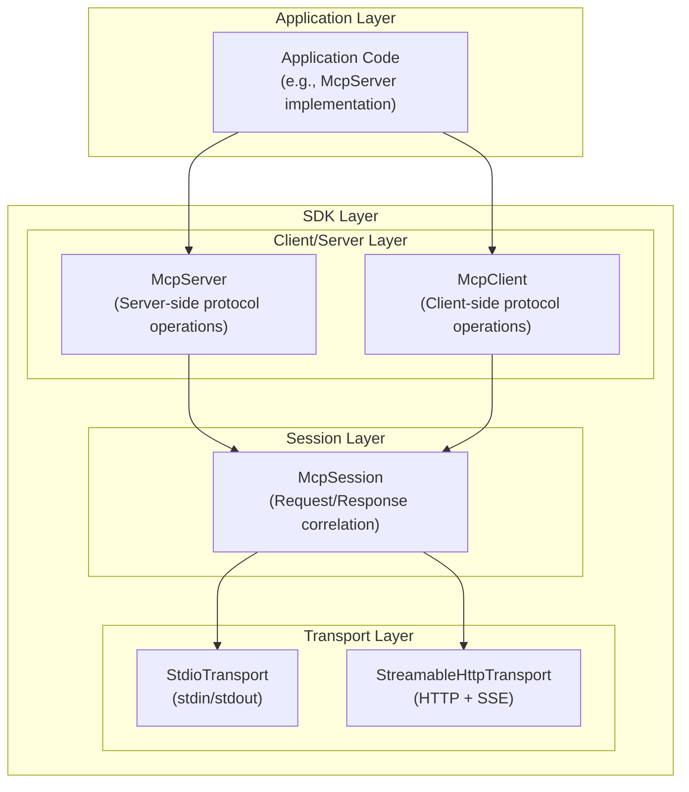
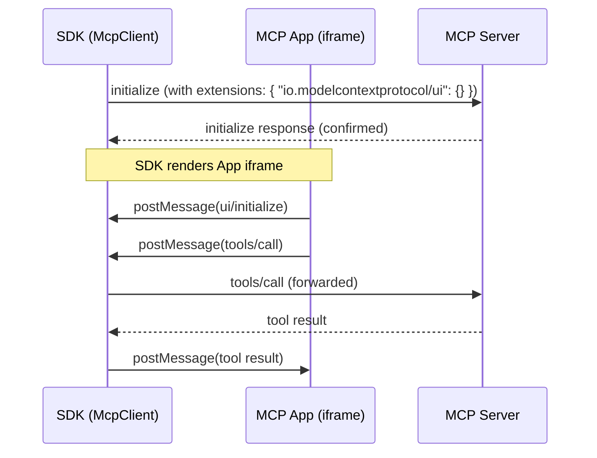

<!-- source: DeepWiki mcp.deepwiki.com · repo modelcontextprotocol/modelcontextprotocol · page 6 SDK Ecosystem · fetched 2026-10-21 -->

# SDK Ecosystem

Relevant source files

The following files were used as context for generating this wiki page:

- [blog/content/posts/2026-01-26-mcp-apps.md](blog/content/posts/2026-01-26-mcp-apps.md)
- [blog/content/posts/2026-06-29-sdk-betas-for-2026-07-28.md](blog/content/posts/2026-06-29-sdk-betas-for-2026-07-28.md)
- [blog/static/posts/images/sdk-betas/stack.svg](blog/static/posts/images/sdk-betas/stack.svg)
- [docs/community/sdk-tiers.mdx](docs/community/sdk-tiers.mdx)
- [docs/docs/getting-started/intro.mdx](docs/docs/getting-started/intro.mdx)
- [docs/docs/tools/debugging.mdx](docs/docs/tools/debugging.mdx)
- [docs/extensions/apps/build.mdx](docs/extensions/apps/build.mdx)
- [docs/extensions/apps/overview.mdx](docs/extensions/apps/overview.mdx)
- [docs/extensions/auth/oauth-client-credentials.mdx](docs/extensions/auth/oauth-client-credentials.mdx)
- [docs/extensions/auth/overview.mdx](docs/extensions/auth/overview.mdx)
- [docs/extensions/client-matrix.mdx](docs/extensions/client-matrix.mdx)
- [docs/extensions/overview.mdx](docs/extensions/overview.mdx)
- [docs/extensions/tasks/overview.mdx](docs/extensions/tasks/overview.mdx)

## Purpose and Scope

This document describes the MCP SDK ecosystem: the collection of official language-specific SDKs that enable developers to build MCP clients and servers. It covers the tier classification system that establishes quality and maintenance expectations, the available SDKs across 10+ languages, conformance testing mechanisms, and the development guidelines for SDK maintainers.

For details on the specific classification levels, see [SDK Tier System](#6.1). For a catalog of current implementations, see [Available SDKs and Language Support](#6.2). For details on the automated validation process, see [Conformance Testing and Quality Metrics](#6.3).

## Overview

The MCP SDK ecosystem provides standardized implementations of the Model Context Protocol across multiple programming languages. Each SDK enables developers to:

- Create MCP servers that expose tools, resources, and prompts.
- Build MCP clients that connect to any MCP server.
- Support local (stdio) and remote (HTTP/SSE) transport protocols.
- Maintain protocol compliance with type safety.

The ecosystem is organized into three tiers based on feature completeness, maintenance commitment, and documentation quality [docs/community/sdk-tiers.mdx:19-29](). This tiering system helps developers choose the right SDK for their needs and provides SDK maintainers with a clear path to improving adoption expectations.

## SDK Tier System

The MCP SDK Tiering System establishes clear expectations for feature completeness and maintenance commitments [docs/community/sdk-tiers.mdx:6-17]().

- **Tier 1: Fully Supported**: Complete protocol implementation, including optional capabilities like sampling and elicitation. Requires a 100% conformance pass rate and issue triage within 2 business days [docs/community/sdk-tiers.mdx:33-40]().
- **Tier 2: Commitment to Full Support**: Actively-maintained SDKs working toward full protocol specification support. Requires an 80% conformance pass rate and issue triage within a month [docs/community/sdk-tiers.mdx:33-40]().
- **Tier 3: Experimental**: Partially implemented, specialized, or experimental SDKs with no minimum conformance or triage requirements [docs/community/sdk-tiers.mdx:26-27](), [docs/community/sdk-tiers.mdx:33-40]().

For details, see [SDK Tier System](#6.1).

Sources: [docs/community/sdk-tiers.mdx:1-43]()

## Conformance Testing

All SDKs are evaluated using automated conformance tests that validate protocol support against the published specifications [docs/community/sdk-tiers.mdx:61-63]().

### Conformance Scoring
Scores are calculated against **applicable required tests** only, excluding experimental features, pending tests, legacy backward-compatibility tests, or disputed scenarios [docs/community/sdk-tiers.mdx:69-75]().

### Tier Advancement and Relegation
Maintainers can request advancement by self-assessing against requirements and passing automated tests reviewed by the SDK Working Group [docs/community/sdk-tiers.mdx:83-90](). Conversely, an SDK may be relegated if tests fail continuously for 4 weeks on the latest stable release (e.g., Tier 1 to Tier 2 if any test fails) [docs/community/sdk-tiers.mdx:94-99]().

For details, see [Conformance Testing and Quality Metrics](#6.3).

Sources: [docs/community/sdk-tiers.mdx:59-101]()

## Available SDKs and Language Support

The ecosystem currently includes SDKs for TypeScript, Python, Java, C#, Go, Kotlin, Swift, Rust, Ruby, and PHP.

### The 2026-07-28 Specification Update
In June 2026, beta releases for the Tier 1 SDKs (TypeScript, Python, Go, and C#) were launched to support the "stateless core" of the 2026-07-28 specification [blog/content/posts/2026-06-29-sdk-betas-for-2026-07-28.md:31-38](). These updates include support for:
- **Stateless Core**: Every request is self-describing; capabilities come from `server/discover` [blog/content/posts/2026-06-29-sdk-betas-for-2026-07-28.md:88-92]().
- **Multi Round-Trip Requests (MRTR)**: Tools returning `InputRequiredResult` for mid-call user interaction [blog/content/posts/2026-06-29-sdk-betas-for-2026-07-28.md:93-97]().
- **Routable Headers**: `Mcp-Method` and `Mcp-Name` on every request for gateway and rate limiter routing [blog/content/posts/2026-06-29-sdk-betas-for-2026-07-28.md:98-102]().

For details, see [Available SDKs and Language Support](#6.2).

Sources: [blog/content/posts/2026-06-29-sdk-betas-for-2026-07-28.md:1-125]()

## SDK Architecture and Components

All official SDKs follow a consistent layered architecture that bridges high-level application logic with the low-level JSON-RPC protocol.

### Layered Architecture

**Diagram: SDK Layered Architecture bridging Code Entities**

Sources: [blog/static/posts/images/sdk-betas/stack.svg:1-70](), [docs/extensions/apps/overview.mdx:77-96]()

### Core Components
1. **Client/Server Classes**: The primary entry points for developers, such as `McpServer` in TypeScript or `FastMCP` in Python [blog/content/posts/2026-06-29-sdk-betas-for-2026-07-28.md:31-38](), [docs/extensions/apps/build.mdx:12-13]().
2. **Transports**: Standardized handlers for `stdio` (stdin/stdout) and `Streamable HTTP` (SSE) [blog/content/posts/2026-06-29-sdk-betas-for-2026-07-28.md:63-68](), [docs/docs/tools/debugging.mdx:31-49]().
3. **Extension Support**: Mechanisms to opt-in to optional features like `io.modelcontextprotocol/ui` (MCP Apps) or `io.modelcontextprotocol/tasks` [docs/extensions/overview.mdx:114-117]().

## Extension Ecosystem

SDKs provide the foundation for official MCP extensions. These are optional and require explicit opt-in via the `extensions` field during the `initialize` handshake or `server/discover` [docs/extensions/overview.mdx:114-117]().

| Extension | Identifier | SDK Role |
| :--- | :--- | :--- |
| **MCP Apps** | `io.modelcontextprotocol/ui` | Provides the `App` class for UI-to-host communication over `postMessage` [blog/content/posts/2026-01-26-mcp-apps.md:103-112](). |
| **Tasks** | `io.modelcontextprotocol/tasks` | Handles `CreateTaskResult` (identified by `resultType: "task"`) and polling via `tasks/get` [docs/extensions/tasks/overview.mdx:50-62](). |
| **OAuth** | `io.modelcontextprotocol/oauth-client-credentials` | Supplementary auth for machine-to-machine scenarios [docs/extensions/auth/overview.mdx:33-39](). |

### Extension Interaction Flow

**Diagram: SDK Extension Negotiation and UI Communication**

Sources: [docs/extensions/apps/overview.mdx:77-96](), [blog/content/posts/2026-01-26-mcp-apps.md:103-129](), [docs/extensions/overview.mdx:114-117]()

## Issue Triage and Quality Metrics

To maintain Tier 1 and Tier 2 status, SDK repositories must use standardized labels to track triage and resolution metrics [docs/community/sdk-tiers.mdx:104-107]().

### Priority Definitions
- **P0 (Critical)**: Security vulnerabilities (CVSS ≥ 7.0), data corruption, or core functionality failures (e.g., transport connection failure) [docs/community/sdk-tiers.mdx:134-142]().
- **P1-P3**: Significant bugs with workarounds, moderate issues, and "nice-to-have" enhancements respectively [docs/community/sdk-tiers.mdx:128-132]().

### Response Requirements
Tier 1 SDKs must triage issues within 2 business days and resolve P0 bugs within 7 days [docs/community/sdk-tiers.mdx:33-38]().

Sources: [docs/community/sdk-tiers.mdx:102-142]()

---

