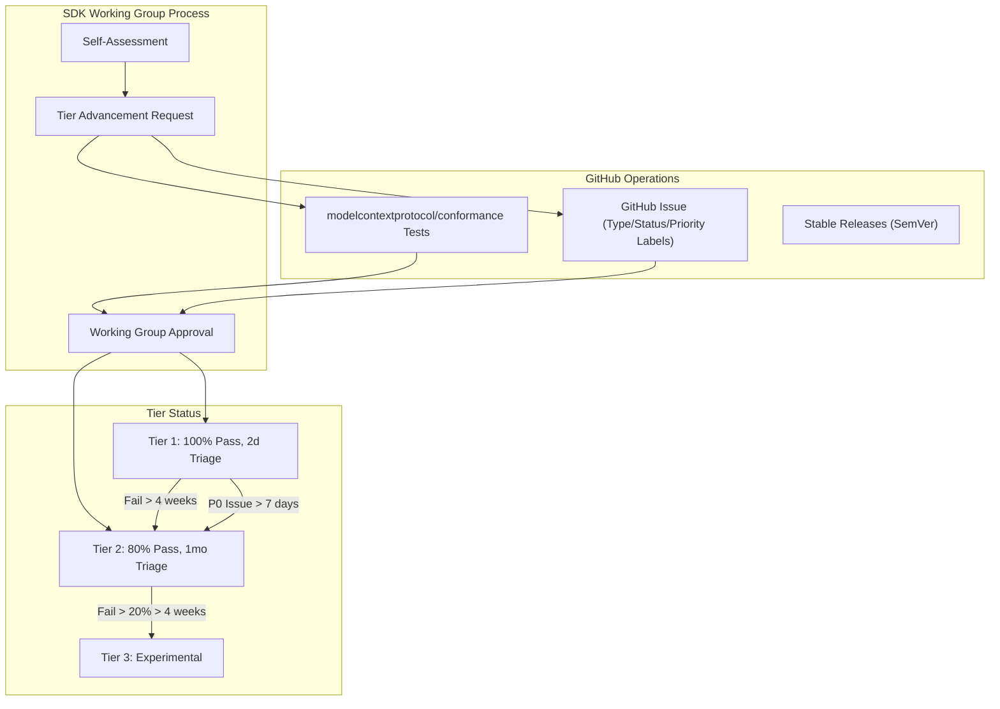
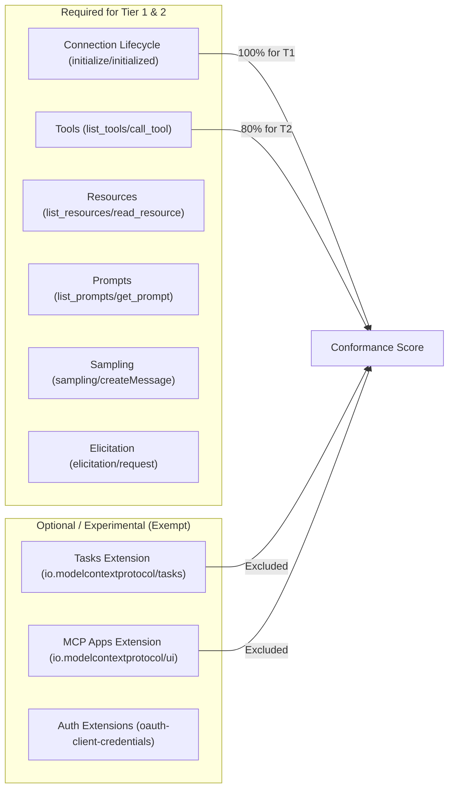

<!-- source: DeepWiki mcp.deepwiki.com · repo modelcontextprotocol/modelcontextprotocol · page 6.1 SDK Tier System · fetched 2026-10-21 -->

# SDK Tier System

Relevant source files

The following files were used as context for generating this wiki page:

- [blog/content/posts/2026-01-26-mcp-apps.md](blog/content/posts/2026-01-26-mcp-apps.md)
- [docs/community/sdk-tiers.mdx](docs/community/sdk-tiers.mdx)
- [docs/docs/getting-started/intro.mdx](docs/docs/getting-started/intro.mdx)
- [docs/docs/tools/debugging.mdx](docs/docs/tools/debugging.mdx)
- [docs/extensions/apps/build.mdx](docs/extensions/apps/build.mdx)
- [docs/extensions/apps/overview.mdx](docs/extensions/apps/overview.mdx)
- [docs/extensions/auth/oauth-client-credentials.mdx](docs/extensions/auth/oauth-client-credentials.mdx)
- [docs/extensions/auth/overview.mdx](docs/extensions/auth/overview.mdx)
- [docs/extensions/client-matrix.mdx](docs/extensions/client-matrix.mdx)
- [docs/extensions/overview.mdx](docs/extensions/overview.mdx)
- [docs/extensions/tasks/overview.mdx](docs/extensions/tasks/overview.mdx)

## Purpose and Scope

This document explains the MCP SDK Tier System, which classifies official SDKs into three tiers based on feature completeness, protocol support, and maintenance commitments. The tier system provides clear expectations for SDK users and maintainers, establishes advancement criteria, and defines quality metrics through conformance testing.

For information about available SDKs and their current tier assignments, see [Available SDKs and Language Support](#6.2). For details on conformance testing methodology and quality metrics, see [Conformance Testing and Quality Metrics](#6.3).

## Overview

The SDK Tier System establishes three classification levels that reflect the maturity and completeness of MCP implementations across different programming languages:

- **Tier 1**: Fully supported SDKs with complete protocol implementation, including all non-experimental features and optional capabilities like sampling and elicitation.
- **Tier 2**: Actively-maintained SDKs working toward full protocol specification support.
- **Tier 3**: Experimental, partially implemented, or specialized SDKs.

Experimental features (such as Tasks) and protocol extensions (such as MCP Apps) are not required for any tier.

Sources: [docs/community/sdk-tiers.mdx:19-29]()

## Tier Requirements

The following table defines the specific requirements for each tier across multiple dimensions:

| Requirement | Tier 1: Fully Supported | Tier 2: Commitment to Full Support | Tier 3: Experimental |
| :--- | :--- | :--- | :--- |
| **Conformance Tests** | 100% pass rate | 80% pass rate | No minimum |
| **New Protocol Features** | Before new spec version release, timeline agreed per release based on feature complexity | Within 6 months | No timeline commitment |
| **Issue Triage** | Within 2 business days | Within a month | No requirement |
| **Critical Bug Resolution** | Within 7 days | Within two weeks | No requirement |
| **Stable Release** | Required with clear versioning | At least one stable release | Not required |
| **Documentation** | Comprehensive with examples for all features | Basic documentation covering core features | No minimum |
| **Dependency Policy** | Published update policy | Published update policy | Not required |
| **Roadmap** | Published roadmap | Published plan toward Tier 1 or explanation for remaining Tier 2 | Not required |

### Key Definitions

**Issue Triage** means labeling and determining whether an issue is valid (e.g., using `bug`, `enhancement`, or `question` labels), not necessarily resolving the issue itself. [docs/community/sdk-tiers.mdx:44-44](), [docs/community/sdk-tiers.mdx:108-115]()

**Critical Bug** refers to P0 issues, which are defined as:
- **Security vulnerabilities** with CVSS score ≥ 7.0 (High or Critical severity). [docs/community/sdk-tiers.mdx:143-144]()
- **Core functionality failures** that prevent basic MCP operations: connection establishment, message exchange, or use of core primitives (tools, resources, prompts). [docs/community/sdk-tiers.mdx:145-147]()

**Stable Release** is a published version explicitly marked as production-ready (e.g., version `1.0.0` or higher without pre-release identifiers like `-alpha`, `-beta`, or `-rc`). [docs/community/sdk-tiers.mdx:49-50]()

**Clear Versioning** means following idiomatic versioning patterns with documented breaking change policies. [docs/community/sdk-tiers.mdx:52-53]()

**Roadmap** outlines concrete steps and work items that track implementation of required MCP specification components. [docs/community/sdk-tiers.mdx:55-57]()

Sources: [docs/community/sdk-tiers.mdx:31-57](), [docs/community/sdk-tiers.mdx:143-147]()

## Conformance Testing

All SDKs are evaluated using [automated conformance tests](https://github.com/modelcontextprotocol/conformance) that validate protocol support against published specifications.

### Conformance Scoring

SDKs receive a conformance score based on test results:
- **Tier 1**: 100% conformance required. [docs/community/sdk-tiers.mdx:65-65]()
- **Tier 2**: 80% conformance required. [docs/community/sdk-tiers.mdx:66-66]()
- **Tier 3**: No minimum requirement. [docs/community/sdk-tiers.mdx:67-67]()

Conformance scores are calculated against **applicable required tests** only, excluding tests for experimental features, pending/skipped tests, and disputed tests. [docs/community/sdk-tiers.mdx:69-76]()

Sources: [docs/community/sdk-tiers.mdx:59-78]()

## Tier Advancement

SDK maintainers can request tier advancement by following this process:

1. **Self-assess** against tier requirements.
2. **Open an issue** in the `modelcontextprotocol/modelcontextprotocol` repository with supporting evidence.
3. **Pass automated conformance testing** with the required pass rate for the target tier.
4. **Receive approval** from SDK Working Group maintainers.

Sources: [docs/community/sdk-tiers.mdx:81-90]()

## Tier Relegation

An SDK may be moved to a lower tier if existing conformance tests on the latest stable release fail continuously for 4 weeks:

- **Tier 1 → Tier 2**: Any conformance test fails. [docs/community/sdk-tiers.mdx:97-97]()
- **Tier 2 → Tier 3**: More than 20% of conformance tests fail. [docs/community/sdk-tiers.mdx:98-98]()

An SDK may also be relegated if issues remain unaddressed for two months. [docs/community/sdk-tiers.mdx:100-100]()

Sources: [docs/community/sdk-tiers.mdx:92-101]()

## Issue Triage Labels

SDK repositories must use consistent labels to enable automated reporting on issue handling metrics.

### Status Labels (pick one)

| Label | Description |
| :--- | :--- |
| `needs confirmation` | Unclear if still relevant. |
| `needs repro` | Insufficient information to reproduce. |
| `ready for work` | Has enough information to start. |
| `good first issue` | Good for newcomers. |
| `help wanted` | Contributions welcome from those familiar with codebase. |

### Priority Labels (only if actionable)

| Label | Description |
| :--- | :--- |
| `P0` | Critical: core functionality failures or high-severity security. |
| `P1` | Significant bug affecting many users. |
| `P2` | Moderate issues, valuable feature requests. |
| `P3` | Nice to haves, rare edge cases. |

Sources: [docs/community/sdk-tiers.mdx:119-142]()

## SDK Advancement and Maintenance Flow

The following diagram bridges the Natural Language requirements for tiers to the operational entities in the codebase and GitHub ecosystem.

Sources: [docs/community/sdk-tiers.mdx:31-42](), [docs/community/sdk-tiers.mdx:81-101]()

## Protocol Conformance Mapping

This diagram maps specific protocol entities and extensions to the conformance requirements of the Tier system.

Sources: [docs/community/sdk-tiers.mdx:23-29](), [docs/community/sdk-tiers.mdx:69-76](), [docs/extensions/tasks/overview.mdx:50-52](), [docs/extensions/apps/overview.mdx:53-56]()

## Tier System Timeline

- **January 23, 2026**: Conformance tests available. [docs/community/sdk-tiers.mdx:10-10]()
- **February 23, 2026**: Official SDK tiering published. [docs/community/sdk-tiers.mdx:11-11]()

Sources: [docs/community/sdk-tiers.mdx:8-17]()

---

