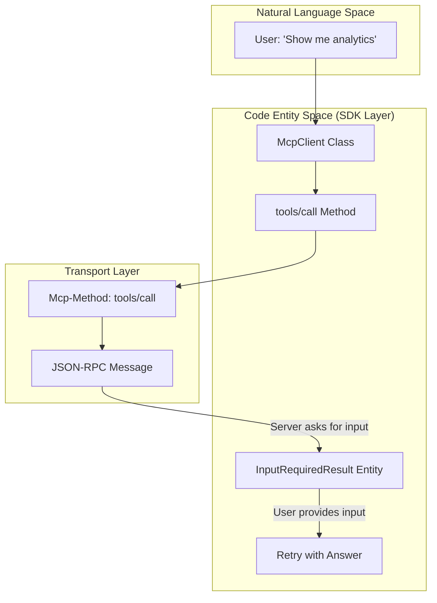
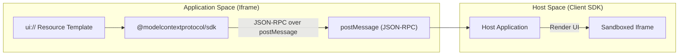

<!-- source: DeepWiki mcp.deepwiki.com · repo modelcontextprotocol/modelcontextprotocol · page 6.2 Available SDKs and Language Support · fetched 2026-10-21 -->

# Available SDKs and Language Support

Relevant source files

The following files were used as context for generating this wiki page:

- [blog/archetypes/default.md](blog/archetypes/default.md)
- [blog/content/posts/2025-07-29-prompts-for-automation.md](blog/content/posts/2025-07-29-prompts-for-automation.md)
- [blog/content/posts/2025-07-31-governance-for-mcp.md](blog/content/posts/2025-07-31-governance-for-mcp.md)
- [blog/content/posts/2025-09-05-php-sdk.md](blog/content/posts/2025-09-05-php-sdk.md)
- [blog/content/posts/2025-09-08-mcp-registry-preview.md](blog/content/posts/2025-09-08-mcp-registry-preview.md)
- [blog/content/posts/2025-09-26-mcp-next-version-update.md](blog/content/posts/2025-09-26-mcp-next-version-update.md)
- [blog/content/posts/2025-11-03-using-server-instructions.md](blog/content/posts/2025-11-03-using-server-instructions.md)
- [blog/content/posts/2025-11-20-adopting-mcpb.md](blog/content/posts/2025-11-20-adopting-mcpb.md)
- [blog/content/posts/2025-11-21-mcp-apps.md](blog/content/posts/2025-11-21-mcp-apps.md)
- [blog/content/posts/2025-11-25-first-mcp-anniversary.md](blog/content/posts/2025-11-25-first-mcp-anniversary.md)
- [blog/content/posts/2025-11-28-sep-process-update.md](blog/content/posts/2025-11-28-sep-process-update.md)
- [blog/content/posts/2026-06-29-sdk-betas-for-2026-07-28.md](blog/content/posts/2026-06-29-sdk-betas-for-2026-07-28.md)
- [blog/content/posts/welcome-to-mcp-blog.md](blog/content/posts/welcome-to-mcp-blog.md)
- [blog/static/posts/images/sdk-betas/stack.svg](blog/static/posts/images/sdk-betas/stack.svg)

## Purpose and Scope

This page catalogs the official Model Context Protocol (MCP) SDKs across multiple programming languages, their tier classifications, and documentation links. It highlights the SDK beta releases supporting the **2026-07-28 specification** release candidate, which introduces a stateless architecture and Multi Round-Trip Requests (MRTR).

## SDK Overview

The MCP ecosystem provides official SDKs in 10 programming languages. As of June 2026, four "Tier 1" SDKs have released beta versions to support the major protocol revision scheduled for July 28, 2026 [blog/content/posts/2026-06-29-sdk-betas-for-2026-07-28.md:1-38]().

| Language | Repository | Tier Status | 2026-07-28 Beta |
| :--- | :--- | :--- | :--- |
| **TypeScript** | [modelcontextprotocol/typescript-sdk](https://github.com/modelcontextprotocol/typescript-sdk) | Tier 1 | v2.0.0-beta [blog/content/posts/2026-06-29-sdk-betas-for-2026-07-28.md:31-34]() |
| **Python** | [modelcontextprotocol/python-sdk](https://github.com/modelcontextprotocol/python-sdk) | Tier 1 | v2.0.0-beta [blog/content/posts/2026-06-29-sdk-betas-for-2026-07-28.md:31-34]() |
| **Go** | [modelcontextprotocol/go-sdk](https://github.com/modelcontextprotocol/go-sdk) | Tier 1 | Available [blog/content/posts/2026-06-29-sdk-betas-for-2026-07-28.md:35-36]() |
| **C#** | [modelcontextprotocol/csharp-sdk](https://github.com/modelcontextprotocol/csharp-sdk) | Tier 1 | Available [blog/content/posts/2026-06-29-sdk-betas-for-2026-07-28.md:35-36]() |
| **Java** | [modelcontextprotocol/java-sdk](https://github.com/modelcontextprotocol/java-sdk) | Tier 2 | TBD |
| **PHP** | [modelcontextprotocol/php-sdk](https://github.com/modelcontextprotocol/php-sdk) | Tier 3 | Supported [blog/content/posts/2025-09-05-php-sdk.md:14-20]() |
| **Kotlin** | [modelcontextprotocol/kotlin-sdk](https://github.com/modelcontextprotocol/kotlin-sdk) | Tier 3 | TBD |
| **Swift** | [modelcontextprotocol/swift-sdk](https://github.com/modelcontextprotocol/swift-sdk) | Tier 3 | TBD [blog/content/posts/2025-09-26-mcp-next-version-update.md:92-92]() |
| **Rust** | [modelcontextprotocol/rust-sdk](https://github.com/modelcontextprotocol/rust-sdk) | Tier 3 | TBD |
| **Ruby** | [modelcontextprotocol/ruby-sdk](https://github.com/modelcontextprotocol/ruby-sdk) | Tier 3 | TBD |

Sources: [blog/content/posts/2026-06-29-sdk-betas-for-2026-07-28.md:31-38](), [blog/content/posts/2025-09-05-php-sdk.md:14-20](), [blog/content/posts/2025-09-26-mcp-next-version-update.md:89-94]()

## Tier 1 SDKs and the 2026-07-28 Spec

The Tier 1 SDKs (TypeScript, Python, Go, C#) are the first to implement the core changes from the 2026-07-28 release candidate [blog/content/posts/2026-06-29-sdk-betas-for-2026-07-28.md:81-83]().

### Key 2026-07-28 Features Supported
*   **Stateless Core**: Removal of the `initialize` handshake; every request is self-describing via `server/discover` [blog/content/posts/2026-06-29-sdk-betas-for-2026-07-28.md:88-92]().
*   **Multi Round-Trip Requests (MRTR)**: Support for `InputRequiredResult`, allowing tools to pause for user input mid-call [blog/content/posts/2026-06-29-sdk-betas-for-2026-07-28.md:93-97]().
*   **Routable Headers**: Inclusion of `Mcp-Method` and `Mcp-Name` in transport headers for gateway routing [blog/content/posts/2026-06-29-sdk-betas-for-2026-07-28.md:98-102]().
*   **Authorization Hardening**: Implementation of `iss` validation (RFC 9207) and `application_type` for Dynamic Client Registration (DCR) [blog/content/posts/2026-06-29-sdk-betas-for-2026-07-28.md:103-111]().
*   **Standard Error Codes**: Transition to standard JSON-RPC error codes (e.g., `-32602` for missing resources) [blog/content/posts/2026-06-29-sdk-betas-for-2026-07-28.md:115-119]().

### Migration and Interoperability
Upgrading to the v2 SDKs is an opt-in breaking change [blog/content/posts/2026-06-29-sdk-betas-for-2026-07-28.md:53-55](). New clients speaking the 2026-07-28 protocol are designed to fall back to the `initialize` handshake when connecting to legacy servers (2025-11-25 or earlier) [blog/content/posts/2026-06-29-sdk-betas-for-2026-07-28.md:69-71]().

## Extension Support

Official extensions allow servers to provide interactive UIs and advanced automation.

| Extension | Identifier | Status |
| :--- | :--- | :--- |
| **MCP Apps** | `ui://` | Proposed in SEP-1865 for interactive UIs via iframes [blog/content/posts/2025-11-21-mcp-apps.md:22-28]() |
| **Server Instructions** | `initializeResult.instructions` | Injected into system prompts to guide LLM tool usage [blog/content/posts/2025-11-03-using-server-instructions.md:47-48]() |
| **MCP Bundles** | `.mcpb` | Standardized format for portable local server distribution [blog/content/posts/2025-11-20-adopting-mcpb.md:15-19]() |

Sources: [blog/content/posts/2025-11-21-mcp-apps.md:54-64](), [blog/content/posts/2025-11-03-using-server-instructions.md:47-48](), [blog/content/posts/2025-11-20-adopting-mcpb.md:21-30]()

## SDK Architecture: Bridging Space

The following diagrams illustrate how the SDKs bridge high-level application logic with low-level protocol entities.

### From Natural Language to Tool Execution (MRTR Pattern)

Sources: [blog/content/posts/2026-06-29-sdk-betas-for-2026-07-28.md:93-102](), [blog/content/posts/2025-11-03-using-server-instructions.md:77-80]()

### MCP Apps: UI-to-Host Communication

Sources: [blog/content/posts/2025-11-21-mcp-apps.md:84-91](), [blog/content/posts/2025-11-21-mcp-apps.md:105-112]()

## SDK-Specific Technical Details

### TypeScript (Reference)
The TypeScript SDK remains the primary reference.
*   **Version 2 Beta**: Introduces stateless transport wiring [blog/content/posts/2026-06-29-sdk-betas-for-2026-07-28.md:63-65]().
*   **UI Support**: Developers can use the standard SDK to build UI components communicating via `postMessage` [blog/content/posts/2025-11-21-mcp-apps.md:86-88]().

### Python
*   **Version 2 Beta**: A single endpoint can answer both `2026-07-28` and legacy protocol revisions [blog/content/posts/2026-06-29-sdk-betas-for-2026-07-28.md:65-68]().
*   **Package Management**: Users are encouraged to pin `mcp>=1.27,<2` for stable workloads [blog/content/posts/2026-06-29-sdk-betas-for-2026-07-28.md:75-77]().

### PHP
*   **Announcement**: Released Sept 2025 in collaboration with the PHP Foundation and Symfony [blog/content/posts/2025-09-05-php-sdk.md:1-12]().
*   **Capabilities**: Supports exposing tools, prompts, and resources [blog/content/posts/2025-09-05-php-sdk.md:16-18]().

### C#
*   **Stateless Default**: The C# preview's HTTP transport defaults to the new stateless mode [blog/content/posts/2026-06-29-sdk-betas-for-2026-07-28.md:67-68]().

Sources: [blog/content/posts/2026-06-29-sdk-betas-for-2026-07-28.md:1-125](), [blog/content/posts/2025-11-21-mcp-apps.md:84-91](), [blog/content/posts/2025-09-05-php-sdk.md:1-36]()

---

