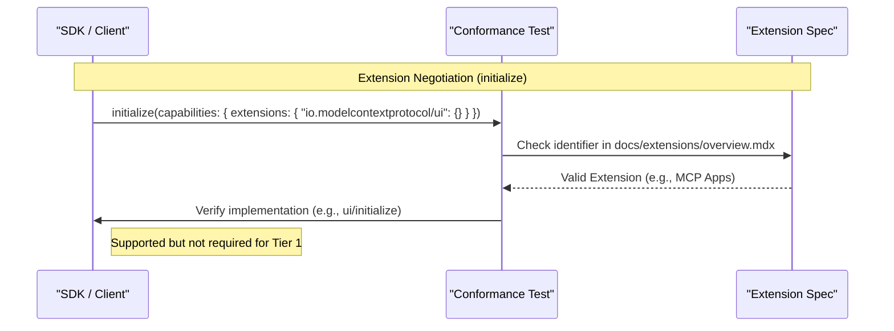

<!-- source: DeepWiki mcp.deepwiki.com · repo modelcontextprotocol/modelcontextprotocol · page 6.3 Conformance Testing and Quality Metrics · fetched 2026-10-21 -->

# Conformance Testing and Quality Metrics

<details>
<summary>Relevant source files</summary>

The following files were used as context for generating this wiki page:

- [blog/content/posts/2026-01-26-mcp-apps.md](blog/content/posts/2026-01-26-mcp-apps.md)
- [docs/community/sdk-tiers.mdx](docs/community/sdk-tiers.mdx)
- [docs/docs/getting-started/intro.mdx](docs/docs/getting-started/intro.mdx)
- [docs/docs/tools/debugging.mdx](docs/docs/tools/debugging.mdx)
- [docs/extensions/apps/build.mdx](docs/extensions/apps/build.mdx)
- [docs/extensions/apps/overview.mdx](docs/extensions/apps/overview.mdx)
- [docs/extensions/auth/oauth-client-credentials.mdx](docs/extensions/auth/oauth-client-credentials.mdx)
- [docs/extensions/auth/overview.mdx](docs/extensions/auth/overview.mdx)
- [docs/extensions/client-matrix.mdx](docs/extensions/client-matrix.mdx)
- [docs/extensions/overview.mdx](docs/extensions/overview.mdx)
- [docs/extensions/tasks/overview.mdx](docs/extensions/tasks/overview.mdx)

</details>


## Purpose and Scope

This page documents the conformance testing framework used to evaluate Model Context Protocol (MCP) SDK implementations against the protocol specification. It covers the automated test suite, pass rate requirements for SDK tier classification, issue triage labeling standards, and quality metrics used to assess SDK maintenance and feature completeness.

For information about the SDK tier system itself and advancement/relegation criteria, see [SDK Tier System](6.1). For details on available SDKs and their current tier status, see [Available SDKs and Language Support](6.2).

## Overview

Conformance testing is the primary mechanism for objectively measuring whether an SDK correctly implements the MCP protocol. The test suite validates protocol compliance by running standardized scenarios and checking message exchanges against the specification. SDKs receive a conformance score based on test results, which directly influences tier classification and maintenance expectations.

**Key principles:**

- Tests are specification-driven and version-specific [docs/community/sdk-tiers.mdx:69-71]().
- Scores exclude experimental features and pending tests [docs/community/sdk-tiers.mdx:72-75]().
- Tier requirements: Tier 1 requires 100% pass rate, Tier 2 requires 80% [docs/community/sdk-tiers.mdx:33-35]().
- Conformance testing is automated and reproducible across all SDKs [docs/community/sdk-tiers.mdx:61-63]().

Sources: [docs/community/sdk-tiers.mdx:59-78]()

## Conformance Test Suite

### Test Repository and Structure

The conformance test suite is maintained in the `modelcontextprotocol/conformance` repository [docs/community/sdk-tiers.mdx:61-62](). Tests are organized by protocol version and feature area, allowing SDKs to target specific specification versions while maintaining backward compatibility validation.

**Test organization:**
- Tests grouped by specification version [docs/community/sdk-tiers.mdx:71]().
- Feature-specific test suites (core protocol, tools, resources, prompts, sampling, etc.).
- Markers for test status: `pending`, `skipped`, `experimental` [docs/community/sdk-tiers.mdx:72-73]().
- Legacy backward-compatibility tests (optional for SDKs claiming legacy support) [docs/community/sdk-tiers.mdx:74]().

### Applicable Test Calculation

Conformance scores are calculated against **applicable required tests only**, excluding:
- Tests for specification versions the SDK does not target [docs/community/sdk-tiers.mdx:71]().
- Tests marked as `pending` or `skipped` [docs/community/sdk-tiers.mdx:72]().
- Tests for experimental features such as **Tasks** or **MCP Apps** [docs/community/sdk-tiers.mdx:28-29](), [docs/community/sdk-tiers.mdx:73]().
- Legacy backward-compatibility tests (unless the SDK explicitly claims legacy support) [docs/community/sdk-tiers.mdx:74]().
- Tests labeled `disputed` in the conformance repository until resolved [docs/community/sdk-tiers.mdx:75]().

Sources: [docs/community/sdk-tiers.mdx:69-75]()

## Pass Rate Requirements by Tier

| Requirement | Tier 1: Fully Supported | Tier 2: Commitment to Full Support | Tier 3: Experimental |
| :--- | :--- | :--- | :--- |
| **Conformance Tests** | 100% pass rate | 80% pass rate | No minimum |
| **New Protocol Features** | Before new spec version release | Within 6 months | No timeline commitment |
| **Issue Triage** | Within 2 business days | Within a month | No requirement |
| **Critical Bug Resolution** | Within 7 days | Within two weeks | No requirement |
| **Stable Release** | Required with clear versioning | At least one stable release | Not required |
| **Documentation** | Comprehensive with examples | Basic documentation | No minimum |

Sources: [docs/community/sdk-tiers.mdx:33-42]()

## Issue Triage Labels

SDK repositories must use consistent labels to enable automated reporting on issue handling metrics [docs/community/sdk-tiers.mdx:102-104](). These labels track triage response times (creation to first label) and critical bug resolution times (P0 label to close) [docs/community/sdk-tiers.mdx:105-107]().

### Type Labels (pick one)

| Label | Description |
| :--- | :--- |
| `bug` | Something isn't working |
| `enhancement` | Request for new feature |
| `question` | Further information requested |

Repositories using GitHub's native issue types satisfy this requirement without needing explicit type labels [docs/community/sdk-tiers.mdx:116-117]().

### Status Labels (pick one)

These labels must use exact names across all repositories to enable consistent automated reporting [docs/community/sdk-tiers.mdx:121-122]().

| Label | Description |
| :--- | :--- |
| `needs confirmation` | Unclear if still relevant |
| `needs repro` | Insufficient information to reproduce |
| `ready for work` | Has enough information to start |
| `good first issue` | Good for newcomers |
| `help wanted` | Contributions welcome from those familiar with codebase |

### Priority Labels (only if actionable)

| Label | Description |
| :--- | :--- |
| `P0` | Critical: core functionality failures or high-severity security |
| `P1` | Significant bug affecting many users |
| `P2` | Moderate issues, valuable feature requests |
| `P3` | Nice to haves, rare edge cases |

**P0 (Critical) issues** are defined as:
- **Security vulnerabilities** with CVSS score ≥ 7.0 (High or Critical severity).
- **Core functionality failures** that prevent basic MCP operations: connection establishment, message exchange, or use of core primitives (tools, resources, prompts).

Sources: [docs/community/sdk-tiers.mdx:102-142]()

## Tier Advancement and Relegation

### Advancement Process
SDK maintainers can request tier advancement by:
1. Self-assessing against tier requirements [docs/community/sdk-tiers.mdx:85]().
2. Opening an issue in the `modelcontextprotocol/modelcontextprotocol` repository with supporting evidence [docs/community/sdk-tiers.mdx:86]().
3. Passing automated conformance testing [docs/community/sdk-tiers.mdx:87]().
4. Receiving approval from SDK Working Group maintainers [docs/community/sdk-tiers.mdx:88]().

### Relegation Criteria
An SDK may be moved to a lower tier if existing conformance tests on the latest stable release fail continuously for 4 weeks [docs/community/sdk-tiers.mdx:94-95]():
- **Tier 1 → Tier 2**: Any conformance test fails [docs/community/sdk-tiers.mdx:97]().
- **Tier 2 → Tier 3**: More than 20% of conformance tests fail [docs/community/sdk-tiers.mdx:98]().
- Relegation may also occur if issues remain unaddressed for two months [docs/community/sdk-tiers.mdx:100]().

Sources: [docs/community/sdk-tiers.mdx:81-100]()

## Conformance Testing Workflow

The following diagram illustrates how conformance testing integrates with the SDK tier system and quality evaluation.

### Conformance to Tier Evaluation
```mermaid
graph TB
    subgraph "SDK_Source_Code"
        [SDK_Implementation] --> [Feature_Set]
    end
    
    subgraph "Conformance_Suite"
        [modelcontextprotocol/conformance] --> [Test_Runner]
        [Test_Runner] --> [Filter_Applicable_Tests]
    end

    subgraph "Quality_Metrics"
        [Issue_Labels] --> [Triage_Response_Time]
        [P0_Label] --> [Critical_Bug_Resolution_Time]
    end

    [Feature_Set] --> [Test_Runner]
    [Filter_Applicable_Tests] --> [Conformance_Score]
    [Conformance_Score] --> [Tier_Classification]
    [Triage_Response_Time] --> [Tier_Classification]
    [Critical_Bug_Resolution_Time] --> [Tier_Classification]

    subgraph "Tier_Classification"
        direction TB
        [Tier_1_100pct]
        [Tier_2_80pct]
        [Tier_3_No_Min]
    end
```
Sources: [docs/community/sdk-tiers.mdx:33-75]()

## Extension Support and Quality Metrics

While core protocol features are required for conformance, official extensions like **MCP Apps** (`io.modelcontextprotocol/ui`) and **Tasks** (`io.modelcontextprotocol/tasks`) are currently considered opt-in and are not required for any tier [docs/community/sdk-tiers.mdx:28-29](). However, they are tracked via an Extension Support Matrix to help developers evaluate SDK and client capabilities [docs/extensions/client-matrix.mdx:32-34]().

### Extension Negotiation and Verification
Extensions are negotiated during the initialization handshake. A client only uses an extension if both client and server declare support [docs/extensions/client-matrix.mdx:16-17]().


Sources: [docs/extensions/overview.mdx:114-117](), [docs/community/sdk-tiers.mdx:28-29](), [docs/extensions/client-matrix.mdx:16-17]()

### Quality Metrics for SDK Evaluation
Beyond conformance tests, SDKs are evaluated on maintenance health using GitHub labels:
- **Triage Latency**: Measured as time from issue creation to the application of a Status label like `ready for work` [docs/community/sdk-tiers.mdx:105-107]().
- **Resolution Latency**: Specifically for `P0` issues, measuring time to close [docs/community/sdk-tiers.mdx:106-107]().
- **Release Stability**: Verified by checking for stable version strings (e.g., `1.0.0`) without pre-release tags like `-beta` [docs/community/sdk-tiers.mdx:49-50]().

Sources: [docs/community/sdk-tiers.mdx:44-53](), [docs/community/sdk-tiers.mdx:102-107]()

## Related Resources

- [SDK Tier System](6.1) - Detailed tier requirements and advancement process.
- [Available SDKs and Language Support](6.2) - Current SDK catalog and tier status.
- [Protocol Specification](2) - Complete MCP protocol documentation.
- [Contributing to MCP](7.1) - How to contribute to the specification repository.

---

