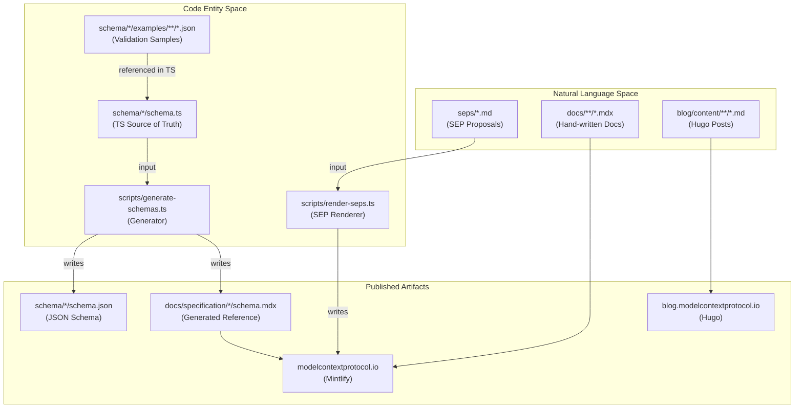
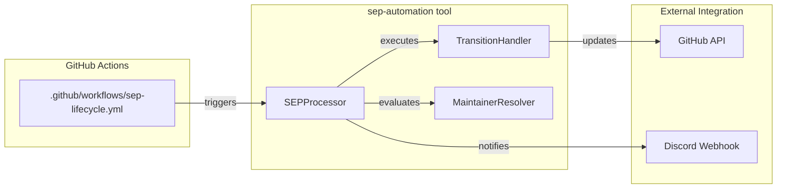

<!-- source: DeepWiki mcp.deepwiki.com · repo modelcontextprotocol/modelcontextprotocol · page 7 Development Guide · fetched 2026-10-21 -->

# Development Guide

Relevant source files

The following files were used as context for generating this wiki page:

- [.gitattributes](.gitattributes)
- [.github/ISSUE_TEMPLATE/bug_report.yml](.github/ISSUE_TEMPLATE/bug_report.yml)
- [.github/ISSUE_TEMPLATE/config.yml](.github/ISSUE_TEMPLATE/config.yml)
- [.github/ISSUE_TEMPLATE/work_tracking.yml](.github/ISSUE_TEMPLATE/work_tracking.yml)
- [.github/dependabot.yml](.github/dependabot.yml)
- [.prototools](.prototools)
- [AGENTS.md](AGENTS.md)
- [CLAUDE.md](CLAUDE.md)
- [CONTRIBUTING.md](CONTRIBUTING.md)
- [README.md](README.md)
- [SECURITY.md](SECURITY.md)
- [docs/community/security.mdx](docs/community/security.mdx)
- [package-lock.json](package-lock.json)
- [package.json](package.json)

This guide provides a comprehensive overview for developers contributing to the Model Context Protocol (MCP) specification repository. It covers environment setup, build orchestration, schema development, and automated maintenance tools.

For detailed information on specific contribution areas:
- **Contributing to MCP**: Prerequisites, repository structure, and AI-assisted contribution policies. See [Contributing to MCP](#7.1).
- **Specification Enhancement Process (SEP)**: Proposing protocol changes and navigating the SEP lifecycle. See [Specification Enhancement Process (SEP)](#7.2).
- **Schema Development and Generation**: Working with the TypeScript source-of-truth and generating JSON schemas. See [Schema Development and Generation](#7.3).
- **Build System and Automation**: npm scripts, CI/CD workflows, and release management. See [Build System and Automation](#7.4).
- **Documentation Generation System**: TypeDoc plugins, Mintlify integration, and the Hugo blog. See [Documentation Generation System](#7.5).
- **SEP Lifecycle Automation Tool**: The `sep-automation` tool for managing GitHub issues and Discord notifications. See [SEP Lifecycle Automation Tool](#7.6).

## Repository Overview

The repository acts as the authoritative source for the MCP specification, housing protocol definitions, documentation, and the blog [README.md:5-9]().

### System Architecture: Source to Artifacts

The following diagram illustrates how source files in the "Natural Language Space" (documentation and SEPs) and "Code Entity Space" (TypeScript schemas) are transformed into published artifacts.

**Source-to-Artifact Pipeline**

Sources: [package.json:23-28](), [CONTRIBUTING.md:42-54](), [README.md:5-17](), [AGENTS.md:58-65]()

## Development Environment

### Prerequisites
- **Node.js**: Version 20 or above is required [package.json:10-12]().
- **Package Manager**: `npm` is used for dependency management and task execution.
- **Tools**: Hugo (for blog development) and Mintlify (for documentation preview) [CONTRIBUTING.md:12-17]().

### Core npm Scripts
The build system is orchestrated via `package.json` scripts.

| Script | Purpose |
|:-------|:--------|
| `npm run generate` | Top-level command to regenerate schemas and SEPs [package.json:24](). |
| `npm run check` | Runs full suite of validation (TS, JSON, Examples, MDX, Links) [package.json:32](). |
| `npm run prep` | Comprehensive script for local development: check, generate, and format [package.json:45](). |
| `npm run serve:docs` | Starts local Mintlify preview for documentation [package.json:43](). |
| `npm run serve:blog` | Starts local Hugo server for the blog [package.json:44](). |

Sources: [package.json:23-46](), [CONTRIBUTING.md:8-17]()

## Build and Automation Workflows

The repository employs several automated workflows to maintain specification integrity and facilitate the release process.

### Automation Tooling: SEP Lifecycle
The `tools/sep-automation` utility (referenced in child page 7.6) manages the state of Specification Enhancement Proposals. It interacts with GitHub to transition SEPs between states and pings maintainers for review.

**SEP Automation Interaction**

Sources: [package.json:28](), [AGENTS.md:77-81]()

### CI/CD Pipelines
Validation is enforced through GitHub Actions to ensure that manual edits to source files are reflected in generated artifacts.

- **Main Validation**: Checks TypeScript definitions, JSON schema consistency, and MDX reference files via `npm run check` [package.json:32]().
- **Merge Handling**: Generated files (`.json`, `.mdx`) use a special merge strategy defined in `.gitattributes` to prevent manual conflict resolution [ .gitattributes:3-10]().
- **Blog Deployment**: Automatically builds and deploys the Hugo site [package.json:44]().

Sources: [package.json:23-46](), [.gitattributes:1-11](), [CONTRIBUTING.md:56-67]()

## Documentation System

The documentation is a hybrid of hand-written MDX and generated API references.

### Schema Reference Generation
TypeScript files are the source of truth for the protocol schema [AGENTS.md:50-55](). The generation pipeline uses `typedoc` to transform `schema.ts` into MDX files suitable for Mintlify [package.json:27]().

- **TypeScript Source**: Located in `schema/[version]/schema.ts` [AGENTS.md:52]().
- **JSON Schema Output**: Generated at `schema/[version]/schema.json` [AGENTS.md:54]().
- **MDX Reference**: Generated at `docs/specification/[version]/schema.mdx` [AGENTS.md:54]().

### Blog System
The blog uses Hugo and is located in the `blog/` directory [CONTRIBUTING.md:92](). It is separate from the main documentation site and can be previewed locally using `npm run serve:blog` [package.json:44]().

Sources: [package.json:23-46](), [CONTRIBUTING.md:90-98](), [AGENTS.md:48-57]()

---

