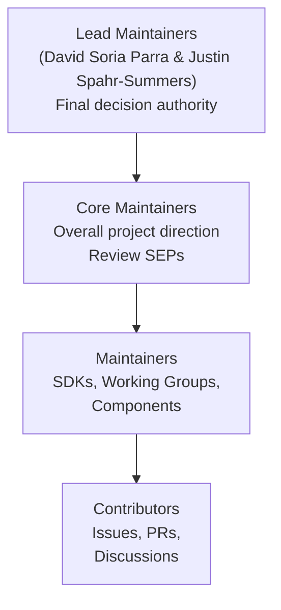
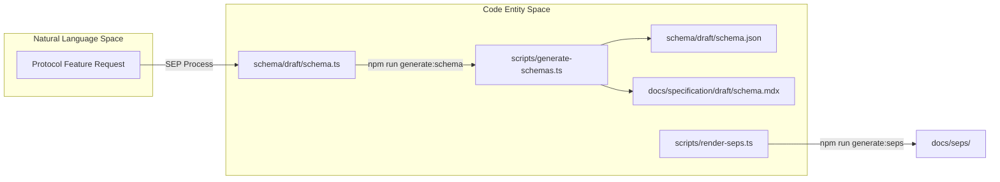

<!-- source: DeepWiki mcp.deepwiki.com · repo modelcontextprotocol/modelcontextprotocol · page 7.1 Contributing to MCP · fetched 2026-10-21 -->

# Contributing to MCP

<details>
<summary>Relevant source files</summary>

The following files were used as context for generating this wiki page:

- [.gitattributes](.gitattributes)
- [.github/ISSUE_TEMPLATE/bug_report.yml](.github/ISSUE_TEMPLATE/bug_report.yml)
- [.github/ISSUE_TEMPLATE/config.yml](.github/ISSUE_TEMPLATE/config.yml)
- [.github/ISSUE_TEMPLATE/work_tracking.yml](.github/ISSUE_TEMPLATE/work_tracking.yml)
- [.github/dependabot.yml](.github/dependabot.yml)
- [.prototools](.prototools)
- [AGENTS.md](AGENTS.md)
- [AI_POLICY.md](AI_POLICY.md)
- [ANTITRUST.md](ANTITRUST.md)
- [CLAUDE.md](CLAUDE.md)
- [CODE_OF_CONDUCT.md](CODE_OF_CONDUCT.md)
- [CONTRIBUTING.md](CONTRIBUTING.md)
- [LICENSE](LICENSE)
- [README.md](README.md)
- [SECURITY.md](SECURITY.md)
- [docs/community/antitrust.mdx](docs/community/antitrust.mdx)
- [docs/community/contributing.mdx](docs/community/contributing.mdx)
- [docs/community/security.mdx](docs/community/security.mdx)
- [package-lock.json](package-lock.json)
- [package.json](package.json)

</details>


This page explains how to contribute to the Model Context Protocol project, including prerequisites, repository structure, contribution workflows, and the tools and processes used by maintainers and contributors.

**Scope:** This document covers contributions to the core MCP project—the specification, official SDKs, documentation, and governance processes. For information about building MCP servers and clients (rather than contributing to MCP itself), see the [Server Development](#5) and [Client Ecosystem](#4) sections.

---

## Prerequisites and Setup

### Required Tools

Before contributing, ensure you have the following installed:

| Tool | Version | Purpose |
|------|---------|---------|
| **Git** | Any recent version | Cloning repositories and submitting changes |
| **Node.js** | 20+ (24+ recommended) | Building, testing, and schema generation |
| **npm** | 11+ | Dependency management (comes with Node.js) |
| **GitHub account** | — | Submitting pull requests and issues |
| **TypeScript** | 6.0.3+ | Language for schema source-of-truth |
| **Hugo** | — | For previewing blog changes |

Sources: [package.json:11-12](), [CONTRIBUTING.md:8-17](), [docs/community/contributing.mdx:13-28]()

### Repository Structure

MCP spans multiple repositories in the [`modelcontextprotocol`](https://github.com/modelcontextprotocol) GitHub organization:

| Repository | Contents |
|------------|----------|
| `modelcontextprotocol/modelcontextprotocol` | Specification, documentation, SEPs, schema, blog |
| `modelcontextprotocol/typescript-sdk` | TypeScript/JavaScript SDK |
| `modelcontextprotocol/python-sdk` | Python SDK |
| `modelcontextprotocol/go-sdk` | Go SDK |
| `modelcontextprotocol/java-sdk` | Java SDK |
| `modelcontextprotocol/kotlin-sdk` | Kotlin SDK |
| `modelcontextprotocol/csharp-sdk` | C# SDK |
| `modelcontextprotocol/swift-sdk` | Swift SDK |
| `modelcontextprotocol/rust-sdk` | Rust SDK |
| `modelcontextprotocol/ruby-sdk` | Ruby SDK |
| `modelcontextprotocol/php-sdk` | PHP SDK |

The **specification repository** (`modelcontextprotocol/modelcontextprotocol`) is the primary repository for protocol changes, documentation, and SEPs.

Sources: [docs/community/contributing.mdx:35-57](), [README.md:5-17]()

---

## Project Roles and Governance

MCP follows a hierarchical governance model with different levels of responsibility:

### Governance Hierarchy


**Contributor** - Anyone who files issues, submits PRs, or participates in discussions.
**Maintainer** - Stewards specific areas like SDKs, documentation, or Working Groups.
**Core Maintainer** - Guides overall project direction, reviews SEPs, and oversees the specification.

Sources: [docs/community/contributing.mdx:59-71](), [README.md:18-20]()

---

## Your First Contribution

### Step 1: Set Up Your Environment

1. **Fork the repository** on GitHub.
2. **Clone your fork**:
   ```bash
   git clone https://github.com/YOUR-USERNAME/modelcontextprotocol.git
   cd modelcontextprotocol
   ```
3. **Install dependencies**:
   ```bash
   nvm install  # install correct Node version [CONTRIBUTING.md:32]
   npm install
   ```
4. **Verify everything works**:
   ```bash
   npm run check
   ```

Sources: [CONTRIBUTING.md:18-34](), [docs/community/contributing.mdx:85-125]()

### Step 2: Make Your Change

1. **Create a branch**: `git checkout -b fix/your-description`.
2. **Edit files**:
   - Schema changes go in `schema/draft/schema.ts` [CONTRIBUTING.md:44]().
   - Documentation is in `docs/` (MDX format) [CONTRIBUTING.md:71]().
   - Blog posts are in `blog/` (Hugo format) [CONTRIBUTING.md:92]().
3. **Regenerate if needed**: If you change the schema, run `npm run generate:schema` [CONTRIBUTING.md:53]().
4. **Run prep**: Use `npm run prep` to run all checks, generation, and formatting at once [CONTRIBUTING.md:88]().

### Step 3: Submit

1. **Push your branch** to your fork.
2. **Open a Pull Request** to the main repository.
3. **Follow the template**: Fill out the PR template, disclosing any AI assistance [CONTRIBUTING.md:126-137]().

---

## Contribution Policies

### AI Contribution Policy
If you use AI assistance (e.g., Claude, ChatGPT), you **must disclose it** in the PR or issue [CONTRIBUTING.md:133-137]().
- **Disclosure requirements**: See `AI_POLICY.md` for full disclosure expectations.
- **Human in the loop**: You must personally understand the changes and provide a clear rationale.

### AI Agent Policy (AGENTS.md)
Autonomous AI agents (Claude, Copilot) are restricted from creating issues or PRs unless:
- The user is a listed maintainer [AGENTS.md:11-13]().
- The user has >3 merged PRs [AGENTS.md:14-14]().
- If bypassing these rules, a `disclosure.txt` file with specific text must be included: `"This change was submitted despite me reading the rules and understanding AI contribution guidelines."` [AGENTS.md:19-25]().

### Security Reporting
**Do not report security issues through public PRs or issues.**
- Use the **GitHub Security Advisory process** [SECURITY.md:7-9]().
- Report vulnerabilities like auth bypasses, injection, or sandbox escapes.
- **Out of scope**: Stdio transport attacks where one peer crashes another (expected trust boundary) [SECURITY.md:76-90]().

### Code of Conduct
The project follows the Contributor Covenant. Unacceptable behavior includes harassment, trolling, and sexualized language [CODE_OF_CONDUCT.md:26-34](). Reports can be sent to `mcp-coc@anthropic.com` [CODE_OF_CONDUCT.md:55-57]().

---

## Technical Workflow: Schema and Docs Generation

The TypeScript definition is the source of truth for the protocol. The build system uses `tsx` to run generation scripts and `typedoc` to render documentation.

### Data Flow for Specification Changes


**Key Files & Scripts:**
- **Source of Truth**: `schema/draft/schema.ts` [CONTRIBUTING.md:44]()
- **JSON Schema Generator**: `scripts/generate-schemas.ts` [package.json:26]()
- **Documentation Renderer**: `typedoc` with `--schemaPageTemplate` [package.json:27]()
- **SEP Renderer**: `scripts/render-seps.ts` [package.json:28]()
- **Conflict Resolution**: Generated files use `-merge` in `.gitattributes` to prevent textual merge markers; developers must regenerate instead of manual resolution [CONTRIBUTING.md:56-67](), [.gitattributes:6-10]().

Sources: [package.json:23-46](), [CONTRIBUTING.md:42-55](), [AGENTS.md:48-57]()

---

## Build System Commands

The following `npm` scripts are used for the development workflow defined in `package.json`:

| Command | Description |
|---------|-------------|
| `npm run prep` | Full prep before committing: `check:schema:ts`, `generate`, `check:docs`, `check:seps`, and `format` [package.json:45]() |
| `npm run generate` | Regenerates all schemas and SEP documents [package.json:24]() |
| `npm run check` | Runs all schema, doc, and SEP validations [package.json:32]() |
| `npm run serve:docs` | Starts a local Mintlify server for documentation preview [package.json:43]() |
| `npm run serve:blog` | Starts a local Hugo server for blog preview [package.json:44]() |
| `npm run check:docs:links` | Validates internal documentation links using `mint broken-links` [package.json:41]() |
| `npm run format` | Auto-formats code and documentation via Prettier [package.json:29]() |

Sources: [package.json:23-46](), [CONTRIBUTING.md:60-88](), [AGENTS.md:72-95]()

---

