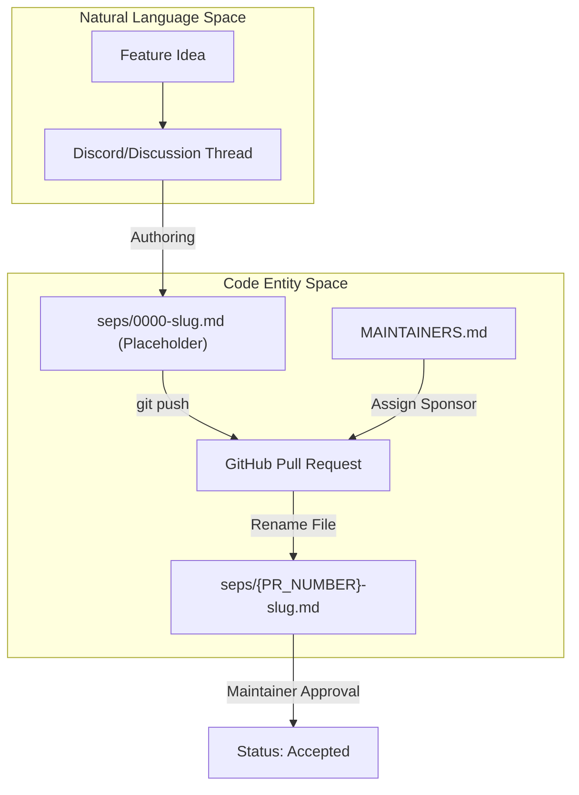
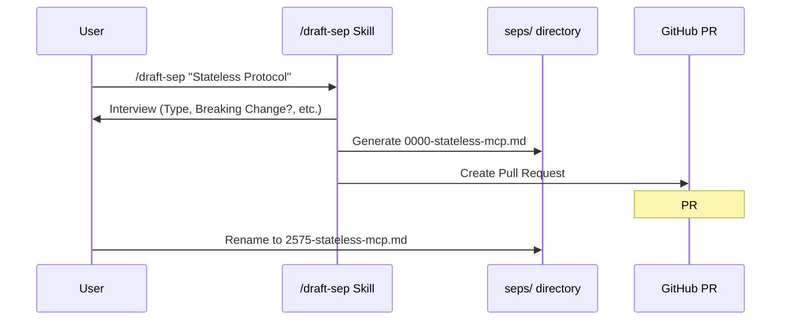

<!-- source: DeepWiki mcp.deepwiki.com · repo modelcontextprotocol/modelcontextprotocol · page 7.2 Specification Enhancement Process (SEP) · fetched 2026-10-21 -->

# Specification Enhancement Process (SEP)

Relevant source files

The following files were used as context for generating this wiki page:

- [MAINTAINERS.md](MAINTAINERS.md)
- [blog/content/posts/2026-04-08-maintainer-update.md](blog/content/posts/2026-04-08-maintainer-update.md)
- [blog/static/posts/images/maintainer-update-2026-04/clare.webp](blog/static/posts/images/maintainer-update-2026-04/clare.webp)
- [blog/static/posts/images/maintainer-update-2026-04/den.jpeg](blog/static/posts/images/maintainer-update-2026-04/den.jpeg)
- [docs/community/communication.mdx](docs/community/communication.mdx)
- [docs/community/governance.mdx](docs/community/governance.mdx)
- [docs/community/sep-guidelines.mdx](docs/community/sep-guidelines.mdx)
- [docs/docs/tutorials/security/authorization.mdx](docs/docs/tutorials/security/authorization.mdx)
- [docs/seps/2575-stateless-mcp.mdx](docs/seps/2575-stateless-mcp.mdx)
- [seps/1850-pr-based-sep-workflow.md](seps/1850-pr-based-sep-workflow.md)
- [seps/2575-stateless-mcp.md](seps/2575-stateless-mcp.md)
- [seps/README.md](seps/README.md)

The Specification Enhancement Process (SEP) is the formal mechanism for proposing, discussing, and documenting changes to the Model Context Protocol. SEPs are design documents stored as markdown files in the [`seps/` directory](https://github.com/modelcontextprotocol/modelcontextprotocol/tree/main/seps) and managed through pull requests. This page describes the complete workflow for creating, sponsoring, reviewing, and finalizing SEPs, including automated tooling available for authors.

Sources: [docs/community/sep-guidelines.mdx:8-15](), [seps/1850-pr-based-sep-workflow.md:12-15]()

## What is a SEP?

A SEP (Specification Enhancement Proposal) is a design document that provides information to the MCP community or describes a new feature for the Model Context Protocol. SEPs serve three primary functions:

1.  **Proposing major new features** with detailed technical specifications.
2.  **Collecting community input** on protocol design decisions.
3.  **Documenting the rationale** behind decisions that shape the protocol.

The SEP author is responsible for building consensus within the community and documenting dissenting opinions. The revision history in Git serves as the historical record of the feature proposal.

Sources: [docs/community/sep-guidelines.mdx:8-10](), [seps/1850-pr-based-sep-workflow.md:12-15]()

## When to Use a SEP

Not all changes require a SEP. Regular pull requests are more appropriate for smaller, direct changes. The SEP process is reserved for changes substantial enough to require broad community discussion and a formal historical record.

| Scenario | Requires SEP | Example |
| :--- | :--- | :--- |
| New protocol feature or API | Yes | Adding new message types, capabilities, or server features |
| Breaking change | Yes | Non-backwards-compatible modifications to existing behavior |
| Governance/process change | Yes | Altering contribution guidelines or decision-making processes |
| Complex/controversial topic | Yes | Changes with multiple valid solutions requiring community consensus |
| Bug fix | No | Straightforward corrections to existing functionality |
| Documentation improvement | No | Clarifications or examples without semantic changes |
| Minor enhancement | No | Small improvements that don't alter core protocol behavior |

Sources: [docs/community/sep-guidelines.mdx:20-33]()

## SEP Types

SEPs are categorized into four types:

1.  **Standards Track**: Describes a new feature or implementation for the Model Context Protocol, or an interoperability standard supported outside the core protocol specification.
2.  **Extensions Track**: Describes a protocol extension. These follow the same review process as Standards Track SEPs.
3.  **Informational**: Describes a design issue or provides general guidelines to the MCP community without proposing a new feature.
4.  **Process**: Describes a process surrounding MCP or proposes changes to project processes (e.g., [SEP-1850: PR-Based SEP Workflow](seps/1850-pr-based-sep-workflow.md)).

Sources: [docs/community/sep-guidelines.mdx:38-43](), [seps/1850-pr-based-sep-workflow.md:4-4]()

## The PR-Based Workflow (SEP-1850)

As of [SEP-1850](seps/1850-pr-based-sep-workflow.md), all SEPs are submitted as pull requests containing markdown files. This workflow ensures that every SEP is versioned alongside the specification itself and uses standard GitHub review tooling.

### Workflow Diagram: Natural Language to Code Entity

This diagram bridges the conceptual "Idea" to the concrete file entities and PR states used in the repository.

Sources: [seps/1850-pr-based-sep-workflow.md:34-46](), [docs/community/sep-guidelines.mdx:48-69]()

## SEP States and Lifecycle

SEPs progress through a defined set of states. Status changes are reflected both in the file's preamble and via GitHub PR labels.

| State | Meaning |
| :--- | :--- |
| `draft` | Has a sponsor, undergoing informal review. |
| `in-review` | Ready for formal Core Maintainer review. |
| `accepted` | Approved, awaiting implementation + conformance tests. |
| `rejected` | Declined by Core Maintainers. |
| `withdrawn` | Author withdrew the proposal. |
| `final` | Complete with implementation and conformance tests. |
| `superseded` | Replaced by a newer SEP. |
| `dormant` | No sponsor found within 6 months; can be revived. |

Sources: [docs/community/sep-guidelines.mdx:103-113](), [seps/1850-pr-based-sep-workflow.md:64-72]()

## Authoring and AI Assistance

### The Claude Plugin Skill
Authors can use the `/draft-sep` skill (documented in `plugins/mcp-spec`) to assist in creating high-quality proposals. This tool facilitates an interview process to ensure alignment with [MCP design principles](docs/community/sep-guidelines.mdx:12-12).

Sources: [docs/community/sep-guidelines.mdx:82-86](), [seps/1850-pr-based-sep-workflow.md:42-45]()

### Manual Process
If not using the automated tool, authors must:
1.  Draft the proposal as a markdown file named `0000-your-feature-title.md`.
2.  Create a pull request adding the file to the `seps/` directory.
3.  Once the PR number is known, rename the file (e.g., `1850-your-feature-title.md`) and update the header.

Sources: [docs/community/sep-guidelines.mdx:82-86](), [seps/1850-pr-based-sep-workflow.md:42-45]()

## Sponsorship Requirements

A SEP cannot enter the `draft` state without a **Sponsor**. A sponsor must be a Core Maintainer or Maintainer listed in `MAINTAINERS.md`.

**Sponsor Responsibilities:**
*   **Reviewing the proposal** and providing constructive feedback.
*   **Managing status transitions** (updating the markdown file and PR labels).
*   **Initiating formal review** by presenting the SEP at Core Maintainer meetings.
*   **Tracking implementation** to ensure reference implementations and conformance tests are complete.

Sources: [seps/1850-pr-based-sep-workflow.md:48-62](), [MAINTAINERS.md:7-108]()

## Governance and Decisions

Technical governance is led by the **MCP Steering Group**, comprising Lead Maintainers, Core Maintainers, and Maintainers.

*   **Lead Maintainers (BDFL)**: Final decision authority (e.g., David Soria Parra, Den Delimarsky).
*   **Core Maintainers**: Drive overall project direction and vote on SEPs (e.g., Clare Liguori, Kurtis Van Gent).
*   **Maintainers**: Steward specific areas like SDKs or Working Groups.

Sources: [docs/community/governance.mdx:24-36](), [MAINTAINERS.md:7-21](), [blog/content/posts/2026-04-08-maintainer-update.md:15-15]()

## Conformance and Finalization

For Standards Track SEPs that introduce observable protocol behavior, a **conformance test** must be merged before the SEP reaches `final` status. A reference implementation must also be completed.

Sources: [docs/community/sep-guidelines.mdx:101-102](), [seps/1850-pr-based-sep-workflow.md:71-71]()

---

