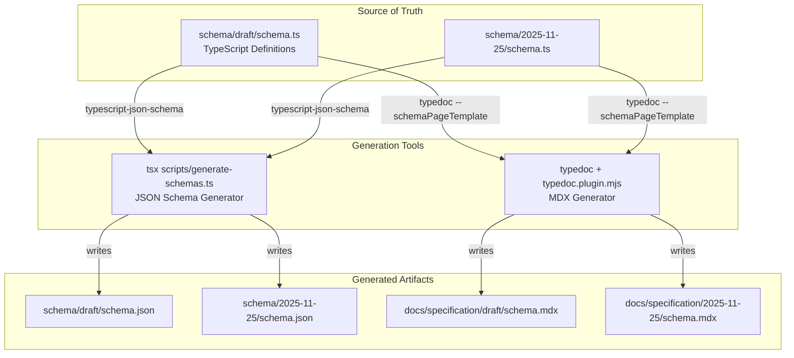
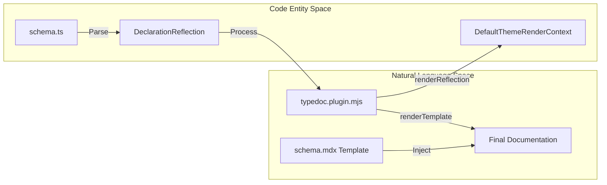

<!-- source: DeepWiki mcp.deepwiki.com · repo modelcontextprotocol/modelcontextprotocol · page 7.3 Schema Development and Generation · fetched 2026-10-21 -->

# Schema Development and Generation

Relevant source files

The following files were used as context for generating this wiki page:

- [.gitattributes](.gitattributes)
- [.github/dependabot.yml](.github/dependabot.yml)
- [.prettierignore](.prettierignore)
- [CONTRIBUTING.md](CONTRIBUTING.md)
- [README.md](README.md)
- [SECURITY.md](SECURITY.md)
- [docs/community/security.mdx](docs/community/security.mdx)
- [docs/specification/2025-06-18/schema.mdx](docs/specification/2025-06-18/schema.mdx)
- [docs/specification/2025-11-25/schema.mdx](docs/specification/2025-11-25/schema.mdx)
- [docs/style.css](docs/style.css)
- [package-lock.json](package-lock.json)
- [package.json](package.json)
- [schema/2025-11-25/schema.json](schema/2025-11-25/schema.json)
- [schema/2025-11-25/schema.ts](schema/2025-11-25/schema.ts)
- [schema/draft/schema.mdx](schema/draft/schema.mdx)
- [scripts/generate-schemas.ts](scripts/generate-schemas.ts)
- [scripts/pull-registry-docs.sh](scripts/pull-registry-docs.sh)
- [tsconfig.json](tsconfig.json)
- [typedoc.config.mjs](typedoc.config.mjs)
- [typedoc.plugin.mjs](typedoc.plugin.mjs)

This document covers the technical workflow for developing and maintaining the MCP protocol schemas. It explains how to edit TypeScript schema definitions, generate derived artifacts (JSON Schema and MDX documentation), and validate changes through the pipeline.

The schema system manages the transformation of canonical TypeScript schemas into multiple generated artifacts:
- **TypeScript schemas** (`schema/*/schema.ts`) are the single source of truth. [schema/2025-11-25/schema.ts:8-9]()
- **JSON schemas** (`schema/*/schema.json`) are generated for machine consumption. [schema/2025-11-25/schema.json:1-3]()
- **MDX documentation** (`docs/specification/*/schema.mdx`) is generated for human-readable API reference. [docs/specification/2025-11-25/schema.mdx:1-13]()

## Schema Generation Pipeline

The generation pipeline transforms TypeScript source files into artifacts using two parallel paths.

**Title: Schema Generation Pipeline Architecture**

Sources: [package.json:23-28](), [scripts/generate-schemas.ts:1-35](), [typedoc.config.mjs:21]()

## Source-of-Truth (TypeScript)

The protocol is defined using TypeScript interfaces and type aliases. This provides type safety for SDKs and clear documentation through TSDoc comments.

| Entity | Role | File Example |
|--------|------|--------------|
| `JSONRPCMessage` | Discriminated union of all valid messages | [schema/2025-11-25/schema.ts:8-9]() |
| `InitializeRequest` | Definition for the handshake start | [schema/2025-11-25/schema.ts:251-260]() |
| `ServerCapabilities` | Registry of supported features | [schema/2025-11-25/schema.ts:340-343]() |
| `@category` | Metadata for documentation grouping | [schema/2025-11-25/schema.ts:6-7]() |
| `LATEST_PROTOCOL_VERSION` | Internal constant for versioning | [schema/2025-11-25/schema.ts:12]() |

Sources: [schema/2025-11-25/schema.ts:1-343]()

## JSON Schema Generation

The project uses `typescript-json-schema` to extract JSON Schema definitions from the TypeScript source. [package.json:62]()

### Generation Logic
The script `scripts/generate-schemas.ts` orchestrates the extraction. For modern schemas, it applies transformations to align with specific JSON Schema dialects. [package.json:26]()

### Validation
The project includes a validation step for examples to ensure they match the generated schemas. [package.json:36]()
- **Script**: `scripts/validate-examples.ts`
- **Tool**: `ajv` (Another JSON Schema Validator) is used for schema validation. [package.json:49]()
- **Formats**: `ajv-formats` provides validation for standard string formats. [package.json:50]()

Sources: [package.json:26](), [package.json:35-36](), [package.json:49-50]()

## Documentation Generation (TypeDoc)

Human-readable documentation is generated using TypeDoc with a custom plugin located at `typedoc.plugin.mjs`. [typedoc.config.mjs:21]()

### Documentation Flow

**Title: Bridge from TypeScript Entities to MDX Documentation**

### Plugin Implementation
The plugin implements a custom `SchemaPageRouter` to handle Mintlify-compatible URL anchoring. [typedoc.plugin.mjs:47-64]()
- **`renderTemplate`**: Replaces category placeholders (e.g., `{/* @category JSON-RPC */}`) in the MDX template with rendered type information. [typedoc.plugin.mjs:93-121]()
- **`renderReflection`**: Converts TypeScript declarations (Interfaces, Type Aliases) into HTML/JSX blocks by calling `context.reflectionPreview` and `context.commentSummary`. [typedoc.plugin.mjs:195-215]()
- **Markdown Escaping**: `MARKDOWN_SPECIAL_CHARS` (like `[`, `_`, `{`) are converted to HTML entities to prevent JSX parsing errors in the output MDX. [typedoc.plugin.mjs:7-13]()

Sources: [typedoc.plugin.mjs:1-215](), [typedoc.config.mjs:1-24](), [package.json:27]()

## Build and Check Commands

The following `npm` scripts are used to manage the schema lifecycle:

| Command | Action | Implementation |
|---------|--------|----------------|
| `npm run generate:schema:json` | Generates JSON schemas | [package.json:26]() |
| `npm run generate:schema:md` | Generates MDX docs via `typedoc` | [package.json:27]() |
| `npm run check:schema:ts` | Validates TS source with `tsc` and `eslint` | [package.json:34]() |
| `npm run check:schema:json` | Checks if JSON schemas are up-to-date | [package.json:35]() |
| `npm run check:schema:examples` | Validates example blocks with `ajv` | [package.json:36]() |
| `npm run check:schema:md` | Compares generated MDX with existing docs | [package.json:37]() |
| `npm run prep` | Runs full generate and check suite | [package.json:45]() |

### Development Workflow
Developers modify `schema/draft/schema.ts` [CONTRIBUTING.md:44]() and run `npm run generate:schema` to update the corresponding JSON and MDX files. [CONTRIBUTING.md:50-53]() Manual editing of generated files is prohibited; merge conflicts are resolved by regenerating artifacts after fixing the source TypeScript. [CONTRIBUTING.md:56-65]()

Sources: [package.json:23-45](), [CONTRIBUTING.md:42-67]()

---

