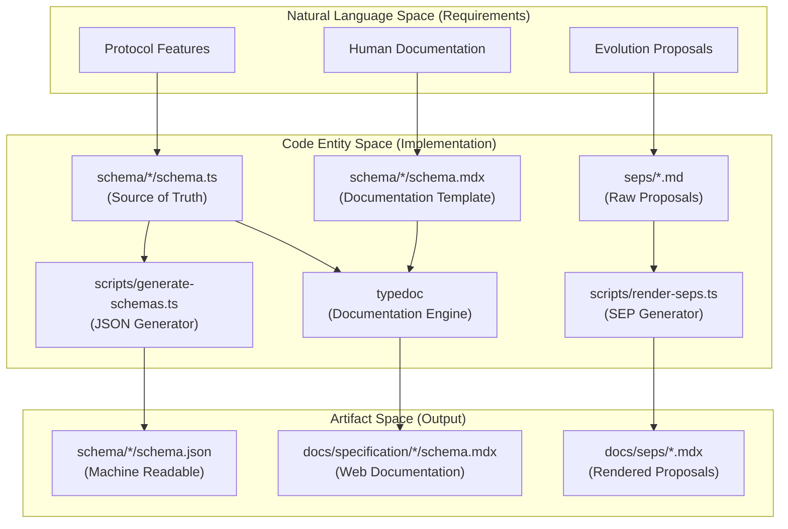
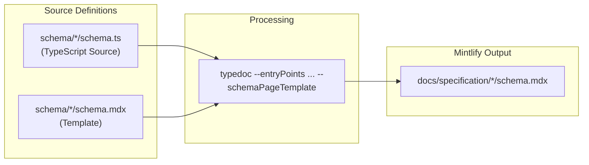

<!-- source: DeepWiki mcp.deepwiki.com · repo modelcontextprotocol/modelcontextprotocol · page 7.4 Build System and Automation · fetched 2026-10-21 -->

# Build System and Automation

Relevant source files

The following files were used as context for generating this wiki page:

- [.gitattributes](.gitattributes)
- [.github/dependabot.yml](.github/dependabot.yml)
- [.github/workflows/blog-preview.yml](.github/workflows/blog-preview.yml)
- [.github/workflows/cut-release.yml](.github/workflows/cut-release.yml)
- [.github/workflows/deploy-blog.yml](.github/workflows/deploy-blog.yml)
- [.github/workflows/main.yml](.github/workflows/main.yml)
- [.github/workflows/markdown-format.yml](.github/workflows/markdown-format.yml)
- [.github/workflows/publish-release.yml](.github/workflows/publish-release.yml)
- [.github/workflows/render-seps.yml](.github/workflows/render-seps.yml)
- [.github/workflows/sep-lifecycle-manual.yml](.github/workflows/sep-lifecycle-manual.yml)
- [.github/workflows/sep-lifecycle.yml](.github/workflows/sep-lifecycle.yml)
- [.github/workflows/sep-reminder.yml](.github/workflows/sep-reminder.yml)
- [.github/workflows/slash-commands.yml](.github/workflows/slash-commands.yml)
- [.github/workflows/stage-blog.yml](.github/workflows/stage-blog.yml)
- [CONTRIBUTING.md](CONTRIBUTING.md)
- [README.md](README.md)
- [SECURITY.md](SECURITY.md)
- [docs/community/security.mdx](docs/community/security.mdx)
- [package-lock.json](package-lock.json)
- [package.json](package.json)

This document describes the automated build system, npm scripts, and GitHub Actions workflows for the Model Context Protocol (MCP) specification repository. The system manages the lifecycle of the protocol through automated schema generation, documentation rendering, and rigorous validation of all artifacts.

## npm Scripts Overview

The build system is orchestrated through npm scripts defined in `package.json`. These scripts handle generation, formatting, and validation of both the machine-readable protocol and human-readable documentation.

### Generation Scripts

| Script | Command | Purpose |
|--------|---------|---------|
| `npm run generate` | `npm run generate:schema && npm run generate:seps` | Entry point for all generation tasks. [package.json:24]() |
| `npm run generate:schema` | `npm run generate:schema:json & npm run generate:schema:md & wait` | Generates JSON schemas and MDX documentation in parallel. [package.json:25]() |
| `npm run generate:schema:json` | `tsx scripts/generate-schemas.ts` | Transforms TypeScript definitions into JSON schemas. [package.json:26]() |
| `npm run generate:schema:md` | `find schema/*/schema.mdx ... xargs typedoc` | Uses TypeDoc with a custom template to generate schema reference docs. [package.json:27]() |
| `npm run generate:seps` | `tsx scripts/render-seps.ts` | Renders Specification Enhancement Proposals (SEPs). [package.json:28]() |

### Validation and Quality Scripts

| Script | Command | Purpose |
|--------|---------|---------|
| `npm run check` | `check:schema && check:docs && check:seps` | Comprehensive validation suite. [package.json:32]() |
| `npm run check:schema:ts` | `tsc --noEmit && eslint schema/ && prettier --check` | Validates TypeScript correctness, linting, and formatting. [package.json:34]() |
| `npm run check:schema:json` | `tsx scripts/generate-schemas.ts --check` | Verifies committed JSON schemas match TypeScript sources. [package.json:35]() |
| `npm run check:schema:examples` | `tsx scripts/validate-examples.ts` | Validates example payloads against generated schemas. [package.json:36]() |
| `npm run check:schema:md` | `typedoc ... | cmp docs/specification/...` | Verifies MDX documentation is up to date. [package.json:37]() |
| `npm run check:docs:links` | `cd docs && npx mint broken-links` | Checks for broken internal links in documentation. [package.json:41]() |
| `npm run prep` | Sequential run of checks, generation, and formatting | Standard pre-commit workflow for developers. [package.json:45]() |

**Sources:** [package.json:23-46]()

## Build System Architecture

The build system bridges the gap between TypeScript-defined protocol entities and the generated artifacts consumed by the ecosystem.

### Data Flow and Entity Mapping

The following diagram illustrates how "Natural Language Space" requirements (like protocol features) are processed through "Code Entity Space" tools into final artifacts.

**Build Pipeline and Entity Association:**

**Sources:** [package.json:23-45](), [CONTRIBUTING.md:42-55](), [README.md:11-13]()

## Documentation Generation System

The repository uses a documentation pipeline that transforms TypeScript source-of-truth definitions into MDX pages compatible with Mintlify.

### Generation Logic

The `generate:schema:md` script utilizes `typedoc` with a specific template to create documentation. It targets TypeScript files in the `schema/` directory and outputs rendered MDX to `docs/specification/`.

**Documentation Transformation Flow:**

**Sources:** [package.json:27](), [CONTRIBUTING.md:50-54]()

## CI/CD Workflows

The repository uses GitHub Actions for continuous validation, release management, and automated maintenance.

### Validation Workflow (`main.yml`)
Runs on every push to `main` and all pull requests. It ensures that the generated `schema.json` and `schema.mdx` files are perfectly synchronized with the TypeScript source code.
- **Steps**: `npm run check:schema:ts` → `npm run check:schema:json` → `npm run check:schema:md`.
- **Sources:** [.github/workflows/main.yml:1-32]()

### Release Management Workflows
The release process is split into two phases:
1. **Cut Release (`cut-release.yml`)**: A manual workflow (`workflow_dispatch`) that can cut a Release Candidate (RC) or a Final release. 
   - **RC Mode**: Creates a `<version>-RC` tag and a prerelease on GitHub [.github/workflows/cut-release.yml:36-72]().
   - **Final Mode**: Promotes the `draft/` specification to a versioned directory (e.g., `docs/specification/YYYY-MM-DD/`), patches `docs/docs.json` for Mintlify versioning, and opens a release PR [.github/workflows/cut-release.yml:78-163]().
2. **Publish Release**: While not shown in full, this companion job handles tagging the GA release after the PR created by `cut-release.yml` is merged [.github/workflows/cut-release.yml:7-8]().

### SEP Lifecycle Automation (`sep-lifecycle.yml`)
This workflow automates the management of Specification Enhancement Proposals.
- **Triggers**: On labeling, unlabeling, assigning, or opening of issues/PRs, and on a weekly schedule (Monday 9 AM UTC) [.github/workflows/sep-lifecycle.yml:3-12]().
- **Functions**: Executes the automation tool located in `tools/sep-automation` to process transitions and optionally post to Discord [.github/workflows/sep-lifecycle.yml:84-105]().

### Blog and Site Deployment
- **Deploy Blog (`deploy-blog.yml`)**: Builds the Hugo-based blog from the `blog/` directory using a custom `hugo-build` action and deploys it to GitHub Pages [.github/workflows/deploy-blog.yml:1-59]().
- **Slash Commands (`slash-commands.yml`)**: Processes maintainer commands (like `/lgtm`, `/hold`, `/stageblog`) and handles auto-approval for narrowly-scoped Dependabot PRs [.github/workflows/slash-commands.yml:1-49]().

**Sources:** [.github/workflows/main.yml:1-32](), [.github/workflows/cut-release.yml:1-170](), [.github/workflows/sep-lifecycle.yml:1-113](), [.github/workflows/deploy-blog.yml:1-59](), [.github/workflows/slash-commands.yml:1-49]()

---

