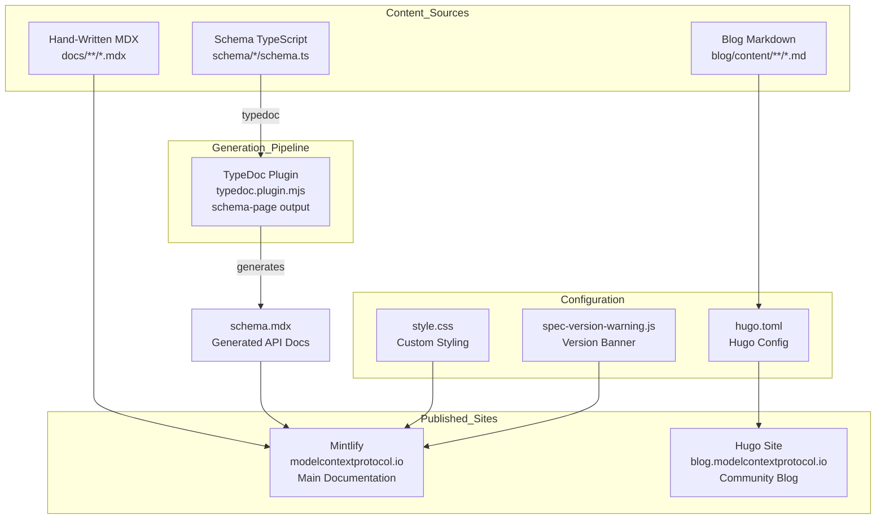
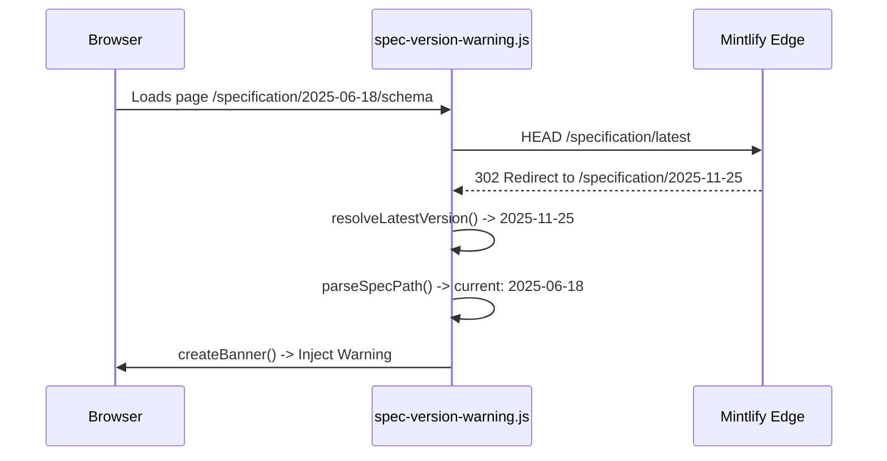

<!-- source: DeepWiki mcp.deepwiki.com · repo modelcontextprotocol/modelcontextprotocol · page 7.5 Documentation Generation System · fetched 2026-10-21 -->

# Documentation Generation System

<details>
<summary>Relevant source files</summary>

The following files were used as context for generating this wiki page:

- [.prettierignore](.prettierignore)
- [blog/assets/css/extended/custom.css](blog/assets/css/extended/custom.css)
- [blog/hugo.toml](blog/hugo.toml)
- [blog/layouts/_default/archives.html](blog/layouts/_default/archives.html)
- [blog/layouts/_default/list.html](blog/layouts/_default/list.html)
- [blog/layouts/_default/search.html](blog/layouts/_default/search.html)
- [blog/layouts/_default/terms.html](blog/layouts/_default/terms.html)
- [blog/layouts/index.html](blog/layouts/index.html)
- [blog/layouts/partials/footer.html](blog/layouts/partials/footer.html)
- [blog/layouts/partials/header.html](blog/layouts/partials/header.html)
- [blog/layouts/partials/post_meta.html](blog/layouts/partials/post_meta.html)
- [blog/layouts/partials/post_nav_links.html](blog/layouts/partials/post_nav_links.html)
- [blog/layouts/partials/templates/schema_json.html](blog/layouts/partials/templates/schema_json.html)
- [docs/seps/1024-mcp-client-security-requirements-for-local-server-.mdx](docs/seps/1024-mcp-client-security-requirements-for-local-server-.mdx)
- [docs/seps/1034--support-default-values-for-all-primitive-types-in.mdx](docs/seps/1034--support-default-values-for-all-primitive-types-in.mdx)
- [docs/seps/1036-url-mode-elicitation-for-secure-out-of-band-intera.mdx](docs/seps/1036-url-mode-elicitation-for-secure-out-of-band-intera.mdx)
- [docs/seps/1046-support-oauth-client-credentials-flow-in-authoriza.mdx](docs/seps/1046-support-oauth-client-credentials-flow-in-authoriza.mdx)
- [docs/seps/1302-formalize-working-groups-and-interest-groups-in-mc.mdx](docs/seps/1302-formalize-working-groups-and-interest-groups-in-mc.mdx)
- [docs/seps/1303-input-validation-errors-as-tool-execution-errors.mdx](docs/seps/1303-input-validation-errors-as-tool-execution-errors.mdx)
- [docs/seps/1319-decouple-request-payload-from-rpc-methods-definiti.mdx](docs/seps/1319-decouple-request-payload-from-rpc-methods-definiti.mdx)
- [docs/seps/991-enable-url-based-client-registration-using-oauth-c.mdx](docs/seps/991-enable-url-based-client-registration-using-oauth-c.mdx)
- [docs/spec-version-warning.js](docs/spec-version-warning.js)
- [docs/specification/2025-06-18/schema.mdx](docs/specification/2025-06-18/schema.mdx)
- [docs/specification/2025-11-25/schema.mdx](docs/specification/2025-11-25/schema.mdx)
- [docs/style.css](docs/style.css)
- [schema/2025-11-25/schema.json](schema/2025-11-25/schema.json)
- [schema/2025-11-25/schema.ts](schema/2025-11-25/schema.ts)
- [scripts/pull-registry-docs.sh](scripts/pull-registry-docs.sh)
- [typedoc.config.mjs](typedoc.config.mjs)
- [typedoc.plugin.mjs](typedoc.plugin.mjs)

</details>


## Purpose and Scope

The documentation system implements a dual-track publishing architecture that serves both technical reference documentation and community blog content. Mintlify powers the main documentation site at `modelcontextprotocol.io`, while Hugo with the PaperMod theme hosts the blog at `blog.modelcontextprotocol.io`. This page covers the TypeDoc configuration for schema generation, the custom plugin for Mintlify compatibility, the Hugo-based blog system, and the dynamic version warning system.

For information about the build system and CI/CD workflows that validate and generate documentation artifacts, see [Build System and Automation](#7.4). For details on the schema generation process itself, see [Schema Development and Generation](#7.3).

## Architecture Overview

The documentation system consists of two independent publishing tracks with distinct toolchains and content types:



**Sources:** [typedoc.plugin.mjs:23-44](), [blog/hugo.toml:1-106](), [docs/style.css:1-207]()

## TypeDoc Schema Generation

The documentation for the MCP specification is generated directly from the TypeScript source-of-truth in the `schema/` directory (e.g., `schema/2025-11-25/schema.ts`).

### Configuration

The TypeDoc configuration is managed in `typedoc.config.mjs`. It filters internal symbols and JSON-Schema specific tags that are not relevant for protocol consumers.

| Property | Value | Purpose |
|----------|-------|---------|
| `out` | `"tmp"` | Temporary output directory (actual output via plugin) |
| `excludeInternal` | `true` | Hides symbols marked as internal implementation details [typedoc.config.mjs:7-7]() |
| `excludeTags` | `["@format", "@maximum", ...]` | Filters JSON Schema metadata from documentation [typedoc.config.mjs:8-15]() |
| `plugin` | `["./typedoc.plugin.mjs"]` | Loads the custom Mintlify-compatibility plugin [typedoc.config.mjs:21-21]() |

**Sources:** [typedoc.config.mjs:1-24](), [schema/2025-11-25/schema.ts:1-12]()

### Custom TypeDoc Plugin Architecture

The custom plugin `typedoc.plugin.mjs` transforms TypeDoc's internal reflection model into Mintlify-compatible MDX. It bypasses the standard HTML renderer to produce Markdown that preserves Mintlify's specific component syntax and CSS hooks.

```mermaid
graph TD
    "typedoc-run"["TypeDoc Run"] --> "load-fn"["load(app)"]
    "load-fn" --> "add-output"["app.outputs.addOutput('schema-page')"]
    "add-output" --> "SchemaPageRouter"["SchemaPageRouter"]
    "SchemaPageRouter" --> "buildPageEvents"["buildPageEvents()"]
    "buildPageEvents" --> "renderTemplate"["renderTemplate()"]
    "renderTemplate" --> "renderCategory"["renderCategory()"]
    "renderCategory" --> "renderReflection"["renderReflection()"]
    "renderReflection" --> "output-mdx"["stdout -> schema.mdx"]
```

**Key Implementation Details:**
- **SchemaPageRouter**: Overrides default URL generation to create Mintlify-compatible lowercase anchor IDs by replacing dots, slashes, and hashes with dashes [typedoc.plugin.mjs:47-64]().
- **renderCategory**: Groups reflections based on the `@category` JSDoc tag found in the schema source [typedoc.plugin.mjs:177-188](), [schema/2025-11-25/schema.ts:6-7]().
- **getReflectionOrder**: Implements a protocol-specific sorting logic where `Request` types appear before `Result` or `Notification` types [typedoc.plugin.mjs:137-152]().

**Sources:** [typedoc.plugin.mjs:1-243](), [schema/2025-11-25/schema.ts:6-9]()

### Mintlify Compatibility and Styling

Because Mintlify uses a custom Markdown parser, the plugin performs extensive character escaping and tag transformations to prevent rendering errors.

- **Character Escaping**: Brackets, underscores, and braces are converted to HTML entities (e.g., `[` to `&#x5B;`) using `MARKDOWN_SPECIAL_CHARS_HTML_ENTITIES` to prevent them from being interpreted as MDX/JSX components [typedoc.plugin.mjs:7-13]().
- **Heading Transformation**: HTML headings (`<hN>`) are converted to `<div>` elements with `data-typedoc-h` attributes to avoid interfering with Mintlify's auto-generated Table of Contents [typedoc.plugin.mjs:213-216]().
- **CSS Hooks**: The `docs/style.css` file uses the `body:has(#schema-reference)` selector to apply specialized styling to these generated pages, including custom syntax highlighting for `tsd-signature` and `tsd-comment` elements [docs/style.css:102-189]().

**Sources:** [typedoc.plugin.mjs:213-238](), [docs/style.css:102-189]()

## Hugo Blog System

The blog at `blog.modelcontextprotocol.io` is built using Hugo and the PaperMod theme. It serves as the primary channel for protocol updates and ecosystem news.

### Theme Customization

The system applies significant customizations to PaperMod via `blog/assets/css/extended/custom.css` and template overrides.

- **Color Tokens**: Defines indigo-based brand accents (`--link: #4f46e5` for light, `#818cf8` for dark) [blog/assets/css/extended/custom.css:1-14]().
- **Accessibility**: Enhances `:focus-visible` indicators and adds a skip-link for keyboard navigation [blog/assets/css/extended/custom.css:26-41](), [blog/assets/css/extended/custom.css:81-95]().
- **Search Integration**: Configures PaperMod's Fuse.js client-side search via `blog/hugo.toml` and custom CSS to match the visual style of the main documentation site [blog/hugo.toml:11-13](), [blog/assets/css/extended/custom.css:49-78]().

**Sources:** [blog/hugo.toml:7-13](), [blog/assets/css/extended/custom.css:1-243]()

### Paginator and Layout Overrides

The `blog/layouts/_default/list.html` override modifies standard PaperMod behavior:
1. **Home Info Persistence**: The intro card (title and blurb defined in `params.homeInfoParams`) appears on every paginated page, not just the first [blog/layouts/_default/list.html:7-9](), [blog/hugo.toml:40-42]().
2. **Page Counter**: Adds an absolutely-positioned "Page N of M" counter between the "Prev" and "Next" buttons [blog/layouts/_default/list.html:110-128]().

**Sources:** [blog/layouts/_default/list.html:1-133](), [blog/hugo.toml:40-42]()

## Spec Version Warning System

The `docs/spec-version-warning.js` script provides a dynamic banner system that alerts users when they are viewing an older or draft version of the specification.

### Dynamic Resolution

Instead of hardcoding the "latest" version, the script performs a `HEAD` request to `/specification/latest` and parses the redirect destination to determine the current stable version [docs/spec-version-warning.js:60-72]().



**Sources:** [docs/spec-version-warning.js:54-72](), [docs/spec-version-warning.js:107-156]()

### Banner Implementation

The script uses a `MutationObserver` to ensure the banner persists across SPA (Single Page Application) transitions within the Mintlify site [docs/spec-version-warning.js:165-173](). It differentiates between "draft" pages (Info style) and "older version" pages (Warning style) by checking if the version string matches `DRAFT_VERSION` ("draft") [docs/spec-version-warning.js:10-12](), [docs/spec-version-warning.js:135-140]().

**Sources:** [docs/spec-version-warning.js:74-103](), [docs/spec-version-warning.js:165-173]()

---

