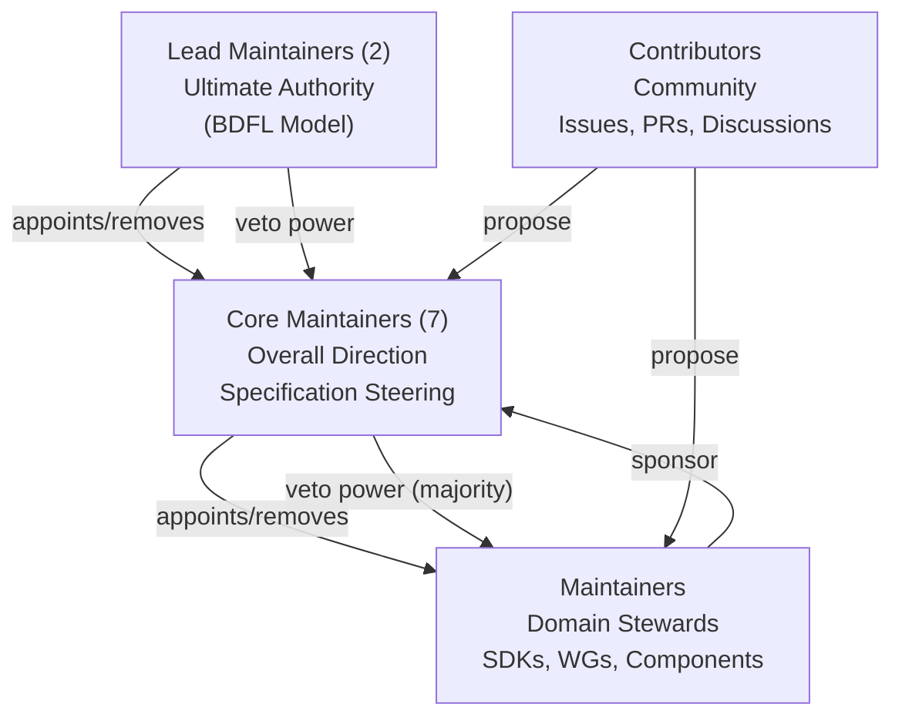
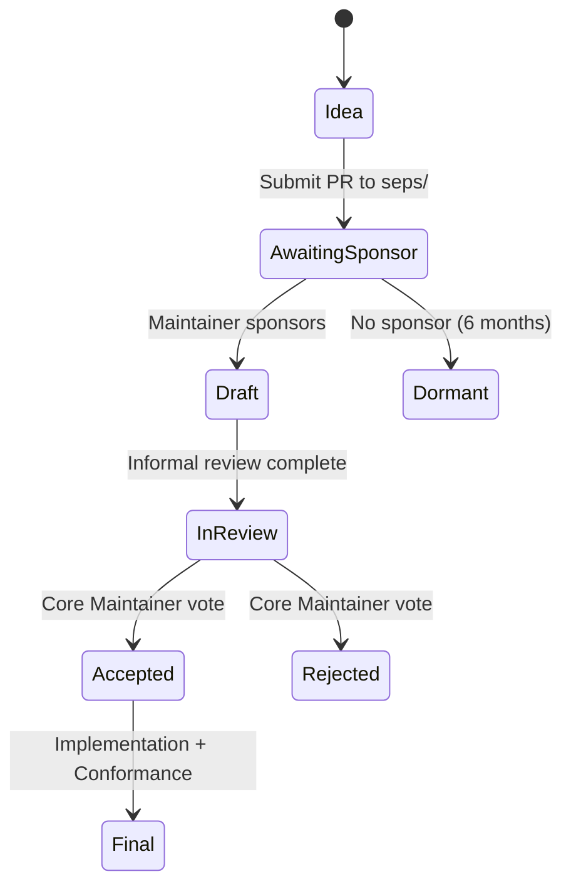

<!-- source: DeepWiki mcp.deepwiki.com · repo modelcontextprotocol/modelcontextprotocol · page 8 Governance and Community · fetched 2026-10-21 -->

# Governance and Community

Relevant source files

The following files were used as context for generating this wiki page:

- [MAINTAINERS.md](MAINTAINERS.md)
- [blog/content/posts/2026-04-08-maintainer-update.md](blog/content/posts/2026-04-08-maintainer-update.md)
- [blog/static/posts/images/maintainer-update-2026-04/clare.webp](blog/static/posts/images/maintainer-update-2026-04/clare.webp)
- [blog/static/posts/images/maintainer-update-2026-04/den.jpeg](blog/static/posts/images/maintainer-update-2026-04/den.jpeg)
- [docs/community/charter-template.mdx](docs/community/charter-template.mdx)
- [docs/community/communication.mdx](docs/community/communication.mdx)
- [docs/community/contributor-ladder.mdx](docs/community/contributor-ladder.mdx)
- [docs/community/governance.mdx](docs/community/governance.mdx)
- [docs/community/sep-guidelines.mdx](docs/community/sep-guidelines.mdx)
- [docs/community/working-interest-groups.mdx](docs/community/working-interest-groups.mdx)
- [docs/docs/tutorials/security/authorization.mdx](docs/docs/tutorials/security/authorization.mdx)
- [docs/seps/2149-working-group-charter-template.mdx](docs/seps/2149-working-group-charter-template.mdx)
- [seps/2149-working-group-charter-template.md](seps/2149-working-group-charter-template.md)

This page documents the Model Context Protocol's governance structure, community organization, and the processes for proposing and implementing changes to the specification. It covers the maintainer hierarchy, the Specification Enhancement Proposal (SEP) workflow, Working Groups and Interest Groups, communication channels, and the project's release history.

For technical contribution guidelines including schema development and build processes, see [Development Guide](#7).

## Governance Structure

MCP adopts a hierarchical governance model to ensure transparent decision-making and community participation. The structure is established as **Model Context Protocol a Series of LF Projects, LLC** [docs/community/governance.mdx:8-10]().

### Hierarchy Overview

**Sources:** [docs/community/governance.mdx:20-38](), [docs/community/governance.mdx:44-53](), [MAINTAINERS.md:1-110]()

### Lead Maintainers (BDFLs)
The Lead Maintainers hold final authority and serve as the project's Benevolent Dictators for Life (BDFL). They are administrators on all project infrastructure [docs/community/governance.mdx:51-53]().
- **David Soria Parra** (`@dsp-ant`)
- **Den Delimarsky** (`@localden`)

**Sources:** [MAINTAINERS.md:7-10](), [docs/community/governance.mdx:51-53]()

### Core Maintainers
Core Maintainers steer the specification and project direction. They meet bi-weekly to vote on proposals and resolve technical disputes [docs/community/governance.mdx:49-50]().
- **Caitie McCaffrey** (`@CaitieM20`)
- **Clare Liguori** (`@clareliguori`)
- **Kurtis Van Gent** (`@kurtisvg`)
- **Nick Aldridge** (`@000-000-000-000-000`)
- **Nick Cooper** (`@nickcoai`)
- **Paul Carleton** (`@pcarleton`)
- **Peter Alexander** (`@pja-ant`)

**Sources:** [MAINTAINERS.md:12-21](), [docs/community/governance.mdx:49-50]()

### Maintainers and Roles
Maintainers steward specific components. For a detailed catalog of current maintainers and their SDK/project ownership, see [Maintainers and Roles](#8.2).
- **SDK Maintainers**: Ownership of specific language SDKs such as Java, Python, TypeScript, Go, C#, Kotlin, Swift, Rust, and PHP [MAINTAINERS.md:28-108]().
- **Project Maintainers**: Stewards for tools like the **Inspector**, **Registry**, **use-mcp**, and **Reference Servers** [MAINTAINERS.md:109-146]().
- **Group Facilitators**: Leadership for Working and Interest Groups [MAINTAINERS.md:156-211]().

**Sources:** [MAINTAINERS.md:28-155](), [docs/community/governance.mdx:47-48]()

## Contributor Ladder
The project defines a formal advancement path based on earned trust and sustained engagement.

| Role | Requirement | Privileges |
| :--- | :--- | :--- |
| **Contributor** | Any contribution | Submit PRs, participate in discussions |
| **Member** | 2-3 months active | GitHub org membership, triage rights |
| **Maintainer** | 6+ months as Member | Merge rights for specific area |
| **Core Maintainer** | Invitation only | Final decision authority |

For details on requirements and advancement, see [Maintainers and Roles](#8.2).

**Sources:** [docs/community/contributor-ladder.mdx:17-26](), [docs/community/contributor-ladder.mdx:52-132]()

## Specification Enhancement Proposal (SEP) Process
The SEP process is the primary mechanism for proposing substantial protocol changes [docs/community/sep-guidelines.mdx:6-15]().

### SEP Workflow

### SEP Types
1.  **Standards Track**: New features or implementation changes [docs/community/sep-guidelines.mdx:40]().
2.  **Informational**: Guidelines or design issues [docs/community/sep-guidelines.mdx:41]().
3.  **Process**: Changes to governance or processes (e.g., SEP-2149) [docs/community/sep-guidelines.mdx:42]().
4.  **Extensions Track**: Protocol extensions [docs/community/sep-guidelines.mdx:43]().

For the full process and status definitions, see [Governance Structure](#8.1).

**Sources:** [docs/community/sep-guidelines.mdx:6-69](), [docs/community/sep-guidelines.mdx:103-112]()

## Working Groups and Interest Groups
Collaboration is organized into two group types defined by SEP-2149 [seps/2149-working-group-charter-template.md:1-15]().

| Group Type | Purpose | Deliverables |
| :--- | :--- | :--- |
| **Interest Group (IG)** | Problem identification | Use cases, recommendations |
| **Working Group (WG)** | Solution development | SEPs, code, implementations |

### Active Groups
- **Transports Interest Group**: Evolution of communication mechanisms [MAINTAINERS.md:189-194]().
- **Security Interest Group**: Protocol security and threat modeling [MAINTAINERS.md:160-164]().
- **Authorization Interest Group**: OAuth 2.1 and identity integration [MAINTAINERS.md:166-170]().
- **Agents Working Group**: Agent-to-agent communication models [MAINTAINERS.md:202-206]().
- **Registry Working Group**: Management of the MCP server ecosystem [MAINTAINERS.md:122-126]().

For a full list and charters, see [Working Groups and Interest Groups](#8.3).

**Sources:** [docs/community/working-interest-groups.mdx:8-18](), [seps/2149-working-group-charter-template.md:36-40](), [MAINTAINERS.md:156-211]()

## Communication Channels
- **Discord**: Real-time coordination for contributors. Not for general support [docs/community/communication.mdx:20-22]().
- **GitHub Discussions**: Long-form debate, proposals, and roadmap planning [docs/community/communication.mdx:60-70]().
- **GitHub Issues**: Bug reports and actionable development tasks [docs/community/communication.mdx:72-83]().
- **Live Calls**: Sync sessions for WG/IG presentations [docs/community/communication.mdx:13]().

For platform links and usage guidelines, see [Communication Channels](#8.4).

**Sources:** [docs/community/communication.mdx:8-16](), [docs/community/communication.mdx:19-23]()

## Release History and Roadmap
MCP tracks its evolution through major releases and adoption milestones. Recent focus areas include the standardization of OAuth 2.1 authorization [docs/docs/tutorials/security/authorization.mdx:8-9]() and the expansion of the multi-language SDK ecosystem [MAINTAINERS.md:28-108]().

For the detailed evolution of the protocol and future priorities, see [Release History and Roadmap](#8.5).

**Sources:** [docs/docs/tutorials/security/authorization.mdx:8-9](), [MAINTAINERS.md:1-108]()

---

