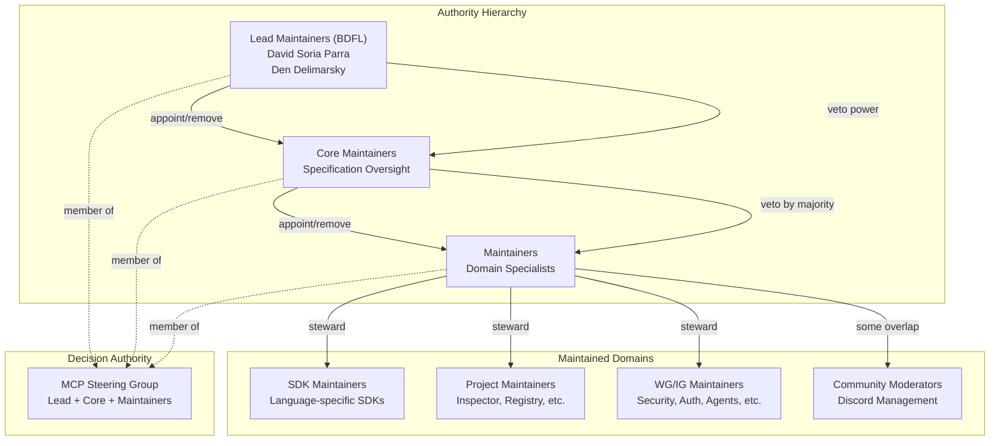
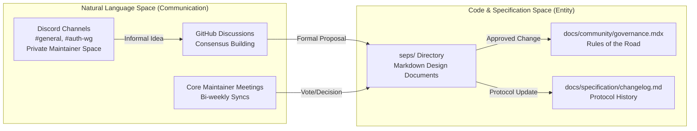

<!-- source: DeepWiki mcp.deepwiki.com · repo modelcontextprotocol/modelcontextprotocol · page 8.1 Governance Structure · fetched 2026-10-21 -->

# Governance Structure

Relevant source files

The following files were used as context for generating this wiki page:

- [MAINTAINERS.md](MAINTAINERS.md)
- [blog/content/posts/2026-04-08-maintainer-update.md](blog/content/posts/2026-04-08-maintainer-update.md)
- [blog/static/posts/images/maintainer-update-2026-04/clare.webp](blog/static/posts/images/maintainer-update-2026-04/clare.webp)
- [blog/static/posts/images/maintainer-update-2026-04/den.jpeg](blog/static/posts/images/maintainer-update-2026-04/den.jpeg)
- [docs/community/communication.mdx](docs/community/communication.mdx)
- [docs/community/governance.mdx](docs/community/governance.mdx)
- [docs/community/sep-guidelines.mdx](docs/community/sep-guidelines.mdx)
- [docs/docs/tutorials/security/authorization.mdx](docs/docs/tutorials/security/authorization.mdx)
- [seps/2085-governance-succession-and-amendment.md](seps/2085-governance-succession-and-amendment.md)

This document describes the hierarchical governance model for the Model Context Protocol project, including the roles, responsibilities, authority relationships, and succession procedures. For the complete list of current maintainers, see [Maintainers and Roles](#8.2). For information about Working Groups and Interest Groups, see [Working Groups and Interest Groups](#8.3). For SEP procedures, see [Specification Enhancement Process (SEP)](#7.2).

## Purpose and Scope

The MCP project adopts a three-tier hierarchical governance structure similar to Python, PyTorch, and other major open source projects [docs/community/governance.mdx:22-30](). This structure ensures clear decision-making authority while enabling distributed maintenance across multiple domains (SDKs, projects, working groups). The governance model balances the need for decisive leadership with community participation and transparent processes.

## Hierarchical Authority Model

The governance structure consists of three levels of maintainership, each with distinct responsibilities and authority. Together, these roles form the **MCP Steering Group** [docs/community/governance.mdx:36-37]().

### Governance Hierarchy Diagram

**Sources:** [docs/community/governance.mdx:20-38](), [MAINTAINERS.md:7-155]()

The governance hierarchy implements a clear chain of authority with explicit veto powers. Lead Maintainers can veto any decision by Core Maintainers or Maintainers [docs/community/governance.mdx:52-53](). Core Maintainers can veto decisions by Maintainers through majority vote [docs/community/governance.mdx:50-51](). This structure is often referred to as "Benevolent Dictator for Life" (BDFL) in open source governance [docs/community/governance.mdx:34-34]().

## Governance Roles and Responsibilities

### Lead Maintainers (BDFL)

The Lead Maintainers serve as the ultimate decision-makers for the MCP project.

| Current Lead Maintainers | Status | GitHub |
|-------------------------|--------|--------|
| David Soria Parra | Active | [dsp-ant](https://github.com/dsp-ant) |
| Den Delimarsky | Active | [localden](https://github.com/localden) |
| Justin Spahr-Summers | Emeritus | [jspahrsummers](https://github.com/jspahrsummers) |

**Authority:**
- Final decision authority and veto power over any decision by Core Maintainers or Maintainers [docs/community/governance.mdx:52-53]().
- Appointment and removal of Core Maintainers [docs/community/governance.mdx:52-53]().
- Administrator access to all project infrastructure [docs/community/governance.mdx:52-53]().

**Sources:** [MAINTAINERS.md:7-11](), [MAINTAINERS.md:24-24](), [docs/community/governance.mdx:52-53](), [blog/content/posts/2026-04-08-maintainer-update.md:35-35]()

### Core Maintainers

Core Maintainers steer the MCP specification and overall project direction.

**Key Responsibilities:**
- Drive overall project direction and oversee contributors and maintainers [docs/community/governance.mdx:33-33]().
- Veto Maintainer decisions by majority vote and resolve disputes [docs/community/governance.mdx:50-51]().
- Appoint or remove Maintainers [docs/community/governance.mdx:50-51]().
- Admin access to all MCP repositories while using the standard PR workflow [docs/community/governance.mdx:50-51]().

**Current Core Maintainers (Partial List):**
- Caitie McCaffrey [MAINTAINERS.md:14-14]()
- Clare Liguori [MAINTAINERS.md:15-15]()
- Kurtis Van Gent [MAINTAINERS.md:16-16]()
- Nick Aldridge [MAINTAINERS.md:17-17]()
- Nick Cooper [MAINTAINERS.md:18-18]()
- Paul Carleton [MAINTAINERS.md:19-19]()
- Peter Alexander [MAINTAINERS.md:20-20]()

**Sources:** [MAINTAINERS.md:12-21](), [docs/community/governance.mdx:50-51](), [blog/content/posts/2026-04-08-maintainer-update.md:15-15]()

### Maintainers

Maintainers steward specific areas such as SDKs, documentation, or Working Groups. They make decisions for their area independently and escalate to Core Maintainers when needed [docs/community/governance.mdx:48-49]().

**Maintainer Categories:**
- **SDK Maintainers**: Responsible for specific language implementations (e.g., Python, TypeScript, Java, Go) [MAINTAINERS.md:28-108]().
- **Project Maintainers**: Oversee specific tools like the MCP Inspector, Registry, and Reference Servers [MAINTAINERS.md:109-146]().
- **WG/IG Maintainers**: Facilitate specific interest and working groups [MAINTAINERS.md:156-211]().

**Sources:** [MAINTAINERS.md:28-211](), [docs/community/governance.mdx:48-49]()

## Governance Succession and Amendment (SEP-2085)

Formal procedures exist for leadership transitions and governance changes to ensure project continuity, as established in SEP-2085.

### Succession Process
- **Lead Maintainer Departure**: Triggered by written notice or determination of inability to serve [seps/2085-governance-succession-and-amendment.md:30-31]().
- **Successor Appointment**: If one Lead Maintainer remains, they appoint a successor. If no Lead Maintainers remain, Core Maintainers appoint a successor by majority vote within 30 days [seps/2085-governance-succession-and-amendment.md:32-34]().
- **Interim Governance**: During a complete Lead Maintainer vacancy, the project operates by a two-thirds (2/3) vote of Core Maintainers [seps/2085-governance-succession-and-amendment.md:34-35]().

### Amendment Process
- **Proposal Authority**: Amendments to the governance structure may only be proposed by Lead Maintainers [seps/2085-governance-succession-and-amendment.md:38-38]().
- **Approval Requirement**: Amendments must be approved by a two-thirds (2/3) majority of all Core Maintainers [seps/2085-governance-succession-and-amendment.md:38-38]().
- **Procedure**: Proposals must be in writing, include specific rationale and language, and allow for a minimum 5-day comment period before a recorded vote [seps/2085-governance-succession-and-amendment.md:40-46]().

**Sources:** [seps/2085-governance-succession-and-amendment.md:28-46]()

## Decision-Making Process

### Decision Venues
| Venue | Purpose | Frequency |
|-------|---------|-----------|
| **Core Maintainer Meetings** | Discuss and vote on proposals | Bi-weekly [docs/community/governance.mdx:58-58]() |
| **Maintainer Discord** | Small proposals and technical coordination | Ongoing [docs/community/governance.mdx:58-58]() |
| **Steering Group Meetings** | High-level alignment and in-person sync | Every 3-6 months [docs/community/governance.mdx:60-60]() |

### Decision Recording
To ensure transparency, all significant decisions are documented in public channels:
- **Technical/Governance Decisions**: Recorded in GitHub Issues and SEPs [docs/community/communication.mdx:99-102]().
- **Specification Changes**: Tracked in the Protocol Changelog [docs/community/communication.mdx:100-100]().
- **Transparency Rule**: All technical decisions affecting the community discussed in private channels must be moved to GitHub and labeled with `notes` [docs/community/communication.mdx:52-54]().

**Sources:** [docs/community/governance.mdx:58-60](), [docs/community/communication.mdx:93-102]()

## Communication and Data Flow

The following diagram illustrates how governance discussions translate from informal spaces into formal protocol artifacts.

**Sources:** [docs/community/communication.mdx:8-58](), [docs/community/governance.mdx:42-43](), [docs/community/sep-guidelines.mdx:47-69]()

## Legal and Policy Framework

The Model Context Protocol is established as **Model Context Protocol a Series of LF Projects, LLC** [docs/community/governance.mdx:10-10]().

| Aspect | Policy |
|--------|--------|
| **Entity** | LF Projects, LLC [docs/community/governance.mdx:10-10]() |
| **Code License** | Apache License, Version 2.0 [docs/community/governance.mdx:14-14]() |
| **Docs License** | Creative Commons Attribution 4.0 [docs/community/governance.mdx:18-18]() |
| **Copyright** | Retained by contributors as independent works [docs/community/governance.mdx:12-12]() |

**Sources:** [docs/community/governance.mdx:8-18]()

---

