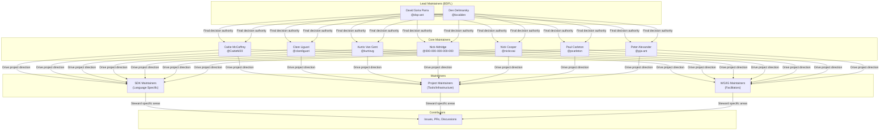
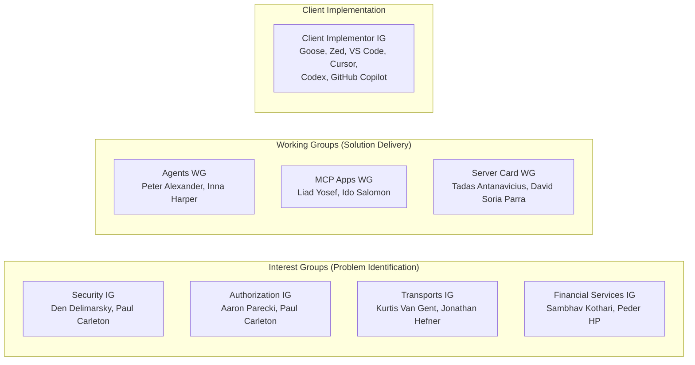

<!-- source: DeepWiki mcp.deepwiki.com · repo modelcontextprotocol/modelcontextprotocol · page 8.2 Maintainers and Roles · fetched 2026-10-21 -->

# Maintainers and Roles

Relevant source files

The following files were used as context for generating this wiki page:

- [MAINTAINERS.md](MAINTAINERS.md)
- [blog/content/posts/2026-01-22-core-maintainer-update.md](blog/content/posts/2026-01-22-core-maintainer-update.md)
- [blog/content/posts/2026-04-08-maintainer-update.md](blog/content/posts/2026-04-08-maintainer-update.md)
- [blog/static/posts/images/maintainer-update-2026-04/clare.webp](blog/static/posts/images/maintainer-update-2026-04/clare.webp)
- [blog/static/posts/images/maintainer-update-2026-04/den.jpeg](blog/static/posts/images/maintainer-update-2026-04/den.jpeg)
- [docs/community/communication.mdx](docs/community/communication.mdx)
- [docs/community/governance.mdx](docs/community/governance.mdx)
- [docs/community/sep-guidelines.mdx](docs/community/sep-guidelines.mdx)
- [docs/docs/tutorials/security/authorization.mdx](docs/docs/tutorials/security/authorization.mdx)

This page catalogs the current maintainers of the Model Context Protocol (MCP) project, their specific responsibilities, SDK ownership, and working group facilitation. The MCP project operates under a formal governance model with a hierarchical structure designed to ensure protocol stability and community growth.

**Note:** This roster is maintained in [MAINTAINERS.md:1-211]() and was last updated May 1, 2026.

## Governance Roles and Hierarchy

The MCP project adopts a hierarchical structure similar to major open-source projects like Python and PyTorch [docs/community/governance.mdx:22-23](). The **MCP Steering Group** is composed of Lead, Core, and specialized Maintainers [docs/community/governance.mdx:36-36]().

### Technical Governance Hierarchy

**Sources:** [MAINTAINERS.md:7-21](), [docs/community/governance.mdx:22-54](), [blog/content/posts/2026-04-08-maintainer-update.md:14-41]()

### Role Definitions

| Role | Scope | Authority |
| :--- | :--- | :--- |
| **Lead Maintainers** | Entire MCP Ecosystem | Final decision authority (BDFL); appoint and remove Core Maintainers [docs/community/governance.mdx:52-53](). |
| **Core Maintainers** | Spec & Project Direction | Steer the MCP specification; veto Maintainer decisions by majority vote; appoint/remove Maintainers [docs/community/governance.mdx:50-51](). |
| **Maintainers** | Specific Components | Steward SDKs, documentation, or Working Groups; make decisions for their area independently [docs/community/governance.mdx:48-49](). |
| **Contributors** | Code & Feedback | File issues and submit pull requests using the standard contribution process [docs/community/governance.mdx:31-31](). |

**Sources:** [docs/community/governance.mdx:24-54]()

## SDK Maintainers

SDK maintainers are responsible for language-specific implementations of the MCP protocol. They ensure conformance with the specification and manage release cycles for their respective libraries [docs/community/governance.mdx:48-49]().

### SDK Ownership Matrix

| SDK | Maintainers |
| :--- | :--- |
| **TypeScript** | Inna Harper, Felix Weinberger, Olivier Chafik, Konstantin Konstantinov, Matt Carey [MAINTAINERS.md:84-91]() |
| **Python** | Inna Harper, Jerome Swannack, Marcelo Trylesinski, Max Isbey, Felix Weinberger [MAINTAINERS.md:76-83]() |
| **Java** | Christian Tzolov, Dariusz Jędrzejczyk, Daniel Garnier-Moiroux, Mark Pollack [MAINTAINERS.md:30-36]() |
| **Go** | Maciej Kisiel, Yaroslav Shevchuk, Guglielmo Colombo, Jonathan Amsterdam [MAINTAINERS.md:51-57]() |
| **C#** | Stephan Halter, Mike Kistler, Den Delimarsky, Eirik Tsarpalis, Stephen Toub [MAINTAINERS.md:59-65]() |
| **Rust** | Alex Hancock, Michael Bolin, Bradley Axen, Jack Amadeo, Michael Neale [MAINTAINERS.md:92-99]() |
| **Swift** | Matt Zmuda, Carl Peaslee, Maksym Mova, Stephen Tallent [MAINTAINERS.md:44-50]() |
| **Kotlin** | Leonid Stashevsky, Sergey Ignatov, Konstantin Pavlov, Pavel Gorgulov, Briliantov Vadim, Sergei Dubov, Maria Tigina [MAINTAINERS.md:66-75]() |
| **Ruby** | Topher Bullock, Koichi Ito, Ateş Göral, Jonathan Hefner [MAINTAINERS.md:37-43]() |
| **PHP** | Kyrian Obikwelu, Christopher Hertel, Fabien Potencier, Nicolas Grekas, Tobias Nyholm, Roman Pronskiy [MAINTAINERS.md:100-108]() |

**Sources:** [MAINTAINERS.md:30-108]()

## Project Maintainers

These maintainers oversee core tools, infrastructure, and reference implementations that support the MCP ecosystem [MAINTAINERS.md:109-146]().

| Project | Maintainers |
| :--- | :--- |
| **Inspector** | Cliff Hall, Konstantin Konstantinov, Ola Hungerford, Bob Dickinson [MAINTAINERS.md:115-121]() |
| **Registry** | Tadas Antanavicius, Radoslav (Rado) Dimitrov, Bob Dickinson [MAINTAINERS.md:122-127]() |
| **Reference Servers** | Ola Hungerford, Cliff Hall, Tadas Antanavicius, Shaun Smith, Jonathan Hefner [MAINTAINERS.md:139-146]() |
| **use-mcp** | Glen Maddern [MAINTAINERS.md:111-114]() |
| **MCPB (Bundle)** | Alexander Sklar, Adam Jones, Joan Xie [MAINTAINERS.md:133-138]() |

**Sources:** [MAINTAINERS.md:111-146]()

## Working Group (WG) & Interest Group (IG) Facilitation

Collaboration is organized around Interest Groups (problem identification) and Working Groups (solution delivery) [docs/community/governance.mdx:70-75]().

### Group Organization

**Sources:** [MAINTAINERS.md:156-211](), [docs/community/governance.mdx:68-75]()

### Group Maintainer Details

*   **Security IG:** Den Delimarsky, Paul Carleton, Jenn Newton [MAINTAINERS.md:160-165](). Focuses on protocol security and vulnerability management.
*   **Authorization IG:** Aaron Parecki, Darin McAdams, Paul Carleton [MAINTAINERS.md:166-171](). Stewards the OAuth 2.1-based authorization specification [docs/docs/tutorials/security/authorization.mdx:8-9]().
*   **Transports IG:** Kurtis Van Gent, Jonathan Hefner, Shaun Smith, Harvey Tuch [MAINTAINERS.md:189-195](). Oversees evolution of stdio and HTTP transports.
*   **Agents WG:** Peter Alexander, Luca Chang, Inna Harper [MAINTAINERS.md:202-207](). Focuses on agentic execution models and unsolicited tasks.
*   **Server Card WG:** Tadas Antanavicius, David Soria Parra, Sam Morrow [MAINTAINERS.md:196-201](). Develops standards for server discovery and metadata.
*   **Client Implementor IG:** Representatives from Goose (Alex Hancock), Zed (Ben Brandt), VS Code (Connor Peet, Tyler Leonhardt), Codex (Gabriel Peal), GitHub Copilot (Jun Han), and Cursor (Michael Feldstein) [MAINTAINERS.md:172-183]().

**Sources:** [MAINTAINERS.md:156-211]()

## Contact and Communication

Technical governance and coordination are primarily facilitated through the shared Discord server and GitHub [docs/community/communication.mdx:8-17]().

*   **Discord:** [MCP Contributor Discord](https://discord.gg/6CSzBmMkjX). Used for real-time discussion, WG/IG coordination, and maintainer availability [docs/community/communication.mdx:12-22]().
*   **GitHub Discussions:** Used for structured, long-form debate on project direction and roadmap planning [docs/community/communication.mdx:60-71]().
*   **Security Reporting:** Security issues should **never** be posted publicly. Use the private reporting process in `SECURITY.md` or contact Lead/Core Maintainers directly [docs/community/communication.mdx:85-92]().

**Sources:** [docs/community/communication.mdx:8-92](), [docs/community/governance.mdx:40-43]()

---

