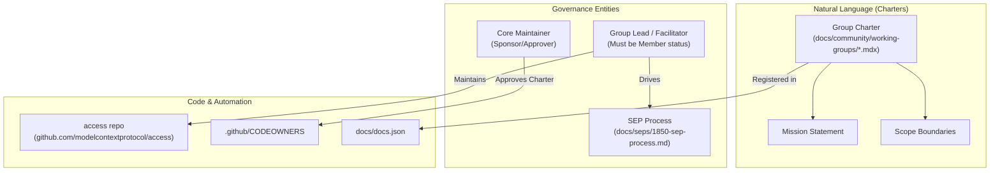
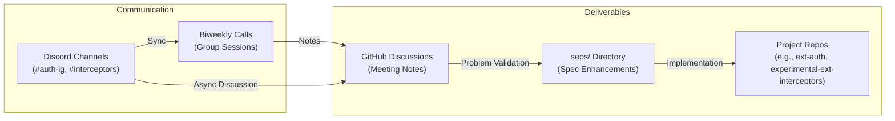

<!-- source: DeepWiki mcp.deepwiki.com · repo modelcontextprotocol/modelcontextprotocol · page 8.3 Working Groups and Interest Groups · fetched 2026-10-21 -->

# Working Groups and Interest Groups

Relevant source files

The following files were used as context for generating this wiki page:

- [.github/CODEOWNERS](.github/CODEOWNERS)
- [docs/community/charter-template.mdx](docs/community/charter-template.mdx)
- [docs/community/contributor-ladder.mdx](docs/community/contributor-ladder.mdx)
- [docs/community/interest-groups/auth.mdx](docs/community/interest-groups/auth.mdx)
- [docs/community/interest-groups/enterprise-managed-authorization.mdx](docs/community/interest-groups/enterprise-managed-authorization.mdx)
- [docs/community/interest-groups/financial-services.mdx](docs/community/interest-groups/financial-services.mdx)
- [docs/community/interest-groups/primitive-grouping.mdx](docs/community/interest-groups/primitive-grouping.mdx)
- [docs/community/interest-groups/security.mdx](docs/community/interest-groups/security.mdx)
- [docs/community/interest-groups/tool-annotations.mdx](docs/community/interest-groups/tool-annotations.mdx)
- [docs/community/working-groups/file-uploads.mdx](docs/community/working-groups/file-uploads.mdx)
- [docs/community/working-groups/inspector-v2.mdx](docs/community/working-groups/inspector-v2.mdx)
- [docs/community/working-groups/interceptors.mdx](docs/community/working-groups/interceptors.mdx)
- [docs/community/working-groups/registry.mdx](docs/community/working-groups/registry.mdx)
- [docs/community/working-groups/sdk.mdx](docs/community/working-groups/sdk.mdx)
- [docs/community/working-groups/server-card.mdx](docs/community/working-groups/server-card.mdx)
- [docs/community/working-interest-groups.mdx](docs/community/working-interest-groups.mdx)
- [docs/seps/2149-working-group-charter-template.mdx](docs/seps/2149-working-group-charter-template.mdx)
- [seps/2149-working-group-charter-template.md](seps/2149-working-group-charter-template.md)

This document describes the collaborative group structures within the Model Context Protocol's governance: **Working Groups** (WGs) and **Interest Groups** (IGs). These groups facilitate focused discussions, problem identification, and deliverable production within specific areas of the MCP ecosystem.

For information about the overall governance structure and maintainer hierarchy, see [Governance Structure](#8.1). For the process of proposing specification changes, see [Specification Enhancement Process (SEP)](#7.2).

## Purpose and Scope

Working Groups and Interest Groups are established to address community feedback regarding unclear authority delegation and inconsistent processes. They provide:
- Standardized governance rules defined in **SEP-2149** [seps/2149-working-group-charter-template.md:12-15]().
- Clear expectations for leadership and participation levels [docs/community/working-interest-groups.mdx:113-123]().
- Explicitly defined boundaries through mandatory charters [docs/community/charter-template.mdx:6-8]().

Sources: [docs/community/working-interest-groups.mdx:1-19](), [seps/2149-working-group-charter-template.md:10-32]()

## Interest Groups vs Working Groups

| Feature | Interest Group (IG) | Working Group (WG) |
| :--- | :--- | :--- |
| **Purpose** | Identify and discuss problems | Build concrete solutions |
| **Output** | Problem statements, use cases, recommendations | SEPs, implementations, code |
| **Commitment** | Active contribution expected | Active contribution expected |
| **Leadership** | Facilitator(s) | Lead(s) |
| **Decisions** | Rough consensus, non-binding | Binding (Lazy consensus → Vote → Escalation) |
| **Duration** | Ongoing as long as topic is relevant | Until deliverables complete |

Sources: [docs/community/working-interest-groups.mdx:8-19](), [seps/2149-working-group-charter-template.md:36-40]()

### Typical Flow
Contributors typically discuss a problem in an IG to validate community support, then form or join a WG to build the solution, eventually submitting a SEP for implementation [docs/community/working-interest-groups.mdx:36]().

## Group Governance and Leadership

### Leadership Requirements
Each group is led by **Leads** (WGs) or **Facilitators** (IGs). They must:
- Hold at least **Member** status on the [Contributor Ladder](./contributor-ladder) [docs/community/working-interest-groups.mdx:85]().
- Be sponsored by at least two Core Maintainers or one Lead Maintainer [docs/community/working-interest-groups.mdx:89]().
- WG Leads additionally commit to 2-3 hours/week for group activities [docs/community/working-interest-groups.mdx:91-94]().

### Participation Tiers
Participation is organized into four levels to ensure clear pathways for involvement:

| Level | Description | Privileges |
| :--- | :--- | :--- |
| **Observer** | Anyone following the work | Read access, attend meetings |
| **Participant** | Active contributor | Propose agenda items, async votes |
| **WG Member** | Sustained contributor (3+ months) | Counted for quorum (WGs only) |
| **Lead/Facilitator** | Operational leadership | Sets agenda, facilitates, escalates |

Sources: [docs/community/working-interest-groups.mdx:113-132](), [seps/2149-working-group-charter-template.md:92-98]()

### Group Decision-Making (WG Only)
Working Groups follow a formal decision-making hierarchy to prevent bottlenecks:
1. **Lazy Consensus**: Proposals are assumed accepted if no objections are raised within 72 hours [docs/community/working-interest-groups.mdx:143-152]().
2. **Formal Vote**: If consensus fails, WG Members vote (simple majority) [docs/community/working-interest-groups.mdx:154-162]().
3. **Escalation**: Blocked decisions are escalated to Core Maintainers [docs/community/working-interest-groups.mdx:164-168]().

## Group Chartering (SEP-2149)

Every group must maintain a charter at `docs/community/working-groups/<name>.mdx` or `docs/community/interest-groups/<name>.mdx` [docs/community/charter-template.mdx:6-7]().

### Charter Template Structure
Charters follow a standardized format to ensure consistency across the ecosystem:
- **Mission Statement**: 2-3 sentence summary of purpose [docs/community/charter-template.mdx:30-38]().
- **Scope**: Explicit "In Scope" and "Out of Scope" sections to prevent mission creep [docs/community/charter-template.mdx:40-59]().
- **Authority & Decision Rights (WG only)**: Matrix defining what the WG can decide autonomously vs. what requires Core Maintainer approval [docs/community/charter-template.mdx:75-94]().
- **Deliverables & Success Metrics (WG only)**: Tracking active work items and target dates [docs/community/charter-template.mdx:121-137]().

Sources: [docs/community/charter-template.mdx:18-143](), [seps/2149-working-group-charter-template.md:205-274]()

## Active Groups

### Interest Groups (IGs)

| Group | Facilitators | Focus |
| :--- | :--- | :--- |
| **Auth IG** | Aaron Parecki, Darin McAdams, Paul Carleton | OAuth 2.1 gaps, enterprise identity, agentic access [docs/community/interest-groups/auth.mdx:46-51](). |
| **Security IG** | TBD | Threat modeling, best practices, and protocol security [docs/community/interest-groups/security.mdx:1-5](). |
| **Enterprise-Managed Auth IG** | Paul Carleton, Aaron Parecki | Interop for the ID-JAG flow and enterprise IdP integration [docs/community/interest-groups/enterprise-managed-authorization.mdx:39-44](). |
| **Financial Services IG** | Sambhav Kothari, Peder H. Pedersen | Compliance, auditability, and risk-controlled deployment [docs/community/interest-groups/financial-services.mdx:75-79](). |
| **Tool Annotations IG** | Sam Morrow, Robert Reichel | Metadata for tool discovery and selection [docs/community/interest-groups/tool-annotations.mdx:38-42](). |
| **Primitive Grouping IG** | Tapan Chugh, Sam Morrow | Organizing Tools/Resources beyond flat lists [docs/community/interest-groups/primitive-grouping.mdx:67-71](). |

### Working Groups (WGs)

| Group | Leads | Deliverables |
| :--- | :--- | :--- |
| **Transports WG** | TBD | Evolution of stdio and HTTP transports [docs/community/charter-template.mdx:151-153](). |
| **Registry WG** | Tadas Antanavicius, Radoslav Dimitrov | `registry.modelcontextprotocol.io`, `server.json` schema [docs/community/working-groups/registry.mdx:38-44](). |
| **Inspector v2 WG** | TBD | Next generation of the MCP Inspector tool [docs/community/working-groups/inspector-v2.mdx:1-5](). |
| **File Uploads WG** | TBD | Standardizing binary and file transfers [docs/community/working-groups/file-uploads.mdx:1-5](). |
| **SDK WG** | TBD | Multi-language SDK tiering and conformance [docs/community/working-groups/sdk.mdx:1-5](). |
| **Server Card WG** | TBD | Standardized metadata for server discovery [docs/community/working-groups/server-card.mdx:1-5](). |
| **Interceptors WG** | Sambhav Kothari, Peder H. Pedersen, et al. | SEP-1763, context validation/mutation primitives [docs/community/working-groups/interceptors.mdx:34-42](). |

## Lifecycle Management

### Creation Workflow
Groups are proposed via the `#wg-ig-group-creation` channel on Discord. Proposals are reviewed by Community Moderators and require sponsorship from Core Maintainers [docs/community/interest-groups/auth.mdx:68-69]().

### Group Entity Relationship
The following diagram illustrates how Group Charters (Natural Language Space) map to Governance and Code Entities (Code Space).

**Title: Group Governance and Code Mapping**

Sources: [docs/community/charter-template.mdx:6-10](), [.github/CODEOWNERS:13-20](), [docs/community/working-interest-groups.mdx:101](), [seps/2149-working-group-charter-template.md:14-15]()

### Operations and Communication
- **Meetings**: Agendas must be published in advance, and notes posted within 48 hours [docs/community/working-interest-groups.mdx:98-99]().
- **Discord**: Primary communication happens in dedicated `#<group-name>` channels on the MCP Contributors Discord [docs/community/interest-groups/auth.mdx:56-64]().
- **Membership**: Managed via the [access repository](https://github.com/modelcontextprotocol/access) [docs/community/working-interest-groups.mdx:101]().

**Title: Communication and Deliverable Flow**

Sources: [docs/community/working-interest-groups.mdx:95-112](), [docs/community/interest-groups/auth.mdx:56-64](), [docs/community/working-groups/interceptors.mdx:57-65]()

---

