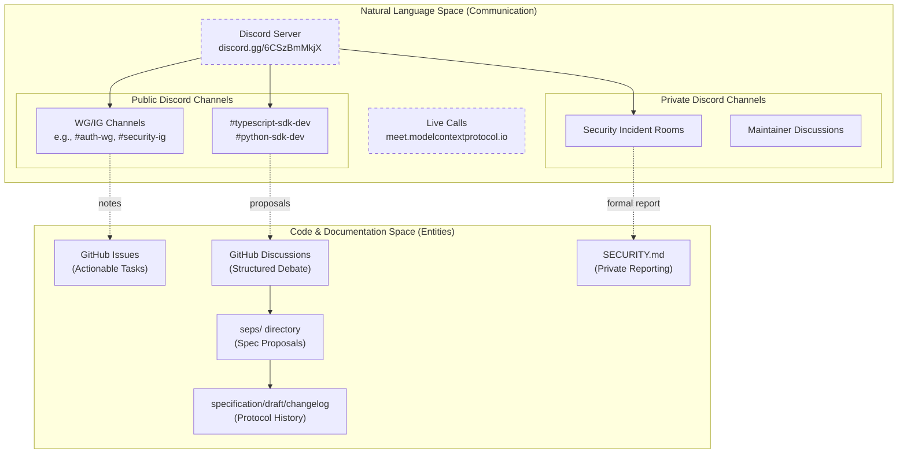

<!-- source: DeepWiki mcp.deepwiki.com · repo modelcontextprotocol/modelcontextprotocol · page 8.4 Communication Channels · fetched 2026-10-21 -->

# Communication Channels

Relevant source files

The following files were used as context for generating this wiki page:

- [MAINTAINERS.md](MAINTAINERS.md)
- [blog/content/posts/2026-04-08-maintainer-update.md](blog/content/posts/2026-04-08-maintainer-update.md)
- [blog/static/posts/images/maintainer-update-2026-04/clare.webp](blog/static/posts/images/maintainer-update-2026-04/clare.webp)
- [blog/static/posts/images/maintainer-update-2026-04/den.jpeg](blog/static/posts/images/maintainer-update-2026-04/den.jpeg)
- [docs/community/communication.mdx](docs/community/communication.mdx)
- [docs/community/governance.mdx](docs/community/governance.mdx)
- [docs/community/sep-guidelines.mdx](docs/community/sep-guidelines.mdx)
- [docs/docs/tutorials/security/authorization.mdx](docs/docs/tutorials/security/authorization.mdx)

This document describes the communication infrastructure for the Model Context Protocol (MCP) project, including where community discussions happen, how decisions are documented, and the policies governing transparency. For governance structure and decision-making processes, see [Governance Structure](#8.1). For the SEP proposal process, see [Specification Enhancement Process (SEP)](#7.2).

## Overview

The MCP project maintains several primary communication channels, each serving distinct purposes in the project lifecycle. These channels are designed to support a distributed, multi-language ecosystem of SDKs and server implementations.

| Channel | Purpose | Formality | Persistence |
| :--- | :--- | :--- | :--- |
| **Discord** | Real-time contributor discussions, coordination | Informal | Transient |
| **Live Calls** | Synchronous WG/IG presentations, reports | Semi-formal | Recorded/Notes |
| **GitHub Discussions** | Long-form proposals, roadmap planning | Semi-formal | Permanent |
| **GitHub Issues** | Actionable tasks, bug reports, tracking | Formal | Permanent |
| **Security Reporting** | Private vulnerability disclosure | Formal | Private |

**Sources:** [docs/community/communication.mdx:8-17]()

## Communication to Code Entity Mapping

The following diagram bridges the natural language space of community interaction with the code and documentation entities that persist those interactions.

**Interaction Flow and Data Persistence**

**Sources:** [docs/community/communication.mdx:8-107](), [docs/community/governance.mdx:40-43](), [docs/community/sep-guidelines.mdx:14-15]()

## Discord Server Structure

### Access and Membership
The [MCP Contributor Discord](https://discord.gg/6CSzBmMkjX) is specifically designed for **MCP contributors** and is not intended for general user support [docs/community/communication.mdx:20-22]().

### Public Channel Categories
Public channels follow a default-open policy for transparency:
*   **SDK and Tooling Development:** Channels like `#typescript-sdk-dev`, `#python-sdk-dev`, and `#inspector-dev` host real-time coordination for core components [docs/community/communication.mdx:30-34]().
*   **WG and IG Discussions:** Channels such as `#auth-wg` and `#security-ig` support the collaborative groups [docs/community/communication.mdx:31-31]().
*   **Public Office Hours:** Maintainers use Discord to coordinate availability and community onboarding [docs/community/communication.mdx:34-35]().

### Private Channel Policies
Private channels are exceptions used for confidential coordination [docs/community/communication.mdx:41-43]().
*   **Criteria:** Security incidents (CVEs), people matters (maintainer discussions, CoC issues), or immediate coordination requiring a limited audience [docs/community/communication.mdx:45-51]().
*   **Transparency Requirements:** Any significant technical or governance discussion on Discord that leads to a potential decision must be moved to GitHub Discussions or Issues for a persistent record [docs/community/communication.mdx:58-59](). Decisions must be documented and labeled with `notes` [docs/community/communication.mdx:52-54]().

**Sources:** [docs/community/communication.mdx:19-59](), [docs/community/governance.mdx:40-43]()

## GitHub Discussions and Issues

### Structured Discussion
GitHub Discussions are the primary tool for structured, long-form debate on project direction [docs/community/communication.mdx:60-62]().
*   **Use cases:** Roadmap planning, announcements, community polls, and feature requests with rationale [docs/community/communication.mdx:64-70]().
*   **Fallback:** If a repository doesn't have Discussions enabled, GitHub Issues are used instead [docs/community/communication.mdx:70-71]().

### Actionable Tasks
GitHub Issues are reserved for actionable development tasks [docs/community/communication.mdx:72-74]().
*   **Use cases:** Bug reports with reproducible steps, documentation improvements, and CI/CD or infrastructure problems [docs/community/communication.mdx:76-81]().

### SEP Relationship
Proposed changes to the specification are submitted as pull requests to the `seps/` directory, not as GitHub Issues [docs/community/communication.mdx:83-84](). The PR-based workflow (e.g., SEP-1850) serves as the historical record of feature proposals [docs/community/sep-guidelines.mdx:14-15]().

**Sources:** [docs/community/communication.mdx:60-84](), [docs/community/sep-guidelines.mdx:14-15]()

## Security and Decision Records

### Security Reporting
Vulnerabilities must **never** be posted publicly [docs/community/communication.mdx:87-88]().
1.  Follow the private security reporting process in `SECURITY.md` [docs/community/communication.mdx:89-89]().
2.  Contact Lead or Core Maintainers directly [docs/community/communication.mdx:90-90]().

### Decision Record System
All MCP decisions follow a documentation hierarchy to ensure context is retained for onboarding engineers.

| Type | Location |
| :--- | :--- |
| **Technical Decisions** | [GitHub Issues](https://github.com/modelcontextprotocol/modelcontextprotocol/issues) and SEPs |
| **Specification Changes** | [Changelog](https://modelcontextprotocol.io/specification/draft/changelog) |
| **Process Changes** | [Community Governance Docs](https://modelcontextprotocol.io/community/governance) |
| **Governance Decisions** | [GitHub Issues](https://github.com/modelcontextprotocol/modelcontextprotocol/issues) and SEPs |

**Sources:** [docs/community/communication.mdx:85-103]()

## Community Events and Meetings

### Working and Interest Groups
Collaboration is organized around Interest Groups (IGs) and Working Groups (WGs) [docs/community/governance.mdx:68-70]().
*   **IGs:** Identify and articulate problems through open discussions [docs/community/governance.mdx:72-72]().
*   **WGs:** Develop concrete solutions and deliverables like SEPs [docs/community/governance.mdx:73-73]().
*   **Live Calls:** Synchronous presentations and progress reports are hosted at `meet.modelcontextprotocol.io` [docs/community/communication.mdx:13-13]().

### Core Maintainer Meetings
The Core Maintainer group meets bi-weekly to discuss and vote on proposals [docs/community/governance.mdx:56-58](). The Steering Group (Lead, Core, and Maintainers) attempts to meet in person every three to six months [docs/community/governance.mdx:60-61]().

**Sources:** [docs/community/governance.mdx:56-75](), [docs/community/communication.mdx:10-15]()

## Moderation and Code of Conduct

All communication is governed by the [Code of Conduct](https://github.com/modelcontextprotocol/modelcontextprotocol/blob/main/CODE_OF_CONDUCT.md) [docs/community/communication.mdx:17-18]().

### Community Moderators
The project designates Community Moderators to ensure respectful interactions [MAINTAINERS.md:147-148]().
*   **Moderator Team:** Includes Ola Hungerford, Cliff Hall, Shaun Smith, Jonathan Hefner, Tadas Antanavicius, and Peder Holdgaard Pedersen [MAINTAINERS.md:149-154]().

### Usage Guidelines
*   **Avoid Marketing:** Keep discussions vendor-neutral; mentions of brands are discouraged except as technical examples [docs/community/communication.mdx:39-40]().
*   **No General Support:** Discord is for contributors. Users should use official documentation or GitHub Discussions for support [docs/community/communication.mdx:38-38]().

**Sources:** [docs/community/communication.mdx:17-40](), [MAINTAINERS.md:147-154]()

---

