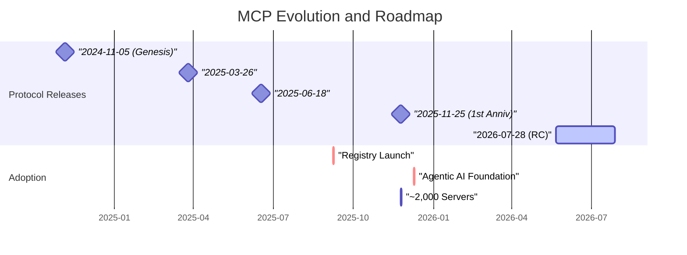
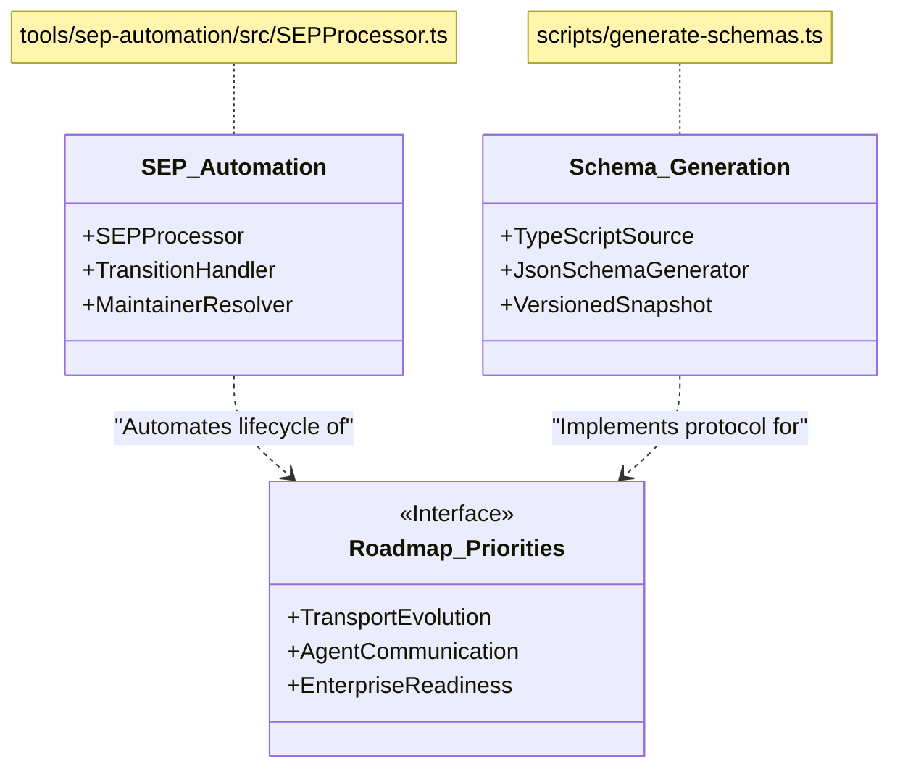
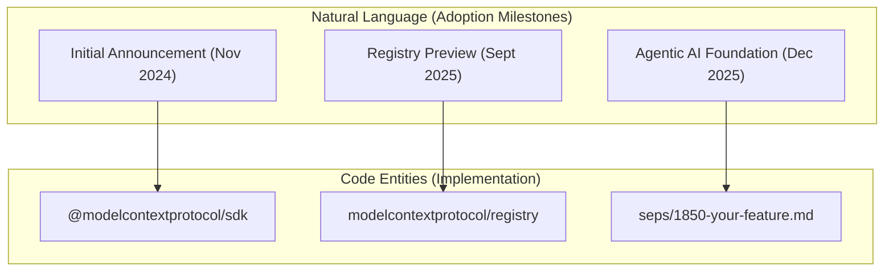

<!-- source: DeepWiki mcp.deepwiki.com · repo modelcontextprotocol/modelcontextprotocol · page 8.5 Release History and Roadmap · fetched 2026-10-21 -->

# Release History and Roadmap

Relevant source files

The following files were used as context for generating this wiki page:

- [blog/archetypes/default.md](blog/archetypes/default.md)
- [blog/content/posts/2025-07-29-prompts-for-automation.md](blog/content/posts/2025-07-29-prompts-for-automation.md)
- [blog/content/posts/2025-07-31-governance-for-mcp.md](blog/content/posts/2025-07-31-governance-for-mcp.md)
- [blog/content/posts/2025-09-05-php-sdk.md](blog/content/posts/2025-09-05-php-sdk.md)
- [blog/content/posts/2025-09-08-mcp-registry-preview.md](blog/content/posts/2025-09-08-mcp-registry-preview.md)
- [blog/content/posts/2025-09-26-mcp-next-version-update.md](blog/content/posts/2025-09-26-mcp-next-version-update.md)
- [blog/content/posts/2025-11-03-using-server-instructions.md](blog/content/posts/2025-11-03-using-server-instructions.md)
- [blog/content/posts/2025-11-20-adopting-mcpb.md](blog/content/posts/2025-11-20-adopting-mcpb.md)
- [blog/content/posts/2025-11-21-mcp-apps.md](blog/content/posts/2025-11-21-mcp-apps.md)
- [blog/content/posts/2025-11-25-first-mcp-anniversary.md](blog/content/posts/2025-11-25-first-mcp-anniversary.md)
- [blog/content/posts/2025-11-28-sep-process-update.md](blog/content/posts/2025-11-28-sep-process-update.md)
- [blog/content/posts/2025-12-09-mcp-joins-agentic-ai-foundation.md](blog/content/posts/2025-12-09-mcp-joins-agentic-ai-foundation.md)
- [blog/content/posts/2026-05-21-mcp-2026-07-28-rc.md](blog/content/posts/2026-05-21-mcp-2026-07-28-rc.md)
- [blog/content/posts/welcome-to-mcp-blog.md](blog/content/posts/welcome-to-mcp-blog.md)
- [blog/static/posts/images/2026-07-28-rc/handle-pattern.svg](blog/static/posts/images/2026-07-28-rc/handle-pattern.svg)
- [blog/static/posts/images/2026-07-28-rc/stateless-topology.svg](blog/static/posts/images/2026-07-28-rc/stateless-topology.svg)
- [docs/development/roadmap.mdx](docs/development/roadmap.mdx)
- [docs/specification/2025-06-18/basic/lifecycle.mdx](docs/specification/2025-06-18/basic/lifecycle.mdx)
- [docs/specification/2025-06-18/changelog.mdx](docs/specification/2025-06-18/changelog.mdx)
- [docs/specification/2025-06-18/index.mdx](docs/specification/2025-06-18/index.mdx)
- [docs/specification/2025-06-18/server/index.mdx](docs/specification/2025-06-18/server/index.mdx)

This document chronicles the evolution of the Model Context Protocol through its major releases, documenting the key features and Specification Enhancement Proposals (SEPs) introduced in each version. It also outlines the protocol's versioning scheme, release cadence, and future roadmap based on active working group priorities.

## Versioning Scheme

MCP uses a **date-based versioning scheme** in YYYY-MM-DD format. Each version identifier represents the date of the last breaking change to the protocol.

- **Legacy versions** (2024-11-05 through 2025-06-18): Use JSON Schema draft-07.
- **Modern versions** (2025-11-25 onward): Use JSON Schema 2020-12 with updated terminology (e.g., `$defs` instead of `definitions`).
- **Draft Version**: The special identifier `draft` represents active development and may change without notice.

**Sources:** [blog/content/posts/2025-11-25-first-mcp-anniversary.md:1-20](), [blog/content/posts/2025-09-26-mcp-next-version-update.md:15-22]()

## Release Timeline and Milestones

MCP followed an accelerated early release cycle, maturing into a quarterly cadence overseen by the Linux Foundation.

Title: MCP Evolution and Roadmap

**Sources:** [blog/content/posts/2025-11-25-first-mcp-anniversary.md:17-35](), [blog/content/posts/2025-09-26-mcp-next-version-update.md:15-25](), [blog/content/posts/2025-12-09-mcp-joins-agentic-ai-foundation.md:1-10]()

## Release History

### Version 2024-11-05 (Genesis)
The initial release established the core JSON-RPC 2.0 foundation.
- **Transports**: Introduced `stdio` and initial HTTP+SSE patterns.
- **Primitives**: Tools, Resources, and Prompts.
- **Lifecycle**: Initial `initialize` handshake. [docs/specification/2025-06-18/basic/lifecycle.mdx:38-74]()

### Version 2025-06-18
Focused on transport standardization and security.
- **Streamable HTTP**: Standardized the HTTP transport mechanism. [blog/content/posts/2025-09-26-mcp-next-version-update.md:64-65]()
- **Structured Tool Output**: Added support for complex tool results. [blog/content/posts/2025-09-26-mcp-next-version-update.md:23-26]()
- **OAuth-based Authorization**: Integrated OAuth 2.1 for secure resource access. [blog/content/posts/2025-09-26-mcp-next-version-update.md:23-26]()
- **Elicitation**: Support for server-initiated user interactions. [blog/content/posts/2025-09-26-mcp-next-version-update.md:23-26]()

### Version 2025-11-25 (First Anniversary)
Major leap in agentic capabilities and ecosystem maturation.
- **Asynchronous Operations (SEP-1391)**: Support for long-running tasks. [blog/content/posts/2025-09-26-mcp-next-version-update.md:55-60]()
- **Statelessness and Scalability**: Improvements to Streamable HTTP for enterprise-scale deployments. [blog/content/posts/2025-09-26-mcp-next-version-update.md:61-66]()
- **Server Identity**: Introduction of `.well-known` URLs for server discovery. [blog/content/posts/2025-09-26-mcp-next-version-update.md:67-72]()
- **Official Extensions**: Standardization of common industry patterns (e.g., MCP Apps/SEP-1865). [blog/content/posts/2025-11-21-mcp-apps.md:22-24](), [blog/content/posts/2025-09-26-mcp-next-version-update.md:73-78]()
- **SDK Tiering**: Clear classification system for SDK support and compliance. [blog/content/posts/2025-09-26-mcp-next-version-update.md:79-84]()
- **MCP Bundles (.mcpb)**: Standardized distribution format for local servers. [blog/content/posts/2025-11-20-adopting-mcpb.md:15-30]()

### Draft Release Candidate (2026-07-28)
A fundamental shift toward stateless, horizontally scalable architecture.
- **Stateless Capability Negotiation**: Moving from the `initialize` handshake to per-request capability headers.
- **Server Discover**: New `server/discover` method to replace the monolithic `initialize` result.
- **MRTR Pattern**: Model-Request-Tool-Response pattern for cleaner agentic loops.
- **Handle Pattern**: Stateful tool handles for managing resources across requests in a stateless transport.

**Sources:** [blog/content/posts/2025-11-25-first-mcp-anniversary.md:19-65](), [blog/content/posts/2025-09-26-mcp-next-version-update.md:51-84](), [blog/content/posts/2025-11-20-adopting-mcpb.md:15-30]()

## Strategic Roadmap (2026+)

The roadmap is driven by Working Groups (WGs) addressing production scaling and enterprise requirements.

### 1. Transport Evolution and Scalability
The **Transports WG** is evolving Streamable HTTP to support stateless operation across multiple server instances behind load balancers.
- **Session Resumption**: Protocols for migrating sessions across server restarts. [docs/development/roadmap.mdx:30-31]()
- **MCP Server Cards**: `.well-known` metadata for capability discovery without connection. [docs/development/roadmap.mdx:32-33]()

### 2. Agent Communication
The **Agents WG** is refining the Tasks primitive and agentic patterns.
- **Retry Semantics**: Defining failure handling for transient task errors. [docs/development/roadmap.mdx:45-46]()
- **Expiry Policies**: Standardizing result retention and expiration notifications. [docs/development/roadmap.mdx:46-47]()

### 3. Enterprise Readiness
The **Enterprise WG** (proposed) focuses on high-compliance environments.
- **Audit Trails**: End-to-end visibility for logging and compliance pipelines. [docs/development/roadmap.mdx:66-67]()
- **Managed Auth**: SSO-integrated flows to replace static client secrets. [docs/development/roadmap.mdx:68-69]()
- **Gateway Patterns**: Standardizing behavior for intermediaries and proxies. [docs/development/roadmap.mdx:70-71]()

### 4. Governance Maturation
The **Governance WG** is formalizing the community leadership path.
- **Contributor Ladder**: Defined progression from participant to Core Maintainer. [docs/development/roadmap.mdx:56-57]()
- **Delegation Model**: Allowing WGs to accept SEPs within their domain autonomously. [docs/development/roadmap.mdx:58-59]()

**Sources:** [docs/development/roadmap.mdx:16-72]()

## Code Entity Mapping: Release Infrastructure

This diagram maps release and roadmap concepts to the code entities that manage them.

Title: Release and Roadmap Infrastructure

**Sources:** [docs/development/roadmap.mdx:16-72](), [blog/content/posts/2025-11-28-sep-process-update.md:14-46]()

## Protocol Adoption Trajectory

MCP's growth from a "small experiment" to an industry standard.

Title: Evolution from Experiment to Standard

**Sources:** [blog/content/posts/2025-11-25-first-mcp-anniversary.md:17-35](), [blog/content/posts/2025-12-09-mcp-joins-agentic-ai-foundation.md:1-10](), [blog/content/posts/2025-11-28-sep-process-update.md:30-41]()

---

