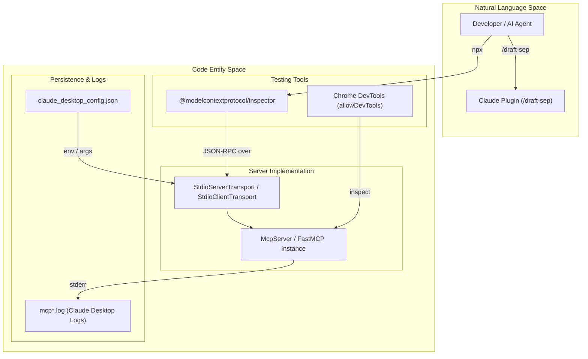

<!-- source: DeepWiki mcp.deepwiki.com · repo modelcontextprotocol/modelcontextprotocol · page 9 Tools and Debugging · fetched 2026-10-21 -->

# Tools and Debugging

<details>
<summary>Relevant source files</summary>

The following files were used as context for generating this wiki page:

- [blog/content/posts/2026-01-26-mcp-apps.md](blog/content/posts/2026-01-26-mcp-apps.md)
- [docs/community/sdk-tiers.mdx](docs/community/sdk-tiers.mdx)
- [docs/docs/getting-started/intro.mdx](docs/docs/getting-started/intro.mdx)
- [docs/docs/tools/debugging.mdx](docs/docs/tools/debugging.mdx)
- [docs/docs/tools/inspector.mdx](docs/docs/tools/inspector.mdx)
- [docs/extensions/apps/build.mdx](docs/extensions/apps/build.mdx)
- [docs/extensions/apps/overview.mdx](docs/extensions/apps/overview.mdx)
- [docs/extensions/auth/oauth-client-credentials.mdx](docs/extensions/auth/oauth-client-credentials.mdx)
- [docs/extensions/auth/overview.mdx](docs/extensions/auth/overview.mdx)
- [docs/extensions/client-matrix.mdx](docs/extensions/client-matrix.mdx)
- [docs/extensions/overview.mdx](docs/extensions/overview.mdx)
- [docs/extensions/tasks/overview.mdx](docs/extensions/tasks/overview.mdx)

</details>


This page provides a high-level overview of the development tools, debugging techniques, and AI-assisted utilities available for working with the Model Context Protocol (MCP). The ecosystem includes the **MCP Inspector** for interactive server testing, a comprehensive suite of **Debugging Techniques** for troubleshooting integrations, and a specialized **Claude Plugin** for researching and drafting protocol enhancements.

## Overview

Developing for MCP requires visibility into the JSON-RPC message exchange and the execution environment of servers. Because many MCP servers run as subprocesses (STDIO transport), standard debugging patterns like `print()` can interfere with protocol operations [docs/docs/tools/debugging.mdx:36-41](). The tooling ecosystem is designed to provide this visibility without disrupting the communication flow.

For detailed documentation on specific tools, see the child pages:
- **[MCP Inspector](#9.1)**: Interactive testing UI for servers.
- **[Development Tools and Debugging](#9.2)**: Log analysis, environment handling, and troubleshooting.
- **[Claude Plugin for MCP Spec](#9.3)**: AI skills for SEP drafting and GitHub research.

## MCP Inspector

The **MCP Inspector** is a command-line utility that provides a web-based interface for testing MCP servers in isolation [docs/docs/tools/inspector.mdx:6-7](). It acts as a reference client, allowing developers to discover and execute tools, resources, and prompts without needing to configure a full host application like Claude Desktop [docs/docs/tools/inspector.mdx:84-112]().

### Execution and Interface
The Inspector is typically invoked via `npx` and launches the target server as a subprocess using the `stdio` transport [docs/docs/tools/inspector.mdx:12-16]().

```bash
npx @modelcontextprotocol/inspector <command> <args>
```

The interface allows for:
- **Tool Testing**: Validating input schemas and viewing execution results [docs/docs/tools/inspector.mdx:105-110]().
- **Resource Inspection**: Reading contents and monitoring MIME types [docs/docs/tools/inspector.mdx:91-96]().
- **Notification Tracking**: Real-time monitoring of server-sent events and logs [docs/docs/tools/inspector.mdx:112-115]().

For details, see [MCP Inspector](#9.1).

**Sources**: [docs/docs/tools/inspector.mdx:6-115](), [docs/docs/tools/debugging.mdx:14-19]()

## Debugging Techniques

Debugging MCP integrations involves monitoring the "outer" transport layer and the "inner" data layer. A critical pitfall in MCP development is **STDIO stream corruption**: writing directly to `stdout` in a local server will break the JSON-RPC framing [docs/docs/tools/debugging.mdx:36-41]().

### Key Debugging Strategies
- **Logging to Stderr**: Servers must use `stderr` for traditional logging to avoid corrupting the protocol stream [docs/docs/tools/debugging.mdx:31-34]().
- **Log Message Notifications**: Using the `notifications/message` method to send structured logs to the client [docs/docs/tools/debugging.mdx:51-73]().
- **Client Logs**: Accessing host-specific logs (e.g., `~/Library/Logs/Claude` on macOS) to see connection events and raw message exchanges [docs/docs/tools/debugging.mdx:203-225]().
- **Environment Handling**: Ensuring servers have the correct absolute paths and environment variables, as subprocesses often inherit a restricted environment [docs/docs/tools/debugging.mdx:98-107]().

For details, see [Development Tools and Debugging](#9.2).

**Sources**: [docs/docs/tools/debugging.mdx:31-107](), [docs/docs/tools/debugging.mdx:203-225]()

## Claude Plugin for MCP Spec

The `plugins/mcp-spec` directory contains a specialized plugin for Claude that assists in the evolution of the protocol. It provides "Agent Skills" that encode the governance and research processes of the MCP project.

### Available Skills
- **`/search-mcp-github`**: Performs deep-dive research across the `modelcontextprotocol` GitHub organization, including issues, PRs, and Discussions, to find historical design rationale.
- **`/draft-sep`**: An interactive workflow that interviews an author, checks current specification coverage, and generates a Specification Enhancement Proposal (SEP) following the official template.

For details, see [Claude Plugin for MCP Spec](#9.3).

**Sources**: [plugins/mcp-spec/skills/draft-sep/SKILL.md:1-13](), [plugins/mcp-spec/skills/search-mcp-github/SKILL.md:1-10]()

## Tooling and Debugging Architecture

The following diagram illustrates how debugging tools sit between the "Natural Language Space" (where the developer or AI operates) and the "Code Entity Space" (the protocol implementation).

### Debugging Data Flow

**Sources**: [docs/docs/tools/debugging.mdx:14-25](), [docs/docs/tools/debugging.mdx:232-237](), [docs/docs/tools/inspector.mdx:84-89]()

### AI-Assisted Development Workflow
This diagram shows how Agent Skills bridge the gap between high-level ideas and concrete codebase entities like the SEP templates.

```mermaid
graph LR
    subgraph "Natural Language Space"
        Idea["'Add WebSocket Transport'"]
        Research["Prior Art Research"]
    end

    subgraph "Code Entity Space"
        Skill["plugins/mcp-spec/skills/draft-sep"]
        Template["seps/TEMPLATE.md"]
        Schema["specification/schema.ts"]
        SEP["seps/0000-new-feature.md"]
    end

    Idea --> Skill
    Skill -->| "reads" | Template
    Skill -->| "references" | Schema
    Research -->| "GitHub API" | Skill
    Skill -->| "writes" | SEP
```
**Sources**: [plugins/mcp-spec/skills/draft-sep/SKILL.md:1-13](), [docs/community/sdk-tiers.mdx:83-90]()

## Related Pages
- **[MCP Inspector](#9.1)**: Detailed usage of the inspector tool.
- **[Development Tools and Debugging](#9.2)**: Comprehensive troubleshooting guide.
- **[Claude Plugin for MCP Spec](#9.3)**: Documentation for spec-contribution skills.
- **[Specification Enhancement Process (SEP)](#7.2)**: The process the Claude Plugin helps automate.

---

