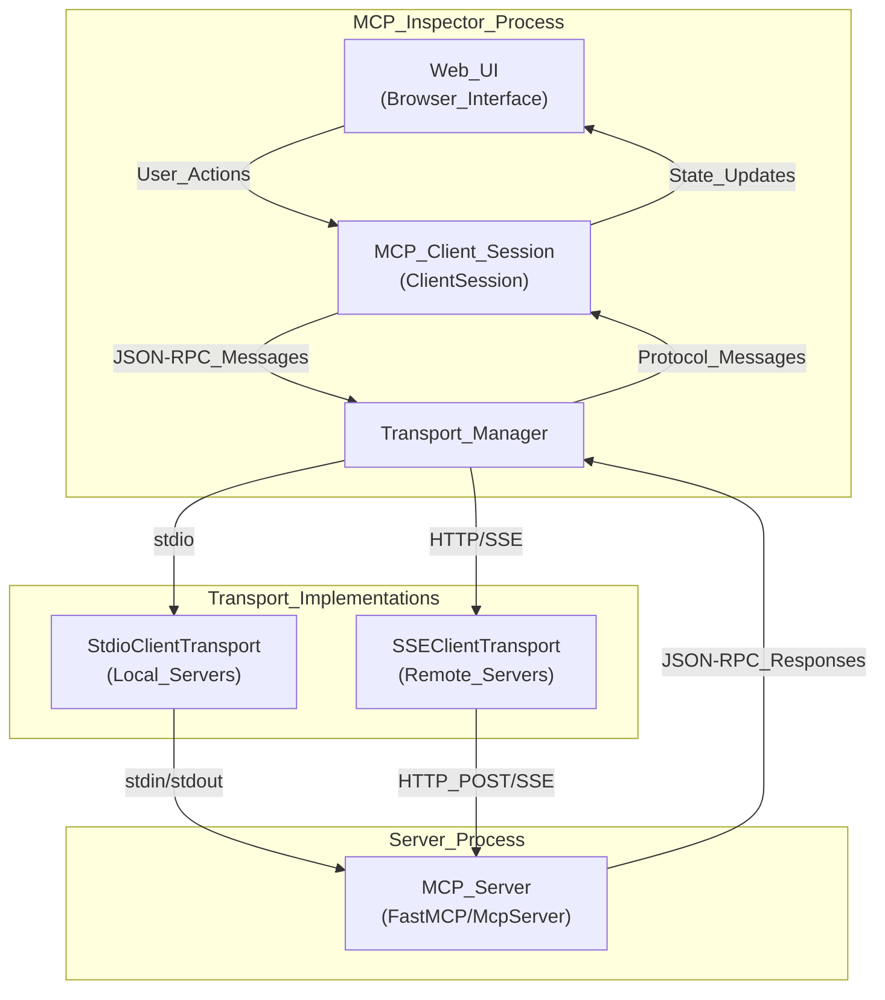

<!-- source: DeepWiki mcp.deepwiki.com · repo modelcontextprotocol/modelcontextprotocol · page 9.1 MCP Inspector · fetched 2026-10-21 -->

# MCP Inspector

<details>
<summary>Relevant source files</summary>

The following files were used as context for generating this wiki page:

- [blog/content/posts/2026-01-26-mcp-apps.md](blog/content/posts/2026-01-26-mcp-apps.md)
- [docs/community/sdk-tiers.mdx](docs/community/sdk-tiers.mdx)
- [docs/docs/getting-started/intro.mdx](docs/docs/getting-started/intro.mdx)
- [docs/docs/tools/debugging.mdx](docs/docs/tools/debugging.mdx)
- [docs/docs/tools/inspector.mdx](docs/docs/tools/inspector.mdx)
- [docs/extensions/apps/build.mdx](docs/extensions/apps/build.mdx)
- [docs/extensions/apps/overview.mdx](docs/extensions/apps/overview.mdx)
- [docs/extensions/auth/oauth-client-credentials.mdx](docs/extensions/auth/oauth-client-credentials.mdx)
- [docs/extensions/auth/overview.mdx](docs/extensions/auth/overview.mdx)
- [docs/extensions/client-matrix.mdx](docs/extensions/client-matrix.mdx)
- [docs/extensions/overview.mdx](docs/extensions/overview.mdx)
- [docs/extensions/tasks/overview.mdx](docs/extensions/tasks/overview.mdx)

</details>


The MCP Inspector is an interactive developer tool for testing and debugging MCP servers during development. It provides a graphical interface for discovering server capabilities, executing tools, reading resources, testing prompts, and monitoring server behavior without requiring integration with a production MCP client.

For information about broader debugging strategies and using the Inspector as part of a complete debugging workflow, see [Development Tools and Debugging](#9.2).

## Purpose and Scope

The Inspector serves as a standalone MCP client implementation with developer-focused features. Its primary purposes are:

- **Server validation**: Verify that an MCP server correctly implements the protocol specification [docs/docs/tools/inspector.mdx:1-7]().
- **Interactive testing**: Manually test tools, resources, and prompts before client integration [docs/docs/tools/inspector.mdx:84-111]().
- **Development iteration**: Rapidly test changes during server development without restarting a full client application [docs/docs/tools/inspector.mdx:120-132]().
- **Protocol debugging**: Inspect message exchanges and server behavior at the protocol level [docs/docs/tools/debugging.mdx:14-19]().

The Inspector is not intended for production use or end-user interactions. It is exclusively a development and testing tool for server authors.

## Architecture and Design

### Inspector as MCP Client

The Inspector functions as a host environment that instantiates an MCP client to communicate with a target server. It supports both local (stdio) and remote (SSE) transport mechanisms.

Inspector Architecture Overview:

Sources: [docs/docs/tools/inspector.mdx:84-90](), [docs/docs/tools/debugging.mdx:14-19]()

### Protocol Message Flow

The Inspector follows the standard MCP lifecycle, beginning with an initialization handshake before enabling feature discovery. It negotiates capabilities such as logging and support for experimental extensions like Tasks or Apps if the server advertises them.

Inspector Protocol Interaction Sequence:
```mermaid
sequenceDiagram
    participant User
    participant Inspector["MCP_Inspector<br/>(ClientSession)"]
    participant Server["MCP_Server"]
    
    Note over User,Server: Connection Phase
    User->>Inspector: npx @modelcontextprotocol/inspector <command>
    Inspector->>Server: Launch process (stdio) or Connect (SSE)
    Inspector->>Server: initialize request (capabilities)
    Server-->>Inspector: initialize response (capabilities)
    Inspector->>Server: initialized notification
    
    Note over User,Server: Discovery Phase
    Inspector->>Server: tools/list
    Server-->>Inspector: ListToolsResult
    Inspector->>Server: resources/list
    Server-->>Inspector: ListResourcesResult
    Inspector->>Server: prompts/list
    Server-->>Inspector: ListPromptsResult
    
    Note over User,Server: Interactive Testing Phase
    User->>Inspector: Input tool arguments
    Inspector->>Server: tools/call (name, arguments)
    Server-->>Inspector: CallToolResult
    Inspector->>User: Render Result
```
Sources: [docs/docs/tools/inspector.mdx:120-132](), [docs/extensions/tasks/overview.mdx:76-101](), [docs/extensions/apps/overview.mdx:78-96]()

## Installation and Execution

The Inspector is designed to be run without permanent installation using `npx` [docs/docs/tools/inspector.mdx:12-16]().

### Execution Patterns by Server Type

| Server Type | Command Pattern | Example |
| :--- | :--- | :--- |
| **npm package** | `npx -y @modelcontextprotocol/inspector npx <package> <args>` | `npx -y @modelcontextprotocol/inspector npx @modelcontextprotocol/server-filesystem /Users/Desktop` |
| **PyPI package** | `npx @modelcontextprotocol/inspector uvx <package> <args>` | `npx @modelcontextprotocol/inspector uvx mcp-server-git --repository ~/repo` |
| **Local TS/JS** | `npx @modelcontextprotocol/inspector node <path/to/index.js>` | `npx @modelcontextprotocol/inspector node ./dist/index.js` |
| **Local Python** | `npx @modelcontextprotocol/inspector uv --directory <dir> run <package>` | `npx @modelcontextprotocol/inspector uv --directory ./server run weather.py` |

Sources: [docs/docs/tools/inspector.mdx:22-74]()

## Feature Overview

### Server Connection Pane
The connection pane allows developers to select the transport (stdio or HTTP) and configure environment variables or command-line arguments [docs/docs/tools/inspector.mdx:86-90]().

### Resources Tab
*   **Discovery**: Lists all available resources and resource templates [docs/docs/tools/inspector.mdx:93-94]().
*   **Inspection**: Allows reading resource contents via `resources/read` [docs/docs/tools/inspector.mdx:95]().
*   **Subscriptions**: Supports testing resource subscription updates [docs/docs/tools/inspector.mdx:96]().

### Prompts Tab
*   **Templates**: Lists available prompt templates [docs/docs/tools/inspector.mdx:99]().
*   **Arguments**: Provides a UI to fill in required arguments defined in the prompt's schema [docs/docs/tools/inspector.mdx:100-102]().
*   **Preview**: Shows the generated message array [docs/docs/tools/inspector.mdx:103]().

### Tools Tab
*   **Schema Validation**: Displays the JSON Schema for tool inputs [docs/docs/tools/inspector.mdx:108]().
*   **Interactive Call**: Allows users to input JSON arguments and execute `tools/call` [docs/docs/tools/inspector.mdx:109]().
*   **Output Visualization**: Renders the result returned by the server [docs/docs/tools/inspector.mdx:110]().

### Notifications Pane
Captures all asynchronous communication from the server:
*   **Logs**: Displays `notifications/message` events at various severity levels [docs/docs/tools/debugging.mdx:20-22]().
*   **Updates**: Shows notifications received from the server, such as `list_changed` [docs/docs/tools/inspector.mdx:115]().

Sources: [docs/docs/tools/inspector.mdx:84-116]()

## Extension Support in Inspector

The Inspector acts as a testing ground for protocol extensions. While primarily used for core protocol features, it is a key tool for validating extension implementations:

*   **MCP Tasks**: The Inspector can be used to monitor `CreateTaskResult` and poll for task status via `tasks/get` [docs/extensions/tasks/overview.mdx:44-74]().
*   **MCP Apps**: Developers can verify if a tool correctly returns `_meta.ui.resourceUri` metadata which would trigger UI rendering in a production client [blog/content/posts/2026-01-26-mcp-apps.md:69-81]().

Sources: [docs/extensions/tasks/overview.mdx:44-74](), [blog/content/posts/2026-01-26-mcp-apps.md:69-81]()

## Development Workflow Integration

### Iterative Testing Pattern
The Inspector is optimized for a tight feedback loop:
1.  **Launch**: Start the Inspector with the server command [docs/docs/tools/inspector.mdx:122]().
2.  **Verify**: Check that capabilities are correctly negotiated in the initialization phase [docs/docs/tools/inspector.mdx:124]().
3.  **Test**: Execute tools with edge-case inputs (e.g., invalid types, missing fields) [docs/docs/tools/inspector.mdx:133-137]().
4.  **Debug**: Monitor the Notifications pane for stderr output or protocol errors [docs/docs/tools/inspector.mdx:113-116]().
5.  **Refine**: Modify server code, rebuild, and reconnect the Inspector [docs/docs/tools/inspector.mdx:127-130]().

### Best Practices for Logging
When testing with the Inspector:
*   **STDIO Servers**: Ensure the server logs to `stderr` and not `stdout`. `stdout` is reserved for JSON-RPC messages; writing logs there will corrupt the transport [docs/docs/tools/debugging.mdx:36-41]().
*   **Severity Levels**: Use appropriate RFC 5424 levels (debug, info, error) so they can be filtered in the Inspector UI [docs/docs/tools/debugging.mdx:75-81]().

Sources: [docs/docs/tools/inspector.mdx:119-138](), [docs/docs/tools/debugging.mdx:27-73]()

---

