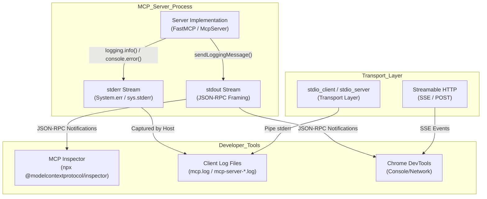
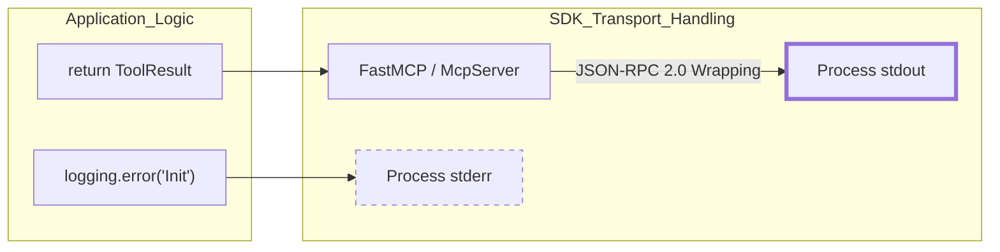

<!-- source: DeepWiki mcp.deepwiki.com · repo modelcontextprotocol/modelcontextprotocol · page 9.2 Development Tools and Debugging · fetched 2026-10-21 -->

# Development Tools and Debugging

Relevant source files

The following files were used as context for generating this wiki page:

- [blog/content/posts/2026-01-26-mcp-apps.md](blog/content/posts/2026-01-26-mcp-apps.md)
- [docs/community/sdk-tiers.mdx](docs/community/sdk-tiers.mdx)
- [docs/docs/develop/build-client.mdx](docs/docs/develop/build-client.mdx)
- [docs/docs/develop/build-server.mdx](docs/docs/develop/build-server.mdx)
- [docs/docs/develop/build-with-agent-skills.mdx](docs/docs/develop/build-with-agent-skills.mdx)
- [docs/docs/getting-started/intro.mdx](docs/docs/getting-started/intro.mdx)
- [docs/docs/learn/architecture.mdx](docs/docs/learn/architecture.mdx)
- [docs/docs/learn/client-concepts.mdx](docs/docs/learn/client-concepts.mdx)
- [docs/docs/learn/server-concepts.mdx](docs/docs/learn/server-concepts.mdx)
- [docs/docs/sdk.mdx](docs/docs/sdk.mdx)
- [docs/docs/tools/debugging.mdx](docs/docs/tools/debugging.mdx)
- [docs/extensions/apps/build.mdx](docs/extensions/apps/build.mdx)
- [docs/extensions/apps/overview.mdx](docs/extensions/apps/overview.mdx)
- [docs/extensions/auth/oauth-client-credentials.mdx](docs/extensions/auth/oauth-client-credentials.mdx)
- [docs/extensions/auth/overview.mdx](docs/extensions/auth/overview.mdx)
- [docs/extensions/client-matrix.mdx](docs/extensions/client-matrix.mdx)
- [docs/extensions/overview.mdx](docs/extensions/overview.mdx)
- [docs/extensions/tasks/overview.mdx](docs/extensions/tasks/overview.mdx)

This document provides a technical deep dive into the debugging techniques, tools, and utilities available for the Model Context Protocol (MCP). It covers implementation details for logging, interactive testing via the MCP Inspector, client-side debugging, and common pitfalls related to execution environments and stream corruption.

## Debugging Architecture

MCP debugging spans the entire stack, from low-level transport stream monitoring to high-level UI inspection in host applications. Because MCP SDKs abstract away many concerns [docs/docs/learn/architecture.mdx:9-11](), understanding the data flow between these layers is essential for troubleshooting.

### Tooling and Data Flow

The following diagram illustrates how debugging information flows from the server to various developer tools, bridging the "Natural Language Space" of user logs to the "Code Entity Space" of the protocol.

**Figure 1: MCP Debugging Data Flow and Entity Mapping**

**Sources:** [docs/docs/develop/build-server.mdx:44-70](), [docs/docs/learn/architecture.mdx:75-102](), [docs/docs/develop/build-client.mdx:102-107]()

## MCP Inspector

The **MCP Inspector** is the primary tool for isolated server testing [docs/docs/learn/architecture.mdx:19](). It acts as a generic MCP client, allowing developers to manually trigger server capabilities without a full AI host like Claude.

### Execution Patterns
The Inspector is typically invoked via `npx` and can wrap various runtimes to initiate the `stdio` transport connection:

| Runtime | Command Example |
| :--- | :--- |
| **npm** | `npx -y @modelcontextprotocol/inspector npx @modelcontextprotocol/server-filesystem /path` |
| **Python (uv)** | `npx @modelcontextprotocol/inspector uvx mcp-server-git --repository ~/repo` |
| **Node.js** | `npx @modelcontextprotocol/inspector node path/to/server/index.js` |

**Sources:** [docs/docs/develop/build-server.mdx:109-110](), [docs/docs/develop/build-client.mdx:140-146]()

### Feature Testing via Protocol Primitives
The Inspector interface allows direct interaction with the `Data Layer` primitives defined in the specification [docs/docs/learn/architecture.mdx:77-81]():

*   **Resources**: Tests `resources/list` and `resources/read` methods. It can also monitor `resources/subscribe` for real-time data updates [docs/docs/learn/server-concepts.mdx:115-120]().
*   **Prompts**: Tests `prompts/list` and `prompts/get`, allowing developers to verify how arguments are injected into templates [docs/docs/learn/server-concepts.mdx:14-18]().
*   **Tools**: Tests `tools/list` and `tools/call`. It validates the `arguments` object against the server's `inputSchema` (JSON Schema) before execution [docs/docs/learn/server-concepts.mdx:32-35]().

## Logging and Stream Integrity

Proper logging is critical in MCP, especially for the **STDIO transport**, where the communication channel is shared with standard output.

### The STDIO Corruption Pitfall
In STDIO-based servers, `stdout` is reserved strictly for JSON-RPC 2.0 messages [docs/docs/learn/architecture.mdx:84-85](). Writing arbitrary text to `stdout` (e.g., using `print()` in Python or `console.log()` in JS) will corrupt the message framing and break the server [docs/docs/develop/build-server.mdx:48-50]().

**Figure 2: Stream Handling Logic**

**Sources:** [docs/docs/develop/build-server.mdx:62-70](), [docs/docs/learn/architecture.mdx:98-99]()

### Implementation Examples
*   **Python (FastMCP)**: Use `logging.info()` or `print("...", file=sys.stderr)` to avoid stream corruption [docs/docs/develop/build-server.mdx:58-70]().
*   **TypeScript**: Use `console.error()` for internal logs or the SDK's `sendLoggingMessage` for protocol-level logs.

## Troubleshooting Common Issues

### Working Directory and Path Pitfalls
When launched by a host application, the server's working directory (`cwd`) may not match the developer's expectations.
*   **Issue**: Relative paths for resources or configuration files fail to resolve.
*   **Solution**: Always use **absolute paths** when configuring servers in the host (e.g., in `Claude Desktop` configuration) [docs/docs/develop/build-server.mdx:101-102]().

### Environment Variable Handling
MCP servers do not automatically inherit the user's full shell environment (e.g., `PATH` or custom aliases).
*   **Behavior**: Servers receive a minimal environment defined by the host [docs/docs/develop/build-client.mdx:140-144]().
*   **Mitigation**: Explicitly define required variables like `API_KEYS` in the `env` property of the `StdioServerParameters` or the host's configuration file [docs/docs/develop/build-client.mdx:112-114]().

### Conformance and SDK Tiers
If a server behaves inconsistently across different clients, it may be due to varying levels of protocol support in the SDKs.
*   **Tier 1 SDKs**: (TypeScript, Python, C#, Go) have 100% conformance and support all non-experimental features [docs/community/sdk-tiers.mdx:23-24](), [docs/docs/sdk.mdx:12-15]().
*   **Tier 2/3 SDKs**: May lack support for advanced features like `Sampling` or `Elicitation` [docs/community/sdk-tiers.mdx:25-26]().
*   **Validation**: Use the official [automated conformance tests](https://github.com/modelcontextprotocol/conformance) to validate SDK behavior against the spec [docs/community/sdk-tiers.mdx:61-63]().

## Advanced Debugging Tools

### Agent-Assisted Debugging
The `mcp-server-dev` plugin provides agent skills to help scaffold and debug servers [docs/docs/develop/build-with-agent-skills.mdx:13-15]():
*   `build-mcp-server`: Interrogates the use case to pick the right deployment model (e.g., Streamable HTTP vs Stdio) [docs/docs/develop/build-with-agent-skills.mdx:19]().
*   `build-mcp-app`: Scaffolds interactive UI widgets for the [MCP Apps](/extensions/apps/overview) extension [docs/docs/develop/build-with-agent-skills.mdx:20]().

### Extension Debugging (MCP Apps & Tasks)
*   **MCP Apps**: Debugged via Chrome DevTools within the host's sandboxed `iframe` [blog/content/posts/2026-01-26-mcp-apps.md:83-85](). Communication is handled via `postMessage` using a JSON-RPC dialect [docs/extensions/apps/overview.mdx:70-76]().
*   **Tasks**: Debugged by monitoring the `tasks/get` polling loop and checking for `input_required` status in the terminal [docs/extensions/tasks/overview.mdx:59-66]().

**Sources:** [docs/community/sdk-tiers.mdx:33-42](), [docs/docs/develop/build-with-agent-skills.mdx:6-21](), [docs/extensions/apps/overview.mdx:39-44](), [docs/extensions/tasks/overview.mdx:75-101]()

---

