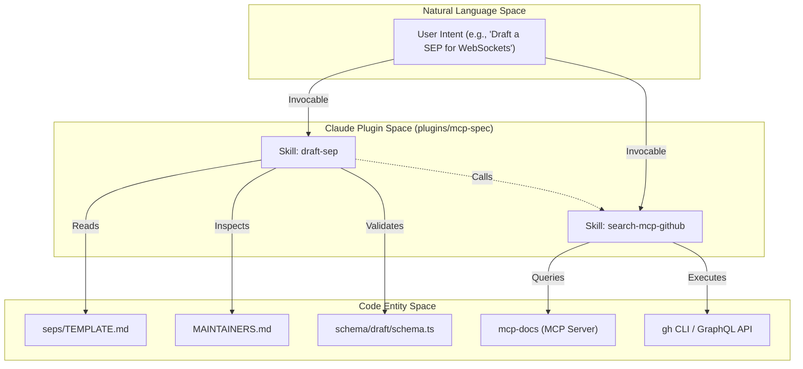
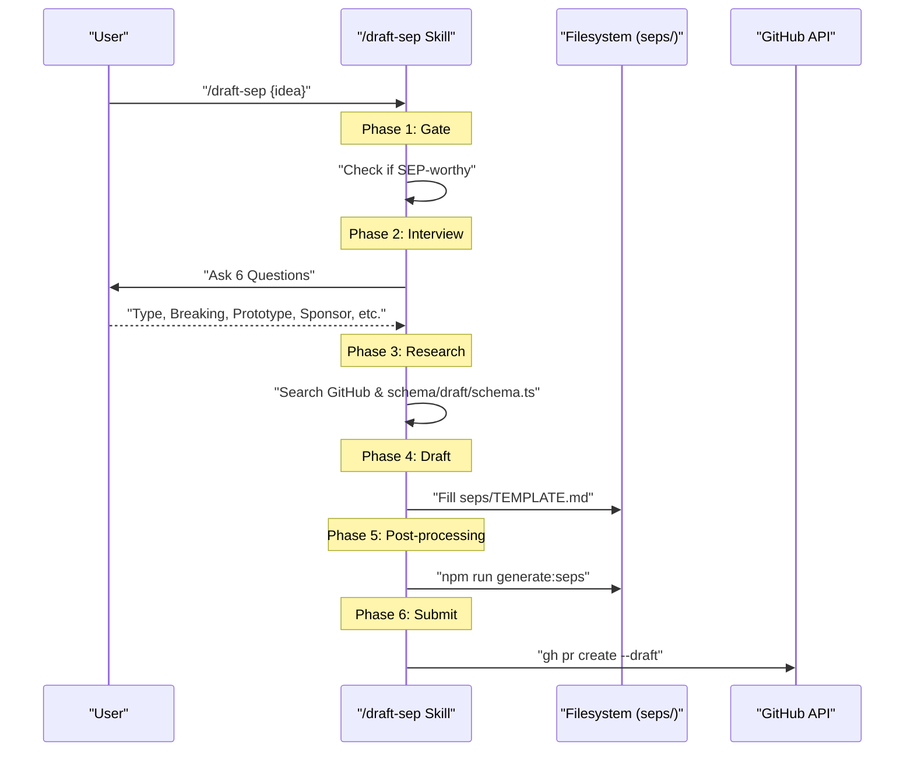

<!-- source: DeepWiki mcp.deepwiki.com · repo modelcontextprotocol/modelcontextprotocol · page 9.3 Claude Plugin for MCP Spec · fetched 2026-10-21 -->

# Claude Plugin for MCP Spec

Relevant source files

The following files were used as context for generating this wiki page:

- [.claude-plugin/marketplace.json](.claude-plugin/marketplace.json)
- [.github/ISSUE_TEMPLATE/bug_report.yml](.github/ISSUE_TEMPLATE/bug_report.yml)
- [.github/ISSUE_TEMPLATE/config.yml](.github/ISSUE_TEMPLATE/config.yml)
- [.github/ISSUE_TEMPLATE/work_tracking.yml](.github/ISSUE_TEMPLATE/work_tracking.yml)
- [.prototools](.prototools)
- [AGENTS.md](AGENTS.md)
- [CLAUDE.md](CLAUDE.md)
- [plugins/mcp-spec/.claude-plugin/plugin.json](plugins/mcp-spec/.claude-plugin/plugin.json)
- [plugins/mcp-spec/README.md](plugins/mcp-spec/README.md)
- [plugins/mcp-spec/skills/draft-sep/SKILL.md](plugins/mcp-spec/skills/draft-sep/SKILL.md)
- [plugins/mcp-spec/skills/search-mcp-github/SKILL.md](plugins/mcp-spec/skills/search-mcp-github/SKILL.md)
- [seps/TEMPLATE.md](seps/TEMPLATE.md)

The `plugins/mcp-spec` directory contains the official Claude plugin designed to assist developers and maintainers in researching and contributing to the Model Context Protocol (MCP) specification [plugins/mcp-spec/README.md:1-3](). This plugin provides AI-assisted skills that automate the complex workflows involved in protocol governance, specifically around the Specification Enhancement Proposal (SEP) process and cross-repository research on GitHub [plugins/mcp-spec/README.md:17-41]().

## Plugin Architecture and Skills

The plugin is structured as a set of skills that leverage the GitHub CLI (`gh`), local git commands, and the MCP documentation server to perform deep analysis of the protocol's history and current state [plugins/mcp-spec/skills/draft-sep/SKILL.md:15-19](), [plugins/mcp-spec/skills/search-mcp-github/SKILL.md:14-19](). It is integrated into the Claude ecosystem via the marketplace configuration [ .claude-plugin/marketplace.json:1-17]().

### Data Flow: AI-Assisted Research and Authoring

The following diagram illustrates how the plugin's skills bridge natural language requests to specific codebase entities and external data sources.

**MCP Spec Plugin Integration Map**

Sources: [plugins/mcp-spec/skills/draft-sep/SKILL.md:11-103](), [plugins/mcp-spec/skills/search-mcp-github/SKILL.md:14-33](), [plugins/mcp-spec/.claude-plugin/plugin.json:11-16](), [AGENTS.md:66-69]()

---

## Skill: `/search-mcp-github`

This skill provides a unified interface for searching across the entire `modelcontextprotocol` GitHub organization, including PRs, issues, and discussions [plugins/mcp-spec/skills/search-mcp-github/SKILL.md:1-10]().

### Key Functions
1.  **Multi-Source Search**: It prioritizes the `mcp-docs` server's `SearchModelContextProtocol` tool for authoritative spec content before falling back to GitHub searches [plugins/mcp-spec/skills/search-mcp-github/SKILL.md:14-19]().
2.  **Discussion Retrieval**: Since the GitHub CLI lacks a native `search discussions` command, the skill uses the GraphQL API to query repository and organization-level discussions [plugins/mcp-spec/skills/search-mcp-github/SKILL.md:25-33]().
3.  **Variant Expansion**: The skill automatically handles tokenization differences between `camelCase` (used in `schema.ts`) and space-separated text (used in natural language discussions) [plugins/mcp-spec/skills/search-mcp-github/SKILL.md:35-43]().
4.  **Maintainer Attribution**: It identifies comments from users with `MEMBER` or `OWNER` associations to highlight design intent and historical rationale [plugins/mcp-spec/skills/search-mcp-github/SKILL.md:79-94]().

Sources: [plugins/mcp-spec/skills/search-mcp-github/SKILL.md:1-119]()

---

## Skill: `/draft-sep`

The `/draft-sep` skill automates the lifecycle of creating a Specification Enhancement Proposal [plugins/mcp-spec/skills/draft-sep/SKILL.md:1-9](). It enforces the governance rules defined in `docs/community/sep-guidelines.mdx` through a multi-phase workflow [plugins/mcp-spec/skills/draft-sep/SKILL.md:11-13]().

### The SEP Authoring Pipeline

The skill executes six distinct phases to move from an idea to a pull request.

**SEP Drafting Workflow**

Sources: [plugins/mcp-spec/skills/draft-sep/SKILL.md:27-103](), [plugins/mcp-spec/README.md:38-51](), [AGENTS.md:78-81]()

### Phase Implementation Details

| Phase | Responsibility | Key Code Entities / Actions |
| :--- | :--- | :--- |
| **1. Gate** | Filter out non-SEP changes | Redirects bug fixes or typos to regular PRs [plugins/mcp-spec/skills/draft-sep/SKILL.md:27-39](). |
| **2. Interview** | Collect metadata | Captures `Author`, `Sponsor`, and `Security Implications` [plugins/mcp-spec/skills/draft-sep/SKILL.md:49-60](). |
| **3. Research** | Contextual analysis | Searches `schema/draft/schema.ts` for touch-points and checks prior art via `/search-mcp-github` [plugins/mcp-spec/skills/draft-sep/SKILL.md:61-98](). |
| **4. Draft** | Template population | Fills `seps/TEMPLATE.md` to create `seps/0000-{slug}.md` [plugins/mcp-spec/skills/draft-sep/SKILL.md:106-113](). |
| **5. Process** | Build validation | Runs `npm run generate:seps` and `npm run format:docs` [plugins/mcp-spec/skills/draft-sep/SKILL.md:115-122](). |
| **6. Submit** | PR Creation | Executes `gh pr create --draft` and backfills the SEP number [plugins/mcp-spec/skills/draft-sep/SKILL.md:124-142](). |

Sources: [plugins/mcp-spec/skills/draft-sep/SKILL.md:27-142](), [seps/TEMPLATE.md:1-11](), [AGENTS.md:78-85]()

---

## AI Agent Contribution Policy

The plugin and its skills are subject to the repository's strict AI agent policy [AGENTS.md:5-18](). 

- **Authorization**: Agents may only open PRs if the user is a listed maintainer in `MAINTAINERS.md` or has >3 merged PRs [AGENTS.md:9-15]().
- **Disclosure**: If an agent bypasses these rules under user instruction, it must include a `disclosure.txt` file or a specific HTML comment in the PR body [AGENTS.md:19-26](), [CLAUDE.md:19-26]().
- **Validation**: Before pushing or creating PRs, the agent is expected to ensure that `npm run prep` is free of warnings and errors [AGENTS.md:39-40](), [CLAUDE.md:39-40]().
- **Issue Templates**: Blank issues are disabled; the plugin must use forms in `.github/ISSUE_TEMPLATE/` when interacting with the API [AGENTS.md:98-101](), [.github/ISSUE_TEMPLATE/config.yml:1]()

Sources: [AGENTS.md:1-26](), [CLAUDE.md:1-26](), [.github/ISSUE_TEMPLATE/bug_report.yml:1-18]()

---

