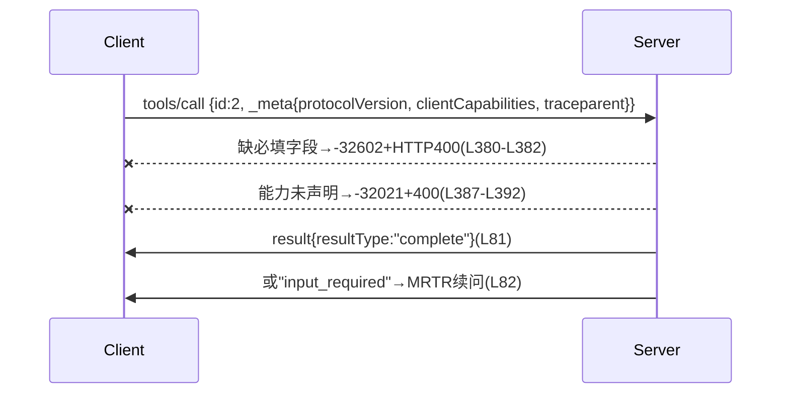

# 02 · 规范总纲：docs/specification/2026-07-28/basic/index.mdx

> 源文件 498 行，行号锚均从磁盘核实（与 draft 版逐行 diff 确认）。

## 1. 角色定位

本页是图谱 document 节点，挂规范主线 GA 层：`docs/specification/` 按日期分版（2024-11-05 → 2026-07-28 → draft），`basic/index.mdx` 是 **2026-07-28 正式版的 Base Protocol 入口**，即 MCP 规范的"宪法级"总纲。开篇 L09-L15 列七大组件（Base Protocol / Versioning / Message Patterns / Authorization / Server / Client Features / Utilities），L17-L19 划实现基线：前三者 MUST 支持，其余按需——判断"一个实现算不算 MCP"的第一道门槛。

本页与 schema 契约是"人读正文 vs 机器真源"关系：L236-L245 明确 `schema/2026-07-28/schema.ts` 是 **source of truth**，schema.json 由其自动生成；本页各 TS 代码块只是摘要，冲突以 schema 为准。

## 2. 内部结构

- **Messages（L25-L180）**：一切消息 MUST 遵循 JSON-RPC 2.0（L27-L28）。三分区：Requests（L31，形状 L36-L44；ID 规则 L46-L49——非 null、未响应前不得复用）；Responses（L51）下分 Result（L55，`result` MUST 含 `resultType` L73）与 Error（L87，畸形请求时可省 `id` L94/L103、code 必为整数 L105）；Notifications（L157，单向 L160、禁带 ID L172）。
- **Error Codes（L109-L155，全页密度最高）**：标准码 -32700/-32600~-32603（L111-L112）之外，把 JSON-RPC 预留区 -32000~-32099 切成 legacy（-32000~-32019，L117-L121）与规范专属（-32020~-32099，L122-L127），规范定义码仅 -32020/-32021/-32022 三个（表 L131-L135）。
- **ResultType 多态（L75-L85）**：`"complete"`（L81）成功完结；`"input_required"`（L82）挂起等待补充输入（payload 为 InputRequiredResult，接 MRTR）；扩展可加值（L83）；客户端不认识的值 MUST 非法（L84）；**字段缺席按 `"complete"` 兜底（L85）**——多态能落地的前置条件。
- **Statelessness（L182-L219）**：无状态协议（L184-L185），服务器 MUST NOT 从先前请求推断上下文（L191-L193），跨请求状态必须用显式标识符（L200-L202）；Note 钉死"连接≠会话"（L204-L209）。
- **Auth（L221-L234）**：HTTP 传输 SHOULD 遵循授权框架（L223-L226），STDIO SHOULD NOT（改从环境取凭据）。
- **JSON Schema Usage（L247-L318）**：dialect 默认 2020-12（L255-L258）；`$ref` 禁自动解引用网络 URI（L301-L302），opt-in 模式须默认关闭+allowlist/超时/大小限制（L304-L307）；组合关键字设预算防 DoS（L312-L318）。
- **General fields**：`_meta`（L322-L446）保留键全表 L350-L358；键名=可选反 DNS 前缀+名字（L330-L344），前缀第二段标签为 `modelcontextprotocol` 或 `mcp` 即保留（L337-L338）。icons（L448-L498）定义 src/mimeType/sizes/theme（L454-L459）、MIME 支持矩阵（L463-L471）与六条安全规则（L475-L487）。

## 3. 外部连接

- **depends_on（0.6）→ `schema/2026-07-28/schema.json`**：磁盘核实 11 处引用——L239/L243 两个 blob 链接直指 schema.ts/schema.json，另有 9 处站内锚 `schema#...`（L33/L57/L89/L124/L133-L135/L159/L390）。schema.json 实测 155 个 $defs，本页点名的 JSONRPCRequest/JSONRPCNotification/HeaderMismatchError/MissingRequiredClientCapabilityError/UnsupportedProtocolVersionError/ResultType/InputRequiredResult 全部存在；`Result` 的 required 恰为 `["resultType"]` 且含可选 `_meta`，与 L63-L66/L73 一致。
- **related 站内边**：`basic/versioning.mdx`（L360 扩展协商、L371 版本协商、L416 链接定义）；`basic/patterns/` 家族——mrtr（L82）、patterns 三模式总览（L176-L180）、progress（L352）、subscriptions（L357、L211-L213、L412-L414）；`server/utilities/logging`（L356）；`server/resources#error-handling`（L142 旧码 -32002 兼容）。**反向边**：`docs/docs/2026-07-28/learn/architecture.mdx` 被本页 L216-L219 引用，其 L111 回链本页 `#statelessness`——规范与教程互指。

## 4. 数据流：一次 tools/call

1. **组包**：请求按 L36-L44，`_meta` 按 L373-L378 带 `protocolVersion`（必填 L375）、`clientCapabilities`（必填 L377）、`clientInfo`（SHOULD，L384-L385），可带 `traceparent` 做 W3C 追踪——本页非规范性示例恰是 tools/call（L429-L446）；长任务再加 `progressToken`（L352）。
2. **服务端四道闸**：①`_meta` 必填缺失→-32602+HTTP 400（L380-L382）；②所需客户端能力未声明→-32021，`data.requiredCapabilities` 列缺失项（L387-L392）；③版本不认识→-32022（L135）；④传输头不匹配→-32020（L133）。
3. **错误码选区决策树**：协议层失败→标准 JSON-RPC 码（L111-L112）；MCP 语义错误→仅限表内三码（L129-L135）；应用自定义错误→**整段避开 -32768~-32000**（L153-L155）；SDK 本地错误不得伪装对端错误（L146-L151）；老服务器回 -32002 客户端 SHOULD 接受（L140-L143）。
4. **成功解析**：按 `resultType` 分派——`"complete"`/`"input_required"`/未知判非法（L84）/缺失兜底（L85）。订阅型请求（subscriptions/listen）的"响应"是通知流，每条必带 `subscriptionId`（L412-L414）。

## 5. 设计决策

- **错误码为何分区**：JSON-RPC 2.0 把 -32000~-32099 留给"实现定义"，各实现自由取码导致同码异义。2026-07-28 承认既成事实——-32000~-32019 圈为 legacy、禁新增、接收方不得假设语义（L117-L121）；-32020~-32099 收归规范独占、唯一登记处是 schema（L122-L127）。配套防腐两招：退役码（-32002/-32042）永不复用（L137-L144）；新应用错误推出整个预留区（L153-L155），规范码/应用码数值上即可区分。
- **`_meta` 为何预留命名空间**：反 DNS 前缀（L332-L336）是业界惯例，妙在保留判据放**第二段标签**——`io.modelcontextprotocol/`、`dev.mcp/` 保留而 `com.example.mcp/` 不保留（L337-L339），一网捞尽任意域名深度上的官方命名空间，第三方扩展天然拿 `com.example/` 自治。更关键：`_meta` 扛起了无状态化的全部重量——协议版本+能力随每个请求走（L365-L378），服务器无需连接级会话（L191-L193）。
- **resultType 多态 vs discriminated union**：TS 判别联合是封闭集+编译期穷尽检查；MCP 反其道——`result` 是开放对象（L72），仅约定字符串 `resultType`（L77-L79），扩展可注册新值（L83）。开放性换前向兼容，代价是运行期才知形状，故配两条兜底：未知值 MUST 非法（L84，防静默误解析）、缺席视为 `"complete"`（L85，对接老服务器）。schema 中 `Result` 仅 required `["resultType"]` 正是其机器化表达。

## 6. 新人提示

- **draft 对照读法**：实测 diff，两版差异仅两类——URL 前缀 `/2026-07-28/`↔`/draft/` 约 30 处机械替换；唯一实质差异 L457：draft 把 icons `mimeType` 描述改为 "override if the **source** MIME type is missing"。**结论：本页与 draft 逐字镜像，读 GA 版实现、盯 draft diff 看演进方向**；draft 独有改动即下版风向标。
- **权威单源表**：错误码表 L131-L135（-32020 起规范码唯一规范性清单）；`_meta` 保留键表 L350-L358 与 per-request 字段表 L373-L378；resultType 语义 L81-L85；MIME 矩阵 L463-L471。
- 盯粗体 RFC 2119 关键词：基线 L17-L19、无状态 L191-L202、安全 L475-L487 全是合规测试判据。版本协商细则不在本页，去 `basic/versioning.mdx`（L371 已指路）。

> 非空白字符 4731 / 锚 93
