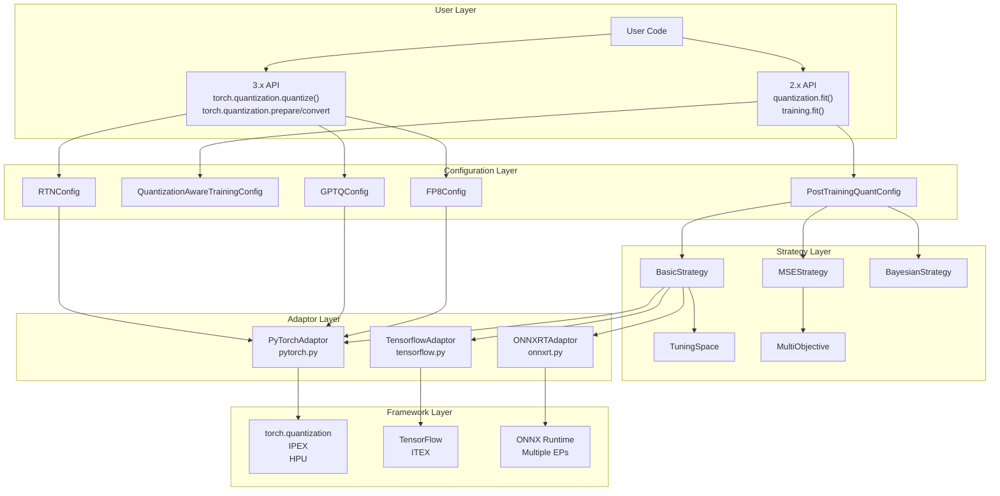
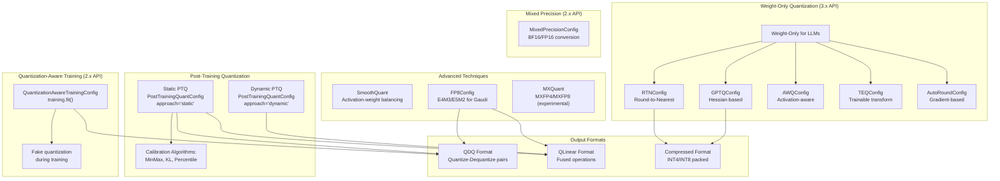
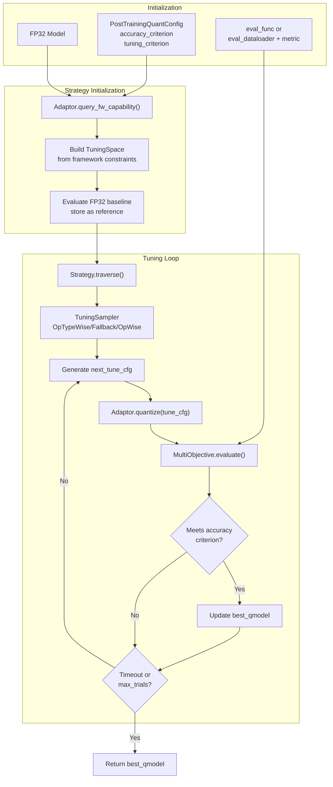

<!-- source: DeepWiki mcp.deepwiki.com · repo intel/neural-compressor · page 1 Overview · fetched 2026-10-21 -->

# Overview

<details>
<summary>Relevant source files</summary>

The following files were used as context for generating this wiki page:

- [README.md](README.md)
- [docs/source/add_new_adaptor.md](docs/source/add_new_adaptor.md)
- [docs/source/add_new_data_type.md](docs/source/add_new_data_type.md)
- [docs/source/calibration.md](docs/source/calibration.md)
- [docs/source/examples_readme.md](docs/source/examples_readme.md)
- [docs/source/framework_yaml.md](docs/source/framework_yaml.md)
- [docs/source/infrastructure.md](docs/source/infrastructure.md)
- [docs/source/mixed_precision.md](docs/source/mixed_precision.md)
- [docs/source/publication_list.md](docs/source/publication_list.md)
- [docs/source/quantization.md](docs/source/quantization.md)
- [docs/source/quantization_mixed_precision.md](docs/source/quantization_mixed_precision.md)
- [examples/README.md](examples/README.md)
- [neural_compressor/benchmark.py](neural_compressor/benchmark.py)
- [neural_compressor/config.py](neural_compressor/config.py)
- [neural_compressor/mix_precision.py](neural_compressor/mix_precision.py)
- [neural_compressor/model/model.py](neural_compressor/model/model.py)
- [neural_compressor/quantization.py](neural_compressor/quantization.py)
- [neural_compressor/training.py](neural_compressor/training.py)
- [neural_compressor/utils/utility.py](neural_compressor/utils/utility.py)
- [test/adaptor/pytorch_adaptor/test_adaptor_security.py](test/adaptor/pytorch_adaptor/test_adaptor_security.py)

</details>


Intel® Neural Compressor is an open-source Python library that enables efficient deployment of deep learning models through model compression techniques. The library provides quantization, pruning, knowledge distillation, and neural architecture search across TensorFlow, PyTorch, and ONNX Runtime frameworks.

The primary value proposition is **accuracy-aware optimization**: automatically tuning quantization configurations to achieve optimal performance while maintaining accuracy targets. For large language models, Intel Neural Compressor offers specialized weight-only quantization algorithms (RTN, GPTQ, AWQ, TEQ, AutoRound) that reduce memory footprint and improve inference throughput.

Sources: [README.md:1-20](), [neural_compressor/config.py:1-17]()

## Purpose and Core Capabilities

Intel Neural Compressor addresses three main optimization goals:

1. **Performance Acceleration**: Up to 4.2x speedup on Intel VNNI hardware with INT8 quantization
2. **Memory Reduction**: INT4 weight-only quantization for large language models reduces memory requirements by ~75%
3. **Accuracy Preservation**: Automated tuning strategies minimize accuracy degradation during compression

The library has validated 10,000+ models from Hugging Face, TorchVision, TensorFlow Model Hub, and ONNX Model Zoo, with performance geomean of 2.2x across validated models.

Sources: [README.md:18-26](), [docs/source/quantization.md:16-18]()

## System Architecture

Intel Neural Compressor uses a layered architecture that separates optimization strategies from framework-specific implementations:

**Architecture: Layered Design with Framework Abstraction**



Sources: [neural_compressor/quantization.py:1-242](), [neural_compressor/strategy/strategy.py:1-50](), [neural_compressor/adaptor/__init__.py:1-30]()

The architecture consists of five layers:

1. **User Layer**: `quantization.fit()` (2.x) and `torch.quantization.quantize()` (3.x) entry points
2. **Configuration Layer**: Config classes define quantization parameters (`PostTrainingQuantConfig`, `RTNConfig`, `FP8Config`)
3. **Strategy Layer**: Tuning algorithms (`BasicStrategy`, `MSEStrategy`) build search spaces and select configurations
4. **Adaptor Layer**: Framework-specific implementations (`PyTorchAdaptor`, `TensorflowAdaptor`, `ONNXRTAdaptor`) in [neural_compressor/adaptor/]()
5. **Framework Layer**: Native quantization APIs (PyTorch, TensorFlow, ONNX Runtime)

The `Model` class wraps user models and routes them to appropriate adaptors based on framework detection in [neural_compressor/model/model.py:66-147]().

Sources: [neural_compressor/quantization.py:33-241](), [neural_compressor/model/model.py:150-253](), [neural_compressor/config.py:715-1502]()

## Framework and Hardware Support

Intel Neural Compressor supports three deep learning frameworks with multiple backend variants:

| Framework | Backends | Supported Precisions | Target Hardware |
|-----------|----------|---------------------|-----------------|
| PyTorch | PyTorch Eager, PyTorch FX, IPEX, HPU | INT8, INT4, FP8, BF16, FP16, MXFP4/MXFP8 | Intel CPUs (Xeon), Intel GPUs (XPU), Intel Gaudi (HPU) |
| TensorFlow (2.x API) | TensorFlow, ITEX | INT8, BF16 | Intel CPUs (Xeon) |
| ONNX Runtime (2.x API) | CPUExecutionProvider, DnnlExecutionProvider, CUDAExecutionProvider, TensorrtExecutionProvider, DmlExecutionProvider | INT8, BF16, FP16 | Intel CPUs, Nvidia GPUs, AMD CPUs, ARM CPUs, NPUs (experimental) |

**Note**: From version 3.0, TensorFlow and ONNX Runtime support is primarily available in the 2.x API. The 3.x API focuses on PyTorch with enhanced LLM optimization capabilities.

Sources: [README.md:22-23](), [README.md:39-45](), [neural_compressor/config.py:28-33]()

**Hardware Platform Support**:

- **Intel Xeon Scalable Processors**: INT8/BF16 quantization with AVX-512 VNNI and AMX acceleration
- **Intel Xeon CPU Max Series**: INT8/BF16 with HBM memory
- **Intel Core Ultra Processors**: INT8/BF16 for client devices
- **Intel Data Center GPU Flex/Max Series**: INT8/INT4/BF16/FP16 for GPU inference
- **Intel Gaudi AI Accelerators**: FP8 (E4M3/E5M2) static/dynamic quantization, INT8, BF16
- **Other Platforms**: AMD CPU, ARM CPU, Nvidia GPU via ONNX Runtime with limited testing

Version compatibility for Intel Gaudi is documented in [docs/source/3x/gaudi_version_map.md]().

Sources: [README.md:22-23](), [README.md:42]()

## API Versions and Package Distribution

Intel Neural Compressor provides two API versions with different optimization focuses:

**API Comparison**

| Feature | 2.x API (Unified) | 3.x API (PyTorch-Focused) |
|---------|------------------|---------------------------|
| **Primary Use Case** | Accuracy-aware tuning across frameworks | Direct quantization for PyTorch/LLMs |
| **Entry Points** | `quantization.fit()`, `training.fit()`, `mix_precision.fit()`, `benchmark.fit()` | `torch.quantization.quantize()`, `torch.quantization.prepare()/convert()` |
| **Frameworks** | TensorFlow, PyTorch, ONNX Runtime | PyTorch only |
| **Tuning** | Automated accuracy-aware tuning with strategies | One-shot quantization (no tuning) |
| **LLM Support** | Basic weight-only quantization | Advanced: RTN, GPTQ, AWQ, TEQ, AutoRound |
| **FP8 Support** | Limited | Full support for Intel Gaudi |
| **Recommendation** | Use for QAT, pruning, distillation | Use for post-training optimization |

Sources: [README.md:176-177](), [neural_compressor/quantization.py:33-242]()

**Package Installation Options**:

```bash
# Full package: 2.x API + Framework extension API + PyTorch dependency
pip install neural-compressor[pt]

# Full package with TensorFlow dependency
pip install neural-compressor[tf]

# PyTorch-only binary (smaller footprint)
pip install neural-compressor-pt

# TensorFlow-only binary
pip install neural-compressor-tf
```

The `neural-compressor` package includes all frameworks, while `neural-compressor-pt` and `neural-compressor-tf` are lightweight distributions containing only framework-specific code.

Sources: [README.md:46-52]()

## Quantization Capabilities

**Quantization Approaches and Techniques**



Sources: [neural_compressor/config.py:715-1502](), [docs/source/quantization.md:93-117]()

**Key Quantization Methods**:

1. **Post-Training Static Quantization**: Calibrates on representative dataset, quantizes both weights and activations (INT8/INT4)
2. **Post-Training Dynamic Quantization**: Quantizes weights offline, activations at runtime (beneficial for NLP models)
3. **Weight-Only Quantization**: Specialized for LLMs, quantizes only weights (INT4/UINT4/NF4) while keeping activations in FP16/BF16
4. **Quantization-Aware Training**: Simulates quantization during training for better accuracy recovery
5. **FP8 Quantization**: E4M3/E5M2 formats for Intel Gaudi accelerators with static/dynamic modes
6. **Mixed Precision**: Selective BF16/FP16 conversion with accuracy-driven fallback

Sources: [docs/source/quantization.md:93-117](), [neural_compressor/config.py:715-1502]()

## Accuracy-Aware Tuning (2.x API)

The 2.x API provides automated accuracy-aware tuning to find optimal quantization configurations:

**Tuning Workflow with Strategy System**



Sources: [neural_compressor/quantization.py:138-241](), [neural_compressor/strategy/strategy.py:1-50]()

**Tuning Strategies**:

- `BasicStrategy`: Explores tuning space sequentially in three stages (OpTypeWise → Fallback → OpWise)
- `MSEStrategy`: Optimizes mean squared error between FP32 and quantized outputs
- `BayesianStrategy`: Uses Bayesian optimization for efficient search space exploration
- `AutoStrategy`: Combines conservative (quant_level=0) and aggressive (quant_level=1) approaches

The `TuningSpace` is constructed by `Adaptor.query_fw_capability()` which parses framework YAML files defining quantization capabilities per operator type.

Sources: [neural_compressor/quantization.py:156-200](), [neural_compressor/config.py:592-713]()

## Quick Start Examples

**Example 1: Static Quantization with Accuracy-Aware Tuning (2.x API)**

```python
from neural_compressor import quantization
from neural_compressor.config import PostTrainingQuantConfig

# Define evaluation function
def eval_func(model):
    # User implements evaluation logic
    # Returns accuracy scalar (higher is better)
    accuracy = evaluate_model(model, val_dataloader)
    return accuracy

# Configure quantization with accuracy target
conf = PostTrainingQuantConfig(
    approach="static",
    accuracy_criterion={'relative': 0.01},  # Allow 1% accuracy loss
    tuning_criterion={'timeout': 0, 'max_trials': 100}
)

# Run accuracy-aware tuning
q_model = quantization.fit(
    model=model,
    conf=conf,
    calib_dataloader=calib_dataloader,
    eval_func=eval_func
)

q_model.save("./quantized_model")
```

Sources: [neural_compressor/quantization.py:33-138](), [README.md:213-278]()

**Example 2: Weight-Only Quantization for LLMs (3.x API)**

```python
from neural_compressor.torch.quantization import quantize, RTNConfig

# Configure RTN weight-only quantization
config = RTNConfig(bits=4, group_size=128)

# One-shot quantization (no tuning)
q_model = quantize(model, config)
q_model.save("./int4_model")
```

**Example 3: FP8 Quantization for Intel Gaudi (3.x API)**

```python
from neural_compressor.torch.quantization import FP8Config, prepare, convert
import torch

model = models.resnet18()
qconfig = FP8Config(fp8_config="E4M3")

# Prepare model for calibration
model = prepare(model, qconfig)

# Run calibration
model(torch.randn(1, 3, 224, 224).to("hpu"))

# Convert to FP8 quantized model
model = convert(model)
```

Sources: [README.md:67-88](), [README.md:92-103]()

**Example 4: Loading Pre-Quantized LLM**

```python
from neural_compressor.torch.quantization import load

# Load GPTQ-quantized model from HuggingFace
model = load(
    model_name_or_path="TheBloke/Llama-2-7B-GPTQ",
    format="huggingface",
    device="hpu",
)
```

Sources: [README.md:92-103]()

## Validated Models and Results

Intel Neural Compressor has validated more than 10,000 models from popular model hubs, including:

- Large Language Models: LLama2, Falcon, GPT-J, Bloom, OPT
- Computer Vision: ResNet50, Stable Diffusion, BERT-Large
- Model sources: Hugging Face, TorchVision, ONNX Model Zoo

Performance improvements include speedups of up to 4.2x on Intel VNNI with a geomean of 2.2x across validated models.

Sources: [README.md:25](), [examples/README.md:3](), [docs/source/examples_readme.md:11-12]()

## Framework and API Compatibility

Intel Neural Compressor provides multiple API versions:

| API Version | Features | Recommendation |
|-------------|----------|----------------|
| 3.X API | Post-training optimization techniques | Recommended for new users |
| 2.X API | Training-time techniques (QAT, Pruning, Distillation) | For advanced compression needs |
| Framework Extension API | Direct framework integration | For framework-specific optimization |

Sources: [README.md:171-172]()

## Additional Resources

For more detailed information, refer to these related pages:

- [Architecture](#2) for a deeper dive into the system design
- [Configuration System](#2.1) for details on quantization configuration
- [Tuning Strategies](#2.2) for automatic optimization algorithms
- [Framework Adaptors](#4) for framework-specific implementations
- [Quantization Techniques](#5) for comprehensive coverage of methods

Intel Neural Compressor is actively maintained with regular updates and collaborations with cloud providers, AI frameworks, and the open-source community.

Sources: [README.md:27-28](), [docs/source/publication_list.md:1-102]()

---

