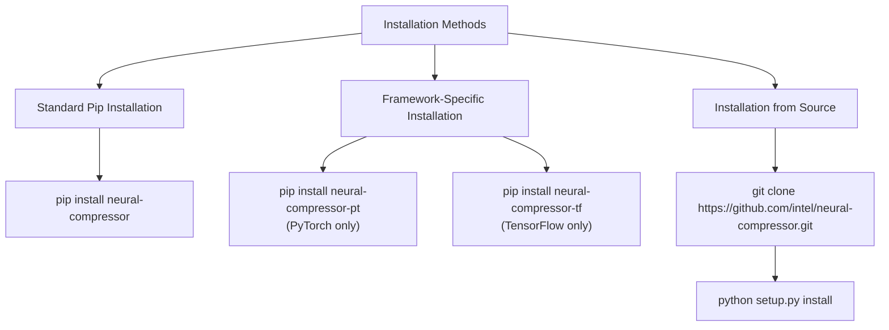
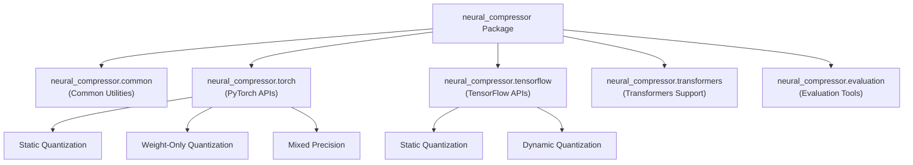
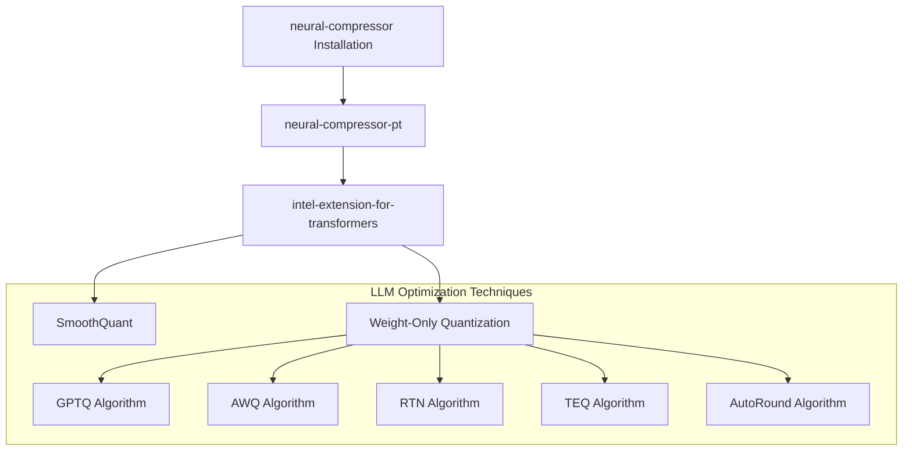

<!-- source: DeepWiki mcp.deepwiki.com · repo intel/neural-compressor · page 2 Installation and Setup · fetched 2026-10-21 -->

# Installation and Setup

<details>
<summary>Relevant source files</summary>

The following files were used as context for generating this wiki page:

- [.azure-pipelines/scripts/ut/3x/collect_log_3x.sh](.azure-pipelines/scripts/ut/3x/collect_log_3x.sh)
- [.azure-pipelines/template/ut-template.yml](.azure-pipelines/template/ut-template.yml)
- [README.md](README.md)
- [docs/source/add_new_adaptor.md](docs/source/add_new_adaptor.md)
- [docs/source/add_new_data_type.md](docs/source/add_new_data_type.md)
- [docs/source/calibration.md](docs/source/calibration.md)
- [docs/source/examples_readme.md](docs/source/examples_readme.md)
- [docs/source/framework_yaml.md](docs/source/framework_yaml.md)
- [docs/source/infrastructure.md](docs/source/infrastructure.md)
- [docs/source/mixed_precision.md](docs/source/mixed_precision.md)
- [docs/source/publication_list.md](docs/source/publication_list.md)
- [docs/source/quantization.md](docs/source/quantization.md)
- [docs/source/quantization_mixed_precision.md](docs/source/quantization_mixed_precision.md)
- [examples/README.md](examples/README.md)
- [neural_compressor/__init__.py](neural_compressor/__init__.py)
- [requirements.txt](requirements.txt)
- [setup.py](setup.py)
- [test/3x/torch/algorithms/fp8_quant/__init__.py](test/3x/torch/algorithms/fp8_quant/__init__.py)
- [test/3x/torch/algorithms/fp8_quant/conftest.py](test/3x/torch/algorithms/fp8_quant/conftest.py)
- [test/3x/torch/quantization/fp8_quant/conftest.py](test/3x/torch/quantization/fp8_quant/conftest.py)

</details>


This document provides comprehensive guidance on how to install and set up Intel® Neural Compressor (INC) for model optimization tasks. It covers different installation methods, system requirements, and initial configuration steps to help you get started.

For information about the overall architecture of Neural Compressor, see [Architecture](#2).

## System Requirements

Before installing Intel Neural Compressor, ensure your system meets the following requirements:

### Software Requirements

| Requirement | Specification |
|-------------|---------------|
| Python      | Python 3.7.0 or later (Python 3.10+ recommended) |
| Operating Systems | Linux (primary support)<br>Windows (limited support) |

### Hardware Requirements

Intel Neural Compressor works with various Intel hardware platforms:

- Intel CPUs (Xeon, Core series)
- Intel GPUs (Data Center GPU Max Series, Arc GPUs)
- Intel Habana Gaudi accelerators

## Installation Methods

Intel Neural Compressor can be installed using different methods depending on your needs:



Sources: [setup.py:86-134]()

### Standard Installation

The simplest way to install Neural Compressor is using pip:

```bash
pip install neural-compressor
```

This will install the complete package with support for all frameworks.

### Framework-Specific Installation

If you only need support for a specific framework, you can install a more targeted package:

#### PyTorch Only:
```bash
pip install neural-compressor-pt
```

#### TensorFlow Only:
```bash
pip install neural-compressor-tf
```

Sources: [setup.py:147-156]()

### Installation from Source

For the latest features or development purposes, you can install Neural Compressor from source:

```bash
git clone https://github.com/intel/neural-compressor.git
cd neural-compressor
python setup.py install
```

## Package Structure

Intel Neural Compressor is organized into multiple components for different frameworks and functionalities:



Sources: [setup.py:104-134](), [neural_compressor/__init__.py:20-32]()

## Dependencies

Neural Compressor requires several dependencies, which are automatically installed when using pip:

### Core Dependencies

The following dependencies are installed with the base package:

```
deprecated >= 1.2.13
numpy < 2.0
opencv-python-headless
pandas
Pillow
prettytable
psutil
py-cpuinfo
pyyaml
requests
schema
scikit-learn
```

Sources: [requirements.txt:1-15]()

### Framework-Specific Dependencies

When installing framework-specific packages, additional dependencies will be installed:

- `neural-compressor-pt`: PyTorch and related libraries
- `neural-compressor-tf`: TensorFlow and related libraries

## Framework Extensions

For optimal performance, Intel provides extensions for supported frameworks:

### Intel Extension for TensorFlow

#### For Intel GPUs (Required for GPU quantization):
```bash
pip install --upgrade intel-extension-for-tensorflow[xpu]
```

#### For Intel CPUs (Optional):
```bash
pip install --upgrade intel-extension-for-tensorflow[cpu]
```

### Intel Extension for PyTorch

For PyTorch optimizations:

```bash
pip install --upgrade intel-extension-for-pytorch
```

Sources: [examples/3.x_api/tensorflow/object_detection/yolo_v5/quantization/ptq/README.md:26-44]()

## Verifying Installation

To verify that Neural Compressor has been installed correctly, you can check the version:

```python
import neural_compressor
print(neural_compressor.__version__)
```

The output should match the current version: `3.3.1`

Sources: [neural_compressor/version.py:18]()

## Installation for Large Language Model (LLM) Optimization

Neural Compressor provides specialized support for quantizing large language models. The installation process is the same, but for optimal LLM support, we recommend installing the PyTorch version and additional dependencies:

```bash
pip install neural-compressor-pt
pip install intel-extension-for-transformers
```

This combination provides support for advanced techniques like:
- SmoothQuant (SQ)
- Weight-Only Quantization (WOQ)
- GPTQ, AWQ, RTN, and other LLM-specific algorithms



Sources: [docs/source/llm_recipes.md:1-40]()

## Benchmark Tool Installation

Neural Compressor includes a benchmarking tool `incbench` that is automatically installed with the package. This tool is useful for evaluating model performance after quantization:

```bash
# Using the benchmark tool
incbench --num_c 4 main.py [additional parameters]
```

Sources: [examples/3.x_api/tensorflow/object_detection/yolo_v5/quantization/ptq/run_benchmark.sh:49-55]()

## Troubleshooting

### Version Compatibility

When using Intel Extensions (ITEX), make sure to check the compatibility between your TensorFlow version and the ITEX version. The compatibility table can be found in the [Intel Extension for TensorFlow repository](https://github.com/intel/intel-extension-for-tensorflow#compatibility-table).

### Common Installation Issues

1. **Missing dependencies**: If you encounter errors about missing dependencies, try installing them manually:
   ```bash
   pip install [missing_dependency]
   ```

2. **GPU driver issues**: For GPU usage, ensure you have installed the appropriate drivers. Follow the [installation guide for XPU](https://github.com/intel/intel-extension-for-tensorflow/blob/main/docs/install/install_for_xpu.md#install-gpu-drivers).

3. **Version conflicts**: If you encounter version conflicts, consider using a virtual environment:
   ```bash
   python -m venv inc_env
   source inc_env/bin/activate  # On Linux/Mac
   inc_env\Scripts\activate     # On Windows
   pip install neural-compressor
   ```

## Next Steps

After successful installation, you can start optimizing your models. For framework-specific adaptor information:
- For PyTorch: see [PyTorch Adaptor](#4.1)
- For TensorFlow: see [TensorFlow Adaptor](#4.2)
- For ONNX Runtime: see [ONNX Runtime Adaptor](#4.3)

For quantization techniques available in Neural Compressor, refer to [Quantization Techniques](#5).

---

