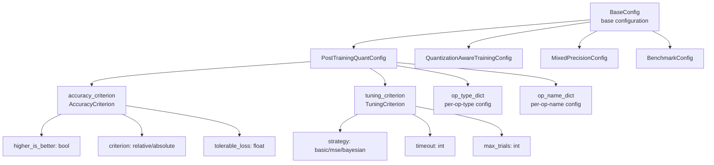
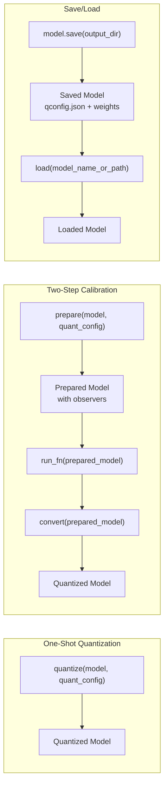
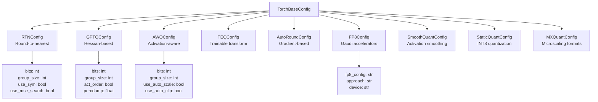
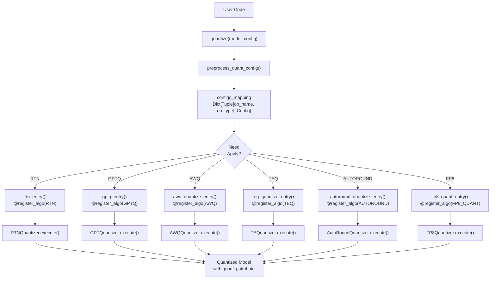
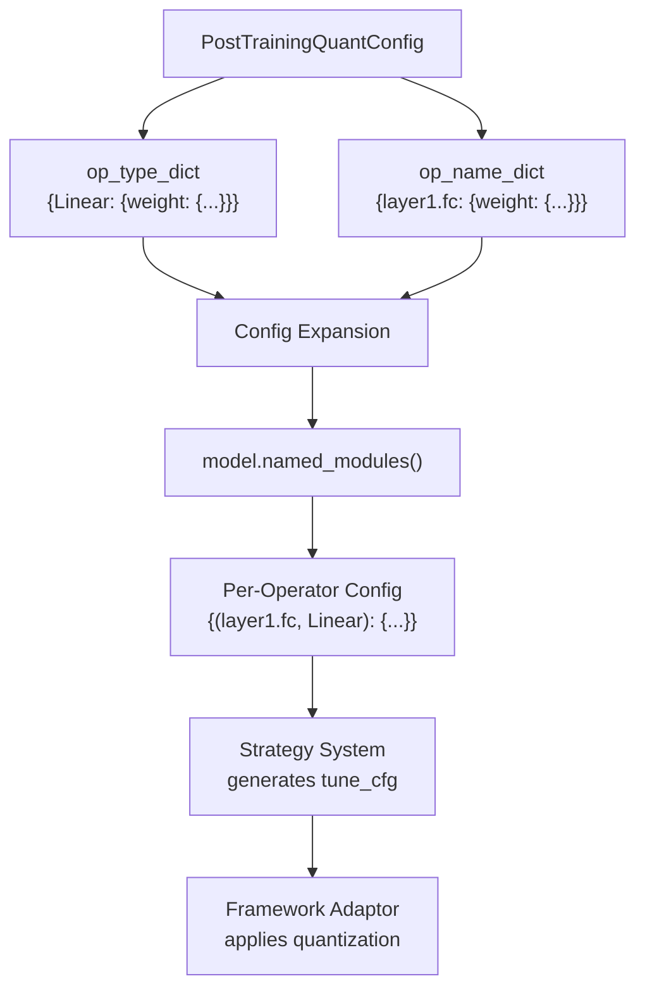
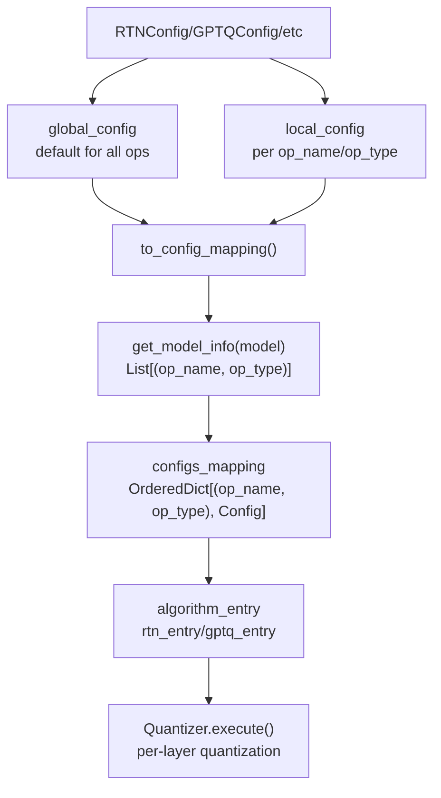

<!-- source: DeepWiki mcp.deepwiki.com · repo intel/neural-compressor · page 3 API Guide · fetched 2026-10-21 -->

# API Guide

<details>
<summary>Relevant source files</summary>

The following files were used as context for generating this wiki page:

- [README.md](README.md)
- [docs/source/add_new_adaptor.md](docs/source/add_new_adaptor.md)
- [docs/source/add_new_data_type.md](docs/source/add_new_data_type.md)
- [docs/source/calibration.md](docs/source/calibration.md)
- [docs/source/examples_readme.md](docs/source/examples_readme.md)
- [docs/source/framework_yaml.md](docs/source/framework_yaml.md)
- [docs/source/infrastructure.md](docs/source/infrastructure.md)
- [docs/source/mixed_precision.md](docs/source/mixed_precision.md)
- [docs/source/publication_list.md](docs/source/publication_list.md)
- [docs/source/quantization.md](docs/source/quantization.md)
- [docs/source/quantization_mixed_precision.md](docs/source/quantization_mixed_precision.md)
- [examples/README.md](examples/README.md)
- [examples/pytorch/multimodal-modeling/quantization/auto_round/mllm.py](examples/pytorch/multimodal-modeling/quantization/auto_round/mllm.py)
- [neural_compressor/benchmark.py](neural_compressor/benchmark.py)
- [neural_compressor/config.py](neural_compressor/config.py)
- [neural_compressor/mix_precision.py](neural_compressor/mix_precision.py)
- [neural_compressor/model/model.py](neural_compressor/model/model.py)
- [neural_compressor/quantization.py](neural_compressor/quantization.py)
- [neural_compressor/torch/algorithms/layer_wise/utils.py](neural_compressor/torch/algorithms/layer_wise/utils.py)
- [neural_compressor/torch/algorithms/mixed_low_precision/modules.py](neural_compressor/torch/algorithms/mixed_low_precision/modules.py)
- [neural_compressor/torch/algorithms/mixed_low_precision/quantizer.py](neural_compressor/torch/algorithms/mixed_low_precision/quantizer.py)
- [neural_compressor/torch/algorithms/weight_only/__init__.py](neural_compressor/torch/algorithms/weight_only/__init__.py)
- [neural_compressor/torch/algorithms/weight_only/autoround.py](neural_compressor/torch/algorithms/weight_only/autoround.py)
- [neural_compressor/torch/algorithms/weight_only/awq.py](neural_compressor/torch/algorithms/weight_only/awq.py)
- [neural_compressor/torch/algorithms/weight_only/gptq.py](neural_compressor/torch/algorithms/weight_only/gptq.py)
- [neural_compressor/torch/algorithms/weight_only/modules.py](neural_compressor/torch/algorithms/weight_only/modules.py)
- [neural_compressor/torch/algorithms/weight_only/rtn.py](neural_compressor/torch/algorithms/weight_only/rtn.py)
- [neural_compressor/torch/algorithms/weight_only/save_load.py](neural_compressor/torch/algorithms/weight_only/save_load.py)
- [neural_compressor/torch/algorithms/weight_only/teq.py](neural_compressor/torch/algorithms/weight_only/teq.py)
- [neural_compressor/torch/algorithms/weight_only/utility.py](neural_compressor/torch/algorithms/weight_only/utility.py)
- [neural_compressor/torch/quantization/__init__.py](neural_compressor/torch/quantization/__init__.py)
- [neural_compressor/torch/quantization/algorithm_entry.py](neural_compressor/torch/quantization/algorithm_entry.py)
- [neural_compressor/torch/quantization/config.py](neural_compressor/torch/quantization/config.py)
- [neural_compressor/torch/quantization/quantize.py](neural_compressor/torch/quantization/quantize.py)
- [neural_compressor/torch/quantization/save_load_entry.py](neural_compressor/torch/quantization/save_load_entry.py)
- [neural_compressor/torch/utils/constants.py](neural_compressor/torch/utils/constants.py)
- [neural_compressor/torch/utils/utility.py](neural_compressor/torch/utils/utility.py)
- [neural_compressor/training.py](neural_compressor/training.py)
- [neural_compressor/transformers/models/modeling_auto.py](neural_compressor/transformers/models/modeling_auto.py)
- [neural_compressor/transformers/quantization/utils.py](neural_compressor/transformers/quantization/utils.py)
- [neural_compressor/transformers/utils/quantization_config.py](neural_compressor/transformers/utils/quantization_config.py)
- [neural_compressor/utils/utility.py](neural_compressor/utils/utility.py)
- [test/3x/torch/algorithms/weight_only/test_teq_quantizer.py](test/3x/torch/algorithms/weight_only/test_teq_quantizer.py)
- [test/3x/torch/quantization/fp8_quant/test_fp8_jsons/test_pow2_w4a8_quant.json](test/3x/torch/quantization/fp8_quant/test_fp8_jsons/test_pow2_w4a8_quant.json)
- [test/3x/torch/quantization/fp8_quant/test_gptq_mixed_precision.py](test/3x/torch/quantization/fp8_quant/test_gptq_mixed_precision.py)
- [test/3x/torch/quantization/weight_only/test_autoround.py](test/3x/torch/quantization/weight_only/test_autoround.py)
- [test/3x/torch/quantization/weight_only/test_awq.py](test/3x/torch/quantization/weight_only/test_awq.py)
- [test/3x/torch/quantization/weight_only/test_gptq.py](test/3x/torch/quantization/weight_only/test_gptq.py)
- [test/3x/torch/quantization/weight_only/test_rtn.py](test/3x/torch/quantization/weight_only/test_rtn.py)
- [test/3x/torch/quantization/weight_only/test_teq.py](test/3x/torch/quantization/weight_only/test_teq.py)
- [test/3x/torch/quantization/weight_only/test_transformers.py](test/3x/torch/quantization/weight_only/test_transformers.py)
- [test/3x/torch/requirements.txt](test/3x/torch/requirements.txt)
- [test/adaptor/pytorch_adaptor/test_adaptor_security.py](test/adaptor/pytorch_adaptor/test_adaptor_security.py)

</details>


## Purpose and Scope

This document provides an overview of Intel® Neural Compressor's two API versions and guidance on selecting the appropriate API for your use case. Intel Neural Compressor offers two distinct API paradigms:

- **2.x API (Unified)**: A framework-agnostic API with automated accuracy-aware tuning across TensorFlow, PyTorch, and ONNX Runtime
- **3.x API (PyTorch-focused)**: A direct quantization API optimized for PyTorch workflows with explicit algorithm control

For detailed information on specific quantization techniques, see [Quantization Techniques](#6). For framework-specific implementations, see [Framework Adaptors](#5).

---

## API Version Comparison

The two API versions serve different purposes and offer distinct capabilities:

### 2.x API Characteristics

- **Framework Support**: TensorFlow, PyTorch, ONNX Runtime
- **Tuning Mode**: Automatic accuracy-aware tuning with Strategy system
- **Use Cases**: Production deployments requiring accuracy guarantees, multi-framework projects
- **Configuration**: `PostTrainingQuantConfig`, `QuantizationAwareTrainingConfig`, `MixedPrecisionConfig`
- **Entry Points**: `quantization.fit()`, `mix_precision.fit()`, `training.fit()`, `benchmark.fit()`

### 3.x API Characteristics

- **Framework Support**: PyTorch (CPU, Intel XPU, Intel Gaudi HPU)
- **Tuning Mode**: Direct quantization without automated tuning (one-shot)
- **Use Cases**: Research, LLM quantization, explicit algorithm control
- **Configuration**: `RTNConfig`, `GPTQConfig`, `AWQConfig`, `FP8Config`, `AutoRoundConfig`, etc.
- **Entry Points**: `quantize()`, `prepare()`/`convert()`, `load()`, `save()`

```mermaid
graph TB
    subgraph "2.x API Flow"
        Model2x["FP32 Model"]
        Config2x["PostTrainingQuantConfig"]
        Fit2x["quantization.fit()"]
        Strategy["Strategy System<br/>BasicStrategy/MSEStrategy"]
        Tuning["Accuracy-Aware Tuning<br/>TuningSpace + Samplers"]
        QModel2x["Quantized Model<br/>with accuracy guarantee"]
        
        Model2x --> Fit2x
        Config2x --> Fit2x
        Fit2x --> Strategy
        Strategy --> Tuning
        Tuning --> QModel2x
    end
    
    subgraph "3.x API Flow"
        Model3x["FP32 Model"]
        Config3x["RTNConfig/GPTQConfig/etc"]
        Quantize3x["quantize()"]
        AlgoEntry["algorithm_entry.py<br/>rtn_entry/gptq_entry"]
        Quantizer["Quantizer Classes<br/>RTNQuantizer/GPTQuantizer"]
        QModel3x["Quantized Model<br/>one-shot"]
        
        Model3x --> Quantize3x
        Config3x --> Quantize3x
        Quantize3x --> AlgoEntry
        AlgoEntry --> Quantizer
        Quantizer --> QModel3x
    end
    
    style Strategy fill:#f9f9f9
    style AlgoEntry fill:#f9f9f9
```



**Diagram 1: API Flow Comparison - 2.x Accuracy-Aware Tuning vs 3.x Direct Quantization**

Sources: [neural_compressor/torch/quantization/quantize.py:113-152](), [neural_compressor/quantization.py:1-100](), [neural_compressor/config.py:489-580]()

---

## 2.x API: Unified Framework Interface

The 2.x API provides a unified interface across frameworks with automated accuracy-aware tuning. This API is recommended for production deployments where accuracy preservation is critical.

### Entry Point Functions

| Function | Purpose | Key Arguments |
|----------|---------|---------------|
| `quantization.fit()` | Post-training quantization with tuning | `model`, `conf`, `eval_func`, `eval_dataloader` |
| `mix_precision.fit()` | BF16/FP16 mixed precision optimization | `model`, `conf`, `eval_func` |
| `training.fit()` | QAT + pruning + distillation orchestration | `model`, `conf`, `train_func` |
| `benchmark.fit()` | Performance measurement | `model`, `conf`, `b_dataloader` |

### Configuration Classes



**Diagram 2: 2.x Configuration Class Hierarchy**

Sources: [neural_compressor/config.py:489-1240](), [neural_compressor/quantization.py:100-200]()

### 2.x Workflow Example Pattern

The typical workflow for 2.x API involves creating a configuration, defining evaluation criteria, and calling `fit()`:

```python
# Pattern from neural_compressor/config.py and neural_compressor/quantization.py
from neural_compressor import quantization
from neural_compressor.config import PostTrainingQuantConfig, AccuracyCriterion, TuningCriterion

# Define accuracy requirement
accuracy_criterion = AccuracyCriterion(
    higher_is_better=True,
    criterion='relative',
    tolerable_loss=0.01
)

# Define tuning budget
tuning_criterion = TuningCriterion(
    strategy='mse',
    timeout=0,
    max_trials=100
)

# Create configuration
conf = PostTrainingQuantConfig(
    device='cpu',
    backend='default',
    accuracy_criterion=accuracy_criterion,
    tuning_criterion=tuning_criterion
)

# Quantize with automatic tuning
q_model = quantization.fit(
    model=fp32_model,
    conf=conf,
    calib_dataloader=calib_dataloader,
    eval_func=eval_func
)
```

Sources: [neural_compressor/config.py:580-800](), [neural_compressor/quantization.py:1-150]()

---

## 3.x API: PyTorch Direct Quantization

The 3.x API provides explicit control over quantization algorithms without automated tuning. This API is optimized for PyTorch and recommended for LLM quantization and research workflows.

### Core Entry Points



**Diagram 3: 3.x API Entry Point Workflows**

Sources: [neural_compressor/torch/quantization/quantize.py:113-288](), [neural_compressor/torch/algorithms/weight_only/save_load.py:55-143]()

### Function Signatures

**`quantize()`** - One-shot quantization
```python
# From neural_compressor/torch/quantization/quantize.py:115-152
def quantize(
    model: torch.nn.Module,
    quant_config: BaseConfig,
    run_fn: Callable = None,
    run_args: Any = None,
    inplace: bool = True,
    example_inputs: Any = None,
) -> torch.nn.Module
```

**`prepare()`** - Insert observers for calibration
```python
# From neural_compressor/torch/quantization/quantize.py:155-192
def prepare(
    model: torch.nn.Module,
    quant_config: BaseConfig,
    inplace: bool = True,
    example_inputs: Any = None,
) -> torch.nn.Module
```

**`convert()`** - Convert prepared model to quantized
```python
# From neural_compressor/torch/quantization/quantize.py:226-288
def convert(
    model: torch.nn.Module,
    quant_config: BaseConfig = None,
    inplace: bool = True,
) -> torch.nn.Module
```

Sources: [neural_compressor/torch/quantization/quantize.py:113-288]()

### Configuration Classes



**Diagram 4: 3.x Configuration Classes and Key Parameters**

Sources: [neural_compressor/torch/quantization/config.py:104-1200]()

### Configuration Class Details

| Config Class | Algorithm | Priority | Key Parameters |
|--------------|-----------|----------|----------------|
| `RTNConfig` | Round-to-nearest | PRIORITY_RTN | `dtype`, `bits`, `group_size`, `use_mse_search` |
| `GPTQConfig` | GPTQ | PRIORITY_GPTQ | `bits`, `group_size`, `act_order`, `percdamp`, `block_size` |
| `AWQConfig` | AWQ | PRIORITY_AWQ | `bits`, `group_size`, `use_auto_scale`, `use_auto_clip` |
| `TEQConfig` | TEQ | PRIORITY_TEQ | `bits`, `group_size`, `absorb_to_layer`, `folding` |
| `AutoRoundConfig` | AutoRound | PRIORITY_AUTOROUND | `bits`, `group_size`, `nsamples`, `iters` |
| `HQQConfig` | HQQ | PRIORITY_HQQ | `bits`, `group_size`, `quant_scale`, `quant_zero` |
| `FP8Config` | FP8 | N/A | `fp8_config` (E4M3/E5M2), `approach`, `device` |
| `StaticQuantConfig` | INT8 PTQ | N/A | `w_dtype`, `act_dtype`, `w_granularity`, `act_granularity` |
| `SmoothQuantConfig` | SmoothQuant | N/A | `alpha`, `folding`, `scale_sharing`, `auto_alpha_args` |

Sources: [neural_compressor/torch/quantization/config.py:104-1200](), [neural_compressor/torch/utils/constants.py:1-100]()

---

## Algorithm Dispatch System

The 3.x API uses a registry-based algorithm dispatch system that routes configurations to specific quantization implementations.



**Diagram 5: 3.x Algorithm Dispatch Flow from Config to Quantizer**

Sources: [neural_compressor/torch/quantization/quantize.py:49-152](), [neural_compressor/torch/quantization/algorithm_entry.py:62-700](), [neural_compressor/torch/utils/utility.py:63-82]()

### Algorithm Entry Registry

The `@register_algo` decorator registers algorithm implementations in `algos_mapping`:

```python
# Pattern from neural_compressor/torch/utils/utility.py:63-82
algos_mapping: Dict[str, Callable] = {}

def register_algo(name):
    def decorator(algo_func):
        algos_mapping[name] = algo_func
        return algo_func
    return decorator

# Usage in neural_compressor/torch/quantization/algorithm_entry.py:63-117
@register_algo(RTN)
@torch.no_grad()
def rtn_entry(model, configs_mapping, mode=Mode.QUANTIZE, *args, **kwargs):
    quantizer = get_quantizer(model, quantizer_cls=RTNQuantizer, quant_config=weight_config)
    model = quantizer.execute(model, mode=mode, *args, **kwargs)
    return model
```

Sources: [neural_compressor/torch/utils/utility.py:63-82](), [neural_compressor/torch/quantization/algorithm_entry.py:62-700]()

---

## Configuration to Model Mapping

Both APIs convert user configurations into per-operator quantization specifications through a mapping process.

### 2.x Configuration Expansion



**Diagram 6: 2.x Configuration Expansion to Per-Operator Tuning**

Sources: [neural_compressor/config.py:580-1240]()

### 3.x Configuration Expansion



**Diagram 7: 3.x Configuration to Per-Operator Mapping**

Sources: [neural_compressor/torch/quantization/config.py:104-300](), [neural_compressor/torch/quantization/quantize.py:49-110]()

---

## Choosing the Right API

### Decision Matrix

| Requirement | Recommended API | Rationale |
|-------------|-----------------|-----------|
| Accuracy must meet specific threshold | 2.x API | Automated tuning with `AccuracyCriterion` |
| Multi-framework deployment | 2.x API | Unified interface for TF, PyTorch, ONNX |
| LLM quantization (weight-only) | 3.x API | Specialized algorithms (GPTQ, AWQ, AutoRound) |
| PyTorch-only deployment | 3.x API | Optimized for PyTorch, simpler workflow |
| Research/experimentation | 3.x API | Direct algorithm control, faster iteration |
| Intel Gaudi FP8 quantization | 3.x API | `FP8Config` with HPU-specific optimizations |
| QAT, pruning, or distillation | 2.x API | Only available in 2.x |
| Need fastest time-to-quantize | 3.x API | One-shot quantization, no tuning loop |

### Migration from 2.x to 3.x

For PyTorch users, the 3.x API provides equivalent functionality with a simpler interface:

**2.x Pattern:**
```python
# From neural_compressor/config.py and neural_compressor/quantization.py
from neural_compressor import quantization
from neural_compressor.config import PostTrainingQuantConfig

conf = PostTrainingQuantConfig(approach='static', ...)
q_model = quantization.fit(model, conf, calib_dataloader, eval_func)
```

**3.x Equivalent:**
```python
# From neural_compressor/torch/quantization/quantize.py
from neural_compressor.torch.quantization import quantize, StaticQuantConfig

quant_config = StaticQuantConfig()
q_model = quantize(model, quant_config, run_fn=calib_func, example_inputs=inputs)
```

Sources: [neural_compressor/quantization.py:1-150](), [neural_compressor/torch/quantization/quantize.py:113-152]()

---

## Package Distribution

Intel Neural Compressor is available in multiple package formats to minimize installation footprint:

| Package Name | Contents | Use Case |
|--------------|----------|----------|
| `neural-compressor` | Full package: 2.x + 3.x + all frameworks | Multi-framework development |
| `neural-compressor[pt]` | Full + PyTorch dependencies | PyTorch-focused projects |
| `neural-compressor[tf]` | Full + TensorFlow dependencies | TensorFlow-focused projects |

```python
# Installation examples
pip install neural-compressor         # Full package
pip install neural-compressor[pt]     # With PyTorch deps
pip install neural-compressor[tf]     # With TensorFlow deps
```

Sources: [README.md:46-53]()

---

## Configuration Attributes Reference

### Common Attributes (2.x and 3.x)

| Attribute | Type | Description | Default |
|-----------|------|-------------|---------|
| `white_list` | `List[OP_NAME_OR_MODULE_TYPE]` | Operators to quantize | `DEFAULT_WHITE_LIST` |
| `op_type_dict` / `local_config` | `Dict` | Per-operator-type config | `{}` |
| `op_name_dict` / `local_config` | `Dict` | Per-operator-name config | `{}` |

### Weight-Only Quantization Attributes (3.x)

| Attribute | Type | Description | Default | Applicable Configs |
|-----------|------|-------------|---------|-------------------|
| `dtype` | `str` | Data type: "int", "int4", "int8", "nf4", "fp4", "fp8_e5m2", etc. | `"int"` | RTN, GPTQ, AWQ, TEQ |
| `bits` | `int` | Number of bits for quantization | `4` | RTN, GPTQ, AWQ, TEQ, AutoRound |
| `use_sym` | `bool` | Symmetric vs asymmetric quantization | `True` | RTN, GPTQ, AWQ, TEQ |
| `group_size` | `int` | Quantization group size (-1 for per-channel) | `32` | RTN, GPTQ, AWQ, TEQ, AutoRound |
| `use_mse_search` | `bool` | Enable MSE-based clip value search | `False` | RTN, AWQ |
| `use_double_quant` | `bool` | Enable double quantization | `False` | RTN, GPTQ, AWQ |
| `quant_lm_head` | `bool` | Quantize language model head layer | `False` | RTN, GPTQ, AWQ, TEQ |

### GPTQ-Specific Attributes

| Attribute | Type | Description | Default |
|-----------|------|-------------|---------|
| `act_order` | `bool` | Activation-based channel reordering | `False` |
| `percdamp` | `float` | Hessian diagonal dampening percentage | `0.01` |
| `block_size` | `int` | Block size for GPTQ execution | `2048` |
| `static_groups` | `bool` | Pre-calculate group-wise parameters | `False` |
| `true_sequential` | `bool` | Quantize layers in original order | `False` |

### AWQ-Specific Attributes

| Attribute | Type | Description | Default |
|-----------|------|-------------|---------|
| `use_auto_scale` | `bool` | Enable automatic scaling search | `True` |
| `use_auto_clip` | `bool` | Enable automatic clip range search | `True` |
| `folding` | `bool` | Allow scale insertion when absorption fails | `False` |

### FP8-Specific Attributes

| Attribute | Type | Description | Default |
|-----------|------|-------------|---------|
| `fp8_config` | `str` | FP8 format: "E4M3" or "E5M2" | `"E4M3"` |
| `approach` | `str` | Quantization approach: "static" or "dynamic" | `"static"` |
| `device` | `str` | Target device (must be "hpu" for FP8) | `"hpu"` |

Sources: [neural_compressor/torch/quantization/config.py:104-1200]()

---

## Save and Load Operations

### 3.x Save/Load API

The 3.x API provides integrated save/load operations for quantized models:

```mermaid
graph TB
    subgraph "Save Operations"
        QModel["Quantized Model<br/>with qconfig"]
        SaveFunc["model.save(output_dir, format)"]
        
        SaveFunc --> CheckFormat{format?}
        
        CheckFormat -->|DEFAULT| DefaultSave["Save INC Format"]
        CheckFormat -->|HUGGINGFACE| HFSave["Save HF Format"]
        
        DefaultSave --> INCFiles["qconfig.json<br/>quantized_weight.pt"]
        HFSave --> HFFiles["config.json<br/>quantize_config.json<br/>model.safetensors"]
        
        QModel --> SaveFunc
    end
    
    subgraph "Load Operations"
        LoadFunc["load(model_name_or_path, format)"]
        
        LoadFunc --> CheckSource{Source?}
        
        CheckSource -->|Local INC| LoadINC["load_inc_format_woq_model()"]
        CheckSource -->|Local/Remote HF| LoadHF["load_hf_format_woq_model()"]
        
        LoadINC --> BuildWOQ["_build_woq_model()"]
        LoadHF --> BuildWOQ
        
        BuildWOQ --> ReplaceLinear["Replace torch.nn.Linear<br/>with INCWeightOnlyLinear"]
        ReplaceLinear --> LoadedModel["Loaded Quantized Model"]
    end
```



**Diagram 8: 3.x Save/Load System with Format Support**

Sources: [neural_compressor/torch/algorithms/weight_only/save_load.py:55-600]()

### Save Function

```python
# From neural_compressor/torch/algorithms/weight_only/save_load.py:55-108
def save(model, output_dir="./saved_results", format=SaveLoadFormat.DEFAULT, **kwargs):
    """Save the quantized model and config.
    
    Args:
        model: Quantized model
        output_dir: Output directory
        format: "default" or "huggingface"
        kwargs: Additional format-specific arguments
            - safe_serialization (bool): Use safetensors for HF format
            - tokenizer: Tokenizer to save with model (HF format)
            - max_shard_size (str): Maximum shard size (HF format)
    """
```

### Load Function

```python
# From neural_compressor/torch/algorithms/weight_only/save_load.py:110-143
def load(model_name_or_path, original_model=None, format=SaveLoadFormat.DEFAULT, device="cpu", **kwargs):
    """Load quantized weight-only quantization model.
    
    Args:
        model_name_or_path: Path to saved model or HF model name
        original_model: Original FP32 model (required for DEFAULT format)
        format: "default" or "huggingface"
        device: Target device ("cpu", "hpu", etc.)
        kwargs: Additional loading arguments
    
    Returns:
        Quantized model
    """
```

Sources: [neural_compressor/torch/algorithms/weight_only/save_load.py:55-143]()

---

## Summary

This guide covered the two API versions available in Intel Neural Compressor:

- **2.x API**: Use for production deployments requiring accuracy guarantees, multi-framework support, or training-time compression (QAT, pruning, distillation)
- **3.x API**: Use for PyTorch-only workflows, LLM quantization, research, or when direct algorithm control is needed

For detailed algorithm descriptions and parameters, see [Weight-Only Quantization](#6.3). For framework-specific implementation details, see [Framework Adaptors](#5).

Sources: [README.md:1-203](), [neural_compressor/torch/quantization/quantize.py:1-288](), [neural_compressor/quantization.py:1-200]()

---

