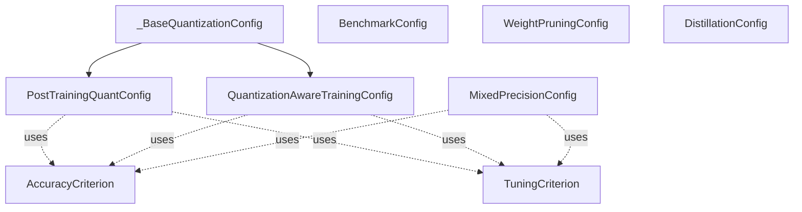
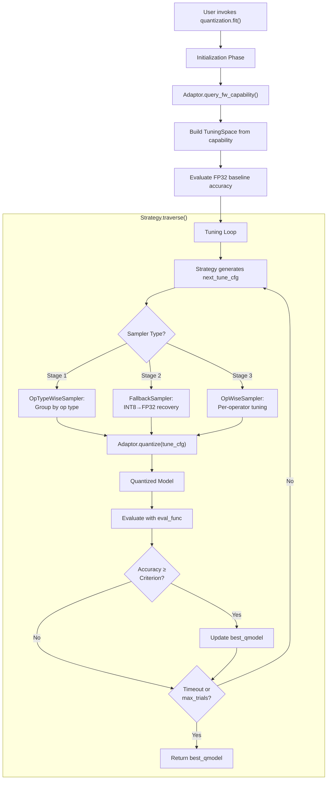
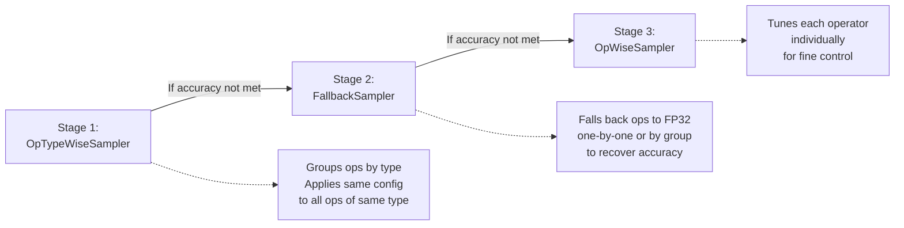
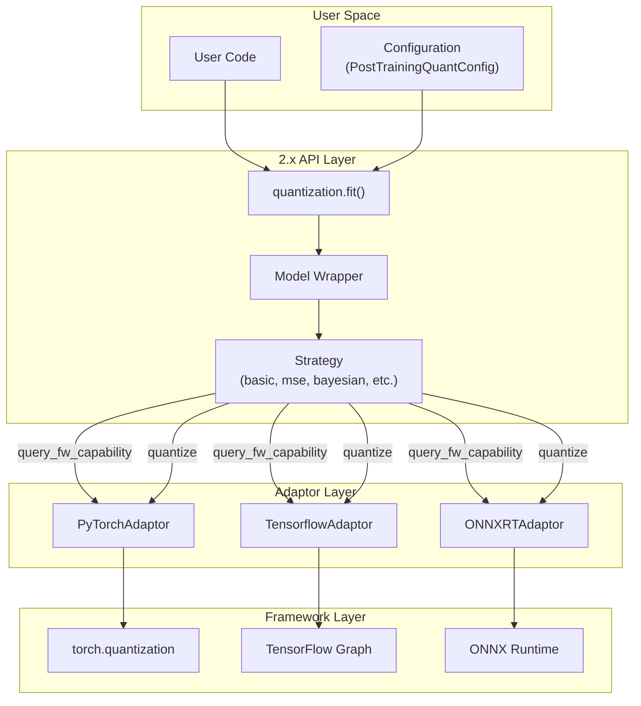

<!-- source: DeepWiki mcp.deepwiki.com · repo intel/neural-compressor · page 3.1 2.x API (Unified) · fetched 2026-10-21 -->

# 2.x API (Unified)

<details>
<summary>Relevant source files</summary>

The following files were used as context for generating this wiki page:

- [README.md](README.md)
- [docs/source/add_new_adaptor.md](docs/source/add_new_adaptor.md)
- [docs/source/add_new_data_type.md](docs/source/add_new_data_type.md)
- [docs/source/calibration.md](docs/source/calibration.md)
- [docs/source/examples_readme.md](docs/source/examples_readme.md)
- [docs/source/framework_yaml.md](docs/source/framework_yaml.md)
- [docs/source/infrastructure.md](docs/source/infrastructure.md)
- [docs/source/mixed_precision.md](docs/source/mixed_precision.md)
- [docs/source/publication_list.md](docs/source/publication_list.md)
- [docs/source/quantization.md](docs/source/quantization.md)
- [docs/source/quantization_mixed_precision.md](docs/source/quantization_mixed_precision.md)
- [examples/README.md](examples/README.md)
- [neural_compressor/benchmark.py](neural_compressor/benchmark.py)
- [neural_compressor/config.py](neural_compressor/config.py)
- [neural_compressor/mix_precision.py](neural_compressor/mix_precision.py)
- [neural_compressor/model/model.py](neural_compressor/model/model.py)
- [neural_compressor/quantization.py](neural_compressor/quantization.py)
- [neural_compressor/training.py](neural_compressor/training.py)
- [neural_compressor/utils/utility.py](neural_compressor/utils/utility.py)
- [test/adaptor/pytorch_adaptor/test_adaptor_security.py](test/adaptor/pytorch_adaptor/test_adaptor_security.py)

</details>


## Purpose and Scope

The 2.x API is Intel® Neural Compressor's unified, framework-agnostic interface for model optimization. This API provides a consistent experience across TensorFlow, PyTorch, and ONNX Runtime frameworks with built-in accuracy-aware tuning capabilities. The 2.x API is designed for users who need automated optimization that balances performance gains with accuracy preservation.

This page documents the 2.x API's core functions, configuration system, and accuracy-aware tuning workflow. For direct quantization without tuning (PyTorch-focused), see the 3.x API documentation [3.2](#3.2). For framework-specific implementation details, see Framework Adaptors [5](#5).

Sources: [README.md:176-177](), [docs/source/quantization.md:1-15]()

## API Overview

The 2.x API consists of four primary entry point functions, each serving a distinct optimization purpose:

| Function | Purpose | Module | Primary Use Case |
|----------|---------|--------|------------------|
| `quantization.fit()` | Post-training quantization with optional accuracy tuning | `neural_compressor.quantization` | INT8 model generation with accuracy guarantees |
| `mix_precision.fit()` | BF16/FP16 conversion with optional accuracy tuning | `neural_compressor.mix_precision` | Mixed precision optimization |
| `training.fit()` | Quantization-aware training with tuning | `neural_compressor.training` | QAT with accuracy-driven configuration search |
| `benchmark.fit()` | Performance measurement | `neural_compressor.benchmark` | Latency and throughput benchmarking |

Sources: [neural_compressor/quantization.py:1-242](), [neural_compressor/mix_precision.py:1-180](), [neural_compressor/training.py:1-303](), [neural_compressor/benchmark.py:1-402]()

## Configuration System

### Configuration Class Hierarchy

The 2.x API uses a hierarchical configuration system with specialized classes for each optimization technique:



Sources: [neural_compressor/config.py:715-1296]()

### PostTrainingQuantConfig

The `PostTrainingQuantConfig` class controls post-training quantization behavior. Key parameters:

| Parameter | Type | Default | Description |
|-----------|------|---------|-------------|
| `approach` | str | "auto" | Quantization approach: "static", "dynamic", "auto", "weight_only" |
| `backend` | str | "default" | Backend library: "default", "ipex", "itex", "onnxrt_trt_ep", etc. |
| `device` | str | "cpu" | Target device: "cpu", "gpu", "xpu", "npu" |
| `calibration_sampling_size` | list[int] | [100] | Number of samples for calibration |
| `op_type_dict` | dict | None | Per-operator-type quantization constraints |
| `op_name_dict` | dict | None | Per-operator-name quantization constraints |
| `recipes` | dict | {} | Quantization recipes (smooth_quant, layer_wise_quant, etc.) |
| `quant_level` | str/int | "auto" | Quantization level: "auto", 0 (conservative), 1 (basic) |
| `accuracy_criterion` | AccuracyCriterion | Default | Accuracy goal for tuning |
| `tuning_criterion` | TuningCriterion | Default | Tuning strategy and stop criteria |
| `excluded_precisions` | list[str] | [] | Precisions to exclude (e.g., ["bf16"]) |

Sources: [neural_compressor/config.py:715-1048]()

### QuantizationAwareTrainingConfig

The `QuantizationAwareTrainingConfig` extends `PostTrainingQuantConfig` with QAT-specific settings:

| Parameter | Type | Default | Description |
|-----------|------|---------|-------------|
| `approach` | str | "quant_aware_training" | Fixed to QAT approach |
| All PTQ parameters | - | - | Inherits all PostTrainingQuantConfig parameters |

Sources: [neural_compressor/config.py:1050-1100]()

### AccuracyCriterion

The `AccuracyCriterion` class defines accuracy goals for tuning:

| Parameter | Type | Default | Description |
|-----------|------|---------|-------------|
| `higher_is_better` | bool | True | Whether higher metric values indicate better accuracy |
| `criterion` | str | "relative" | Loss criterion: "relative" or "absolute" |
| `tolerable_loss` | float | 0.01 | Maximum acceptable accuracy degradation |

Example: For a baseline accuracy of 0.90, a relative tolerance of 0.01 means the quantized model must achieve at least 0.891 accuracy (99% of baseline).

Sources: [neural_compressor/config.py:489-589]()

### TuningCriterion

The `TuningCriterion` class controls the tuning process:

| Parameter | Type | Default | Description |
|-----------|------|---------|-------------|
| `strategy` | str | "basic" | Tuning strategy: "basic", "mse", "bayesian", "random", "exhaustive", "sigopt", "tpe", "mse_v2", "hawq_v2" |
| `strategy_kwargs` | dict | None | Strategy-specific parameters |
| `timeout` | int/float | 0 | Maximum tuning time in seconds (0 = no limit) |
| `max_trials` | int | 100 | Maximum number of tuning trials |
| `objective` | str/list/dict | "performance" | Optimization objective: "performance", "accuracy", "modelsize", "footprint" |

Sources: [neural_compressor/config.py:592-713]()

### MixedPrecisionConfig

The `MixedPrecisionConfig` class configures BF16/FP16 conversion:

| Parameter | Type | Default | Description |
|-----------|------|---------|-------------|
| `precisions` | str/list[str] | "bf16" | Target precisions: "bf16", "fp16" |
| `backend` | str | "default" | Backend for execution |
| `device` | str | "cpu" | Target device |
| `excluded_precisions` | list[str] | [] | Precisions to avoid |
| `accuracy_criterion` | AccuracyCriterion | Default | Accuracy goal (for accuracy-aware mode) |
| `tuning_criterion` | TuningCriterion | Default | Tuning configuration |

Sources: [neural_compressor/config.py:1102-1192]()

### BenchmarkConfig

The `BenchmarkConfig` class defines performance measurement parameters:

| Parameter | Type | Default | Description |
|-----------|------|---------|-------------|
| `warmup` | int | 5 | Number of warmup iterations |
| `iteration` | int | -1 | Number of benchmark iterations (-1 = all data) |
| `cores_per_instance` | int | None | CPU cores per instance for multi-instance |
| `num_of_instance` | int | 1 | Number of parallel instances |
| `inter_num_of_threads` | int | None | Inter-op parallelism threads |
| `intra_num_of_threads` | int | None | Intra-op parallelism threads |

Sources: [neural_compressor/config.py:261-487]()

## Core API Functions

### quantization.fit()

The `quantization.fit()` function is the primary entry point for post-training quantization:

```python
def fit(
    model,
    conf: PostTrainingQuantConfig,
    calib_dataloader=None,
    calib_func=None,
    eval_func=None,
    eval_dataloader=None,
    eval_metric=None,
    **kwargs
) -> Model
```

**Parameters:**
- `model`: Framework model object or path to model file
- `conf`: PostTrainingQuantConfig instance
- `calib_dataloader`: Calibration data loader (required for static quantization)
- `calib_func`: Alternative calibration function (optional)
- `eval_func`: Evaluation function for accuracy-aware tuning (optional)
- `eval_dataloader`: Evaluation data loader (optional, requires eval_metric)
- `eval_metric`: Metric for evaluation (optional, requires eval_dataloader)

**Behavior:**
1. If `eval_func` or (`eval_dataloader` + `eval_metric`) provided: Performs accuracy-aware tuning
2. If neither provided: Performs direct quantization without tuning

**Return Value:**
Returns a quantized model wrapped in the framework-specific Model class.

Sources: [neural_compressor/quantization.py:33-242]()

### mix_precision.fit()

The `mix_precision.fit()` function converts models to BF16/FP16:

```python
def fit(
    model,
    conf: MixedPrecisionConfig,
    eval_func=None,
    eval_dataloader=None,
    eval_metric=None,
    **kwargs
) -> Model
```

**Key Differences from quantization.fit():**
- No calibration dataloader required
- Focuses on BF16/FP16 conversion rather than INT8 quantization
- Hardware validation: BF16 requires AVX512_BF16 instruction set or ITEX/IPEX backend

Sources: [neural_compressor/mix_precision.py:36-179]()

### training.fit()

The `training.fit()` function enables quantization-aware training with tuning:

```python
def fit(
    compression_manager: CompressionManager,
    train_func: Callable,
    eval_func=None,
    eval_dataloader=None,
    eval_metric=None,
    **kwargs
) -> Model
```

**Workflow:**
1. User creates `CompressionManager` with model and config via `prepare_compression()`
2. User provides `train_func` that performs training loop with callback hooks
3. Function performs accuracy-aware tuning by invoking `train_func` with different configurations
4. Returns best quantized model that meets accuracy criterion

**CompressionManager Callbacks:**
- `on_train_begin()`: Initialize quantization
- `on_epoch_begin(epoch)`: Epoch start hook
- `on_step_begin(step)`: Step start hook
- `on_after_compute_loss(input, output, loss)`: Loss modification hook
- `on_before_optimizer_step()`: Pre-optimization hook
- `on_step_end()`: Step end hook
- `on_epoch_end()`: Epoch end hook
- `on_train_end()`: Finalize quantization

Sources: [neural_compressor/training.py:197-303](), [neural_compressor/training.py:38-195]()

### benchmark.fit()

The `benchmark.fit()` function measures model performance:

```python
def fit(
    model,
    conf: BenchmarkConfig,
    b_dataloader=None,
    b_func=None
) -> dict
```

**Features:**
- Latency and throughput measurement
- Multi-instance execution for server scenarios
- Warmup iterations to stabilize measurements
- NUMA-aware core binding (Linux only)

Sources: [neural_compressor/benchmark.py:140-213]()

## Accuracy-Aware Tuning Workflow

The accuracy-aware tuning mechanism is the distinguishing feature of the 2.x API. The workflow operates as follows:



Sources: [neural_compressor/quantization.py:158-241](), [docs/source/quantization.md:118-132]()

### Tuning Space Construction

The tuning space is built by querying framework capabilities through the adaptor layer:

1. **Capability Query**: `Adaptor.query_fw_capability()` returns opwise and optypewise quantization capabilities
   ```python
   capability = {
       'opwise': {
           ('conv1', 'Conv2D'): [
               {'weight': {'dtype': 'int8'}, 'activation': {'dtype': 'int8'}},
               {'weight': {'dtype': 'bf16'}, 'activation': {'dtype': 'bf16'}},
               {'weight': {'dtype': 'fp32'}, 'activation': {'dtype': 'fp32'}}
           ]
       },
       'optypewise': {...}
   }
   ```

2. **Space Construction**: Strategy builds a tree of possible configurations by combining:
   - Framework capabilities from YAML files
   - User-specified constraints in `op_type_dict` and `op_name_dict`
   - Recipe settings (smooth_quant, layer_wise_quant, etc.)

Sources: [neural_compressor/quantization.py:158-173]()

### Tuning Strategies

The `TuningCriterion.strategy` parameter selects the search algorithm:

| Strategy | Description | Best For |
|----------|-------------|----------|
| `basic` | Sequential exploration of tuning space | Default, reliable approach |
| `bayesian` | Bayesian optimization for efficient search | Large tuning spaces |
| `mse` | Mean Squared Error-driven tuning | Minimizing output divergence from FP32 |
| `mse_v2` | Enhanced MSE with layer-wise sensitivity | Complex models with varied layer sensitivities |
| `random` | Random sampling of configurations | Quick exploration |
| `exhaustive` | Try all possible configurations | Small tuning spaces only |
| `sigopt` | Integration with SigOpt service | Advanced hyperparameter optimization |
| `tpe` | Tree-structured Parzen Estimator | Efficient probabilistic search |
| `hawq_v2` | Hessian Aware Quantization v2 | Second-order sensitivity-based |

The strategy is automatically selected as `"auto"` when `quant_level="auto"`, or `"conservative"` when `quant_level=0`.

Sources: [neural_compressor/config.py:615-699](), [neural_compressor/quantization.py:161-173]()

### Tuning Samplers

Samplers generate configurations from the tuning space in stages:



Sources: Inferred from architecture diagrams

### MultiObjective Evaluation

The `MultiObjective` class evaluates quantized models against multiple criteria:

| Objective | Metric | Description |
|-----------|--------|-------------|
| `accuracy` | User-defined metric | Model accuracy on evaluation dataset |
| `performance` | Latency/Throughput | Inference speed measurement |
| `modelsize` | Disk footprint | Saved model file size |
| `footprint` | Runtime memory | Memory usage during inference |

Objectives can be weighted when specified as a dict:
```python
objective = {
    "objective": ["performance", "modelsize"],
    "weight": [0.7, 0.3]  # 70% weight on performance, 30% on model size
}
```

Sources: [neural_compressor/config.py:650-684]()

## Framework Adaptor Integration

The 2.x API achieves framework-agnostic behavior through the adaptor layer:



**Framework Detection:**
The `Model` wrapper automatically detects the framework using `get_model_fwk_name()`:
- TensorFlow: Detected via `get_model_type()` which checks for GraphDef, SavedModel, or Keras model
- PyTorch: Detected via `isinstance(model, torch.nn.Module)`
- ONNX Runtime: Detected by attempting to load with `onnxruntime.InferenceSession`

**Adaptor Selection:**
Based on the detected framework and configuration, the appropriate adaptor is instantiated:
- `pytorch_adaptor.py` for PyTorch backend="default"
- `pytorch_cpu.py` for PyTorch backend="ipex"
- `tensorflow.py` for TensorFlow backend="default"
- `tensorflow.py` for TensorFlow backend="itex"
- `onnxrt.py` for ONNX Runtime

Sources: [neural_compressor/model/model.py:66-253](), [neural_compressor/quantization.py:148-156]()

## Usage Examples

### Basic Post-Training Quantization (No Tuning)

```python
from neural_compressor import quantization
from neural_compressor.config import PostTrainingQuantConfig

# Create model and dataloader
model = create_model()
calib_dataloader = create_dataloader(dataset, batch_size=32)

# Configure for static quantization
conf = PostTrainingQuantConfig(
    approach="static",
    backend="default"
)

# Quantize without accuracy tuning
q_model = quantization.fit(
    model=model,
    conf=conf,
    calib_dataloader=calib_dataloader
)

# Save quantized model
q_model.save("./output/model_int8")
```

Sources: [docs/source/quantization.md:214-240]()

### Post-Training Quantization with Accuracy Tuning

```python
from neural_compressor import quantization
from neural_compressor.config import PostTrainingQuantConfig, AccuracyCriterion, TuningCriterion

# Define evaluation function
def eval_func(model):
    accuracy = evaluate_model(model, val_dataloader)
    return accuracy

# Configure with accuracy criterion
conf = PostTrainingQuantConfig(
    approach="static",
    accuracy_criterion=AccuracyCriterion(
        criterion="relative",
        tolerable_loss=0.01  # Allow 1% accuracy loss
    ),
    tuning_criterion=TuningCriterion(
        strategy="bayesian",
        max_trials=100,
        timeout=3600  # 1 hour timeout
    )
)

# Quantize with accuracy-aware tuning
q_model = quantization.fit(
    model=model,
    conf=conf,
    calib_dataloader=calib_dataloader,
    eval_func=eval_func
)
```

Sources: [docs/source/quantization.md:243-278]()

### Quantization with Operator-Specific Constraints

```python
from neural_compressor.config import PostTrainingQuantConfig

# Define per-operator-type constraints
op_type_dict = {
    "Conv2D": {
        "weight": {"dtype": ["int8"]},
        "activation": {"dtype": ["int8"]}
    },
    "MatMul": {
        "weight": {"dtype": ["int8"]},
        "activation": {"dtype": ["uint8"]}
    }
}

# Define per-operator-name constraints
op_name_dict = {
    "layer1.0.conv1": {
        "weight": {"dtype": ["fp32"]},  # Keep this layer in FP32
        "activation": {"dtype": ["fp32"]}
    }
}

conf = PostTrainingQuantConfig(
    op_type_dict=op_type_dict,
    op_name_dict=op_name_dict
)

q_model = quantization.fit(model, conf, calib_dataloader=calib_dataloader)
```

Sources: [docs/source/quantization.md:370-406]()

### Mixed Precision Conversion

```python
from neural_compressor import mix_precision
from neural_compressor.config import MixedPrecisionConfig

# BF16 conversion with accuracy tuning
conf = MixedPrecisionConfig(
    precisions="bf16",
    accuracy_criterion=AccuracyCriterion(
        criterion="relative",
        tolerable_loss=0.01
    )
)

bf16_model = mix_precision.fit(
    model=model,
    conf=conf,
    eval_func=eval_func
)
bf16_model.save("./output/model_bf16")
```

Sources: [docs/source/mixed_precision.md:137-144]()

### Quantization-Aware Training

```python
from neural_compressor import QuantizationAwareTrainingConfig
from neural_compressor.training import prepare_compression, fit

# Define training function
def train_func(model):
    compression_manager.callbacks.on_train_begin()
    for epoch in range(num_epochs):
        compression_manager.callbacks.on_epoch_begin(epoch)
        for step, (batch, label) in enumerate(train_dataloader):
            compression_manager.callbacks.on_step_begin(step)
            
            output = model(batch)
            loss = criterion(output, label)
            loss = compression_manager.callbacks.on_after_compute_loss(
                batch, output, loss
            )
            
            loss.backward()
            compression_manager.callbacks.on_before_optimizer_step()
            optimizer.step()
            compression_manager.callbacks.on_step_end()
        compression_manager.callbacks.on_epoch_end()
    compression_manager.callbacks.on_train_end()
    return model

# Configure QAT
conf = QuantizationAwareTrainingConfig()
compression_manager = prepare_compression(model, conf)

# Perform QAT with accuracy tuning
q_model = fit(
    compression_manager=compression_manager,
    train_func=train_func,
    eval_func=eval_func
)
```

Sources: [docs/source/quantization.md:333-368](), [neural_compressor/training.py:38-68]()

### Benchmarking

```python
from neural_compressor import benchmark
from neural_compressor.config import BenchmarkConfig

conf = BenchmarkConfig(
    warmup=10,
    iteration=100,
    cores_per_instance=4,
    num_of_instance=1
)

results = benchmark.fit(
    model=q_model,
    conf=conf,
    b_dataloader=benchmark_dataloader
)

# Results contain performance metrics
# results['performance'] = (accuracy, batch_size, latency_list)
```

Sources: [neural_compressor/config.py:261-290](), [neural_compressor/benchmark.py:140-213]()

## Advanced Features

### Recipes

The `recipes` parameter in configuration enables advanced quantization techniques:

| Recipe | Description | Supported Frameworks |
|--------|-------------|---------------------|
| `smooth_quant` | Activation-weight balancing for better quantization | PyTorch, ONNX Runtime |
| `smooth_quant_args` | SmoothQuant hyperparameters (alpha tuning) | PyTorch, ONNX Runtime |
| `layer_wise_quant` | Layer-by-layer quantization to reduce memory | PyTorch |
| `layer_wise_quant_args` | Layer-wise quantization parameters | PyTorch |
| `fast_bias_correction` | Fast bias correction for accuracy recovery | (In progress) |
| `weight_correction` | Weight correction technique | (In progress) |

Example:
```python
conf = PostTrainingQuantConfig(
    recipes={
        "smooth_quant": True,
        "smooth_quant_args": {
            "alpha": 0.5  # or "auto" for automatic tuning
        }
    }
)
```

Sources: [neural_compressor/config.py:855-910]()

### Multi-Objective Optimization

The 2.x API supports optimizing for multiple objectives simultaneously:

```python
from neural_compressor.config import TuningCriterion

# Optimize for both performance and model size
tuning_criterion = TuningCriterion(
    objective={
        "objective": ["performance", "modelsize"],
        "weight": [0.8, 0.2],  # 80% performance, 20% model size
        "higher_is_better": [True, False]  # higher perf better, lower size better
    }
)

conf = PostTrainingQuantConfig(tuning_criterion=tuning_criterion)
```

Sources: [neural_compressor/config.py:650-684]()

### Orchestration (Multiple Techniques)

The `CompressionManager` supports orchestrating multiple optimization techniques:

```python
from neural_compressor import QuantizationAwareTrainingConfig, WeightPruningConfig
from neural_compressor.training import prepare_compression

# Combine QAT with pruning
confs = [
    QuantizationAwareTrainingConfig(),
    WeightPruningConfig(target_sparsity=0.5)
]

compression_manager = prepare_compression(model, confs)

# Training loop with both QAT and pruning callbacks
train_with_compression(compression_manager)
compression_manager.save("./output")
```

Sources: [neural_compressor/training.py:70-123]()

### Resume from Checkpoint

The 2.x API supports resuming interrupted tuning sessions:

```python
from neural_compressor.config import options

# Set workspace and resume path
options.workspace = "./workspace"
options.resume_from = "./workspace/history.snapshot"

# Tuning will resume from saved state
q_model = quantization.fit(model, conf, calib_dataloader, eval_func)
```

The tuning history is automatically saved to `{workspace}/history.snapshot` during tuning.

Sources: [neural_compressor/quantization.py:177-186](), [neural_compressor/config.py:209-258]()

## Differences from 3.x API

The 2.x API differs from the 3.x API in several key aspects:

| Aspect | 2.x API | 3.x API |
|--------|---------|---------|
| **Scope** | Unified across frameworks | PyTorch-focused |
| **Tuning** | Built-in accuracy-aware tuning | Direct quantization (no tuning by default) |
| **Entry Points** | `quantization.fit()`, `mix_precision.fit()`, etc. | `torch.quantization.quantize()`, `prepare()`/`convert()` |
| **Configuration** | `PostTrainingQuantConfig` with tuning criteria | Algorithm-specific configs (RTNConfig, GPTQConfig, etc.) |
| **Primary Use Case** | Automated optimization with accuracy guarantees | Manual quantization with explicit algorithm selection |
| **Weight-Only** | Limited support via approach="weight_only" | Rich weight-only support (RTN, GPTQ, AWQ, TEQ, AUTOROUND) |
| **Framework Support** | TensorFlow, PyTorch, ONNX Runtime | PyTorch only |
| **LLM Support** | Basic | Advanced (dedicated weight-only algorithms) |

For direct quantization of PyTorch models without tuning, especially for LLMs with weight-only quantization, see the 3.x API documentation [3.2](#3.2).

Sources: [README.md:176-177]()

---

