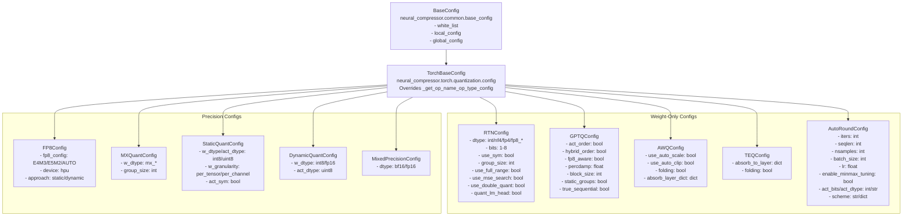
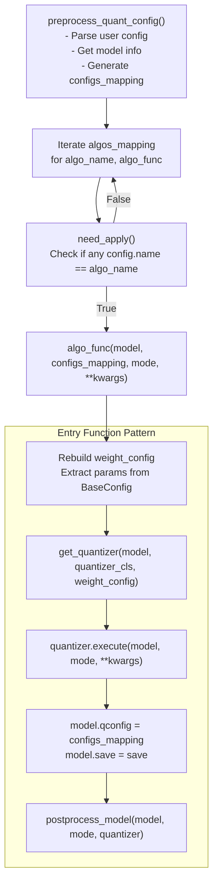
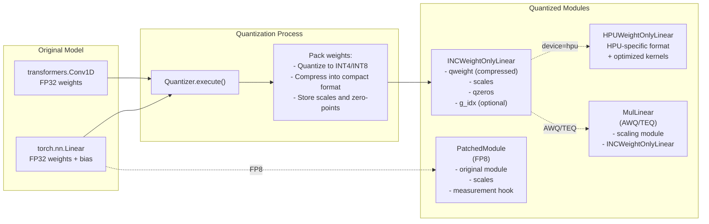
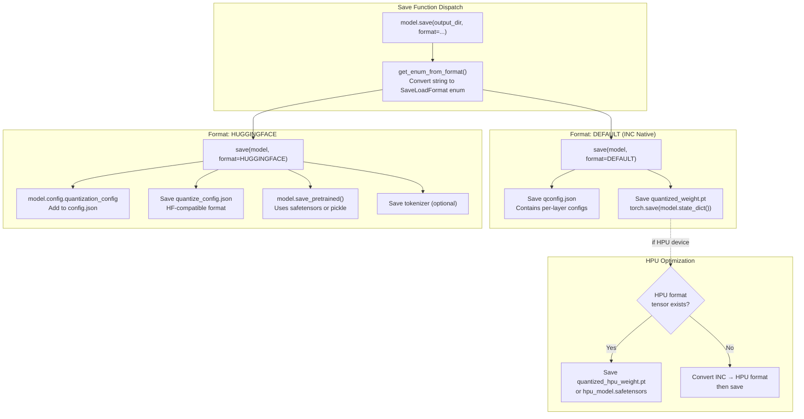
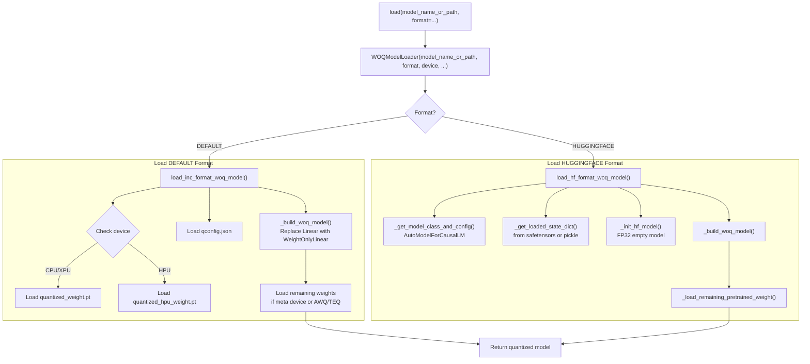

<!-- source: DeepWiki mcp.deepwiki.com · repo intel/neural-compressor · page 3.2 3.x API (PyTorch) · fetched 2026-10-21 -->

# 3.x API (PyTorch)

<details>
<summary>Relevant source files</summary>

The following files were used as context for generating this wiki page:

- [README.md](README.md)
- [docs/source/add_new_adaptor.md](docs/source/add_new_adaptor.md)
- [docs/source/add_new_data_type.md](docs/source/add_new_data_type.md)
- [docs/source/calibration.md](docs/source/calibration.md)
- [docs/source/examples_readme.md](docs/source/examples_readme.md)
- [docs/source/framework_yaml.md](docs/source/framework_yaml.md)
- [docs/source/infrastructure.md](docs/source/infrastructure.md)
- [docs/source/mixed_precision.md](docs/source/mixed_precision.md)
- [docs/source/publication_list.md](docs/source/publication_list.md)
- [docs/source/quantization.md](docs/source/quantization.md)
- [docs/source/quantization_mixed_precision.md](docs/source/quantization_mixed_precision.md)
- [examples/README.md](examples/README.md)
- [examples/pytorch/multimodal-modeling/quantization/auto_round/mllm.py](examples/pytorch/multimodal-modeling/quantization/auto_round/mllm.py)
- [neural_compressor/torch/algorithms/layer_wise/utils.py](neural_compressor/torch/algorithms/layer_wise/utils.py)
- [neural_compressor/torch/algorithms/mixed_low_precision/modules.py](neural_compressor/torch/algorithms/mixed_low_precision/modules.py)
- [neural_compressor/torch/algorithms/mixed_low_precision/quantizer.py](neural_compressor/torch/algorithms/mixed_low_precision/quantizer.py)
- [neural_compressor/torch/algorithms/weight_only/__init__.py](neural_compressor/torch/algorithms/weight_only/__init__.py)
- [neural_compressor/torch/algorithms/weight_only/autoround.py](neural_compressor/torch/algorithms/weight_only/autoround.py)
- [neural_compressor/torch/algorithms/weight_only/awq.py](neural_compressor/torch/algorithms/weight_only/awq.py)
- [neural_compressor/torch/algorithms/weight_only/gptq.py](neural_compressor/torch/algorithms/weight_only/gptq.py)
- [neural_compressor/torch/algorithms/weight_only/modules.py](neural_compressor/torch/algorithms/weight_only/modules.py)
- [neural_compressor/torch/algorithms/weight_only/rtn.py](neural_compressor/torch/algorithms/weight_only/rtn.py)
- [neural_compressor/torch/algorithms/weight_only/save_load.py](neural_compressor/torch/algorithms/weight_only/save_load.py)
- [neural_compressor/torch/algorithms/weight_only/teq.py](neural_compressor/torch/algorithms/weight_only/teq.py)
- [neural_compressor/torch/algorithms/weight_only/utility.py](neural_compressor/torch/algorithms/weight_only/utility.py)
- [neural_compressor/torch/quantization/__init__.py](neural_compressor/torch/quantization/__init__.py)
- [neural_compressor/torch/quantization/algorithm_entry.py](neural_compressor/torch/quantization/algorithm_entry.py)
- [neural_compressor/torch/quantization/config.py](neural_compressor/torch/quantization/config.py)
- [neural_compressor/torch/quantization/quantize.py](neural_compressor/torch/quantization/quantize.py)
- [neural_compressor/torch/quantization/save_load_entry.py](neural_compressor/torch/quantization/save_load_entry.py)
- [neural_compressor/torch/utils/constants.py](neural_compressor/torch/utils/constants.py)
- [neural_compressor/torch/utils/utility.py](neural_compressor/torch/utils/utility.py)
- [neural_compressor/transformers/models/modeling_auto.py](neural_compressor/transformers/models/modeling_auto.py)
- [neural_compressor/transformers/quantization/utils.py](neural_compressor/transformers/quantization/utils.py)
- [neural_compressor/transformers/utils/quantization_config.py](neural_compressor/transformers/utils/quantization_config.py)
- [test/3x/torch/algorithms/weight_only/test_teq_quantizer.py](test/3x/torch/algorithms/weight_only/test_teq_quantizer.py)
- [test/3x/torch/quantization/fp8_quant/test_fp8_jsons/test_pow2_w4a8_quant.json](test/3x/torch/quantization/fp8_quant/test_fp8_jsons/test_pow2_w4a8_quant.json)
- [test/3x/torch/quantization/fp8_quant/test_gptq_mixed_precision.py](test/3x/torch/quantization/fp8_quant/test_gptq_mixed_precision.py)
- [test/3x/torch/quantization/weight_only/test_autoround.py](test/3x/torch/quantization/weight_only/test_autoround.py)
- [test/3x/torch/quantization/weight_only/test_awq.py](test/3x/torch/quantization/weight_only/test_awq.py)
- [test/3x/torch/quantization/weight_only/test_gptq.py](test/3x/torch/quantization/weight_only/test_gptq.py)
- [test/3x/torch/quantization/weight_only/test_rtn.py](test/3x/torch/quantization/weight_only/test_rtn.py)
- [test/3x/torch/quantization/weight_only/test_teq.py](test/3x/torch/quantization/weight_only/test_teq.py)
- [test/3x/torch/quantization/weight_only/test_transformers.py](test/3x/torch/quantization/weight_only/test_transformers.py)
- [test/3x/torch/requirements.txt](test/3x/torch/requirements.txt)

</details>


## Purpose and Scope

The 3.x API provides a PyTorch-focused interface for model quantization without accuracy-aware tuning. It offers direct, one-shot quantization through simple function calls (`quantize()`, `prepare()`, `convert()`) and supports a wide range of quantization algorithms including weight-only techniques (RTN, GPTQ, AWQ, TEQ, AutoRound), FP8 quantization for specialized hardware, static/dynamic quantization, and mixed precision conversion.

**Key Differences from 2.x API:**
- **No accuracy-aware tuning**: The 3.x API applies quantization directly without iterative search through configuration space
- **PyTorch-only**: Focused exclusively on PyTorch models, while the 2.x API supports TensorFlow and ONNX Runtime as well
- **Algorithm-specific configs**: Each algorithm has its own dedicated configuration class (e.g., `RTNConfig`, `GPTQConfig`) rather than unified `PostTrainingQuantConfig`
- **Simpler workflow**: Direct quantization via `quantize()` or two-step via `prepare()` + `convert()`

For accuracy-aware tuning with automatic configuration search, see the [2.x API](#3.1). For framework adaptors and low-level implementation details, see [Framework Adaptors](#5).

---

## API Architecture

The following diagram shows the high-level architecture of the 3.x API, illustrating how user code flows through configuration, algorithm dispatch, and module replacement.

```mermaid
graph TB
    User["User Code"]
    
    subgraph "Public API Layer"
        Quantize["quantize()<br/>neural_compressor.torch.quantization.quantize"]
        Prepare["prepare()<br/>neural_compressor.torch.quantization.quantize"]
        Convert["convert()<br/>neural_compressor.torch.quantization.quantize"]
        SaveLoad["save()/load()<br/>neural_compressor.torch.quantization.save_load_entry"]
    end
    
    subgraph "Configuration Layer"
        BaseConfig["BaseConfig<br/>neural_compressor.common.base_config"]
        RTNConfig["RTNConfig"]
        GPTQConfig["GPTQConfig"]
        AWQConfig["AWQConfig"]
        TEQConfig["TEQConfig"]
        AutoRoundConfig["AutoRoundConfig"]
        FP8Config["FP8Config"]
        StaticQuantConfig["StaticQuantConfig"]
        MixedPrecisionConfig["MixedPrecisionConfig"]
        
        BaseConfig --> RTNConfig
        BaseConfig --> GPTQConfig
        BaseConfig --> AWQConfig
        BaseConfig --> TEQConfig
        BaseConfig --> AutoRoundConfig
        BaseConfig --> FP8Config
        BaseConfig --> StaticQuantConfig
        BaseConfig --> MixedPrecisionConfig
    end
    
    subgraph "Algorithm Entry Layer"
        AlgoEntry["algorithm_entry.py<br/>Dispatch to algorithm implementations"]
        RTNEntry["rtn_entry()"]
        GPTQEntry["gptq_entry()"]
        AWQEntry["awq_quantize_entry()"]
        TEQEntry["teq_quantize_entry()"]
        AutoRoundEntry["autoround_quantize_entry()"]
        FP8Entry["fp8_static_quant_entry()"]
        StaticEntry["static_quant_entry()"]
        
        AlgoEntry --> RTNEntry
        AlgoEntry --> GPTQEntry
        AlgoEntry --> AWQEntry
        AlgoEntry --> TEQEntry
        AlgoEntry --> AutoRoundEntry
        AlgoEntry --> FP8Entry
        AlgoEntry --> StaticEntry
    end
    
    subgraph "Quantizer Layer"
        RTNQuantizer["RTNQuantizer<br/>neural_compressor.torch.algorithms.weight_only.rtn"]
        GPTQuantizer["GPTQuantizer<br/>neural_compressor.torch.algorithms.weight_only.gptq"]
        AWQQuantizer["AWQQuantizer<br/>neural_compressor.torch.algorithms.weight_only.awq"]
        TEQuantizer["TEQuantizer<br/>neural_compressor.torch.algorithms.weight_only.teq"]
        AutoRoundQuantizer["AutoRoundQuantizer<br/>neural_compressor.torch.algorithms.weight_only.autoround"]
        FP8Quantizer["FP8Quantizer<br/>neural_compressor.torch.algorithms.fp8_quant"]
        StaticQuantizer["StaticQuantQuantizer<br/>neural_compressor.torch.algorithms.static_quant"]
    end
    
    subgraph "Module Layer"
        INCWeightOnlyLinear["INCWeightOnlyLinear"]
        HPUWeightOnlyLinear["HPUWeightOnlyLinear"]
        PatchedModule["PatchedModule (FP8)"]
        MulLinear["MulLinear (AWQ/TEQ)"]
    end
    
    User --> Quantize
    User --> Prepare
    User --> Convert
    User --> SaveLoad
    
    Quantize --> RTNConfig
    Quantize --> GPTQConfig
    Quantize --> AWQConfig
    Quantize --> FP8Config
    
    Prepare --> RTNConfig
    Prepare --> FP8Config
    
    Convert --> RTNConfig
    Convert --> FP8Config
    
    RTNConfig --> AlgoEntry
    GPTQConfig --> AlgoEntry
    AWQConfig --> AlgoEntry
    FP8Config --> AlgoEntry
    
    RTNEntry --> RTNQuantizer
    GPTQEntry --> GPTQuantizer
    AWQEntry --> AWQQuantizer
    TEQEntry --> TEQuantizer
    AutoRoundEntry --> AutoRoundQuantizer
    FP8Entry --> FP8Quantizer
    StaticEntry --> StaticQuantizer
    
    RTNQuantizer --> INCWeightOnlyLinear
    GPTQuantizer --> INCWeightOnlyLinear
    AWQQuantizer --> MulLinear
    TEQuantizer --> MulLinear
    AutoRoundQuantizer --> INCWeightOnlyLinear
    FP8Quantizer --> PatchedModule
    
    INCWeightOnlyLinear --> HPUWeightOnlyLinear
```



**Sources:** [neural_compressor/torch/quantization/quantize.py:1-297](), [neural_compressor/torch/quantization/algorithm_entry.py:1-700](), [neural_compressor/torch/quantization/config.py:1-2500]()

---

## Core API Functions

### quantize()

The `quantize()` function provides one-shot quantization in a single call. It internally handles both the preparation and conversion phases.

**Function Signature:**
```python
def quantize(
    model: torch.nn.Module,
    quant_config: BaseConfig,
    run_fn: Callable = None,
    run_args: Any = None,
    inplace: bool = True,
    example_inputs: Any = None,
) -> torch.nn.Module
```

**Parameters:**
- `model`: The float model to be quantized
- `quant_config`: Quantization configuration (e.g., `RTNConfig`, `GPTQConfig`, `FP8Config`)
- `run_fn`: Calibration function for algorithms that require calibration data (GPTQ, AWQ, TEQ, SmoothQuant)
- `run_args`: Positional arguments for `run_fn`
- `inplace`: If True, modifies the model in-place; otherwise creates a copy
- `example_inputs`: Example inputs for model tracing (required for some algorithms)

**Returns:** Quantized model with `is_quantized` attribute set to `True`

**Workflow:**
1. Preprocess configuration via `preprocess_quant_config()` [neural_compressor/torch/quantization/quantize.py:49-111]()
2. Convert configuration to per-operator mapping via `to_config_mapping()`
3. Iterate through `algos_mapping` dictionary to find matching algorithms
4. Dispatch to algorithm-specific entry function (e.g., `rtn_entry()`, `gptq_entry()`)
5. Attach `save()` method to quantized model for persistence

**Sources:** [neural_compressor/torch/quantization/quantize.py:113-153]()

---

### prepare()

The `prepare()` function inserts observers or fake quantization modules into the model for calibration. This is the first step in the two-phase workflow.

**Function Signature:**
```python
def prepare(
    model: torch.nn.Module,
    quant_config: BaseConfig,
    inplace: bool = True,
    example_inputs: Any = None,
) -> torch.nn.Module
```

**Parameters:**
- `model`: Original float model
- `quant_config`: Quantization configuration
- `inplace`: If True, modifies the model in-place
- `example_inputs`: Example inputs for model tracing

**Returns:** Prepared model with `is_prepared` attribute set to `True` and `quant_config` stored for later use

**Use Cases:**
- **FP8 Quantization**: Inserts `PatchedModule` wrappers to collect activation statistics during calibration [neural_compressor/torch/algorithms/fp8_quant/model_configs.py:1-500]()
- **Static Quantization**: Inserts IPEX or PT2E observers
- **QAT (Quantization-Aware Training)**: Inserts fake quantization modules via `prepare_qat()` [neural_compressor/torch/quantization/quantize.py:195-224]()

**Workflow:**
1. Preprocess configuration
2. Dispatch to algorithm-specific entry with `mode=Mode.PREPARE`
3. Store `quant_config` and `example_inputs` as model attributes
4. Return prepared model for calibration

**Sources:** [neural_compressor/torch/quantization/quantize.py:155-193]()

---

### convert()

The `convert()` function converts a prepared model to its quantized form. This is the second step in the two-phase workflow.

**Function Signature:**
```python
def convert(
    model: torch.nn.Module,
    quant_config: BaseConfig = None,
    inplace: bool = True,
) -> torch.nn.Module
```

**Parameters:**
- `model`: Prepared model (with `is_prepared=True`) or float model
- `quant_config`: Quantization configuration (optional if model is already prepared)
- `inplace`: If True, modifies the model in-place

**Returns:** Quantized model with `is_quantized` attribute set to `True`

**Workflow:**
1. Check if model is prepared or requires new configuration
2. Retrieve stored `quant_config` and `example_inputs` from prepared model
3. Generate per-operator configuration mapping
4. Dispatch to algorithm-specific entry with `mode=Mode.CONVERT`
5. Replace modules with quantized equivalents

**Sources:** [neural_compressor/torch/quantization/quantize.py:226-290]()

---

### finalize_calibration()

The `finalize_calibration()` function generates and saves calibration results for FP8 quantization.

**Function Signature:**
```python
def finalize_calibration(model: torch.nn.Module)
```

**Purpose:** Extracts calibration data from `PatchedModule` instances and saves to disk for later use during inference.

**Sources:** [neural_compressor/torch/quantization/quantize.py:292-297]()

---

## Configuration System

### Configuration Class Hierarchy



**Sources:** [neural_compressor/torch/quantization/config.py:83-2500](), [neural_compressor/common/base_config.py:1-500]()

---

### Configuration to Algorithm Mapping

The following table shows how configuration classes map to algorithm entry functions and quantizer implementations:

| Config Class | Algorithm Name | Entry Function | Quantizer Class | Priority |
|-------------|----------------|----------------|-----------------|----------|
| `RTNConfig` | `RTN` | `rtn_entry()` | `RTNQuantizer` | `PRIORITY_RTN` (100) |
| `GPTQConfig` | `GPTQ` | `gptq_entry()` | `GPTQuantizer` | `PRIORITY_GPTQ` (90) |
| `AWQConfig` | `AWQ` | `awq_quantize_entry()` | `AWQQuantizer` | `PRIORITY_AWQ` (80) |
| `TEQConfig` | `TEQ` | `teq_quantize_entry()` | `TEQuantizer` | `PRIORITY_TEQ` (70) |
| `AutoRoundConfig` | `AUTOROUND` | `autoround_quantize_entry()` | `AutoRoundQuantizer` | `PRIORITY_AUTOROUND` (60) |
| `HQQConfig` | `HQQ` | `hqq_quantize_entry()` | `HQQQuantizer` | `PRIORITY_HQQ` (50) |
| `FP8Config` | `FP8_QUANT` | `fp8_static_quant_entry()` | `FP8Quantizer` | N/A |
| `StaticQuantConfig` | `STATIC_QUANT` | `static_quant_entry()` or `pt2e_static_quant_entry()` | `StaticQuantQuantizer` or `W8A8PT2EQuantizer` | N/A |
| `DynamicQuantConfig` | `PT2E_DYNAMIC_QUANT` | `pt2e_dynamic_quant_entry()` | `W8A8PT2EQuantizer` | N/A |
| `SmoothQuantConfig` | `SMOOTH_QUANT` | `smooth_quant_entry()` | `SmoothQuantQuantizer` | N/A |
| `MixedPrecisionConfig` | `MIXED_PRECISION` | `mixed_precision_entry()` | `MixedPrecisionQuantizer` | N/A |
| `MXQuantConfig` | `MX_QUANT` | `mx_quant_entry()` | `MXQuantizer` | N/A |

**Registration Mechanism:**
Algorithms are registered via the `@register_algo()` decorator in [neural_compressor/torch/quantization/algorithm_entry.py:1-700](). The decorator adds the entry function to the `algos_mapping` dictionary in [neural_compressor/torch/utils/utility.py:48]().

**Sources:** [neural_compressor/torch/quantization/algorithm_entry.py:62-700](), [neural_compressor/torch/utils/constants.py:1-100]()

---

### Global vs. Local Configuration

Configurations can be set globally (for all operators) or locally (for specific operators or operator types).

**Global Configuration Example:**
```python
# All Linear layers quantized with 4-bit RTN
config = RTNConfig(bits=4, group_size=32, use_sym=True)
```

**Local Configuration Example:**
```python
# Most layers 4-bit, but specific layers use different settings
config = RTNConfig(bits=4, group_size=32, use_sym=True)
config.set_local("model.layer1.linear", RTNConfig(bits=8))
config.set_local("model.lm_head", RTNConfig(dtype="fp32"))  # Skip quantization
```

**Configuration Resolution:**
1. `to_config_mapping()` generates per-operator configuration via [neural_compressor/common/base_config.py:200-300]()
2. Local configs override global configs
3. `_get_op_name_op_type_config()` separates operator names from operator types [neural_compressor/torch/quantization/config.py:88-100]()
4. Result is `OrderedDict[(op_name, op_type), config]`

**Sources:** [neural_compressor/common/base_config.py:1-500](), [neural_compressor/torch/quantization/config.py:83-100]()

---

## Algorithm Entry Points

### Entry Point Workflow



**Sources:** [neural_compressor/torch/quantization/quantize.py:49-153](), [neural_compressor/torch/quantization/algorithm_entry.py:62-700]()

---

### RTN Entry Point

**Location:** [neural_compressor/torch/quantization/algorithm_entry.py:62-118]()

**Key Steps:**
1. Rebuild `weight_config` dictionary from `configs_mapping`
2. Extract RTN-specific parameters: `dtype`, `bits`, `use_sym`, `group_size`, `use_full_range`, `use_mse_search`, `use_double_quant`
3. Initialize `RTNQuantizer` via `get_quantizer()`
4. Execute quantization via `quantizer.execute()`
5. Attach `save()` method and `qconfig` attribute to model

**Weight Config Format:**
```python
weight_config = {
    "layer_name": {
        "dtype": "int",
        "bits": 4,
        "scheme": "sym" / "asym",
        "group_size": 32,
        "use_full_range": False,
        "use_mse_search": False,
        "use_double_quant": False,
        "double_quant_bits": 8,
        "double_quant_scheme": "sym",
        "double_quant_group_size": 256
    }
}
```

**Sources:** [neural_compressor/torch/quantization/algorithm_entry.py:62-118]()

---

### GPTQ Entry Point

**Location:** [neural_compressor/torch/quantization/algorithm_entry.py:120-187]()

**Key Steps:**
1. Rebuild `weight_config` with GPTQ-specific parameters: `act_order`, `hybrid_order`, `fp8_aware`, `percdamp`, `block_size`, `static_groups`, `true_sequential`
2. Initialize `GPTQuantizer` 
3. Execute block-wise quantization via transformer tracing [neural_compressor/torch/algorithms/weight_only/gptq.py:68-128]()
4. Collect Hessian information during calibration
5. Perform column-by-column optimal quantization

**Calibration Requirement:**
GPTQ requires `run_fn` or calibration dataloader to collect activation inputs for Hessian calculation. Without calibration data, GPTQ cannot execute.

**Sources:** [neural_compressor/torch/quantization/algorithm_entry.py:120-187](), [neural_compressor/torch/algorithms/weight_only/gptq.py:1-1000]()

---

### AWQ Entry Point

**Location:** [neural_compressor/torch/quantization/algorithm_entry.py:399-482]()

**Key Steps:**
1. Rebuild `weight_config` with AWQ-specific parameters: `use_auto_scale`, `use_auto_clip`, `folding`, `absorb_layer_dict`
2. Initialize `AWQQuantizer`
3. Search optimal scales per layer via `auto_scale` [neural_compressor/torch/algorithms/weight_only/awq.py:1-500]()
4. Search optimal clip range via `auto_clip`
5. Insert `MulLinear` modules to apply scaling during inference

**Module Structure:**
```
MulLinear(
  (mul): ScalingModule  # Applies learned scaling
  (linear): INCWeightOnlyLinear  # Quantized linear layer
)
```

**Sources:** [neural_compressor/torch/quantization/algorithm_entry.py:399-482](), [neural_compressor/torch/algorithms/weight_only/awq.py:1-800]()

---

### TEQ Entry Point

**Location:** [neural_compressor/torch/quantization/algorithm_entry.py:484-552]()

**Key Steps:**
1. Rebuild `weight_config` with TEQ-specific parameters: `absorb_to_layer`, `folding`
2. Wrap linear layers with `TEQLinearFakeQuant` for training
3. Train learnable alpha parameters via forward-backward passes
4. Apply learned transformation and quantize
5. Optionally fold transformation into preceding layers or insert `MulLinear`

**Sources:** [neural_compressor/torch/quantization/algorithm_entry.py:484-552](), [neural_compressor/torch/algorithms/weight_only/teq.py:1-500]()

---

### AutoRound Entry Point

**Location:** [neural_compressor/torch/quantization/algorithm_entry.py:554-700]()

**Key Features:**
- Integrates external `auto_round` library
- Supports multimodal models via `AutoRoundMLLM`
- Uses gradient-based weight rounding optimization
- Supports W4A8 quantization scheme via `act_bits` parameter
- Multiple export formats: `itrex` (default), `fake`, `auto_gptq`, `auto_round`

**Weight Config Format:**
```python
weight_config = {
    "layer_name": {
        "data_type": "int",
        "bits": 4,
        "group_size": 128,
        "sym": True,
        "act_bits": 32,        # For activation quantization
        "act_data_type": "int",
        "act_dynamic": True,
        "super_bits": 8,       # For super-quantization
        "super_group_size": 128
    }
}
```

**Sources:** [neural_compressor/torch/quantization/algorithm_entry.py:554-700](), [neural_compressor/torch/algorithms/weight_only/autoround.py:1-500]()

---

### FP8 Entry Point

**Location:** [neural_compressor/torch/quantization/algorithm_entry.py:700-800]()

**Supported Devices:** Intel Gaudi (HPU) accelerators only

**FP8 Formats:**
- `E4M3`: 4 exponent bits, 3 mantissa bits
- `E5M2`: 5 exponent bits, 2 mantissa bits
- `AUTO`: Automatic format selection

**Workflow:**
1. **Prepare Phase**: Insert `PatchedModule` wrappers around target operations [neural_compressor/torch/algorithms/fp8_quant/model_configs.py:1-500]()
2. **Calibration Phase**: Collect activation statistics via `run_fn`
3. **Convert Phase**: Calculate per-tensor scales and replace with FP8 modules
4. **Finalize**: Save calibration results via `finalize_calibration()`

**Sources:** [neural_compressor/torch/quantization/algorithm_entry.py:700-800](), [neural_compressor/torch/algorithms/fp8_quant/]()

---

## Module Types

### Module Replacement Flow



**Sources:** [neural_compressor/torch/algorithms/weight_only/modules.py:1-800](), [neural_compressor/torch/algorithms/weight_only/save_load.py:399-544]()

---

### INCWeightOnlyLinear

**Location:** [neural_compressor/torch/algorithms/weight_only/modules.py:156-510]()

**Purpose:** CPU-based weight-only quantized linear layer with compressed weight storage.

**Key Attributes:**
- `qweight`: Packed quantized weights (dtype: `torch.int32` or `torch.int64`)
- `scales`: Per-group dequantization scales (dtype: `torch.float16` or `torch.float32`)
- `qzeros`: Packed zero-points for asymmetric quantization (optional)
- `g_idx`: Group index for act_order (GPTQ) (optional)
- `bias`: Optional bias tensor
- `use_optimum_format`: If True, uses HuggingFace-compatible format (transposed qweight/qzeros, qzeros -= 1)

**Packing Format:**
- Weights are packed along the input channel dimension
- `n_pack = compress_bits // bits` (e.g., 8 INT4 values packed into 1 INT32)
- HuggingFace format: `qweight.shape = [in_features // n_pack, out_features]`
- INC native format: `qweight.shape = [out_features, in_features // n_pack]`

**Forward Pass:**
1. Unpack compressed weights via `unpack_tensor()`
2. Dequantize: `weight = (int_weight - zp) * scales`
3. Perform matrix multiplication: `output = input @ weight.T + bias`

**Sources:** [neural_compressor/torch/algorithms/weight_only/modules.py:156-510]()

---

### HPUWeightOnlyLinear

**Location:** [neural_compressor/torch/algorithms/weight_only/modules.py:697-1000]()

**Purpose:** HPU (Gaudi) optimized weight-only quantized linear layer using native HPU operations.

**Key Differences from INCWeightOnlyLinear:**
- Uses HPU-specific packing format optimized for `hpu_ops.matmul_i4`
- Supports ordered `g_idx` check via `is_g_idx_ordered()` [neural_compressor/torch/algorithms/weight_only/modules.py:770-780]()
- If `g_idx` is ordered, sets to `None` for better performance
- Forward pass uses `hpu_ops.fp8_gemm_i4` for computation

**Conversion Flow:**
When loading models, if `device="hpu"` is specified, `INCWeightOnlyLinear` modules are converted to `HPUWeightOnlyLinear`:
1. Unpack CPU format weights
2. Re-pack into HPU format
3. Replace module
4. Save HPU format to disk for faster future loading

**Sources:** [neural_compressor/torch/algorithms/weight_only/modules.py:697-1000](), [neural_compressor/torch/algorithms/weight_only/save_load.py:515-544]()

---

### MulLinear

**Location:** [neural_compressor/torch/algorithms/weight_only/modules.py:1033-1080]()

**Purpose:** Wrapper module that applies learned scaling before quantized linear layer (used by AWQ and TEQ algorithms).

**Structure:**
```python
class MulLinear(torch.nn.Module):
    def __init__(self, module):
        self.scale = torch.nn.Parameter(...)  # Learned per-channel scales
        self.linear = INCWeightOnlyLinear(...)
    
    def forward(self, x):
        x = x * self.scale  # Apply scaling
        return self.linear(x)
```

**Use Cases:**
- **AWQ**: `scale` contains optimal activation scales found via search
- **TEQ**: `scale` contains learned alpha parameters from training

**Folding Option:**
If `folding=True`, scales are absorbed into the preceding layer's weights, and `MulLinear` is not inserted.

**Sources:** [neural_compressor/torch/algorithms/weight_only/modules.py:1033-1080]()

---

### PatchedModule (FP8)

**Location:** [neural_compressor/torch/algorithms/fp8_quant/model_configs.py:1-500]()

**Purpose:** Wraps original FP32/BF16 modules for FP8 quantization on Intel Gaudi accelerators.

**Key Components:**
- `orig_module`: Original unmodified module
- `scales`: Computed per-tensor FP8 scales
- `is_quantized`: Flag indicating quantization state
- Measurement hooks for collecting activation statistics

**Workflow:**
1. **Prepare**: Wrap modules with `PatchedModule.from_float()`
2. **Measurement**: Run calibration, hooks collect min/max statistics
3. **Scale Calculation**: Compute optimal FP8 scales from collected stats
4. **Convert**: Replace `PatchedModule` with FP8-quantized module or remove wrapper

**Supported Module Types:**
- `torch.nn.Linear`
- `torch.nn.Conv1d` / `Conv2d` / `Conv3d`
- `torch.nn.BatchNorm1d` / `BatchNorm2d` / `BatchNorm3d`

**Sources:** [neural_compressor/torch/algorithms/fp8_quant/model_configs.py:1-500]()

---

## Save and Load System

### Save Formats



**Sources:** [neural_compressor/torch/algorithms/weight_only/save_load.py:55-108]()

---

### Load Process



**Sources:** [neural_compressor/torch/algorithms/weight_only/save_load.py:110-595]()

---

### Format Comparison

| Aspect | DEFAULT (INC Native) | HUGGINGFACE |
|--------|---------------------|-------------|
| **File Structure** | `qconfig.json` + `quantized_weight.pt` | `config.json` + `quantize_config.json` + `model.safetensors` |
| **Weight Format** | INC custom format (optional transpose) | HuggingFace Optimum format (transposed, qzeros -= 1) |
| **Compatibility** | INC-specific | Compatible with `transformers`, `auto-gptq` |
| **Size** | Smaller (more compact) | Larger (HF standard) |
| **Zero-points** | Optional for symmetric | Always present |
| **g_idx** | Channel order indices | Inverted group indices |
| **Loading** | Requires `original_model` parameter | Loads from config alone |
| **Use Case** | Production deployment | Sharing on HuggingFace Hub |

**Sources:** [neural_compressor/torch/algorithms/weight_only/save_load.py:55-800]()

---

### HPU Format Optimization

**Purpose:** Optimize loading speed on Intel Gaudi accelerators by saving weights in HPU-native format.

**Automatic Conversion Flow:**
1. First load detects `device="hpu"` and INC/HF format weights
2. Converts `INCWeightOnlyLinear` → `HPUWeightOnlyLinear`
3. Saves HPU format to `quantized_hpu_weight.pt` or `hpu_model.safetensors`
4. Future loads detect HPU format file and load directly

**Flag for Manual Saving:**
Set `_should_save_hpu_format_tensor = True` during loading to trigger HPU format save [neural_compressor/torch/algorithms/weight_only/save_load.py:279-282]().

**Sources:** [neural_compressor/torch/algorithms/weight_only/save_load.py:206-284](), [neural_compressor/torch/algorithms/weight_only/save_load.py:357-360]()

---

## Configuration Options Reference

### RTNConfig Parameters

| Parameter | Type | Default | Description |
|-----------|------|---------|-------------|
| `dtype` | str | "int" | Data type: "int", "nf4", "fp4", "fp4_e2m1_bnb", "fp4_e2m1", "fp8_e5m2", "fp8_e4m3fn" |
| `bits` | int | 4 | Number of bits: 1-8 |
| `use_sym` | bool | True | Symmetric vs asymmetric quantization |
| `group_size` | int | 32 | Group size for per-group quantization (-1 for per-channel) |
| `group_dim` | int | 1 | Dimension for grouping (0=output, 1=input) |
| `use_full_range` | bool | False | Use full integer range vs. symmetric range |
| `use_mse_search` | bool | False | Search for optimal clip range via MSE |
| `use_layer_wise` | bool | False | Quantize per layer (memory efficient) |
| `model_path` | str | "" | Path to load FP32 weights per layer |
| `use_double_quant` | bool | False | Enable double quantization for scales |
| `double_quant_dtype` | str | "int" | Data type for scale quantization |
| `double_quant_bits` | int | 8 | Bits for scale quantization |
| `double_quant_use_sym` | bool | False | Symmetric scale quantization |
| `double_quant_group_size` | int | 256 | Group size for scale quantization |
| `quant_lm_head` | bool | False | Quantize language model head layer |

**Sources:** [neural_compressor/torch/quantization/config.py:104-254]()

---

### GPTQConfig Parameters

| Parameter | Type | Default | Description |
|-----------|------|---------|-------------|
| `act_order` | bool | False | Reorder weights based on Hessian diagonal (desc_act) |
| `hybrid_order` | bool | False | Act_order within groups only (no cross-group mixing) |
| `fp8_aware` | bool | False | Include FP8 step for W4A8 schemes |
| `percdamp` | float | 0.01 | Damping factor for Hessian (stability) |
| `block_size` | int | 2048 | Block size for GPTQ processing |
| `static_groups` | bool | False | Pre-compute group-wise params (faster with act_order) |
| `true_sequential` | bool | False | Quantize layers in original order (slower but more accurate) |
| `use_block_wise` | bool | False | Load and quantize per block (for large GPU/HPU) |

**Sources:** [neural_compressor/torch/quantization/config.py:326-553]()

---

### AWQConfig Parameters

| Parameter | Type | Default | Description |
|-----------|------|---------|-------------|
| `use_auto_scale` | bool | True | Search optimal per-channel scales |
| `use_auto_clip` | bool | True | Search optimal clip range |
| `folding` | bool | False | Fold scales into preceding layer vs. insert MulLinear |
| `absorb_layer_dict` | dict | {} | Manual specification of scale absorption layers |

**Sources:** [neural_compressor/torch/quantization/config.py:555-735]()

---

### TEQConfig Parameters

| Parameter | Type | Default | Description |
|-----------|------|---------|-------------|
| `absorb_to_layer` | dict | {} | Target layers for scale absorption |
| `folding` | bool | True | Fold learned transformations into preceding layers |

**Sources:** [neural_compressor/torch/quantization/config.py:737-867]()

---

### AutoRoundConfig Parameters

| Parameter | Type | Default | Description |
|-----------|------|---------|-------------|
| `iters` | int | 200 | Number of optimization iterations |
| `seqlen` | int | 2048 | Sequence length for calibration |
| `nsamples` | int | 128 | Number of calibration samples |
| `batch_size` | int | 8 | Batch size for training |
| `lr` | float | None | Learning rate (auto if None) |
| `enable_minmax_tuning` | bool | True | Tune min/max clip values |
| `act_bits` | int | None | Activation quantization bits (for W4A8) |
| `act_dtype` | str | None | Activation data type |
| `act_dynamic` | bool | True | Dynamic activation quantization |
| `scheme` | str/dict | "W4A16" | Quantization scheme ("W4A8", "W4A16", custom dict) |
| `export_format` | str | "itrex" | Export format: "itrex", "auto_gptq", "auto_round" |

**Sources:** [neural_compressor/torch/quantization/config.py:869-1300](), [neural_compressor/torch/algorithms/weight_only/autoround.py:48-227]()

---

### FP8Config Parameters

| Parameter | Type | Default | Description |
|-----------|------|---------|-------------|
| `fp8_config` | str | "E4M3" | FP8 format: "E4M3", "E5M2", "AUTO" |
| `approach` | str | "static" | "static" (calibration) or "dynamic" (runtime) |
| `device` | str | "hpu" | Target device (HPU only supported) |

**Sources:** [neural_compressor/torch/quantization/config.py:1800-1900]()

---

## Usage Examples

### Example 1: RTN Weight-Only Quantization

```python
from neural_compressor.torch.quantization import quantize, RTNConfig

# Load model
model = transformers.AutoModelForCausalLM.from_pretrained("meta-llama/Llama-2-7b-hf")

# Configure RTN quantization
config = RTNConfig(
    bits=4,
    use_sym=True,
    group_size=128,
    use_mse_search=True
)

# Quantize (one-shot, no calibration needed)
quantized_model = quantize(model, config)

# Save
quantized_model.save("./quantized_model")
```

**Sources:** [test/3x/torch/quantization/weight_only/test_rtn.py:1-300]()

---

### Example 2: GPTQ with Calibration

```python
from neural_compressor.torch.quantization import quantize, GPTQConfig
from datasets import load_dataset

# Load model
model = transformers.AutoModelForCausalLM.from_pretrained("facebook/opt-125m")
tokenizer = transformers.AutoTokenizer.from_pretrained("facebook/opt-125m")

# Prepare calibration data
def run_fn(model):
    dataset = load_dataset("lambada", split="validation[:10]")
    for sample in dataset:
        input_ids = tokenizer(sample["text"], return_tensors="pt").input_ids
        model(input_ids)

# Configure GPTQ
config = GPTQConfig(
    bits=4,
    group_size=128,
    use_sym=False,
    act_order=True,
    percdamp=0.01
)

# Quantize with calibration
quantized_model = quantize(model, config, run_fn=run_fn)
```

**Sources:** [test/3x/torch/quantization/weight_only/test_gptq.py:1-500]()

---

### Example 3: FP8 Quantization (Prepare + Convert)

```python
from neural_compressor.torch.quantization import prepare, convert, finalize_calibration, FP8Config
import torch
import torchvision.models as models

# Load model
model = models.resnet18().to("hpu")

# Configure FP8
config = FP8Config(fp8_config="E4M3", approach="static")

# Prepare: insert measurement hooks
prepared_model = prepare(model, config)

# Calibrate: run forward passes
for _ in range(10):
    prepared_model(torch.randn(1, 3, 224, 224).to("hpu"))

# Convert: apply FP8 quantization
quantized_model = convert(prepared_model)

# Finalize: save calibration results
finalize_calibration(quantized_model)

# Save
quantized_model.save("./fp8_resnet18")
```

**Sources:** [README.md:67-89](), [test/3x/torch/quantization/fp8_quant/test_fp8.py:1-500]()

---

### Example 4: Loading Quantized Models

```python
from neural_compressor.torch.quantization import load
import torch

# Load INC format (requires original model)
original_model = transformers.AutoModelForCausalLM.from_pretrained("meta-llama/Llama-2-7b-hf")
quantized_model = load(
    model_name_or_path="./saved_results",
    original_model=original_model,
    format="default",
    device="cpu"
)

# Load HuggingFace format (no original model needed)
quantized_model = load(
    model_name_or_path="TheBloke/Llama-2-7B-GPTQ",
    format="huggingface",
    device="hpu",  # Automatically converts to HPU format
    torch_dtype=torch.bfloat16
)
```

**Sources:** [neural_compressor/torch/algorithms/weight_only/save_load.py:110-143](), [README.md:91-103]()

---

### Example 5: Per-Layer Configuration

```python
from neural_compressor.torch.quantization import quantize, RTNConfig

# Global config: 4-bit for most layers
config = RTNConfig(bits=4, group_size=128)

# Local overrides
config.set_local("model.embed_tokens", RTNConfig(dtype="fp32"))  # Skip embedding
config.set_local("model.lm_head", RTNConfig(dtype="fp32"))       # Skip lm_head
config.set_local("model.layers.0", RTNConfig(bits=8))            # First layer 8-bit

quantized_model = quantize(model, config)
```

**Sources:** [neural_compressor/common/base_config.py:200-350]()

---

### Example 6: HuggingFace Transformers-like API

```python
from neural_compressor.transformers import AutoModelForCausalLM, RtnConfig

# Quantize during model loading
config = RtnConfig(bits=4, group_size=32)
model = AutoModelForCausalLM.from_pretrained(
    "meta-llama/Llama-2-7b-hf",
    quantization_config=config
)

# Save in HuggingFace format
model.save_low_bit("./quantized_model")

# Load later
model = AutoModelForCausalLM.from_pretrained("./quantized_model")
```

**Sources:** [neural_compressor/transformers/models/modeling_auto.py:92-300](), [test/3x/torch/quantization/weight_only/test_transformers.py:45-100]()

---

## Supported Operations and Frameworks

### Quantizable Module Types

| Module Type | Weight-Only | Static INT8 | Dynamic INT8 | FP8 | Mixed Precision |
|-------------|-------------|-------------|--------------|-----|-----------------|
| `torch.nn.Linear` | ✓ | ✓ | ✓ | ✓ | ✓ |
| `transformers.Conv1D` | ✓ | ✗ | ✗ | ✗ | ✗ |
| `torch.nn.Conv1d` | ✗ | ✓ | ✗ | ✓ | ✓ |
| `torch.nn.Conv2d` | ✗ | ✓ | ✗ | ✓ | ✓ |
| `torch.nn.Conv3d` | ✗ | ✓ | ✗ | ✓ | ✓ |
| `torch.nn.LSTM` | ✗ | ✗ | ✓ | ✗ | ✗ |
| `torch.nn.GRU` | ✗ | ✗ | ✓ | ✗ | ✗ |
| `torch.nn.Embedding` | ✗ | ✗ | ✗ | ✗ | ✓ |

**Sources:** [neural_compressor/torch/utils/utility.py:40-53]()

---

### Backend and Device Support

| Algorithm | CPU | Intel GPU (XPU) | Intel Gaudi (HPU) | NVIDIA GPU | Backend |
|-----------|-----|-----------------|-------------------|------------|---------|
| RTN | ✓ | ✓ | ✓ | ✓ | PyTorch native |
| GPTQ | ✓ | ✓ | ✓ | ✓ | PyTorch native |
| AWQ | ✓ | ✓ | ✓ | ✓ | PyTorch native |
| TEQ | ✓ | ✓ | ✓ | ✓ | PyTorch native |
| AutoRound | ✓ | ✓ | ✓ | ✓ | External library |
| FP8 | ✗ | ✗ | ✓ | ✗ | HPU-specific |
| Static INT8 | ✓ (IPEX) | ✓ (IPEX) | ✗ | ✗ | IPEX or PT2E |
| Dynamic INT8 | ✓ | ✓ | ✗ | ✗ | PT2E |
| SmoothQuant | ✓ (IPEX) | ✓ (IPEX) | ✗ | ✗ | IPEX |
| Mixed Precision | ✓ | ✓ | ✓ | ✓ | PyTorch native |

**Sources:** [neural_compressor/torch/utils/auto_accelerator.py:1-200](), [neural_compressor/torch/algorithms/fp8_quant/]()

---

## Algorithm Comparison

| Algorithm | Calibration Required | Training Required | Speed | Accuracy | Memory | Use Case |
|-----------|---------------------|------------------|-------|----------|--------|----------|
| **RTN** | ✗ | ✗ | Fastest | Good | Low | Quick deployment, baseline |
| **GPTQ** | ✓ (Hessian) | ✗ | Slow | Best | Medium | Best accuracy for LLMs |
| **AWQ** | ✓ (Search) | ✗ | Medium | Better | Medium | Accuracy-aware, practical |
| **TEQ** | ✓ | ✓ (Few steps) | Medium | Better | Medium | Learnable transformation |
| **AutoRound** | ✓ | ✓ (Gradient) | Slow | Best | High | State-of-art accuracy |
| **FP8** | ✓ | ✗ | Fast | Good | Low | Gaudi accelerators only |

**Sources:** [docs/source/quantization.md:1-500](), [neural_compressor/torch/algorithms/weight_only/]()

---

## Migration Guide from 2.x API

| 2.x API | 3.x API | Notes |
|---------|---------|-------|
| `quantization.fit(model, conf, ...)` | `quantize(model, config, ...)` | No tuning loop in 3.x |
| `PostTrainingQuantConfig` | `RTNConfig`, `GPTQConfig`, etc. | Algorithm-specific configs |
| `accuracy_criterion` | Not supported | Use `autotune()` for tuning |
| `tuning_criterion` | Not supported | Use `autotune()` for tuning |
| `op_type_dict` | `config.set_local(op_name/type, ...)` | Per-operator config |
| `recipes` | Config parameters | Direct parameters in config |
| `approach="static"` | `StaticQuantConfig` | Separate config class |
| `approach="dynamic"` | `DynamicQuantConfig` | Separate config class |
| `model.save()` | `model.save()` | Same API |
| Backend selection via config | Backend auto-detected | Based on installed packages |

**Sources:** [neural_compressor/torch/quantization/config.py:1-2500](), [README.md:176-178]()

---

