<!-- source: DeepWiki mcp.deepwiki.com · repo intel/neural-compressor · page 4 Architecture · fetched 2026-10-21 -->

# Architecture

<details>
<summary>Relevant source files</summary>

The following files were used as context for generating this wiki page:

- [README.md](README.md)
- [docs/source/add_new_adaptor.md](docs/source/add_new_adaptor.md)
- [docs/source/add_new_data_type.md](docs/source/add_new_data_type.md)
- [docs/source/calibration.md](docs/source/calibration.md)
- [docs/source/examples_readme.md](docs/source/examples_readme.md)
- [docs/source/framework_yaml.md](docs/source/framework_yaml.md)
- [docs/source/infrastructure.md](docs/source/infrastructure.md)
- [docs/source/mixed_precision.md](docs/source/mixed_precision.md)
- [docs/source/publication_list.md](docs/source/publication_list.md)
- [docs/source/quantization.md](docs/source/quantization.md)
- [docs/source/quantization_mixed_precision.md](docs/source/quantization_mixed_precision.md)
- [examples/README.md](examples/README.md)
- [neural_compressor/benchmark.py](neural_compressor/benchmark.py)
- [neural_compressor/config.py](neural_compressor/config.py)
- [neural_compressor/mix_precision.py](neural_compressor/mix_precision.py)
- [neural_compressor/model/model.py](neural_compressor/model/model.py)
- [neural_compressor/quantization.py](neural_compressor/quantization.py)
- [neural_compressor/training.py](neural_compressor/training.py)
- [neural_compressor/utils/utility.py](neural_compressor/utils/utility.py)
- [test/adaptor/pytorch_adaptor/test_adaptor_security.py](test/adaptor/pytorch_adaptor/test_adaptor_security.py)

</details>


## Purpose and Scope

This document describes the overall system architecture of Intel® Neural Compressor, including its layered design, core components, and how they interact to provide model optimization capabilities across multiple deep learning frameworks. This page covers the high-level structural design and component interactions.

For specific details on:
- Configuration options and usage, see [Configuration System](#4.2)
- Tuning strategies and algorithms, see [Strategy and Tuning System](#4.3)
- Framework-specific implementations, see [Framework Adaptors](#5)
- API usage patterns, see [API Guide](#3)

## System Overview

Intel® Neural Compressor is built on a layered architecture that abstracts framework-specific operations through a unified interface. The system supports two primary API styles (2.x and 3.x) and provides model compression across TensorFlow, PyTorch, and ONNX Runtime.

### Layered Architecture

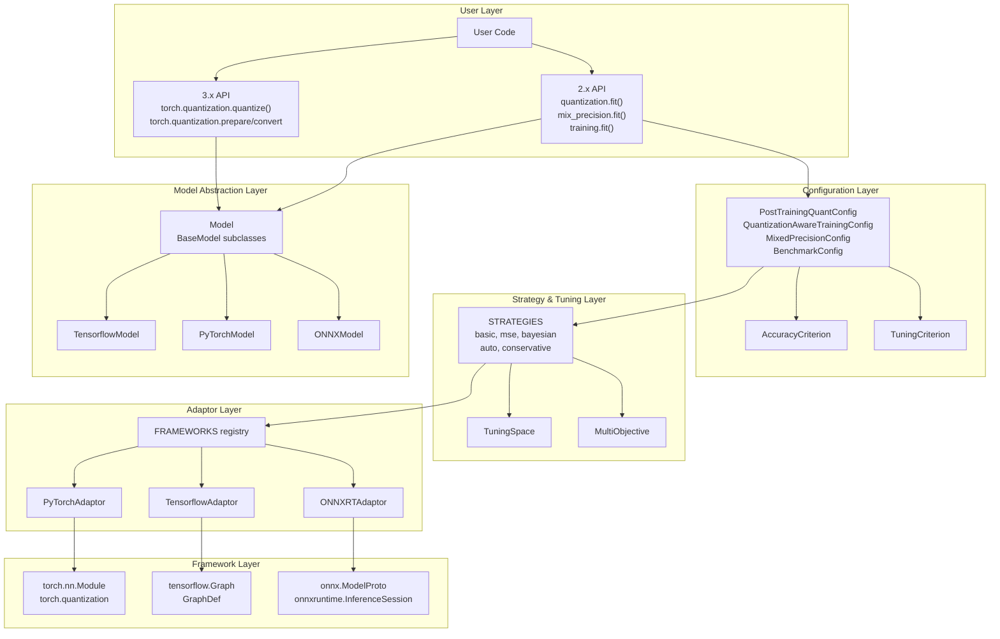

**Sources:** [README.md:13-27](), [docs/source/infrastructure.md:13-18](), [neural_compressor/model/model.py:51-63](), [neural_compressor/quantization.py:1-242]()

The architecture consists of six distinct layers, each with specific responsibilities:

| Layer | Components | Responsibilities |
|-------|-----------|-----------------|
| **User Layer** | User code, API entry points | Provides simple interfaces for model optimization |
| **Configuration Layer** | Config classes, criteria objects | Defines optimization goals and constraints |
| **Strategy & Tuning Layer** | Strategy implementations, tuning space | Orchestrates accuracy-aware optimization process |
| **Adaptor Layer** | Framework adaptors | Bridges generic tuning logic to framework-specific APIs |
| **Model Abstraction Layer** | Model wrapper classes | Provides unified model interface across frameworks |
| **Framework Layer** | Native framework APIs | Executes actual quantization/optimization operations |

**Sources:** [neural_compressor/config.py:1-1577](), [neural_compressor/quantization.py:33-242]()

## Core Components

### Model Wrapper System

The `Model` class in [neural_compressor/model/model.py:150-253]() serves as a factory that creates framework-specific model wrappers. It automatically detects the framework from the input model object or file path and instantiates the appropriate wrapper class.

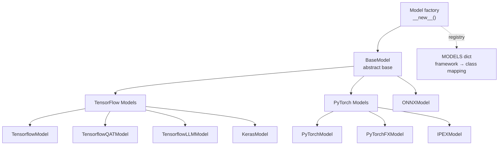

**Sources:** [neural_compressor/model/model.py:51-253](), [neural_compressor/model/base_model.py:1-100]()

The `MODELS` dictionary at [neural_compressor/model/model.py:51-63]() maps framework names to their corresponding model classes:

```python
MODELS = {
    "tensorflow": TensorflowModel,
    "tensorflow_itex": TensorflowModel,
    "tensorflow_qat": TensorflowQATModel,
    "keras": KerasModel,
    "pytorch": PyTorchModel,
    "pytorch_ipex": IPEXModel,
    "pytorch_fx": PyTorchFXModel,
    "onnxruntime": ONNXModel,
    # ... additional mappings
}
```

Framework detection occurs in `get_model_fwk_name()` at [neural_compressor/model/model.py:66-147](), which attempts to identify the framework by inspecting the model object type or file structure.

**Sources:** [neural_compressor/model/model.py:66-147](), [neural_compressor/model/model.py:150-253]()

### Configuration System

Configuration classes define the parameters for different optimization approaches. The base configuration class `_BaseQuantizationConfig` at [neural_compressor/config.py:715-1100]() provides common parameters inherited by specific config types.

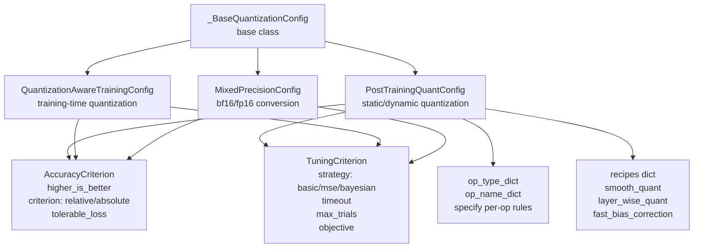

**Sources:** [neural_compressor/config.py:489-712](), [neural_compressor/config.py:715-1577]()

Key configuration parameters:

| Configuration Class | Primary Purpose | Key Parameters |
|-------------------|-----------------|----------------|
| `PostTrainingQuantConfig` | Static/dynamic PTQ | `approach`, `calibration_sampling_size`, `op_type_dict`, `recipes` |
| `QuantizationAwareTrainingConfig` | QAT during training | `approach="quant_aware_training"`, training parameters |
| `MixedPrecisionConfig` | BF16/FP16 conversion | `precisions`, `excluded_precisions`, `backend` |
| `AccuracyCriterion` | Accuracy goals | `higher_is_better`, `criterion`, `tolerable_loss` |
| `TuningCriterion` | Tuning process control | `strategy`, `timeout`, `max_trials`, `objective` |
| `BenchmarkConfig` | Performance evaluation | `warmup`, `iteration`, `cores_per_instance` |

**Sources:** [neural_compressor/config.py:1103-1577](), [neural_compressor/config.py:489-587](), [neural_compressor/config.py:592-712](), [neural_compressor/config.py:261-487]()

### Strategy and Tuning System

The `STRATEGIES` registry at [neural_compressor/strategy/__init__.py]() maps strategy names to implementation classes. When a user calls `quantization.fit()`, the system instantiates the appropriate strategy based on the configuration.

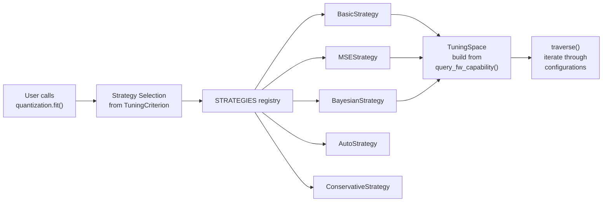

**Sources:** [neural_compressor/quantization.py:158-220](), [neural_compressor/strategy/strategy.py:1-1000]()

The strategy workflow in `quantization.fit()` at [neural_compressor/quantization.py:33-242]():

1. **Strategy instantiation** ([neural_compressor/quantization.py:190-200]()):
   - Based on `conf.tuning_criterion.strategy` or `conf.quant_level`
   - Maps to strategy class from `STRATEGIES` registry
   - Special handling for "auto" → `AutoStrategy`, quant_level=0 → `ConservativeStrategy`

2. **Capability query**:
   - Strategy calls `adaptor.query_fw_capability(model)` 
   - Returns quantization capabilities for each operator
   - Format: `{'opwise': {...}, 'optypewise': {...}}`

3. **Tuning space construction**:
   - Strategy builds search space from capabilities and config constraints
   - Applies `op_type_dict` and `op_name_dict` filters
   - Creates tree structure of possible configurations

4. **Configuration traversal**:
   - `strategy.traverse()` generates next tuning configuration
   - Calls `adaptor.quantize(tune_cfg, model, dataloader)`
   - Evaluates with `eval_func` or `eval_dataloader` + `eval_metric`
   - Checks against `AccuracyCriterion`

**Sources:** [neural_compressor/quantization.py:158-242](), [docs/source/quantization.md:118-132]()

### Adaptor Layer

The `FRAMEWORKS` registry at [neural_compressor/adaptor/__init__.py]() maps framework names to adaptor classes. Adaptors implement the bridge between strategy logic and framework-specific quantization APIs.

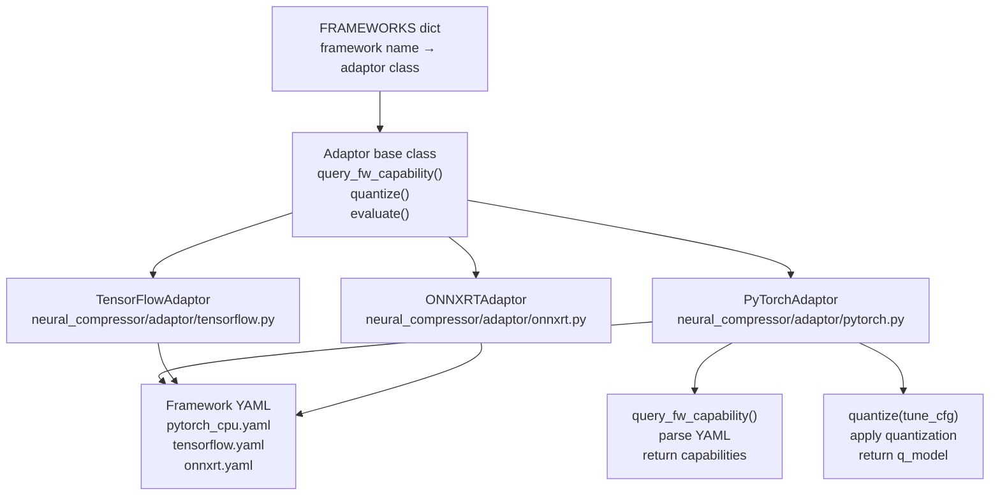

**Sources:** [docs/source/add_new_adaptor.md:13-43](), [neural_compressor/adaptor/__init__.py:1-100]()

Each adaptor must implement two critical methods:

1. **`query_fw_capability(model)`** - Returns framework quantization capabilities
   - Output format specified at [docs/source/add_new_adaptor.md:49-50]()
   - Includes `opwise` (per-operator) and `optypewise` (per-op-type) capabilities
   - Parsed from framework YAML files

2. **`quantize(tune_cfg, model, dataloader, q_func=None)`** - Performs quantization
   - Takes tuning configuration from strategy
   - Invokes framework-specific quantization kernels
   - Returns quantized model object

**Sources:** [docs/source/add_new_adaptor.md:46-50](), [docs/source/add_new_adaptor.md:107-132]()

### Framework YAML Configuration

Framework YAML files define the quantization capabilities of each framework. They specify which operators can be quantized, supported data types, quantization schemes, and calibration algorithms.

**Structure of framework YAML:**

| Section | Purpose | Example |
|---------|---------|---------|
| `version` | Supported framework versions | `['2.1.0', '2.2.0', ...]` |
| `precisions` | Supported data types | `int8, uint8, bf16, fp32` |
| `ops` | Valid op types per precision | `int8: ['Conv2D', 'MatMul']` |
| `capabilities` | Per-op quantization details | dtype, scheme, granularity, algorithm |
| `patterns` | Supported fusion patterns | `'Conv2D + BiasAdd + Relu'` |

**Sources:** [docs/source/framework_yaml.md:1-194](), [docs/source/add_new_data_type.md:14-90]()

## Data Flow

### 2.x API Flow (Accuracy-Aware Tuning)

The following diagram illustrates the complete data flow for the 2.x API with accuracy-aware tuning:

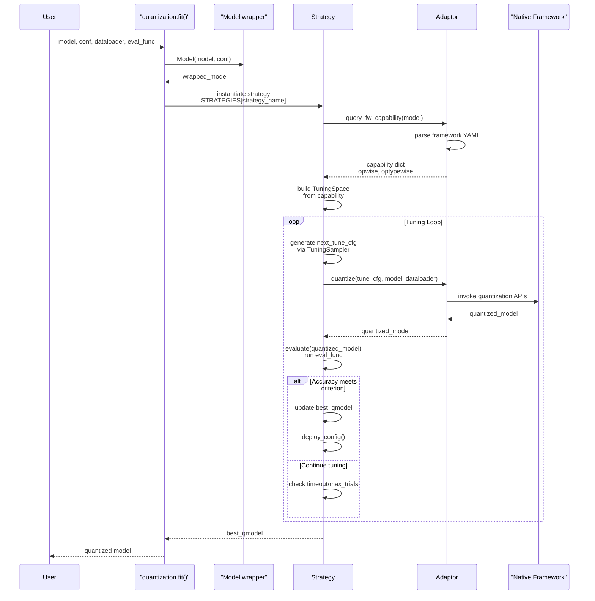

**Sources:** [neural_compressor/quantization.py:33-242](), [docs/source/quantization.md:127-132]()

Key data structures passed between components:

1. **Configuration objects** ([neural_compressor/config.py:715-1577]()):
   - `PostTrainingQuantConfig` with `op_type_dict`, `op_name_dict`, `recipes`
   - `AccuracyCriterion` with `tolerable_loss`, `criterion`
   - `TuningCriterion` with `strategy`, `timeout`, `max_trials`

2. **Capability dictionary** (returned by `query_fw_capability()`):
   ```python
   {
       'opwise': {
           ('conv1', 'Conv2D'): [
               {'weight': {'dtype': 'int8', ...}, 'activation': {'dtype': 'uint8', ...}},
               {'weight': {'dtype': 'fp32', ...}, 'activation': {'dtype': 'fp32', ...}}
           ]
       },
       'optypewise': {
           'Conv2D': {'weight': {...}, 'activation': {...}}
       }
   }
   ```

3. **Tuning configuration** (passed to `quantize()`):
   ```python
   tune_cfg = {
       'op': {
           ('conv1', 'Conv2D'): {
               'weight': {'dtype': 'int8', 'scheme': 'sym', 'granularity': 'per_channel'},
               'activation': {'dtype': 'uint8', 'scheme': 'asym', 'granularity': 'per_tensor'}
           }
       }
   }
   ```

**Sources:** [docs/source/add_new_adaptor.md:56-105](), [neural_compressor/quantization.py:158-220]()

### 3.x API Flow (Direct Quantization)

The 3.x API provides a simplified flow without accuracy-aware tuning, primarily for PyTorch:

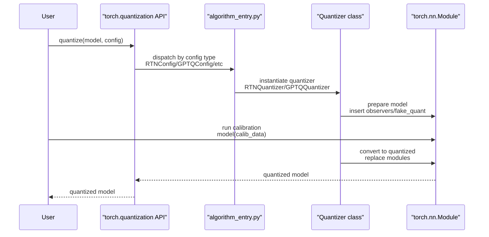

**Sources:** [examples/README.md:1-79](), [docs/source/quantization.md:206-240]()

## API Entry Points

### Primary 2.x API Functions

The 2.x API provides unified entry points for different optimization approaches:

| Function | Module | Purpose | Key Parameters |
|----------|--------|---------|----------------|
| `quantization.fit()` | [neural_compressor/quantization.py:33-242]() | Post-training quantization with optional accuracy tuning | `model`, `conf`, `calib_dataloader`, `eval_func` |
| `training.fit()` | [neural_compressor/training.py:197-339]() | Quantization-aware training with accuracy tuning | `compression_manager`, `train_func`, `eval_func` |
| `training.prepare_compression()` | [neural_compressor/training.py:342-396]() | Setup compression manager for QAT/pruning/distillation | `model`, `confs` |
| `mix_precision.fit()` | [neural_compressor/mix_precision.py:36-179]() | BF16/FP16 mixed precision conversion | `model`, `conf`, `eval_func` |
| `benchmark.fit()` | [neural_compressor/benchmark.py:140-213]() | Performance benchmarking | `model`, `conf`, `b_dataloader` |

**Sources:** [neural_compressor/quantization.py:33-138](), [neural_compressor/training.py:38-195](), [neural_compressor/mix_precision.py:36-83](), [neural_compressor/benchmark.py:1-486]()

### CompressionManager for Training

The `CompressionManager` class at [neural_compressor/training.py:38-195]() orchestrates compression during training:

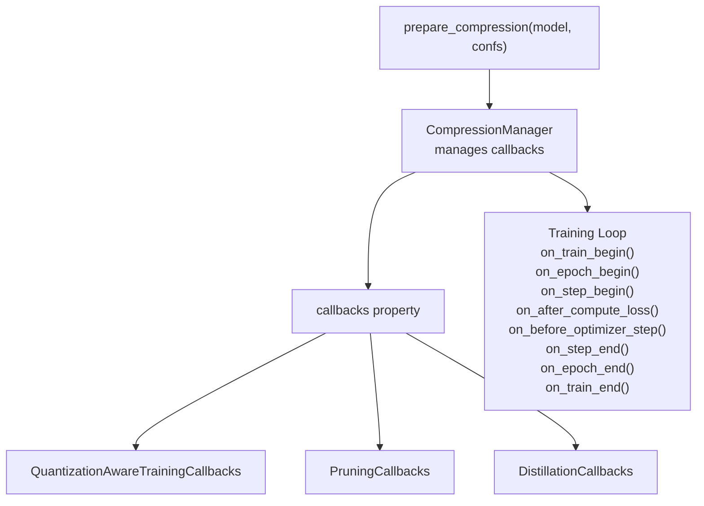

**Sources:** [neural_compressor/training.py:38-195](), [neural_compressor/training.py:342-396]()

### Configuration Object Lifecycle

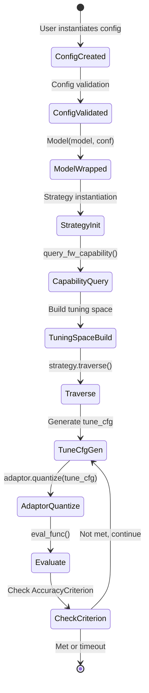

**Sources:** [neural_compressor/quantization.py:139-242](), [neural_compressor/config.py:715-1100]()

### Global Configuration Options

The `options` singleton at [neural_compressor/config.py:209-259]() provides global settings:

```python
options = Options(
    random_seed=1978,
    workspace=default_workspace,
    resume_from=None,
    tensorboard=False
)
```

Users can modify these via utility functions at [neural_compressor/utils/utility.py:678-703]():
- `set_random_seed(seed)`
- `set_workspace(workspace)`
- `set_resume_from(resume_from)`
- `set_tensorboard(tensorboard)`

**Sources:** [neural_compressor/config.py:176-259](), [neural_compressor/utils/utility.py:678-703]()

## Component Interactions

### Strategy-Adaptor Interaction Protocol

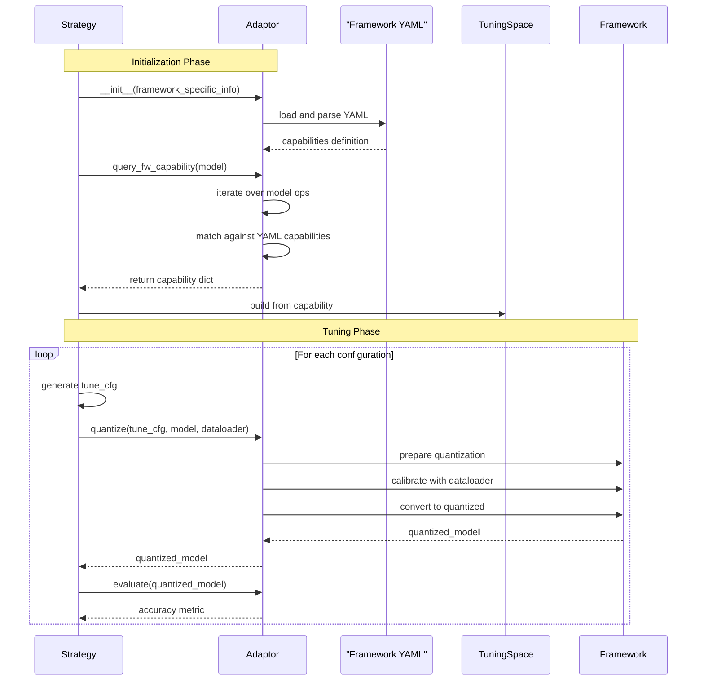

**Sources:** [docs/source/add_new_adaptor.md:20-43](), [neural_compressor/adaptor/__init__.py:1-100]()

### Model Wrapper Integration

The `Model` factory integrates with other components:

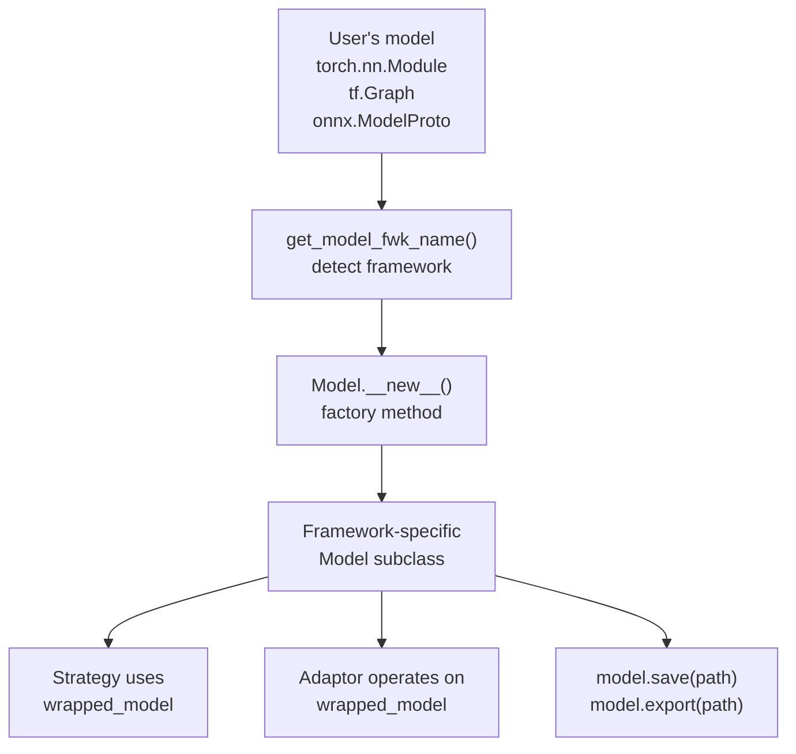

**Sources:** [neural_compressor/model/model.py:150-253](), [neural_compressor/model/model.py:66-147]()

### Configuration Validation Flow

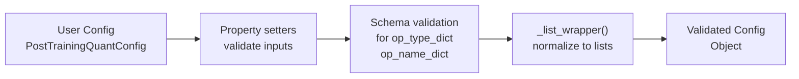

**Sources:** [neural_compressor/config.py:82-131](), [neural_compressor/config.py:113-130](), [neural_compressor/config.py:36-79]()

The configuration system uses property setters with validation:
- `_check_value()` function at [neural_compressor/config.py:82-110]() validates types and allowed values
- `ops_schema` at [neural_compressor/config.py:36-79]() defines schema for operator configurations
- `_list_wrapper()` at [neural_compressor/config.py:113-130]() normalizes values to list format

**Sources:** [neural_compressor/config.py:36-131](), [neural_compressor/config.py:715-1100]()

---

