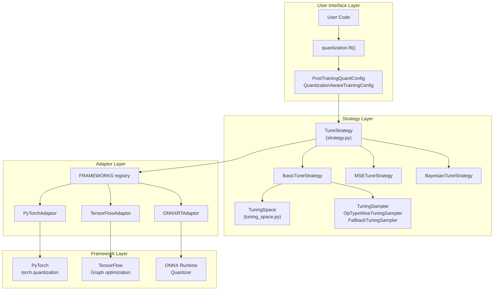
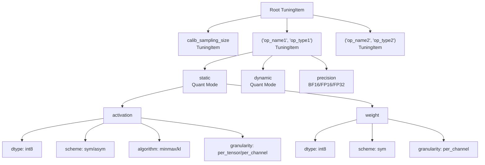
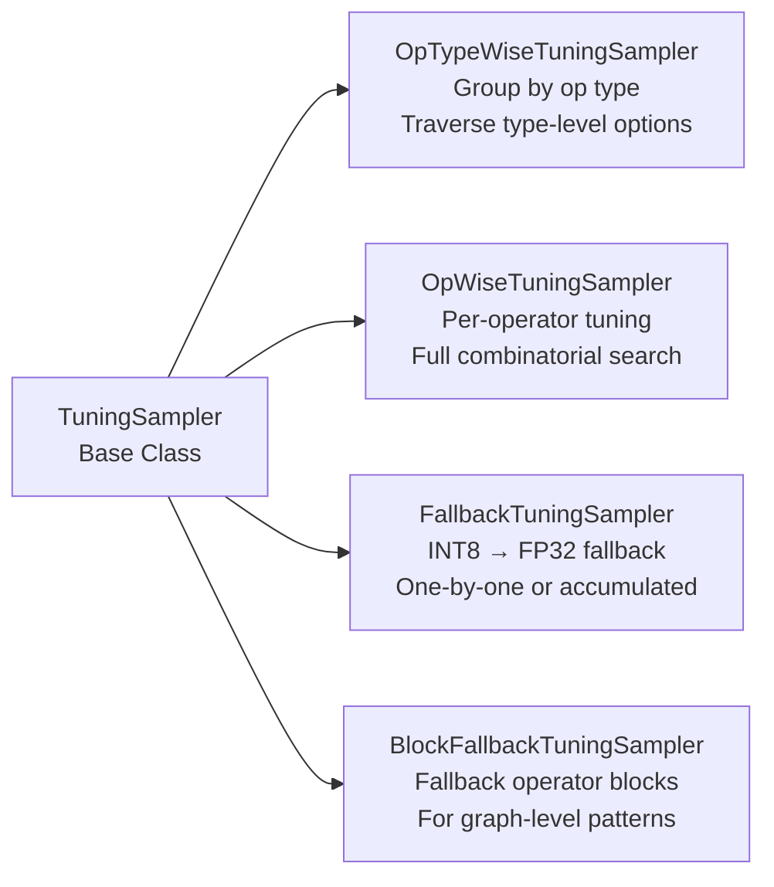
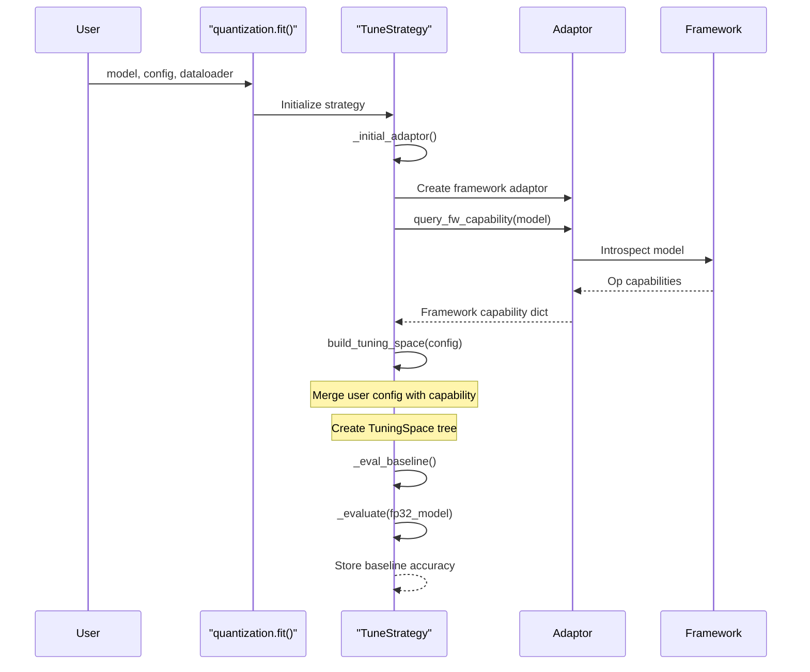
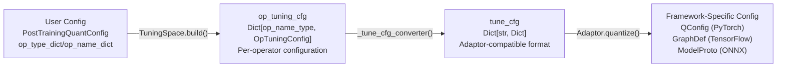
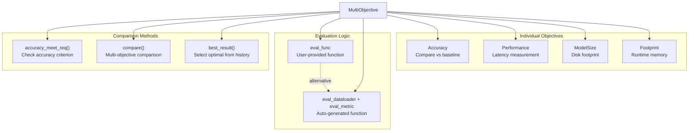

<!-- source: DeepWiki mcp.deepwiki.com · repo intel/neural-compressor · page 4.1 System Overview · fetched 2026-10-21 -->

# System Overview

<details>
<summary>Relevant source files</summary>

The following files were used as context for generating this wiki page:

- [README.md](README.md)
- [docs/source/add_new_adaptor.md](docs/source/add_new_adaptor.md)
- [docs/source/add_new_data_type.md](docs/source/add_new_data_type.md)
- [docs/source/calibration.md](docs/source/calibration.md)
- [docs/source/examples_readme.md](docs/source/examples_readme.md)
- [docs/source/framework_yaml.md](docs/source/framework_yaml.md)
- [docs/source/infrastructure.md](docs/source/infrastructure.md)
- [docs/source/mixed_precision.md](docs/source/mixed_precision.md)
- [docs/source/publication_list.md](docs/source/publication_list.md)
- [docs/source/quantization.md](docs/source/quantization.md)
- [docs/source/quantization_mixed_precision.md](docs/source/quantization_mixed_precision.md)
- [examples/README.md](examples/README.md)
- [neural_compressor/contrib/strategy/sigopt.py](neural_compressor/contrib/strategy/sigopt.py)
- [neural_compressor/contrib/strategy/tpe.py](neural_compressor/contrib/strategy/tpe.py)
- [neural_compressor/objective.py](neural_compressor/objective.py)
- [neural_compressor/strategy/auto_mixed_precision.py](neural_compressor/strategy/auto_mixed_precision.py)
- [neural_compressor/strategy/basic.py](neural_compressor/strategy/basic.py)
- [neural_compressor/strategy/bayesian.py](neural_compressor/strategy/bayesian.py)
- [neural_compressor/strategy/conservative.py](neural_compressor/strategy/conservative.py)
- [neural_compressor/strategy/exhaustive.py](neural_compressor/strategy/exhaustive.py)
- [neural_compressor/strategy/hawq_v2.py](neural_compressor/strategy/hawq_v2.py)
- [neural_compressor/strategy/mse.py](neural_compressor/strategy/mse.py)
- [neural_compressor/strategy/mse_v2.py](neural_compressor/strategy/mse_v2.py)
- [neural_compressor/strategy/random.py](neural_compressor/strategy/random.py)
- [neural_compressor/strategy/strategy.py](neural_compressor/strategy/strategy.py)
- [neural_compressor/strategy/utils/constant.py](neural_compressor/strategy/utils/constant.py)
- [neural_compressor/strategy/utils/tuning_sampler.py](neural_compressor/strategy/utils/tuning_sampler.py)
- [neural_compressor/strategy/utils/tuning_space.py](neural_compressor/strategy/utils/tuning_space.py)
- [neural_compressor/strategy/utils/tuning_structs.py](neural_compressor/strategy/utils/tuning_structs.py)
- [test/strategy/test_tuning_sampler.py](test/strategy/test_tuning_sampler.py)
- [test/strategy/test_tuning_space.py](test/strategy/test_tuning_space.py)
- [test/strategy/test_tuning_space_v2.py](test/strategy/test_tuning_space_v2.py)

</details>


## Purpose and Scope

This document describes the overall system architecture of Intel® Neural Compressor, focusing on the three-layer architecture that enables accuracy-aware model quantization. It covers the data flow from user configuration through strategy selection, tuning space exploration, and framework-specific quantization.

For details on specific configuration options, see [Configuration System](#4.2). For framework-specific implementation details, see [Framework Adaptors](#5). For quantization algorithms and techniques, see [Quantization Techniques](#6).

## High-Level Architecture

Intel® Neural Compressor implements a three-layer architecture that separates tuning strategy logic, framework-agnostic interfaces, and framework-specific implementations:



**Three-Layer Architecture**

Sources: [neural_compressor/strategy/strategy.py:1-1344](), [README.md:1-203]()

The architecture consists of three distinct layers:

1. **Strategy Layer**: Implements tuning logic and search algorithms
2. **Adaptor Layer**: Provides framework-agnostic quantization interface
3. **Framework Layer**: Native framework quantization implementations

## Strategy Layer Components

### TuneStrategy Base Class

The `TuneStrategy` class is the foundation of the strategy layer, providing common infrastructure for all tuning strategies:

```mermaid
graph TB
    TuneStrategy["TuneStrategy<br/>Base Class"]
    
    subgraph "Core Attributes"
        Model["model<br/>FP32 model"]
        Config["config<br/>User configuration"]
        Adaptor["adaptor<br/>Framework adaptor"]
        Capability["capability<br/>Framework constraints"]
        TuningSpace["tuning_space<br/>Search space tree"]
        Objectives["objectives<br/>MultiObjective evaluator"]
    end
    
    subgraph "Tuning State"
        TrialsCount["trials_count<br/>Current trial number"]
        Baseline["baseline<br/>FP32 accuracy"]
        BestQModel["best_qmodel<br/>Best quantized model"]
        BestTuneCfg["cur_best_tuning_cfg<br/>Best configuration"]
        LastTuneResult["last_tune_result<br/>Latest evaluation"]
    end
    
    subgraph "Core Methods"
        NextTuneCfg["next_tune_cfg()<br/>Generate configurations"]
        Traverse["traverse()<br/>Main tuning loop"]
        Evaluate["_evaluate()<br/>Run evaluation"]
        Stop["stop()<br/>Check termination"]
    end
    
    TuneStrategy --> Model
    TuneStrategy --> Config
    TuneStrategy --> Adaptor
    TuneStrategy --> Capability
    TuneStrategy --> TuningSpace
    TuneStrategy --> Objectives
    
    TuneStrategy --> TrialsCount
    TuneStrategy --> Baseline
    TuneStrategy --> BestQModel
    TuneStrategy --> BestTuneCfg
    TuneStrategy --> LastTuneResult
    
    TuneStrategy --> NextTuneCfg
    TuneStrategy --> Traverse
    TuneStrategy --> Evaluate
    TuneStrategy --> Stop
```



Sources: [neural_compressor/strategy/strategy.py:117-454]()

### Strategy Registry and Concrete Strategies

The system uses a registry pattern to manage different tuning strategies:

| Strategy Class | Strategy Name | Key Characteristics | Use Case |
|---------------|---------------|---------------------|----------|
| `BasicTuneStrategy` | `basic` | 3-stage tuning: OpType-wise → Fallback → Accumulate | Default, general-purpose |
| `MSETuneStrategy` | `mse` | MSE-guided fallback ordering | Accuracy-sensitive models |
| `MSE_V2TuneStrategy` | `mse_v2` | Two-stage fallback with revert | Advanced accuracy recovery |
| `BayesianTuneStrategy` | `bayesian` | Bayesian optimization search | Large search spaces |
| `ConservativeTuneStrategy` | `conservative` | Accuracy-first, OpType-wise quantization | Strict accuracy requirements |
| `AutoMixedPrecisionTuneStrategy` | `auto_mixed_precision` | BF16/FP16 conversion | Mixed precision optimization |

Sources: [neural_compressor/strategy/strategy.py:65-83](), [neural_compressor/strategy/basic.py:34-40](), [neural_compressor/strategy/mse.py:30-37](), [neural_compressor/strategy/bayesian.py:33-43](), [neural_compressor/strategy/conservative.py:27-34]()

### TuningSpace Construction

The `TuningSpace` class constructs a tree representation of all possible quantization configurations:



Sources: [neural_compressor/strategy/utils/tuning_space.py:117-146](), [neural_compressor/strategy/utils/tuning_space.py:155-200]()

The `TuningSpace` is created by:
1. Querying framework capability via `adaptor.query_fw_capability()`
2. Merging with user-specified constraints from `op_type_dict` and `op_name_dict`
3. Building a tree structure with `TuningItem` nodes
4. Indexing operations by quantization mode and operator type

### Tuning Samplers

Samplers generate quantization configurations by traversing the tuning space:



Sources: [neural_compressor/strategy/utils/tuning_sampler.py:53-92](), [neural_compressor/strategy/utils/tuning_sampler.py:177-273](), [neural_compressor/strategy/utils/tuning_sampler.py:275-367](), [neural_compressor/strategy/utils/tuning_sampler.py:370-519]()

**Sampler Characteristics:**

| Sampler | Search Strategy | Configuration Count | Typical Stage |
|---------|----------------|---------------------|---------------|
| `OpTypeWiseTuningSampler` | Product of type-level options | O(options^types) | Stage 1: Initial quantization |
| `OpWiseTuningSampler` | Product of per-op options | O(options^ops) | Exhaustive search |
| `FallbackTuningSampler` | Sequential fallback | O(ops) per precision | Stage 2-3: Accuracy recovery |
| `BlockFallbackTuningSampler` | Block-level fallback | O(blocks) | Graph-aware fallback |

## Data Flow Through the System

### Initialization Phase



Sources: [neural_compressor/strategy/strategy.py:120-222](), [neural_compressor/strategy/strategy.py:371-385]()

### Tuning Loop Execution

```mermaid
sequenceDiagram
    participant Strategy as "TuneStrategy.traverse()"
    participant NextCfg as "next_tune_cfg()"
    participant Sampler as "TuningSampler"
    participant Adaptor
    participant Objective as "MultiObjective"
    
    loop For each tuning configuration
        Strategy->>NextCfg: Request next config
        NextCfg->>Sampler: Generate op_tuning_cfg
        Sampler-->>NextCfg: op_tuning_cfg
        NextCfg-->>Strategy: op_tuning_cfg
        
        Strategy->>Strategy: _tune_cfg_converter()
        Note over Strategy: Convert to adaptor format
        
        Strategy->>Adaptor: quantize(tune_cfg, model, dataloader)
        Adaptor-->>Strategy: q_model
        
        Strategy->>Strategy: _evaluate(q_model)
        Strategy->>Objective: evaluate()
        Note over Objective: Run eval_func or eval_dataloader
        Objective-->>Strategy: (accuracy, performance)
        
        Strategy->>Strategy: update_best_op_tuning_cfg()
        Strategy->>Strategy: stop(timeout, trials_count)
        
        alt Accuracy meets criterion
            Strategy->>Strategy: Store best_qmodel
            break Exit loop
        else Continue tuning
            Note over Strategy: trials_count += 1
        end
    end
```

Sources: [neural_compressor/strategy/strategy.py:455-563](), [neural_compressor/strategy/basic.py:284-434]()

### Configuration Conversion Flow

The system converts between different configuration representations:



Sources: [neural_compressor/strategy/utils/tuning_space.py:297-437](), [neural_compressor/strategy/strategy.py:1195-1272](), [neural_compressor/strategy/utils/tuning_structs.py:25-112]()

**OpTuningConfig Structure:**
- Created by samplers for each operation
- Contains: `op_name`, `op_type`, `op_quant_mode`, tuning parameters
- Methods: `get_state()` returns dict with activation/weight dtypes and algorithms

**tune_cfg Structure:**
- Keyed by operation name (string)
- Values are dicts with `activation` and `weight` subdicts
- Contains `dtype`, `algorithm`, `scheme`, `granularity` for each

## Objective Evaluation System

The `MultiObjective` class coordinates evaluation of multiple optimization objectives:



Sources: [neural_compressor/objective.py:203-449](), [neural_compressor/strategy/strategy.py:1045-1194]()

**Objective Evaluation Flow:**

1. **Measure**: Each objective's `start()` and `end()` methods bracket measurement
2. **Aggregate**: `result()` computes mean over multiple iterations
3. **Compare**: `accuracy_meet_req()` checks accuracy criterion (absolute or relative)
4. **Select**: `compare()` implements multi-objective optimization logic

## Component Interaction Summary

The following table summarizes key interactions between components:

| Source Component | Target Component | Interface | Purpose |
|-----------------|------------------|-----------|---------|
| `quantization.fit()` | `TuneStrategy` | Constructor | Initialize tuning process |
| `TuneStrategy` | `Adaptor` | `query_fw_capability()` | Get framework constraints |
| `TuneStrategy` | `TuningSpace` | `build_tuning_space()` | Create search space |
| `TuneStrategy` | `TuningSampler` | `__iter__()` | Generate configurations |
| `TuneStrategy` | `Adaptor` | `quantize()` | Apply quantization |
| `TuneStrategy` | `MultiObjective` | `evaluate()` | Measure model quality |
| `TuningSpace` | `TuningItem` | Tree traversal | Navigate search space |
| `Sampler` | `OpTuningConfig` | Create instances | Build op configs |

Sources: [neural_compressor/strategy/strategy.py:455-563](), [neural_compressor/strategy/utils/tuning_sampler.py:241-272]()

## Key Design Patterns

**Registry Pattern**: Strategies and objectives use class decorators for registration
- `@strategy_registry` registers `TuneStrategy` subclasses
- `@objective_registry` registers `Objective` subclasses
- Enables dynamic strategy selection via string names

Sources: [neural_compressor/strategy/strategy.py:68-83](), [neural_compressor/objective.py:34-46]()

**Iterator Pattern**: Samplers implement `__iter__()` to yield configurations
- Enables lazy generation of tuning configurations
- Memory-efficient for large search spaces
- Compatible with Python for-loops

Sources: [neural_compressor/strategy/utils/tuning_sampler.py:81-83]()

**Strategy Pattern**: `TuneStrategy` defines abstract `next_tune_cfg()` method
- Subclasses implement different search algorithms
- Common infrastructure in base class
- Easy to add new strategies

Sources: [neural_compressor/strategy/strategy.py:441-453]()

**Adapter Pattern**: `Adaptor` provides framework-agnostic interface
- Hides framework-specific quantization APIs
- Enables uniform quantization workflow
- See [Framework Adaptors](#5) for details

---

