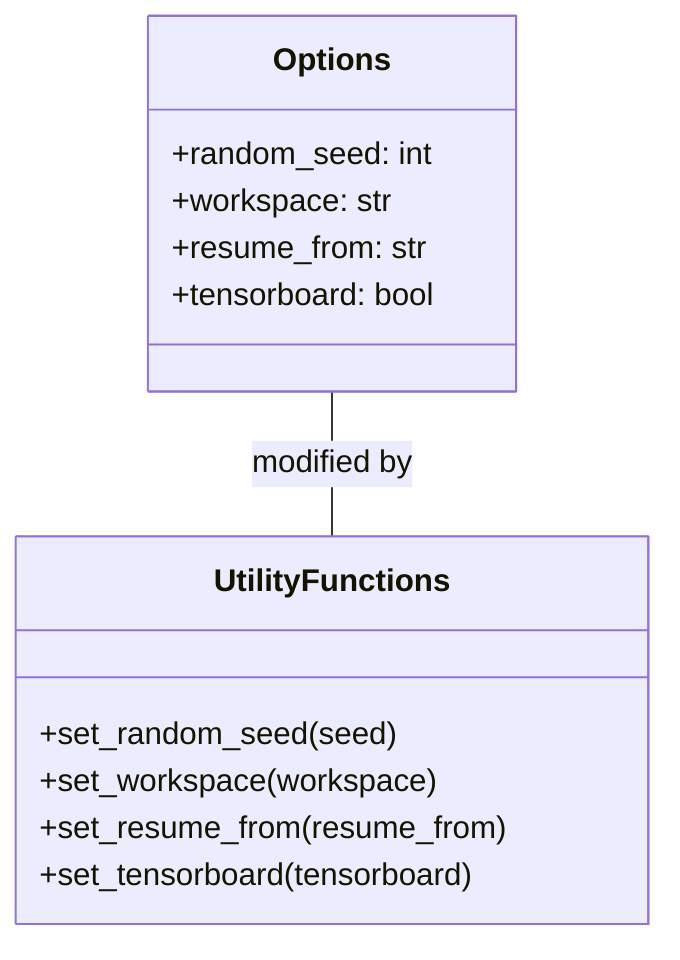
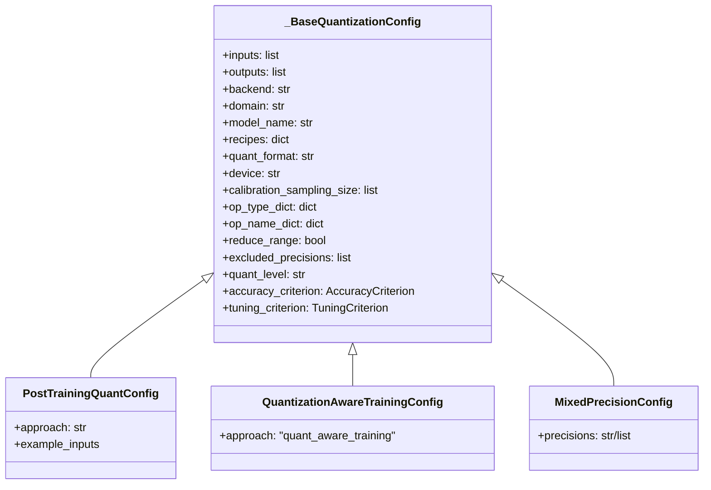
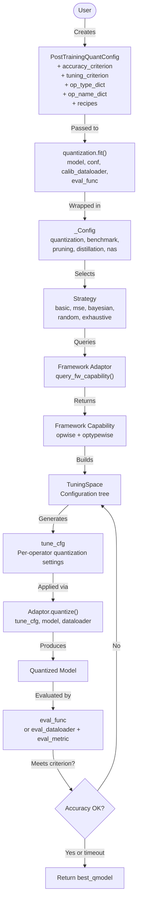
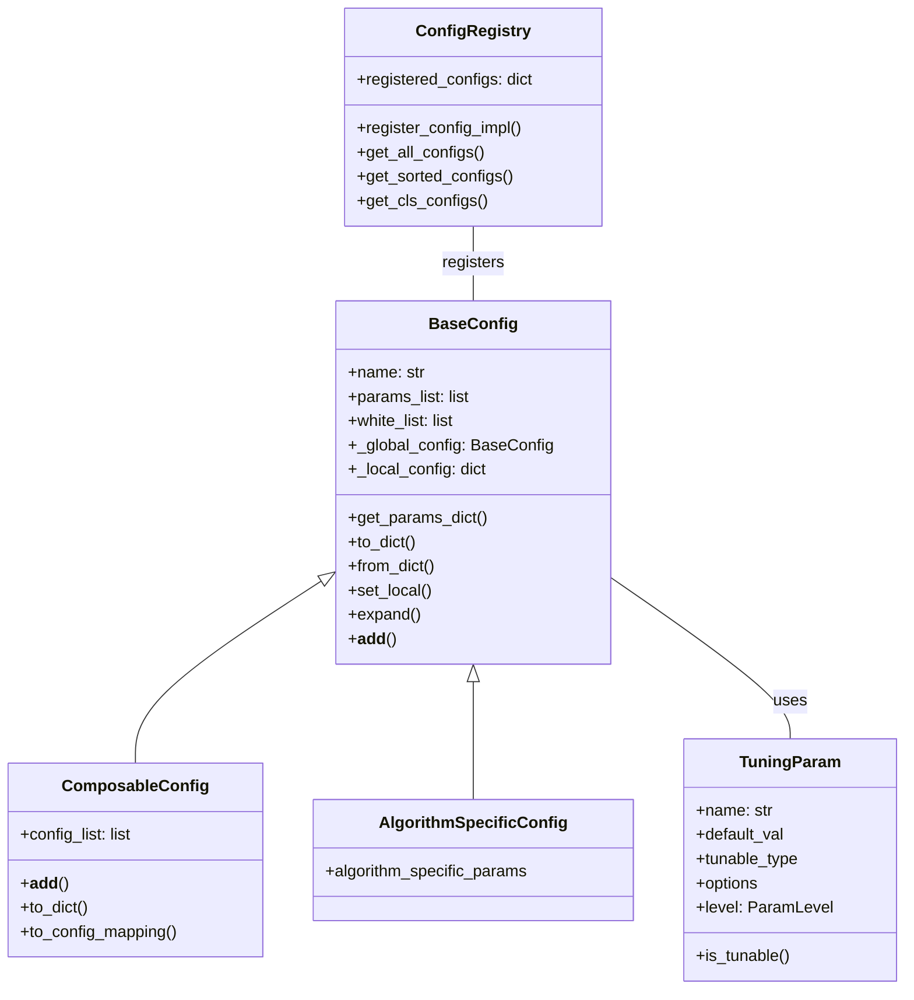
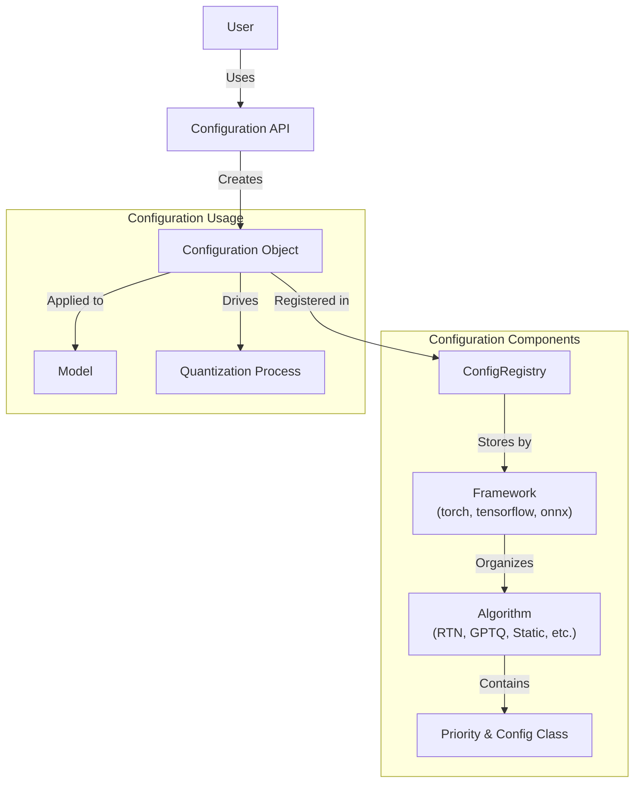
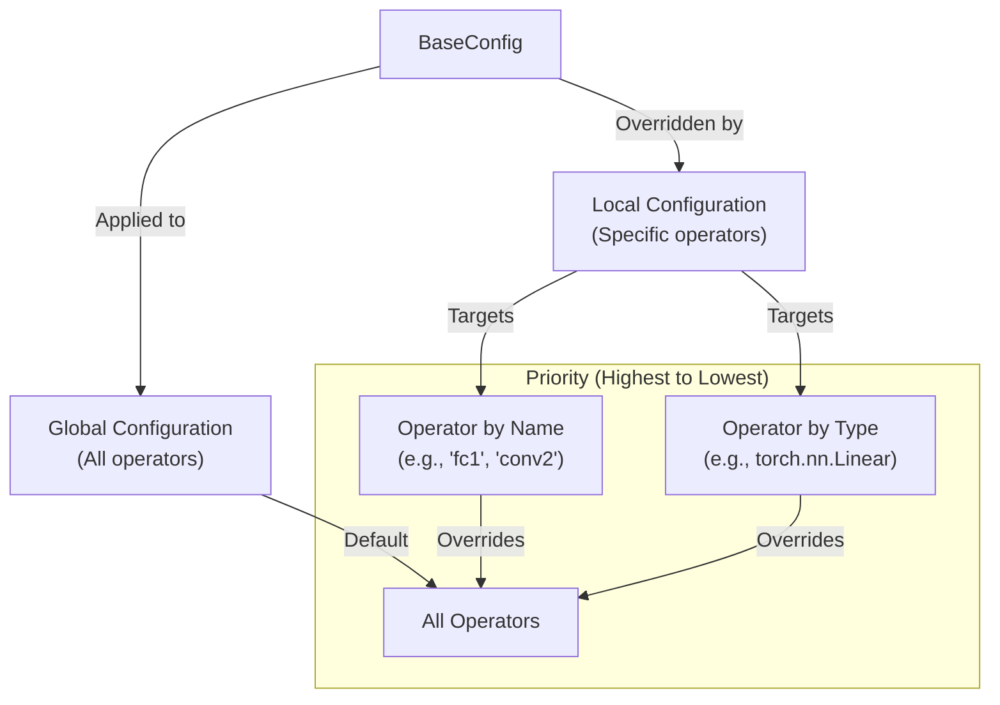
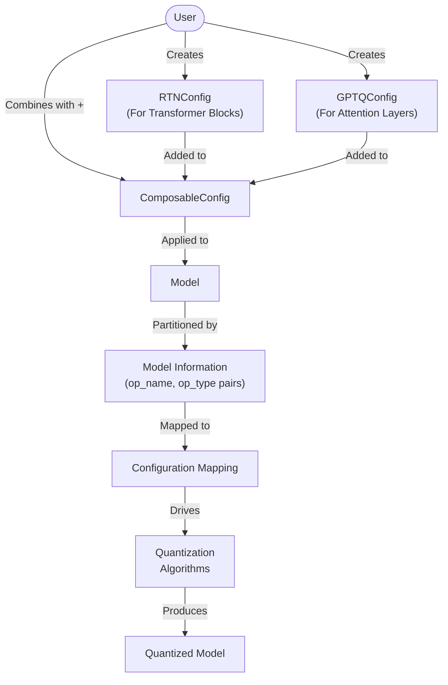
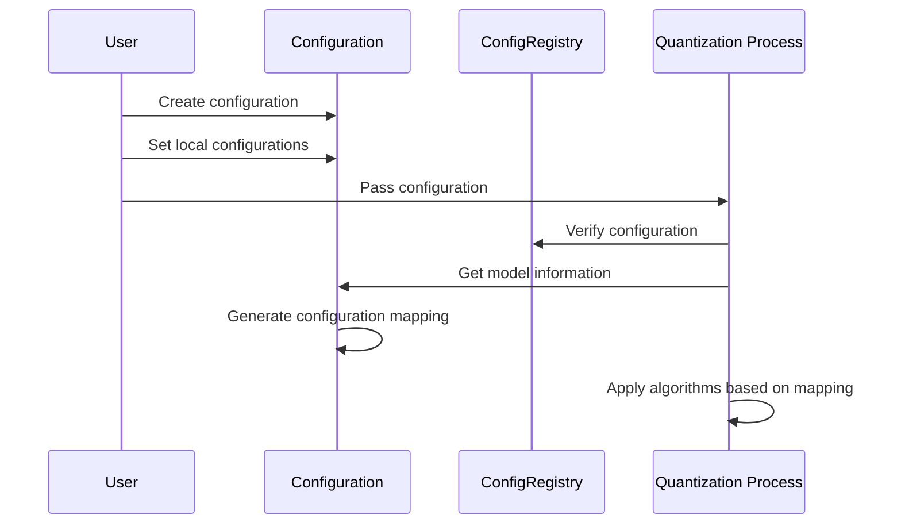
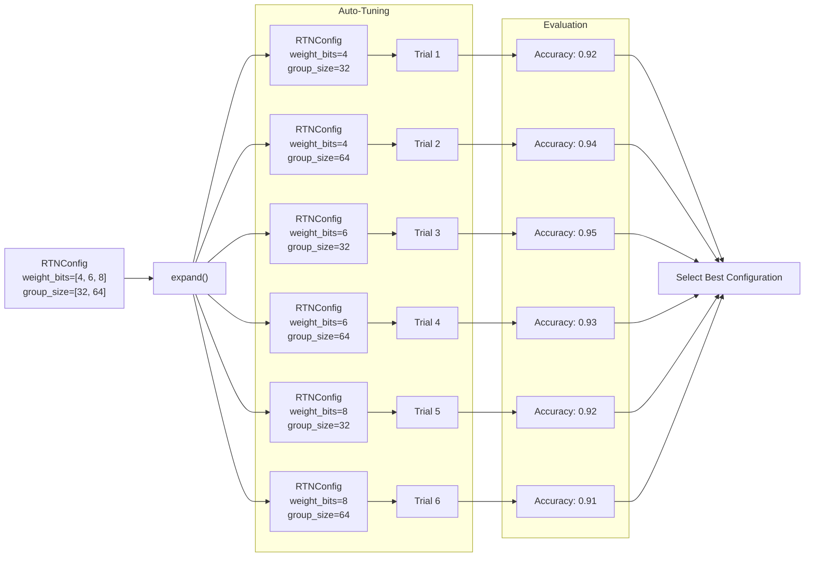
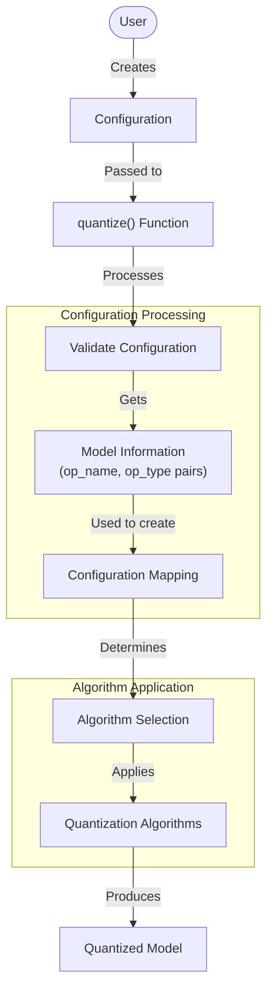

<!-- source: DeepWiki mcp.deepwiki.com · repo intel/neural-compressor · page 4.2 Configuration System · fetched 2026-10-21 -->

# Configuration System

<details>
<summary>Relevant source files</summary>

The following files were used as context for generating this wiki page:

- [README.md](README.md)
- [docs/source/add_new_adaptor.md](docs/source/add_new_adaptor.md)
- [docs/source/add_new_data_type.md](docs/source/add_new_data_type.md)
- [docs/source/calibration.md](docs/source/calibration.md)
- [docs/source/examples_readme.md](docs/source/examples_readme.md)
- [docs/source/framework_yaml.md](docs/source/framework_yaml.md)
- [docs/source/infrastructure.md](docs/source/infrastructure.md)
- [docs/source/mixed_precision.md](docs/source/mixed_precision.md)
- [docs/source/publication_list.md](docs/source/publication_list.md)
- [docs/source/quantization.md](docs/source/quantization.md)
- [docs/source/quantization_mixed_precision.md](docs/source/quantization_mixed_precision.md)
- [examples/README.md](examples/README.md)
- [neural_compressor/benchmark.py](neural_compressor/benchmark.py)
- [neural_compressor/config.py](neural_compressor/config.py)
- [neural_compressor/mix_precision.py](neural_compressor/mix_precision.py)
- [neural_compressor/model/model.py](neural_compressor/model/model.py)
- [neural_compressor/quantization.py](neural_compressor/quantization.py)
- [neural_compressor/training.py](neural_compressor/training.py)
- [neural_compressor/utils/utility.py](neural_compressor/utils/utility.py)
- [test/adaptor/pytorch_adaptor/test_adaptor_security.py](test/adaptor/pytorch_adaptor/test_adaptor_security.py)

</details>


The Configuration System in Intel Neural Compressor provides a structured way to define and manage parameters for model optimization techniques, particularly quantization. Intel Neural Compressor has two distinct configuration systems:

- **2.x API Configuration System**: Used with accuracy-aware tuning through `quantization.fit()`, `training.fit()`, and `mix_precision.fit()`. This system uses configuration classes like `PostTrainingQuantConfig`, `AccuracyCriterion`, and `TuningCriterion`.

- **3.x API Configuration System**: Used with direct quantization through `torch.quantization.quantize()` and algorithm-specific APIs. This system uses algorithm-specific configuration classes like `RTNConfig`, `GPTQConfig`, and `FP8Config`.

This page covers both configuration systems, their core architecture, and how they are used within the framework. For information about specific quantization techniques, see page 6.

Sources: [neural_compressor/config.py:1-803](), [neural_compressor/quantization.py:33-242]()

## Overview: Two Configuration Systems

Intel Neural Compressor provides two distinct configuration systems that serve different use cases:

| Aspect | 2.x API | 3.x API |
|--------|---------|---------|
| **Primary Use Case** | Accuracy-aware tuning with automatic fallback | Direct quantization with explicit control |
| **Main Entry Points** | `quantization.fit()`, `training.fit()`, `mix_precision.fit()` | `torch.quantization.quantize()`, `prepare()`, `convert()` |
| **Configuration Classes** | `PostTrainingQuantConfig`, `QuantizationAwareTrainingConfig`, `MixedPrecisionConfig` | `RTNConfig`, `GPTQConfig`, `AWQConfig`, `FP8Config`, `StaticQuantConfig` |
| **Tuning Support** | Built-in via `TuningCriterion` and `Strategy` | Optional via `autotune()` |
| **Framework Support** | TensorFlow, PyTorch, ONNX Runtime | Primarily PyTorch |
| **Configuration Approach** | Unified configuration for all frameworks | Algorithm-specific configurations |

Sources: [neural_compressor/config.py:715-803](), [README.md:67-102]()

## 2.x Configuration System

The 2.x configuration system is designed for accuracy-aware tuning workflows where the framework automatically searches for the best quantization configuration that meets accuracy criteria.

### Configuration Classes

#### Options Class

The `Options` class manages global settings that apply across all quantization operations:



**Default Values:**
- `random_seed`: 1978
- `workspace`: `./nc_workspace/{timestamp}/`
- `resume_from`: None
- `tensorboard`: False

Sources: [neural_compressor/config.py:176-259](), [neural_compressor/utils/utility.py:678-704]()

#### AccuracyCriterion Class

The `AccuracyCriterion` class defines the acceptable accuracy loss during quantization:

| Parameter | Type | Default | Description |
|-----------|------|---------|-------------|
| `higher_is_better` | bool | True | Whether higher metric values indicate better accuracy |
| `criterion` | str | "relative" | Type of accuracy loss calculation: "relative" or "absolute" |
| `tolerable_loss` | float | 0.01 | Maximum acceptable accuracy loss (e.g., 0.01 = 1% loss) |

**Example Usage:**
```python
from neural_compressor.config import AccuracyCriterion

accuracy_criterion = AccuracyCriterion(
    higher_is_better=True,
    criterion="relative",  # or "absolute"
    tolerable_loss=0.01    # 1% relative loss
)
```

Sources: [neural_compressor/config.py:489-587]()

#### TuningCriterion Class

The `TuningCriterion` class controls the tuning process behavior:

| Parameter | Type | Default | Description |
|-----------|------|---------|-------------|
| `strategy` | str | "basic" | Tuning strategy: "basic", "mse", "bayesian", "random", "exhaustive", "sigopt", "tpe", "mse_v2", "hawq_v2" |
| `strategy_kwargs` | dict | None | Parameters specific to the chosen strategy |
| `timeout` | int/float | 0 | Maximum tuning time in seconds (0 = no timeout) |
| `max_trials` | int | 100 | Maximum number of tuning trials |
| `objective` | str/list/dict | "performance" | Optimization objectives: "performance", "accuracy", "modelsize", "footprint" |

**Example Usage:**
```python
from neural_compressor.config import TuningCriterion

tuning_criterion = TuningCriterion(
    strategy="basic",
    timeout=3600,      # 1 hour
    max_trials=100,
    objective="performance"
)
```

Sources: [neural_compressor/config.py:592-712]()

#### Quantization Configuration Classes

The base class `_BaseQuantizationConfig` and its subclasses define quantization parameters:



Sources: [neural_compressor/config.py:715-825]()

### Operator-Level Configuration: op_type_dict and op_name_dict

The 2.x configuration system provides fine-grained control over quantization through two dictionaries:

#### op_type_dict

Controls quantization settings for all operators of a specific type:

```python
op_type_dict = {
    "Conv": {
        "weight": {
            "dtype": ["fp32"],
            "granularity": ["per_channel"],
            "scheme": ["sym"],
            "algorithm": ["minmax"]
        },
        "activation": {
            "dtype": ["fp32"],
            "granularity": ["per_tensor"],
            "scheme": ["sym"],
            "algorithm": ["minmax"]
        }
    },
    "Linear": {
        "weight": {"dtype": ["int8"]},
        "activation": {"dtype": ["uint8"]}
    }
}
```

#### op_name_dict

Controls quantization settings for specific operators by name:

```python
op_name_dict = {
    "layer1.0.conv1": {
        "activation": {"dtype": ["fp32"]},
        "weight": {"dtype": ["fp32"]}
    },
    "layer2.0.conv1": {
        "activation": {
            "dtype": ["uint8"],
            "algorithm": ["minmax"],
            "granularity": ["per_tensor"],
            "scheme": ["sym"]
        },
        "weight": {
            "dtype": ["int8"],
            "algorithm": ["minmax"],
            "granularity": ["per_channel"],
            "scheme": ["sym"]
        }
    }
}
```

**Configuration Format:**

Each operator configuration can specify:
- `dtype`: Data type(s) - "int8", "uint8", "int4", "nf4", "fp4", "fp32", "bf16", "fp16"
- `scheme`: Quantization scheme - "sym" (symmetric), "asym" (asymmetric), "asym_float"
- `granularity`: Quantization granularity - "per_channel", "per_tensor"
- `algorithm`: Calibration algorithm - "minmax", "kl", "percentile", "RTN", "AWQ", "GPTQ", "TEQ", "AUTOROUND"
- `bits`: Bit width for weight-only quantization (1-8)
- `group_size`: Group size for weight-only quantization

**Priority:** `op_name_dict` settings override `op_type_dict` settings, which override global settings.

Sources: [neural_compressor/config.py:36-79](), [neural_compressor/config.py:748-774](), [docs/source/quantization.md:370-405]()

### Schema Validation

The configuration system validates operator-level settings using the `schema` library:

```python
ops_schema = Schema({
    Optional("weight", default=None): {
        Optional("granularity"): And(list, lambda s: all(i in ["per_channel", "per_tensor"] for i in s)),
        Optional("scheme"): And(list, lambda s: all(i in ["asym", "sym", "asym_float"] for i in s)),
        Optional("dtype"): And(list, lambda s: all(i in ["int", "int4", "nf4", "fp4", ..., "fp16"] for i in s)),
        Optional("algorithm"): And(list, lambda s: all(i in ["minmax", "RTN", "AWQ", "GPTQ", ...] for i in s)),
        Optional("bits"): And(list, lambda s: all(0 < i <= 8 and type(i) == int for i in s)),
        Optional("group_size"): And(list, lambda s: all(i >= -1 and i != 0 and type(i) == int for i in s)),
    },
    Optional("activation", default=None): {
        # Similar structure for activations
    }
})
```

Values are automatically wrapped in lists using the `_list_wrapper()` helper function to ensure consistent formatting.

Sources: [neural_compressor/config.py:36-79](), [neural_compressor/config.py:113-131]()

### Recipes System

The `recipes` parameter provides additional optimization techniques that can be applied during quantization:

| Recipe | Description | Frameworks | Parameters |
|--------|-------------|------------|------------|
| `smooth_quant` | Applies SmoothQuant algorithm to balance activation/weight quantization | PyTorch, ONNX | boolean |
| `smooth_quant_args` | Parameters for SmoothQuant | PyTorch, ONNX | `alpha` (float or "auto"), other algorithm-specific parameters |
| `layer_wise_quant` | Enables layer-by-layer quantization for large models | PyTorch | boolean |
| `layer_wise_quant_args` | Parameters for layer-wise quantization | PyTorch | dict |
| `fast_bias_correction` | Applies fast bias correction | TensorFlow | boolean |
| `weight_correction` | Applies weight correction | TensorFlow | boolean |
| `gemm_to_matmul` | Converts GEMM to MatMul + Add | ONNX | boolean |
| `graph_optimization_level` | Graph optimization level | ONNX | "DISABLE_ALL", "ENABLE_BASIC", "ENABLE_EXTENDED", "ENABLE_ALL" |
| `first_conv_or_matmul_quantization` | Whether to quantize first conv/matmul | TensorFlow, ONNX | boolean |
| `last_conv_or_matmul_quantization` | Whether to quantize last conv/matmul | TensorFlow, ONNX | boolean |
| `pre_post_process_quantization` | Whether to quantize preprocessing/postprocessing ops | TensorFlow, ONNX | boolean |
| `add_qdq_pair_to_weight` | Add QDQ pairs for weights | ONNX (TensorRT) | boolean |
| `optypes_to_exclude_output_quant` | Op types to exclude from output quantization | ONNX | list |
| `dedicated_qdq_pair` | Use dedicated QDQ pairs | ONNX (TensorRT) | boolean |

**Example Usage:**

```python
from neural_compressor.config import PostTrainingQuantConfig

recipes = {
    "smooth_quant": True,
    "smooth_quant_args": {
        "alpha": 0.5,  # or "auto" for automatic tuning
    },
    "layer_wise_quant": True,
    "first_conv_or_matmul_quantization": False,
    "last_conv_or_matmul_quantization": False
}

config = PostTrainingQuantConfig(recipes=recipes)
```

The `alpha` parameter in `smooth_quant_args` can be:
- A single float value (e.g., 0.5)
- A list of float values for tuning (e.g., [0.3, 0.5, 0.7])
- The string "auto" for automatic alpha selection

Sources: [neural_compressor/config.py:729-742](), [neural_compressor/config.py:860-910](), [docs/source/quantization.md:407-437]()

### Configuration Usage in 2.x API

Diagram: Configuration Flow in 2.x API


Sources: [neural_compressor/quantization.py:33-242](), [neural_compressor/config.py:715-825]()

## 3.x Configuration System

The 3.x configuration system is designed for direct quantization workflows where users explicitly specify the quantization algorithm and parameters.

### Core Architecture

The configuration system is built around a hierarchical structure of classes that enable flexible parameter specification and reuse across different optimization algorithms.



Sources: [neural_compressor/common/base_config.py:182-442](), [neural_compressor/common/base_config.py:57-142](), [neural_compressor/common/base_config.py:643-786](), [neural_compressor/common/tuning_param.py:40-131]()

### BaseConfig

The `BaseConfig` is the foundation of the configuration system. It's an abstract base class that provides essential functionality for all configuration types:

- **Parameter Management**: Stores and manages configuration parameters
- **Hierarchical Configuration**: Supports global and local (operator-specific) settings
- **Configuration Conversion**: Converts between Python objects and serializable formats
- **Configuration Composition**: Allows combining multiple configurations
- **Configuration Expansion**: Expands configurations with tunable parameters for auto-tuning

Key methods in `BaseConfig` include:
- `set_local()`: Sets custom configuration for specific operators or types
- `to_dict()` and `from_dict()`: Serializes/deserializes configurations
- `expand()`: Generates configurations with different parameter combinations
- `__add__()`: Combines two configurations

Sources: [neural_compressor/common/base_config.py:182-442]()

### ConfigRegistry

The `ConfigRegistry` serves as a central registry for all configuration classes in the framework. It:

- Maintains a dictionary of registered configurations by framework and algorithm
- Provides decorator functions for registering new configurations
- Enables retrieval of configurations by priority or framework



Sources: [neural_compressor/common/base_config.py:57-142](), [neural_compressor/common/base_config.py:163-179]()

## Configuration Hierarchy

Configurations in Neural Compressor follow a hierarchical structure that allows for granular control:



A configuration can have:

1. **Global Configuration**: Applied to all operators in the model
2. **Local Configuration**: Specifically for certain operators, which can be targeted by:
   - Operator name (e.g., 'fc1')
   - Operator type (e.g., `torch.nn.Linear`)
   - Regular expression pattern matching on operator names

Local configurations override global configurations when applied to their target operators.

Sources: [neural_compressor/common/base_config.py:193-206](), [neural_compressor/common/base_config.py:278-297]()

## Composable Configurations

Neural Compressor allows combining multiple configurations using the `+` operator, which creates a `ComposableConfig`. This enables mixing different quantization approaches for different parts of a model.



For example, combining RTN and GPTQ configurations:

```python
rtn_config = RTNConfig(white_list=[".*mlp.*"])  # Apply to MLP layers
gptq_config = GPTQConfig(white_list=[".*attn.*"])  # Apply to attention layers
combined_config = rtn_config + gptq_config  # Composite configuration
```

Sources: [neural_compressor/common/base_config.py:643-786]()

## Configuration Creation and Usage

There are multiple ways to create configurations:

1. **Using Configuration Classes**:
   ```python
   from neural_compressor.torch.quantization import RTNConfig
   config = RTNConfig(bits=4, dtype="nf4", group_size=32)
   ```

2. **Using Dictionary Format**:
   ```python
   config = {
       "rtn": {
           "dtype": "nf4",
           "bits": 4,
           "group_size": 32
       }
   }
   ```

3. **Using Helper Functions**:
   ```python
   from neural_compressor.torch.quantization import get_default_rtn_config
   config = get_default_rtn_config()
   ```

### Configuration Setup Flow



Sources: [neural_compressor/torch/quantization/quantize.py:45-112]()

## Using the Configuration System

The configuration system integrates with three main workflows in Neural Compressor:

1. **Direct Quantization**:
   ```python
   from neural_compressor.torch.quantization import quantize, RTNConfig
   
   # Create configuration
   config = RTNConfig(bits=4, dtype="nf4")
   
   # Set local configuration for specific layers
   fc1_config = RTNConfig(bits=8, dtype="int8")
   config.set_local("model.fc1", fc1_config)
   
   # Apply quantization
   quantized_model = quantize(model, quant_config=config)
   ```

2. **Prepare-Calibrate-Convert Flow**:
   ```python
   from neural_compressor.torch.quantization import prepare, convert, RTNConfig
   
   # Create configuration
   config = RTNConfig(bits=4, dtype="nf4")
   
   # Prepare model (insert observers)
   prepared_model = prepare(model, quant_config=config)
   
   # Calibrate model
   with torch.no_grad():
       for batch in calibration_data:
           prepared_model(batch)
   
   # Convert model (replace with quantized operations)
   quantized_model = convert(prepared_model)
   ```

3. **Auto-Tuning**:
   ```python
   from neural_compressor.torch.quantization import autotune, TuningConfig, RTNConfig
   
   # Define possible configurations
   config_set = [RTNConfig(bits=[4, 6])]  # Will try both 4 and 6 bits
   
   # Create tuning configuration
   tune_config = TuningConfig(config_set=config_set, max_trials=5)
   
   # Perform auto-tuning
   best_model = autotune(
       model, 
       tune_config=tune_config,
       eval_fn=evaluation_function,
       run_fn=calibration_function
   )
   ```

Sources: [neural_compressor/torch/quantization/quantize.py:45-112](), [neural_compressor/torch/quantization/quantize.py:116-170](), [neural_compressor/torch/quantization/quantize.py:174-234]()

## Configuration Expansion for Auto-Tuning

The configuration system supports auto-tuning by allowing configurations to expand into multiple configurations with different parameter combinations.

For example, a configuration with multiple options for weight bits:

```python
config = RTNConfig(weight_bits=[4, 6, 8])
```

Will expand to three separate configurations:
1. `RTNConfig(weight_bits=4)`
2. `RTNConfig(weight_bits=6)`
3. `RTNConfig(weight_bits=8)`

This expansion is used in auto-tuning to systematically explore the configuration space.



Sources: [neural_compressor/common/base_config.py:471-547]()

## 3.x Global Settings

The 3.x API also provides global settings, though with a different interface than the 2.x API:

```python
from neural_compressor.common.utils import set_random_seed, set_workspace, set_resume_from, set_tensorboard

set_random_seed(42)
set_workspace("./my_workspace")
set_resume_from("./previous_tuning")
set_tensorboard(True)
```

Sources: [neural_compressor/common/base_config.py:852-939]()

## Internal Configuration Flow

The following diagram illustrates how configurations are processed internally during quantization:



Sources: [neural_compressor/torch/quantization/quantize.py:45-112](), [neural_compressor/common/base_config.py:561-592]()

## Summary

The Configuration System in Intel Neural Compressor provides a flexible and powerful way to control optimization techniques. Key features include:

- Hierarchical configurations with global and local settings
- Composable configurations for mixing different optimization approaches
- Parameter expansion for auto-tuning
- Configuration serialization for saving and loading

This system enables precise control over how models are optimized while maintaining flexibility for different use cases and model architectures.

---

