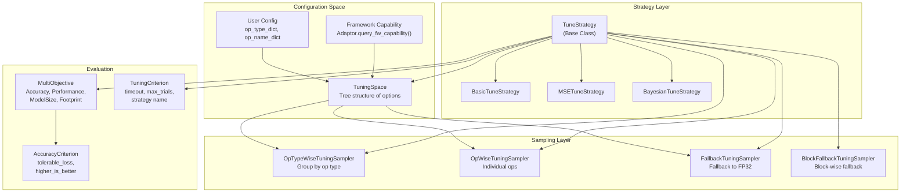
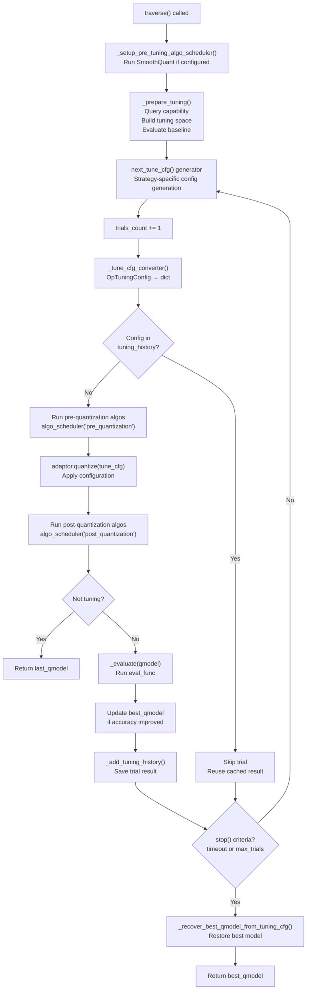
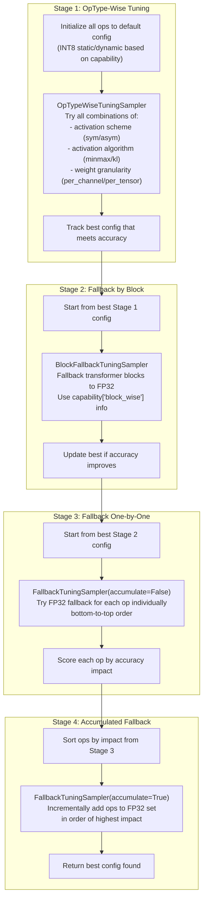
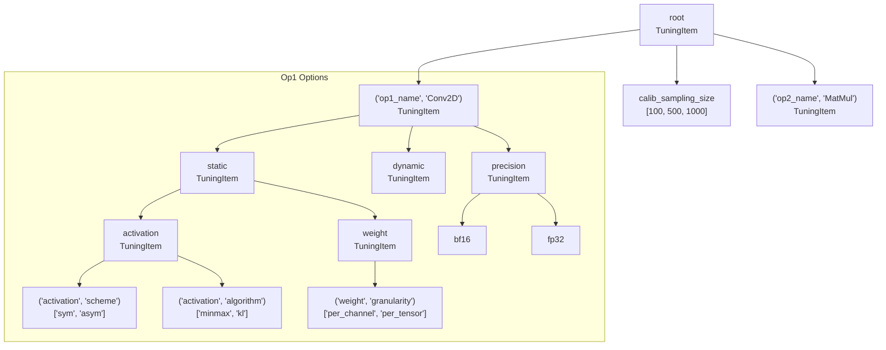
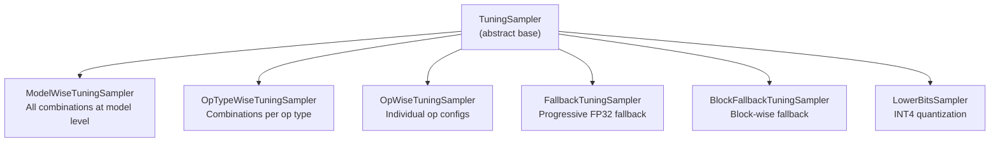
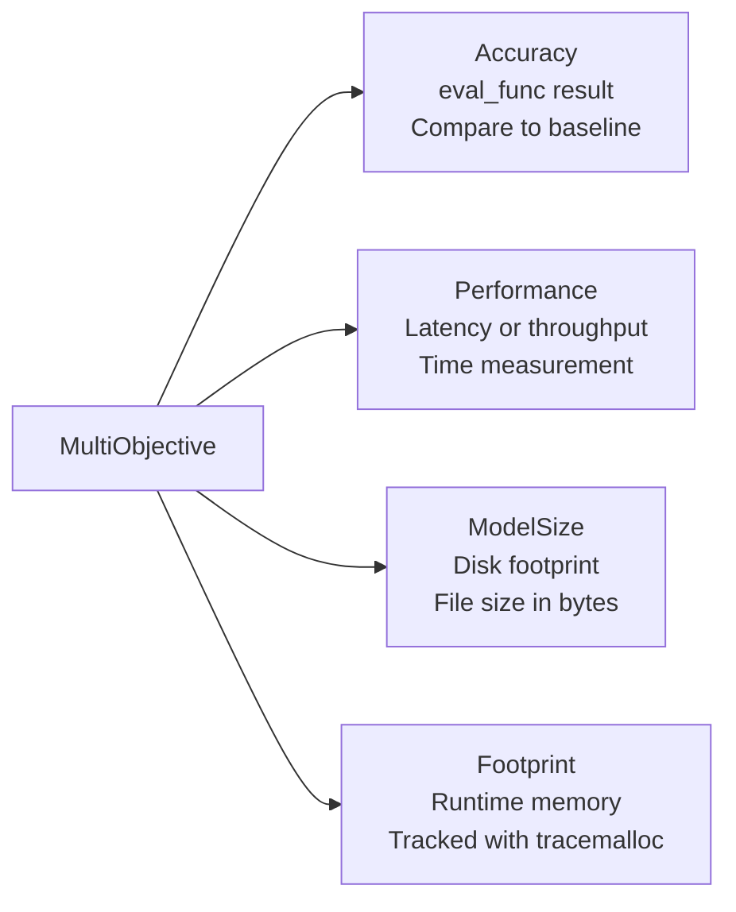
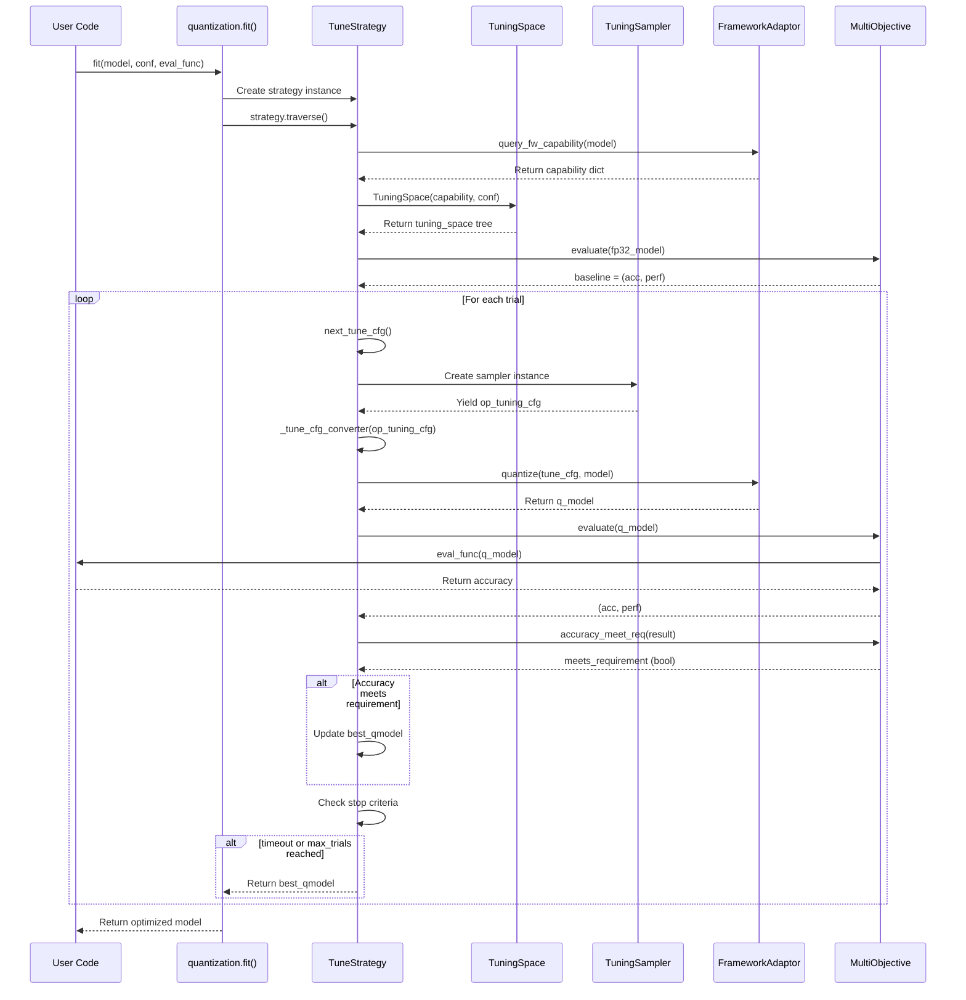
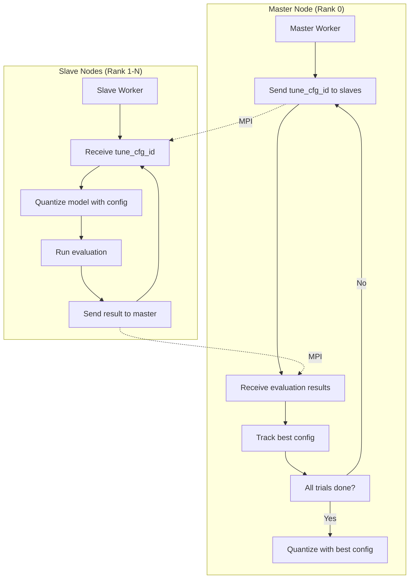

<!-- source: DeepWiki mcp.deepwiki.com · repo intel/neural-compressor · page 4.3 Strategy and Tuning System · fetched 2026-10-21 -->

# Strategy and Tuning System

<details>
<summary>Relevant source files</summary>

The following files were used as context for generating this wiki page:

- [neural_compressor/benchmark.py](neural_compressor/benchmark.py)
- [neural_compressor/config.py](neural_compressor/config.py)
- [neural_compressor/contrib/strategy/sigopt.py](neural_compressor/contrib/strategy/sigopt.py)
- [neural_compressor/contrib/strategy/tpe.py](neural_compressor/contrib/strategy/tpe.py)
- [neural_compressor/mix_precision.py](neural_compressor/mix_precision.py)
- [neural_compressor/model/model.py](neural_compressor/model/model.py)
- [neural_compressor/objective.py](neural_compressor/objective.py)
- [neural_compressor/quantization.py](neural_compressor/quantization.py)
- [neural_compressor/strategy/auto_mixed_precision.py](neural_compressor/strategy/auto_mixed_precision.py)
- [neural_compressor/strategy/basic.py](neural_compressor/strategy/basic.py)
- [neural_compressor/strategy/bayesian.py](neural_compressor/strategy/bayesian.py)
- [neural_compressor/strategy/conservative.py](neural_compressor/strategy/conservative.py)
- [neural_compressor/strategy/exhaustive.py](neural_compressor/strategy/exhaustive.py)
- [neural_compressor/strategy/hawq_v2.py](neural_compressor/strategy/hawq_v2.py)
- [neural_compressor/strategy/mse.py](neural_compressor/strategy/mse.py)
- [neural_compressor/strategy/mse_v2.py](neural_compressor/strategy/mse_v2.py)
- [neural_compressor/strategy/random.py](neural_compressor/strategy/random.py)
- [neural_compressor/strategy/strategy.py](neural_compressor/strategy/strategy.py)
- [neural_compressor/strategy/utils/constant.py](neural_compressor/strategy/utils/constant.py)
- [neural_compressor/strategy/utils/tuning_sampler.py](neural_compressor/strategy/utils/tuning_sampler.py)
- [neural_compressor/strategy/utils/tuning_space.py](neural_compressor/strategy/utils/tuning_space.py)
- [neural_compressor/strategy/utils/tuning_structs.py](neural_compressor/strategy/utils/tuning_structs.py)
- [neural_compressor/training.py](neural_compressor/training.py)
- [neural_compressor/utils/utility.py](neural_compressor/utils/utility.py)
- [test/adaptor/pytorch_adaptor/test_adaptor_security.py](test/adaptor/pytorch_adaptor/test_adaptor_security.py)
- [test/strategy/test_tuning_sampler.py](test/strategy/test_tuning_sampler.py)
- [test/strategy/test_tuning_space.py](test/strategy/test_tuning_space.py)
- [test/strategy/test_tuning_space_v2.py](test/strategy/test_tuning_space_v2.py)

</details>


## Purpose and Scope

The Strategy and Tuning System is the core orchestration layer in Neural Compressor's 2.x API that automates the search for optimal quantization configurations. This system combines **strategy algorithms** (which define the search logic), **tuning space** (representing all possible configurations), **samplers** (which generate configurations to try), and **multi-objective evaluation** (which measures quality) to automatically find quantized models that meet accuracy constraints while optimizing for performance.

This page covers the accuracy-aware tuning workflow used by the 2.x API's `quantization.fit()` interface. For direct quantization without tuning (3.x API), see page [3.2](#3.2). For framework-specific adaptors that execute quantization, see page [5](#5).

---

## System Architecture

The strategy system orchestrates four key components that work together to explore the quantization configuration space:



**Sources:** [neural_compressor/strategy/strategy.py:1-2000](), [neural_compressor/strategy/utils/tuning_space.py:1-800](), [neural_compressor/strategy/utils/tuning_sampler.py:1-600](), [neural_compressor/objective.py:1-500]()

---

## TuneStrategy Base Class

The `TuneStrategy` class ([neural_compressor/strategy/strategy.py:117-1500]()) is the abstract base class for all tuning strategies. It defines the core tuning workflow and provides infrastructure for configuration management, history tracking, and model evaluation.

### Key Responsibilities

| Responsibility | Implementation |
|---|---|
| **Tuning Space Construction** | `build_tuning_space()` builds tree from capability |
| **Configuration Generation** | `next_tune_cfg()` abstract method implemented by subclasses |
| **Model Quantization** | Delegates to `adaptor.quantize()` with tune_cfg |
| **Evaluation** | `_evaluate()` uses eval_func or MultiObjective |
| **History Management** | Tracks all trials in `tuning_history` |
| **Recipe Management** | Handles smooth_quant, fast_bias_correction, etc. |
| **Stop Criteria** | Checks timeout, max_trials, accuracy met |

### Core Attributes

```python
# From neural_compressor/strategy/strategy.py:120-220
class TuneStrategy:
    model               # FP32 model to quantize
    config              # User configuration (PostTrainingQuantConfig)
    adaptor             # Framework adaptor (pytorch/tensorflow/onnx)
    tuning_space        # TuningSpace object with all options
    objectives          # MultiObjective for evaluation
    
    # Tuning state
    baseline            # FP32 baseline accuracy
    best_qmodel         # Best quantized model found
    best_tune_result    # Best evaluation result
    cur_best_tuning_cfg # Current best config
    trials_count        # Number of trials so far
    
    # Recipe management
    _tuning_recipes                 # Recipes to tune
    _not_tuning_recipes_values      # User-specified recipes
    _tuning_recipes_default_values  # Default values
```

**Sources:** [neural_compressor/strategy/strategy.py:117-220]()

### Main Workflow: traverse()

The `traverse()` method ([neural_compressor/strategy/strategy.py:455-564]()) is the main entry point that executes the tuning loop:



**Sources:** [neural_compressor/strategy/strategy.py:455-564]()

---

## Strategy Types

Neural Compressor provides multiple strategy implementations, each with different search algorithms:

### Strategy Registry and Selection

Strategies are registered using the `@strategy_registry` decorator ([neural_compressor/strategy/strategy.py:68-83]()):

```python
STRATEGIES = {}

@strategy_registry
class BasicTuneStrategy(TuneStrategy):
    # Registered as 'basic'
```

Strategy selection happens in `quantization.fit()` ([neural_compressor/quantization.py:159-173]()):

```python
strategy_name = conf.tuning_criterion.strategy  # From TuningCriterion
if conf.quant_level == "auto":
    strategy_name = "auto"  # Maps to BasicTuneStrategy
elif conf.quant_level == 0:
    strategy_name = "conservative"

strategy = STRATEGIES[strategy_name](
    model=wrapped_model,
    conf=config,
    q_dataloader=calib_dataloader,
    eval_func=eval_func,
    # ...
)
```

### Available Strategies

| Strategy | Class | Search Algorithm | Use Case |
|----------|-------|------------------|----------|
| **basic** | `BasicTuneStrategy` | OpType-wise → Fallback stages | Default, general purpose |
| **mse** | `MSETuneStrategy` | MSE-based op scoring | Minimize quantization error |
| **mse_v2** | `MSE_V2TuneStrategy` | Multi-batch MSE scoring | TensorFlow/PyTorch FX only |
| **bayesian** | `BayesianTuneStrategy` | Gaussian Process optimization | Sample-efficient search |
| **random** | `RandomTuneStrategy` | Random sampling | Quick exploration |
| **exhaustive** | `ExhaustiveTuneStrategy` | All combinations | Small search spaces |
| **hawq_v2** | `HAWQ_V2TuneStrategy` | Hessian trace scoring | Hardware-aware |
| **conservative** | `ConservativeTuneStrategy` | FP32 → INT8 gradually | quant_level=0 |
| **auto** | Maps to `BasicTuneStrategy` | See Basic strategy | quant_level="auto" |

**Sources:** [neural_compressor/strategy/basic.py:35](), [neural_compressor/strategy/mse.py:31](), [neural_compressor/strategy/bayesian.py:34](), [neural_compressor/strategy/conservative.py:28](), [neural_compressor/config.py:686-699]()

---

## BasicTuneStrategy in Detail

The `BasicTuneStrategy` ([neural_compressor/strategy/basic.py:35-420]()) implements a three-stage tuning process that is the default for most quantization workflows.

### Three-Stage Process



### Implementation: next_tune_cfg()

The `next_tune_cfg()` generator ([neural_compressor/strategy/basic.py:284-420]()) yields configurations in the order described above:

```python
def next_tune_cfg(self):
    # Stage 1: OpType-wise tuning
    op_type_wise_tuning_sampler = OpTypeWiseTuningSampler(
        tuning_space, [], [], op_item_dtype_dict, initial_op_tuning_cfg
    )
    for op_tuning_cfg in op_type_wise_tuning_sampler:
        op_tuning_cfg["calib_sampling_size"] = calib_sampling_size
        yield op_tuning_cfg
    
    # Stage 2: Fallback by block
    for op_tuning_cfg in self.fallback_by_block(
        fallback_items_lst, best_op_tuning_cfg_stage1, 
        target_dtype, tuning_space, calib_sampling_size
    ):
        yield op_tuning_cfg
    
    # Stage 3: Fallback one-by-one
    fallback_sampler = FallbackTuningSampler(
        tuning_space,
        tuning_order_lst=[],
        initial_op_tuning_cfg=initial_op_tuning_cfg,
        op_dtypes=op_dtypes,
        accumulate=False,  # Try each op individually
    )
    for op_tuning_cfg in fallback_sampler:
        yield op_tuning_cfg
    
    # Stage 4: Accumulated fallback
    ordered_ops = sorted(
        op_fallback_acc_impact.keys(),
        key=lambda key: op_fallback_acc_impact[key],
        reverse=self.higher_is_better,
    )
    fallback_sampler = FallbackTuningSampler(
        # ... accumulate=True
    )
    for op_tuning_cfg in fallback_sampler:
        yield op_tuning_cfg
```

**Sources:** [neural_compressor/strategy/basic.py:284-420]()

---

## Tuning Space

The `TuningSpace` class ([neural_compressor/strategy/utils/tuning_space.py:117-800]()) represents all possible quantization configurations as a tree structure built from framework capabilities and user constraints.

### Tree Structure



### Key Methods

| Method | Purpose | Returns |
|--------|---------|---------|
| `query_items_by_quant_mode(mode)` | Get all ops supporting a mode | List of TuningItem |
| `get_default_config(op_name_type, mode)` | Default OpTuningConfig for op | OpTuningConfig |
| `get_op_default_path_by_pattern(op, mode)` | Full path through tree | Dict of paths |
| `query_quant_mode_item_by_full_path(op, path)` | Navigate to specific node | TuningItem |
| `query_item_option(op, path, item, option)` | Check if option exists | bool |

**Example: Building Tuning Space**

```python
# From neural_compressor/strategy/strategy.py:1180-1250
def build_tuning_space(self, config):
    from .utils.tuning_space import TuningSpace
    
    # Query framework capability
    capability = self.adaptor.query_fw_capability(self.model)
    
    # Merge with user config
    tuning_space = TuningSpace(capability, config, framework=self.framework)
    
    return tuning_space
```

### Internal Representation

The tuning space stores operator data types and paths:

```python
# neural_compressor/strategy/utils/tuning_space.py:141-144
self.ops_data_type = OrderedDefaultDict()  
# {(op_name, op_type): {path: data_type}}

self.ops_path_set = defaultdict(set)
# {(op_name, op_type): {path1, path2, ...}}

self.ops_attr = {"activation": set(), "weight": set()}
# Ops with activation/weight quantization
```

**Sources:** [neural_compressor/strategy/utils/tuning_space.py:117-800](), [neural_compressor/strategy/strategy.py:1180-1250]()

---

## Tuning Samplers

Samplers generate quantization configurations by traversing the tuning space. Each sampler implements a different traversal strategy.

### Sampler Hierarchy



### OpTypeWiseTuningSampler

The `OpTypeWiseTuningSampler` ([neural_compressor/strategy/utils/tuning_sampler.py:177-330]()) groups operators by type and tries all combinations of tuning items for each type:

```python
# Example: Grouping ops by type
# Conv2D ops: [('conv1', 'Conv2D'), ('conv2', 'Conv2D')]
# MatMul ops: [('mm1', 'MatMul'), ('mm2', 'MatMul')]

# Tries combinations like:
# All Conv2D: sym activation + minmax algorithm
# All Conv2D: asym activation + kl algorithm
# All MatMul: per_channel weight + sym scheme
# ...
```

**Key Features:**
- Groups ops by `op_type` 
- Generates all combinations of tuning items per group
- Uses `itertools.product()` for exhaustive combinations
- Yields `op_tuning_cfg` dict with `OpTuningConfig` for each op

**Sources:** [neural_compressor/strategy/utils/tuning_sampler.py:177-330]()

### FallbackTuningSampler

The `FallbackTuningSampler` ([neural_compressor/strategy/utils/tuning_sampler.py:400-550]()) progressively converts quantized ops back to higher precision:

```python
class FallbackTuningSampler:
    def __init__(
        self,
        tuning_space,
        tuning_order_lst,
        initial_op_tuning_cfg,
        op_dtypes,           # {op_name_type: target_dtype}
        accumulate=False,    # If True, add ops incrementally
    ):
        self.accumulate = accumulate
        self.op_dtypes = op_dtypes  # OrderedDict of ops to fallback
```

**Two Modes:**

1. **accumulate=False**: Try each op individually
   - Config 1: fallback op1 to FP32
   - Config 2: fallback op2 to FP32  
   - Config 3: fallback op3 to FP32

2. **accumulate=True**: Incrementally add ops
   - Config 1: fallback op1 to FP32
   - Config 2: fallback op1 + op2 to FP32
   - Config 3: fallback op1 + op2 + op3 to FP32

**Sources:** [neural_compressor/strategy/utils/tuning_sampler.py:400-550]()

### OpWiseTuningSampler

The `OpWiseTuningSampler` ([neural_compressor/strategy/utils/tuning_sampler.py:570-700]()) tries all possible configurations for each individual operator:

```python
# For each op, tries all combinations:
# op1: [int8 sym minmax, int8 asym kl, ...]
# op2: [int8 sym minmax, int8 asym kl, ...]
# Then generates all model-level combinations
```

This produces the most fine-grained search but can be very expensive (exponential in number of ops).

**Sources:** [neural_compressor/strategy/utils/tuning_sampler.py:570-700]()

---

## Multi-Objective Evaluation

The `MultiObjective` class ([neural_compressor/objective.py:290-500]()) evaluates quantized models against multiple objectives and determines if they meet accuracy requirements.

### Supported Objectives



### Accuracy Criterion Checking

The `accuracy_meet_req()` method ([neural_compressor/objective.py:350-380]()) compares evaluation results against the accuracy criterion:

```python
def accuracy_meet_req(self, eval_result):
    acc, performance = eval_result
    baseline_acc, _ = self.baseline
    
    if self.accuracy_criterion.criterion == "relative":
        # Relative tolerance
        if self.accuracy_criterion.higher_is_better:
            threshold = baseline_acc * (1 - self.accuracy_criterion.tolerable_loss)
            return acc >= threshold
        else:
            threshold = baseline_acc * (1 + self.accuracy_criterion.tolerable_loss)
            return acc <= threshold
    
    elif self.accuracy_criterion.criterion == "absolute":
        # Absolute tolerance
        if self.accuracy_criterion.higher_is_better:
            return acc >= (baseline_acc - self.accuracy_criterion.tolerable_loss)
        else:
            return acc <= (baseline_acc + self.accuracy_criterion.tolerable_loss)
```

### Configuration

From `AccuracyCriterion` ([neural_compressor/config.py:489-587]()):

```python
accuracy_criterion = AccuracyCriterion(
    higher_is_better=True,    # Accuracy metric direction
    criterion="relative",      # "relative" or "absolute"
    tolerable_loss=0.01,      # 1% relative loss allowed
)
```

From `TuningCriterion` ([neural_compressor/config.py:592-712]()):

```python
tuning_criterion = TuningCriterion(
    strategy="basic",              # Strategy name
    strategy_kwargs=None,          # Strategy-specific params
    timeout=0,                     # Timeout in seconds (0=no limit)
    max_trials=100,                # Maximum trials
    objective="performance",       # Primary objective
)
```

**Sources:** [neural_compressor/objective.py:290-500](), [neural_compressor/config.py:489-712]()

---

## Complete Tuning Flow

This diagram shows how all components interact during the tuning process:



**Sources:** [neural_compressor/quantization.py:33-241](), [neural_compressor/strategy/strategy.py:455-564]()

---

## Recipe System

Recipes are optimization techniques that can be automatically tuned alongside quantization configurations. The strategy system manages recipe tuning through three categories:

### Recipe Categories

| Category | When Applied | Examples |
|----------|-------------|----------|
| **Not Tuning** | User explicitly set value | `smooth_quant=True` |
| **Tuning** | Default value, will be explored | `fast_bias_correction` |
| **Fallback** | Post-quantization fallback | `first_conv_or_matmul_quantization` |

### Recipe Initialization

From `_initialize_recipe()` ([neural_compressor/strategy/strategy.py:565-604]()):

```python
def _initialize_recipe(self):
    # Get adaptor-supported recipes
    adaptor_recipes = fwk_recipes["common"]
    for adaptor_name_key, adaptor_recipes_val in fwk_recipes.items():
        if adaptor_name_key.startswith(adaptor_name):
            adaptor_recipes.update(adaptor_recipes_val)
    
    # Divide into tuning vs not tuning
    usr_recipes_cfg = self.config.recipes if self.config.recipes else {}
    for recipe_name, recipe_val in usr_recipes_cfg.items():
        if recipe_name in adaptor_recipes and recipe_val != adaptor_recipes[recipe_name][0]:
            # User set non-default value -> don't tune
            self._not_tuning_recipes_values[recipe_name] = recipe_val
    
    # Remaining recipes use default and will be tuned
    for recipe_name in fwk_recipes_priority:
        if recipe_name in adaptor_recipes and recipe_name not in self._not_tuning_recipes_values:
            self._tuning_recipes[recipe_name] = adaptor_recipes[recipe_name]
            self._tuning_recipes_default_values[recipe_name] = adaptor_recipes[recipe_name][0]
```

### Recipe Tuning Methods

**Apply All Recipes**: Tries enabling all recipes at once

```python
# neural_compressor/strategy/strategy.py:1810-1830
def apply_all_tuning_recipes(self, op_tuning_cfg):
    """Apply all tuning recipes to the config."""
    new_op_tuning_cfg = deepcopy(op_tuning_cfg)
    for recipe_name, recipe_options in self._tuning_recipes.items():
        # Try the non-default value
        new_op_tuning_cfg[recipe_name] = recipe_options[1]
    return new_op_tuning_cfg
```

**Apply One by One**: Tries each recipe individually to measure impact

```python
# neural_compressor/strategy/strategy.py:1830-1850
def apply_recipe_one_by_one(self, op_tuning_cfg):
    """Try each recipe one at a time."""
    for recipe_name, recipe_options in self._tuning_recipes.items():
        new_op_tuning_cfg = deepcopy(op_tuning_cfg)
        new_op_tuning_cfg[recipe_name] = recipe_options[1]
        yield new_op_tuning_cfg
```

### Common Recipes

From [neural_compressor/utils/constant.py]():

| Recipe | Purpose | Options |
|--------|---------|---------|
| `smooth_quant` | Activation-weight balancing | `False`, `True`, `auto` |
| `smooth_quant_args` | SmoothQuant parameters | `{'alpha': 0.5, 'folding': True}` |
| `layer_wise_quant` | Layer-by-layer quantization | `False`, `True` |
| `fast_bias_correction` | Bias correction | `False`, `True` |
| `weight_correction` | Weight correction | `False`, `True` |
| `first_conv_or_matmul_quantization` | Quantize first layer | `True`, `False` |
| `last_conv_or_matmul_quantization` | Quantize last layer | `True`, `False` |
| `pre_post_process_quantization` | Quantize pre/post ops | `False`, `True` |

**Sources:** [neural_compressor/strategy/strategy.py:565-604](), [neural_compressor/strategy/strategy.py:1810-1860]()

---

## OpTuningConfig Structure

The `OpTuningConfig` class ([neural_compressor/strategy/utils/tuning_structs.py:25-120]()) represents the quantization configuration for a single operator:

```python
class OpTuningConfig:
    def __init__(self, op_name, op_type, quant_mode, tuning_space, kwargs=None):
        self.op_name = op_name
        self.op_type = op_type
        self.quant_mode = quant_mode  # "static", "dynamic", "fp32", etc.
        
        # Activation config
        self.activation_dtype = None      # "int8", "uint8", "fp32"
        self.activation_scheme = None     # "sym", "asym"
        self.activation_algorithm = None  # "minmax", "kl", "percentile"
        self.activation_granularity = None # "per_channel", "per_tensor"
        
        # Weight config (if applicable)
        self.weight_dtype = None
        self.weight_scheme = None
        self.weight_algorithm = None
        self.weight_granularity = None
        self.weight_bits = None           # For weight-only: 4, 8
        self.weight_group_size = None     # For weight-only: 32, 128, -1
        
        # Set from kwargs if provided
        if kwargs:
            for key, val in kwargs.items():
                setattr(self, key, val)
```

**Tuple Representation**: OpTuningConfig can be converted to a hashable tuple for history tracking:

```python
def to_tuple(self):
    return (
        self.op_name, self.op_type, self.quant_mode,
        self.activation_dtype, self.activation_scheme, 
        self.activation_algorithm, self.activation_granularity,
        self.weight_dtype, self.weight_scheme,
        self.weight_algorithm, self.weight_granularity,
        # ...
    )
```

**Sources:** [neural_compressor/strategy/utils/tuning_structs.py:25-120]()

---

## Distributed Tuning

For large search spaces, the strategy system supports distributed tuning using MPI ([neural_compressor/strategy/strategy.py:827-900]()):



**Usage**: Automatically enabled when `mpi4py` is installed and MPI.COMM_WORLD.Get_size() > 2:

```python
# neural_compressor/strategy/strategy.py:461-481
try:
    from mpi4py import MPI
    if MPI.COMM_WORLD.Get_size() > 2:
        logger.info("Use distributed tuning on {} nodes".format(
            MPI.COMM_WORLD.Get_size()))
        return self.distributed_traverse()
except ImportError:
    pass
```

**Sources:** [neural_compressor/strategy/strategy.py:461-481](), [neural_compressor/strategy/strategy.py:827-900]()

---

## Tuning History and Resumption

The strategy system maintains a complete history of all trials to enable:
1. Skipping duplicate configurations
2. Resuming interrupted tuning
3. Post-analysis of tuning results

### History Structure

```python
# neural_compressor/strategy/strategy.py:2600-2650
tuning_history = [
    {
        "version": __version__,
        "cfg": self.conf,           # Configuration used
        "baseline": self.baseline,  # FP32 baseline
        "last_tune_result": (acc, perf),
        "best_tune_result": (acc, perf),
        "history": [
            {
                "tune_cfg": tune_cfg_dict,     # Full config
                "tune_result": (acc, perf),    # Result
                "q_config": q_model.q_config,  # Quantized config
            },
            # ... more trials
        ]
    }
]
```

### Saving and Loading

**Save**: Automatically saved to `options.workspace/history.snapshot` using pickle:

```python
# neural_compressor/strategy/strategy.py:2650-2680
def _add_tuning_history(self, tune_cfg, tune_result, q_config=None):
    history_item = {
        "tune_cfg": tune_cfg,
        "tune_result": tune_result,
        "q_config": q_config,
    }
    
    # Save to file
    with fault_tolerant_file(self.history_path) as f:
        pickle.dump(self, f, protocol=pickle.HIGHEST_PROTOCOL)
```

**Resume**: Load from file and restore state:

```python
# neural_compressor/quantization.py:179-185
resume_file = os.path.abspath(os.path.expanduser(options.resume_from))
if resume_file:
    with open(resume_file, "rb") as f:
        _resume = pickle.load(f).__dict__
    
strategy = STRATEGIES[strategy_name](
    # ...
    resume=_resume,
)
```

**Sources:** [neural_compressor/strategy/strategy.py:2600-2680](), [neural_compressor/quantization.py:179-185]()

---

## Summary

The Strategy and Tuning System provides automated quantization configuration search through:

1. **TuneStrategy**: Base class orchestrating the tuning workflow
2. **Strategy Implementations**: Different search algorithms (Basic, MSE, Bayesian, etc.)
3. **TuningSpace**: Tree representation of all possible configurations
4. **Samplers**: Generate configurations using different traversal strategies
5. **MultiObjective**: Evaluate models and check accuracy criteria
6. **Recipe System**: Tune optimization techniques alongside quantization

The system is designed to be extensible—new strategies can be added by subclassing `TuneStrategy` and implementing `next_tune_cfg()`, while new samplers can be created by subclassing `TuningSampler`.

**Key Files:**
- [neural_compressor/strategy/strategy.py:1-3000]() - Base strategy and orchestration
- [neural_compressor/strategy/basic.py:1-420]() - Default strategy implementation
- [neural_compressor/strategy/utils/tuning_space.py:1-800]() - Tuning space tree
- [neural_compressor/strategy/utils/tuning_sampler.py:1-700]() - Configuration samplers
- [neural_compressor/objective.py:1-500]() - Multi-objective evaluation
- [neural_compressor/config.py:489-712]() - Accuracy and tuning criteria

---

