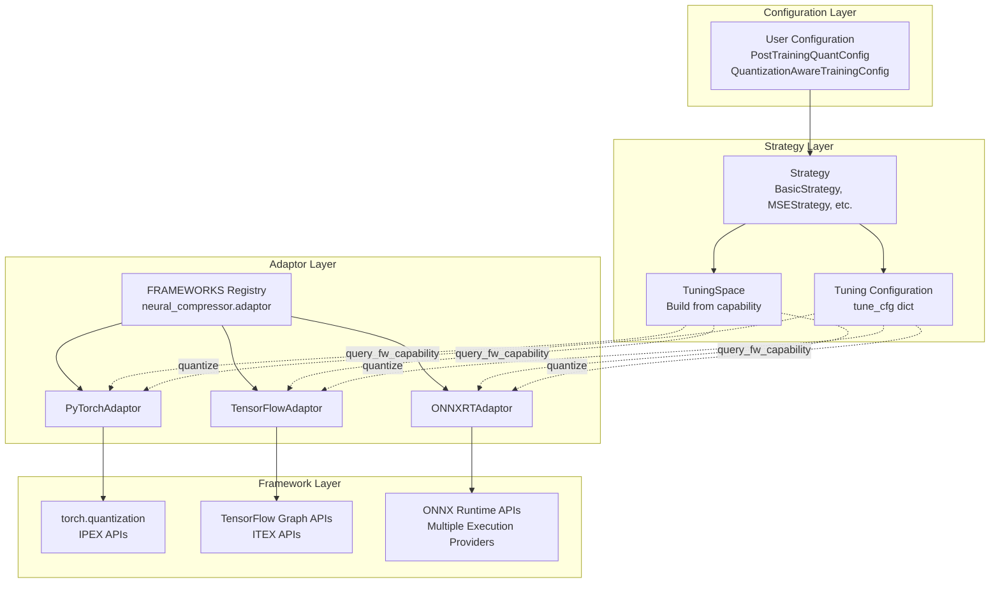
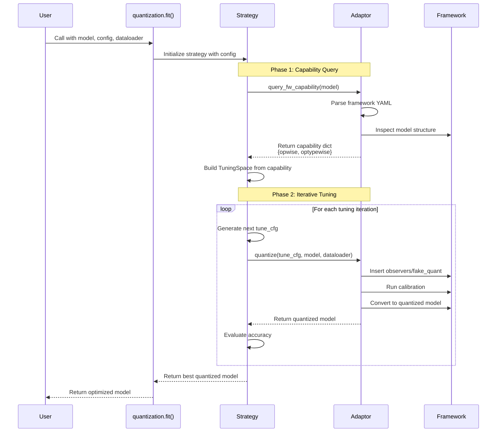
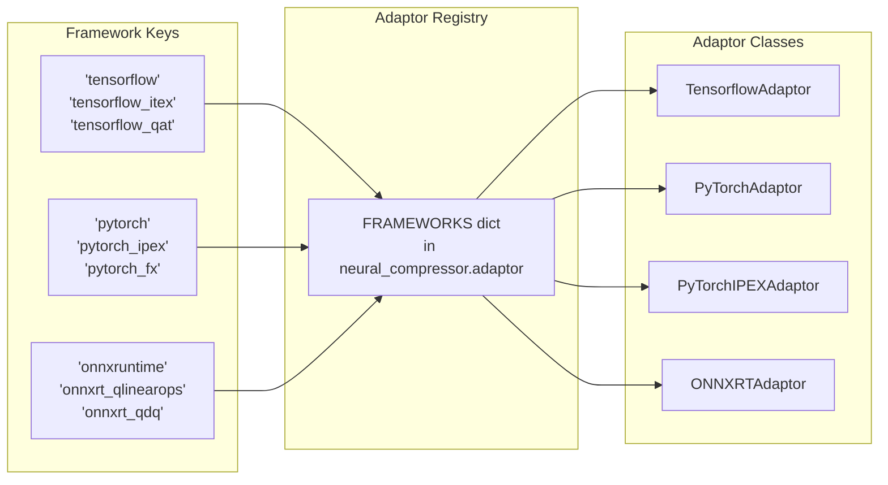
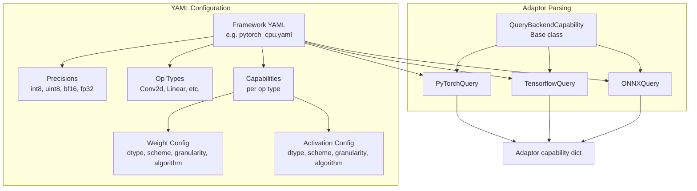
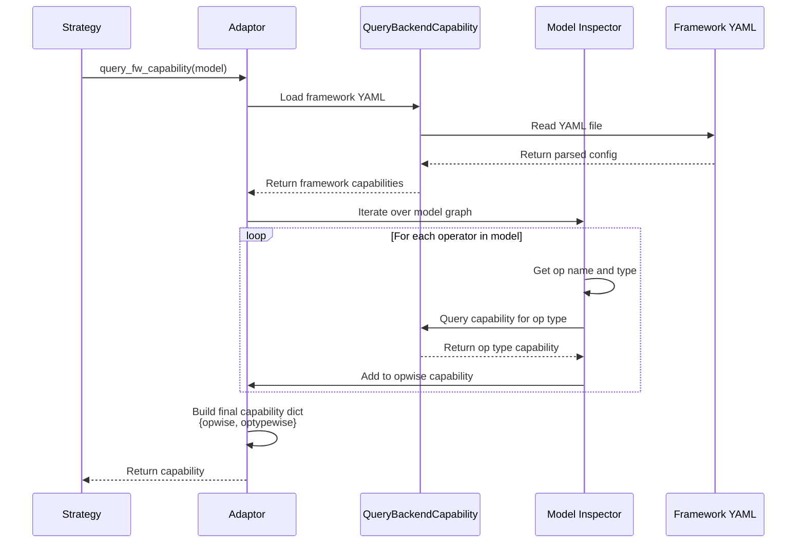
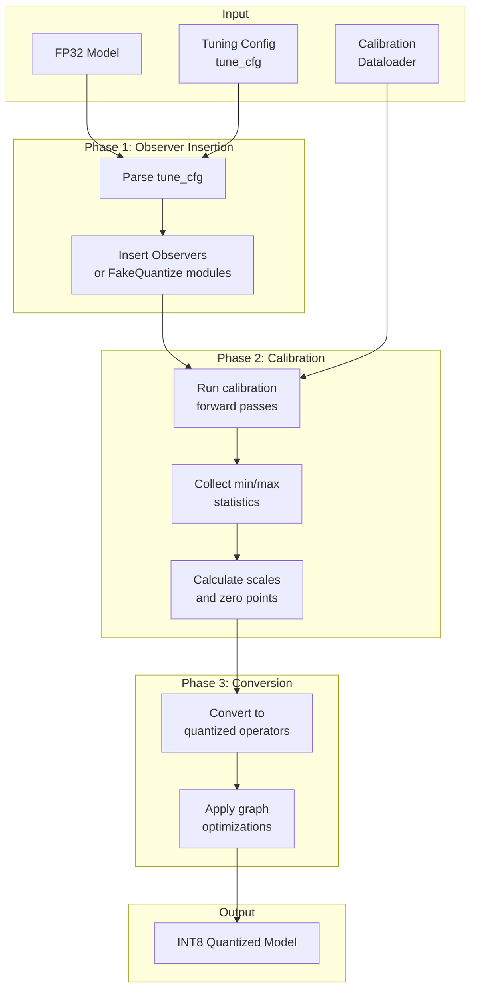
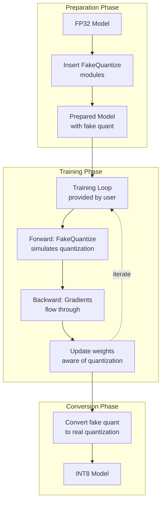
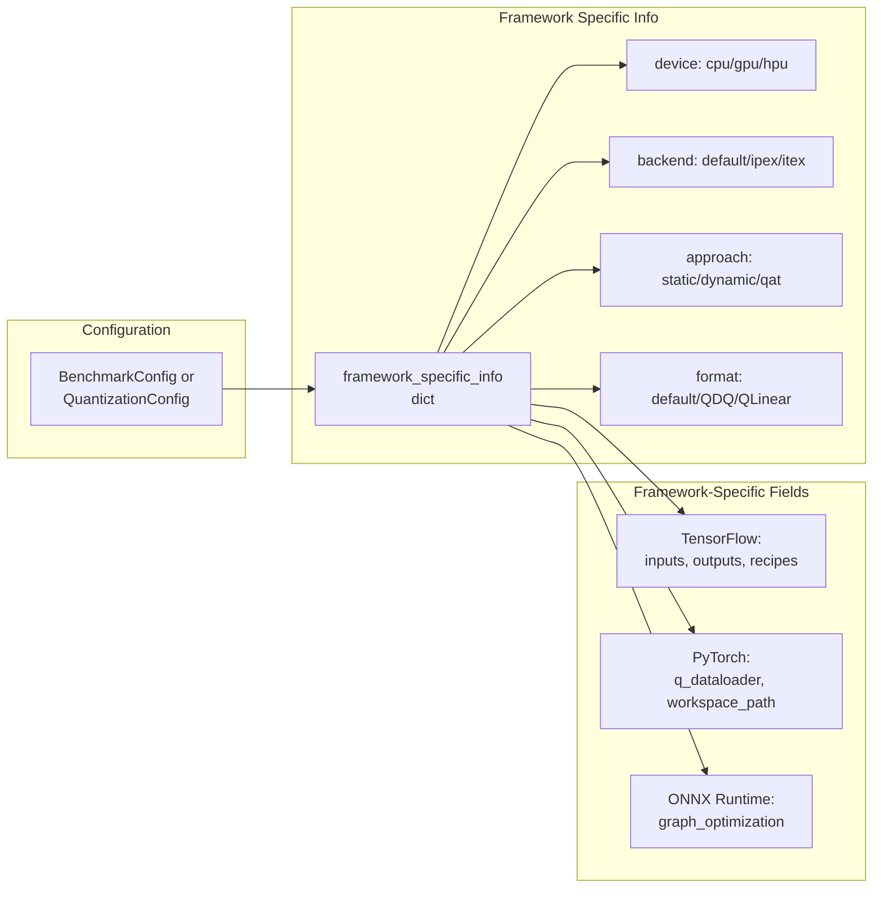

<!-- source: DeepWiki mcp.deepwiki.com · repo intel/neural-compressor · page 5 Framework Adaptors · fetched 2026-10-21 -->

# Framework Adaptors

<details>
<summary>Relevant source files</summary>

The following files were used as context for generating this wiki page:

- [README.md](README.md)
- [docs/source/add_new_adaptor.md](docs/source/add_new_adaptor.md)
- [docs/source/add_new_data_type.md](docs/source/add_new_data_type.md)
- [docs/source/calibration.md](docs/source/calibration.md)
- [docs/source/examples_readme.md](docs/source/examples_readme.md)
- [docs/source/framework_yaml.md](docs/source/framework_yaml.md)
- [docs/source/infrastructure.md](docs/source/infrastructure.md)
- [docs/source/mixed_precision.md](docs/source/mixed_precision.md)
- [docs/source/publication_list.md](docs/source/publication_list.md)
- [docs/source/quantization.md](docs/source/quantization.md)
- [docs/source/quantization_mixed_precision.md](docs/source/quantization_mixed_precision.md)
- [examples/README.md](examples/README.md)
- [neural_compressor/benchmark.py](neural_compressor/benchmark.py)
- [neural_compressor/config.py](neural_compressor/config.py)
- [neural_compressor/mix_precision.py](neural_compressor/mix_precision.py)
- [neural_compressor/model/model.py](neural_compressor/model/model.py)
- [neural_compressor/quantization.py](neural_compressor/quantization.py)
- [neural_compressor/training.py](neural_compressor/training.py)
- [neural_compressor/utils/utility.py](neural_compressor/utils/utility.py)
- [test/adaptor/pytorch_adaptor/test_adaptor_security.py](test/adaptor/pytorch_adaptor/test_adaptor_security.py)

</details>


## Purpose and Scope

Framework Adaptors serve as the abstraction layer between Intel® Neural Compressor's tuning strategies and native framework quantization APIs. This document covers the overall adaptor architecture, the common APIs that all adaptors implement, and the framework capability system. For detailed information about specific framework implementations, see [PyTorch Adaptor](#5.1), [TensorFlow Adaptor](#5.2), and [ONNX Runtime Adaptor](#5.3).

The adaptor layer enables Neural Compressor to support multiple deep learning frameworks (TensorFlow, PyTorch, ONNX Runtime) and their extensions (IPEX, ITEX, TensorRT) through a unified interface. Each adaptor translates framework-agnostic tuning configurations into framework-specific quantization operations.

## Adaptor Architecture Overview

### Position in System Architecture

Framework Adaptors occupy a critical position in the Neural Compressor architecture, bridging the high-level tuning strategies with low-level framework implementations:



**Sources:** [neural_compressor/quantization.py:158-200](), [docs/source/add_new_adaptor.md:20-42]()

### Adaptor Lifecycle

The adaptor follows a well-defined lifecycle during the quantization process:



**Sources:** [neural_compressor/quantization.py:33-241](), [docs/source/add_new_adaptor.md:20-43]()

## Framework Support Matrix

Neural Compressor supports multiple frameworks through dedicated adaptors. The framework detection and adaptor selection happens automatically:

| Framework | Adaptor Class | Backend Options | Model Detection |
|-----------|--------------|-----------------|-----------------|
| PyTorch | `PyTorchAdaptor` | `default` (Eager/FX), `ipex` | `torch.nn.Module`, `torch.fx.GraphModule`, `torch.jit.RecursiveScriptModule` |
| TensorFlow | `TensorflowAdaptor` | `default`, `itex` | `tf.Graph`, GraphDef, SavedModel, Keras Model |
| ONNX Runtime | `ONNXRTAdaptor` | `default`, `onnxrt_trt_ep`, `onnxrt_cuda_ep`, `onnxrt_dnnl_ep`, `onnxrt_dml_ep` | ONNX ModelProto, `.onnx` file path |

**Sources:** [neural_compressor/model/model.py:51-63](), [neural_compressor/model/model.py:66-147]()

### Adaptor Registry and Factory

The `FRAMEWORKS` registry maps framework names to adaptor classes:



The framework is automatically detected using `get_model_fwk_name()` which inspects the model object type and attempts to load it with each framework's APIs.

**Sources:** [neural_compressor/model/model.py:66-147](), [neural_compressor/benchmark.py:162-178]()

## Core Adaptor APIs

Every adaptor must implement a standard interface. The key methods are:

### 1. query_fw_capability

Returns the quantization capabilities of the framework for a given model.

**Method Signature:**
```python
def query_fw_capability(self, model) -> dict
```

**Return Format:**
```python
{
    'opwise': {
        ('layer1.0.conv1', 'Conv2d'): [
            {
                'weight': {
                    'dtype': ['int8'],
                    'scheme': ['sym'],
                    'granularity': ['per_channel'],
                    'algorithm': ['minmax']
                },
                'activation': {
                    'dtype': ['uint8'],
                    'scheme': ['asym'],
                    'granularity': ['per_tensor'],
                    'algorithm': ['minmax', 'kl']
                }
            },
            {'weight': {'dtype': ['fp32']}, 'activation': {'dtype': ['fp32']}},
            {'weight': {'dtype': ['bf16']}, 'activation': {'dtype': ['bf16']}}
        ],
        # ... other ops
    },
    'optypewise': {
        'Conv2d': {
            'weight': {
                'dtype': ['int8'],
                'scheme': ['sym'],
                'granularity': ['per_channel'],
                'algorithm': ['minmax']
            },
            'activation': {
                'dtype': ['uint8'],
                'scheme': ['asym'],
                'granularity': ['per_tensor'],
                'algorithm': ['minmax', 'kl']
            }
        },
        # ... other op types
    }
}
```

The capability dictionary has two sections:
- **opwise**: Per-operator instance capabilities (keyed by `(op_name, op_type)` tuple)
- **optypewise**: Per-operator type capabilities (keyed by op type string)

Each capability lists possible configurations including data types, quantization schemes (symmetric/asymmetric), granularity (per-channel/per-tensor), and calibration algorithms (minmax/kl/percentile).

**Sources:** [docs/source/add_new_adaptor.md:46-105]()

### 2. quantize

Applies quantization to the model based on the tuning configuration.

**Method Signature:**
```python
def quantize(self, tune_cfg, model, dataloader, q_func=None) -> BaseModel
```

**Parameters:**
- `tune_cfg`: Dictionary mapping operators to their quantization configuration
- `model`: The model to quantize (BaseModel wrapper)
- `dataloader`: Calibration data loader
- `q_func`: Optional training function for QAT mode

**Tuning Configuration Format:**
```python
tune_cfg = {
    'op': {
        ('conv1', 'Conv2d'): {
            'weight': {
                'dtype': 'int8',
                'scheme': 'sym',
                'granularity': 'per_channel',
                'algorithm': 'minmax'
            },
            'activation': {
                'dtype': 'uint8',
                'scheme': 'asym',
                'granularity': 'per_tensor',
                'algorithm': 'kl'
            }
        },
        # ... configurations for other ops
    },
    'calib_iteration': 100,
    'calib_sampling_size': 100
}
```

The `quantize` method:
1. Parses the `tune_cfg` to determine which operators to quantize and how
2. Inserts observers or fake quantization nodes in the model
3. Runs calibration using the provided dataloader
4. Converts the model to use quantized operators
5. Returns the quantized model

**Sources:** [docs/source/add_new_adaptor.md:46-51](), [neural_compressor/quantization.py:43-241]()

### 3. evaluate

Evaluates the model using the provided evaluation function or dataloader.

**Method Signature:**
```python
def evaluate(self, model, dataloader, postprocess, metrics, measurer, iteration, tensorboard, fp32_baseline)
```

This method wraps the user's evaluation function and measures accuracy and performance metrics.

**Sources:** [neural_compressor/benchmark.py:140-213]()

## Framework Capability System

### Framework YAML Files

Each framework defines its capabilities in a YAML file that specifies:
- Supported operator types for each precision
- Quantization schemes (symmetric/asymmetric)
- Granularity options (per-channel/per-tensor)
- Calibration algorithms (minmax/kl/percentile)



**Example YAML structure:**

```yaml
version:
  name: ['1.13.0', '2.0.0']

precisions:
  names: int8, uint8, bf16, fp32

ops:
  int8: ['Conv2d', 'Linear', 'LSTM']
  fp32: ['*']

capabilities:
  int8:
    Conv2d:
      weight:
        dtype: ['int8']
        scheme: ['sym']
        granularity: ['per_channel', 'per_tensor']
        algorithm: ['minmax']
      activation:
        dtype: ['uint8']
        scheme: ['asym', 'sym']
        granularity: ['per_tensor']
        algorithm: ['minmax', 'kl']
```

**Sources:** [docs/source/framework_yaml.md:1-194](), [docs/source/add_new_adaptor.md:52-54]()

### Capability Query Flow



**Sources:** [docs/source/add_new_adaptor.md:20-43]()

## Quantization Process Flow

The quantization process varies by approach (PTQ, QAT, dynamic) but follows a general pattern:

### Post-Training Static Quantization (PTQ)



**PyTorch PTQ Example Flow:**
1. Parse `tune_cfg` to identify ops to quantize
2. Insert `torch.quantization.observer` modules or `FakeQuantize` modules
3. Run calibration using dataloader
4. Compute quantization parameters from collected statistics
5. Convert to quantized operators using `torch.quantization.convert`
6. Apply backend-specific optimizations (e.g., operator fusion)

**TensorFlow PTQ Example Flow:**
1. Parse `tune_cfg` and build quantization config
2. Insert `QuantizeV2` and `Dequantize` ops in graph
3. Insert calibration nodes to collect min/max values
4. Run calibration on dataloader
5. Freeze calibration values and optimize graph
6. Fuse quantization ops with compute ops

**Sources:** [docs/source/quantization.md:94-117](), [docs/source/add_new_adaptor.md:107-134]()

### Quantization-Aware Training (QAT)

For QAT, the adaptor inserts fake quantization nodes during training:



**Sources:** [docs/source/quantization.md:114-117](), [neural_compressor/training.py:38-194]()

## Backend Selection and Configuration

### Backend Configuration

Different backends are specified via the `backend` parameter in the configuration:

```python
# PyTorch Default (Eager/FX mode)
conf = PostTrainingQuantConfig(backend='default')

# PyTorch IPEX
conf = PostTrainingQuantConfig(backend='ipex')

# TensorFlow ITEX
conf = PostTrainingQuantConfig(backend='itex')

# ONNX Runtime with different execution providers
conf = PostTrainingQuantConfig(backend='onnxrt_cuda_ep')  # CUDA
conf = PostTrainingQuantConfig(backend='onnxrt_dnnl_ep')  # DNNL
conf = PostTrainingQuantConfig(backend='onnxrt_trt_ep')   # TensorRT
```

**Sources:** [neural_compressor/config.py:261-357]()

### Backend-Specific Information

Adaptors receive backend-specific configuration through `framework_specific_info`:



**Example for PyTorch:**
```python
framework_specific_info = {
    'device': 'cpu',
    'approach': 'post_training_static_quant',
    'random_seed': 1978,
    'backend': 'ipex',
    'format': 'default',
    'workspace_path': './nc_workspace',
    'q_dataloader': None
}
```

**Example for ONNX Runtime:**
```python
framework_specific_info = {
    'device': 'gpu',
    'backend': 'onnxrt_cuda_ep',
    'workspace_path': './nc_workspace',
    'graph_optimization': {
        'level': 'ENABLE_EXTENDED',
        'disabled_optimizers': []
    }
}
```

**Sources:** [neural_compressor/benchmark.py:155-175](), [neural_compressor/training.py:95-106]()

## Adaptor Initialization and Registration

### Adaptor Factory Pattern

The adaptor selection happens through the `FRAMEWORKS` registry:

```python
from neural_compressor.adaptor import FRAMEWORKS

# Framework detection from model
framework = get_model_fwk_name(model)  # Returns 'pytorch', 'tensorflow', 'onnxruntime'

# Adaptor instantiation
adaptor = FRAMEWORKS[framework](framework_specific_info)
```

The registry maps framework strings to adaptor classes and handles backend variants:

- `'pytorch'` → `PyTorchAdaptor` (Eager mode)
- `'pytorch_ipex'` → `PyTorchIPEXAdaptor`
- `'pytorch_fx'` → `PyTorchFXAdaptor`
- `'tensorflow'` → `TensorflowAdaptor`
- `'tensorflow_itex'` → `TensorflowAdaptor` (with ITEX backend)
- `'onnxruntime'` → `ONNXRTAdaptor`

**Sources:** [neural_compressor/benchmark.py:162-178](), [neural_compressor/model/model.py:51-63]()

### Model Wrapping

Before being passed to adaptors, raw models are wrapped in Neural Compressor's `Model` class:

```python
from neural_compressor.model import Model

wrapped_model = Model(raw_model, conf=config)
```

The `Model` wrapper:
- Provides a unified interface across frameworks
- Stores framework-specific metadata (input/output names, etc.)
- Manages model serialization and deserialization

**Sources:** [neural_compressor/model/model.py:150-253](), [neural_compressor/quantization.py:149]()

## Summary

Framework Adaptors serve as the critical abstraction layer that enables Neural Compressor to support multiple deep learning frameworks through a unified interface. Key characteristics:

1. **Standardized API**: All adaptors implement `query_fw_capability()` and `quantize()` methods
2. **Framework-Specific Logic**: Each adaptor handles the nuances of its target framework
3. **Backend Flexibility**: Single frameworks can have multiple backend implementations (e.g., PyTorch with default/IPEX/FX)
4. **Capability-Driven**: Adaptors declare what quantization configurations are possible through capability dictionaries
5. **Configuration Translation**: Adaptors translate framework-agnostic tuning configurations into framework-specific operations

The adaptor layer allows Neural Compressor's strategies to remain framework-agnostic while still leveraging the native quantization capabilities of each framework.

**Sources:** [docs/source/add_new_adaptor.md:1-134](), [neural_compressor/quantization.py:1-242](), [neural_compressor/benchmark.py:1-448]()

---

