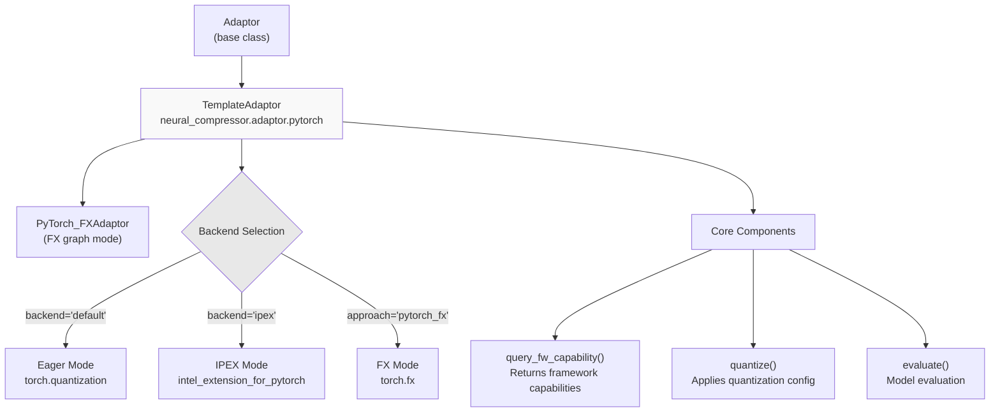
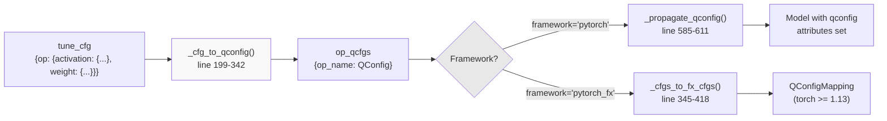
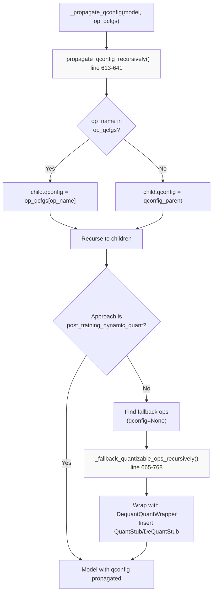
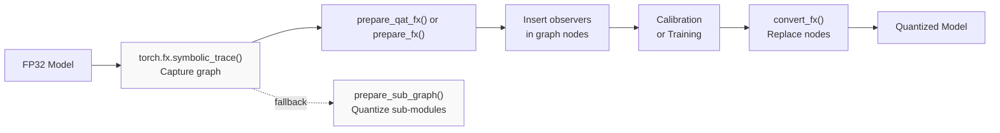
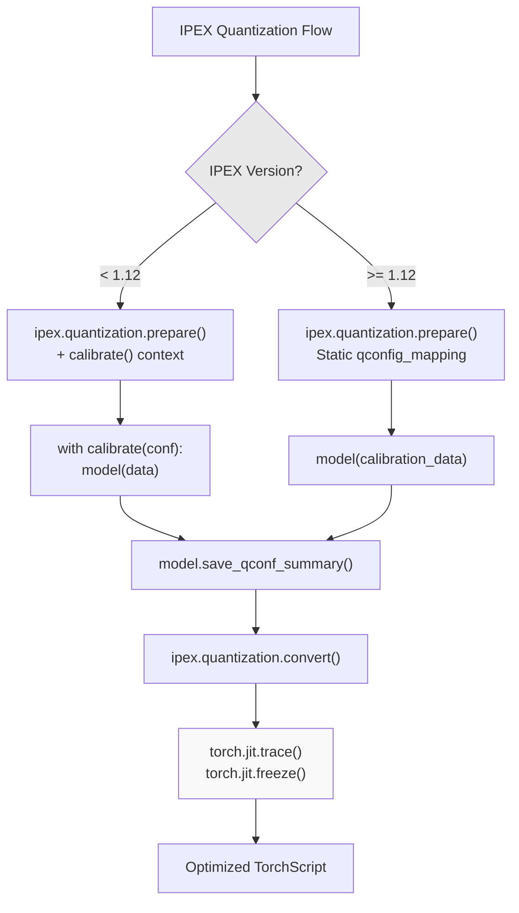
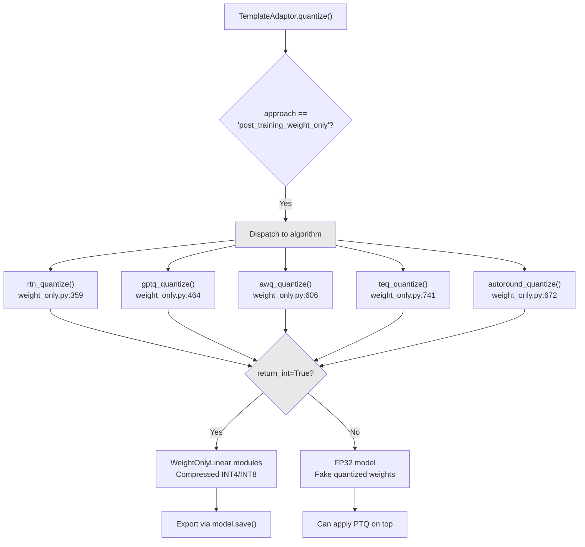
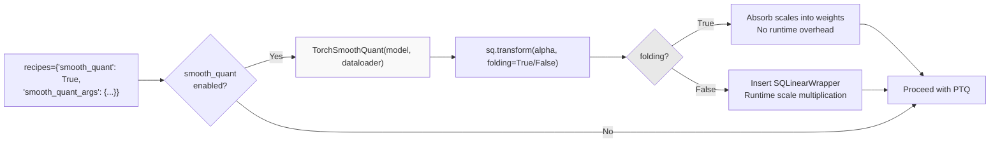
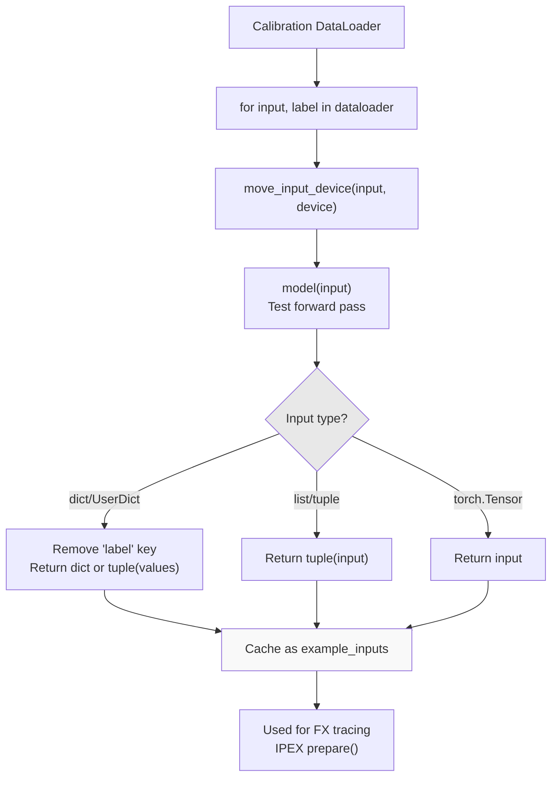
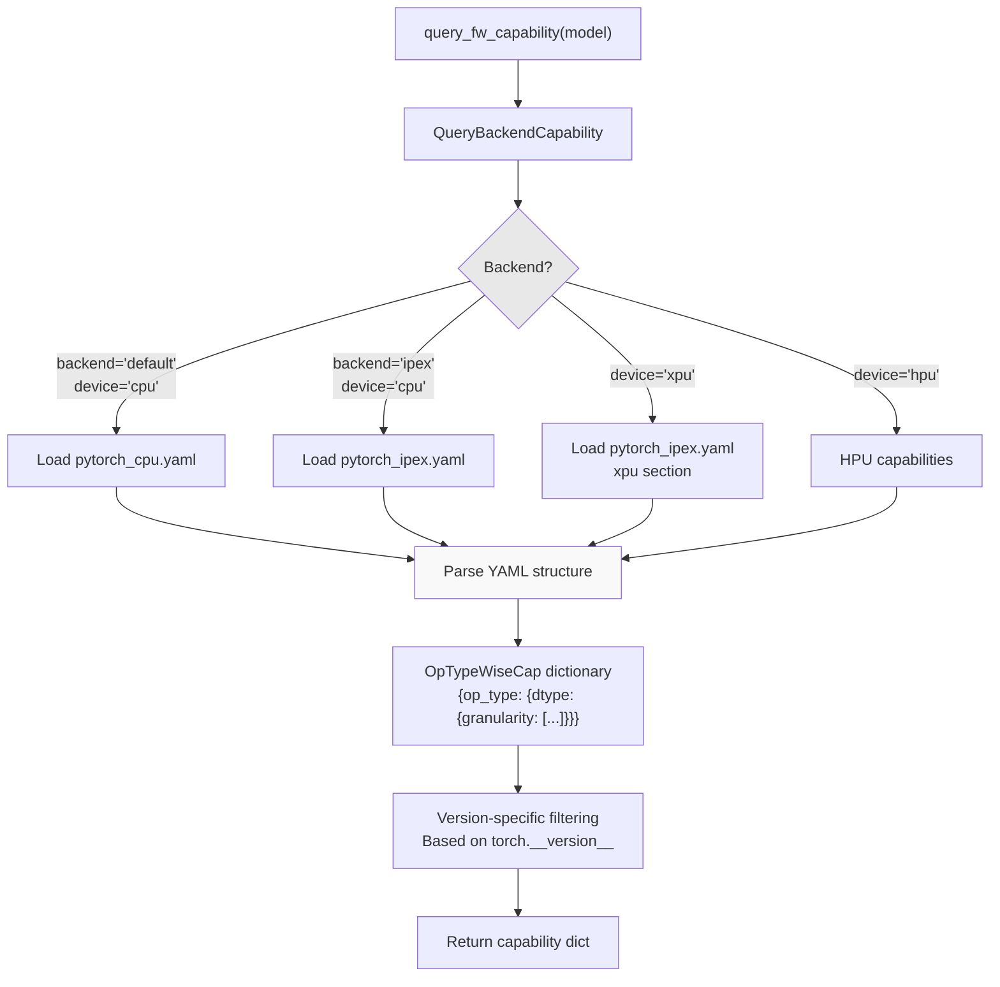
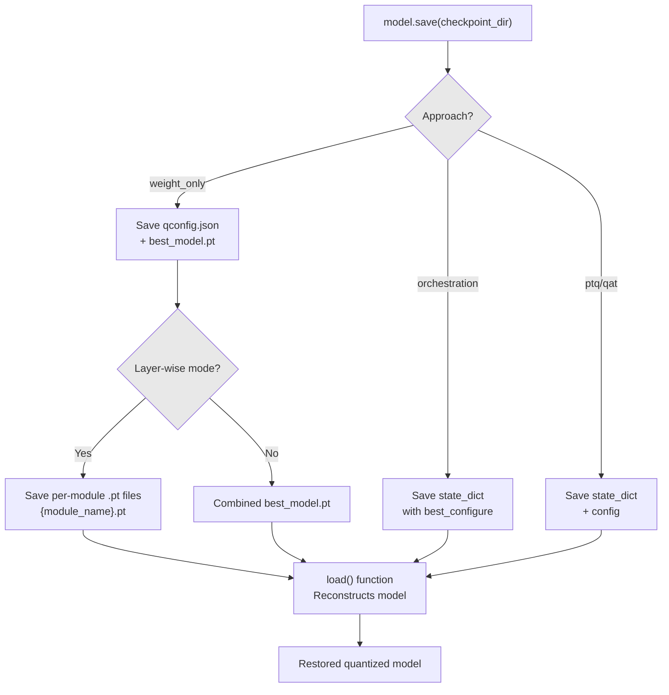

<!-- source: DeepWiki mcp.deepwiki.com · repo intel/neural-compressor · page 5.1 PyTorch Adaptor · fetched 2026-10-21 -->

# PyTorch Adaptor

<details>
<summary>Relevant source files</summary>

The following files were used as context for generating this wiki page:

- [README.md](README.md)
- [docs/source/add_new_adaptor.md](docs/source/add_new_adaptor.md)
- [docs/source/add_new_data_type.md](docs/source/add_new_data_type.md)
- [docs/source/calibration.md](docs/source/calibration.md)
- [docs/source/examples_readme.md](docs/source/examples_readme.md)
- [docs/source/framework_yaml.md](docs/source/framework_yaml.md)
- [docs/source/infrastructure.md](docs/source/infrastructure.md)
- [docs/source/mixed_precision.md](docs/source/mixed_precision.md)
- [docs/source/publication_list.md](docs/source/publication_list.md)
- [docs/source/quantization.md](docs/source/quantization.md)
- [docs/source/quantization_mixed_precision.md](docs/source/quantization_mixed_precision.md)
- [docs/source/quantization_weight_only.md](docs/source/quantization_weight_only.md)
- [examples/README.md](examples/README.md)
- [neural_compressor/adaptor/pytorch.py](neural_compressor/adaptor/pytorch.py)
- [neural_compressor/adaptor/pytorch_cpu.yaml](neural_compressor/adaptor/pytorch_cpu.yaml)
- [neural_compressor/adaptor/pytorch_ipex.yaml](neural_compressor/adaptor/pytorch_ipex.yaml)
- [neural_compressor/adaptor/torch_utils/awq.py](neural_compressor/adaptor/torch_utils/awq.py)
- [neural_compressor/adaptor/torch_utils/bf16_convert.py](neural_compressor/adaptor/torch_utils/bf16_convert.py)
- [neural_compressor/adaptor/torch_utils/model_wrapper.py](neural_compressor/adaptor/torch_utils/model_wrapper.py)
- [neural_compressor/adaptor/torch_utils/teq.py](neural_compressor/adaptor/torch_utils/teq.py)
- [neural_compressor/adaptor/torch_utils/util.py](neural_compressor/adaptor/torch_utils/util.py)
- [neural_compressor/adaptor/torch_utils/weight_only.py](neural_compressor/adaptor/torch_utils/weight_only.py)
- [neural_compressor/algorithm/smooth_quant.py](neural_compressor/algorithm/smooth_quant.py)
- [neural_compressor/model/torch_model.py](neural_compressor/model/torch_model.py)
- [neural_compressor/utils/pytorch.py](neural_compressor/utils/pytorch.py)
- [test/adaptor/pytorch_adaptor/test_adaptor_pytorch_2x.py](test/adaptor/pytorch_adaptor/test_adaptor_pytorch_2x.py)
- [test/algorithm/test_smooth_quant.py](test/algorithm/test_smooth_quant.py)
- [test/ipex/test_adaptor_ipex.py](test/ipex/test_adaptor_ipex.py)
- [test/quantization/test_weight_only_quantization.py](test/quantization/test_weight_only_quantization.py)
- [test/utils/test_huggingface.py](test/utils/test_huggingface.py)

</details>


## Purpose and Scope

The PyTorch Adaptor is the framework-specific component that bridges Intel® Neural Compressor's quantization strategies with PyTorch's native quantization APIs. It translates high-level quantization configurations from the tuning system into PyTorch-specific qconfig objects, manages the prepare-calibrate-convert workflow, and provides multiple backend implementations (Eager, FX, IPEX) to support different execution modes and hardware targets.

For information about other framework adaptors, see [TensorFlow Adaptor](#5.2) and [ONNX Runtime Adaptor](#5.3). For quantization techniques that the adaptor enables, see [Post-Training Quantization](#6.1) and [Weight-Only Quantization](#6.3).

---

## Adaptor Architecture

### Class Hierarchy

The PyTorch adaptor uses an inheritance-based design with `TemplateAdaptor` as the base class and specialized adaptors for different PyTorch execution modes.



**Diagram: PyTorch Adaptor Class Structure and Backend Selection**

The `TemplateAdaptor` class [neural_compressor/adaptor/pytorch.py:772-1518]() serves as the primary implementation for all PyTorch quantization workflows. It contains:
- Backend selection logic based on `framework_specific_info['backend']` and `framework_specific_info['approach']`
- Device management (CPU, XPU, HPU)
- Workspace and model management
- Recipe handling (e.g., SmoothQuant parameters)

Sources: [neural_compressor/adaptor/pytorch.py:772-820]()

---

## Configuration Translation System

### From Tune Config to QConfig

The adaptor translates Neural Compressor's internal tune configuration format into PyTorch's `QConfig` objects through a multi-step process:



**Diagram: Configuration Translation Pipeline**

### QConfig Construction

The `_cfg_to_qconfig` function [neural_compressor/adaptor/pytorch.py:199-342]() constructs PyTorch `QConfig` objects by:

1. **Observer Creation**: Uses `_observer()` [neural_compressor/adaptor/pytorch.py:421-509]() to create activation and weight observers based on:
   - Algorithm: `minmax` → `MinMaxObserver`, `kl` → `HistogramObserver`
   - Scheme: `sym` → symmetric qscheme, `asym` → asymmetric qscheme
   - Granularity: `per_channel` or `per_tensor`
   - Dtype: `torch.qint8`, `torch.quint8`, or `torch.float` (for placeholder)

2. **Fake Quantize Creation** (QAT mode): Uses `_fake_quantize()` [neural_compressor/adaptor/pytorch.py:512-582]() to create `FakeQuantize` modules for quantization-aware training.

3. **Special Cases Handling**:
   - Dynamic quantization: Creates `QConfigDynamic` for LSTM, Embedding layers
   - BF16 ops: Sets `qconfig=None` and adds to `bf16_ops_list`
   - FP32 fallback: Sets `qconfig=None`

| Operator Type | Static PTQ | Dynamic PTQ | QAT |
|---------------|------------|-------------|-----|
| Linear, Conv2d | `QConfig(activation_observer, weight_observer)` | `QConfigDynamic(weight=weight_observer)` | `QConfig(activation_fake_quant, weight_fake_quant)` |
| Embedding, LSTM | N/A | `QConfigDynamic` or `float_qparams_weight_only_qconfig` | `QConfigDynamic` |
| Other ops | `QConfig` with observers | Not supported | `QConfig` with fake quants |

Sources: [neural_compressor/adaptor/pytorch.py:199-342](), [neural_compressor/adaptor/pytorch.py:421-509](), [neural_compressor/adaptor/pytorch.py:512-582]()

---

## QConfig Propagation Mechanism

### Eager Mode Propagation

For Eager mode, qconfig propagation assigns qconfig attributes to each module in the model hierarchy:



**Diagram: Eager Mode QConfig Propagation Flow**

### Fallback Handling

When an operator is configured as FP32 (`qconfig=None`), but surrounding operators are INT8, the adaptor uses `DequantQuantWrapper` [neural_compressor/adaptor/pytorch.py:678-768]() to:
1. Add `DeQuantStub` to dequantize inputs
2. Execute the FP32 operation
3. Add `QuantStub` to requantize outputs

This prevents dtype mismatches in the execution graph.

### FX Mode Configuration

For FX mode (PyTorch >= 1.8), `_cfgs_to_fx_cfgs()` [neural_compressor/adaptor/pytorch.py:345-418]() creates:
- PyTorch 1.8-1.12: Dictionary with `{"": default_qconfig, "module_name": [(name, qconfig), ...]}`
- PyTorch >= 1.13: `QConfigMapping` object with `set_global()`, `set_module_name()`, `set_object_type()` methods

Sources: [neural_compressor/adaptor/pytorch.py:585-641](), [neural_compressor/adaptor/pytorch.py:665-768](), [neural_compressor/adaptor/pytorch.py:345-418]()

---

## Backend-Specific Implementations

### Eager Backend (Default)

The default backend uses PyTorch's eager mode quantization APIs:

| Phase | API | Purpose |
|-------|-----|---------|
| Prepare | `torch.quantization.prepare(model, inplace=True)` | Inserts observers into model |
| Calibrate | `model(calibration_data)` | Observers collect statistics |
| Convert | `torch.quantization.convert(model, inplace=True)` | Replaces modules with quantized versions |

**Key characteristics:**
- Module-level granularity
- Supports all operator types in `get_torch_white_list()` [neural_compressor/adaptor/pytorch.py:65-87]()
- Requires manual qconfig propagation via `_propagate_qconfig()`

Implementation: [neural_compressor/adaptor/pytorch.py:1057-1282]()

### FX Backend

FX backend uses symbolic tracing to capture computation graph:



**Diagram: FX Backend Workflow**

**Advantages:**
- Finer-grained control at node level
- Automatic fusion detection
- Better optimization opportunities

**Fallback mechanism**: If entire model tracing fails, `prepare_sub_graph()` [neural_compressor/adaptor/pytorch.py:2169-2272]() quantizes individual sub-modules.

Implementation: [neural_compressor/adaptor/pytorch.py:1543-1934]()

### IPEX Backend

Intel Extension for PyTorch (IPEX) provides optimized quantization for Intel hardware:



**Diagram: IPEX Backend Quantization Workflow**

**IPEX-specific features:**
- OneDNN kernel optimization
- Static quantization configuration JSON (`ipex_config_path`)
- SmoothQuant scale injection via `update_sq_scale()` [neural_compressor/adaptor/torch_utils/util.py:504-536]()
- TorchScript export for deployment

**Configuration format** [neural_compressor/adaptor/torch_utils/util.py:384-441]():
```python
{
    "module_name": {
        "q_op_infos": {
            "op_id": {
                "fqn": "fully_qualified_name",
                "input_tensor_infos": [...],
                "weight_tensor_infos": [...],
                "activation_observer": {...}
            }
        }
    }
}
```

Implementation: [neural_compressor/adaptor/pytorch.py:1936-2520]()

Sources: [neural_compressor/adaptor/pytorch.py:1057-1282](), [neural_compressor/adaptor/pytorch.py:1543-1934](), [neural_compressor/adaptor/pytorch.py:1936-2520](), [neural_compressor/adaptor/torch_utils/util.py:504-536]()

---

## Advanced Integration Features

### Weight-Only Quantization Integration

The PyTorch adaptor integrates weight-only quantization algorithms through a unified interface:



**Diagram: Weight-Only Quantization Integration**

**Key integration points**:
1. **Algorithm selection**: Based on `weight_config` parameter
2. **Module replacement**: Linear layers → `WeightOnlyLinear` or `INCWeightOnlyLinear` [neural_compressor/adaptor/torch_utils/model_wrapper.py:341-584]()
3. **Calibration data**: Passed to algorithms via `q_dataloader`
4. **Example inputs**: Required for graph tracing in AWQ/TEQ

**Weight-only configuration storage** [neural_compressor/model/torch_model.py:330-371]():
- `qconfig.json`: Contains quantization parameters per layer
- `gptq_config.json`: GPTQ-specific parameters (optional)
- Layer-wise mode: Individual `.pt` files per module for large models

Sources: [neural_compressor/adaptor/torch_utils/weight_only.py:359-800](), [neural_compressor/adaptor/torch_utils/model_wrapper.py:341-584](), [neural_compressor/model/torch_model.py:330-371]()

### SmoothQuant Support

SmoothQuant is integrated as a pre-quantization transformation:



**Diagram: SmoothQuant Integration Flow**

**Implementation details**:
- **Alpha parameter**: Controls activation-weight smoothing balance [0, 1]
  - `alpha='auto'`: Automatically searches optimal alpha per layer
  - `alpha=0.5`: Default fixed value
- **Folding modes**:
  - `folding=True`: Scales absorbed into preceding layer weights (Eager mode default)
  - `folding=False`: Scales applied at runtime via `SQLinearWrapper` (IPEX mode required)
- **IPEX integration**: Scales injected into IPEX config via `update_sq_scale()` [neural_compressor/adaptor/torch_utils/util.py:504-536]()

Sources: [test/algorithm/test_smooth_quant.py:732-811](), [neural_compressor/adaptor/torch_utils/util.py:504-536](), [neural_compressor/adaptor/pytorch.py:809-811]()

---

## Example Inputs Handling

The adaptor provides `get_example_inputs()` [neural_compressor/adaptor/pytorch.py:110-155]() to automatically extract example inputs from calibration dataloader:



**Diagram: Example Inputs Extraction Process**

**Use cases**:
1. **FX symbolic tracing**: Requires concrete inputs to trace computation graph
2. **IPEX prepare**: IPEX quantization APIs require `example_inputs` parameter
3. **Shape inference**: Some models need input shape information

**Version compatibility**:
- PyTorch < 1.12: Not supported for IPEX
- PyTorch 1.12-2.0: Returns `tuple(values)` for dict inputs
- PyTorch > 2.0: Returns `dict` for dict inputs (preserves key names)

Sources: [neural_compressor/adaptor/pytorch.py:110-155](), [neural_compressor/adaptor/torch_utils/util.py:34-58](), [neural_compressor/adaptor/torch_utils/util.py:61-86]()

---

## Capability Query System

The `query_fw_capability()` method returns framework-specific quantization capabilities:



**Diagram: Capability Query System**

### Capability Structure

The capability dictionary defines supported configurations per operator type:

```python
{
    'Linear': {
        'activation': {
            'dtype': ['uint8', 'fp32'],
            'scheme': ['asym', 'sym'],
            'granularity': ['per_tensor'],
            'algorithm': ['minmax', 'kl']
        },
        'weight': {
            'dtype': ['int8', 'fp32'],
            'scheme': ['sym'],
            'granularity': ['per_channel', 'per_tensor'],
            'algorithm': ['minmax']
        }
    },
    'Conv2d': {...},
    'default': {...}  # Fallback for unspecified ops
}
```

### YAML Configuration Files

| Backend | Device | YAML File | Key Features |
|---------|--------|-----------|--------------|
| default | CPU | `pytorch_cpu.yaml` | Native PyTorch capabilities, per version |
| ipex | CPU | `pytorch_ipex.yaml` | IPEX-optimized ops, OneDNN kernels |
| ipex | XPU | `pytorch_ipex.yaml` (xpu section) | GPU-specific quantization |
| default | HPU | Programmatic | FP8 quantization for Gaudi |

**Version-specific capabilities**: The YAML files contain multiple version entries (1.11, 1.12, 1.13, 2.0, etc.) to handle API changes across PyTorch versions [neural_compressor/adaptor/pytorch_cpu.yaml:17-20]().

Sources: [neural_compressor/adaptor/pytorch_cpu.yaml:1-300](), [neural_compressor/adaptor/pytorch_ipex.yaml:1-200](), [neural_compressor/adaptor/pytorch.py:844-938]()

---

## Model Wrapping and Export

### Model Wrapper Classes

The adaptor provides specialized wrapper classes for different quantization scenarios:

| Wrapper Class | Purpose | File Location |
|---------------|---------|---------------|
| `SQLinearWrapper` | SmoothQuant with runtime scaling | [model_wrapper.py:109-151]() |
| `WeightOnlyLinear` | Compressed weight-only quantization | [model_wrapper.py:341-584]() |
| `QDQLinear` | QDQ (Quantize-Dequantize) pattern | [model_wrapper.py:46-73]() |
| `MulLinear` | AWQ/TEQ scaling layer | [model_wrapper.py:154-205]() |
| `DequantQuantWrapper` | Fallback FP32 ops in INT8 graph | [pytorch.py:678-742]() |

### Export Workflow



**Diagram: Model Save and Load System**

**Loading process** [neural_compressor/utils/pytorch.py:256-400]():
1. Check for `qconfig.json` → weight-only mode
2. Check for `best_configure.yaml` → standard PTQ/QAT
3. Load appropriate modules based on detected format
4. Reconstruct qconfig and apply quantization

Sources: [neural_compressor/model/torch_model.py:323-377](), [neural_compressor/utils/pytorch.py:256-400](), [neural_compressor/adaptor/torch_utils/model_wrapper.py:46-584]()

---

## Summary

The PyTorch Adaptor serves as the critical translation layer between Neural Compressor's framework-agnostic quantization system and PyTorch's diverse quantization APIs. Its key responsibilities include:

1. **Configuration Translation**: Converting `tune_cfg` to PyTorch `QConfig` objects
2. **Backend Abstraction**: Supporting Eager, FX, and IPEX backends with unified interface
3. **Qconfig Propagation**: Managing hierarchical qconfig assignment and fallback handling
4. **Algorithm Integration**: Seamless integration of weight-only algorithms (RTN, GPTQ, AWQ, TEQ, AUTOROUND)
5. **Advanced Features**: SmoothQuant transformation, example inputs extraction, capability querying
6. **Model Export**: Flexible save/load system supporting various quantization modes

The adaptor's modular design enables Neural Compressor to leverage PyTorch's evolving quantization APIs while maintaining backward compatibility and providing a consistent user experience across different PyTorch versions and hardware backends.

Sources: [neural_compressor/adaptor/pytorch.py:1-2520](), [neural_compressor/adaptor/torch_utils/util.py:1-1200](), [neural_compressor/model/torch_model.py:1-700]()

---

