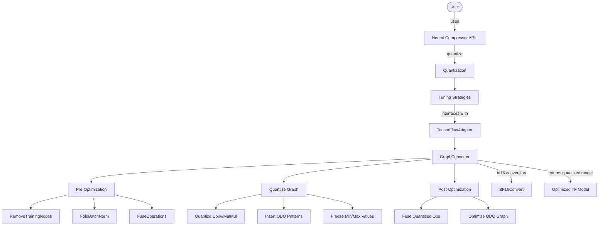
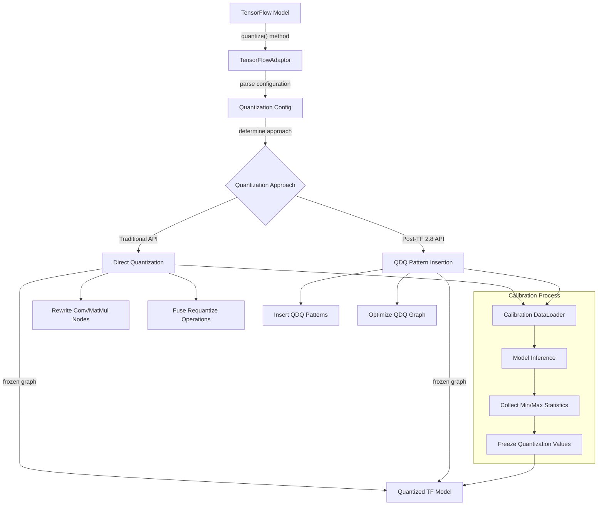
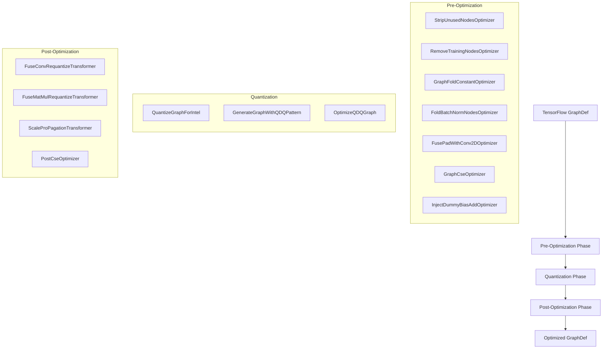
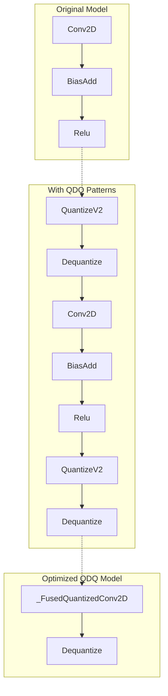
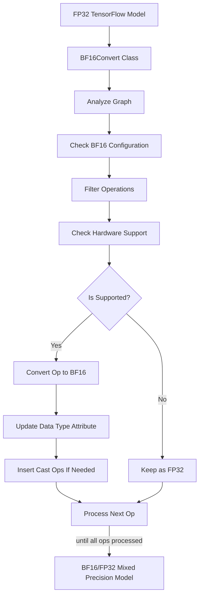
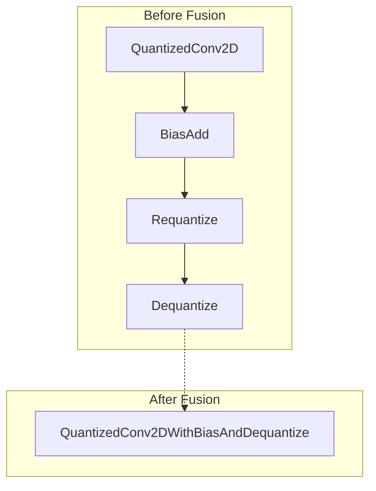
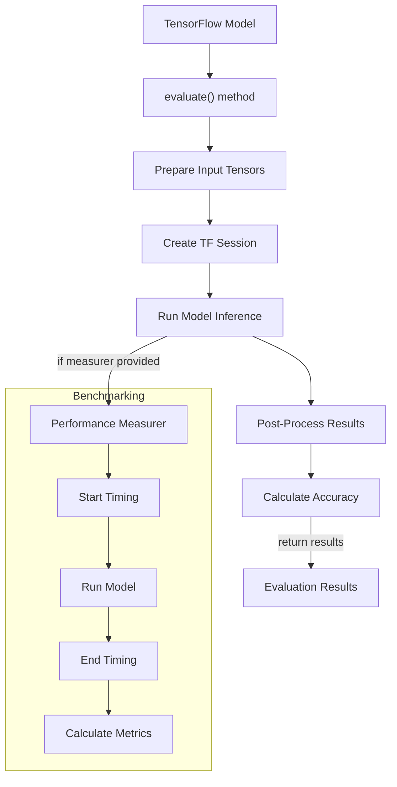

<!-- source: DeepWiki mcp.deepwiki.com · repo intel/neural-compressor · page 5.2 TensorFlow Adaptor · fetched 2026-10-21 -->

# TensorFlow Adaptor

Relevant source files

The following files were used as context for generating this wiki page:

- [README.md](README.md)
- [docs/source/add_new_adaptor.md](docs/source/add_new_adaptor.md)
- [docs/source/add_new_data_type.md](docs/source/add_new_data_type.md)
- [docs/source/calibration.md](docs/source/calibration.md)
- [docs/source/examples_readme.md](docs/source/examples_readme.md)
- [docs/source/framework_yaml.md](docs/source/framework_yaml.md)
- [docs/source/infrastructure.md](docs/source/infrastructure.md)
- [docs/source/mixed_precision.md](docs/source/mixed_precision.md)
- [docs/source/publication_list.md](docs/source/publication_list.md)
- [docs/source/quantization.md](docs/source/quantization.md)
- [docs/source/quantization_mixed_precision.md](docs/source/quantization_mixed_precision.md)
- [examples/README.md](examples/README.md)
- [neural_compressor/adaptor/tensorflow.py](neural_compressor/adaptor/tensorflow.py)
- [neural_compressor/adaptor/tensorflow.yaml](neural_compressor/adaptor/tensorflow.yaml)
- [neural_compressor/adaptor/tf_utils/graph_converter.py](neural_compressor/adaptor/tf_utils/graph_converter.py)
- [neural_compressor/adaptor/tf_utils/graph_converter_without_calib.py](neural_compressor/adaptor/tf_utils/graph_converter_without_calib.py)
- [neural_compressor/adaptor/tf_utils/graph_rewriter/bf16/bf16_convert.py](neural_compressor/adaptor/tf_utils/graph_rewriter/bf16/bf16_convert.py)
- [neural_compressor/adaptor/tf_utils/graph_rewriter/generic/convert_add_to_biasadd.py](neural_compressor/adaptor/tf_utils/graph_rewriter/generic/convert_add_to_biasadd.py)
- [neural_compressor/adaptor/tf_utils/graph_rewriter/generic/dilated_contraction.py](neural_compressor/adaptor/tf_utils/graph_rewriter/generic/dilated_contraction.py)
- [neural_compressor/adaptor/tf_utils/graph_rewriter/generic/dummy_biasadd.py](neural_compressor/adaptor/tf_utils/graph_rewriter/generic/dummy_biasadd.py)
- [neural_compressor/adaptor/tf_utils/graph_rewriter/generic/fetch_weight_from_reshape.py](neural_compressor/adaptor/tf_utils/graph_rewriter/generic/fetch_weight_from_reshape.py)
- [neural_compressor/adaptor/tf_utils/graph_rewriter/generic/fuse_pad_with_conv.py](neural_compressor/adaptor/tf_utils/graph_rewriter/generic/fuse_pad_with_conv.py)
- [neural_compressor/adaptor/tf_utils/graph_rewriter/generic/fuse_pad_with_fp32_conv.py](neural_compressor/adaptor/tf_utils/graph_rewriter/generic/fuse_pad_with_fp32_conv.py)
- [neural_compressor/adaptor/tf_utils/graph_rewriter/generic/insert_print_node.py](neural_compressor/adaptor/tf_utils/graph_rewriter/generic/insert_print_node.py)
- [neural_compressor/adaptor/tf_utils/graph_rewriter/generic/pre_optimize.py](neural_compressor/adaptor/tf_utils/graph_rewriter/generic/pre_optimize.py)
- [neural_compressor/adaptor/tf_utils/graph_rewriter/generic/rename_batch_norm.py](neural_compressor/adaptor/tf_utils/graph_rewriter/generic/rename_batch_norm.py)
- [neural_compressor/adaptor/tf_utils/graph_rewriter/generic/split_shared_input.py](neural_compressor/adaptor/tf_utils/graph_rewriter/generic/split_shared_input.py)
- [neural_compressor/adaptor/tf_utils/graph_rewriter/int8/freeze_value.py](neural_compressor/adaptor/tf_utils/graph_rewriter/int8/freeze_value.py)
- [neural_compressor/adaptor/tf_utils/graph_rewriter/int8/fuse_conv_redundant_dequantize.py](neural_compressor/adaptor/tf_utils/graph_rewriter/int8/fuse_conv_redundant_dequantize.py)
- [neural_compressor/adaptor/tf_utils/graph_rewriter/int8/fuse_conv_requantize.py](neural_compressor/adaptor/tf_utils/graph_rewriter/int8/fuse_conv_requantize.py)
- [neural_compressor/adaptor/tf_utils/graph_rewriter/int8/fuse_matmul_requantize.py](neural_compressor/adaptor/tf_utils/graph_rewriter/int8/fuse_matmul_requantize.py)
- [neural_compressor/adaptor/tf_utils/graph_rewriter/qdq/insert_qdq_pattern.py](neural_compressor/adaptor/tf_utils/graph_rewriter/qdq/insert_qdq_pattern.py)
- [neural_compressor/adaptor/tf_utils/graph_util.py](neural_compressor/adaptor/tf_utils/graph_util.py)
- [neural_compressor/adaptor/tf_utils/quantize_graph/qdq/fuse_qdq_concatv2.py](neural_compressor/adaptor/tf_utils/quantize_graph/qdq/fuse_qdq_concatv2.py)
- [neural_compressor/adaptor/tf_utils/quantize_graph/qdq/fuse_qdq_conv.py](neural_compressor/adaptor/tf_utils/quantize_graph/qdq/fuse_qdq_conv.py)
- [neural_compressor/adaptor/tf_utils/quantize_graph/qdq/fuse_qdq_matmul.py](neural_compressor/adaptor/tf_utils/quantize_graph/qdq/fuse_qdq_matmul.py)
- [neural_compressor/adaptor/tf_utils/quantize_graph/qdq/fuse_qdq_pooling.py](neural_compressor/adaptor/tf_utils/quantize_graph/qdq/fuse_qdq_pooling.py)
- [neural_compressor/adaptor/tf_utils/quantize_graph/qdq/optimize_qdq.py](neural_compressor/adaptor/tf_utils/quantize_graph/qdq/optimize_qdq.py)
- [neural_compressor/adaptor/tf_utils/quantize_graph/quantize_graph_base.py](neural_compressor/adaptor/tf_utils/quantize_graph/quantize_graph_base.py)
- [neural_compressor/adaptor/tf_utils/quantize_graph/quantize_graph_conv.py](neural_compressor/adaptor/tf_utils/quantize_graph/quantize_graph_conv.py)
- [neural_compressor/adaptor/tf_utils/quantize_graph/quantize_graph_for_intel_cpu.py](neural_compressor/adaptor/tf_utils/quantize_graph/quantize_graph_for_intel_cpu.py)
- [neural_compressor/adaptor/tf_utils/quantize_graph/quantize_graph_matmul.py](neural_compressor/adaptor/tf_utils/quantize_graph/quantize_graph_matmul.py)
- [neural_compressor/adaptor/tf_utils/quantize_graph_common.py](neural_compressor/adaptor/tf_utils/quantize_graph_common.py)
- [neural_compressor/adaptor/tf_utils/transform_graph/rerange_quantized_concat.py](neural_compressor/adaptor/tf_utils/transform_graph/rerange_quantized_concat.py)
- [neural_compressor/adaptor/tf_utils/util.py](neural_compressor/adaptor/tf_utils/util.py)

The TensorFlow Adaptor is a core component of the Intel Neural Compressor (INC) that enables quantization, optimization, and benchmarking of TensorFlow models. This adaptor translates between INC's framework-agnostic API and TensorFlow's specific implementation, handling graph transformations, quantization techniques, and hardware-specific optimizations for Intel platforms.

## Architecture Overview

The TensorFlow Adaptor follows a modular architecture that bridges INC's optimization strategies with TensorFlow's graph representation and execution model.

Sources: [neural_compressor/adaptor/tensorflow.py:58-139](neural_compressor/adaptor/tensorflow.py:58-139), [neural_compressor/adaptor/tf_utils/graph_converter.py:92-191](neural_compressor/adaptor/tf_utils/graph_converter.py:92-191)

Key components include:

- **TensorFlowAdaptor**: The main class that implements the Adaptor interface for TensorFlow models
- **GraphConverter**: Handles the transformation and optimization of TensorFlow graphs
- **Graph Rewriters**: Modules that implement specific graph transformations
- **Quantization Implementation**: Modules for converting operations to their quantized versions

## Quantization Process

The TensorFlow Adaptor supports multiple quantization approaches:

Sources: [neural_compressor/adaptor/tensorflow.py:551-717](neural_compressor/adaptor/tensorflow.py:551-717), [neural_compressor/adaptor/tf_utils/graph_converter.py:416-616](neural_compressor/adaptor/tf_utils/graph_converter.py:416-616)

The quantization workflow:

1. **Configuration Parsing**: Converts INC's configuration to TensorFlow-specific settings
2. **Approach Selection**: Decides between traditional or QDQ pattern approach based on TensorFlow version and configuration
3. **Graph Transformation**: Applies pre-optimization, quantization, and post-optimization transformations
4. **Calibration**: Uses a provided dataset to determine optimal quantization parameters
5. **Value Freezing**: Freezes the min/max values for quantization
6. **Fusion Operations**: Fuses operations like quantized convolution with requantization

## Graph Transformation Details

Graph transformation is the core of the TensorFlow Adaptor's functionality and consists of several phases:

Sources: [neural_compressor/adaptor/tf_utils/graph_rewriter/generic/pre_optimize.py:103-130](neural_compressor/adaptor/tf_utils/graph_rewriter/generic/pre_optimize.py:103-130), [neural_compressor/adaptor/tf_utils/graph_converter.py:416-467](neural_compressor/adaptor/tf_utils/graph_converter.py:416-467)

Key transformation steps:

1. **Pre-Optimization**:
   - Removes unused and training-only nodes
   - Folds constant operations and batch normalization
   - Fuses operations like padding with convolution
   - Optimizes the graph through common subexpression elimination
   - Injects dummy bias add operations to enable fusion patterns

2. **Quantization**:
   - For traditional approach: directly quantizes operations like convolution and matrix multiplication
   - For QDQ approach: inserts quantize-dequantize patterns around operations
   - Freezes quantization parameters based on calibration data

3. **Post-Optimization**:
   - Fuses quantized operations with requantization operations
   - Propagates scales through the graph
   - Optimizes the graph further with quantization-aware common subexpression elimination

## QDQ Pattern Approach

For TensorFlow versions 2.8+ and SPR-BASE, the adaptor uses the QDQ (Quantize-Dequantize) pattern approach:

Sources: [neural_compressor/adaptor/tf_utils/graph_rewriter/qdq/insert_qdq_pattern.py:34-194](neural_compressor/adaptor/tf_utils/graph_rewriter/qdq/insert_qdq_pattern.py:34-194), [neural_compressor/adaptor/tf_utils/quantize_graph/qdq/fuse_qdq_conv.py:29-130](neural_compressor/adaptor/tf_utils/quantize_graph/qdq/fuse_qdq_conv.py:29-130)

The QDQ pattern workflow:

1. **Pattern Insertion**: Inserts QuantizeV2 and Dequantize nodes around operations like Conv2D, MatMul
2. **Weight Quantization**: Quantizes weights by adding QDQ patterns around weight inputs
3. **Optimization**: Fuses the QDQ patterns with operations to create optimized quantized operations
4. **Pattern Merging**: Merges consecutive QDQ patterns to reduce computational overhead

## BF16 Conversion

The TensorFlow Adaptor supports BF16 (Brain Float 16) conversion for compatible operations:

Sources: [neural_compressor/adaptor/tf_utils/graph_rewriter/bf16/bf16_convert.py:42-131](neural_compressor/adaptor/tf_utils/graph_rewriter/bf16/bf16_convert.py:42-131), [neural_compressor/adaptor/tf_utils/graph_converter.py:619-637](neural_compressor/adaptor/tf_utils/graph_converter.py:619-637)

BF16 conversion process:

1. **Configuration Check**: Checks the configuration to determine which operations should be converted to BF16
2. **Operation Filtering**: Filters operations based on the BF16 operation list in `tensorflow.yaml`
3. **Hardware Support Verification**: Verifies that the operation has BF16 kernel support
4. **Type Conversion**: Updates the data type attributes of operations to BF16
5. **Cast Operation Insertion**: Inserts cast operations to maintain compatibility between FP32 and BF16 operations

## Operation Fusion

A key optimization in the TensorFlow Adaptor is the fusion of operations to reduce computational overhead:

Sources: [neural_compressor/adaptor/tf_utils/graph_rewriter/int8/fuse_conv_requantize.py:29-68](neural_compressor/adaptor/tf_utils/graph_rewriter/int8/fuse_conv_requantize.py:29-68), [neural_compressor/adaptor/tf_utils/graph_rewriter/int8/fuse_matmul_requantize.py:31-202](neural_compressor/adaptor/tf_utils/graph_rewriter/int8/fuse_matmul_requantize.py:31-202)

Key fusion patterns include:

1. **Conv2D Fusion**:
   - `QuantizedConv2D + Requantize` → `QuantizedConv2DAndRequantize`
   - `QuantizedConv2D + BiasAdd + Requantize` → `QuantizedConv2DWithBiasAndRequantize`
   - `QuantizedConv2D + BiasAdd + Relu + Requantize` → `QuantizedConv2DWithBiasAndReluAndRequantize`

2. **MatMul Fusion**:
   - `QuantizedMatMul + Requantize` → `QuantizedMatMulAndRequantize`
   - `QuantizedMatMul + BiasAdd + Requantize` → `QuantizedMatMulWithBiasAndRequantize`
   - `QuantizedMatMul + BiasAdd + Relu + Requantize` → `QuantizedMatMulWithBiasAndReluAndRequantize`

3. **Dequantize Fusion**:
   - `QuantizedOp + Requantize + Dequantize` → `QuantizedOpAndDequantize`

## Version Compatibility

The TensorFlow Adaptor handles different TensorFlow versions through configuration in `tensorflow.yaml`:

| Version Range | Features | Configuration |
|---------------|----------|--------------|
| SPR-BASE (2.11.0202242+) | Extended BF16 support, Enhanced INT8 | Full op support for bf16, int8, fp32 |
| 2.1.0 - 2.13.0 | BF16 support, INT8 support | Limited bf16 support, standard int8 support |
| 1.15.0 - 2.0.1 | Basic INT8 support | No bf16 support, basic int8 support |

Sources: [neural_compressor/adaptor/tensorflow.yaml:16-245](neural_compressor/adaptor/tensorflow.yaml:16-245), [neural_compressor/adaptor/tf_utils/graph_converter.py:313-367](neural_compressor/adaptor/tf_utils/graph_converter.py:313-367)

Version compatibility features:

- **Version Detection**: Detects the installed TensorFlow version and loads appropriate configurations
- **API Differences**: Handles differences between TensorFlow 1.x and 2.x APIs
- **Feature Detection**: Enables or disables features based on version capabilities
- **SPR-BASE Special Handling**: Provides special optimizations for Intel's SPR-BASE TensorFlow version

## Evaluation and Benchmarking

The TensorFlow Adaptor provides functionality for evaluating and benchmarking models:

Sources: [neural_compressor/adaptor/tensorflow.py:289-549](neural_compressor/adaptor/tensorflow.py:289-549)

Evaluation and benchmarking features:

1. **Model Evaluation**: Evaluates the model accuracy on a validation dataset
2. **Performance Measurement**: Measures throughput, latency, and other performance metrics
3. **TensorBoard Integration**: Supports logging tensor values for inspection in TensorBoard
4. **Custom Metrics**: Allows custom metric calculations for model evaluation
5. **Distributed Inference**: Supports distributed inference for better utilization of hardware resources

## Conclusion

The TensorFlow Adaptor is a crucial component of Intel Neural Compressor that bridges the gap between framework-agnostic optimization strategies and TensorFlow-specific implementations. It handles complex graph transformations, quantization, and optimization to improve the performance of TensorFlow models on Intel hardware while maintaining accuracy.

The adaptor's modular design allows it to support various TensorFlow versions and optimization techniques, making it a versatile tool for optimizing deep learning models for deployment on Intel platforms.

Sources: [neural_compressor/adaptor/tensorflow.py:58-139](neural_compressor/adaptor/tensorflow.py:58-139), [neural_compressor/adaptor/tf_utils/graph_converter.py:92-191](neural_compressor/adaptor/tf_utils/graph_converter.py:92-191)

---

