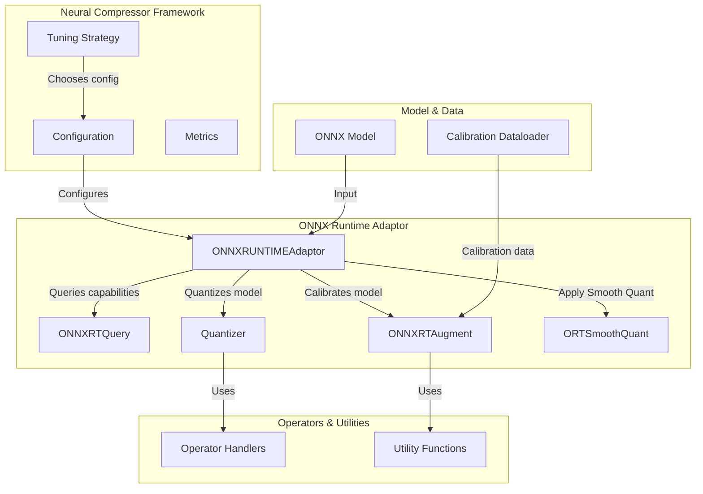
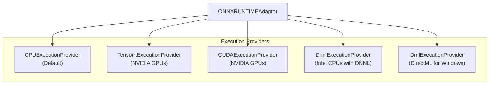
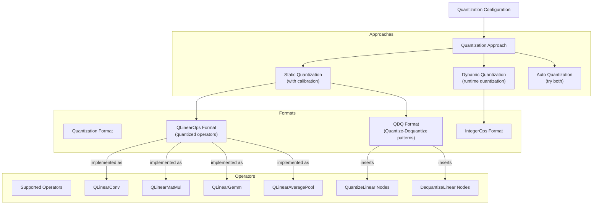
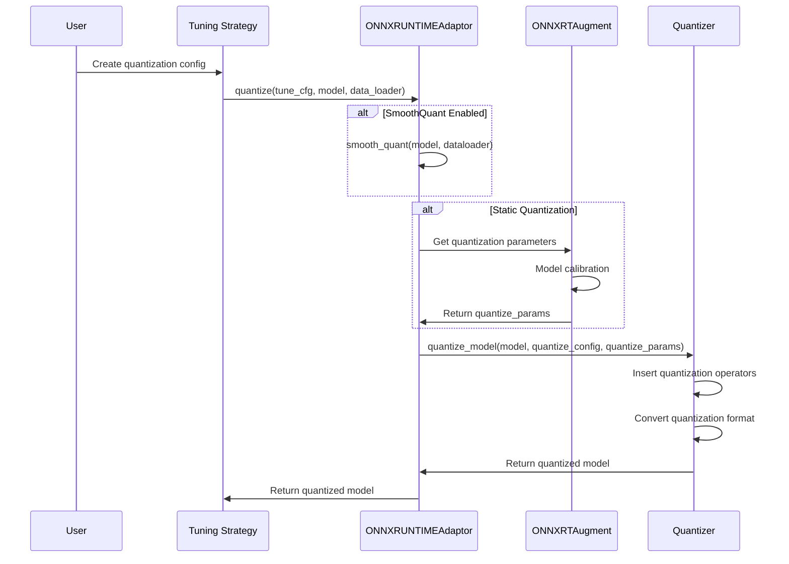
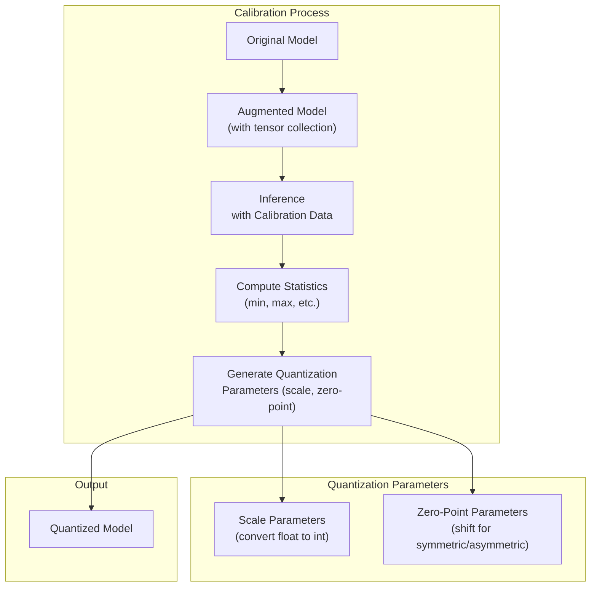
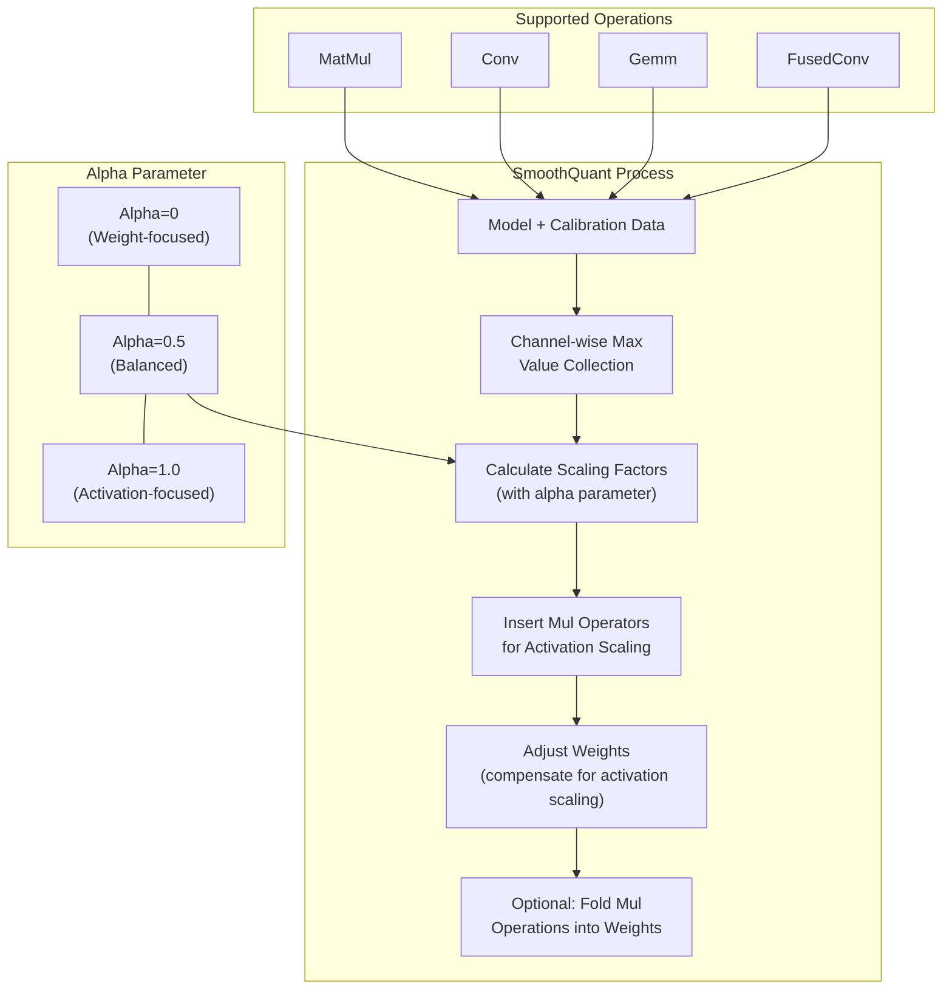
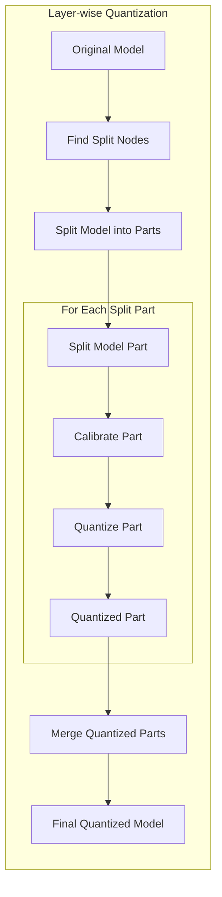
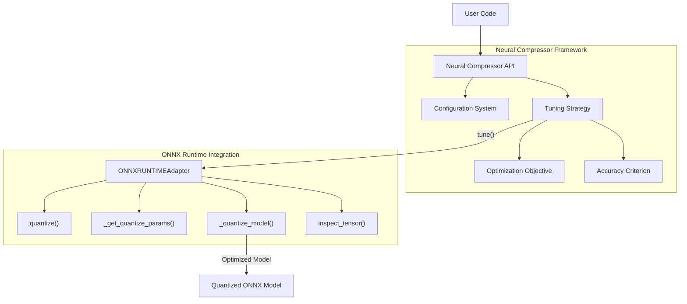

<!-- source: DeepWiki mcp.deepwiki.com · repo intel/neural-compressor · page 5.3 ONNX Runtime Adaptor · fetched 2026-10-21 -->

# ONNX Runtime Adaptor

<details>
<summary>Relevant source files</summary>

The following files were used as context for generating this wiki page:

- [README.md](README.md)
- [docs/source/add_new_adaptor.md](docs/source/add_new_adaptor.md)
- [docs/source/add_new_data_type.md](docs/source/add_new_data_type.md)
- [docs/source/calibration.md](docs/source/calibration.md)
- [docs/source/examples_readme.md](docs/source/examples_readme.md)
- [docs/source/framework_yaml.md](docs/source/framework_yaml.md)
- [docs/source/infrastructure.md](docs/source/infrastructure.md)
- [docs/source/mixed_precision.md](docs/source/mixed_precision.md)
- [docs/source/publication_list.md](docs/source/publication_list.md)
- [docs/source/quantization.md](docs/source/quantization.md)
- [docs/source/quantization_mixed_precision.md](docs/source/quantization_mixed_precision.md)
- [examples/README.md](examples/README.md)
- [neural_compressor/adaptor/onnxrt.py](neural_compressor/adaptor/onnxrt.py)
- [neural_compressor/adaptor/onnxrt.yaml](neural_compressor/adaptor/onnxrt.yaml)
- [neural_compressor/adaptor/onnxrt_cuda.yaml](neural_compressor/adaptor/onnxrt_cuda.yaml)
- [neural_compressor/adaptor/onnxrt_trt.yaml](neural_compressor/adaptor/onnxrt_trt.yaml)
- [neural_compressor/adaptor/ox_utils/calibration.py](neural_compressor/adaptor/ox_utils/calibration.py)
- [neural_compressor/adaptor/ox_utils/calibrator.py](neural_compressor/adaptor/ox_utils/calibrator.py)
- [neural_compressor/adaptor/ox_utils/operators/activation.py](neural_compressor/adaptor/ox_utils/operators/activation.py)
- [neural_compressor/adaptor/ox_utils/operators/binary_op.py](neural_compressor/adaptor/ox_utils/operators/binary_op.py)
- [neural_compressor/adaptor/ox_utils/operators/concat.py](neural_compressor/adaptor/ox_utils/operators/concat.py)
- [neural_compressor/adaptor/ox_utils/operators/conv.py](neural_compressor/adaptor/ox_utils/operators/conv.py)
- [neural_compressor/adaptor/ox_utils/operators/direct_q8.py](neural_compressor/adaptor/ox_utils/operators/direct_q8.py)
- [neural_compressor/adaptor/ox_utils/operators/gather.py](neural_compressor/adaptor/ox_utils/operators/gather.py)
- [neural_compressor/adaptor/ox_utils/operators/matmul.py](neural_compressor/adaptor/ox_utils/operators/matmul.py)
- [neural_compressor/adaptor/ox_utils/operators/maxpool.py](neural_compressor/adaptor/ox_utils/operators/maxpool.py)
- [neural_compressor/adaptor/ox_utils/operators/ops.py](neural_compressor/adaptor/ox_utils/operators/ops.py)
- [neural_compressor/adaptor/ox_utils/operators/pad.py](neural_compressor/adaptor/ox_utils/operators/pad.py)
- [neural_compressor/adaptor/ox_utils/operators/pooling.py](neural_compressor/adaptor/ox_utils/operators/pooling.py)
- [neural_compressor/adaptor/ox_utils/operators/reduce.py](neural_compressor/adaptor/ox_utils/operators/reduce.py)
- [neural_compressor/adaptor/ox_utils/operators/split.py](neural_compressor/adaptor/ox_utils/operators/split.py)
- [neural_compressor/adaptor/ox_utils/operators/unary_op.py](neural_compressor/adaptor/ox_utils/operators/unary_op.py)
- [neural_compressor/adaptor/ox_utils/quantizer.py](neural_compressor/adaptor/ox_utils/quantizer.py)
- [neural_compressor/adaptor/ox_utils/smooth_quant.py](neural_compressor/adaptor/ox_utils/smooth_quant.py)
- [neural_compressor/adaptor/ox_utils/util.py](neural_compressor/adaptor/ox_utils/util.py)
- [neural_compressor/model/onnx_model.py](neural_compressor/model/onnx_model.py)
- [test/adaptor/onnxrt_adaptor/test_adaptor_onnxrt.py](test/adaptor/onnxrt_adaptor/test_adaptor_onnxrt.py)
- [test/adaptor/onnxrt_adaptor/test_onnxrt_augment.py](test/adaptor/onnxrt_adaptor/test_onnxrt_augment.py)
- [test/adaptor/onnxrt_adaptor/test_onnxrt_operators.py](test/adaptor/onnxrt_adaptor/test_onnxrt_operators.py)
- [test/algorithm/test_smooth_quant_onnx.py](test/algorithm/test_smooth_quant_onnx.py)
- [test/model/test_onnx_model.py](test/model/test_onnx_model.py)

</details>


The ONNX Runtime Adaptor is a key component in the Intel Neural Compressor framework that enables quantization and optimization of ONNX models. This adaptor serves as the bridge between Neural Compressor's tuning strategies and the ONNX Runtime, providing a standardized interface for applying various quantization techniques to ONNX models.

## Overview and Architecture

The ONNX Runtime Adaptor integrates with the Neural Compressor's framework adaptor pattern to provide consistent quantization capabilities for ONNX models. It supports multiple execution providers, quantization formats, and optimization techniques.



Sources:
- [neural_compressor/adaptor/onnxrt.py:51-595](neural_compressor/adaptor/onnxrt.py:51-595)
- [neural_compressor/adaptor/ox_utils/quantizer.py:61-98](neural_compressor/adaptor/ox_utils/quantizer.py:61-98)
- [neural_compressor/adaptor/ox_utils/calibration.py:53-114](neural_compressor/adaptor/ox_utils/calibration.py:53-114)

## Supported Backend Providers

The ONNX Runtime Adaptor supports various execution providers (backends) for model execution, each optimized for different hardware targets.



Sources:
- [neural_compressor/adaptor/onnxrt.py:80-108](neural_compressor/adaptor/onnxrt.py:80-108)
- [neural_compressor/adaptor/ox_utils/util.py:79-95](neural_compressor/adaptor/ox_utils/util.py:79-95)

## Quantization Formats and Approaches

The ONNX Runtime Adaptor provides multiple quantization formats and approaches to accommodate different use cases and hardware targets.



Sources:
- [neural_compressor/adaptor/onnxrt.py:60-88](neural_compressor/adaptor/onnxrt.py:60-88)
- [neural_compressor/adaptor/ox_utils/quantizer.py:98-166](neural_compressor/adaptor/ox_utils/quantizer.py:98-166)

## Initialization and Configuration

The ONNXRUNTIMEAdaptor is initialized with framework-specific information that determines its behavior. This includes the quantization approach (static or dynamic), the backend execution provider, the quantization format, and various optimization recipes.

```python
# Example configuration for ONNX Runtime Adaptor
framework_specific_info = {
    "device": "cpu",  # Options: "cpu", "gpu", "npu"
    "approach": "post_training_static_quant",  # Or "post_training_dynamic_quant", "post_training_auto_quant"
    "backend": "default",  # Options: "default", "onnxrt_trt_ep", "onnxrt_cuda_ep", "onnxrt_dnnl_ep", "onnxrt_dml_ep"
    "domain": "auto",  # Options: "auto", "cv", "nlp", etc.
    "format": "qlinearops",  # Options: "qlinearops", "qdq"
    "workspace_path": "./workspace",
    "recipes": {
        "smooth_quant": False,  # Enable/disable smooth quantization
        "layer_wise_quant": False,  # Enable/disable layer-wise quantization
        "first_conv_or_matmul_quantization": True,  # Enable/disable first Conv/MatMul quantization
        "graph_optimization_level": "ENABLE_EXTENDED"  # ONNX graph optimization level
    }
}
```

Sources:
- [neural_compressor/adaptor/onnxrt.py:59-152](neural_compressor/adaptor/onnxrt.py:59-152)
- [neural_compressor/config.py:713-985](neural_compressor/config.py:713-985)

## Quantization Workflow

The quantization process in the ONNX Runtime Adaptor follows a specific workflow, which is illustrated below:



Sources:
- [neural_compressor/adaptor/onnxrt.py:254-442](neural_compressor/adaptor/onnxrt.py:254-442)
- [neural_compressor/adaptor/ox_utils/calibration.py:232-336](neural_compressor/adaptor/ox_utils/calibration.py:232-336)
- [neural_compressor/adaptor/ox_utils/quantizer.py:179-198](neural_compressor/adaptor/ox_utils/quantizer.py:179-198)

## Calibration and Quantization Parameters

Calibration is a critical step in static quantization that determines the optimal scale and zero-point values for quantization. The ONNXRTAugment class handles model calibration by:

1. Augmenting the model with nodes to collect tensor values
2. Running inference with calibration data
3. Computing statistics from the collected data
4. Determining quantization parameters (scale and zero-point)



Sources:
- [neural_compressor/adaptor/onnxrt.py:797-819](neural_compressor/adaptor/onnxrt.py:797-819)
- [neural_compressor/adaptor/ox_utils/calibration.py:232-336](neural_compressor/adaptor/ox_utils/calibration.py:232-336)
- [neural_compressor/adaptor/ox_utils/util.py:307-397](neural_compressor/adaptor/ox_utils/util.py:307-397)

## Smooth Quantization

The adaptor supports Smooth Quantization (SmoothQuant), an advanced quantization technique particularly useful for transformer models and LLMs. SmoothQuant balances the quantization difficulty between activations and weights to achieve better accuracy.



Sources:
- [neural_compressor/adaptor/onnxrt.py:168-237](neural_compressor/adaptor/onnxrt.py:168-237)
- [neural_compressor/adaptor/ox_utils/smooth_quant.py:144-194](neural_compressor/adaptor/ox_utils/smooth_quant.py:144-194)

## Layer-wise Quantization

For large models, the adaptor supports layer-wise quantization which splits the model into smaller parts, quantizes each part separately, and then merges them back.



Sources:
- [neural_compressor/adaptor/onnxrt.py:317-382](neural_compressor/adaptor/onnxrt.py:317-382)
- [neural_compressor/adaptor/onnxrt.py:444-513](neural_compressor/adaptor/onnxrt.py:444-513)

## Operator Support

The ONNX Runtime Adaptor supports quantization for a wide range of ONNX operators. Different backends and quantization approaches may support different sets of operators.

| Operator Type | Static Quantization | Dynamic Quantization | Weight-Only Quantization |
|---------------|---------------------|----------------------|--------------------------|
| Conv          | ✅                  | ✅                   | ✅                       |
| MatMul        | ✅                  | ✅                   | ✅                       |
| Gemm          | ✅                  | ✅                   | ✅                       |
| Gather        | ✅                  | ✅                   | ✅                       |
| LSTM          | ✅                  | ✅                   | ✅                       |
| Attention     | ✅                  | ✅                   | ✅                       |
| Concat        | ✅                  | ✅                   | ❌                       |
| AveragePool   | ✅                  | ❌                   | ❌                       |
| MaxPool       | ✅                  | ❌                   | ❌                       |
| Add           | ✅                  | ✅                   | ❌                       |
| Mul           | ✅                  | ✅                   | ❌                       |
| Relu          | ✅                  | ✅                   | ❌                       |
| Reshape       | ✅                  | ✅                   | ❌                       |
| Transpose     | ✅                  | ✅                   | ❌                       |

Sources:
- [neural_compressor/adaptor/onnxrt.yaml:34-517](neural_compressor/adaptor/onnxrt.yaml:34-517)
- [neural_compressor/adaptor/ox_utils/operators](neural_compressor/adaptor/ox_utils/operators)

## Statistics and Performance Metrics

The adaptor provides methods to analyze the quantized model and report statistics about the operators and their precision types.

```python
# Example output from _dump_model_op_stats
# ---------------------------------------------------------
# Mixed Precision Statistics
# ---------------------------------------------------------
# Op Type      | Total | INT8 | BF16 | FP16 | FP32
# ---------------------------------------------------------
# Conv         |   5   |   3  |   0  |   0  |   2  
# MatMul       |  10   |   8  |   0  |   0  |   2  
# Gemm         |   3   |   3  |   0  |   0  |   0  
# QuantizeLinear |  11 |  11  |   0  |   0  |   0  
# DequantizeLinear | 11 |  11  |   0  |   0  |   0  
# Relu         |   5   |   0  |   0  |   0  |   5  
# Add          |   4   |   0  |   0  |   0  |   4  
# ---------------------------------------------------------
```

Sources:
- [neural_compressor/adaptor/onnxrt.py:742-796](neural_compressor/adaptor/onnxrt.py:742-796)

## Integration with Neural Compressor

The ONNX Runtime Adaptor integrates with the broader Neural Compressor framework, particularly the tuning strategies. The following diagram shows this integration:



Sources:
- [neural_compressor/strategy/strategy.py:484-509](neural_compressor/strategy/strategy.py:484-509)
- [neural_compressor/adaptor/onnxrt.py:254-442](neural_compressor/adaptor/onnxrt.py:254-442)

## Advanced Features

### Model Recovery

The adaptor supports recovering a quantized model from a quantization configuration (`q_config`) without needing to rerun the calibration process. This is useful for deployment scenarios.

```python
def recover(model, q_config):
    """
    Recover quantized model from q_config without calibration
    """
    # Parse quantization parameters from q_config
    quantize_params, tune_cfg = self._parse_qconfig(q_config)
    
    # Convert to quantize config format used by quantizer
    quantize_config = self._cfg_to_quantize_config(tune_cfg)
    
    # Quantize the model using loaded parameters
    model = self._quantize_model(model, quantize_config, quantize_params)
    
    return model
```

Sources:
- [neural_compressor/adaptor/onnxrt.py:603-719](neural_compressor/adaptor/onnxrt.py:603-719)

### Tensor Inspection

The adaptor provides functionality to inspect tensors within the model, which is useful for debugging and analysis purposes.

```python
def inspect_tensor(model, dataloader, op_list, iteration_list, 
                   inspect_type="activation", save_to_disk=False):
    """
    Inspect tensor values during model execution
    """
    # Create augmented model with tensor extraction nodes
    augment = ONNXRTAugment(model, dataloader, op_list)
    augment.augment_graph()
    
    # Run model to collect tensor values
    session = create_session(augment.augmented_model)
    results = run_model(session, dataloader, iteration_list)
    
    return results
```

Sources:
- [neural_compressor/adaptor/onnxrt.py:822-903](neural_compressor/adaptor/onnxrt.py:822-903)

## Conclusion

The ONNX Runtime Adaptor provides a comprehensive interface for quantizing and optimizing ONNX models within the Neural Compressor framework. It supports multiple quantization formats, backends, and optimization techniques. By leveraging the ONNX Runtime's ecosystem and extending it with advanced quantization capabilities, the adaptor enables significant performance improvements while maintaining model accuracy.

For more information about other adaptors in Neural Compressor, see:
- PyTorch Adaptor [#4.1](#4.1)
- TensorFlow Adaptor [#4.2](#4.2)

For information about specific quantization techniques, see:
- Post-Training Quantization [#5.1](#5.1)
- Weight-Only Quantization [#5.2](#5.2)

---

