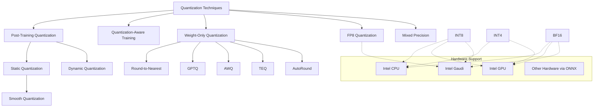
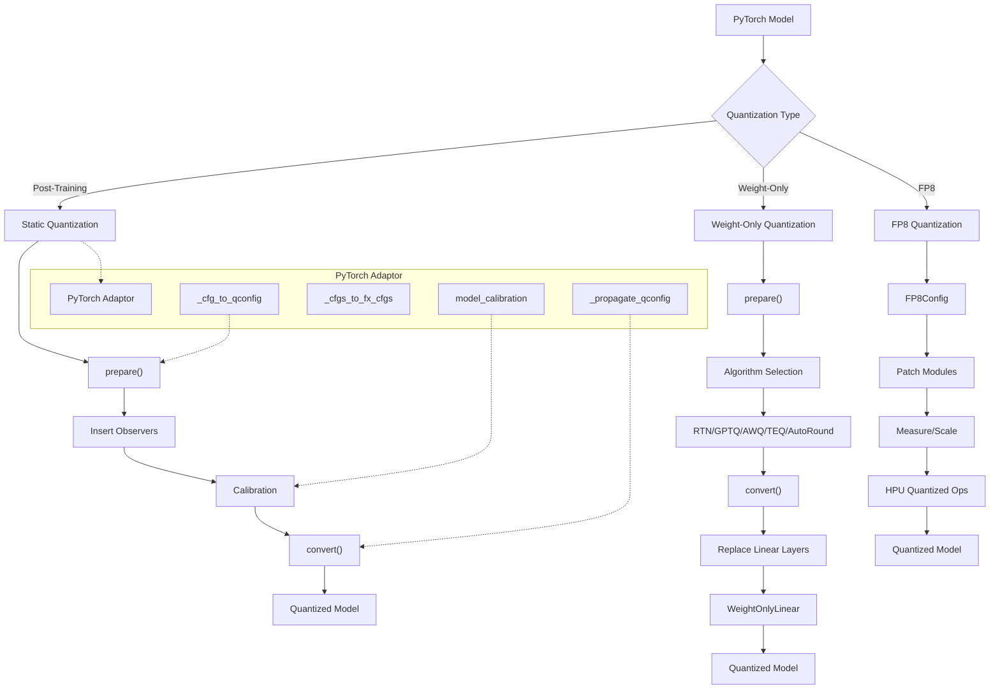
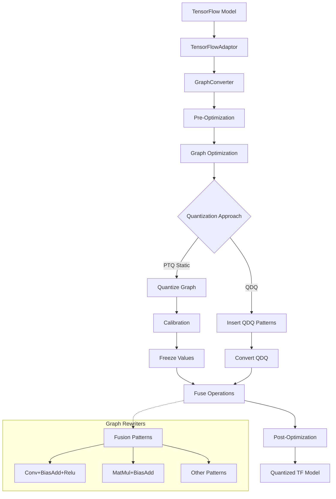
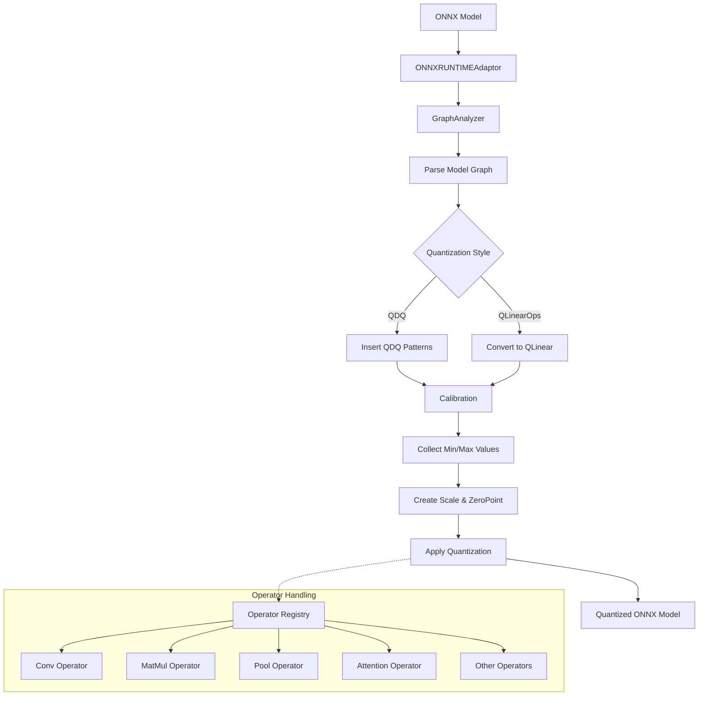
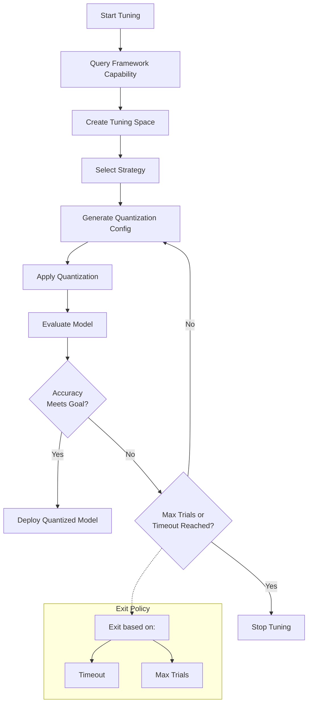

<!-- source: DeepWiki mcp.deepwiki.com · repo intel/neural-compressor · page 6 Quantization Techniques · fetched 2026-10-21 -->

# Quantization Techniques

<details>
<summary>Relevant source files</summary>

The following files were used as context for generating this wiki page:

- [README.md](README.md)
- [docs/source/add_new_adaptor.md](docs/source/add_new_adaptor.md)
- [docs/source/add_new_data_type.md](docs/source/add_new_data_type.md)
- [docs/source/calibration.md](docs/source/calibration.md)
- [docs/source/examples_readme.md](docs/source/examples_readme.md)
- [docs/source/framework_yaml.md](docs/source/framework_yaml.md)
- [docs/source/infrastructure.md](docs/source/infrastructure.md)
- [docs/source/mixed_precision.md](docs/source/mixed_precision.md)
- [docs/source/publication_list.md](docs/source/publication_list.md)
- [docs/source/quantization.md](docs/source/quantization.md)
- [docs/source/quantization_mixed_precision.md](docs/source/quantization_mixed_precision.md)
- [examples/README.md](examples/README.md)
- [neural_compressor/benchmark.py](neural_compressor/benchmark.py)
- [neural_compressor/config.py](neural_compressor/config.py)
- [neural_compressor/mix_precision.py](neural_compressor/mix_precision.py)
- [neural_compressor/model/model.py](neural_compressor/model/model.py)
- [neural_compressor/quantization.py](neural_compressor/quantization.py)
- [neural_compressor/training.py](neural_compressor/training.py)
- [neural_compressor/utils/utility.py](neural_compressor/utils/utility.py)
- [test/adaptor/pytorch_adaptor/test_adaptor_security.py](test/adaptor/pytorch_adaptor/test_adaptor_security.py)

</details>


## Introduction

This page provides a comprehensive overview of the quantization techniques supported by Intel Neural Compressor (INC). Quantization is a model optimization technique that converts higher precision data (like FP32) to lower precision (such as INT8 or INT4) to improve inference performance with minimal impact on accuracy. Intel Neural Compressor offers a rich set of quantization capabilities across multiple frameworks including TensorFlow, PyTorch, and ONNX Runtime.

For information about the overall architecture of Neural Compressor, see [Architecture](#2). For benchmark information, see [Benchmarking](#7).

## Quantization Fundamentals

Neural Compressor supports two main quantization methods: affine quantization and scale quantization.

### Affine Quantization (Asymmetric)

Affine quantization maps the floating-point range to the integer range using both a scale factor and a zero point:

```
X_int8 = round(Scale × X_fp32 + ZeroPoint)
```

Where for INT8:
- Scale = |X_f_max - X_f_min| / 127
- ZeroPoint = -128 - X_f_min / Scale

### Scale Quantization (Symmetric)

Scale quantization uses only a scale factor (with zero point = 0):

```
X_int8 = round(Scale × X_fp32)
```

Where for INT8:
- Scale = max(abs(X_f_max), abs(X_f_min)) / 127
- ZeroPoint = 0

Sources: [docs/source/quantization.md:22-54](https://github.com/intel/neural-compressor/blob/master/docs/source/quantization.md)

## Supported Numeric Formats

Intel Neural Compressor supports various lower precision formats:

| Format | Description |
|--------|-------------|
| INT8   | 8-bit integer quantization (most common) |
| INT4   | 4-bit integer quantization for weights |
| BF16   | Brain Floating Point Format (16-bit) |
| FP8    | 8-bit floating-point format |
| Mixed Precision | Combination of different precisions for different parts of a model |

Sources: [README.md:24-23](https://github.com/intel/neural-compressor/blob/master/README.md), [docs/source/mixed_precision.md:10-17](https://github.com/intel/neural-compressor/blob/master/docs/source/mixed_precision.md)

## Quantization Hierarchy

Intel Neural Compressor provides a range of quantization techniques organized in a hierarchical manner:



Sources: [README.md:15-27](https://github.com/intel/neural-compressor/blob/master/README.md), [README.md:54-65](https://github.com/intel/neural-compressor/blob/master/README.md)

## Quantization Approaches

### Post-Training Quantization (PTQ)

Post-Training Quantization applies quantization after a model has been trained. Neural Compressor supports two main variants:

#### Static Quantization

Static quantization quantizes both weights and activations of a model. It requires a calibration dataset to determine the appropriate quantization parameters (scales and zero points) for activations by analyzing their distributions. This approach typically delivers the best performance.

```python
from neural_compressor import quantization
from neural_compressor.config import PostTrainingQuantConfig

conf = PostTrainingQuantConfig(approach="static")
q_model = quantization.fit(
    model=model,
    conf=conf,
    calib_dataloader=calib_dataloader,
    eval_func=eval_func,
)
```

#### Dynamic Quantization

Dynamic quantization only pre-quantizes weights, while activations are quantized during inference. This approach doesn't require a calibration dataset but generally offers less performance improvement compared to static quantization.

```python
conf = PostTrainingQuantConfig(approach="dynamic")
```

#### Smooth Quantization

Smooth Quantization is an advanced technique that addresses the problem of activation outliers by redistributing the quantization difficulty between weights and activations. This is particularly helpful for transformer-based models.

Sources: [docs/source/quantization.md:93-105](https://github.com/intel/neural-compressor/blob/master/docs/source/quantization.md), [docs/source/quantization.md:207-240](https://github.com/intel/neural-compressor/blob/master/docs/source/quantization.md)

### Weight-Only Quantization (WOQ)

Weight-Only Quantization focuses on quantizing only the weights of a model while keeping activations in higher precision. This approach is particularly beneficial for Large Language Models (LLMs) where quantizing activations can lead to significant accuracy loss.

Intel Neural Compressor supports several WOQ algorithms:

| Algorithm | Description |
|-----------|-------------|
| RTN (Round-to-Nearest) | Simple rounding to nearest quantized value |
| GPTQ | Greedy path approach for weight quantization |
| AWQ | Activation-aware weight quantization |
| TEQ | Trainable equivalent transformation for LLMs |
| AutoRound | Weight rounding via signed gradient descent |

Example of loading a weight-only quantized model:

```python
from neural_compressor.torch.quantization import load

model_name = "TheBloke/Llama-2-7B-GPTQ"
model = load(
    model_name_or_path=model_name,
    format="huggingface",
    device="hpu",
    torch_dtype=torch.bfloat16,
)
```

Sources: [README.md:86-98](https://github.com/intel/neural-compressor/blob/master/README.md), [docs/source/publication_list.md:19-21](https://github.com/intel/neural-compressor/blob/master/docs/source/publication_list.md)

### Quantization-Aware Training (QAT)

Quantization-Aware Training incorporates quantization effects during the training process by inserting fake quantization operations. This approach typically yields better accuracy compared to post-training techniques at the cost of requiring model retraining.

```python
from neural_compressor import QuantizationAwareTrainingConfig
from neural_compressor.training import prepare_compression

conf = QuantizationAwareTrainingConfig()
compression_manager = prepare_compression(model, conf)
compression_manager.callbacks.on_train_begin()
model = compression_manager.model
# Training loop here
compression_manager.callbacks.on_train_end()
compression_manager.save("./output")
```

Sources: [docs/source/quantization.md:298-329](https://github.com/intel/neural-compressor/blob/master/docs/source/quantization.md), [neural_compressor/training.py:66-67](https://github.com/intel/neural-compressor/blob/master/neural_compressor/training.py)

### FP8 Quantization

FP8 Quantization is a specialized technique supported on Intel Gaudi AI Accelerators. It provides a higher dynamic range compared to INT8 while still offering performance benefits.

```python
from neural_compressor.torch.quantization import (
    FP8Config,
    prepare,
    convert,
)

model = models.resnet18()
qconfig = FP8Config(fp8_config="E4M3")
model = prepare(model, qconfig)

# Calibration
model(torch.randn(1, 3, 224, 224).to("hpu"))

model = convert(model)
```

Sources: [README.md:62-83](https://github.com/intel/neural-compressor/blob/master/README.md), [docs/source/publication_list.md:4-6](https://github.com/intel/neural-compressor/blob/master/docs/source/publication_list.md)

### Mixed Precision

Mixed Precision combines different numeric formats within a single model, typically placing more sensitive operations in higher precision and less sensitive ones in lower precision to balance accuracy and performance.

```python
from neural_compressor import mix_precision
from neural_compressor.config import MixedPrecisionConfig

conf = MixedPrecisionConfig()
converted_model = mix_precision.fit(model, conf=conf)
```

Sources: [docs/source/mixed_precision.md:31-84](https://github.com/intel/neural-compressor/blob/master/docs/source/mixed_precision.md), [neural_compressor/mix_precision.py:36-40](https://github.com/intel/neural-compressor/blob/master/neural_compressor/mix_precision.py)

## Framework-Specific Quantization Flows

### PyTorch Quantization Flow

Neural Compressor supports multiple backends for PyTorch quantization:



PyTorch quantization in Neural Compressor supports three main paths:
1. Static quantization with observers and calibration
2. Weight-only quantization with multiple algorithm options
3. FP8 quantization for Habana accelerators

Sources: [README.md:124-136](https://github.com/intel/neural-compressor/blob/master/README.md)

### TensorFlow Quantization Flow



TensorFlow quantization in Neural Compressor involves several key steps:
1. Graph conversion and pre-optimization
2. Quantization (either direct static quantization or QDQ pattern insertion)
3. Calibration and parameter freezing
4. Operation fusion and post-optimization

Sources: [neural_compressor/model/model.py:151-252](https://github.com/intel/neural-compressor/blob/master/neural_compressor/model/model.py)

### ONNX Quantization Flow



ONNX Runtime quantization in Neural Compressor provides two main quantization styles:
1. QDQ (Quantize-Dequantize) pattern insertion
2. QLinearOps conversion

The process includes analyzing the model graph, calibration, determining quantization parameters, and applying quantization through an operator registry.

Sources: [neural_compressor/model/model.py:140-146](https://github.com/intel/neural-compressor/blob/master/neural_compressor/model/model.py)

## Accuracy-Aware Tuning

A unique feature of Intel Neural Compressor is its accuracy-aware tuning capability, which automatically finds the optimal quantization configuration that meets accuracy goals while maximizing performance.



The tuning process:
1. Queries framework capabilities to determine possible quantization options
2. Creates a tuning space based on model structure and capabilities
3. Selects and applies a tuning strategy (Basic, MSE, Bayesian, etc.)
4. Iteratively generates and evaluates quantization configurations
5. Exits when finding a configuration that meets accuracy goals or exhausting the search

Users can control tuning behavior through `TuningCriterion` and `AccuracyCriterion` configuration.

Sources: [docs/source/quantization.md:118-133](https://github.com/intel/neural-compressor/blob/master/docs/source/quantization.md), [docs/source/tuning_strategies.md:39-101](https://github.com/intel/neural-compressor/blob/master/docs/source/tuning_strategies.md), [neural_compressor/quantization.py:150-239](https://github.com/intel/neural-compressor/blob/master/neural_compressor/quantization.py)

## Usage Examples

### Post-Training Static Quantization

```python
from neural_compressor import quantization
from neural_compressor.config import PostTrainingQuantConfig

# Create configuration
conf = PostTrainingQuantConfig()

# Quantize the model
q_model = quantization.fit(
    model=model,
    conf=conf,
    calib_dataloader=calib_dataloader,
    eval_func=eval_func,
)

# Save the quantized model
q_model.save("./output")
```

### Weight-Only Quantization for LLMs

```python
from neural_compressor.torch.quantization import load

# Load a pre-quantized model
model = load(
    model_name_or_path="TheBloke/Llama-2-7B-GPTQ",
    format="huggingface",
    device="hpu",
    torch_dtype=torch.bfloat16,
)
```

### FP8 Quantization

```python
from neural_compressor.torch.quantization import FP8Config, prepare, convert
import torch
import torchvision.models as models

# Load model
model = models.resnet18()

# Configure FP8 quantization
qconfig = FP8Config(fp8_config="E4M3")
model = prepare(model, qconfig)

# Calibration
model(torch.randn(1, 3, 224, 224).to("hpu"))

# Convert to FP8 model
model = convert(model)

# Run inference
output = model(torch.randn(1, 3, 224, 224).to("hpu")).to("cpu")
```

Sources: [README.md:54-98](https://github.com/intel/neural-compressor/blob/master/README.md), [docs/source/quantization.md:213-293](https://github.com/intel/neural-compressor/blob/master/docs/source/quantization.md)

## Calibration Algorithms

Neural Compressor supports several calibration algorithms to determine quantization parameters:

| Algorithm | Description |
|-----------|-------------|
| MinMax | Uses min/max values of the tensor for range calculation |
| KL Divergence (Entropy) | Minimizes KL divergence between original and quantized distributions |
| Percentile | Uses a specific percentile of values rather than absolute min/max |

Different frameworks support different calibration algorithms:

| Framework | Weight Calibration | Activation Calibration |
|-----------|-------------------|------------------------|
| PyTorch | minmax | minmax, kl |
| TensorFlow | minmax | minmax, kl, percentile |
| ONNX Runtime | minmax | minmax, kl |

Sources: [docs/source/calibration.md:12-20](https://github.com/intel/neural-compressor/blob/master/docs/source/calibration.md)

## Hardware Support

Neural Compressor quantization techniques support various Intel hardware platforms:

| Hardware | Supported Quantization Types |
|----------|----------------------------|
| Intel Xeon CPUs | INT8, INT4, BF16 |
| Intel GPUs | INT8, INT4, BF16 |
| Intel Gaudi AI Accelerators | INT8, FP8, BF16 |
| Other hardware (via ONNX Runtime) | INT8 |

Sources: [docs/source/installation_guide.md:97-116](https://github.com/intel/neural-compressor/blob/master/docs/source/installation_guide.md), [README.md:22-23](https://github.com/intel/neural-compressor/blob/master/README.md)

## Conclusion

Intel Neural Compressor provides a comprehensive suite of quantization techniques to optimize deep learning models for improved inference performance. From simple post-training quantization to advanced techniques like weight-only quantization and FP8, it supports various frameworks and hardware platforms with a unified API.

The accuracy-aware tuning capability automatically finds optimal quantization configurations, balancing performance gains with accuracy requirements. This makes Neural Compressor a powerful tool for deploying efficient AI models across Intel's hardware portfolio.

---

