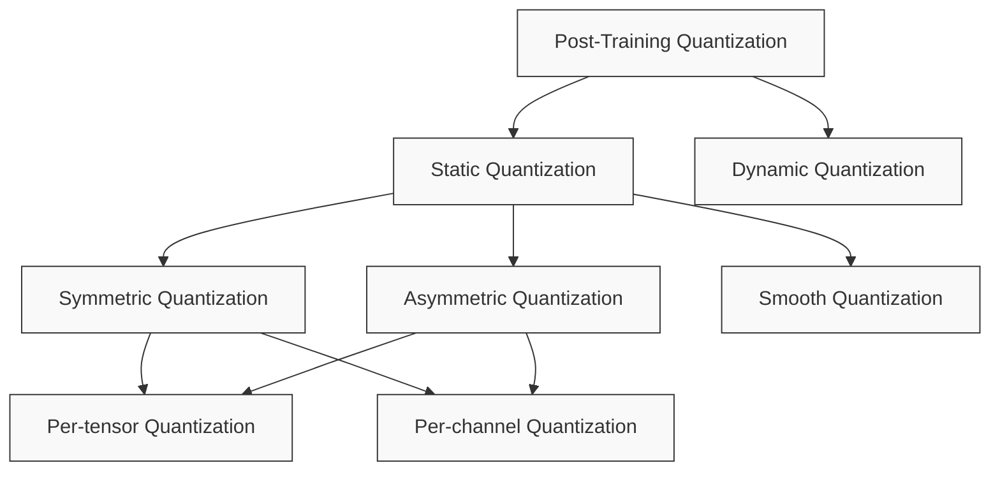
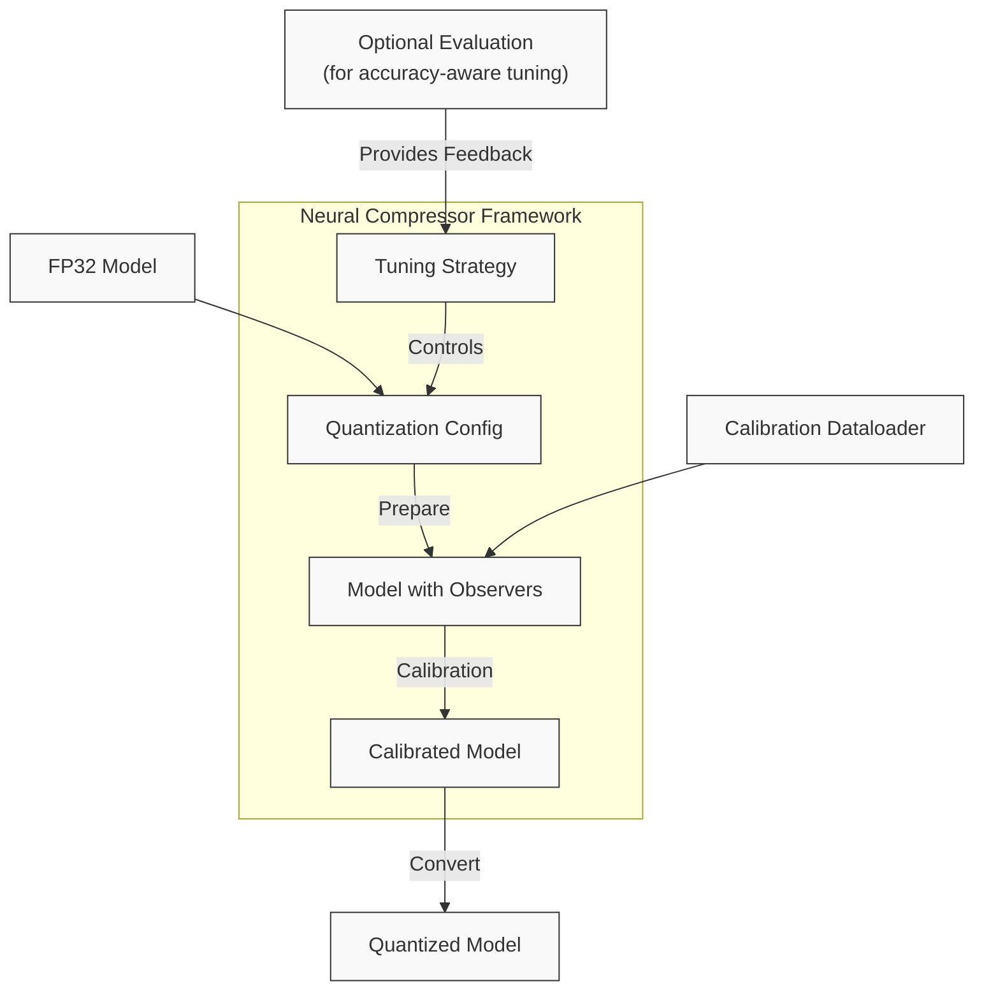
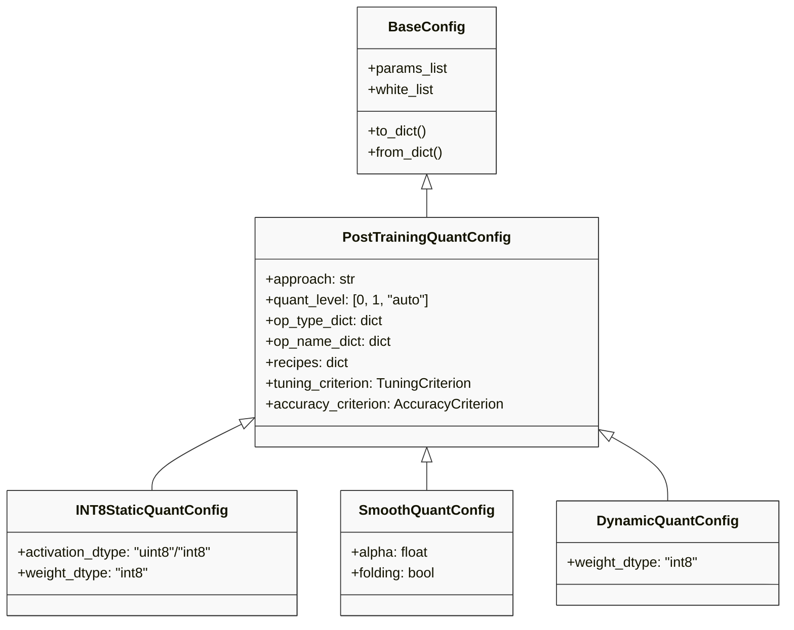
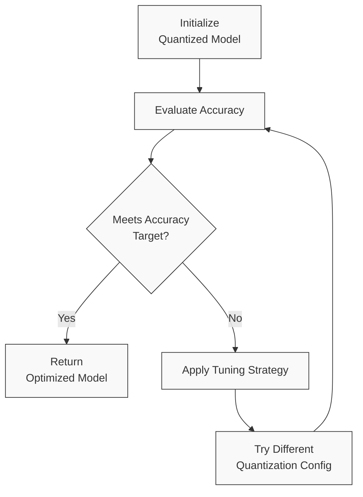

<!-- source: DeepWiki mcp.deepwiki.com · repo intel/neural-compressor · page 6.1 Post-Training Quantization · fetched 2026-10-21 -->

# Post-Training Quantization

<details>
<summary>Relevant source files</summary>

The following files were used as context for generating this wiki page:

- [README.md](README.md)
- [docs/source/add_new_adaptor.md](docs/source/add_new_adaptor.md)
- [docs/source/add_new_data_type.md](docs/source/add_new_data_type.md)
- [docs/source/calibration.md](docs/source/calibration.md)
- [docs/source/examples_readme.md](docs/source/examples_readme.md)
- [docs/source/framework_yaml.md](docs/source/framework_yaml.md)
- [docs/source/infrastructure.md](docs/source/infrastructure.md)
- [docs/source/mixed_precision.md](docs/source/mixed_precision.md)
- [docs/source/publication_list.md](docs/source/publication_list.md)
- [docs/source/quantization.md](docs/source/quantization.md)
- [docs/source/quantization_mixed_precision.md](docs/source/quantization_mixed_precision.md)
- [docs/source/quantization_weight_only.md](docs/source/quantization_weight_only.md)
- [examples/README.md](examples/README.md)
- [neural_compressor/adaptor/pytorch.py](neural_compressor/adaptor/pytorch.py)
- [neural_compressor/adaptor/pytorch_cpu.yaml](neural_compressor/adaptor/pytorch_cpu.yaml)
- [neural_compressor/adaptor/pytorch_ipex.yaml](neural_compressor/adaptor/pytorch_ipex.yaml)
- [neural_compressor/adaptor/tensorflow.py](neural_compressor/adaptor/tensorflow.py)
- [neural_compressor/adaptor/tensorflow.yaml](neural_compressor/adaptor/tensorflow.yaml)
- [neural_compressor/adaptor/tf_utils/graph_converter.py](neural_compressor/adaptor/tf_utils/graph_converter.py)
- [neural_compressor/adaptor/tf_utils/graph_converter_without_calib.py](neural_compressor/adaptor/tf_utils/graph_converter_without_calib.py)
- [neural_compressor/adaptor/tf_utils/graph_rewriter/bf16/bf16_convert.py](neural_compressor/adaptor/tf_utils/graph_rewriter/bf16/bf16_convert.py)
- [neural_compressor/adaptor/tf_utils/graph_rewriter/generic/convert_add_to_biasadd.py](neural_compressor/adaptor/tf_utils/graph_rewriter/generic/convert_add_to_biasadd.py)
- [neural_compressor/adaptor/tf_utils/graph_rewriter/generic/dilated_contraction.py](neural_compressor/adaptor/tf_utils/graph_rewriter/generic/dilated_contraction.py)
- [neural_compressor/adaptor/tf_utils/graph_rewriter/generic/dummy_biasadd.py](neural_compressor/adaptor/tf_utils/graph_rewriter/generic/dummy_biasadd.py)
- [neural_compressor/adaptor/tf_utils/graph_rewriter/generic/fetch_weight_from_reshape.py](neural_compressor/adaptor/tf_utils/graph_rewriter/generic/fetch_weight_from_reshape.py)
- [neural_compressor/adaptor/tf_utils/graph_rewriter/generic/fuse_pad_with_conv.py](neural_compressor/adaptor/tf_utils/graph_rewriter/generic/fuse_pad_with_conv.py)
- [neural_compressor/adaptor/tf_utils/graph_rewriter/generic/fuse_pad_with_fp32_conv.py](neural_compressor/adaptor/tf_utils/graph_rewriter/generic/fuse_pad_with_fp32_conv.py)
- [neural_compressor/adaptor/tf_utils/graph_rewriter/generic/insert_print_node.py](neural_compressor/adaptor/tf_utils/graph_rewriter/generic/insert_print_node.py)
- [neural_compressor/adaptor/tf_utils/graph_rewriter/generic/pre_optimize.py](neural_compressor/adaptor/tf_utils/graph_rewriter/generic/pre_optimize.py)
- [neural_compressor/adaptor/tf_utils/graph_rewriter/generic/rename_batch_norm.py](neural_compressor/adaptor/tf_utils/graph_rewriter/generic/rename_batch_norm.py)
- [neural_compressor/adaptor/tf_utils/graph_rewriter/generic/split_shared_input.py](neural_compressor/adaptor/tf_utils/graph_rewriter/generic/split_shared_input.py)
- [neural_compressor/adaptor/tf_utils/graph_rewriter/int8/freeze_value.py](neural_compressor/adaptor/tf_utils/graph_rewriter/int8/freeze_value.py)
- [neural_compressor/adaptor/tf_utils/graph_rewriter/int8/fuse_conv_redundant_dequantize.py](neural_compressor/adaptor/tf_utils/graph_rewriter/int8/fuse_conv_redundant_dequantize.py)
- [neural_compressor/adaptor/tf_utils/graph_rewriter/int8/fuse_conv_requantize.py](neural_compressor/adaptor/tf_utils/graph_rewriter/int8/fuse_conv_requantize.py)
- [neural_compressor/adaptor/tf_utils/graph_rewriter/int8/fuse_matmul_requantize.py](neural_compressor/adaptor/tf_utils/graph_rewriter/int8/fuse_matmul_requantize.py)
- [neural_compressor/adaptor/tf_utils/graph_rewriter/qdq/insert_qdq_pattern.py](neural_compressor/adaptor/tf_utils/graph_rewriter/qdq/insert_qdq_pattern.py)
- [neural_compressor/adaptor/tf_utils/graph_util.py](neural_compressor/adaptor/tf_utils/graph_util.py)
- [neural_compressor/adaptor/tf_utils/quantize_graph/qdq/fuse_qdq_concatv2.py](neural_compressor/adaptor/tf_utils/quantize_graph/qdq/fuse_qdq_concatv2.py)
- [neural_compressor/adaptor/tf_utils/quantize_graph/qdq/fuse_qdq_conv.py](neural_compressor/adaptor/tf_utils/quantize_graph/qdq/fuse_qdq_conv.py)
- [neural_compressor/adaptor/tf_utils/quantize_graph/qdq/fuse_qdq_matmul.py](neural_compressor/adaptor/tf_utils/quantize_graph/qdq/fuse_qdq_matmul.py)
- [neural_compressor/adaptor/tf_utils/quantize_graph/qdq/fuse_qdq_pooling.py](neural_compressor/adaptor/tf_utils/quantize_graph/qdq/fuse_qdq_pooling.py)
- [neural_compressor/adaptor/tf_utils/quantize_graph/qdq/optimize_qdq.py](neural_compressor/adaptor/tf_utils/quantize_graph/qdq/optimize_qdq.py)
- [neural_compressor/adaptor/tf_utils/quantize_graph/quantize_graph_base.py](neural_compressor/adaptor/tf_utils/quantize_graph/quantize_graph_base.py)
- [neural_compressor/adaptor/tf_utils/quantize_graph/quantize_graph_conv.py](neural_compressor/adaptor/tf_utils/quantize_graph/quantize_graph_conv.py)
- [neural_compressor/adaptor/tf_utils/quantize_graph/quantize_graph_for_intel_cpu.py](neural_compressor/adaptor/tf_utils/quantize_graph/quantize_graph_for_intel_cpu.py)
- [neural_compressor/adaptor/tf_utils/quantize_graph/quantize_graph_matmul.py](neural_compressor/adaptor/tf_utils/quantize_graph/quantize_graph_matmul.py)
- [neural_compressor/adaptor/tf_utils/quantize_graph_common.py](neural_compressor/adaptor/tf_utils/quantize_graph_common.py)
- [neural_compressor/adaptor/tf_utils/transform_graph/rerange_quantized_concat.py](neural_compressor/adaptor/tf_utils/transform_graph/rerange_quantized_concat.py)
- [neural_compressor/adaptor/tf_utils/util.py](neural_compressor/adaptor/tf_utils/util.py)
- [neural_compressor/adaptor/torch_utils/awq.py](neural_compressor/adaptor/torch_utils/awq.py)
- [neural_compressor/adaptor/torch_utils/bf16_convert.py](neural_compressor/adaptor/torch_utils/bf16_convert.py)
- [neural_compressor/adaptor/torch_utils/model_wrapper.py](neural_compressor/adaptor/torch_utils/model_wrapper.py)
- [neural_compressor/adaptor/torch_utils/teq.py](neural_compressor/adaptor/torch_utils/teq.py)
- [neural_compressor/adaptor/torch_utils/util.py](neural_compressor/adaptor/torch_utils/util.py)
- [neural_compressor/adaptor/torch_utils/weight_only.py](neural_compressor/adaptor/torch_utils/weight_only.py)
- [neural_compressor/algorithm/smooth_quant.py](neural_compressor/algorithm/smooth_quant.py)
- [neural_compressor/model/torch_model.py](neural_compressor/model/torch_model.py)
- [neural_compressor/utils/pytorch.py](neural_compressor/utils/pytorch.py)
- [test/adaptor/pytorch_adaptor/test_adaptor_pytorch_2x.py](test/adaptor/pytorch_adaptor/test_adaptor_pytorch_2x.py)
- [test/algorithm/test_smooth_quant.py](test/algorithm/test_smooth_quant.py)
- [test/ipex/test_adaptor_ipex.py](test/ipex/test_adaptor_ipex.py)
- [test/quantization/test_weight_only_quantization.py](test/quantization/test_weight_only_quantization.py)
- [test/utils/test_huggingface.py](test/utils/test_huggingface.py)

</details>


Post-Training Quantization (PTQ) is a model optimization technique that converts a trained floating-point model to a lower-precision representation (such as INT8, INT4, or BF16), with minimal or no accuracy loss. Unlike Quantization-Aware Training, PTQ does not require retraining the model, making it a faster and more convenient approach to achieve inference acceleration. This page explains how to use Post-Training Quantization in Neural Compressor, covering the concepts, API, workflow, and configuration options.

For information about Weight-Only Quantization which specifically targets weight parameters, see section 5.2. For Quantization-Aware Training approaches, see section 5.3.

## Quantization Fundamentals

Post-Training Quantization maps model weights and/or activations from a higher-precision format (typically FP32) to a lower-precision format. Neural Compressor supports various approaches to post-training quantization.



**Static Quantization**: Both weights and activations are quantized. Requires a calibration dataset to determine optimal quantization parameters.

**Dynamic Quantization**: Only weights are quantized offline; activations are quantized during runtime.

Sources: [neural_compressor/quantization.py:33-135](neural_compressor/quantization.py:33-135), [docs/source/quantization.md:94-114](docs/source/quantization.md:94-114)

## Architecture and Workflow

The post-training quantization process in Neural Compressor follows a modular design:



This workflow can be implemented either through the unified `fit()` API, which handles the entire process, or through the granular APIs (`prepare()`, `calibrate()`, `convert()`) for more control over the quantization process.

Sources: [neural_compressor/torch/quantization/quantize.py:43-126](neural_compressor/torch/quantization/quantize.py:43-126), [neural_compressor/torch/quantization/quantize.py:115-170](neural_compressor/torch/quantization/quantize.py:115-170)

## Supported Methods and Frameworks

The table below shows the quantization methods supported across different frameworks:

| Framework | Static Quantization | Dynamic Quantization | Symmetric | Asymmetric | INT8 | INT4 | BF16 |
|-----------|:-------------------:|:--------------------:|:---------:|:----------:|:----:|:----:|:----:|
| PyTorch   | ✓                   | ✓                    | ✓         | ✓          | ✓    | ✓    | ✓    |
| TensorFlow| ✓                   | ✓                    | ✓         | ✗          | ✓    | ✗    | ✓    |
| ONNX Runtime | ✓                | ✓                    | ✓         | ✓          | ✓    | ✗    | ✓    |

Sources: [docs/source/quantization.md:135-186](docs/source/quantization.md:135-186)

## Configuration System

Neural Compressor uses a flexible configuration system to specify quantization parameters. The `PostTrainingQuantConfig` class is the main configuration for PTQ.



Sources: [neural_compressor/common/base_config.py:182-447](neural_compressor/common/base_config.py:182-447), [neural_compressor/torch/quantization/__init__.py:16-47](neural_compressor/torch/quantization/__init__.py:16-47)

## Accuracy-Aware Tuning

One of Neural Compressor's unique features is accuracy-aware tuning for post-training quantization. This feature optimizes the balance between quantization and accuracy by:

1. Starting with a fully quantized model
2. Evaluating the model against an accuracy target
3. Selectively reverting quantization for certain layers if needed
4. Finding the optimal configuration that meets accuracy requirements



The tuning process is controlled by the following parameters:
- `tuning_criterion`: Defines the strategy, max trials, and timeout
- `accuracy_criterion`: Defines the acceptable accuracy loss

Sources: [neural_compressor/quantization.py:141-178](neural_compressor/quantization.py:141-178), [docs/source/tuning_strategies.md:44-105](docs/source/tuning_strategies.md:44-105)

## Usage Examples

### Basic Post-Training Quantization

```python
from neural_compressor import quantization
from neural_compressor.config import PostTrainingQuantConfig

# Create configuration
conf = PostTrainingQuantConfig()

# Quantize model
q_model = quantization.fit(
    model=model,
    conf=conf,
    calib_dataloader=calib_dataloader
)

# Save quantized model
q_model.save("./quantized_model")
```

### With Accuracy-Aware Tuning

```python
from neural_compressor import quantization
from neural_compressor.config import PostTrainingQuantConfig

# Define evaluation function
def evaluate(model):
    accuracy = run_validation(model, val_dataloader)
    return accuracy

# Create configuration with accuracy criteria
conf = PostTrainingQuantConfig(
    accuracy_criterion={"relative": 0.01}  # Allow 1% accuracy drop
)

# Quantize with accuracy-aware tuning
q_model = quantization.fit(
    model=model,
    conf=conf,
    calib_dataloader=calib_dataloader,
    eval_func=evaluate
)
```

### PyTorch Step-by-Step Approach

For PyTorch, Neural Compressor offers a more granular API that allows finer control:

```python
from neural_compressor.torch.quantization import prepare, convert
from neural_compressor.torch.quantization import StaticQuantConfig

# Create configuration
quant_config = StaticQuantConfig()

# Prepare model for calibration
prepared_model = prepare(model, quant_config)

# Calibrate
for batch in calib_dataloader:
    prepared_model(batch)
    
# Convert to quantized model
quantized_model = convert(prepared_model)
```

Sources: [neural_compressor/torch/quantization/quantize.py:43-112](neural_compressor/torch/quantization/quantize.py:43-112), [neural_compressor/torch/quantization/quantize.py:115-170](neural_compressor/torch/quantization/quantize.py:115-170), [neural_compressor/torch/quantization/quantize.py:173-235](neural_compressor/torch/quantization/quantize.py:173-235)

## Advanced Configuration Options

### Specifying Quantization Rules

Neural Compressor allows fine-grained control over which operators are quantized and how:

```python
# Specify quantization rules by operator name
op_name_dict = {
    "layer1.0.conv1": {
        "activation": {"dtype": ["fp32"]},
        "weight": {"dtype": ["fp32"]}
    },
    "layer2.0.conv1": {
        "activation": {
            "dtype": ["uint8"],
            "algorithm": ["minmax"],
            "granularity": ["per_tensor"],
            "scheme": ["sym"]
        },
        "weight": {
            "dtype": ["int8"],
            "algorithm": ["minmax"],
            "granularity": ["per_channel"],
            "scheme": ["sym"]
        }
    }
}

# Specify quantization rules by operator type
op_type_dict = {
    "Conv": {
        "weight": {"dtype": ["fp32"]},
        "activation": {"dtype": ["fp32"]}
    }
}

conf = PostTrainingQuantConfig(
    op_name_dict=op_name_dict,
    op_type_dict=op_type_dict
)
```

### Quantization Recipes

Neural Compressor provides various recipes to enhance quantization results:

```python
recipes = {
    "smooth_quant": True,  # Apply Smooth Quantization
    "smooth_quant_args": {
        "alpha": 0.5,  # Balance between weight/activation quantization
    },
}

conf = PostTrainingQuantConfig(recipes=recipes)
```

Sources: [docs/source/quantization.md:371-435](docs/source/quantization.md:371-435)

## Auto-Tuning for Post-Training Quantization

Neural Compressor also provides an auto-tuning capability that automatically searches for the best quantization configuration:

```python
from neural_compressor.torch.quantization import TuningConfig, autotune

# Define evaluation function
def eval_func(model):
    # Run validation and return accuracy
    return accuracy

# Create tuning config
tune_config = TuningConfig(
    max_trials=10  # Maximum number of quantization configurations to try
)

# Auto-tune the model
best_model = autotune(
    model=model,
    tune_config=tune_config,
    eval_fn=eval_func,
    run_fn=calib_func,  # Optional calibration function
    example_inputs=example_inputs  # Optional example inputs for tracing
)
```

Sources: [neural_compressor/torch/quantization/autotune.py:66-134](neural_compressor/torch/quantization/autotune.py:66-134)

## Framework-Specific Considerations

### PyTorch

- Supports both static and dynamic quantization
- Provides backend options:
  - `default`: Uses PyTorch's built-in quantization with FBGEMM
  - `ipex`: Uses Intel Extension for PyTorch with oneDNN

### TensorFlow

- Quantizes graph-level operations
- Fusion patterns like Conv+BiasAdd+Relu are automatically detected and quantized together

### ONNX Runtime

- Supports QDQ (Quantize-Dequantize) pattern and QLinearOps styles
- Provides multiple execution providers (CPU, CUDA, TensorRT)

Sources: [docs/source/quantization.md:437-517](docs/source/quantization.md:437-517)

## Conclusion

Post-Training Quantization in Neural Compressor offers a powerful and flexible approach to optimize deep learning models for inference. With support for various quantization methods, frameworks, and a unique accuracy-aware tuning capability, it enables users to achieve the best balance between performance and accuracy for their specific use cases.

---

