<!-- source: DeepWiki mcp.deepwiki.com · repo intel/neural-compressor · page 6.2 Quantization-Aware Training · fetched 2026-10-21 -->

# Quantization-Aware Training

<details>
<summary>Relevant source files</summary>

The following files were used as context for generating this wiki page:

- [docs/source/quantization_weight_only.md](docs/source/quantization_weight_only.md)
- [neural_compressor/adaptor/pytorch.py](neural_compressor/adaptor/pytorch.py)
- [neural_compressor/adaptor/pytorch_cpu.yaml](neural_compressor/adaptor/pytorch_cpu.yaml)
- [neural_compressor/adaptor/pytorch_ipex.yaml](neural_compressor/adaptor/pytorch_ipex.yaml)
- [neural_compressor/adaptor/torch_utils/awq.py](neural_compressor/adaptor/torch_utils/awq.py)
- [neural_compressor/adaptor/torch_utils/bf16_convert.py](neural_compressor/adaptor/torch_utils/bf16_convert.py)
- [neural_compressor/adaptor/torch_utils/model_wrapper.py](neural_compressor/adaptor/torch_utils/model_wrapper.py)
- [neural_compressor/adaptor/torch_utils/teq.py](neural_compressor/adaptor/torch_utils/teq.py)
- [neural_compressor/adaptor/torch_utils/util.py](neural_compressor/adaptor/torch_utils/util.py)
- [neural_compressor/adaptor/torch_utils/weight_only.py](neural_compressor/adaptor/torch_utils/weight_only.py)
- [neural_compressor/algorithm/smooth_quant.py](neural_compressor/algorithm/smooth_quant.py)
- [neural_compressor/benchmark.py](neural_compressor/benchmark.py)
- [neural_compressor/config.py](neural_compressor/config.py)
- [neural_compressor/mix_precision.py](neural_compressor/mix_precision.py)
- [neural_compressor/model/model.py](neural_compressor/model/model.py)
- [neural_compressor/model/torch_model.py](neural_compressor/model/torch_model.py)
- [neural_compressor/quantization.py](neural_compressor/quantization.py)
- [neural_compressor/training.py](neural_compressor/training.py)
- [neural_compressor/utils/pytorch.py](neural_compressor/utils/pytorch.py)
- [neural_compressor/utils/utility.py](neural_compressor/utils/utility.py)
- [test/adaptor/pytorch_adaptor/test_adaptor_pytorch_2x.py](test/adaptor/pytorch_adaptor/test_adaptor_pytorch_2x.py)
- [test/adaptor/pytorch_adaptor/test_adaptor_security.py](test/adaptor/pytorch_adaptor/test_adaptor_security.py)
- [test/algorithm/test_smooth_quant.py](test/algorithm/test_smooth_quant.py)
- [test/ipex/test_adaptor_ipex.py](test/ipex/test_adaptor_ipex.py)
- [test/quantization/test_weight_only_quantization.py](test/quantization/test_weight_only_quantization.py)
- [test/utils/test_huggingface.py](test/utils/test_huggingface.py)

</details>


## Purpose and Scope

This document describes the Quantization-Aware Training (QAT) functionality in Intel Neural Compressor. QAT is a quantization approach that simulates quantization effects during the training process, enabling the model to learn parameters that are robust to quantization errors. 

For post-training quantization without retraining, see [Post-Training Quantization](#6.1). For weight-only quantization methods, see [Weight-Only Quantization](#6.3). For the overall training API and orchestration with pruning/distillation, see [Pruning and Distillation](#7.2).

---

## Overview

Quantization-Aware Training addresses the accuracy degradation that can occur with post-training quantization by incorporating quantization simulation during the training phase. Unlike Post-Training Quantization (PTQ), which quantizes a pre-trained model, QAT inserts fake quantization operations into the model and continues training. This allows the model's weights and activations to adapt to the reduced precision representation.

**Key Characteristics:**

| Aspect | Description |
|--------|-------------|
| **Training Required** | Yes - model must be trained/fine-tuned with quantization simulation |
| **Accuracy** | Generally better than PTQ, especially for models sensitive to quantization |
| **Time Cost** | Higher - requires training iterations |
| **Use Case** | When PTQ accuracy is insufficient and training budget is available |

**QAT vs PTQ:**

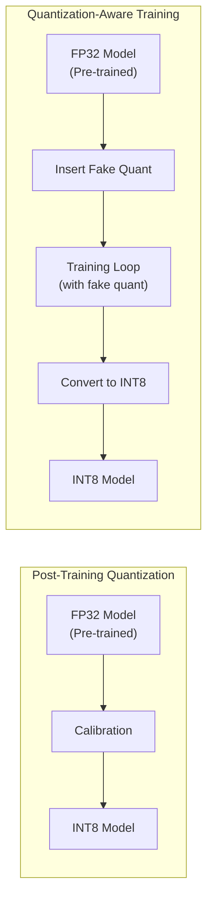

Sources: [neural_compressor/adaptor/pytorch.py:199-342](), [neural_compressor/training.py:1-100]()

---

## QAT Workflow

The QAT workflow consists of four main phases: configuration, preparation, training, and conversion.

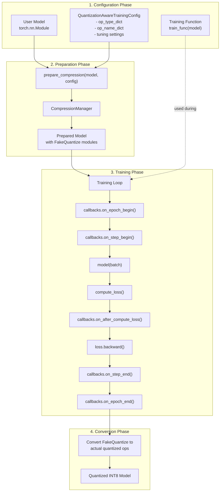

Sources: [neural_compressor/training.py:38-200](), [neural_compressor/adaptor/pytorch.py:199-342]()

---

## Configuration

QAT is configured using the `QuantizationAwareTrainingConfig` class, which specifies quantization parameters and tuning strategy.

**Configuration Structure:**

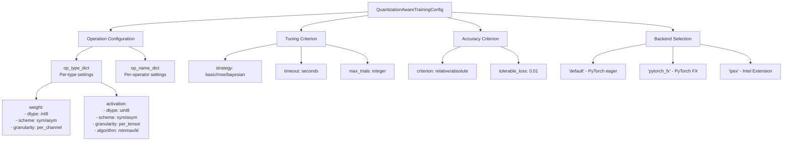

**Example Configuration:**

| Parameter | Example Value | Description |
|-----------|---------------|-------------|
| `approach` | `"quant_aware_training"` | Automatically set for QAT config |
| `backend` | `"default"` / `"pytorch_fx"` | PyTorch quantization backend |
| `device` | `"cpu"` / `"gpu"` | Target device |
| `op_type_dict` | `{"Conv2d": {...}, "Linear": {...}}` | Per-type quantization settings |
| `op_name_dict` | `{"layer1.conv1": {...}}` | Per-operator overrides |
| `accuracy_criterion` | `AccuracyCriterion(tolerable_loss=0.01)` | Accuracy target |
| `tuning_criterion` | `TuningCriterion(strategy="basic", max_trials=100)` | Tuning parameters |

Sources: [neural_compressor/config.py:715-1200]()

---

## Fake Quantization

Fake quantization is the core mechanism in QAT. It simulates the quantization effect during forward pass while maintaining FP32 precision for backward propagation.

**Fake Quantization Operation:**

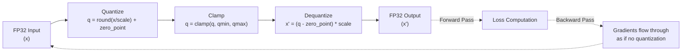

**Fake Quantization Modules:**

The adaptor creates different fake quantization modules based on the configuration:

| Configuration | Fake Quantize Module | Observer Used |
|---------------|---------------------|---------------|
| Per-tensor symmetric | `FusedMovingAvgObsFakeQuantize` (PT 1.10+) | `MovingAverageMinMaxObserver` |
| Per-channel symmetric | `FusedMovingAvgObsFakeQuantize` | `MovingAveragePerChannelMinMaxObserver` |
| Per-tensor asymmetric | `FusedMovingAvgObsFakeQuantize` | `MovingAverageMinMaxObserver` |
| Per-channel asymmetric | `FusedMovingAvgObsFakeQuantize` | `MovingAveragePerChannelMinMaxObserver` |

**Key Functions:**

- [neural_compressor/adaptor/pytorch.py:512-582]() - `_fake_quantize()`: Constructs fake quantize module based on algorithm, scheme, granularity, and dtype
- [neural_compressor/adaptor/pytorch.py:262-326]() - QAT-specific qconfig creation with fake quantize modules

Sources: [neural_compressor/adaptor/pytorch.py:512-582](), [neural_compressor/adaptor/pytorch.py:262-326]()

---

## Model Preparation

Model preparation transforms a FP32 model into a QAT-ready model by inserting fake quantization modules and configuring quantization parameters.

**Preparation Pipeline:**

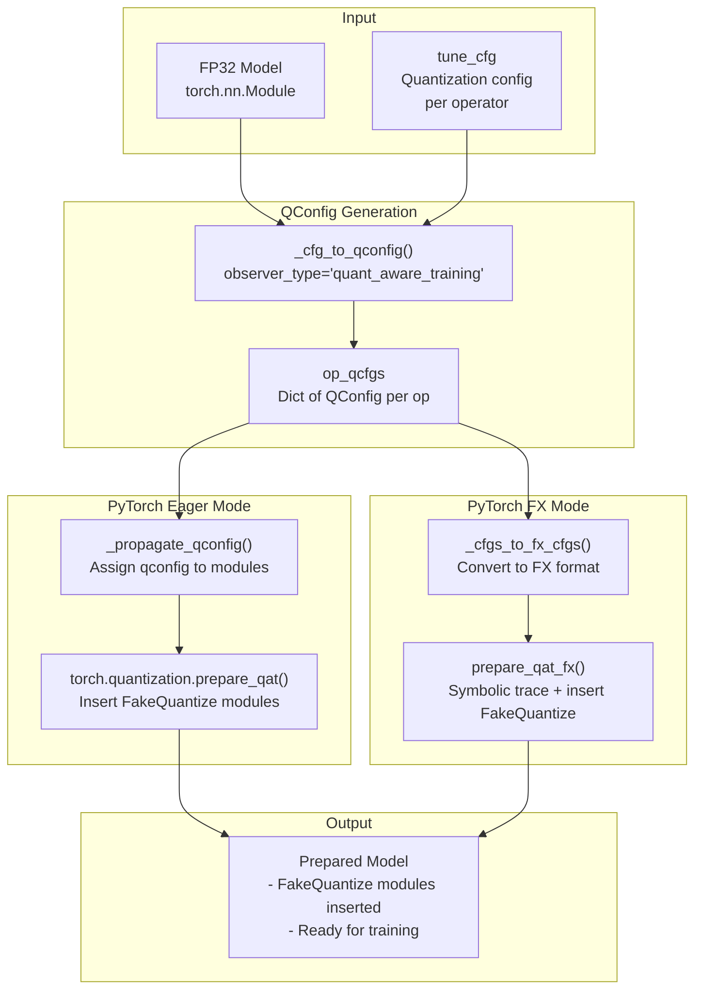

**QConfig Mapping:**

The `_cfg_to_qconfig()` function creates PyTorch `QConfig` objects with fake quantize modules for QAT:

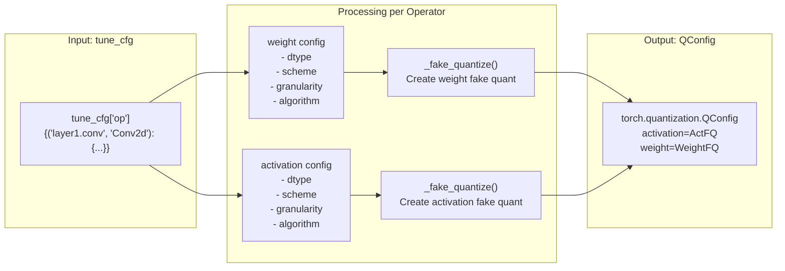

**Special Cases:**

- **Embedding/EmbeddingBag/LSTM/GRU/LSTMCell/GRUCell/RNNCell**: Use dynamic quantization qconfig even in QAT mode [neural_compressor/adaptor/pytorch.py:313-322]()
- **DeQuantStub**: Gets a special qconfig with MinMaxObserver [neural_compressor/adaptor/pytorch.py:634-641]()

Sources: [neural_compressor/adaptor/pytorch.py:199-342](), [neural_compressor/adaptor/pytorch.py:345-418](), [neural_compressor/adaptor/pytorch.py:585-611]()

---

## Training Loop Integration

QAT integrates with the training loop through the `CompressionManager` and its callback system.

**2.x API Integration (with CompressionManager):**

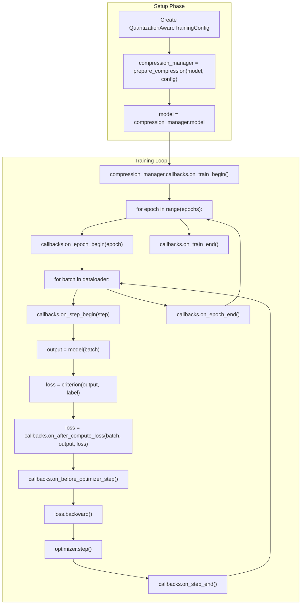

**CompressionManager Workflow:**

The `CompressionManager` class coordinates QAT callbacks:

| Method | Purpose | QAT Behavior |
|--------|---------|--------------|
| `on_train_begin()` | Initialize training | Setup fake quantization modules |
| `on_epoch_begin(epoch)` | Start of epoch | Update learning rate schedules, enable/disable quantization per epoch |
| `on_step_begin(batch)` | Start of training step | Prepare for forward pass |
| `on_after_compute_loss(batch, output, loss)` | After loss computation | Can modify loss (for distillation, etc.) |
| `on_before_optimizer_step()` | Before optimizer step | Can apply gradient modifications |
| `on_step_end()` | End of training step | Update statistics |
| `on_epoch_end()` | End of epoch | Evaluation, checkpointing |
| `on_train_end()` | End of training | Final model conversion |

**Alternative: Direct Fit API:**

For simpler use cases, the `training.fit()` function handles the training loop internally:

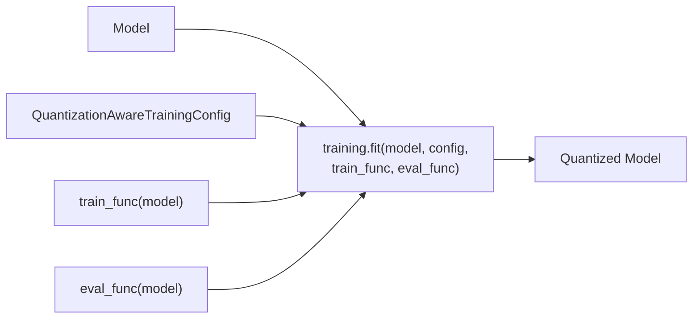

Sources: [neural_compressor/training.py:38-300](), [neural_compressor/training.py:303-450](), [neural_compressor/compression/callbacks.py]()

---

## Conversion to INT8

After training, the model with fake quantization modules is converted to an actual INT8 quantized model.

**Conversion Process:**

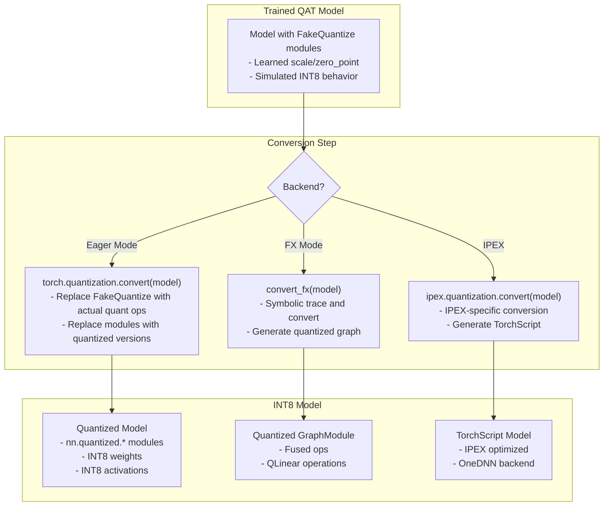

**Module Replacement:**

During conversion, FP32 modules with fake quantization are replaced with their quantized counterparts:

| FP32 Module | Quantized Module (Eager) | Quantized Module (FX) |
|-------------|-------------------------|----------------------|
| `torch.nn.Linear` | `torch.nn.quantized.Linear` | Fused into graph |
| `torch.nn.Conv2d` | `torch.nn.quantized.Conv2d` | Fused into graph |
| `torch.nn.Conv2d + ReLU` | `torch.nn.intrinsic.quantized.ConvReLU2d` | Fused operation |
| `torch.nn.Linear + ReLU` | `torch.nn.intrinsic.quantized.LinearReLU` | Fused operation |

**Activation Scale/Zero-Point Setting:**

The conversion process also sets the learned activation scale and zero-point values from the fake quantization modules to the actual quantized operations [neural_compressor/utils/pytorch.py:106-142]().

Sources: [neural_compressor/utils/pytorch.py:144-207](), [neural_compressor/adaptor/pytorch.py:820-828]()

---

## Backend Support

QAT is supported across multiple PyTorch backends with varying capabilities.

**Backend Comparison:**

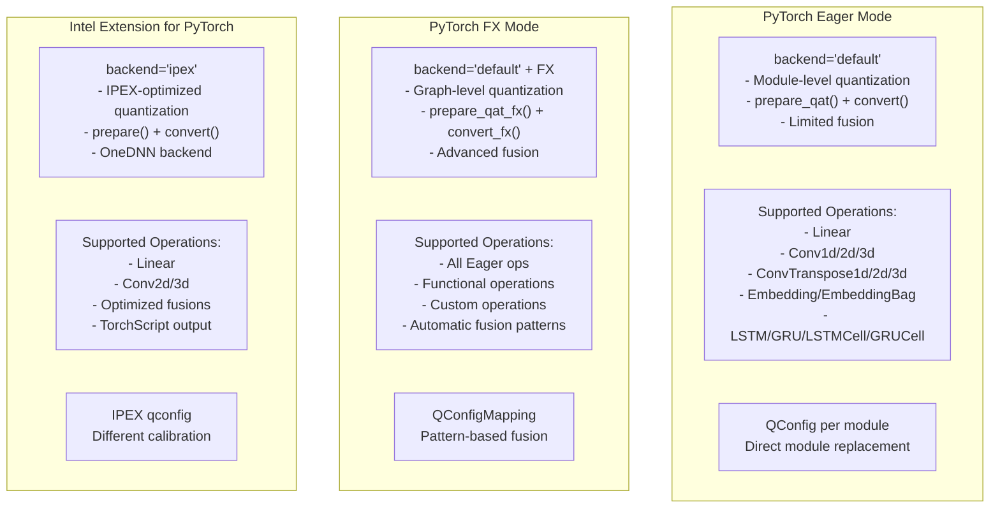

**Backend Selection:**

| Backend | Configuration | PyTorch Version | Use Case |
|---------|---------------|----------------|----------|
| `default` (Eager) | `backend="default"` | ≥ 1.11 | Simple models, module-level control |
| `default` (FX) | Automatic if FX available | ≥ 1.11 | Complex models, better fusion |
| `ipex` | `backend="ipex"` | ≥ 1.12 (IPEX ≥ 1.12) | Intel hardware optimization |

**Capability Files:**

- [neural_compressor/adaptor/pytorch_cpu.yaml:1-500]() - Default PyTorch backend capabilities
- [neural_compressor/adaptor/pytorch_ipex.yaml:1-200]() - IPEX backend capabilities

These YAML files define supported operations, data types, schemes, and granularities for each backend.

Sources: [neural_compressor/adaptor/pytorch.py:813-841](), [neural_compressor/adaptor/pytorch_cpu.yaml:1-500](), [neural_compressor/adaptor/pytorch_ipex.yaml:1-200]()

---

## Advanced Features

### FX Mode Quantization

FX mode provides more advanced quantization through symbolic tracing:


**FX Advantages:**

- Automatic operator fusion (Conv+BN+ReLU, Linear+ReLU, etc.)
- Support for functional operations (torch.nn.functional.*)
- Better handling of control flow
- More aggressive optimizations

**FX Limitations:**

- Not all models are symbolically traceable
- Dynamic control flow requires manual intervention
- Sub-module handling is more complex [neural_compressor/adaptor/pytorch.py:2500-2600]()

### Fallback Mechanism

When specific operators should remain in FP32 during QAT:

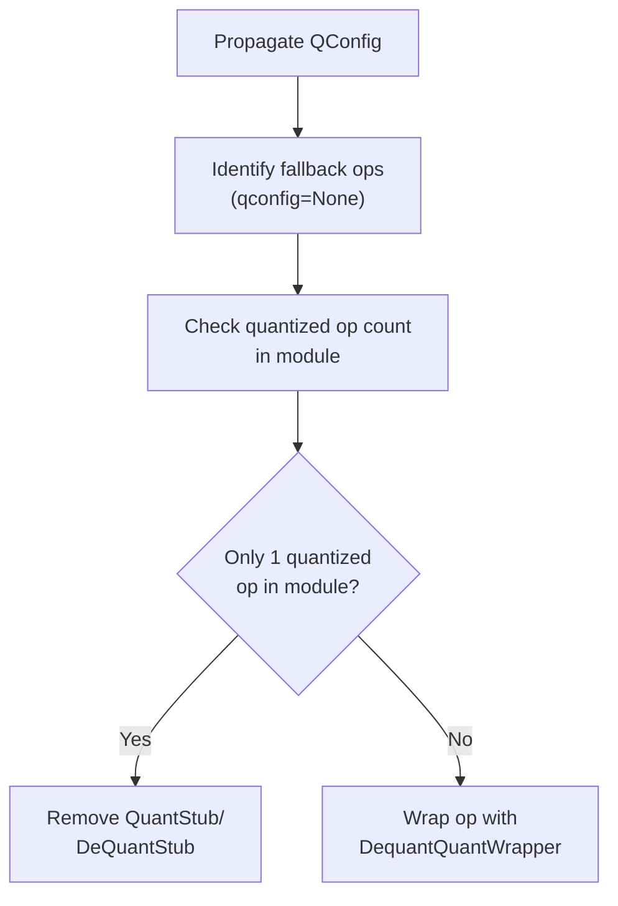

The `DequantQuantWrapper` class [neural_compressor/adaptor/pytorch.py:678-768]() wraps FP32 fallback operations with dequantize and quantize stubs to maintain INT8 input/output interfaces.

Sources: [neural_compressor/adaptor/pytorch.py:665-768](), [neural_compressor/adaptor/pytorch.py:2500-2700]()

---

## TensorFlow QAT Support

While PyTorch is the primary framework for QAT in Neural Compressor, TensorFlow also has QAT support through the `TensorflowQATModel` class.

**TensorFlow QAT Characteristics:**

| Aspect | Implementation |
|--------|----------------|
| **Model Type** | Keras models primarily |
| **Fake Quantization** | `tf.quantization.fake_quant_*` operations |
| **Configuration** | Similar to PyTorch with `QuantizationAwareTrainingConfig` |
| **Training** | Standard Keras training loop with fake quant layers |
| **Conversion** | Convert fake quant to actual quantized ops |

**Model Class:**

- `TensorflowQATModel` [neural_compressor/model/tensorflow_model.py]() - Wrapper for TensorFlow QAT models
- Integrates with TensorFlow's built-in QAT functionality
- Supports both graph-based and eager execution

Sources: [neural_compressor/model/tensorflow_model.py:100-300](), [neural_compressor/model/model.py:28-34]()

---

## Implementation Details

### QConfig Structure

The PyTorch `QConfig` object contains two components:

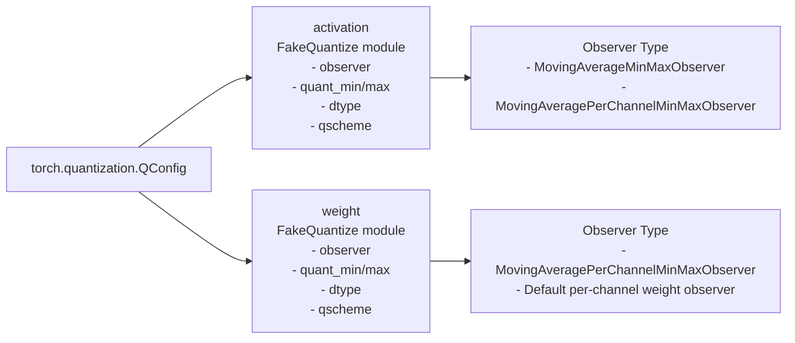

**QConfig Creation Logic:**

The `_cfg_to_qconfig()` function [neural_compressor/adaptor/pytorch.py:199-342]() handles QAT-specific logic:

1. For weight: Create fake quantize module unless operator is special (Embedding, LSTM, etc.)
2. For activation: Create fake quantize module for most operators
3. For RNN operators: Use dynamic quantization qconfig
4. For Embedding operators: Use float qparams weight-only qconfig (PyTorch ≥ 1.11)

### Reduce Range

The `REDUCE_RANGE` flag affects quantization range:

```python
REDUCE_RANGE = False if CpuInfo().vnni else True
```

- **False** (VNNI available): Use full INT8 range [-128, 127] or [0, 255]
- **True** (No VNNI): Use reduced range [-127, 127] or [0, 254] to avoid saturation issues

This flag is set in fake quantize modules [neural_compressor/adaptor/pytorch.py:367-377]().

### Version Compatibility

Different PyTorch versions have different APIs:

| PyTorch Version | Key Differences |
|-----------------|-----------------|
| < 1.7.0 | Basic quantization support |
| 1.7.0 - 1.9.x | `QConfigDynamic` for dynamic quantization |
| 1.10.0+ | `FusedMovingAvgObsFakeQuantize` (better performance) |
| 1.11.0+ | Improved Embedding/EmbeddingBag QAT support |
| 1.13.0+ | `QConfigMapping` replaces dict-based qconfig |

The code handles these differences with version checks [neural_compressor/adaptor/pytorch.py:311-341]().

Sources: [neural_compressor/adaptor/pytorch.py:43-63](), [neural_compressor/adaptor/pytorch.py:199-342](), [neural_compressor/adaptor/pytorch.py:512-582]()

---

## Usage Example

**Basic QAT Workflow:**

```python
# 1. Define model and config
model = MyModel()
from neural_compressor import QuantizationAwareTrainingConfig
from neural_compressor.training import prepare_compression

config = QuantizationAwareTrainingConfig(
    backend="default",
    device="cpu"
)

# 2. Prepare model for QAT
compression_manager = prepare_compression(model, config)
model = compression_manager.model

# 3. Training loop
compression_manager.callbacks.on_train_begin()
for epoch in range(num_epochs):
    compression_manager.callbacks.on_epoch_begin(epoch)
    for batch_idx, (data, target) in enumerate(train_loader):
        compression_manager.callbacks.on_step_begin(batch_idx)
        
        # Forward pass
        output = model(data)
        loss = criterion(output, target)
        
        # Allow callbacks to modify loss
        loss = compression_manager.callbacks.on_after_compute_loss(
            data, output, loss
        )
        
        # Backward pass
        optimizer.zero_grad()
        loss.backward()
        
        compression_manager.callbacks.on_before_optimizer_step()
        optimizer.step()
        compression_manager.callbacks.on_step_end()
    
    compression_manager.callbacks.on_epoch_end()

compression_manager.callbacks.on_train_end()

# 4. Get quantized model
quantized_model = compression_manager.model
```

**Simplified API with Automatic Training:**

```python
from neural_compressor import QuantizationAwareTrainingConfig
from neural_compressor.training import fit

config = QuantizationAwareTrainingConfig()

def train_func(model):
    # Your training logic
    for epoch in range(num_epochs):
        for data, target in train_loader:
            output = model(data)
            loss = criterion(output, target)
            loss.backward()
            optimizer.step()

def eval_func(model):
    # Your evaluation logic
    return accuracy

quantized_model = fit(
    model=model,
    conf=config,
    train_func=train_func,
    eval_func=eval_func
)
```

Sources: [neural_compressor/training.py:303-450](), [test/adaptor/pytorch_adaptor/test_adaptor_pytorch_2x.py:1-100]()

---

## Summary

Quantization-Aware Training in Neural Compressor provides a comprehensive solution for training INT8 models with minimal accuracy loss. The key components are:

| Component | Purpose |
|-----------|---------|
| **QuantizationAwareTrainingConfig** | Defines QAT parameters and tuning strategy |
| **Fake Quantization** | Simulates quantization during training |
| **CompressionManager** | Orchestrates QAT callbacks in training loop |
| **Backend Adaptors** | Implement framework-specific QAT logic |
| **Conversion** | Transforms fake quant model to actual INT8 model |

QAT is most effective when:
- Post-training quantization accuracy is insufficient
- Training budget is available
- Model architecture is quantization-friendly
- Target deployment requires INT8 precision

For models where training is not feasible, consider [Post-Training Quantization](#6.1) methods first.

---

