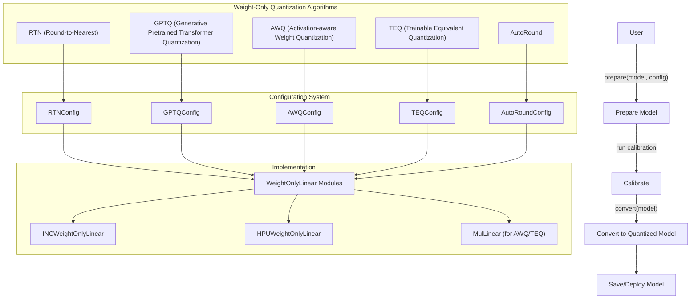
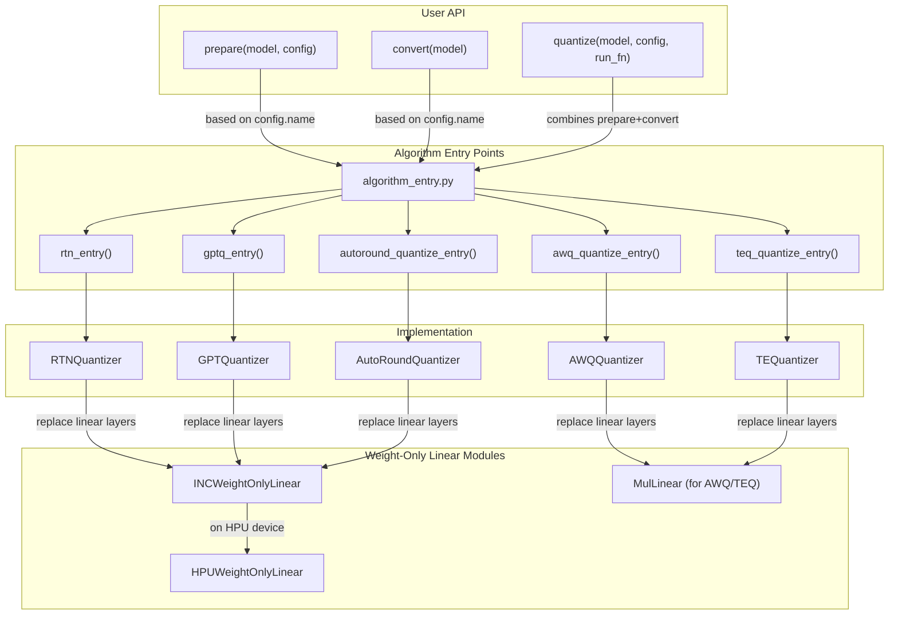

<!-- source: DeepWiki mcp.deepwiki.com · repo intel/neural-compressor · page 6.3 Weight-Only Quantization · fetched 2026-10-21 -->

# Weight-Only Quantization

<details>
<summary>Relevant source files</summary>

The following files were used as context for generating this wiki page:

- [docs/source/quantization_weight_only.md](docs/source/quantization_weight_only.md)
- [examples/pytorch/multimodal-modeling/quantization/auto_round/mllm.py](examples/pytorch/multimodal-modeling/quantization/auto_round/mllm.py)
- [neural_compressor/adaptor/pytorch.py](neural_compressor/adaptor/pytorch.py)
- [neural_compressor/adaptor/pytorch_cpu.yaml](neural_compressor/adaptor/pytorch_cpu.yaml)
- [neural_compressor/adaptor/pytorch_ipex.yaml](neural_compressor/adaptor/pytorch_ipex.yaml)
- [neural_compressor/adaptor/torch_utils/awq.py](neural_compressor/adaptor/torch_utils/awq.py)
- [neural_compressor/adaptor/torch_utils/bf16_convert.py](neural_compressor/adaptor/torch_utils/bf16_convert.py)
- [neural_compressor/adaptor/torch_utils/model_wrapper.py](neural_compressor/adaptor/torch_utils/model_wrapper.py)
- [neural_compressor/adaptor/torch_utils/teq.py](neural_compressor/adaptor/torch_utils/teq.py)
- [neural_compressor/adaptor/torch_utils/util.py](neural_compressor/adaptor/torch_utils/util.py)
- [neural_compressor/adaptor/torch_utils/weight_only.py](neural_compressor/adaptor/torch_utils/weight_only.py)
- [neural_compressor/algorithm/smooth_quant.py](neural_compressor/algorithm/smooth_quant.py)
- [neural_compressor/model/torch_model.py](neural_compressor/model/torch_model.py)
- [neural_compressor/torch/algorithms/layer_wise/utils.py](neural_compressor/torch/algorithms/layer_wise/utils.py)
- [neural_compressor/torch/algorithms/mixed_low_precision/modules.py](neural_compressor/torch/algorithms/mixed_low_precision/modules.py)
- [neural_compressor/torch/algorithms/mixed_low_precision/quantizer.py](neural_compressor/torch/algorithms/mixed_low_precision/quantizer.py)
- [neural_compressor/torch/algorithms/weight_only/__init__.py](neural_compressor/torch/algorithms/weight_only/__init__.py)
- [neural_compressor/torch/algorithms/weight_only/autoround.py](neural_compressor/torch/algorithms/weight_only/autoround.py)
- [neural_compressor/torch/algorithms/weight_only/awq.py](neural_compressor/torch/algorithms/weight_only/awq.py)
- [neural_compressor/torch/algorithms/weight_only/gptq.py](neural_compressor/torch/algorithms/weight_only/gptq.py)
- [neural_compressor/torch/algorithms/weight_only/modules.py](neural_compressor/torch/algorithms/weight_only/modules.py)
- [neural_compressor/torch/algorithms/weight_only/rtn.py](neural_compressor/torch/algorithms/weight_only/rtn.py)
- [neural_compressor/torch/algorithms/weight_only/save_load.py](neural_compressor/torch/algorithms/weight_only/save_load.py)
- [neural_compressor/torch/algorithms/weight_only/teq.py](neural_compressor/torch/algorithms/weight_only/teq.py)
- [neural_compressor/torch/algorithms/weight_only/utility.py](neural_compressor/torch/algorithms/weight_only/utility.py)
- [neural_compressor/torch/quantization/__init__.py](neural_compressor/torch/quantization/__init__.py)
- [neural_compressor/torch/quantization/algorithm_entry.py](neural_compressor/torch/quantization/algorithm_entry.py)
- [neural_compressor/torch/quantization/config.py](neural_compressor/torch/quantization/config.py)
- [neural_compressor/torch/quantization/quantize.py](neural_compressor/torch/quantization/quantize.py)
- [neural_compressor/torch/quantization/save_load_entry.py](neural_compressor/torch/quantization/save_load_entry.py)
- [neural_compressor/torch/utils/constants.py](neural_compressor/torch/utils/constants.py)
- [neural_compressor/torch/utils/utility.py](neural_compressor/torch/utils/utility.py)
- [neural_compressor/transformers/models/modeling_auto.py](neural_compressor/transformers/models/modeling_auto.py)
- [neural_compressor/transformers/quantization/utils.py](neural_compressor/transformers/quantization/utils.py)
- [neural_compressor/transformers/utils/quantization_config.py](neural_compressor/transformers/utils/quantization_config.py)
- [neural_compressor/utils/pytorch.py](neural_compressor/utils/pytorch.py)
- [test/3x/torch/algorithms/weight_only/test_teq_quantizer.py](test/3x/torch/algorithms/weight_only/test_teq_quantizer.py)
- [test/3x/torch/quantization/fp8_quant/test_fp8_jsons/test_pow2_w4a8_quant.json](test/3x/torch/quantization/fp8_quant/test_fp8_jsons/test_pow2_w4a8_quant.json)
- [test/3x/torch/quantization/fp8_quant/test_gptq_mixed_precision.py](test/3x/torch/quantization/fp8_quant/test_gptq_mixed_precision.py)
- [test/3x/torch/quantization/weight_only/test_autoround.py](test/3x/torch/quantization/weight_only/test_autoround.py)
- [test/3x/torch/quantization/weight_only/test_awq.py](test/3x/torch/quantization/weight_only/test_awq.py)
- [test/3x/torch/quantization/weight_only/test_gptq.py](test/3x/torch/quantization/weight_only/test_gptq.py)
- [test/3x/torch/quantization/weight_only/test_rtn.py](test/3x/torch/quantization/weight_only/test_rtn.py)
- [test/3x/torch/quantization/weight_only/test_teq.py](test/3x/torch/quantization/weight_only/test_teq.py)
- [test/3x/torch/quantization/weight_only/test_transformers.py](test/3x/torch/quantization/weight_only/test_transformers.py)
- [test/3x/torch/requirements.txt](test/3x/torch/requirements.txt)
- [test/adaptor/pytorch_adaptor/test_adaptor_pytorch_2x.py](test/adaptor/pytorch_adaptor/test_adaptor_pytorch_2x.py)
- [test/algorithm/test_smooth_quant.py](test/algorithm/test_smooth_quant.py)
- [test/ipex/test_adaptor_ipex.py](test/ipex/test_adaptor_ipex.py)
- [test/quantization/test_weight_only_quantization.py](test/quantization/test_weight_only_quantization.py)
- [test/utils/test_huggingface.py](test/utils/test_huggingface.py)

</details>


Weight-Only Quantization (WOQ) is a technique that reduces model size and accelerates inference by quantizing only the weights of neural networks while keeping activations in full precision. Intel Neural Compressor provides several state-of-the-art algorithms for WOQ, specifically designed for large language models (LLMs) and other transformer-based architectures.

For post-training quantization that quantizes both weights and activations, see [Post-Training Quantization](#5.1).

## Overview



Sources:
- [neural_compressor/torch/quantization/config.py:101-292](neural_compressor/torch/quantization/config.py:101-292)
- [neural_compressor/torch/algorithms/weight_only/rtn.py:44-66](neural_compressor/torch/algorithms/weight_only/rtn.py:44-66)
- [neural_compressor/torch/algorithms/weight_only/modules.py:117-193](neural_compressor/torch/algorithms/weight_only/modules.py:117-193)
- [neural_compressor/torch/quantization/algorithm_entry.py:60-115](neural_compressor/torch/quantization/algorithm_entry.py:60-115)

## Supported Algorithms

Intel Neural Compressor implements several weight-only quantization algorithms, each with different characteristics and trade-offs:

### RTN (Round-to-Nearest)

The most straightforward approach, where weights are simply rounded to the nearest representable value in the quantized format. It offers a good baseline for weight quantization with minimal computational overhead.

```python
from neural_compressor.torch.quantization import RTNConfig, prepare, convert

# Create RTN configuration
rtn_config = RTNConfig(
    dtype="int",      # Data type for weights
    bits=4,           # Number of bits
    use_sym=True,     # Symmetric quantization
    group_size=32     # Size of weight groups
)

# Prepare and convert model
model = prepare(model, rtn_config)
quantized_model = convert(model)
```

Sources:
- [neural_compressor/torch/quantization/config.py:101-292](neural_compressor/torch/quantization/config.py:101-292)
- [neural_compressor/torch/algorithms/weight_only/rtn.py:45-66](neural_compressor/torch/algorithms/weight_only/rtn.py:45-66)

### GPTQ (Generative Pretrained Transformer Quantization)

GPTQ is a more advanced quantization method specifically designed for transformer models. It uses a layer-by-layer quantization approach that approximates the weight matrix in a way that minimizes the error introduced by quantization.

```python
from neural_compressor.torch.quantization import GPTQConfig, prepare, convert

# Create GPTQ configuration
gptq_config = GPTQConfig(
    bits=4,
    use_sym=True,
    group_size=128,
    act_order=True,     # Whether to use activation order
    percdamp=0.01       # Percentage of Hessian's diagonal values
)

# Prepare model
model = prepare(model, gptq_config)

# Run calibration function (required)
run_fn(model)

# Convert to quantized model
quantized_model = convert(model)
```

Sources:
- [neural_compressor/torch/quantization/config.py:324-516](neural_compressor/torch/quantization/config.py:324-516)
- [neural_compressor/torch/algorithms/weight_only/gptq.py:174-266](neural_compressor/torch/algorithms/weight_only/gptq.py:174-266)
- [neural_compressor/torch/quantization/algorithm_entry.py:118-181](neural_compressor/torch/quantization/algorithm_entry.py:118-181)

### AWQ (Activation-aware Weight Quantization)

AWQ analyzes the activation patterns during inference to identify important weights and quantize them more precisely. This algorithm typically provides better accuracy than simpler methods like RTN by focusing quantization precision where it matters most.

```python
from neural_compressor.torch.quantization import AWQConfig, prepare, convert

# Create AWQ configuration
awq_config = AWQConfig(
    bits=4,
    group_size=128,
    use_sym=True,
    use_auto_scale=True,    # Auto-scale based on activations
    use_auto_clip=True      # Automatic clip range search
)

# Prepare, calibrate and convert
model = prepare(model, awq_config)
model = convert(model, example_inputs=example_inputs)  # example_inputs required
```

Sources:
- [neural_compressor/torch/quantization/config.py:534-704](neural_compressor/torch/quantization/config.py:534-704)
- [neural_compressor/torch/algorithms/weight_only/awq.py:39-85](neural_compressor/torch/algorithms/weight_only/awq.py:39-85)
- [neural_compressor/torch/quantization/algorithm_entry.py:394-476](neural_compressor/torch/quantization/algorithm_entry.py:394-476)

### TEQ (Trainable Equivalent Quantization)

TEQ allows for trainable transformation of the model during quantization, enabling better adaptation to the quantized format and often preserving more of the original model's accuracy.

```python
from neural_compressor.torch.quantization import TEQConfig, prepare, convert

# Create TEQ configuration
teq_config = TEQConfig(
    bits=4,
    group_size=128,
    use_sym=True,
    folding=True        # Allow inserting mul before linear
)

# Prepare, calibrate and convert
model = prepare(model, teq_config)
model = convert(model, example_inputs=example_inputs)  # example_inputs required
```

Sources:
- [neural_compressor/torch/quantization/config.py:716-873](neural_compressor/torch/quantization/config.py:716-873)
- [neural_compressor/torch/algorithms/weight_only/teq.py:35-70](neural_compressor/torch/algorithms/weight_only/teq.py:35-70)
- [neural_compressor/torch/quantization/algorithm_entry.py:480-546](neural_compressor/torch/quantization/algorithm_entry.py:480-546)

### AutoRound

AutoRound optimizes weight rounding via signed gradient descent for quantizing LLMs, potentially offering better quantization results compared to deterministic rounding methods.

```python
from neural_compressor.torch.quantization import AutoRoundConfig, prepare, convert

# Create AutoRound configuration
autoround_config = AutoRoundConfig(
    bits=4,
    group_size=128,
    use_sym=False,
    iters=200,          # Training iterations
    nsamples=128        # Number of calibration samples
)

# Prepare model
model = prepare(model, autoround_config)

# Run calibration (required)
run_fn(model, dataloader)

# Convert to quantized model
quantized_model = convert(model)
```

Sources:
- [neural_compressor/torch/quantization/config.py:884-964](neural_compressor/torch/quantization/config.py:884-964)
- [neural_compressor/torch/algorithms/weight_only/autoround.py:47-113](neural_compressor/torch/algorithms/weight_only/autoround.py:47-113)
- [neural_compressor/torch/quantization/algorithm_entry.py:549-665](neural_compressor/torch/quantization/algorithm_entry.py:549-665)

## Configuration System

The weight-only quantization algorithms share many common parameters but also have algorithm-specific options. Here's a summary of the key configuration parameters:

### Common Parameters

| Parameter | Description | Default | Applicable To |
|-----------|-------------|---------|--------------|
| `dtype` | Data type for quantized weights (`int`, `nf4`, `fp4`, etc.) | `"int"` | All |
| `bits` | Number of bits for quantization | `4` | All |
| `group_size` | Number of elements that share quantization parameters | `32` | All |
| `use_sym` | Whether to use symmetric quantization | `True` | All |
| `use_layer_wise` | Whether to quantize model per layer | `False` | All |
| `model_path` | Path to load state_dict per layer (for layer-wise) | `""` | All |
| `quant_lm_head` | Whether to quantize the LM head in transformers | `False` | All |
| `white_list` | List of operators to be quantized | `DEFAULT_WHITE_LIST` | All |

### Algorithm-Specific Parameters

#### RTN
- `use_full_range`: Uses full quantization range for symmetric quantization
- `use_mse_search`: Enables MSE-based search for quantization parameters
- `use_double_quant`: Enables double quantization for quantization parameters
- Various double quantization parameters (`double_quant_bits`, etc.)

#### GPTQ
- `act_order`: Whether to sort Hessian's diagonal values for channel-wise quantization
- `percdamp`: Percentage used for damping Hessian diagonals
- `block_size`: Size of blocks for GPTQ quantization
- `static_groups`: Whether to calculate group-wise parameters in advance
- `true_sequential`: Whether to quantize transformer layers in their original order

#### AWQ
- `use_auto_scale`: Enables scale search based on activation distribution
- `use_auto_clip`: Enables clip range search
- `folding`: Allow inserting multiplication before linear layers
- `absorb_layer_dict`: Dictionary of layers where scale can be absorbed

#### TEQ
- `absorb_to_layer`: Dictionary of layers where scale can be absorbed
- `folding`: Similar to AWQ, controls if operations can be folded into layers

#### AutoRound
- `batch_size`: Batch size for training
- `enable_minmax_tuning`: Enables tuning of min/max values
- `lr` & `minmax_lr`: Learning rates for weight and min/max tuning
- `iters`: Number of training iterations
- `nsamples`: Number of samples for calibration
- Various training-related parameters

Sources:
- [neural_compressor/torch/quantization/config.py:101-964](neural_compressor/torch/quantization/config.py:101-964)

## Quantization Flow



Sources:
- [neural_compressor/torch/quantization/algorithm_entry.py:60-665](neural_compressor/torch/quantization/algorithm_entry.py:60-665)
- [neural_compressor/torch/algorithms/weight_only/modules.py:117-644](neural_compressor/torch/algorithms/weight_only/modules.py:117-644)

## API Usage

Neural Compressor provides three main API approaches for weight-only quantization:

### 1. Two-Step Approach: Prepare and Convert

```python
from neural_compressor.torch.quantization import RTNConfig, prepare, convert

# Define configuration
config = RTNConfig(bits=4, group_size=128, use_sym=True)

# Prepare the model for quantization
prepared_model = prepare(model, config)

# For some algorithms (GPTQ, AutoRound), calibration is required
run_fn(prepared_model)  # Run calibration function

# Convert the model to use quantized weights
quantized_model = convert(prepared_model)
```

### 2. One-Step Approach: Quantize API

```python
from neural_compressor.torch.quantization import AWQConfig, quantize

# Define configuration
config = AWQConfig(bits=4, group_size=128, use_sym=True)

# Quantize in one step
quantized_model = quantize(
    model=model,
    quant_config=config,
    run_fn=run_fn,                # Optional for some algorithms
    example_inputs=example_inputs # Required for AWQ/TEQ
)
```

### 3. Predefined Configurations

```python
from neural_compressor.torch.quantization import get_default_rtn_config, get_default_gptq_config

# Get default configurations based on processor type
rtn_config = get_default_rtn_config("Client")  # For client-side inference
gptq_config = get_default_gptq_config("Server") # For server-side inference
```

Sources:
- [neural_compressor/torch/quantization/config.py:294-306](neural_compressor/torch/quantization/config.py:294-306)
- [neural_compressor/torch/quantization/config.py:519-530](neural_compressor/torch/quantization/config.py:519-530)
- [test/3x/torch/quantization/weight_only/test_rtn.py:54-63](test/3x/torch/quantization/weight_only/test_rtn.py:54-63)
- [test/3x/torch/quantization/weight_only/test_gptq.py:61-79](test/3x/torch/quantization/weight_only/test_gptq.py:61-79)

## Weight-Only Linear Modules

All weight-only quantization algorithms in Neural Compressor replace the standard `torch.nn.Linear` layers with specialized weight-only linear layers:

### INCWeightOnlyLinear

The default implementation used by most algorithms:

```python
class INCWeightOnlyLinear(WeightOnlyLinear):
    def __init__(
        self,
        in_features,
        out_features,
        dtype="int",         # Data type for weights
        bits=4,              # Number of bits
        group_size=32,       # Size of weight groups
        zp=False,            # Zero point (for asymmetric)
        bias=False,          # Whether to include bias
        scale_dtype=torch.float32,
        g_idx=False,         # Group indices
        device="cpu",
        use_optimum_format=True,
        **kwargs
    )
```

Key features:
- Supports various numeric formats (int4/8, nf4, fp4, etc.)
- Implements both symmetric and asymmetric quantization
- Supports group-wise quantization
- Provides optimized forward implementations for different hardware

### HPUWeightOnlyLinear

A specialized implementation for Habana Processor Units:

```python
class HPUWeightOnlyLinear(WeightOnlyLinear):
    def __init__(
        self,
        in_features,
        out_features,
        dtype="int",
        bits=4,
        group_size=32,
        zp=False,
        bias=False,
        scale_dtype=torch.float32,
        g_idx=False,
        device="hpu",
        use_optimum_format=True,
        **kwargs
    )
```

Key features:
- Optimized specifically for Habana HPU hardware
- Implements HPU-specific optimizations for faster inference
- Automatically selected when using HPU device

### MulLinear

Used by AWQ and TEQ algorithms for handling activation scale factors:

```python
class MulLinear(torch.nn.Module):
    def __init__(self, linear_layer):
        """Wraps a linear layer with a learned input scaling factor."""
```

Key features:
- Applies a scaling factor to inputs before the linear layer
- Used for algorithms that compute activation-aware scaling factors
- Helps maintain accuracy when quantizing weights

Sources:
- [neural_compressor/torch/algorithms/weight_only/modules.py:117-193](neural_compressor/torch/algorithms/weight_only/modules.py:117-193)
- [neural_compressor/torch/algorithms/weight_only/modules.py:489-644](neural_compressor/torch/algorithms/weight_only/modules.py:489-644)
- [neural_compressor/torch/algorithms/weight_only/modules.py:647-689](neural_compressor/torch/algorithms/weight_only/modules.py:647-689)

## Save and Load

After quantizing a model, you can save it for later use:

```python
# Save the quantized model
quantized_model.save("./saved_model")

# Load the quantized model
from neural_compressor.torch.quantization import load
loaded_model = load("./saved_model", original_model)
```

Neural Compressor supports two formats for saving weight-only quantized models:

1. **Default Format**: Saves the model weights and configuration to standard PyTorch state_dict format
2. **Hugging Face Format**: Compatible with Hugging Face's model hub

```python
# Save in Hugging Face format
quantized_model.save("./saved_model", format="huggingface")

# Load from Hugging Face format
loaded_model = load(model_name_or_path, format="huggingface")
```

Sources:
- [neural_compressor/torch/algorithms/weight_only/save_load.py:53-101](neural_compressor/torch/algorithms/weight_only/save_load.py:53-101)
- [neural_compressor/torch/algorithms/weight_only/save_load.py:104-136](neural_compressor/torch/algorithms/weight_only/save_load.py:104-136)

## Hardware Support and Optimizations

Neural Compressor optimizes weight-only quantized models for different hardware targets:

### CPU Optimizations

When targeting CPU, Neural Compressor leverages Intel Extension for PyTorch (IPEX) for hardware-specific optimizations:

```python
from intel_extension_for_pytorch.nn.modules import WeightOnlyQuantizedLinear as ipex_linear
```

Key features:
- Optimizes memory layout for Intel CPUs
- Implements efficient kernels for quantized operations
- Provides acceleration through AVX-512 and other instruction sets

### GPU/XPU Optimizations

For Intel GPUs (XPU), specific optimizations are applied:

```python
from intel_extension_for_pytorch.nn.utils._quantize_convert import (
    WeightOnlyQuantizedLinear as ipex_linear
)
```

Key features:
- GPU-specific memory layouts
- Kernels optimized for Intel GPUs
- Different handling of scale factors and zero points

### HPU (Habana) Support

For Habana Gaudi processors, specialized implementations are provided:

```python
# Using HPU-specific implementations
device = "hpu"
model_hpu = model.to(device)
```

Sources:
- [neural_compressor/transformers/quantization/utils.py:143-262](neural_compressor/transformers/quantization/utils.py:143-262)
- [neural_compressor/torch/algorithms/weight_only/save_load.py:139-353](neural_compressor/torch/algorithms/weight_only/save_load.py:139-353)

## Use with Transformers Models

Neural Compressor provides specialized support for Hugging Face Transformers models through a transformers-like API:

```python
from neural_compressor.transformers import AutoModelForCausalLM, RtnConfig

# Create configuration
config = RtnConfig(bits=4, group_size=128)

# Load and quantize model in one step
model = AutoModelForCausalLM.from_pretrained(
    "model_name",
    quantization_config=config,
    device_map="auto"
)
```

Key features:
- Seamless integration with Hugging Face workflows
- Support for all popular transformer architectures
- Automatic handling of model-specific features (tied weights, etc.)
- Integration with Transformers generation API

Sources:
- [neural_compressor/transformers/models/modeling_auto.py:90-239](neural_compressor/transformers/models/modeling_auto.py:90-239)
- [examples/3.x_api/pytorch/nlp/huggingface_models/language-modeling/quantization/transformers/weight_only/text-generation/run_generation_gpu_woq.py:1-108](examples/3.x_api/pytorch/nlp/huggingface_models/language-modeling/quantization/transformers/weight_only/text-generation/run_generation_gpu_woq.py:1-108)

## Comparison of Algorithms

Each weight-only quantization algorithm has different characteristics in terms of accuracy, speed, and memory usage:

| Algorithm | Accuracy | Speed | Memory Usage | Calibration Required | Best For |
|-----------|----------|-------|--------------|----------------------|----------|
| RTN | Good | Fastest | Lowest | No | Quick deployment, resource-constrained environments |
| GPTQ | Better | Fast | Low | Yes | Transformer models when accuracy is important |
| AWQ | Better | Medium | Low | Yes | Models where activation patterns vary significantly |
| TEQ | Better | Medium | Low | Yes | Cases where AWQ isn't sufficient |
| AutoRound | Best | Slowest | Higher during training | Yes (extensive) | When maximum accuracy is required |

Sources:
- [test/3x/torch/quantization/weight_only/test_gptq.py:60-79](test/3x/torch/quantization/weight_only/test_gptq.py:60-79)
- [neural_compressor/torch/algorithms/weight_only/rtn.py:44-66](neural_compressor/torch/algorithms/weight_only/rtn.py:44-66)
- [neural_compressor/torch/algorithms/weight_only/gptq.py:174-262](neural_compressor/torch/algorithms/weight_only/gptq.py:174-262)

## Advanced Features

### Double Quantization

Neural Compressor supports double quantization where the quantization parameters themselves are quantized:

```python
# Enable double quantization in RTN
config = RTNConfig(
    bits=4,
    use_double_quant=True,
    double_quant_bits=8,
    double_quant_group_size=256
)

# Use predefined double quantization configurations
from neural_compressor.torch.quantization import get_default_double_quant_config
double_quant_config = get_default_double_quant_config("BNB_NF4")
```

### Layer-Wise Quantization

For large models that don't fit in memory, layer-wise quantization allows processing one layer at a time:

```python
config = RTNConfig(
    bits=4,
    group_size=128,
    use_layer_wise=True,
    model_path="path/to/model"  # Path to load state_dict per layer
)
```

### Numeric Formats

Neural Compressor supports various numeric formats beyond standard int4/int8:

- `int4`/`int8`: Standard integer quantization
- `nf4`: 4-bit normalized float format (similar to NVIDIA's FP4)
- `fp4`: 4-bit floating point format
- `fp4_e2m1_bnb`: 4-bit format with 2 exponent bits, 1 mantissa bit (BitsAndBytes)
- `fp8_e5m2`/`fp8_e4m3fn`: 8-bit floating point formats

Sources:
- [neural_compressor/torch/quantization/config.py:294-321](neural_compressor/torch/quantization/config.py:294-321)
- [neural_compressor/torch/algorithms/weight_only/utility.py:51-95](neural_compressor/torch/algorithms/weight_only/utility.py:51-95)
- [neural_compressor/torch/algorithms/layer_wise/utils.py:18-85](neural_compressor/torch/algorithms/layer_wise/utils.py:18-85)

## Best Practices

1. **Algorithm Selection**:
   - Start with RTN for quick experiments
   - Try GPTQ if accuracy is more important
   - Consider AWQ/TEQ for further accuracy improvements
   - Use AutoRound when maximum accuracy is critical

2. **Configuration Tuning**:
   - Smaller group sizes generally improve accuracy but increase memory usage
   - Symmetric quantization (`use_sym=True`) works better for most models
   - Use MSE search (`use_mse_search=True`) to improve quantization accuracy

3. **Mixed Precision**:
   - Apply different quantization configs to different parts of the model
   - Keep critical layers (e.g., input/output layers) at higher precision
   - Example: `config.set_local("*.attention.*", RTNConfig(bits=8))`

4. **Hardware Considerations**:
   - Use device-specific settings for optimal performance
   - Enable layer-wise quantization for very large models
   - Consider double quantization to further reduce memory usage

Sources:
- [test/3x/torch/quantization/weight_only/test_rtn.py:219-229](test/3x/torch/quantization/weight_only/test_rtn.py:219-229)
- [neural_compressor/torch/utils/utility.py:26-52](neural_compressor/torch/utils/utility.py:26-52)

---

