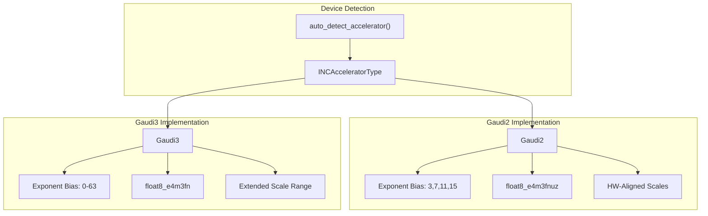
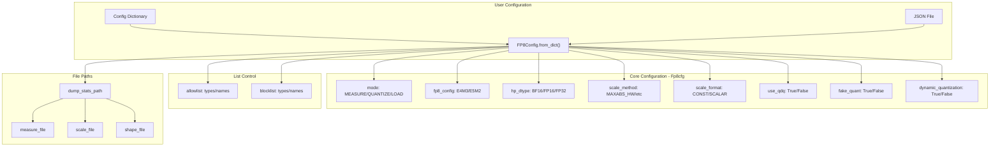
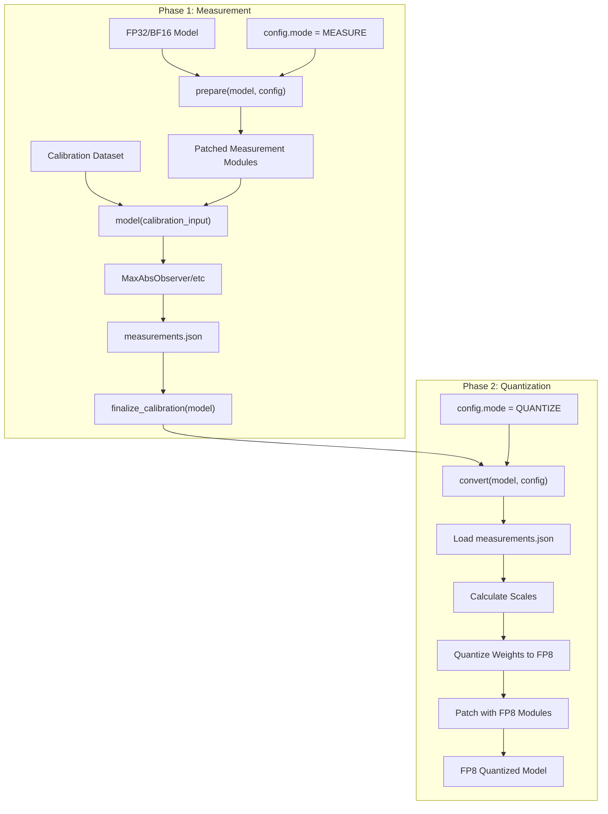
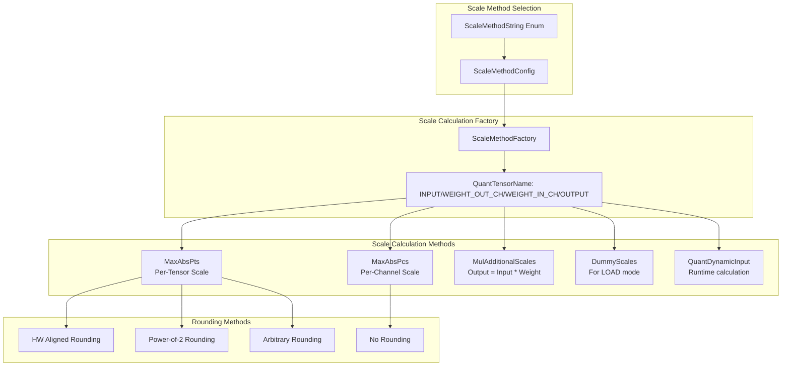
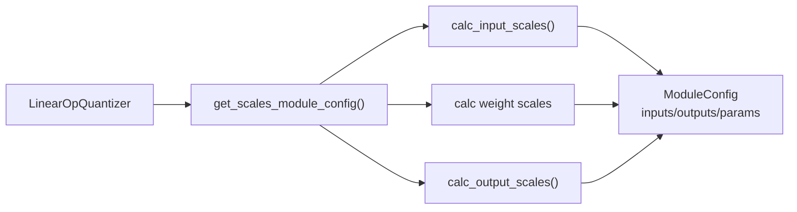
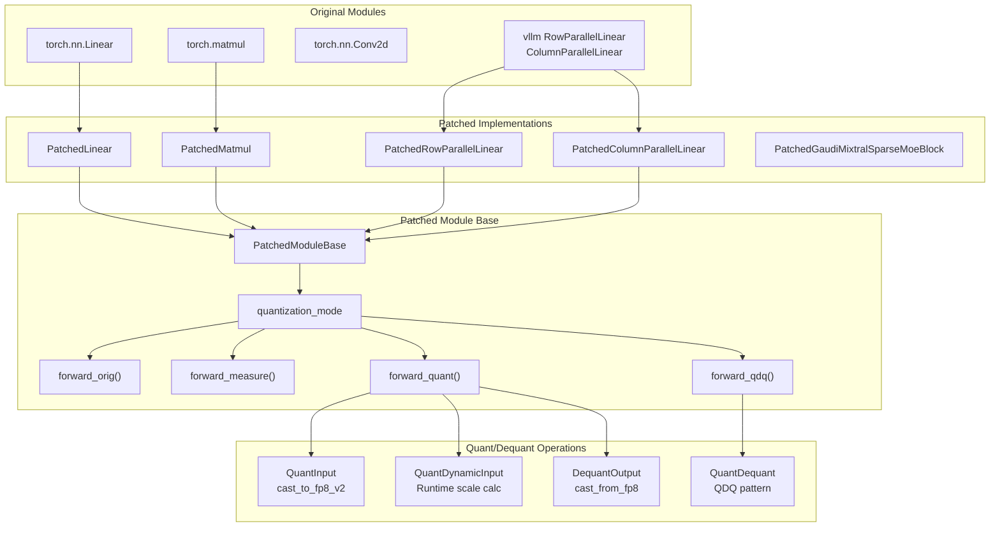
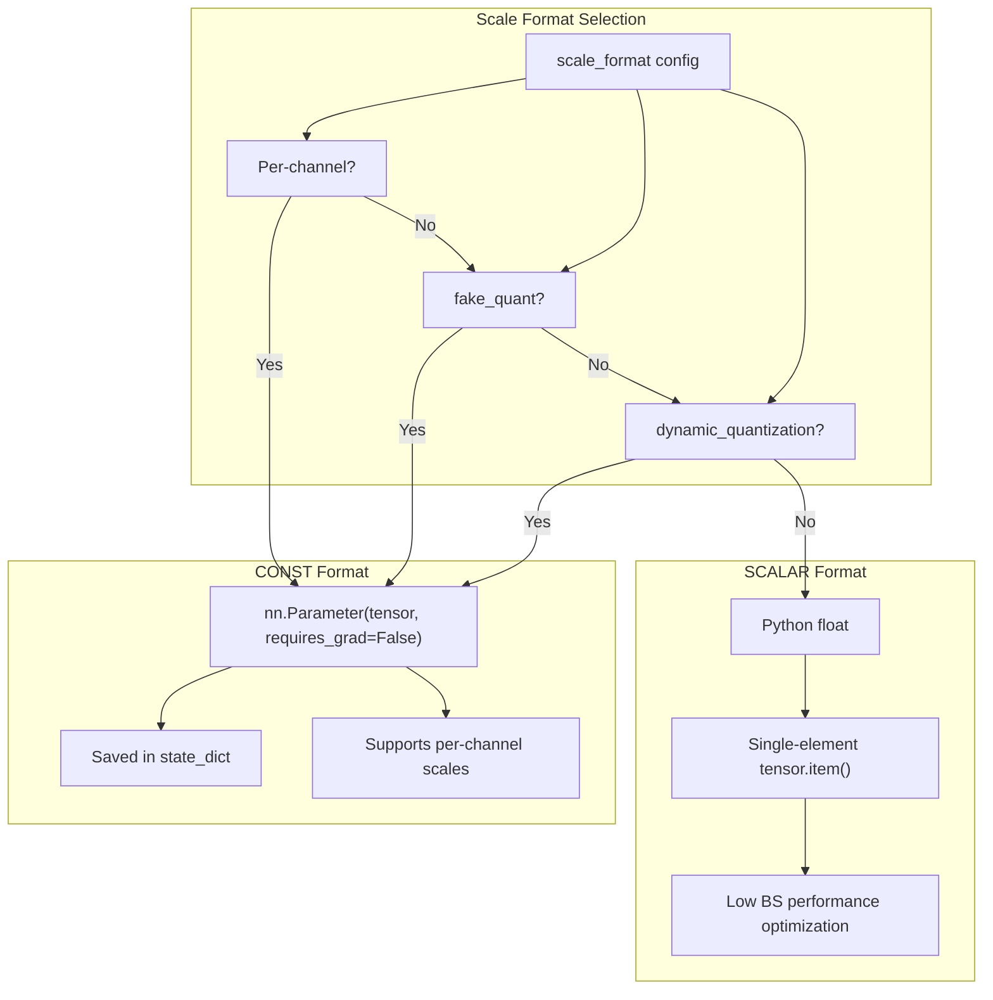
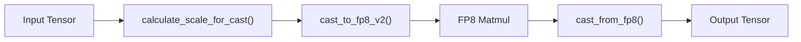
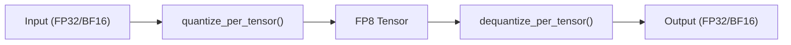
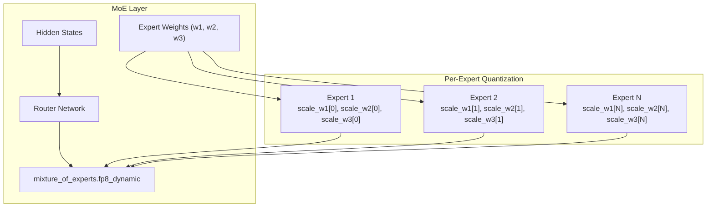

<!-- source: DeepWiki mcp.deepwiki.com · repo intel/neural-compressor · page 6.4 FP8 Quantization · fetched 2026-10-21 -->

# FP8 Quantization

<details>
<summary>Relevant source files</summary>

The following files were used as context for generating this wiki page:

- [README.md](README.md)
- [docs/source/add_new_adaptor.md](docs/source/add_new_adaptor.md)
- [docs/source/add_new_data_type.md](docs/source/add_new_data_type.md)
- [docs/source/calibration.md](docs/source/calibration.md)
- [docs/source/examples_readme.md](docs/source/examples_readme.md)
- [docs/source/framework_yaml.md](docs/source/framework_yaml.md)
- [docs/source/infrastructure.md](docs/source/infrastructure.md)
- [docs/source/mixed_precision.md](docs/source/mixed_precision.md)
- [docs/source/publication_list.md](docs/source/publication_list.md)
- [docs/source/quantization.md](docs/source/quantization.md)
- [docs/source/quantization_mixed_precision.md](docs/source/quantization_mixed_precision.md)
- [examples/README.md](examples/README.md)
- [neural_compressor/torch/algorithms/fp8_quant/_core/common.py](neural_compressor/torch/algorithms/fp8_quant/_core/common.py)
- [neural_compressor/torch/algorithms/fp8_quant/_core/fp_utils.py](neural_compressor/torch/algorithms/fp8_quant/_core/fp_utils.py)
- [neural_compressor/torch/algorithms/fp8_quant/_core/measure.py](neural_compressor/torch/algorithms/fp8_quant/_core/measure.py)
- [neural_compressor/torch/algorithms/fp8_quant/_core/patching_common.py](neural_compressor/torch/algorithms/fp8_quant/_core/patching_common.py)
- [neural_compressor/torch/algorithms/fp8_quant/_core/quant_dequant.py](neural_compressor/torch/algorithms/fp8_quant/_core/quant_dequant.py)
- [neural_compressor/torch/algorithms/fp8_quant/_core/quantize.py](neural_compressor/torch/algorithms/fp8_quant/_core/quantize.py)
- [neural_compressor/torch/algorithms/fp8_quant/_core/scale.py](neural_compressor/torch/algorithms/fp8_quant/_core/scale.py)
- [neural_compressor/torch/algorithms/fp8_quant/_core/scale_handler.py](neural_compressor/torch/algorithms/fp8_quant/_core/scale_handler.py)
- [neural_compressor/torch/algorithms/fp8_quant/_core/scale_methods/ops_quantizer.py](neural_compressor/torch/algorithms/fp8_quant/_core/scale_methods/ops_quantizer.py)
- [neural_compressor/torch/algorithms/fp8_quant/_core/scale_methods/round_scales_function.py](neural_compressor/torch/algorithms/fp8_quant/_core/scale_methods/round_scales_function.py)
- [neural_compressor/torch/algorithms/fp8_quant/_core/scale_methods/scale_method_factory.py](neural_compressor/torch/algorithms/fp8_quant/_core/scale_methods/scale_method_factory.py)
- [neural_compressor/torch/algorithms/fp8_quant/_core/scale_methods/scales_method.py](neural_compressor/torch/algorithms/fp8_quant/_core/scale_methods/scales_method.py)
- [neural_compressor/torch/algorithms/fp8_quant/_core/utils.py](neural_compressor/torch/algorithms/fp8_quant/_core/utils.py)
- [neural_compressor/torch/algorithms/fp8_quant/_quant_common/helper_modules.py](neural_compressor/torch/algorithms/fp8_quant/_quant_common/helper_modules.py)
- [neural_compressor/torch/algorithms/fp8_quant/_quant_common/quant_config.py](neural_compressor/torch/algorithms/fp8_quant/_quant_common/quant_config.py)
- [test/3x/torch/algorithms/fp8_quant/tester.py](test/3x/torch/algorithms/fp8_quant/tester.py)
- [test/3x/torch/algorithms/fp8_quant/unit_tests/test_functions/test_config_json.py](test/3x/torch/algorithms/fp8_quant/unit_tests/test_functions/test_config_json.py)
- [test/3x/torch/algorithms/fp8_quant/unit_tests/test_layers/test_conv2d.py](test/3x/torch/algorithms/fp8_quant/unit_tests/test_layers/test_conv2d.py)
- [test/3x/torch/algorithms/fp8_quant/unit_tests/test_layers/test_linear.py](test/3x/torch/algorithms/fp8_quant/unit_tests/test_layers/test_linear.py)
- [test/3x/torch/algorithms/fp8_quant/unit_tests/test_layers/test_matmul.py](test/3x/torch/algorithms/fp8_quant/unit_tests/test_layers/test_matmul.py)
- [test/3x/torch/algorithms/fp8_quant/unit_tests/test_runtime_scale_patching.py](test/3x/torch/algorithms/fp8_quant/unit_tests/test_runtime_scale_patching.py)

</details>


## Purpose and Scope

This document covers FP8 (8-bit floating point) quantization for Intel Gaudi AI Accelerators (Gaudi2 and Gaudi3). FP8 quantization reduces model memory footprint and accelerates inference by converting FP32/BF16 weights and activations to 8-bit floating point formats (E4M3 and E5M2) with minimal accuracy loss.

For general quantization concepts and other precision formats (INT8, INT4), see [Post-Training Quantization](#6.1). For weight-only quantization techniques for LLMs, see [Weight-Only Quantization](#6.3).

**Sources:** [README.md:56-89](), [docs/source/quantization.md:1-20](), [neural_compressor/torch/algorithms/fp8_quant/_quant_common/quant_config.py:1-375]()

---

## FP8 Formats and Hardware Support

### Supported FP8 Formats

FP8 quantization supports two IEEE-like 8-bit floating point formats:

| Format | Exponent Bits | Mantissa Bits | Typical Use | Hardware Support |
|--------|--------------|---------------|-------------|------------------|
| **E4M3** (float8_e4m3fn) | 4 | 3 | Weights and activations | Gaudi2, Gaudi3 |
| **E5M2** (float8_e5m2) | 5 | 2 | Gradients (training) | Gaudi2, Gaudi3 |

The E4M3 format provides higher precision in the mantissa and is the primary format for inference quantization. E5M2 offers wider dynamic range and is typically used for training gradients.

### Hardware-Specific Implementation



**Hardware Detection and Scale Calculation**

The system detects hardware type at runtime and adjusts scale calculation accordingly:

- **Gaudi2**: Uses `float8_e4m3fnuz` format with limited exponent bias options (3, 7, 11, 15)
- **Gaudi3**: Uses `float8_e4m3fn` with full range of exponent bias (0-63) for more flexible scale selection

**Sources:** [neural_compressor/torch/algorithms/fp8_quant/_quant_common/quant_config.py:47-99](), [neural_compressor/torch/algorithms/fp8_quant/_core/fp_utils.py:49-118](), [neural_compressor/torch/utils/auto_accelerator.py]()

---

## Configuration System

### FP8Config Class

The `FP8Config` class provides the primary user interface for configuring FP8 quantization. Configuration can be provided via Python dictionary or JSON file.

**Configuration Diagram**



**Key Configuration Parameters**

| Parameter | Options | Description |
|-----------|---------|-------------|
| `mode` | `MEASURE`, `QUANTIZE`, `LOAD` | Operating mode: calibration, quantization, or loading quantized model |
| `fp8_config` | `E4M3`, `E5M2` | Target FP8 format (E4M3 default for inference) |
| `hp_dtype` | `BF16`, `FP16`, `FP32` | High-precision dtype for non-quantized operations |
| `scale_method` | See Scale Methods section | Algorithm for calculating quantization scales |
| `scale_format` | `CONST`, `SCALAR` | Scale storage format (CONST for parameters, SCALAR for performance) |
| `use_qdq` | `True`, `False` | Use Quantize-Dequantize pattern (for inference/training) |
| `fake_quant` | `True`, `False` | Fake quantization for QAT |
| `dynamic_quantization` | `True`, `False` | Enable dynamic per-token quantization |

**Example Configuration**

```python
config_dict = {
    "mode": "MEASURE",
    "fp8_config": "E4M3",
    "hp_dtype": "BF16",
    "scale_method": "MAXABS_HW",
    "scale_format": "SCALAR",
    "observer": "maxabs",
    "dump_stats_path": "./stats",
    "allowlist": {"types": ["Linear"], "names": []},
    "blocklist": {"types": [], "names": ["lm_head"]}
}
```

**Sources:** [neural_compressor/torch/algorithms/fp8_quant/_quant_common/quant_config.py:146-333](), [test/3x/torch/algorithms/fp8_quant/unit_tests/test_functions/test_config_json.py:21-32]()

---

## Quantization Workflow

### Two-Phase Workflow

FP8 quantization follows a two-phase workflow: measurement (calibration) and quantization.



### Detailed Workflow Steps

#### 1. Measurement Phase (MEASURE Mode)

**Entry Point:** `prepare(model, config)` calls `prepare_model_for_measure()` in [neural_compressor/torch/algorithms/fp8_quant/_core/measure.py:118-158]()

**Process:**
1. **Module Identification**: Identifies quantizable modules via `should_quantize()` in [neural_compressor/torch/algorithms/fp8_quant/_core/utils.py:56-87]()
2. **Observer Creation**: Creates observers (e.g., `MaxAbsObserver`) for each module's inputs/outputs/parameters in [neural_compressor/torch/algorithms/fp8_quant/_core/measure.py:58-105]()
3. **Module Patching**: Replaces original modules with patched measurement modules using `patch_module_measure()` in [neural_compressor/torch/algorithms/fp8_quant/_core/measure.py:39-55]()
4. **Measurement Collection**: During forward passes, observers collect statistics (max absolute values)
5. **Finalization**: `finalize_calibration()` saves measurements to `{dump_stats_path}_hooks_maxabs.json`

#### 2. Quantization Phase (QUANTIZE Mode)

**Entry Point:** `convert(model, config)` calls `quantize()` in [neural_compressor/torch/algorithms/fp8_quant/_core/quantize.py:245-274]()

**Process:**
1. **Load Measurements**: Reads measurement files via `load_measurements()` in [neural_compressor/torch/algorithms/fp8_quant/_core/measure.py:183-208]()
2. **Scale Calculation**: Computes scales for each module using selected scale method via `load_layer_scales()` in [neural_compressor/torch/algorithms/fp8_quant/_core/scale.py:26-61]()
3. **Weight Quantization**: Quantizes static weights to FP8 via `quantize_params()` in [neural_compressor/torch/algorithms/fp8_quant/_core/quantize.py:68-89]()
4. **Module Patching**: Replaces modules with quantized versions via `patch_module()` in [neural_compressor/torch/algorithms/fp8_quant/_core/quantize.py:39-54]()
5. **Configuration**: Sets up quantization/dequantization ops for runtime

**Sources:** [neural_compressor/torch/algorithms/fp8_quant/_core/utils.py:107-131](), [neural_compressor/torch/algorithms/fp8_quant/_core/quantize.py:245-274](), [neural_compressor/torch/algorithms/fp8_quant/_core/measure.py:118-158]()

---

## Scale Calculation Methods

### Scale Method Architecture

Scale calculation is central to FP8 quantization. Scales determine the mapping between high-precision (FP32/BF16) and low-precision (FP8) values.



### Common Scale Methods

| Scale Method | Description | Granularity | Rounding | Use Case |
|--------------|-------------|-------------|----------|----------|
| `MAXABS_HW` | Hardware-aligned max absolute value | Per-tensor | HW-aligned | Best accuracy, Gaudi-optimized |
| `MAXABS_POW2` | Power-of-2 max absolute value | Per-tensor | Power-of-2 | Fast computation |
| `MAXABS_ARBITRARY` | Arbitrary max absolute value | Per-tensor | None | Maximum flexibility |
| `ACT_MAXABS_HW_WEIGHTS_PCS_MAXABS_POW2` | Per-channel weight scales | Activation: per-tensor<br/>Weight: per-channel | Mixed | Higher accuracy for weights |
| `UNIT_SCALE` | Fixed unit scale (no calibration) | N/A | None | Fast quantization-only |
| `ACT_MAXABS_PCS_POW2_WEIGHT_MAXABS_PTS_POW2_HW` | Dynamic per-token quantization | Per-token | Power-of-2 + HW | LLM dynamic quantization |

### Scale Calculation Pipeline

**For Linear Layers:**

1. **Input Scale**: Calculated from input activations during measurement
   - Class: `MaxAbsPts` in [neural_compressor/torch/algorithms/fp8_quant/_core/scale_methods/scales_method.py:86-98]()
   
2. **Weight Scale (Out Channel)**: Calculated from weight tensor
   - Class: `MaxAbsPts` or `MaxAbsPcs` depending on configuration
   - Method: `calc_maxabs_for_real_tensor()` in [neural_compressor/torch/algorithms/fp8_quant/_core/scale_methods/scales_method.py:91-98]()

3. **Weight Scale (In Channel)**: Optional for per-channel input quantization
   - Only used with certain scale methods

4. **Output Scale**: Typically product of input and weight scales
   - Class: `MulAdditionalScales` in [neural_compressor/torch/algorithms/fp8_quant/_core/scale_methods/scales_method.py:103-112]()

**Implementation in OpQuantizer:**



**Sources:** [neural_compressor/torch/algorithms/fp8_quant/_core/scale_methods/scale_method_factory.py:31-145](), [neural_compressor/torch/algorithms/fp8_quant/_core/scale_methods/ops_quantizer.py:102-196](), [neural_compressor/torch/algorithms/fp8_quant/_core/scale_methods/scales_method.py:55-98]()

---

## Module Patching System

### Patched Module Architecture

The patching system replaces standard PyTorch modules with FP8-aware versions that perform quantization/dequantization.



### Module Patching Process

**1. Module Registration**

Modules are registered in `mod_default_dict` mapping original class names to patched versions:

```python
mod_default_dict = {
    "Linear": ModuleInfo("linear", PatchedLinear),
    "Matmul": ModuleInfo("matmul", PatchedMatmul),
    "RowParallelLinear": ModuleInfo("row_parallel_linear", PatchedRowParallelLinear),
    # ... more modules
}
```

Defined in [neural_compressor/torch/algorithms/fp8_quant/_core/patching_common.py:68-93]()

**2. Module Replacement**

The `patch_module()` function replaces original modules:

```python
def patch_module(mod, qconfig, mod_dict, patched_mod=None):
    parent = parent_child_mod_dict[mod].parent
    name = parent_child_mod_dict[mod].name
    if patched_mod is None:
        patched_mod = mod_dict[mod.__class__.__name__].patched_module(mod, parent, qconfig)
    setattr(parent, name, patched_mod)
```

Defined in [neural_compressor/torch/algorithms/fp8_quant/_core/quantize.py:39-54]()

### PatchedLinear Implementation

**Structure:**

- **Initialization**: Stores quantization configuration via `ModuleExtraConfig`
- **Weight Transposition**: Weights are transposed for efficient matmul in [neural_compressor/torch/algorithms/fp8_quant/_quant_common/helper_modules.py:166]()
- **Quantization Objects**: Initializes `QuantInput`, `DequantOutput` for runtime operations

**Forward Paths:**

1. **forward_measure()**: Collects statistics via observers
2. **forward_quant()**: Performs FP8 quantized computation
3. **forward_qdq()**: Uses QDQ pattern for training/inference

**Key Methods:**

```python
def run_linear_quant(self, input, bias):
    qinput, scale_input = self.quant_input_func(input)
    y = self.matmul_fp8(qinput, self.weight,
                        out_dtype=hp_dtype,
                        scale_input_inv=scale_input,
                        scale_other_inv=self.scale_weight)
    output = y + bias if (bias is not None) else y
    return output
```

Defined in [neural_compressor/torch/algorithms/fp8_quant/_quant_common/helper_modules.py:200-208]()

### Quantized Operations

**Static Quantization:**
- Input: Pre-calculated scale, `QuantInput` performs `cast_to_fp8_v2(x, scale_inv)`
- Weight: Quantized during model preparation
- Computation: FP8 matmul via `get_quantized_func_wrapper(OP_TYPE.LINEAR_GEMM)`
- Output: Dequantized if needed via `DequantOutput`

**Dynamic Quantization:**
- Input: Runtime scale calculation via `QuantDynamicInput`
- Process: `calculate_scale_for_cast()` → `cast_to_fp8_v2()`
- Suitable for LLM inference with varying sequence lengths

**Sources:** [neural_compressor/torch/algorithms/fp8_quant/_quant_common/helper_modules.py:155-243](), [neural_compressor/torch/algorithms/fp8_quant/_core/quant_dequant.py:82-138](), [neural_compressor/torch/algorithms/fp8_quant/_core/patching_common.py:30-93]()

---

## Scale Formats and Storage

### Scale Format Options

FP8 quantization supports two scale storage formats optimized for different use cases:

| Format | Storage Type | Use Case | Performance Impact |
|--------|-------------|----------|-------------------|
| `CONST` | `nn.Parameter` (persistent) | Per-channel quantization, training | Standard, supports per-channel |
| `SCALAR` | Python float (non-persistent) | Per-tensor quantization, inference | Optimized for low batch size |



### Scale Storage Implementation

**Creating Scales:**

The `create_scale_tensor()` function converts scale values based on format:

```python
def create_scale_tensor(orig_scales, scale_format):
    if scale_format == ScaleFormat.SCALAR:
        return scale_to_scalar(orig_scales)  # Returns float
    elif scale_format == ScaleFormat.CONST:
        return scale_to_const(orig_scales)   # Returns nn.Parameter
```

Defined in [neural_compressor/torch/algorithms/fp8_quant/_core/scale_handler.py:39-75]()

**Registering Scales:**

Scales are registered as module attributes via `register_scale()`:

```python
def register_scale(patched_mod, name, scale, scale_format):
    if name in patched_mod.scale_members:
        raise ValueError("scale member {} already exists".format(name))
    scale = create_scale_tensor(scale, scale_format)
    patched_mod.scale_members.add(name)
    setattr(patched_mod, name, scale)
```

Defined in [neural_compressor/torch/algorithms/fp8_quant/_core/scale_handler.py:31-37]()

### State Dict Handling

For SCALAR format, custom state_dict methods handle float scales:

**Saving Scales:**
```python
def get_state_dict(patched_mod, *args, destination=None, prefix='', keep_vars=False):
    cur_state_dict = torch.nn.Module.state_dict(patched_mod, *args, ...)
    if patched_mod.scale_format == ScaleFormat.SCALAR:
        scale_dict = get_param_scales_from_scalar(patched_mod, prefix, ...)
        cur_state_dict.update(scale_dict)  # Convert float to tensor
    return cur_state_dict
```

**Loading Scales:**
```python
def load_state_dict(patched_mod, state_dict, ...):
    if patched_mod.scale_format == ScaleFormat.SCALAR:
        state_dict = set_param_scales_as_scalar(patched_mod, state_dict)  # Convert tensor to float
    torch.nn.Module._load_from_state_dict(patched_mod, state_dict, ...)
```

Defined in [neural_compressor/torch/algorithms/fp8_quant/_core/scale_handler.py:144-169]()

**Sources:** [neural_compressor/torch/algorithms/fp8_quant/_core/scale_handler.py:1-170](), [neural_compressor/torch/algorithms/fp8_quant/_quant_common/quant_config.py:61-76]()

---

## Advanced Features

### Dynamic Quantization

Dynamic quantization calculates scales at runtime for each input token, useful for LLMs with varying sequence lengths.

**Configuration:**
```python
config = {
    "dynamic_quantization": True,
    "scale_method": "ACT_MAXABS_PCS_POW2_WEIGHT_MAXABS_PTS_POW2_HW"
}
```

**Process Flow:**



**Implementation:**

The `QuantDynamicInput` class calculates scales per forward pass:

```python
class QuantDynamicInput(QuantDequantBase):
    def calculate_scales(self, x):
        scale = self.input_scales_creator.calc_scales(x, QuantTensorType.DYNAMIC)
        scale_inv = self.input_scales_creator.invert_scales(scale)
        return scale, scale_inv
    
    def forward(self, x):
        scale, scale_inv = self.calculate_scales(x)
        ret = self.cast_to_op(x, scale_inv, False, False, self.lp_dtype)
        return ret, scale
```

Defined in [neural_compressor/torch/algorithms/fp8_quant/_core/quant_dequant.py:114-137]()

**Limitations:**
- Only supported on Intel Gaudi (not CPU)
- Limited to specific operator types (Linear, RowParallelLinear, DynamicMoE)
- Cannot use HW-aligned rounding methods

**Sources:** [neural_compressor/torch/algorithms/fp8_quant/_quant_common/quant_config.py:246-274](), [neural_compressor/torch/algorithms/fp8_quant/_core/quant_dequant.py:114-137](), [test/3x/torch/algorithms/fp8_quant/unit_tests/test_layers/test_linear.py:129-184]()

### QDQ Mode

QDQ (Quantize-Dequantize) mode inserts quantization ops that maintain tensor types, useful for:
- Quantization-aware training (QAT)
- CPU inference (FP8 not natively supported on CPU)
- Debugging and accuracy analysis

**QDQ Pattern:**



**Implementation:**

Uses PyTorch's `torch.ops.quantized_decomposed` ops:

```python
class QuantDequant(QuantDequantBase):
    def forward_qdq(self, x, *args, **kwargs):
        y = quantize_per_tensor_to_fp8(
            x, scale=self.scale, zero_point=self.zero_point,
            quant_min=self.quant_min, quant_max=self.quant_max,
            dtype=self.lp_dtype
        )
        z = dequantize_per_tensor_from_fp8(
            y, scale=self.scale, zero_point=self.zero_point,
            quant_min=self.quant_min, quant_max=self.quant_max,
            dtype=self.lp_dtype, out_dtype=self.hp_dtype
        )
        return z
```

Defined in [neural_compressor/torch/algorithms/fp8_quant/_core/quant_dequant.py:171-220]()

**Configuration:**
```python
config = {"use_qdq": True}  # Enables QDQ mode
```

**Sources:** [neural_compressor/torch/algorithms/fp8_quant/_core/quant_dequant.py:31-220](), [neural_compressor/torch/algorithms/fp8_quant/_quant_common/quant_config.py:220-226]()

### Per-Channel Quantization

Per-channel quantization (PCQ) uses separate scales for each output channel, improving accuracy for weight tensors.

**Scale Granularity:**

| Granularity | Description | Typical Use |
|-------------|-------------|-------------|
| Per-Tensor (PTS) | Single scale for entire tensor | Activations |
| Per-Channel (PCS) | One scale per output channel | Weights |
| Per-Token (Dynamic) | One scale per token (runtime) | LLM dynamic quantization |

**Configuration:**
```python
config = {
    "scale_method": "ACT_MAXABS_HW_WEIGHTS_PCS_MAXABS_POW2"
}
```

**Implementation:**

The `MaxAbsPcs` class calculates per-channel scales:

```python
class MaxAbsPcs(MaxAbsMethod):
    def calc_maxabs_for_real_tensor_no_reshape(self, tensor):
        max_abs_tensor = calculate_scale_maxabs(
            tensor, ScaleCalculationMaxMode.MAX_ABS_PCS_CALCULATION,
            reduceAxis=self.dim, reduceKeepdim=self.keepdim,
            fullscale=self.fullscale, backoff=self.backoff
        )
        return max_abs_tensor
```

Defined in [neural_compressor/torch/algorithms/fp8_quant/_core/scale_methods/scales_method.py:143-162]()

**Note:** Per-channel quantization requires `scale_format: CONST` (not compatible with SCALAR).

**Sources:** [neural_compressor/torch/algorithms/fp8_quant/_core/scale_methods/scales_method.py:143-243](), [neural_compressor/torch/algorithms/fp8_quant/_quant_common/quant_config.py:238-245]()

### Device-Specific Scale Overrides

For compatibility, Gaudi3 models can use Gaudi2 scales:

**Configuration:**
```python
config = {
    "device_for_scales": "GAUDI2",  # Override on Gaudi3
    "scale_method": "MAXABS_HW"     # Only MAXABS_HW supports override
}
```

**Use Case:** Deploy models quantized on Gaudi2 to Gaudi3 without re-calibration.

**Validation:**

The system validates scale device overrides:

```python
def set_gaudi_device_for_scales(custom_config, measured_global_config, scale_method):
    if measured_global_config["device_for_scales"] != measured_global_config["device_type"]:
        if not check_scale_method_fields(scale_method_dict=scale_method, 
                                        scale_method=ScaleMethodString.MAXABS_HW, reducer=all):
            raise ValueError("Unsupported config: scale_method")
        if not (device_for_scales == GAUDI2 and device_type == GAUDI3):
            raise ValueError("Unsupported config: device_for_scales")
```

Defined in [neural_compressor/torch/algorithms/fp8_quant/_quant_common/quant_config.py:335-356]()

**Sources:** [neural_compressor/torch/algorithms/fp8_quant/_quant_common/quant_config.py:335-356](), [test/3x/torch/algorithms/fp8_quant/unit_tests/test_layers/test_linear.py:103-110]()

### Mixture of Experts (MoE) Support

FP8 quantization supports vLLM and DeepSpeed MoE implementations:

**Supported Architectures:**
- `vllm.FusedMoE` (via `PatchedMixtralMoE`)
- `GaudiMixtralSparseMoeBlock` (via `PatchedGaudiMixtralSparseMoeBlock`)

**MoE Quantization:**



**Per-Expert Scale Calculation:**

Each expert gets individual scales to maximize accuracy:

```python
class PatchedGaudiMixtralSparseMoeBlock(PatchedModuleBase):
    def call_dynamic_moe_quant_op(self, hidden_states, expert_routing_table, ...):
        w1_list = [self.experts[i].w1.weight for i in self.experts_range]
        w2_list = [self.experts[i].w2.weight for i in self.experts_range]
        w3_list = [self.experts[i].w3.weight for i in self.experts_range]
        scale_w1 = [self.experts[i].w1.scale_weight for i in self.experts_range]
        scale_w2 = [self.experts[i].w2.scale_weight for i in self.experts_range]
        scale_w3 = [self.experts[i].w3.scale_weight for i in self.experts_range]
        # ... calls torch.ops.hpu.mixture_of_experts
```

Defined in [neural_compressor/torch/algorithms/fp8_quant/_quant_common/helper_modules.py:722-752]()

**Sources:** [neural_compressor/torch/algorithms/fp8_quant/_quant_common/helper_modules.py:639-786](), [neural_compressor/torch/algorithms/fp8_quant/_core/scale_methods/ops_quantizer.py:374-421]()

### HPU Graph Support

HPU graphs cache compiled computation graphs for improved performance:

**Usage:**
```python
import habana_frameworks.torch as ht

model = convert(model, config)
model = ht.hpu.wrap_in_hpu_graph(model)  # Enable HPU graphs

# Inference
output = model(input)  # Cached after first run
```

**Compatibility:**
- Compatible with both static and dynamic quantization
- Works with all scale methods
- Requires `PT_HPU_LAZY_MODE=1` for low-precision ops

**Sources:** [test/3x/torch/algorithms/fp8_quant/tester.py:147-150](), [README.md:64]()

---

## Usage Examples

### Basic Static Quantization

```python
from neural_compressor.torch.quantization import FP8Config, prepare, convert, finalize_calibration
import torch
import torchvision.models as models

# Load model
model = models.resnet18().to("hpu")

# Configure FP8 quantization
config = FP8Config(fp8_config="E4M3", scale_method="MAXABS_HW")

# Phase 1: Measurement
model = prepare(model, config)
for data in calibration_loader:
    model(data)  # Collect statistics
finalize_calibration(model)

# Phase 2: Quantization
model = convert(model, config)

# Inference
output = model(input_tensor.to("hpu"))
```

### Advanced Configuration with JSON

```python
config_dict = {
    "mode": "MEASURE",
    "fp8_config": "E4M3",
    "hp_dtype": "BF16",
    "scale_method": "MAXABS_HW",
    "scale_format": "SCALAR",
    "observer": "maxabs",
    "dump_stats_path": "./fp8_stats",
    "allowlist": {
        "types": ["Linear", "Conv2d"],
        "names": []
    },
    "blocklist": {
        "types": [],
        "names": ["classifier"]  # Skip final layer
    }
}

measure_config = FP8Config.from_dict(config_dict)
```

### Dynamic Quantization for LLMs

```python
config = FP8Config(
    fp8_config="E4M3",
    scale_method="ACT_MAXABS_PCS_POW2_WEIGHT_MAXABS_PTS_POW2_HW",
    dynamic_quantization=True,
    scale_format="CONST"
)

# No measurement phase needed
model = convert(model, config)

# Scales calculated per forward pass
output = model(input_tokens)
```

**Sources:** [README.md:67-88](), [test/3x/torch/algorithms/fp8_quant/unit_tests/test_functions/test_config_json.py:21-56](), [test/3x/torch/algorithms/fp8_quant/unit_tests/test_layers/test_linear.py:56-120]()

---

## File Organization

### Core Module Structure

```
neural_compressor/torch/algorithms/fp8_quant/
├── _quant_common/
│   ├── quant_config.py          # Fp8cfg, QuantMode, ScaleFormat
│   └── helper_modules.py        # PatchedLinear, PatchedMatmul, etc.
├── _core/
│   ├── quantize.py             # Main quantization logic
│   ├── measure.py              # Measurement phase logic
│   ├── scale.py                # Scale loading/calculation
│   ├── common.py               # Utilities, file I/O
│   ├── quant_dequant.py        # QuantInput, DequantOutput, QuantDequant
│   ├── patching_common.py      # Module registration, parent_child_mod_dict
│   ├── scale_handler.py        # Scale format handling, state_dict
│   ├── utils.py                # prepare_model, should_quantize
│   ├── fp_utils.py             # FP8 utilities, fullscale calculation
│   ├── scale_methods/
│   │   ├── scale_method_config.py     # ScaleMethodConfig, ScaleMethodString
│   │   ├── scale_method_factory.py    # ScaleMethodFactory, QuantTensorName
│   │   ├── ops_quantizer.py           # LinearOpQuantizer, MatmulOpQuantizer
│   │   ├── scales_method.py           # MaxAbsPts, MaxAbsPcs, etc.
│   │   └── round_scales_function.py   # HW-aligned rounding
│   └── quantized_func_wrappers.py     # HPU op wrappers
└── prepare_quant/
    └── prepare_model.py         # High-level prep_model API
```

**Sources:** [neural_compressor/torch/algorithms/fp8_quant/_quant_common/quant_config.py:1-15](), [neural_compressor/torch/algorithms/fp8_quant/_core/quantize.py:1-20](), [neural_compressor/torch/algorithms/fp8_quant/_core/scale_methods/ops_quantizer.py:1-20]()

---

## Limitations and Constraints

### Hardware Requirements

- **Required**: Intel Gaudi2 or Gaudi3 AI Accelerator
- **CPU Support**: Limited to QDQ mode (no native FP8 computation)
- **GPU Support**: Not supported

### Configuration Constraints

| Constraint | Details |
|-----------|---------|
| **Dynamic + HW-aligned** | Dynamic quantization incompatible with HW-aligned rounding methods |
| **Dynamic + SCALAR** | Dynamic quantization requires `scale_format: CONST` |
| **Per-channel + SCALAR** | Per-channel quantization requires `scale_format: CONST` |
| **Device override** | Only `MAXABS_HW` supports `device_for_scales` override, only Gaudi2→Gaudi3 |
| **Fake quant + SCALAR** | Fake quantization requires `scale_format: CONST` |

### Operator Support

Static quantization supports:
- `Linear`, `Conv2d`
- `Matmul`
- `RowParallelLinear`, `ColumnParallelLinear` (vLLM)
- `FusedMoE` (vLLM, DeepSpeed)
- `Softmax`, `FSDPA`
- `KVCache`

Dynamic quantization supports (limited):
- `Linear`
- `RowParallelLinear`
- `DynamicMoE`

**Sources:** [neural_compressor/torch/algorithms/fp8_quant/_quant_common/quant_config.py:220-274](), [neural_compressor/torch/algorithms/fp8_quant/_quant_common/quant_config.py:100-106](), [test/3x/torch/algorithms/fp8_quant/tester.py:28-42]()

---

