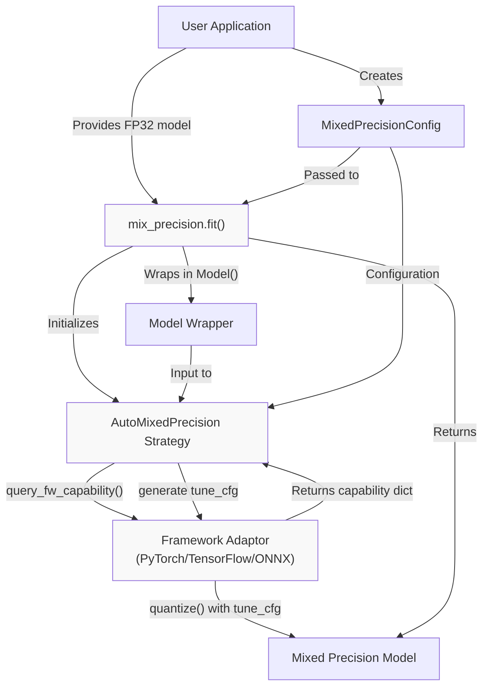
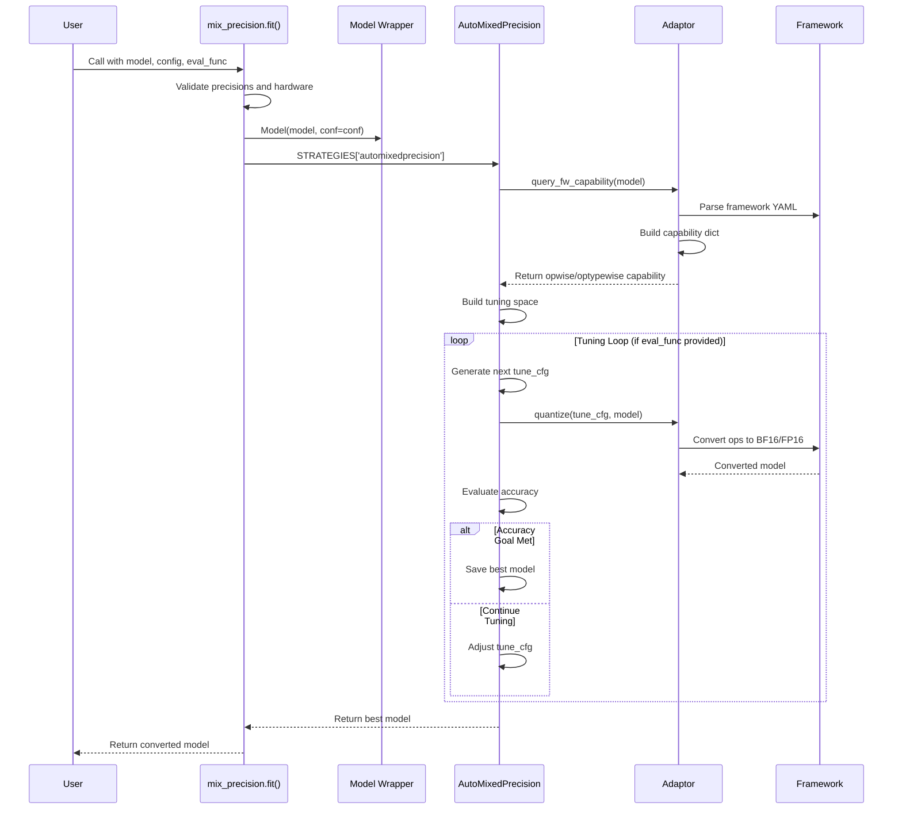
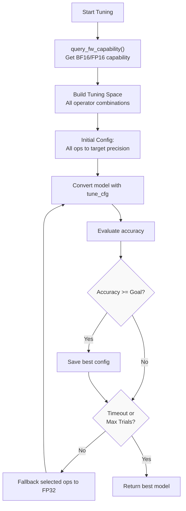
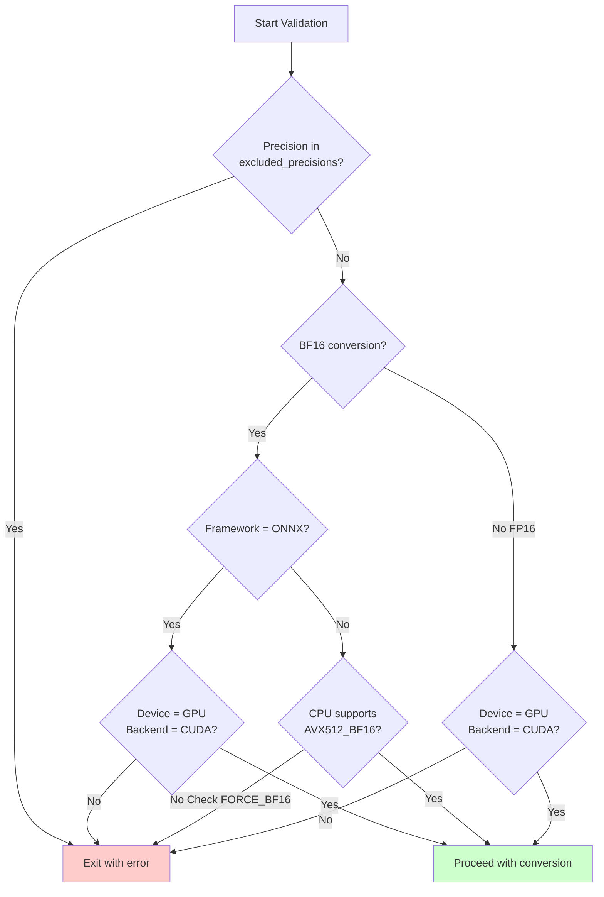
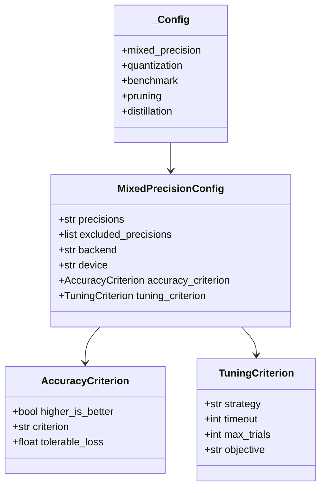
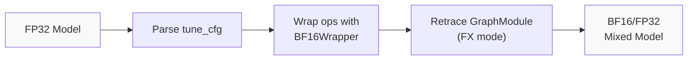

<!-- source: DeepWiki mcp.deepwiki.com · repo intel/neural-compressor · page 6.5 Mixed Precision · fetched 2026-10-21 -->

# Mixed Precision

<details>
<summary>Relevant source files</summary>

The following files were used as context for generating this wiki page:

- [README.md](README.md)
- [docs/source/add_new_adaptor.md](docs/source/add_new_adaptor.md)
- [docs/source/add_new_data_type.md](docs/source/add_new_data_type.md)
- [docs/source/calibration.md](docs/source/calibration.md)
- [docs/source/examples_readme.md](docs/source/examples_readme.md)
- [docs/source/framework_yaml.md](docs/source/framework_yaml.md)
- [docs/source/infrastructure.md](docs/source/infrastructure.md)
- [docs/source/mixed_precision.md](docs/source/mixed_precision.md)
- [docs/source/publication_list.md](docs/source/publication_list.md)
- [docs/source/quantization.md](docs/source/quantization.md)
- [docs/source/quantization_mixed_precision.md](docs/source/quantization_mixed_precision.md)
- [examples/README.md](examples/README.md)
- [neural_compressor/benchmark.py](neural_compressor/benchmark.py)
- [neural_compressor/config.py](neural_compressor/config.py)
- [neural_compressor/mix_precision.py](neural_compressor/mix_precision.py)
- [neural_compressor/model/model.py](neural_compressor/model/model.py)
- [neural_compressor/quantization.py](neural_compressor/quantization.py)
- [neural_compressor/training.py](neural_compressor/training.py)
- [neural_compressor/utils/utility.py](neural_compressor/utils/utility.py)
- [test/adaptor/pytorch_adaptor/test_adaptor_security.py](test/adaptor/pytorch_adaptor/test_adaptor_security.py)

</details>


## Purpose and Scope

This document describes the **Mixed Precision** capability in Intel Neural Compressor, which converts FP32 models to lower-precision formats (BF16/FP16) to improve inference performance while maintaining acceptable accuracy. Mixed precision conversion is a standalone optimization technique that operates independently of quantization.

**Note**: This page covers the dedicated mixed precision API provided by the `neural_compressor.mix_precision` module. For information about mixed precision behavior *during quantization* (where BF16 conversion is automatically applied alongside INT8 quantization), see the quantization documentation in section [6.1](#6.1). The two are separate features with different APIs and workflows.

## Overview

Mixed Precision in Intel Neural Compressor provides model conversion from FP32 to BF16 (bfloat16) or FP16 (half-precision) formats. These lower-precision formats reduce memory bandwidth and computational requirements while typically maintaining acceptable accuracy on modern hardware.

The system supports:
- **BF16 conversion**: Targets Intel CPUs with AVX512_BF16 instruction set (3rd Gen Intel Xeon Scalable processors and later)
- **FP16 conversion**: Targets GPU devices (ONNX Runtime with CUDA execution provider)
- **Accuracy-aware tuning**: Automatically falls back problematic ops to FP32 to recover accuracy
- **Framework-agnostic interface**: Unified API across TensorFlow, PyTorch, and ONNX Runtime

**Sources**: [neural_compressor/mix_precision.py:1-180](), [docs/source/mixed_precision.md:1-168]()

## Key Concepts

### Data Format Comparison

| Format | Bits | Sign | Exponent | Mantissa | Range | Precision |
|--------|------|------|----------|----------|-------|-----------|
| FP32   | 32   | 1    | 8        | 23       | ~10^±38 | ~7 decimal digits |
| BF16   | 16   | 1    | 8        | 7        | ~10^±38 | ~2 decimal digits |
| FP16   | 16   | 1    | 5        | 10       | ~10^±4  | ~3 decimal digits |

BF16 maintains the same exponent range as FP32, making it easier to substitute in existing models without numerical issues, while FP16 provides better mantissa precision at the cost of reduced range.

**Sources**: [docs/source/mixed_precision.md:11-17]()

## Configuration System

### MixedPrecisionConfig

The `MixedPrecisionConfig` class defines all parameters for mixed precision conversion. It inherits from `_BaseQuantizationConfig` and extends it with precision-specific settings.

**Key Configuration Parameters**:

```python
class MixedPrecisionConfig(_BaseQuantizationConfig):
    precisions: str or list           # Target precision: "bf16", "fp16", or ["bf16", "fp16"]
    excluded_precisions: list         # Precisions to exclude (e.g., ["bf16"])
    accuracy_criterion: AccuracyCriterion  # Accuracy goal for tuning
    tuning_criterion: TuningCriterion      # Tuning strategy and timeout
    backend: str                      # Execution backend ("default", "ipex", "onnxrt_cuda_ep", etc.)
    device: str                       # Target device ("cpu", "gpu")
```

Configuration is passed to `mix_precision.fit()` to control the conversion process.

**Sources**: [neural_compressor/config.py:715-825](), [docs/source/mixed_precision.md:131-159]()

## Architecture and Workflow

### High-Level System Flow



**Diagram: Mixed Precision Conversion Flow**

**Sources**: [neural_compressor/mix_precision.py:36-179]()

### Detailed Conversion Process

The mixed precision conversion follows this sequence:



**Diagram: Mixed Precision Tuning Sequence**

**Sources**: [neural_compressor/mix_precision.py:36-179](), [neural_compressor/strategy/__init__.py]()

## Framework Support Matrix

### Supported Backends and Precisions

| Framework | Backend | Backend Library | Device | BF16 Support | FP16 Support |
|-----------|---------|-----------------|--------|--------------|--------------|
| PyTorch | `"default"` (FX) | FBGEMM | CPU | ✓ | ✗ |
| PyTorch | `"ipex"` | OneDNN | CPU | ✓ | ✗ |
| ONNX Runtime | `"onnxrt_cuda_ep"` | CUDA | GPU | ✓ | ✓ |
| ONNX Runtime | `"onnxrt_dnnl_ep"` | OneDNN | CPU | ✓ | ✗ |
| TensorFlow | `"default"` | OneDNN | CPU | ✓ (deprecated) | ✗ |
| TensorFlow | `"itex"` | OneDNN | CPU/GPU | ✓ (deprecated) | ✗ |

**Hardware Requirements**:
- **BF16 on CPU**: Intel CPU with AVX512_BF16 instruction set (3rd Gen Xeon Scalable or later)
- **FP16 on GPU**: NVIDIA GPU with ONNX Runtime CUDA execution provider
- **BF16 on GPU**: NVIDIA GPU with ONNX Runtime CUDA execution provider

**Sources**: [docs/source/mixed_precision.md:19-102]()

### Framework YAML Capabilities

Each framework defines its mixed precision capabilities in a YAML file that specifies which operators support BF16/FP16 conversion:

```yaml
# Example from pytorch_cpu.yaml
precisions:
  names: int8, uint8, bf16, fp32
  
ops:
  bf16: ['Conv2d', 'Linear', 'BatchNorm2d', ...]
  fp32: ['*']  # All ops support FP32 fallback

capabilities:
  bf16:
    'Conv2d':
      weight: {dtype: ['bf16', 'fp32']}
      activation: {dtype: ['bf16', 'fp32']}
```

The adaptor parses these YAML files to determine which operators can be converted to lower precision.

**Sources**: [docs/source/framework_yaml.md:1-194](), [neural_compressor/adaptor/]()

## Tuning Strategy

### AutoMixedPrecision Strategy

When accuracy-aware tuning is enabled (by providing `eval_func` or `eval_dataloader` + `eval_metric`), the system uses the `automixedprecision` strategy to automatically determine which operators should be converted and which should remain in FP32.

**Strategy Selection**:
```python
# In mix_precision.py
strategy = STRATEGIES["automixedprecision"](
    model=wrapped_model,
    conf=config,
    eval_func=eval_func,
    eval_dataloader=eval_dataloader,
    eval_metric=metric,
    resume=_resume,
    q_hooks=None,
)
```

**Tuning Process**:



**Diagram: Accuracy-Aware Mixed Precision Tuning Flow**

**Tuning Configuration Format**:

Each tuning configuration specifies the precision for each operator:

```python
tune_cfg = {
    'op': {
        ('conv1', 'Conv2d'): {
            'weight': {'dtype': 'bf16'},
            'activation': {'dtype': 'bf16'}
        },
        ('fc1', 'Linear'): {
            'weight': {'dtype': 'fp32'},  # Fallback to FP32
            'activation': {'dtype': 'fp32'}
        },
        ...
    }
}
```

**Sources**: [neural_compressor/mix_precision.py:147-159](), [neural_compressor/strategy/]()

## API Usage Patterns

### Basic Conversion (No Tuning)

Convert all eligible operators to BF16 without accuracy checking:

```python
from neural_compressor import mix_precision
from neural_compressor.config import MixedPrecisionConfig

# Configure for BF16 conversion
conf = MixedPrecisionConfig()  # Default precision is "bf16"

# Convert model (no eval_func = no tuning)
converted_model = mix_precision.fit(model, conf=conf)
converted_model.save("./bf16_model")
```

**Sources**: [docs/source/mixed_precision.md:131-144]()

### Accuracy-Aware Tuning

Enable automatic fallback to FP32 for accuracy-critical operators:

```python
from neural_compressor import mix_precision
from neural_compressor.config import MixedPrecisionConfig, AccuracyCriterion

# Configure with accuracy goal
conf = MixedPrecisionConfig(
    precisions="bf16",
    accuracy_criterion=AccuracyCriterion(
        higher_is_better=True,
        criterion="relative",
        tolerable_loss=0.01  # Allow 1% accuracy drop
    )
)

# Provide evaluation function for tuning
def eval_func(model):
    # User's evaluation logic
    return accuracy_score

converted_model = mix_precision.fit(
    model,
    conf=conf,
    eval_func=eval_func
)
```

**Sources**: [neural_compressor/mix_precision.py:36-83]()

### FP16 Conversion for GPU

Convert ONNX model to FP16 for GPU inference:

```python
from neural_compressor import mix_precision
from neural_compressor.config import MixedPrecisionConfig

conf = MixedPrecisionConfig(
    backend="onnxrt_cuda_ep",
    device="gpu",
    precisions="fp16"
)

converted_model = mix_precision.fit(model, conf=conf)
```

**Sources**: [docs/source/mixed_precision.md:146-159]()

## Implementation Details

### Entry Point: mix_precision.fit()

The `fit()` function is the main entry point for mixed precision conversion:

**Function Signature**:
```python
def fit(model, conf, eval_func=None, eval_dataloader=None, eval_metric=None, **kwargs)
```

**Key Responsibilities**:
1. **Validation**: Check hardware support and precision compatibility
2. **Model Wrapping**: Create `Model` wrapper object
3. **Strategy Initialization**: Set up `automixedprecision` strategy
4. **Tuning Execution**: Run tuning loop if evaluation provided
5. **Result Handling**: Return best model or raise error

**Sources**: [neural_compressor/mix_precision.py:36-179]()

### Hardware Validation

The system performs extensive validation before conversion:



**Diagram: Hardware and Precision Validation Flow**

**Validation Code Location**: [neural_compressor/mix_precision.py:87-124]()

The validation checks include:
- Target precision not in `excluded_precisions`
- BF16 requires CPU with AVX512_BF16 or ONNX Runtime with CUDA EP
- FP16 requires ONNX Runtime with CUDA execution provider
- Framework-specific backend compatibility

**Sources**: [neural_compressor/mix_precision.py:87-124]()

### Model Wrapper Integration

The system wraps the input model using the `Model` class:

```python
wrapped_model = Model(model, conf=conf)
```

This wrapper:
- Normalizes model representation across frameworks
- Provides unified interface for adaptors
- Stores configuration metadata
- Enables model saving/loading

**Key Classes**:
- `Model`: Factory class that creates framework-specific model objects [neural_compressor/model/model.py:150-253]()
- `BaseModel`: Base class for all model wrappers [neural_compressor/model/base_model.py]()
- Framework-specific implementations (e.g., `PyTorchModel`, `TensorflowModel`, `ONNXModel`)

**Sources**: [neural_compressor/model/model.py:150-253](), [neural_compressor/mix_precision.py:96]()

### Config Object Structure

The configuration system uses a hierarchical structure:



**Diagram: Configuration Class Hierarchy**

The `_Config` wrapper unifies different compression techniques into a single configuration object passed to strategies.

**Sources**: [neural_compressor/config.py:489-712](), [neural_compressor/mix_precision.py:131]()

## Adaptor Integration

### Adaptor Role

Adaptors bridge the framework-agnostic tuning strategy with framework-specific conversion APIs. For mixed precision, the adaptor must implement:

1. **query_fw_capability()**: Return which operators support BF16/FP16
2. **quantize()**: Apply the tuning configuration to convert operators

### Capability Query Format

The adaptor returns a capability dictionary with this structure:

```python
capability = {
    'opwise': {
        ('conv1', 'Conv2d'): [
            {'weight': {'dtype': 'bf16'}, 'activation': {'dtype': 'bf16'}},
            {'weight': {'dtype': 'fp32'}, 'activation': {'dtype': 'fp32'}}
        ],
        ('fc1', 'Linear'): [
            {'weight': {'dtype': 'bf16'}, 'activation': {'dtype': 'bf16'}},
            {'weight': {'dtype': 'fp32'}, 'activation': {'dtype': 'fp32'}}
        ],
        ...
    },
    'optypewise': {
        'Conv2d': {
            'weight': {'dtype': 'bf16'},
            'activation': {'dtype': 'bf16'}
        },
        'Linear': {
            'weight': {'dtype': 'bf16'},
            'activation': {'dtype': 'bf16'}
        },
        ...
    }
}
```

- **opwise**: Per-operator instance capabilities (keyed by `(name, op_type)` tuple)
- **optypewise**: Per operator type default capabilities

**Sources**: [docs/source/add_new_adaptor.md:46-105]()

### Conversion Implementation

When the strategy calls `adaptor.quantize(tune_cfg, model)`, the adaptor:

1. Parses the `tune_cfg` to identify which operators need conversion
2. Inserts BF16/FP16 cast operations around target operators
3. Applies framework-specific optimizations (e.g., fusion, constant folding)
4. Returns the converted model

**PyTorch BF16 Conversion Example Flow**:



**Diagram: PyTorch BF16 Conversion Process**

**Sources**: [docs/source/quantization_mixed_precision.md:45-64]()

## Comparison: Mixed Precision vs. Quantization Mixed Precision

Intel Neural Compressor has two distinct mixed precision features that serve different purposes:

| Feature | Mixed Precision API | Quantization Mixed Precision |
|---------|---------------------|------------------------------|
| **Entry Point** | `mix_precision.fit()` | `quantization.fit()` with auto BF16 |
| **Primary Goal** | Convert FP32 → BF16/FP16 | INT8 quantization with BF16 fallback |
| **Output Precision** | BF16/FP16/FP32 | INT8/BF16/FP32 |
| **Configuration** | `MixedPrecisionConfig` | `PostTrainingQuantConfig` |
| **Default Behavior** | Manual invocation required | Automatic during quantization |
| **Hardware Target** | CPUs with AVX512_BF16 or GPUs | Same as quantization target |
| **Use Case** | Pure reduced-precision inference | Quantization with accuracy recovery |
| **Disable Option** | N/A (separate feature) | Set `excluded_precisions=["bf16"]` |

**Key Distinction**: The mixed precision API is a standalone feature for FP32→BF16/FP16 conversion, while quantization mixed precision is an automatic fallback mechanism that applies BF16 to operators that cannot be quantized to INT8 or experience accuracy loss from INT8.

**Sources**: [docs/source/quantization_mixed_precision.md:1-64](), [neural_compressor/mix_precision.py:1-180]()

## Common Usage Scenarios

### Scenario 1: CPU BF16 Conversion for Inference Speedup

**Goal**: Maximize throughput on Intel Xeon with AVX512_BF16

```python
from neural_compressor import mix_precision
from neural_compressor.config import MixedPrecisionConfig

# Simple conversion without accuracy tuning
conf = MixedPrecisionConfig(
    precisions="bf16",
    backend="ipex",  # Use Intel Extension for PyTorch
    device="cpu"
)

bf16_model = mix_precision.fit(model, conf=conf)
bf16_model.save("./bf16_optimized")
```

### Scenario 2: GPU FP16 Conversion with Accuracy Protection

**Goal**: Deploy FP16 model on NVIDIA GPU while maintaining accuracy

```python
from neural_compressor import mix_precision
from neural_compressor.config import MixedPrecisionConfig, AccuracyCriterion

conf = MixedPrecisionConfig(
    precisions="fp16",
    backend="onnxrt_cuda_ep",
    device="gpu",
    accuracy_criterion=AccuracyCriterion(
        tolerable_loss=0.005  # Max 0.5% accuracy drop
    )
)

fp16_model = mix_precision.fit(
    model,
    conf=conf,
    eval_dataloader=validation_loader,
    eval_metric={"topk": 1}
)
```

### Scenario 3: Multi-Precision Evaluation

**Goal**: Compare BF16 and FP16 to select best option

```python
# Test both precisions
for precision in ["bf16", "fp16"]:
    try:
        conf = MixedPrecisionConfig(
            precisions=precision,
            backend="onnxrt_cuda_ep" if precision == "fp16" else "default",
            device="gpu" if precision == "fp16" else "cpu"
        )
        
        converted = mix_precision.fit(model, conf=conf, eval_func=evaluate)
        print(f"{precision}: Accuracy = {evaluate(converted)}")
    except Exception as e:
        print(f"{precision}: Not supported - {e}")
```

**Sources**: [docs/source/mixed_precision.md:131-168](), [examples/README.md:69-77]()

## Limitations and Considerations

### IPEX Backend Limitation

The Intel Extension for PyTorch (IPEX) backend does **not** support accuracy-aware tuning. When using `backend="ipex"`, do not provide `eval_func` or `eval_dataloader`:

```python
# Correct: No evaluation function with IPEX
conf = MixedPrecisionConfig(backend="ipex", precisions="bf16")
model = mix_precision.fit(model, conf=conf)

# Incorrect: Will fail or produce unexpected results
model = mix_precision.fit(model, conf=conf, eval_func=evaluate)
```

**Sources**: [docs/source/mixed_precision.md:128-129]()

### Precision Exclusion

To prevent BF16 conversion during quantization, explicitly exclude it:

```python
from neural_compressor.config import PostTrainingQuantConfig

# Force pure INT8/FP32 quantization (no BF16)
conf = PostTrainingQuantConfig(excluded_precisions=["bf16"])
```

**Sources**: [docs/source/quantization_mixed_precision.md:1-16]()

### Framework-Specific Constraints

- **TensorFlow**: BF16 support is deprecated; use PyTorch or ONNX Runtime for new projects
- **PyTorch FP16**: Not supported on CPU backend
- **ONNX Runtime FP16**: Requires GPU with CUDA execution provider
- **ONNX Runtime BF16**: Requires CUDA EP or DNNL EP depending on device

**Sources**: [docs/source/mixed_precision.md:19-120]()

## Error Handling and Validation

### Common Validation Errors

The `fit()` function performs extensive validation and exits with informative errors:

**Error: Precision in excluded_precisions**
```
"Target precision is in excluded_precisions, please modify precision or 
excluded_precisions to make it understandable."
```
**Source**: [neural_compressor/mix_precision.py:87-92]()

**Error: FP16 without GPU**
```
"Mix precision exits due to fp16 for onnx models needs 'gpu' device and 
'onnxrt_cuda_ep' backend."
```
**Source**: [neural_compressor/mix_precision.py:99-104]()

**Error: BF16 without hardware support**
```
"Mix precision exits due to the hardware doesn't support bf16 instruction."
```
Can be overridden with `FORCE_BF16=1` environment variable.
**Source**: [neural_compressor/mix_precision.py:114-121]()

### Tuning Timeout Handling

The tuning process respects the configured timeout:

```python
from neural_compressor.config import TuningCriterion

conf = MixedPrecisionConfig(
    tuning_criterion=TuningCriterion(
        timeout=3600,      # 1 hour timeout
        max_trials=100     # Or max 100 trials
    )
)
```

If timeout or max_trials is reached:
- **Best model found**: Returns model with best accuracy
- **No acceptable model**: Logs error and returns None

**Sources**: [neural_compressor/mix_precision.py:157-179]()

## Related Components

### Strategy Module Integration

The mixed precision feature integrates with the strategy module through the `automixedprecision` strategy class. This strategy is automatically selected when calling `mix_precision.fit()`:

```python
strategy = STRATEGIES["automixedprecision"](
    model=wrapped_model,
    conf=config,
    eval_func=eval_func,
    eval_dataloader=eval_dataloader,
    eval_metric=metric,
    resume=_resume,
    q_hooks=None,
)
```

**Sources**: [neural_compressor/mix_precision.py:147-155](), [neural_compressor/strategy/__init__.py]()

### Model Save and Load

Converted models can be saved and loaded using the standard model interface:

```python
# Save
converted_model.save("./output_path")

# Load (framework-specific)
from neural_compressor.model import Model
loaded_model = Model("./output_path")
```

The saved model includes precision metadata in the configuration.

**Sources**: [neural_compressor/model/model.py:150-253]()

## Examples and References

### Example Models

The repository includes mixed precision examples for various model types:

- **PyTorch ResNet18**: [examples/pytorch/cv/mixed_precision]()
- **IPEX DistilBERT**: [examples/deprecated/pytorch/nlp/huggingface_models/question-answering/mixed_precision/ipex]()
- **TensorFlow ResNet50**: [examples/deprecated/tensorflow/image_recognition/tensorflow_models/resnet50_v1/mixed_precision]()
- **ONNX Runtime BERT**: [examples/deprecated/onnxrt/nlp/huggingface_model/text_classification/mix_precision]()

**Sources**: [docs/source/mixed_precision.md:161-167](), [examples/README.md:69-77]()

### Code References

Key source files for understanding mixed precision implementation:

| Component | File Path | Key Classes/Functions |
|-----------|-----------|----------------------|
| Main API | [neural_compressor/mix_precision.py:1-180]() | `fit()` |
| Configuration | [neural_compressor/config.py:715-1033]() | `MixedPrecisionConfig` |
| Model Wrapper | [neural_compressor/model/model.py:150-253]() | `Model` |
| Strategy Base | [neural_compressor/strategy/]() | `STRATEGIES` registry |
| Utilities | [neural_compressor/utils/utility.py:310-416]() | `CpuInfo` class |

**Sources**: Multiple files cited above

---

