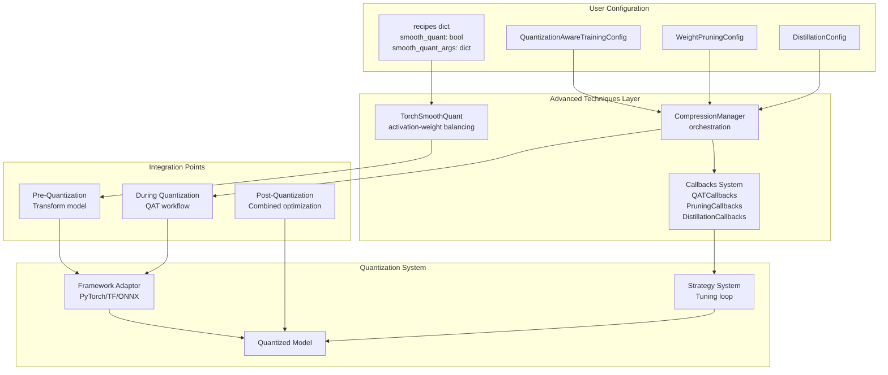
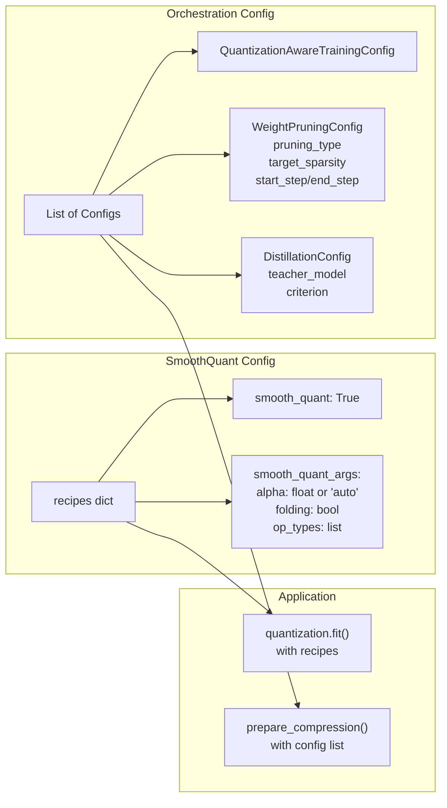
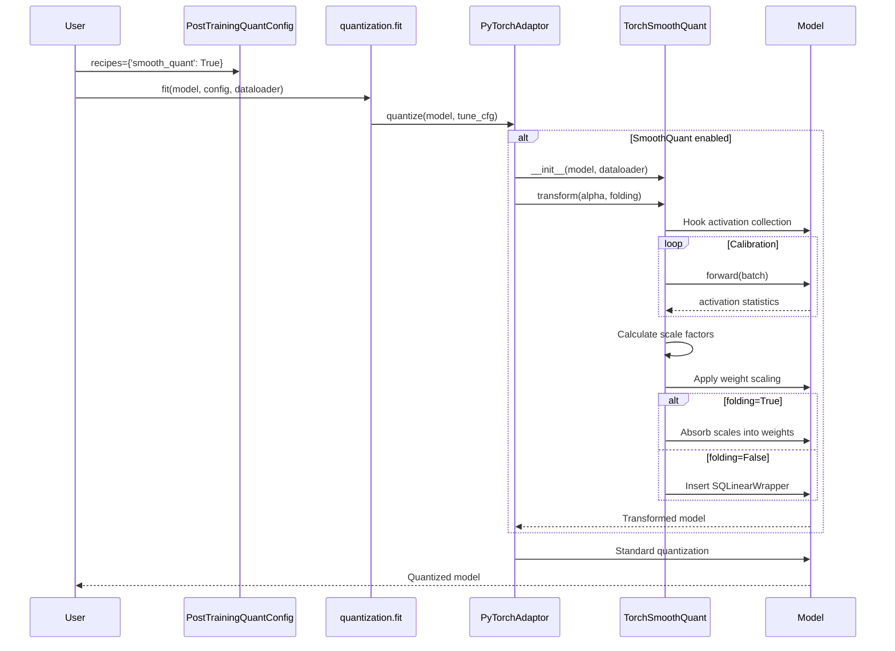
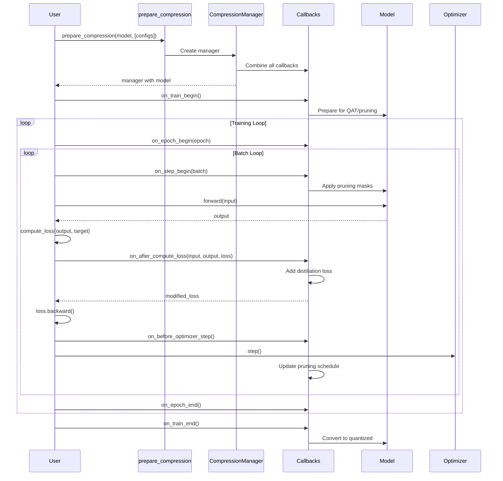

<!-- source: DeepWiki mcp.deepwiki.com · repo intel/neural-compressor · page 7 Advanced Techniques · fetched 2026-10-21 -->

# Advanced Techniques

<details>
<summary>Relevant source files</summary>

The following files were used as context for generating this wiki page:

- [docs/source/quantization_weight_only.md](docs/source/quantization_weight_only.md)
- [neural_compressor/adaptor/pytorch.py](neural_compressor/adaptor/pytorch.py)
- [neural_compressor/adaptor/pytorch_cpu.yaml](neural_compressor/adaptor/pytorch_cpu.yaml)
- [neural_compressor/adaptor/pytorch_ipex.yaml](neural_compressor/adaptor/pytorch_ipex.yaml)
- [neural_compressor/adaptor/torch_utils/awq.py](neural_compressor/adaptor/torch_utils/awq.py)
- [neural_compressor/adaptor/torch_utils/bf16_convert.py](neural_compressor/adaptor/torch_utils/bf16_convert.py)
- [neural_compressor/adaptor/torch_utils/model_wrapper.py](neural_compressor/adaptor/torch_utils/model_wrapper.py)
- [neural_compressor/adaptor/torch_utils/teq.py](neural_compressor/adaptor/torch_utils/teq.py)
- [neural_compressor/adaptor/torch_utils/util.py](neural_compressor/adaptor/torch_utils/util.py)
- [neural_compressor/adaptor/torch_utils/weight_only.py](neural_compressor/adaptor/torch_utils/weight_only.py)
- [neural_compressor/algorithm/smooth_quant.py](neural_compressor/algorithm/smooth_quant.py)
- [neural_compressor/benchmark.py](neural_compressor/benchmark.py)
- [neural_compressor/config.py](neural_compressor/config.py)
- [neural_compressor/mix_precision.py](neural_compressor/mix_precision.py)
- [neural_compressor/model/model.py](neural_compressor/model/model.py)
- [neural_compressor/model/torch_model.py](neural_compressor/model/torch_model.py)
- [neural_compressor/quantization.py](neural_compressor/quantization.py)
- [neural_compressor/training.py](neural_compressor/training.py)
- [neural_compressor/utils/pytorch.py](neural_compressor/utils/pytorch.py)
- [neural_compressor/utils/utility.py](neural_compressor/utils/utility.py)
- [test/adaptor/pytorch_adaptor/test_adaptor_pytorch_2x.py](test/adaptor/pytorch_adaptor/test_adaptor_pytorch_2x.py)
- [test/adaptor/pytorch_adaptor/test_adaptor_security.py](test/adaptor/pytorch_adaptor/test_adaptor_security.py)
- [test/algorithm/test_smooth_quant.py](test/algorithm/test_smooth_quant.py)
- [test/ipex/test_adaptor_ipex.py](test/ipex/test_adaptor_ipex.py)
- [test/quantization/test_weight_only_quantization.py](test/quantization/test_weight_only_quantization.py)
- [test/utils/test_huggingface.py](test/utils/test_huggingface.py)

</details>


## Purpose and Scope

This page provides an overview of advanced optimization methods available in Intel® Neural Compressor that go beyond standard quantization approaches. These techniques can be used standalone or combined with quantization to achieve better accuracy-performance trade-offs.

For basic quantization methods (PTQ, QAT, weight-only), see [Quantization Techniques](#6). For framework-specific implementation details, see [Framework Adaptors](#5).

## Overview

Advanced techniques in Neural Compressor address specific challenges in model optimization:

- **SmoothQuant**: Mitigates accuracy degradation in activation quantization by balancing the difficulty between weights and activations
- **Pruning**: Reduces model size by removing redundant weights
- **Distillation**: Transfers knowledge from a larger teacher model to maintain accuracy in compressed models

These techniques integrate seamlessly with the 2.x API's accuracy-aware tuning system and can be orchestrated together for multi-objective optimization.

## Technique Categories

### Transformation-Based Techniques

SmoothQuant operates as a pre-quantization transformation that modifies the model's numeric properties without changing its architecture. It can be applied before any quantization method to improve final accuracy.

### Training-Based Techniques

Pruning and distillation require model retraining with specialized callbacks. The `CompressionManager` class orchestrates these techniques during the training loop.

## System Architecture



**Sources:** [neural_compressor/adaptor/torch_utils/waq/__init__.py](), [neural_compressor/training.py:38-62](), [neural_compressor/config.py:729-744]()

## Technique Integration Patterns

### Pattern 1: SmoothQuant + PTQ

SmoothQuant transforms the model before static quantization calibration:

| Step | Component | Action |
|------|-----------|--------|
| 1 | Configuration | Set `recipes={'smooth_quant': True}` |
| 2 | `TorchSmoothQuant` | Analyze activation distributions |
| 3 | `TorchSmoothQuant.transform()` | Apply channel-wise scaling |
| 4 | Adaptor | Perform standard PTQ calibration |
| 5 | Strategy | Tune with accuracy criterion |

### Pattern 2: QAT + Pruning + Distillation (Orchestration)

Multiple techniques are orchestrated during training:

| Step | Component | Action |
|------|-----------|--------|
| 1 | `prepare_compression()` | Create `CompressionManager` |
| 2 | `CompressionManager.callbacks` | Register all technique callbacks |
| 3 | Training loop | Execute callbacks at lifecycle points |
| 4 | `on_step_begin()` | Apply pruning masks |
| 5 | `on_after_compute_loss()` | Add distillation loss |
| 6 | Convert | Apply QAT quantization |

**Sources:** [neural_compressor/training.py:38-130](), [neural_compressor/compression/callbacks.py]()

## Configuration System



**Sources:** [neural_compressor/config.py:715-859](), [neural_compressor/training.py:285-357]()

## Key Classes and Functions

### SmoothQuant Implementation

The `TorchSmoothQuant` class implements the transformation algorithm:

```
TorchSmoothQuant(model, dataloader)
├── __init__: Initialize with model and calibration data
├── transform: Main entry point
│   ├── alpha: Balancing factor (0.0-1.0 or "auto")
│   ├── calib_iter: Number of calibration iterations
│   └── folding: Whether to fold scaling into weights
├── _get_all_hook_module_names: Identify quantizable modules
├── _adjust_parameters: Apply channel-wise scaling
└── absorb_to_layer: Dict of absorption relationships
```

### Compression Manager

The `CompressionManager` orchestrates multiple techniques:

```
CompressionManager
├── __init__(model, confs): Initialize with configs
├── callbacks: Combined callback object
│   ├── on_train_begin()
│   ├── on_epoch_begin(epoch)
│   ├── on_step_begin(batch)
│   ├── on_after_compute_loss(input, output, loss)
│   ├── on_before_optimizer_step()
│   └── on_train_end()
├── model: Wrapped/prepared model
├── _optimizer_parameters: Parameters to optimize
└── prune(): Apply pruning (if configured)
```

**Sources:** [neural_compressor/adaptor/torch_utils/waq/waq.py:1-100](), [neural_compressor/training.py:38-264]()

## Execution Flow Diagrams

### SmoothQuant Transformation Flow



**Sources:** [neural_compressor/adaptor/pytorch.py:1175-1250](), [test/algorithm/test_smooth_quant.py:732-777]()

### Orchestration Training Flow



**Sources:** [neural_compressor/training.py:285-357](), [neural_compressor/compression/callbacks.py]()

## Integration with Tuning System

Advanced techniques interact with the 2.x API's accuracy-aware tuning:

| Technique | Tuning Integration | Impact |
|-----------|-------------------|--------|
| **SmoothQuant** | Pre-processes model before tuning space exploration | Reduces tuning search space by improving baseline accuracy |
| **QAT** | Can be tuned with different observer/qconfig settings | Strategy samples different QAT configurations |
| **Pruning** | Sparsity level can be part of tuning space | MultiObjective evaluates accuracy vs model size |
| **Distillation** | Temperature/criterion can be tuned | Usually fixed during tuning, applied in orchestration |

The `Strategy` system can explore different combinations of these techniques when configured with appropriate tuning criteria.

**Sources:** [neural_compressor/strategy/strategy.py](), [neural_compressor/quantization.py:33-159]()

## Usage Examples

### Example 1: SmoothQuant with Auto Alpha Search

```python
from neural_compressor import PostTrainingQuantConfig, quantization

conf = PostTrainingQuantConfig(
    calibration_sampling_size=100,
    recipes={
        'smooth_quant': True,
        'smooth_quant_args': {
            'alpha': 'auto',  # Search for optimal alpha
            'folding': True,   # Absorb scales into weights
        }
    }
)

q_model = quantization.fit(
    model, 
    conf, 
    calib_dataloader=calib_dataloader,
    eval_func=eval_func  # Optional: for accuracy-aware tuning
)
```

### Example 2: Orchestrated Optimization

```python
from neural_compressor import (
    QuantizationAwareTrainingConfig,
    WeightPruningConfig,
    DistillationConfig
)
from neural_compressor.training import prepare_compression

configs = [
    QuantizationAwareTrainingConfig(approach='qat'),
    WeightPruningConfig(target_sparsity=0.5, start_step=0, end_step=1000),
    DistillationConfig(teacher_model=teacher_model)
]

compression_manager = prepare_compression(model, configs)
model = compression_manager.model

for epoch in range(epochs):
    compression_manager.callbacks.on_epoch_begin(epoch)
    for batch, label in dataloader:
        compression_manager.callbacks.on_step_begin(batch)
        output = model(batch)
        loss = criterion(output, label)
        loss = compression_manager.callbacks.on_after_compute_loss(
            batch, output, loss
        )
        loss.backward()
        compression_manager.callbacks.on_before_optimizer_step()
        optimizer.step()
```

**Sources:** [test/algorithm/test_smooth_quant.py:752-811](), [neural_compressor/training.py:359-420]()

## Technical Considerations

### SmoothQuant Limitations

- Only applicable to models with paired layers (e.g., Linear→LayerNorm→Linear)
- Requires calibration data to analyze activation distributions
- `alpha="auto"` increases calibration time but improves accuracy
- Folding may not be possible if scales cannot be absorbed by preceding layers

### Orchestration Constraints

- Not all technique combinations are compatible (e.g., dynamic quantization + pruning)
- Callbacks must be called in correct order: `on_step_begin` → forward → loss → `on_after_compute_loss` → backward → `on_before_optimizer_step` → optimizer step
- Some techniques require specific framework versions (QAT requires PyTorch ≥1.8)
- Memory overhead during training when combining multiple techniques

**Sources:** [neural_compressor/adaptor/torch_utils/waq/waq.py:150-250](), [neural_compressor/training.py:38-130]()

## Next Steps

- For detailed SmoothQuant algorithm, configuration options, and examples, see [SmoothQuant](#7.1)
- For pruning methods, distillation techniques, and orchestration modes, see [Pruning and Distillation](#7.2)
- For integration with specific frameworks, see [Framework Adaptors](#5)

---

