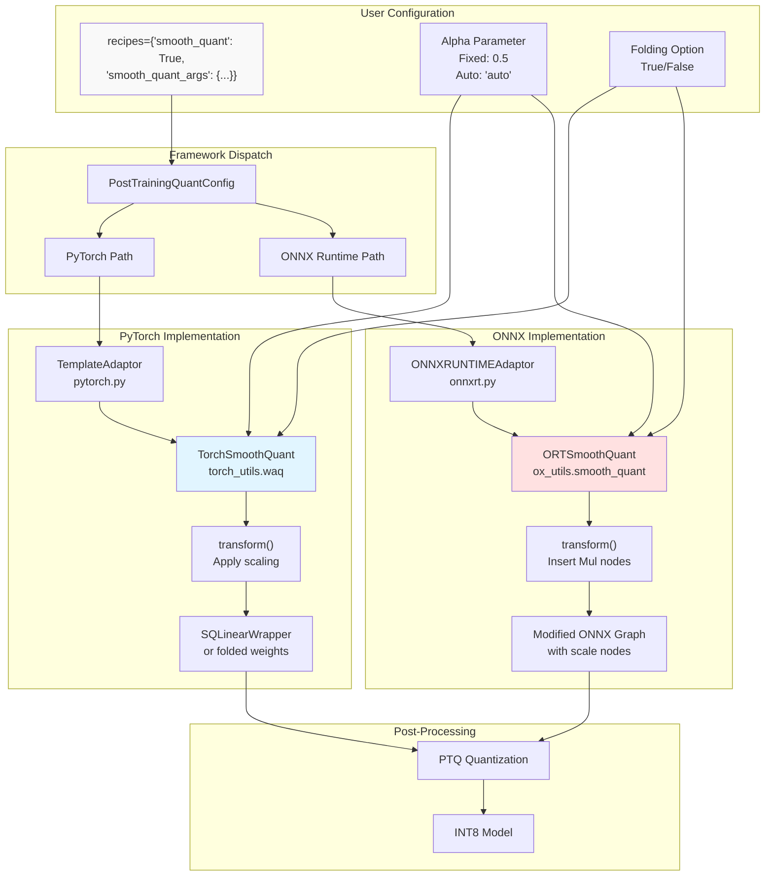
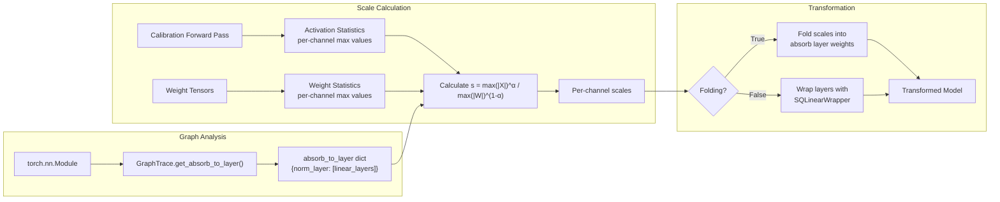
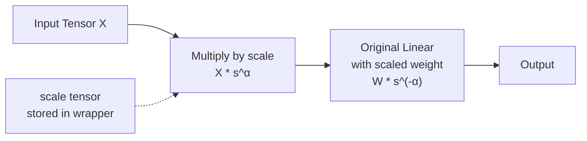
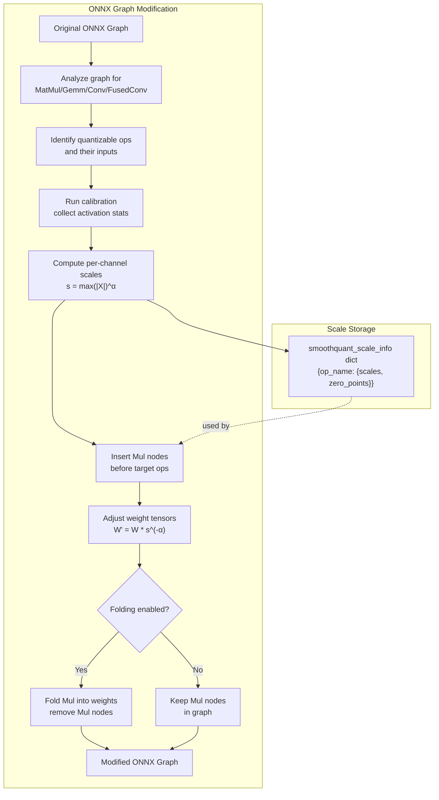
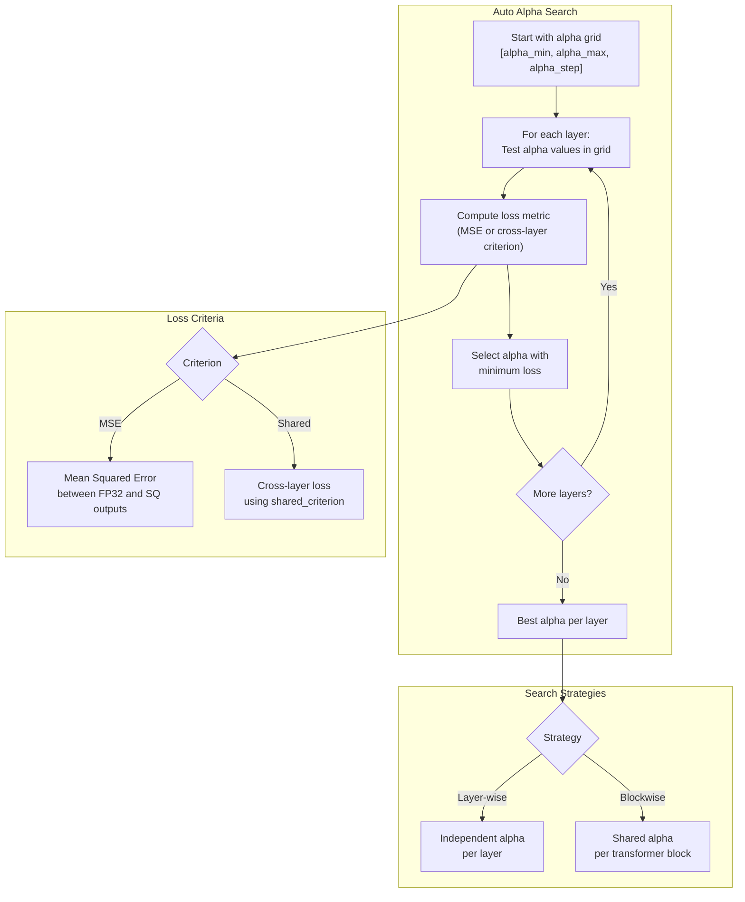
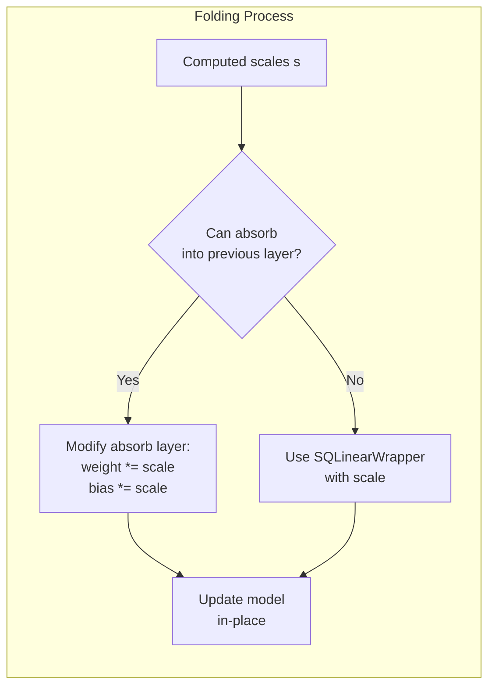
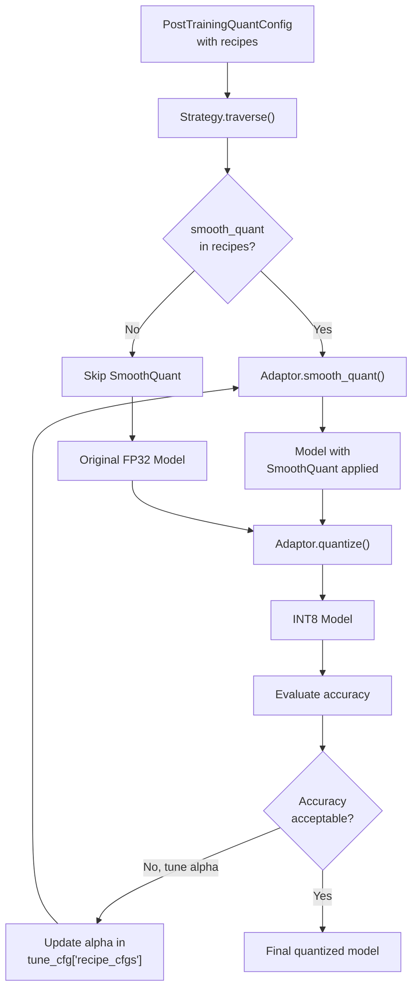

<!-- source: DeepWiki mcp.deepwiki.com · repo intel/neural-compressor · page 7.1 SmoothQuant · fetched 2026-10-21 -->

# SmoothQuant

<details>
<summary>Relevant source files</summary>

The following files were used as context for generating this wiki page:

- [docs/source/quantization_weight_only.md](docs/source/quantization_weight_only.md)
- [neural_compressor/adaptor/onnxrt.py](neural_compressor/adaptor/onnxrt.py)
- [neural_compressor/adaptor/onnxrt.yaml](neural_compressor/adaptor/onnxrt.yaml)
- [neural_compressor/adaptor/onnxrt_cuda.yaml](neural_compressor/adaptor/onnxrt_cuda.yaml)
- [neural_compressor/adaptor/onnxrt_trt.yaml](neural_compressor/adaptor/onnxrt_trt.yaml)
- [neural_compressor/adaptor/ox_utils/calibration.py](neural_compressor/adaptor/ox_utils/calibration.py)
- [neural_compressor/adaptor/ox_utils/calibrator.py](neural_compressor/adaptor/ox_utils/calibrator.py)
- [neural_compressor/adaptor/ox_utils/operators/activation.py](neural_compressor/adaptor/ox_utils/operators/activation.py)
- [neural_compressor/adaptor/ox_utils/operators/binary_op.py](neural_compressor/adaptor/ox_utils/operators/binary_op.py)
- [neural_compressor/adaptor/ox_utils/operators/concat.py](neural_compressor/adaptor/ox_utils/operators/concat.py)
- [neural_compressor/adaptor/ox_utils/operators/conv.py](neural_compressor/adaptor/ox_utils/operators/conv.py)
- [neural_compressor/adaptor/ox_utils/operators/direct_q8.py](neural_compressor/adaptor/ox_utils/operators/direct_q8.py)
- [neural_compressor/adaptor/ox_utils/operators/gather.py](neural_compressor/adaptor/ox_utils/operators/gather.py)
- [neural_compressor/adaptor/ox_utils/operators/matmul.py](neural_compressor/adaptor/ox_utils/operators/matmul.py)
- [neural_compressor/adaptor/ox_utils/operators/maxpool.py](neural_compressor/adaptor/ox_utils/operators/maxpool.py)
- [neural_compressor/adaptor/ox_utils/operators/ops.py](neural_compressor/adaptor/ox_utils/operators/ops.py)
- [neural_compressor/adaptor/ox_utils/operators/pad.py](neural_compressor/adaptor/ox_utils/operators/pad.py)
- [neural_compressor/adaptor/ox_utils/operators/pooling.py](neural_compressor/adaptor/ox_utils/operators/pooling.py)
- [neural_compressor/adaptor/ox_utils/operators/reduce.py](neural_compressor/adaptor/ox_utils/operators/reduce.py)
- [neural_compressor/adaptor/ox_utils/operators/split.py](neural_compressor/adaptor/ox_utils/operators/split.py)
- [neural_compressor/adaptor/ox_utils/operators/unary_op.py](neural_compressor/adaptor/ox_utils/operators/unary_op.py)
- [neural_compressor/adaptor/ox_utils/quantizer.py](neural_compressor/adaptor/ox_utils/quantizer.py)
- [neural_compressor/adaptor/ox_utils/smooth_quant.py](neural_compressor/adaptor/ox_utils/smooth_quant.py)
- [neural_compressor/adaptor/ox_utils/util.py](neural_compressor/adaptor/ox_utils/util.py)
- [neural_compressor/adaptor/pytorch.py](neural_compressor/adaptor/pytorch.py)
- [neural_compressor/adaptor/pytorch_cpu.yaml](neural_compressor/adaptor/pytorch_cpu.yaml)
- [neural_compressor/adaptor/pytorch_ipex.yaml](neural_compressor/adaptor/pytorch_ipex.yaml)
- [neural_compressor/adaptor/torch_utils/awq.py](neural_compressor/adaptor/torch_utils/awq.py)
- [neural_compressor/adaptor/torch_utils/bf16_convert.py](neural_compressor/adaptor/torch_utils/bf16_convert.py)
- [neural_compressor/adaptor/torch_utils/model_wrapper.py](neural_compressor/adaptor/torch_utils/model_wrapper.py)
- [neural_compressor/adaptor/torch_utils/teq.py](neural_compressor/adaptor/torch_utils/teq.py)
- [neural_compressor/adaptor/torch_utils/util.py](neural_compressor/adaptor/torch_utils/util.py)
- [neural_compressor/adaptor/torch_utils/weight_only.py](neural_compressor/adaptor/torch_utils/weight_only.py)
- [neural_compressor/algorithm/smooth_quant.py](neural_compressor/algorithm/smooth_quant.py)
- [neural_compressor/model/onnx_model.py](neural_compressor/model/onnx_model.py)
- [neural_compressor/model/torch_model.py](neural_compressor/model/torch_model.py)
- [neural_compressor/utils/pytorch.py](neural_compressor/utils/pytorch.py)
- [test/adaptor/onnxrt_adaptor/test_adaptor_onnxrt.py](test/adaptor/onnxrt_adaptor/test_adaptor_onnxrt.py)
- [test/adaptor/onnxrt_adaptor/test_onnxrt_augment.py](test/adaptor/onnxrt_adaptor/test_onnxrt_augment.py)
- [test/adaptor/onnxrt_adaptor/test_onnxrt_operators.py](test/adaptor/onnxrt_adaptor/test_onnxrt_operators.py)
- [test/adaptor/pytorch_adaptor/test_adaptor_pytorch_2x.py](test/adaptor/pytorch_adaptor/test_adaptor_pytorch_2x.py)
- [test/algorithm/test_smooth_quant.py](test/algorithm/test_smooth_quant.py)
- [test/algorithm/test_smooth_quant_onnx.py](test/algorithm/test_smooth_quant_onnx.py)
- [test/ipex/test_adaptor_ipex.py](test/ipex/test_adaptor_ipex.py)
- [test/model/test_onnx_model.py](test/model/test_onnx_model.py)
- [test/quantization/test_weight_only_quantization.py](test/quantization/test_weight_only_quantization.py)
- [test/utils/test_huggingface.py](test/utils/test_huggingface.py)

</details>


## Purpose and Scope

SmoothQuant is an advanced pre-quantization transformation technique that improves INT8 quantization accuracy by migrating quantization difficulty from activations to weights. This document covers the SmoothQuant algorithm implementation in Neural Compressor, including its integration with Post-Training Quantization (PTQ) workflows for both PyTorch and ONNX Runtime frameworks. For information about basic PTQ techniques, see [Post-Training Quantization](#6.1). For weight-only quantization algorithms, see [Weight-Only Quantization](#6.3).

## Overview

SmoothQuant addresses the challenge that activation outliers in large language models and other neural networks cause significant quantization errors. Instead of quantizing activations and weights independently, SmoothQuant mathematically migrates quantization difficulty from activations to weights using per-channel scaling factors. This is particularly effective because:

1. **Activation outliers** are difficult to quantize and cause accuracy degradation
2. **Weight values** are generally easier to quantize with less accuracy impact
3. **Per-channel scaling** allows fine-grained control over the transformation

The core transformation formula is:

```
Y = (X · diag(s)^α) · (diag(s)^(-α) · W)
  = X' · W'
```

Where:
- `X` = input activations (with potential outliers)
- `W` = weights
- `s` = per-channel scaling factors derived from activation statistics
- `α` = smoothness parameter controlling migration strength (0 ≤ α ≤ 1)

Sources: [neural_compressor/adaptor/ox_utils/smooth_quant.py:1-36](), [test/algorithm/test_smooth_quant.py:732-778]()

## System Architecture



**Diagram: SmoothQuant Integration in Neural Compressor**

Sources: [neural_compressor/adaptor/pytorch.py:772-850](), [neural_compressor/adaptor/onnxrt.py:170-239]()

## PyTorch Implementation

### Core Components

The PyTorch SmoothQuant implementation is provided by the `TorchSmoothQuant` class, which analyzes the model graph to identify absorption patterns and apply per-channel scaling.



**Diagram: PyTorch SmoothQuant Workflow**

Sources: [neural_compressor/adaptor/torch_utils/waq/__init__.py](), [test/algorithm/test_smooth_quant.py:413-433]()

### Absorption Patterns

SmoothQuant identifies absorption patterns where scaling factors can be mathematically absorbed. The following table shows supported patterns:

| Absorb Layer (scales from) | Absorbed Layers (scales to) | Supported Operations |
|---|---|---|
| LayerNorm | Linear, Conv2d | Yes |
| BatchNorm1d/2d/3d | Linear, Conv2d | Yes |
| GroupNorm | Linear, Conv2d | Yes |
| InstanceNorm2d/3d | Linear, Conv2d | Yes |
| LlamaRMSNorm | Linear | Yes (custom) |
| T5LayerNorm | Linear | Yes (custom) |
| ReLU / ReLU6 | Linear, Conv2d | Yes (activation only) |

Sources: [test/algorithm/test_smooth_quant.py:542-628](), [test/algorithm/test_smooth_quant.py:259-309]()

### SQLinearWrapper

When folding is disabled, PyTorch wraps quantized layers with `SQLinearWrapper`, which applies scaling during forward pass:



**Diagram: SQLinearWrapper Forward Pass**

The wrapper stores the scale factor and applies it dynamically, allowing the transformation to be preserved without modifying the original layer weights.

Sources: [neural_compressor/adaptor/torch_utils/model_wrapper.py:69-130](), [test/algorithm/test_smooth_quant.py:678-720]()

### Usage Example

```python
from neural_compressor import PostTrainingQuantConfig, quantization

# Configure SmoothQuant with auto alpha search
conf = PostTrainingQuantConfig(
    calibration_sampling_size=8,
    recipes={
        "smooth_quant": True,
        "smooth_quant_args": {
            "alpha": "auto",           # Auto-tune alpha per layer
            "folding": False,          # Use wrapper instead of folding
            "percentile": 99.999,      # Percentile for outlier clipping
            "op_types": ["Linear"],    # Apply to Linear layers only
            "scales_per_op": True,     # Per-layer scaling
        }
    }
)

# Apply quantization with SmoothQuant
q_model = quantization.fit(
    model,
    conf,
    calib_dataloader=calib_dataloader,
    eval_func=eval_func
)
```

Sources: [test/algorithm/test_smooth_quant.py:752-778]()

## ONNX Runtime Implementation

### ORTSmoothQuant Class

The ONNX Runtime implementation uses `ORTSmoothQuant` to modify the ONNX graph by inserting `Mul` nodes:



**Diagram: ONNX Runtime SmoothQuant Graph Transformation**

Sources: [neural_compressor/adaptor/ox_utils/smooth_quant.py:1-500](), [neural_compressor/adaptor/onnxrt.py:170-239]()

### Graph Transformation Process

The ONNX implementation performs the following transformations:

1. **Pre-optimization**: Apply ONNX optimization passes to simplify graph
2. **Operator identification**: Find MatMul, Gemm, Conv, FusedConv nodes based on `op_types` config
3. **Calibration**: Run dataloader through model to collect activation statistics
4. **Scale calculation**: Compute per-channel scales using formula `s = max(|X|)^α`
5. **Node insertion**: Insert `Mul` nodes before target operations
6. **Weight adjustment**: Multiply weight initializers by `s^(-α)`
7. **Optional folding**: If folding is enabled, absorb `Mul` nodes into preceding operations

Sources: [neural_compressor/adaptor/ox_utils/smooth_quant.py:100-300]()

### Configuration Parameters

The ONNX adaptor's `smooth_quant` method accepts:

| Parameter | Type | Default | Description |
|-----------|------|---------|-------------|
| `alpha` | float or str | 0.5 | Smoothness factor. Use "auto" for automatic tuning |
| `folding` | bool | True | Whether to fold scaling factors into weights |
| `percentile` | float | 99.999 | Percentile for activation clipping |
| `op_types` | list | ["MatMul", "Gemm", "Conv", "FusedConv"] | Operation types to apply SmoothQuant |
| `scales_per_op` | bool | True | Individual scale per op (True) or shared scales (False) |
| `record_max_info` | bool | False | Whether to only record scale info without applying |
| `weight_clip` | bool | True | Whether to clip weights during scale calculation |
| `auto_alpha_args` | dict | {...} | Hyperparameters for auto alpha search |

Sources: [neural_compressor/adaptor/onnxrt.py:170-239]()

## Alpha Parameter Tuning

### Fixed Alpha

A fixed alpha value (typically 0.5) provides a balanced trade-off:
- **α = 0**: No smoothing (all difficulty on activations)
- **α = 0.5**: Balanced smoothing (default)
- **α = 1**: Maximum smoothing (SPIQ algorithm, all difficulty on weights)

### Auto Alpha Search

When `alpha="auto"`, Neural Compressor automatically searches for optimal per-layer alpha values:



**Diagram: Auto Alpha Search Process**

The `auto_alpha_args` dictionary controls the search:

```python
auto_alpha_args = {
    "alpha_min": 0.0,          # Minimum alpha to try
    "alpha_max": 1.0,          # Maximum alpha to try  
    "alpha_step": 0.1,         # Step size for grid search
    "shared_criterion": "mean", # Criterion for blockwise search
    "do_blockwise": False,     # Enable blockwise search
}
```

Sources: [neural_compressor/adaptor/torch_utils/waq/auto_alpha.py](), [test/algorithm/test_smooth_quant.py:493-527]()

## Folding Mechanism

### Concept

Folding mathematically absorbs the inserted scaling factors into the weights of preceding layers, eliminating the need for explicit multiplication operations during inference:

**Without Folding:**
```
X → [Mul(s^α)] → X' → [Linear(W * s^(-α))] → Y
```

**With Folding:**
```
X → [Linear(W * s^(-α), bias * s^(-α))] → Y
```

The `Mul` node is removed and scales are directly applied to weights and biases.

### When Folding Works

Folding is possible when:
1. The preceding layer's output feeds directly into the scaled layer
2. The preceding layer is a norm layer (LayerNorm, BatchNorm, etc.) or activation
3. No other operations depend on the intermediate tensor

### PyTorch Folding Implementation



**Diagram: PyTorch Folding Logic**

Sources: [neural_compressor/adaptor/torch_utils/waq/__init__.py](), [test/algorithm/test_smooth_quant.py:630-653]()

### ONNX Folding Implementation

For ONNX models, folding removes `Mul` nodes and updates weight initializers:

```python
# Before folding (conceptual ONNX graph):
# Input -> Mul(scale) -> MatMul(weight) -> Output

# After folding:  
# Input -> MatMul(weight * scale^(-alpha)) -> Output
```

The transformation preserves mathematical equivalence while reducing inference overhead.

Sources: [neural_compressor/adaptor/ox_utils/smooth_quant.py:400-500]()

## Integration with Quantization Workflow

### 2.x API Integration

SmoothQuant is integrated into the accuracy-aware tuning pipeline through the `recipes` configuration:



**Diagram: SmoothQuant in Accuracy-Aware Tuning**

Sources: [neural_compressor/adaptor/pytorch.py:855-870](), [neural_compressor/adaptor/onnxrt.py:241-254](), [neural_compressor/adaptor/onnxrt.py:309-314]()

### Execution Flow

1. **Configuration**: User specifies `recipes={'smooth_quant': True, 'smooth_quant_args': {...}}`
2. **Pre-optimization**: Model is optimized before SmoothQuant (ONNX only)
3. **SmoothQuant application**: `adaptor.smooth_quant()` is called with calibration data
4. **Model storage**: Transformed model is stored in `adaptor.smooth_quant_model`
5. **Quantization**: PTQ is applied to the SmoothQuant-transformed model
6. **Evaluation**: Model accuracy is evaluated in tuning loop

### Recipe Configuration Detection

The adaptor checks for SmoothQuant recipes using `_need_smooth_quant()`:

```python
def _need_smooth_quant(self, tune_cfg) -> bool:
    """Check if model needs smooth quant."""
    recipe_cfgs = tune_cfg.get("recipe_cfgs", None)
    if (recipe_cfgs 
        and recipe_cfgs.get("smooth_quant", False)
        and recipe_cfgs["smooth_quant_args"].get("alpha", None)):
        return True
    return False
```

Sources: [neural_compressor/adaptor/onnxrt.py:241-254]()

## Framework-Specific Differences

| Aspect | PyTorch | ONNX Runtime |
|--------|---------|--------------|
| **Implementation Class** | `TorchSmoothQuant` | `ORTSmoothQuant` |
| **Scale Application** | `SQLinearWrapper` or weight folding | `Mul` node insertion or folding |
| **Supported Ops** | Linear, Conv2d | MatMul, Gemm, Conv, FusedConv |
| **Norm Layers** | LayerNorm, BatchNorm, GroupNorm, RMSNorm | Automatically detected |
| **Default Folding** | True (stock PT), False (IPEX) | True |
| **Auto Alpha** | Supported | Supported |
| **Graph Tracing** | Uses `torch.fx` for analysis | ONNX graph traversal |

Sources: [neural_compressor/adaptor/pytorch.py:772-850](), [neural_compressor/adaptor/onnxrt.py:170-239]()

## Advanced Topics

### Layer-wise vs. Blockwise Alpha

**Layer-wise**: Each layer gets an independent alpha value optimized for its specific activation-weight distribution.

**Blockwise**: Layers within a transformer block share the same alpha value, reducing search complexity for large models.

The blockwise approach is controlled by `auto_alpha_args['do_blockwise']`:

```python
auto_alpha_args = {
    "do_blockwise": True,  # Enable blockwise search
    "shared_criterion": "mean",  # How to aggregate block loss
}
```

Sources: [neural_compressor/adaptor/onnxrt.py:182-189]()

### Percentile Clipping

The `percentile` parameter clips activation outliers before computing scales:

```python
# Only values within [percentile, 100] are used
# Default: 99.999 (clip extreme outliers only)
smoothquant_args = {"percentile": 99.999}
```

This prevents extreme outliers from dominating scale calculation while preserving most activation information.

Sources: [neural_compressor/adaptor/onnxrt.py:177]()

### Scales Per Op vs. Shared Scales

**Scales per op (`scales_per_op=True`)**:
- Each operation gets individual scaling factors
- Better accuracy but more parameters
- Recommended for accuracy-critical applications

**Shared scales (`scales_per_op=False`)**:
- Operations with the same input share scaling factors  
- Fewer parameters, better performance
- Recommended for latency-critical applications

Sources: [neural_compressor/adaptor/onnxrt.py:179]()

### Model Preservation

For IPEX backend, the original model is preserved and SmoothQuant is applied to a copy:

```python
# IPEX configuration
conf = PostTrainingQuantConfig(
    backend="ipex",
    recipes={
        "smooth_quant": True,
        "smooth_quant_args": {"folding": False}  # IPEX default
    }
)
```

This allows reverting to the original model if needed during tuning.

Sources: [test/algorithm/test_smooth_quant.py:814-850]()

## File Structure Reference

Key implementation files:

```
neural_compressor/
├── adaptor/
│   ├── pytorch.py                    # PyTorch adaptor integration
│   ├── onnxrt.py                     # ONNX adaptor integration  
│   ├── torch_utils/
│   │   ├── waq/                      # Weight-Activation Quantization
│   │   │   ├── __init__.py           # TorchSmoothQuant class
│   │   │   └── auto_alpha.py         # Auto alpha search
│   │   └── model_wrapper.py          # SQLinearWrapper
│   └── ox_utils/
│       └── smooth_quant.py           # ORTSmoothQuant class
└── test/
    └── algorithm/
        ├── test_smooth_quant.py      # PyTorch tests
        └── test_smooth_quant_onnx.py # ONNX tests
```

Sources: [neural_compressor/adaptor/pytorch.py:1-50](), [neural_compressor/adaptor/onnxrt.py:1-50](), [neural_compressor/adaptor/ox_utils/smooth_quant.py:1-36]()

---

