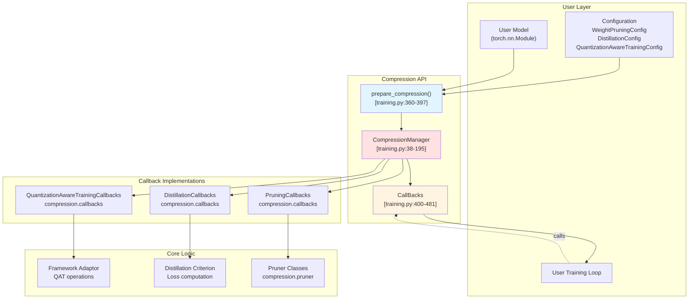
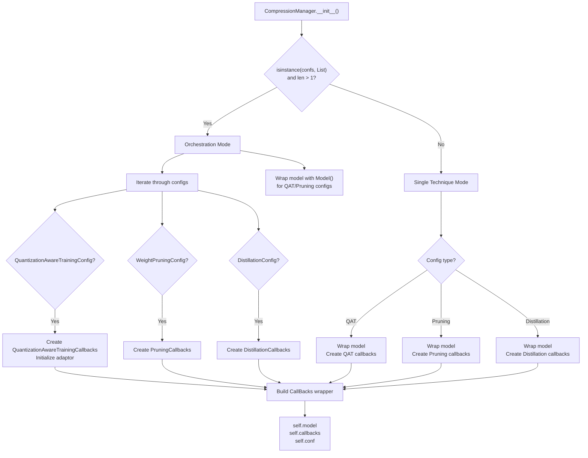
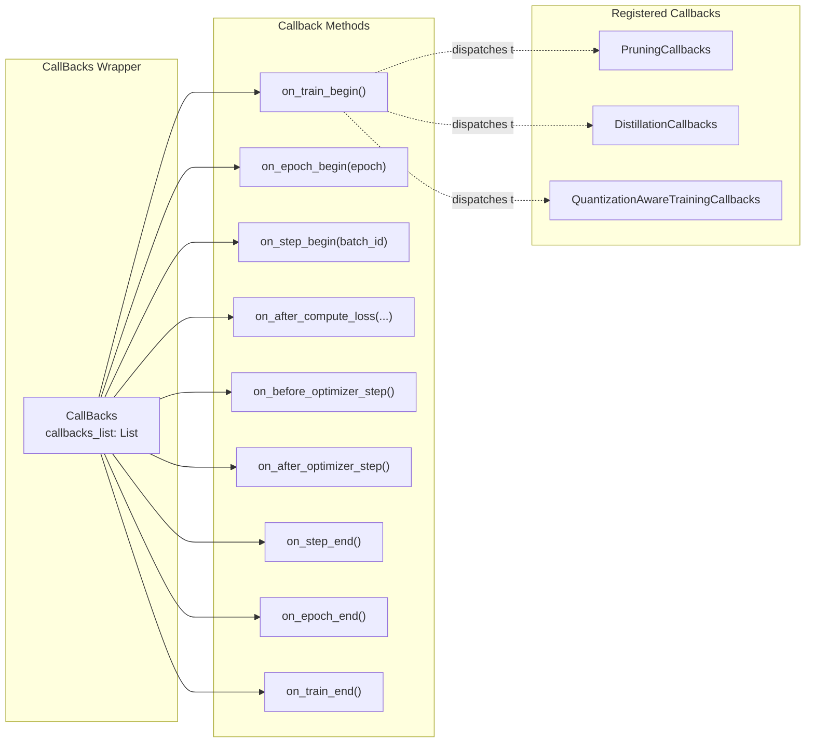
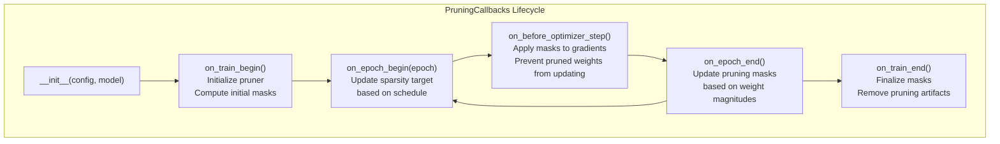
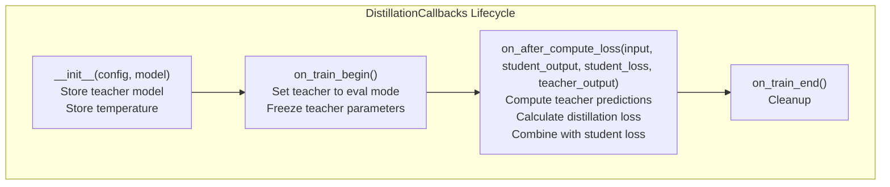
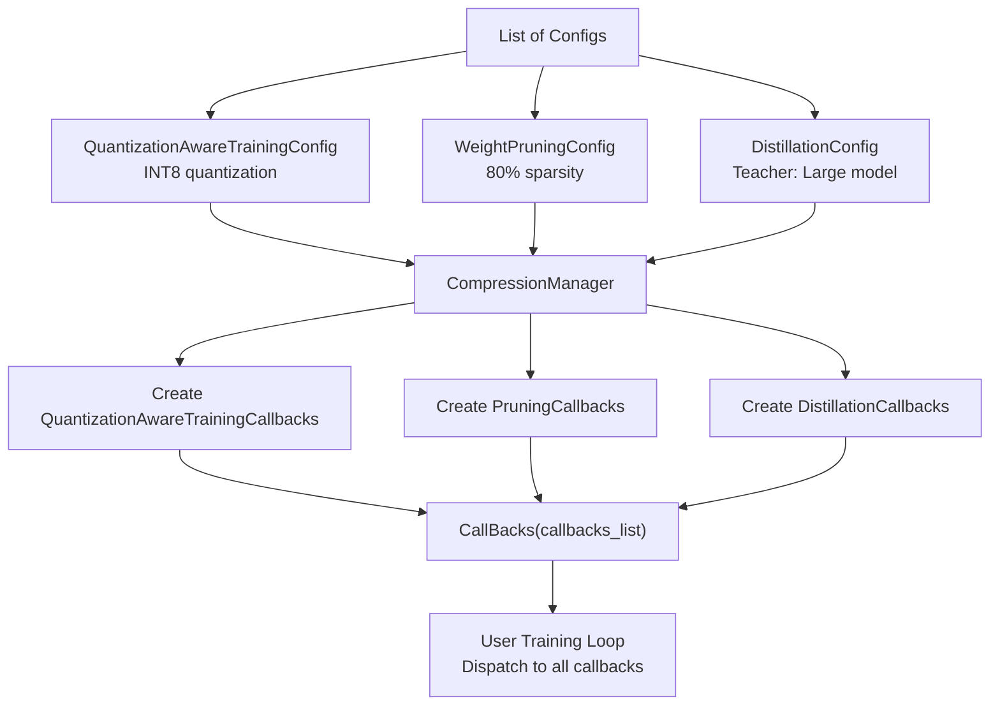
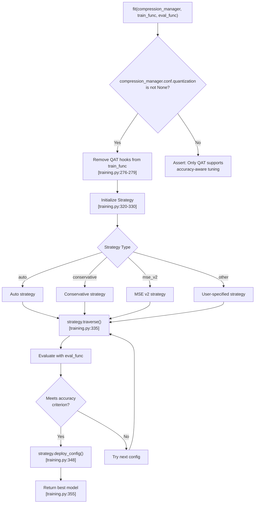
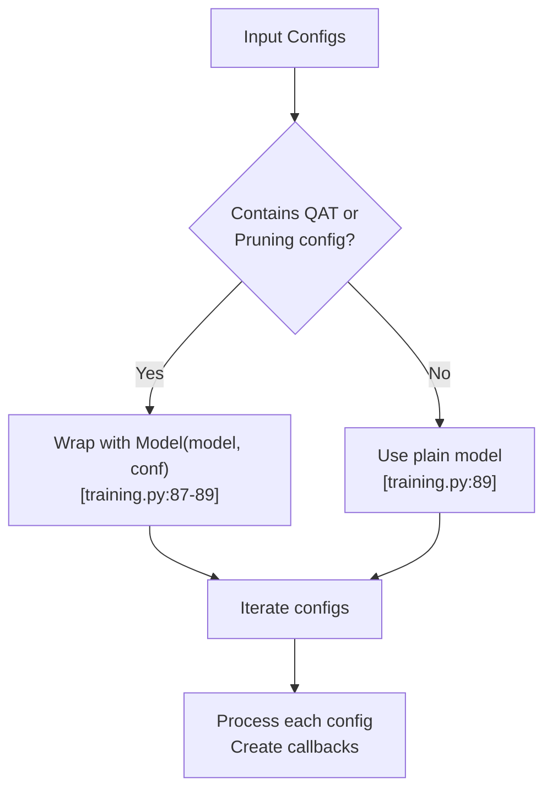

<!-- source: DeepWiki mcp.deepwiki.com · repo intel/neural-compressor · page 7.2 Pruning and Distillation · fetched 2026-10-21 -->

# Pruning and Distillation

<details>
<summary>Relevant source files</summary>

The following files were used as context for generating this wiki page:

- [neural_compressor/benchmark.py](neural_compressor/benchmark.py)
- [neural_compressor/config.py](neural_compressor/config.py)
- [neural_compressor/mix_precision.py](neural_compressor/mix_precision.py)
- [neural_compressor/model/model.py](neural_compressor/model/model.py)
- [neural_compressor/quantization.py](neural_compressor/quantization.py)
- [neural_compressor/training.py](neural_compressor/training.py)
- [neural_compressor/utils/utility.py](neural_compressor/utils/utility.py)
- [test/adaptor/pytorch_adaptor/test_adaptor_security.py](test/adaptor/pytorch_adaptor/test_adaptor_security.py)

</details>


This document describes the pruning and knowledge distillation capabilities in Intel Neural Compressor, including the callback-based training loop integration system and the orchestration mode that allows combining multiple compression techniques.

For information about quantization techniques, see [Quantization Techniques](#6). For quantization-aware training specifically, see [Quantization-Aware Training](#6.2).

---

## Purpose and Scope

Neural Compressor provides two additional model compression techniques beyond quantization:

- **Weight Pruning**: Reduces model size and improves inference speed by setting selected weights to zero based on magnitude, gradient, or other criteria
- **Knowledge Distillation**: Improves accuracy of compressed models by training a smaller "student" model to mimic a larger "teacher" model's outputs

Both techniques integrate with the training loop via a callback system and support **orchestration mode**, which allows combining pruning, distillation, and quantization-aware training in a single workflow.

---

## System Architecture

The pruning and distillation system is built around three core components:

1. **Configuration Classes**: `WeightPruningConfig` and `DistillationConfig` that define compression parameters
2. **CompressionManager**: Orchestrates multiple compression techniques and manages their lifecycle
3. **Callbacks System**: Provides hooks into the training loop for applying compression algorithms



**Sources**: [neural_compressor/training.py:1-481]()

---

## CompressionManager

The `CompressionManager` class is the central orchestrator for all compression techniques. It manages the initialization, configuration, and lifecycle of pruning, distillation, and QAT operations.

### Key Responsibilities

| Responsibility | Implementation |
|---------------|----------------|
| Configuration parsing | Accepts single config or list for orchestration |
| Model wrapping | Wraps user model in Neural Compressor `Model` class |
| Callback initialization | Creates appropriate callback objects for each technique |
| Adaptor management | Initializes framework-specific adaptors (for QAT) |
| Model persistence | Provides `save()` and `export()` methods |

### Initialization Logic

The `CompressionManager.__init__()` method [training.py:70-173]() handles both single-technique and orchestration modes:



**Sources**: [neural_compressor/training.py:70-173]()

### Orchestration Mode Example

When multiple configs are provided, `CompressionManager` combines them:

```python
# Example from docstring [training.py:46-67]
from neural_compressor import WeightPruningConfig, DistillationConfig, QuantizationAwareTrainingConfig
from neural_compressor.training import prepare_compression

confs = [
    WeightPruningConfig(...),
    DistillationConfig(...),
    QuantizationAwareTrainingConfig(...)
]

compression_manager = prepare_compression(model, confs)
```

The orchestration logic [training.py:84-123]() creates callbacks for each technique and combines them into a single `CallBacks` wrapper.

**Sources**: [neural_compressor/training.py:38-195]()

---

## Callbacks System

The callbacks system provides a structured way to integrate compression techniques into existing training loops without major code refactoring.

### CallBacks Wrapper Class

The `CallBacks` class [training.py:400-481]() aggregates multiple callback implementations and dispatches events to all registered callbacks:



**Sources**: [neural_compressor/training.py:400-481]()

### Callback Lifecycle Hooks

The callbacks system defines the following lifecycle hooks that integrate with PyTorch training loops:

| Hook | Purpose | Return Value | Location |
|------|---------|--------------|----------|
| `on_train_begin(dataloader)` | Initialize compression algorithms | None | [training.py:412-415]() |
| `on_epoch_begin(epoch)` | Per-epoch setup (e.g., adjust pruning ratio) | None | [training.py:423-426]() |
| `on_step_begin(batch_id)` | Pre-batch operations | List of results | [training.py:428-435]() |
| `on_after_compute_loss(input, student_output, student_loss, teacher_output)` | Modify loss (e.g., add distillation loss) | Modified loss | [training.py:437-444]() |
| `on_before_optimizer_step()` | Pre-update operations (e.g., mask gradients) | None | [training.py:446-449]() |
| `on_after_optimizer_step()` | Post-update operations | None | [training.py:451-454]() |
| `on_step_end()` | Post-batch operations | List of results | [training.py:466-473]() |
| `on_epoch_end()` | Per-epoch cleanup (e.g., update masks) | List of results | [training.py:475-480]() |
| `on_train_end()` | Finalize compression | None | [training.py:417-421]() |

**Sources**: [neural_compressor/training.py:400-481]()

### Integration Pattern

Users integrate callbacks into their training loop following this pattern:

```python
# Pattern from docstring [training.py:51-66]
compression_manager.callbacks.on_train_begin()
for epoch in range(epochs):
    compression_manager.callbacks.on_epoch_begin(epoch)
    for i, (batch, label) in enumerate(dataloader):
        compression_manager.callbacks.on_step_begin(i)
        
        output = model(batch)
        loss = criterion(output, label)
        loss = compression_manager.callbacks.on_after_compute_loss(batch, output, loss)
        
        loss.backward()
        compression_manager.callbacks.on_before_optimizer_step()
        optimizer.step()
        compression_manager.callbacks.on_step_end()
        
    compression_manager.callbacks.on_epoch_end()
compression_manager.callbacks.on_train_end()
```

**Sources**: [neural_compressor/training.py:38-67](), [training.py:377-393]()

---

## Weight Pruning

Weight pruning reduces model size by setting weights to zero based on various criteria (magnitude, gradient, etc.). The pruning system uses `WeightPruningConfig` for configuration and `PruningCallbacks` for training loop integration.

### Configuration

`WeightPruningConfig` is imported from the top-level module [training.py:25]() and configured with parameters such as:

- **Target sparsity**: Percentage of weights to prune
- **Pruning type**: Magnitude-based, gradient-based, pattern-based
- **Pruning schedule**: Gradual pruning over epochs vs. one-shot
- **Pruning scope**: Layer-wise or global
- **Start/end epoch**: When to begin and stop pruning

### PruningCallbacks

The `PruningCallbacks` class [training.py:29]() implements the callback interface to apply pruning operations during training:



**Sources**: [neural_compressor/training.py:29](), [neural_compressor/training.py:117](), [neural_compressor/training.py:153]()

### Pruning Workflow

1. **Initialization**: `prepare_pruning` function [training.py:30]() sets up pruning infrastructure
2. **Mask Computation**: Calculate which weights to prune based on criteria
3. **Gradient Masking**: In `on_before_optimizer_step()`, multiply gradients by mask to prevent updates to pruned weights
4. **Mask Updates**: In `on_epoch_end()`, recompute masks based on updated weight magnitudes (for gradual pruning)
5. **Finalization**: Convert masked weights to actual zeros

**Sources**: [neural_compressor/training.py:30](), [neural_compressor/training.py:153]()

---

## Knowledge Distillation

Knowledge distillation trains a smaller "student" model to mimic a larger "teacher" model, improving the student's accuracy by learning from the teacher's soft predictions.

### Configuration

`DistillationConfig` [training.py:25]() specifies:

- **Teacher model**: The pre-trained model to learn from
- **Temperature**: Controls softness of probability distributions
- **Loss weights**: Balance between task loss and distillation loss
- **Distillation loss type**: KL divergence, MSE, custom

### DistillationCallbacks

The `DistillationCallbacks` class [training.py:29]() implements distillation during training:



**Sources**: [neural_compressor/training.py:29](), [neural_compressor/training.py:120](), [neural_compressor/training.py:157]()

### Distillation Loss Computation

The `on_after_compute_loss()` hook [training.py:437-444]() modifies the student loss:

```python
# Pseudo-code based on callback pattern
def on_after_compute_loss(self, input, student_output, student_loss, teacher_output=None):
    if teacher_output is None:
        with torch.no_grad():
            teacher_output = self.teacher_model(input)
    
    # Compute distillation loss (e.g., KL divergence)
    distillation_loss = self.criterion(student_output, teacher_output)
    
    # Weighted combination
    combined_loss = alpha * student_loss + (1 - alpha) * distillation_loss
    
    return combined_loss
```

**Sources**: [neural_compressor/training.py:437-444]()

---

## Orchestration Mode

Orchestration mode allows combining pruning, distillation, and quantization-aware training in a single workflow. This is particularly useful for achieving maximum compression while maintaining accuracy.

### Multi-Technique Configuration

The system detects orchestration mode when multiple configs are provided [training.py:84-123]():



**Sources**: [neural_compressor/training.py:84-123]()

### Orchestration Workflow

When orchestration is enabled:

1. **Model Preparation**: Model is wrapped using the first QAT or Pruning config (if present) [training.py:86-89]()
2. **Callback Registration**: Each config creates its corresponding callback [training.py:91-122]()
3. **Unified Dispatch**: `CallBacks` wrapper dispatches events to all callbacks [training.py:123]()
4. **Combined Loss**: `on_after_compute_loss()` collects and combines losses from all callbacks [training.py:437-444]()

### Execution Order

The orchestration respects callback execution order:

- **Sequential Iteration**: Callbacks execute in the order they were added [training.py:414-415]()
- **Loss Aggregation**: Multiple callbacks can modify the loss; the first non-None loss is returned or all are collected in a list [training.py:439-444]()
- **Result Collection**: Callbacks that return values have them aggregated into lists [training.py:430-435]()

**Sources**: [neural_compressor/training.py:84-123](), [neural_compressor/training.py:412-480]()

---

## Accuracy-Aware Tuning

The `fit()` function [training.py:197-357]() provides accuracy-aware tuning for compression techniques, similar to quantization tuning. This allows automatic adjustment of compression parameters to meet accuracy targets.

### Tuning Integration



**Sources**: [neural_compressor/training.py:197-357]()

### Strategy System Integration

The `fit()` function integrates with the Neural Compressor strategy system [training.py:286-330]():

1. **Strategy Selection**: Based on `tuning_criterion.strategy` or `quant_level`
2. **Strategy Initialization**: Creates strategy object with model, config, eval functions
3. **Traversal**: Strategy explores configuration space
4. **Best Model Selection**: Returns model that meets accuracy criterion

**Note**: Currently, only QAT (quantization) supports accuracy-aware tuning with the `fit()` function. Pruning and distillation require manual training loop integration via callbacks.

**Sources**: [neural_compressor/training.py:270](), [neural_compressor/training.py:286-303]()

---

## API Reference

### prepare_compression()

Initializes compression techniques and returns a `CompressionManager`.

**Signature**: [training.py:360-397]()

```python
def prepare_compression(
    model: Callable,
    confs: Union[Callable, List],
    **kwargs
) -> CompressionManager
```

**Parameters**:
- `model`: The model to compress (e.g., `torch.nn.Module`)
- `confs`: Single config or list of configs for orchestration
- `**kwargs`: Additional parameters

**Returns**: `CompressionManager` instance with `model`, `callbacks`, and `conf` attributes

**Sources**: [neural_compressor/training.py:360-397]()

---

### CompressionManager

Main orchestration class for compression techniques.

**Class Definition**: [training.py:38-195]()

**Attributes**:
| Attribute | Type | Description |
|-----------|------|-------------|
| `model` | `Model` | Wrapped Neural Compressor model |
| `callbacks` | `CallBacks` | Aggregated callbacks for training loop |
| `conf` | `_Config` | Internal configuration object |
| `adaptor` | `Adaptor` | Framework-specific adaptor (QAT only) |
| `fp32_model` | `Model` | Original FP32 model (for export) |

**Methods**:
| Method | Description | Location |
|--------|-------------|----------|
| `__init__(model, confs, **kwargs)` | Initialize compression manager | [training.py:70-173]() |
| `save(root=None)` | Save compressed model | [training.py:175-181]() |
| `export(save_path, conf)` | Export to another format (e.g., ONNX) | [training.py:183-194]() |

**Sources**: [neural_compressor/training.py:38-195]()

---

### CallBacks

Wrapper class that dispatches events to multiple callback implementations.

**Class Definition**: [training.py:400-481]()

**Constructor**:
```python
def __init__(self, callbacks_list: List)
```
- `callbacks_list`: List of callback objects (PruningCallbacks, DistillationCallbacks, etc.)

**Methods**: See [Callback Lifecycle Hooks](#callback-lifecycle-hooks) section above.

**Sources**: [neural_compressor/training.py:400-481]()

---

### fit()

Applies compression with accuracy-aware tuning (QAT only).

**Signature**: [training.py:197-357]()

```python
def fit(
    compression_manager: CompressionManager,
    train_func: Callable,
    eval_func: Callable = None,
    eval_dataloader = None,
    eval_metric = None,
    **kwargs
) -> Model
```

**Parameters**:
- `compression_manager`: Initialized `CompressionManager`
- `train_func`: Training function that integrates callbacks
- `eval_func`: Evaluation function returning accuracy scalar
- `eval_dataloader`: Alternative to `eval_func` with separate metric
- `eval_metric`: Metric object or config dict

**Returns**: Optimized model meeting accuracy criterion

**Sources**: [neural_compressor/training.py:197-357]()

---

## Usage Examples

### Example 1: Standalone Pruning

```python
from neural_compressor import WeightPruningConfig
from neural_compressor.training import prepare_compression

# Configure pruning
prune_conf = WeightPruningConfig(
    pruning_type='magnitude',
    target_sparsity=0.8,
    start_epoch=0,
    end_epoch=10
)

# Prepare compression
compression_manager = prepare_compression(model, prune_conf)
model = compression_manager.model

# Training loop with callbacks
compression_manager.callbacks.on_train_begin()
for epoch in range(epochs):
    compression_manager.callbacks.on_epoch_begin(epoch)
    for batch, label in dataloader:
        compression_manager.callbacks.on_step_begin(batch_id)
        
        output = model(batch)
        loss = criterion(output, label)
        
        loss.backward()
        compression_manager.callbacks.on_before_optimizer_step()
        optimizer.step()
        compression_manager.callbacks.on_step_end()
    
    compression_manager.callbacks.on_epoch_end()

compression_manager.callbacks.on_train_end()
compression_manager.save("pruned_model")
```

**Sources**: [neural_compressor/training.py:46-67](), [neural_compressor/training.py:151-154]()

---

### Example 2: Knowledge Distillation

```python
from neural_compressor import DistillationConfig
from neural_compressor.training import prepare_compression

# Configure distillation
distill_conf = DistillationConfig(
    teacher_model=teacher_model,
    temperature=3.0,
    loss_types=['KL'],
    loss_weights=[0.5]
)

# Prepare compression
compression_manager = prepare_compression(student_model, distill_conf)
model = compression_manager.model

# Training loop - note teacher_output parameter
compression_manager.callbacks.on_train_begin()
for epoch in range(epochs):
    compression_manager.callbacks.on_epoch_begin(epoch)
    for batch, label in dataloader:
        compression_manager.callbacks.on_step_begin(batch_id)
        
        output = model(batch)
        loss = criterion(output, label)
        
        # Callbacks modify loss to include distillation loss
        loss = compression_manager.callbacks.on_after_compute_loss(
            batch, output, loss, teacher_output=None  # Computed internally
        )
        
        loss.backward()
        optimizer.step()
        compression_manager.callbacks.on_step_end()
    
    compression_manager.callbacks.on_epoch_end()

compression_manager.callbacks.on_train_end()
compression_manager.save("distilled_model")
```

**Sources**: [neural_compressor/training.py:155-158](), [neural_compressor/training.py:437-444]()

---

### Example 3: Orchestration (Pruning + Distillation + QAT)

```python
from neural_compressor import (
    WeightPruningConfig,
    DistillationConfig,
    QuantizationAwareTrainingConfig
)
from neural_compressor.training import prepare_compression

# Configure multiple techniques
confs = [
    WeightPruningConfig(target_sparsity=0.8),
    DistillationConfig(teacher_model=teacher),
    QuantizationAwareTrainingConfig()
]

# Prepare orchestrated compression
compression_manager = prepare_compression(model, confs)
model = compression_manager.model

# Training loop - all techniques applied automatically
compression_manager.callbacks.on_train_begin()
for epoch in range(epochs):
    compression_manager.callbacks.on_epoch_begin(epoch)
    for batch, label in dataloader:
        compression_manager.callbacks.on_step_begin(batch_id)
        
        output = model(batch)
        loss = criterion(output, label)
        
        # All callbacks modify loss
        loss = compression_manager.callbacks.on_after_compute_loss(
            batch, output, loss
        )
        
        loss.backward()
        compression_manager.callbacks.on_before_optimizer_step()
        optimizer.step()
        compression_manager.callbacks.on_step_end()
    
    compression_manager.callbacks.on_epoch_end()

compression_manager.callbacks.on_train_end()
compression_manager.save("compressed_model")
```

**Sources**: [neural_compressor/training.py:84-123]()

---

### Example 4: Accuracy-Aware Tuning with QAT

```python
from neural_compressor import QuantizationAwareTrainingConfig
from neural_compressor.training import prepare_compression, fit

qat_conf = QuantizationAwareTrainingConfig(
    accuracy_criterion={'relative': 0.01}
)

compression_manager = prepare_compression(model, qat_conf)

def train_func(model):
    # Training loop with callbacks
    compression_manager.callbacks.on_train_begin()
    for epoch in range(epochs):
        compression_manager.callbacks.on_epoch_begin(epoch)
        for batch, label in dataloader:
            compression_manager.callbacks.on_step_begin(batch_id)
            output = model(batch)
            loss = criterion(output, label)
            loss = compression_manager.callbacks.on_after_compute_loss(
                batch, output, loss
            )
            loss.backward()
            compression_manager.callbacks.on_before_optimizer_step()
            optimizer.step()
            compression_manager.callbacks.on_step_end()
        compression_manager.callbacks.on_epoch_end()
    compression_manager.callbacks.on_train_end()
    return model

def eval_func(model):
    # Evaluation logic
    return accuracy

# Automatic tuning
tuned_model = fit(
    compression_manager,
    train_func=train_func,
    eval_func=eval_func
)
```

**Sources**: [neural_compressor/training.py:197-357](), [neural_compressor/training.py:238-268]()

---

## Comparison with Other Compression Techniques

| Technique | Configuration | Primary Use Case | Accuracy Impact | Compression Ratio |
|-----------|--------------|------------------|-----------------|-------------------|
| **Pruning** | `WeightPruningConfig` | Reduce model size and latency | Moderate (1-5% drop) | 2-10x |
| **Distillation** | `DistillationConfig` | Improve compressed model accuracy | Positive (recovery) | Depends on student size |
| **Quantization (PTQ)** | `PostTrainingQuantConfig` | Fast compression without training | Low to moderate | 4x (INT8) |
| **QAT** | `QuantizationAwareTrainingConfig` | High accuracy quantization | Very low | 4x (INT8) |
| **Orchestration** | List of configs | Maximum compression with accuracy | Configurable | Combined effect |

**Key Differences**:

- **Pruning** modifies weight values (sets to zero) and requires mask management during training
- **Distillation** trains a separate student model using teacher knowledge, doesn't modify architecture
- **QAT** simulates quantization during training, requires framework adaptor integration
- **Orchestration** combines multiple techniques for compound benefits

**Sources**: [neural_compressor/training.py:84-164]()

---

## Implementation Details

### Model Wrapping Strategy

The `CompressionManager` selectively wraps the model based on the compression techniques:



This ensures the model is wrapped with the correct framework-specific implementation before applying compression.

**Sources**: [neural_compressor/training.py:84-89]()

---

### Callback Dispatch Pattern

The `CallBacks` class uses a simple iteration pattern to dispatch to all registered callbacks:

```python
# Simplified from [training.py:414-415]
def on_train_begin(self, dataloader=None):
    for callbacks in self.callbacks_list:
        callbacks.on_train_begin(dataloader)
```

For methods that return values, results are collected:

```python
# Simplified from [training.py:430-435]
def on_step_begin(self, batch_id):
    res_list = []
    for callbacks in self.callbacks_list:
        res = callbacks.on_step_begin(batch_id)
        if res is not None:
            res_list.append(res)
    return res_list
```

**Sources**: [neural_compressor/training.py:412-480]()

---

### Framework Support

The pruning and distillation system primarily targets **PyTorch** models. The QAT component supports multiple frameworks through adaptors [training.py:112]():

- **PyTorch**: Full support for pruning, distillation, and QAT
- **TensorFlow**: Limited support via QAT adaptor [training.py:104-105]()
- **ONNX**: QAT only, no pruning/distillation

**Sources**: [neural_compressor/training.py:95-147]()

---

## Summary

The pruning and distillation system in Neural Compressor provides:

1. **Flexible Configuration**: Separate config classes for each technique
2. **Unified Integration**: Callback-based system for easy training loop integration
3. **Orchestration Support**: Combine multiple compression techniques seamlessly
4. **Accuracy-Aware Tuning**: Automatic parameter tuning for QAT (extensible to other techniques)
5. **Framework Adaptors**: Support for PyTorch, TensorFlow, and ONNX (varying levels)

The system is designed to be **non-invasive** to existing training code, requiring only callback insertions at key points in the training loop.

**Sources**: [neural_compressor/training.py:1-481]()

---

