<!-- source: DeepWiki mcp.deepwiki.com · repo intel/neural-compressor · page 8 Transformers and LLMs · fetched 2026-10-21 -->

# Transformers and LLMs

<details>
<summary>Relevant source files</summary>

The following files were used as context for generating this wiki page:

- [README.md](README.md)
- [docs/source/add_new_adaptor.md](docs/source/add_new_adaptor.md)
- [docs/source/add_new_data_type.md](docs/source/add_new_data_type.md)
- [docs/source/calibration.md](docs/source/calibration.md)
- [docs/source/examples_readme.md](docs/source/examples_readme.md)
- [docs/source/framework_yaml.md](docs/source/framework_yaml.md)
- [docs/source/infrastructure.md](docs/source/infrastructure.md)
- [docs/source/mixed_precision.md](docs/source/mixed_precision.md)
- [docs/source/publication_list.md](docs/source/publication_list.md)
- [docs/source/quantization.md](docs/source/quantization.md)
- [docs/source/quantization_mixed_precision.md](docs/source/quantization_mixed_precision.md)
- [examples/README.md](examples/README.md)
- [examples/pytorch/multimodal-modeling/quantization/auto_round/mllm.py](examples/pytorch/multimodal-modeling/quantization/auto_round/mllm.py)
- [neural_compressor/torch/algorithms/layer_wise/utils.py](neural_compressor/torch/algorithms/layer_wise/utils.py)
- [neural_compressor/torch/algorithms/mixed_low_precision/modules.py](neural_compressor/torch/algorithms/mixed_low_precision/modules.py)
- [neural_compressor/torch/algorithms/mixed_low_precision/quantizer.py](neural_compressor/torch/algorithms/mixed_low_precision/quantizer.py)
- [neural_compressor/torch/algorithms/weight_only/__init__.py](neural_compressor/torch/algorithms/weight_only/__init__.py)
- [neural_compressor/torch/algorithms/weight_only/autoround.py](neural_compressor/torch/algorithms/weight_only/autoround.py)
- [neural_compressor/torch/algorithms/weight_only/awq.py](neural_compressor/torch/algorithms/weight_only/awq.py)
- [neural_compressor/torch/algorithms/weight_only/gptq.py](neural_compressor/torch/algorithms/weight_only/gptq.py)
- [neural_compressor/torch/algorithms/weight_only/modules.py](neural_compressor/torch/algorithms/weight_only/modules.py)
- [neural_compressor/torch/algorithms/weight_only/rtn.py](neural_compressor/torch/algorithms/weight_only/rtn.py)
- [neural_compressor/torch/algorithms/weight_only/save_load.py](neural_compressor/torch/algorithms/weight_only/save_load.py)
- [neural_compressor/torch/algorithms/weight_only/teq.py](neural_compressor/torch/algorithms/weight_only/teq.py)
- [neural_compressor/torch/algorithms/weight_only/utility.py](neural_compressor/torch/algorithms/weight_only/utility.py)
- [neural_compressor/torch/quantization/__init__.py](neural_compressor/torch/quantization/__init__.py)
- [neural_compressor/torch/quantization/algorithm_entry.py](neural_compressor/torch/quantization/algorithm_entry.py)
- [neural_compressor/torch/quantization/config.py](neural_compressor/torch/quantization/config.py)
- [neural_compressor/torch/quantization/quantize.py](neural_compressor/torch/quantization/quantize.py)
- [neural_compressor/torch/quantization/save_load_entry.py](neural_compressor/torch/quantization/save_load_entry.py)
- [neural_compressor/torch/utils/constants.py](neural_compressor/torch/utils/constants.py)
- [neural_compressor/torch/utils/utility.py](neural_compressor/torch/utils/utility.py)
- [neural_compressor/transformers/models/modeling_auto.py](neural_compressor/transformers/models/modeling_auto.py)
- [neural_compressor/transformers/quantization/utils.py](neural_compressor/transformers/quantization/utils.py)
- [neural_compressor/transformers/utils/quantization_config.py](neural_compressor/transformers/utils/quantization_config.py)
- [test/3x/torch/algorithms/weight_only/test_teq_quantizer.py](test/3x/torch/algorithms/weight_only/test_teq_quantizer.py)
- [test/3x/torch/quantization/fp8_quant/test_fp8_jsons/test_pow2_w4a8_quant.json](test/3x/torch/quantization/fp8_quant/test_fp8_jsons/test_pow2_w4a8_quant.json)
- [test/3x/torch/quantization/fp8_quant/test_gptq_mixed_precision.py](test/3x/torch/quantization/fp8_quant/test_gptq_mixed_precision.py)
- [test/3x/torch/quantization/weight_only/test_autoround.py](test/3x/torch/quantization/weight_only/test_autoround.py)
- [test/3x/torch/quantization/weight_only/test_awq.py](test/3x/torch/quantization/weight_only/test_awq.py)
- [test/3x/torch/quantization/weight_only/test_gptq.py](test/3x/torch/quantization/weight_only/test_gptq.py)
- [test/3x/torch/quantization/weight_only/test_rtn.py](test/3x/torch/quantization/weight_only/test_rtn.py)
- [test/3x/torch/quantization/weight_only/test_teq.py](test/3x/torch/quantization/weight_only/test_teq.py)
- [test/3x/torch/quantization/weight_only/test_transformers.py](test/3x/torch/quantization/weight_only/test_transformers.py)
- [test/3x/torch/requirements.txt](test/3x/torch/requirements.txt)

</details>


## Purpose and Scope

This page documents Intel Neural Compressor's specialized support for transformer models and large language models (LLMs). It covers weight-only quantization algorithms designed for LLMs, the `neural_compressor.transformers` package, and HuggingFace integration.

For general quantization concepts, see [Quantization Techniques](#6). For detailed information on specific algorithms:
- RTN Algorithm: [RTN Algorithm](#6.3.1)
- GPTQ Algorithm: [GPTQ Algorithm](#6.3.2)
- AWQ Algorithm: [AWQ Algorithm](#6.3.3)
- TEQ Algorithm: [TEQ Algorithm](#6.3.4)
- AutoRound Algorithm: [AutoRound Algorithm](#6.3.5)

For HuggingFace-specific integration details, see [HuggingFace Integration](#8.1). For model persistence, see [Model Save and Load](#8.2).

## Overview

Large language models present unique quantization challenges due to their size (billions of parameters) and memory requirements. Intel Neural Compressor provides specialized support through:

1. **Weight-Only Quantization**: Quantizes only weights (W4/W8) while keeping activations in higher precision (A16/A32), reducing memory footprint by 4-8x with minimal accuracy loss
2. **Transformers-Like API**: HuggingFace-compatible interface via `neural_compressor.transformers.AutoModelForCausalLM`
3. **Layer-Wise Quantization**: Progressive layer loading and quantization to handle models that exceed available memory
4. **Specialized Algorithms**: Five algorithms (RTN, GPTQ, AWQ, TEQ, AutoRound) optimized for different accuracy/speed trade-offs

**Key Design Principles:**

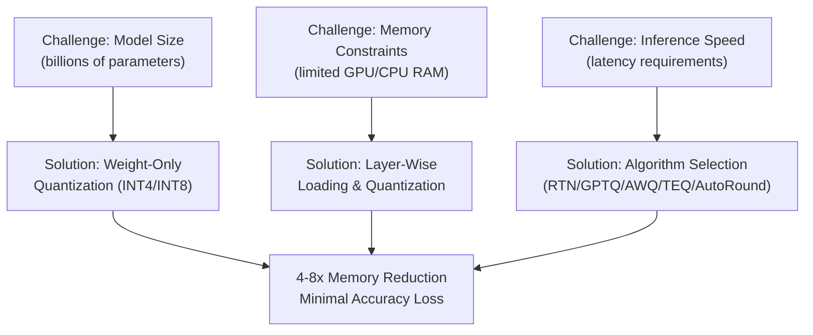

**Sources:** [README.md:1-203](), [neural_compressor/torch/quantization/config.py:1-1500](), [docs/source/quantization.md:1-500]()

## Package Structure

Neural Compressor organizes transformer/LLM support into two main interfaces:

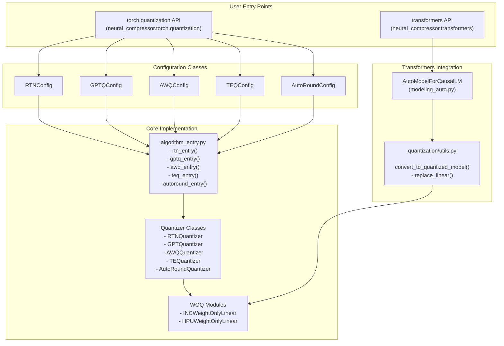

**Key Files:**

| Component | File Path | Purpose |
|-----------|-----------|---------|
| Torch API Entry | `neural_compressor/torch/quantization/quantize.py` | Main `quantize()`, `prepare()`, `convert()` functions |
| Algorithm Dispatch | `neural_compressor/torch/quantization/algorithm_entry.py` | Entry points for each WOQ algorithm |
| Transformers API | `neural_compressor/transformers/models/modeling_auto.py` | HuggingFace-compatible `AutoModelForCausalLM` |
| Config Classes | `neural_compressor/torch/quantization/config.py` | Configuration for all WOQ algorithms |
| WOQ Modules | `neural_compressor/torch/algorithms/weight_only/modules.py` | Quantized linear layer implementations |
| Save/Load | `neural_compressor/torch/algorithms/weight_only/save_load.py` | Model persistence in HF and INC formats |

**Sources:** [neural_compressor/torch/quantization/__init__.py:1-60](), [neural_compressor/transformers/models/modeling_auto.py:1-100](), [neural_compressor/torch/quantization/algorithm_entry.py:1-100]()

## Weight-Only Quantization Algorithms

Neural Compressor provides five weight-only quantization algorithms, each with different accuracy/speed/complexity trade-offs:

### Algorithm Comparison Matrix

| Algorithm | Calibration Required | Relative Speed | Relative Accuracy | Use Case |
|-----------|---------------------|----------------|-------------------|----------|
| **RTN** (Round-To-Nearest) | No | Fastest | Good | Quick deployment, baseline |
| **GPTQ** | Yes (Hessian-based) | Slow | Excellent | Best accuracy, offline quantization |
| **AWQ** | Yes (activation-aware) | Medium | Excellent | Balanced accuracy/speed |
| **TEQ** | Yes (trainable) | Medium | Very Good | Learnable transformations |
| **AutoRound** | Yes (gradient-based) | Slow | Excellent | State-of-art, flexible |

### Algorithm Flow and Decision Tree

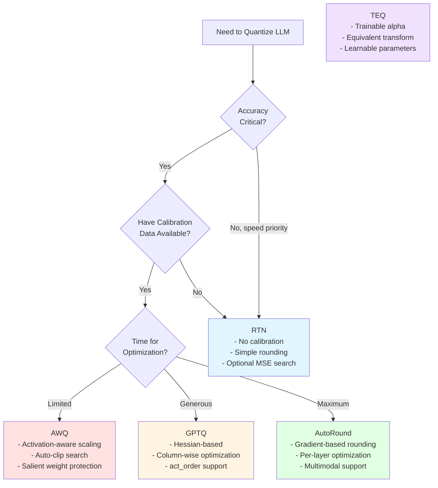

**Sources:** [neural_compressor/torch/quantization/config.py:104-850](), [examples/README.md:1-200](), [README.md:18-103]()

## Algorithm Implementation Details

### RTN (Round-To-Nearest)

RTN is the simplest and fastest weight-only quantization algorithm. It quantizes weights through direct rounding with optional MSE-based clipping.

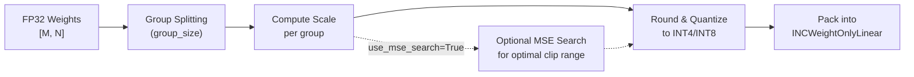

**Key Parameters:**
- `bits`: 1-8 (typically 4 or 8)
- `group_size`: -1 (per-channel) or 32, 64, 128 (per-group)
- `use_sym`: symmetric vs asymmetric quantization
- `use_mse_search`: optimize clipping range via MSE
- `use_full_range`: use full INT4 range [-8, 7] vs [-7, 7]

**Implementation Entry Point:** [neural_compressor/torch/quantization/algorithm_entry.py:62-118]()

**Quantizer Class:** [neural_compressor/torch/algorithms/weight_only/rtn.py:1-300]()

**Sources:** [neural_compressor/torch/quantization/config.py:104-295](), [test/3x/torch/quantization/weight_only/test_rtn.py:1-200]()

### GPTQ (Generative Pre-trained Transformer Quantization)

GPTQ uses second-order Hessian information to minimize quantization error through layer-wise optimal rounding.

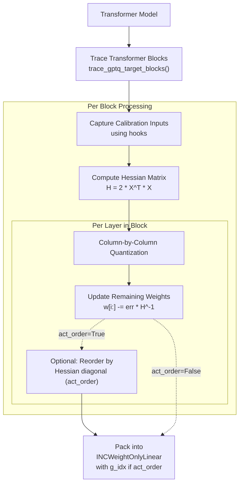

**Key Parameters:**
- `act_order`: Reorder channels by Hessian diagonal (desc_act)
- `hybrid_order`: Reorder within groups (no inference overhead)
- `percdamp`: Dampening factor for numerical stability (default 0.01)
- `block_size`: Process weights in blocks (default 128)
- `static_groups`: Pre-compute group quantization parameters
- `true_sequential`: Quantize layers in original order (slower, more accurate)

**Implementation Entry Point:** [neural_compressor/torch/quantization/algorithm_entry.py:120-187]()

**Quantizer Class:** [neural_compressor/torch/algorithms/weight_only/gptq.py:184-1000]()

**Block Tracing:** [neural_compressor/torch/algorithms/weight_only/gptq.py:68-128]()

**Sources:** [neural_compressor/torch/quantization/config.py:327-553](), [test/3x/torch/quantization/weight_only/test_gptq.py:1-300]()

### AWQ (Activation-aware Weight Quantization)

AWQ protects salient weights by applying per-channel scaling based on activation magnitude statistics.

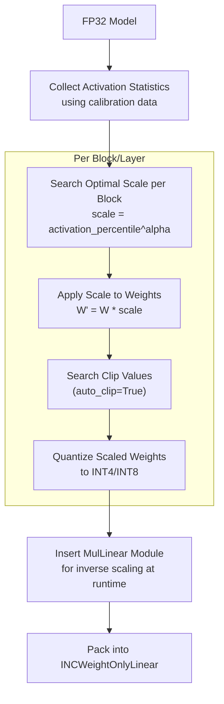

**Key Concepts:**
- **Salient Weights**: Weights with large activation magnitudes are more sensitive to quantization
- **Scaling**: Apply `scale = max(abs(activation))^alpha` where `alpha` is typically 0.5
- **MulLinear Module**: Inserted before quantized layer to multiply input by `1/scale` at runtime

**Implementation Entry Point:** [neural_compressor/torch/quantization/algorithm_entry.py:399-482]()

**Quantizer Class:** [neural_compressor/torch/algorithms/weight_only/awq.py:1-800]()

**Sources:** [neural_compressor/torch/quantization/config.py:556-735](), [test/3x/torch/quantization/weight_only/test_awq.py:1-250]()

### TEQ (Trainable Equivalent Quantization)

TEQ introduces trainable transformation parameters (`alpha`) that are learned to minimize quantization error.

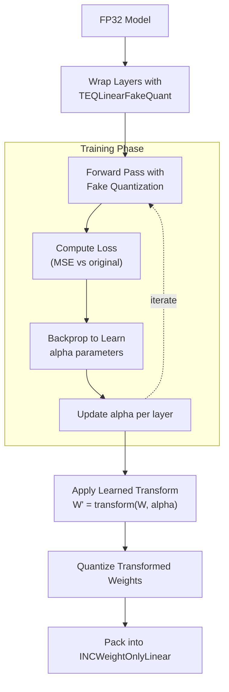

**Key Features:**
- Trainable `alpha` parameters per layer
- Equivalent transformation: maintains mathematical equivalence to original model
- Optional folding: merge transformation into previous layer

**Implementation Entry Point:** [neural_compressor/torch/quantization/algorithm_entry.py:484-552]()

**Quantizer Class:** [neural_compressor/torch/algorithms/weight_only/teq.py:1-600]()

**Sources:** [neural_compressor/torch/quantization/config.py:738-867](), [docs/source/publication_list.md:22-23]()

### AutoRound

AutoRound uses gradient-based optimization to learn optimal weight rounding, offering state-of-the-art accuracy with support for multimodal models.

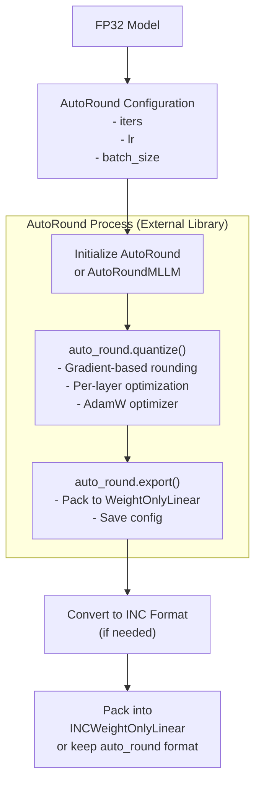

**Key Features:**
- External library integration (`pip install auto-round`)
- Gradient-based weight rounding optimization
- Support for multimodal models (vision-language)
- Multiple export formats (ITREX, auto-gptq, HuggingFace)
- W4A8 mixed precision support

**Implementation Entry Point:** [neural_compressor/torch/quantization/algorithm_entry.py:554-700]()

**Quantizer Class:** [neural_compressor/torch/algorithms/weight_only/autoround.py:48-400]()

**Sources:** [test/3x/torch/quantization/weight_only/test_autoround.py:1-300](), [neural_compressor/torch/quantization/config.py:870-1200]()

## Special Features for LLM Quantization

### Layer-Wise and Block-Wise Quantization

Large models often exceed available memory. Layer-wise quantization loads and quantizes one layer at a time, dramatically reducing peak memory usage.

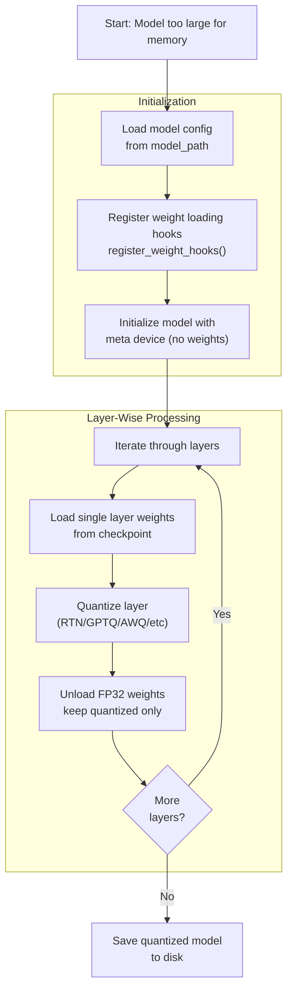

**Configuration:**

```python
# Layer-wise quantization for CPU/GPU
RTNConfig(use_layer_wise=True, model_path="/path/to/model")
GPTQConfig(use_layer_wise=True, model_path="/path/to/model")
AWQConfig(use_layer_wise=True, model_path="/path/to/model")

# Block-wise quantization for large GPU/HPU
GPTQConfig(use_block_wise=True, model_path="/path/to/model")
```

**Key Classes:**
- Weight loading hooks: [neural_compressor/torch/algorithms/layer_wise/utils.py:100-200]()
- Checkpoint loading: [neural_compressor/torch/algorithms/layer_wise/load.py:1-150]()

**Sources:** [neural_compressor/torch/algorithms/weight_only/gptq.py:286-350](), [neural_compressor/torch/algorithms/layer_wise/utils.py:1-400](), [neural_compressor/torch/quantization/config.py:150-250]()

### Double Quantization

Double quantization further compresses models by quantizing the quantization scales themselves (e.g., quantize FP16 scales to INT8).

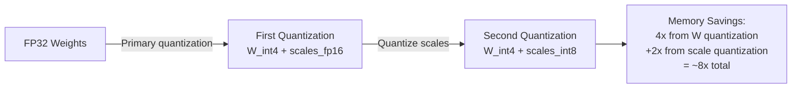

**Configuration:**

```python
RTNConfig(
    bits=4,
    use_double_quant=True,
    double_quant_dtype="int",
    double_quant_bits=8,
    double_quant_use_sym=True,
    double_quant_group_size=256
)
```

**Available Presets:**

| Preset | Description | Config |
|--------|-------------|--------|
| `BNB_NF4` | BitsAndBytes NF4 | 4-bit weights, NF4 dtype, double quant scales |
| `GGUF_IQ2_XXS` | GGUF IQ2_XXS format | 2-bit weights, specific quant params |
| Custom | User-defined | Specify all double_quant_* parameters |

**Sources:** [neural_compressor/torch/quantization/config.py:143-192](), [neural_compressor/torch/utils/constants.py:1-100]()

### LM Head Handling

The language model head (`lm_head`) layer is often excluded from quantization to preserve generation quality.

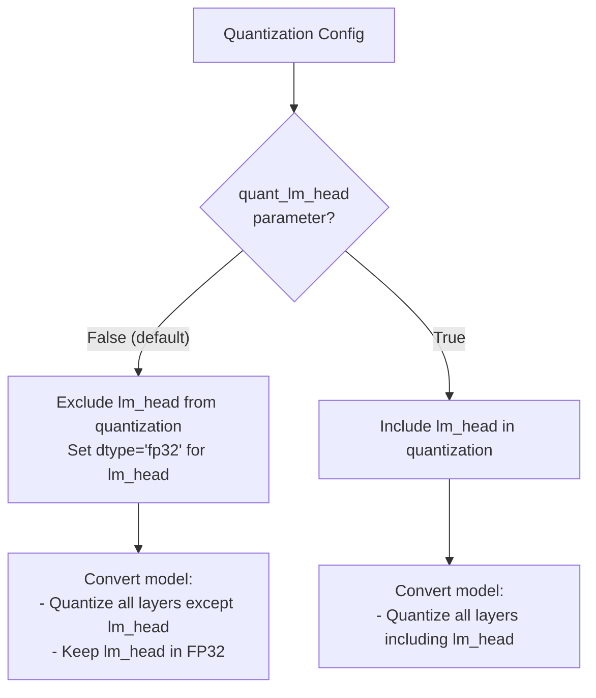

**Implementation:**
The `quant_lm_head` parameter in config classes automatically handles this:

```python
# Default: exclude lm_head
RTNConfig(quant_lm_head=False)  # lm_head stays FP32

# Explicitly quantize lm_head
RTNConfig(quant_lm_head=True)   # lm_head quantized
```

**Automatic Detection:**
[neural_compressor/torch/quantization/config.py:248-253]() - RTN automatically sets FP32 for `LM_HEAD_NAMES`
[neural_compressor/torch/utils/constants.py:1-50]() - Defines `LM_HEAD_NAMES` list

**Sources:** [neural_compressor/torch/quantization/config.py:172-253](), [neural_compressor/torch/utils/constants.py:1-100]()

### Multi-Device Support

Neural Compressor supports quantization and inference across multiple device types:

| Device | WOQ Support | Quantized Module Type | Key Features |
|--------|-------------|----------------------|--------------|
| **CPU** | ✓ | `INCWeightOnlyLinear` | Default, full algorithm support |
| **Intel GPU (XPU)** | ✓ | `INCWeightOnlyLinear` | IPEX integration |
| **Intel Gaudi (HPU)** | ✓ | `HPUWeightOnlyLinear` | Optimized HPU kernels, saved in safetensors |
| **NVIDIA GPU** | Partial | `INCWeightOnlyLinear` | Some algorithms via AutoRound/HQQ |

**Device-Specific Optimizations:**

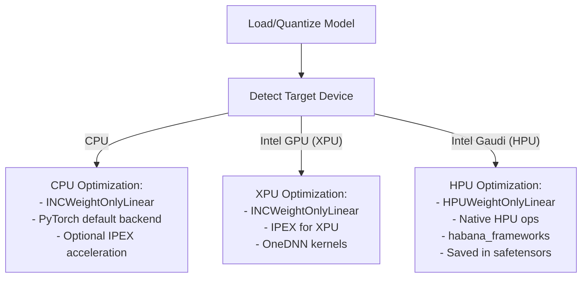

**HPU-Specific Features:**
- Custom `HPUWeightOnlyLinear` module: [neural_compressor/torch/algorithms/weight_only/modules.py:600-1000]()
- Optimized packing format stored in `hpu_model.safetensors`
- Automatic conversion on first load: [neural_compressor/torch/algorithms/weight_only/save_load.py:214-282]()

**Sources:** [neural_compressor/torch/algorithms/weight_only/modules.py:1-1500](), [neural_compressor/torch/algorithms/weight_only/save_load.py:110-450]()

## Transformers-Like API Usage

The `neural_compressor.transformers` package provides a HuggingFace-compatible API for seamless integration with transformer models.

### AutoModelForCausalLM Override

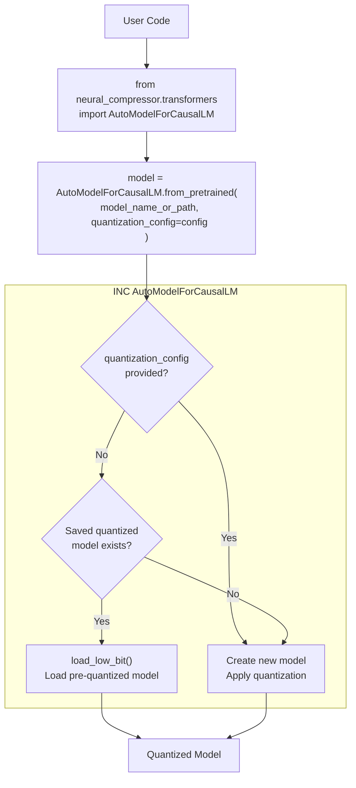

**Example Usage:**

```python
from neural_compressor.transformers import AutoModelForCausalLM, RtnConfig

# Quantize during loading
config = RtnConfig(bits=4, group_size=128)
model = AutoModelForCausalLM.from_pretrained(
    "meta-llama/Llama-2-7b-hf",
    quantization_config=config,
    device_map="auto"
)

# Save quantized model
model.save_pretrained("./llama2-7b-w4-rtn")

# Load pre-quantized model
model = AutoModelForCausalLM.from_pretrained(
    "./llama2-7b-w4-rtn",
    device_map="auto"
)
```

**Key Implementation:**
- Custom `from_pretrained()`: [neural_compressor/transformers/models/modeling_auto.py:96-200]()
- Quantization application: [neural_compressor/transformers/quantization/utils.py:80-200]()
- Linear replacement: [neural_compressor/transformers/quantization/utils.py:114-250]()

**Sources:** [neural_compressor/transformers/models/modeling_auto.py:1-500](), [test/3x/torch/quantization/weight_only/test_transformers.py:1-250]()

### Supported Model Types

Neural Compressor's transformers API supports all HuggingFace causal language models:

| Model Family | Example Models | Special Support |
|--------------|----------------|-----------------|
| **LLaMA** | LLaMA, LLaMA-2, LLaMA-3 | ✓ Full support, all algorithms |
| **GPT** | GPT-2, GPT-J, GPT-NeoX | ✓ Full support |
| **OPT** | OPT-125M to OPT-175B | ✓ Full support |
| **BLOOM** | BLOOM-560M to BLOOM-176B | ✓ Full support |
| **Falcon** | Falcon-7B, Falcon-40B | ✓ Full support |
| **Mistral/Mixtral** | Mistral-7B, Mixtral-8x7B | ✓ Full support, MoE models |
| **Qwen** | Qwen-7B, Qwen-14B | ✓ Full support |
| **Vision-Language** | Qwen2VL, LLaVA | ✓ Via AutoRound multimodal |

**Sources:** [examples/README.md:1-200](), [README.md:25-26](), [neural_compressor/transformers/models/modeling_auto.py:1-100]()

### Integration with HuggingFace Ecosystem

Neural Compressor integrates seamlessly with the HuggingFace ecosystem:

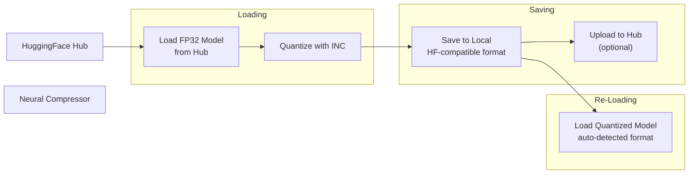

**Compatible Components:**
- **Tokenizers**: Use standard HuggingFace tokenizers
- **Model Cards**: Standard `config.json` with `quantization_config` field
- **Safetensors**: Supports both PyTorch `.bin` and `.safetensors` formats
- **Generation**: Compatible with `model.generate()` and generation configs

**Example with Full Ecosystem:**

```python
from transformers import AutoTokenizer, GenerationConfig
from neural_compressor.transformers import AutoModelForCausalLM, GPTQConfig

# Load tokenizer (standard HuggingFace)
tokenizer = AutoTokenizer.from_pretrained("meta-llama/Llama-2-7b-hf")

# Quantize model
config = GPTQConfig(bits=4, group_size=128, dataset="wikitext")
model = AutoModelForCausalLM.from_pretrained(
    "meta-llama/Llama-2-7b-hf",
    quantization_config=config
)

# Use generation config
gen_config = GenerationConfig.from_pretrained("meta-llama/Llama-2-7b-hf")
inputs = tokenizer("Hello, my name is", return_tensors="pt")
outputs = model.generate(**inputs, generation_config=gen_config)
```

**Sources:** [neural_compressor/transformers/models/modeling_auto.py:1-500](), [test/3x/torch/quantization/weight_only/test_transformers.py:45-100]()

## Practical Examples

### Example 1: Quick RTN Quantization

```python
from neural_compressor.transformers import AutoModelForCausalLM, RtnConfig

# Quantize GPT-J to 4-bit with RTN (no calibration needed)
config = RtnConfig(
    bits=4,
    group_size=128,
    use_sym=True
)

model = AutoModelForCausalLM.from_pretrained(
    "EleutherAI/gpt-j-6B",
    quantization_config=config,
    device_map="auto"
)

# Save for later use
model.save_pretrained("./gptj-w4-rtn")
```

**Sources:** [test/3x/torch/quantization/weight_only/test_transformers.py:45-80]()

### Example 2: GPTQ with Calibration

```python
from neural_compressor.transformers import AutoModelForCausalLM, GPTQConfig
from datasets import load_dataset

# Prepare calibration dataset
dataset = load_dataset("wikitext", "wikitext-2-raw-v1", split="test")

# GPTQ configuration
config = GPTQConfig(
    bits=4,
    group_size=128,
    dataset="wikitext-2-raw-v1",  # Dataset name
    act_order=True,               # Reorder by Hessian diagonal
    static_groups=False,
    nsamples=128                  # Number of calibration samples
)

# Quantize (this runs calibration automatically)
model = AutoModelForCausalLM.from_pretrained(
    "meta-llama/Llama-2-7b-hf",
    quantization_config=config,
    device_map="auto"
)

model.save_pretrained("./llama2-7b-gptq-w4g128")
```

**Sources:** [test/3x/torch/quantization/weight_only/test_transformers.py:100-150]()

### Example 3: Layer-Wise Quantization for Large Models

```python
from neural_compressor.transformers import AutoModelForCausalLM, GPTQConfig

# For models that don't fit in memory
config = GPTQConfig(
    bits=4,
    group_size=128,
    use_layer_wise=True,           # Enable layer-wise
    model_path="meta-llama/Llama-2-70b-hf"  # Source for weights
)

# Model is loaded and quantized layer by layer
model = AutoModelForCausalLM.from_pretrained(
    "meta-llama/Llama-2-70b-hf",
    quantization_config=config,
    device_map="cpu"  # Target device
)

# Save (reduces size by 4x)
model.save_pretrained("./llama2-70b-gptq-w4")
```

**Sources:** [neural_compressor/torch/quantization/config.py:403-404](), [test/3x/torch/quantization/weight_only/test_gptq.py:150-200]()

### Example 4: Loading and Using Pre-Quantized Models

```python
from neural_compressor.transformers import AutoModelForCausalLM
from transformers import AutoTokenizer

# Load pre-quantized model (auto-detected format)
model = AutoModelForCausalLM.from_pretrained(
    "./llama2-7b-gptq-w4",
    device_map="auto"
)

tokenizer = AutoTokenizer.from_pretrained("meta-llama/Llama-2-7b-hf")

# Use normally
inputs = tokenizer("The capital of France is", return_tensors="pt")
outputs = model.generate(**inputs, max_length=50)
print(tokenizer.decode(outputs[0]))
```

**Sources:** [test/3x/torch/quantization/weight_only/test_transformers.py:200-250]()

### Example 5: AutoRound for Multimodal Models

```python
from neural_compressor.transformers import Qwen2VLForConditionalGeneration, AutoRoundConfig

# AutoRound configuration for vision-language model
config = AutoRoundConfig(
    bits=4,
    group_size=128,
    iters=200,                    # AutoRound iterations
    quant_nontext_module=True,    # Quantize vision modules
    extra_data_dir="./images"     # Path to calibration images
)

# Quantize Qwen2-VL (multimodal)
model = Qwen2VLForConditionalGeneration.from_pretrained(
    "Qwen/Qwen2-VL-7B-Instruct",
    quantization_config=config,
    device_map="auto"
)

model.save_pretrained("./qwen2vl-7b-w4-autoround")
```

**Sources:** [neural_compressor/torch/quantization/config.py:870-1000](), [neural_compressor/torch/algorithms/weight_only/autoround.py:96-100]()

## Model Save and Load Formats

Neural Compressor supports multiple save/load formats for interoperability. For detailed information, see [Model Save and Load](#8.2).

### Quick Format Overview

| Format | Description | File Names | Use Case |
|--------|-------------|------------|----------|
| **INC Default** | Native INC format | `quantized_weight.pt`<br/>`qconfig.json` | INC-to-INC transfer |
| **HuggingFace** | HF-compatible format | `model.safetensors`<br/>`quantize_config.json` | HF ecosystem integration |
| **HPU Optimized** | Intel Gaudi format | `hpu_model.safetensors`<br/>`qconfig.json` | HPU deployment |

**Sources:** [neural_compressor/torch/algorithms/weight_only/save_load.py:1-100](), [neural_compressor/torch/utils/utility.py:52-61]()

---

