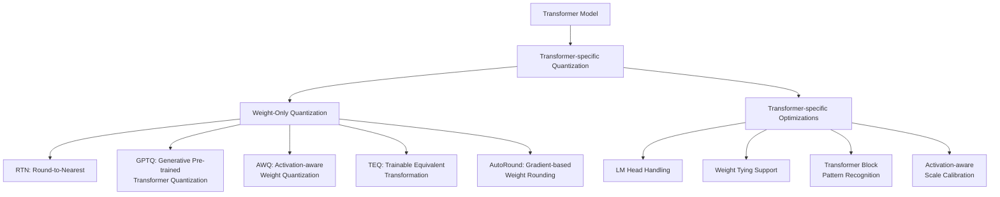
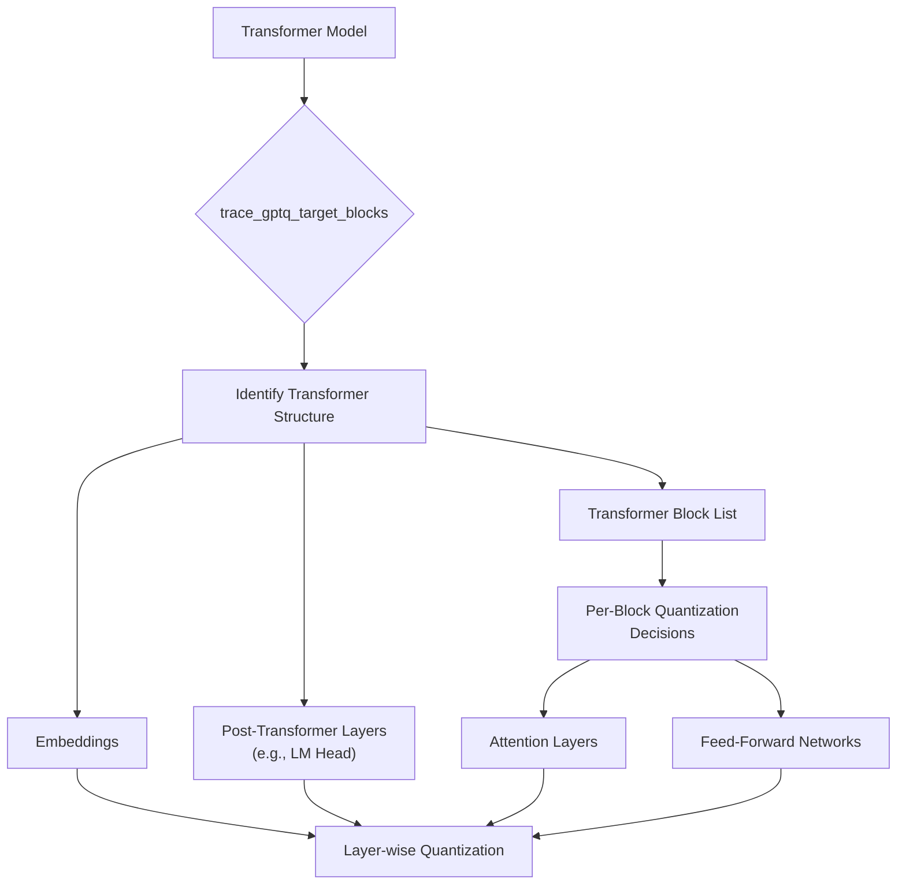
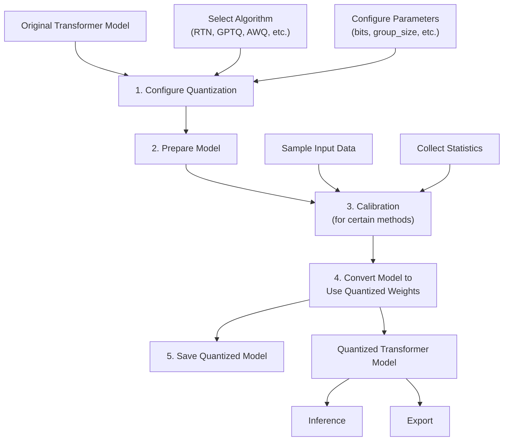
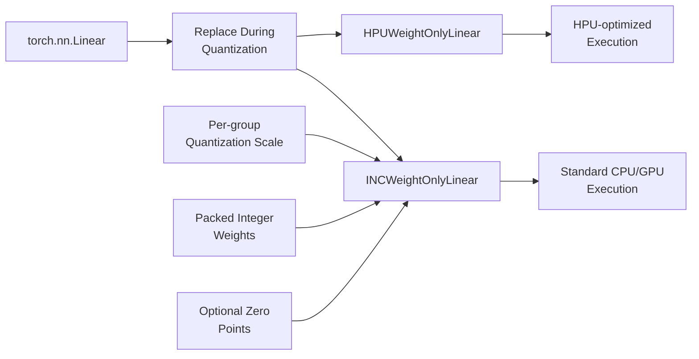

<!-- source: DeepWiki mcp.deepwiki.com · repo intel/neural-compressor · page 8.1 HuggingFace Integration · fetched 2026-10-21 -->

# Transformer-specific Quantization

<details>
<summary>Relevant source files</summary>

The following files were used as context for generating this wiki page:

- [examples/pytorch/multimodal-modeling/quantization/auto_round/mllm.py](examples/pytorch/multimodal-modeling/quantization/auto_round/mllm.py)
- [neural_compressor/torch/algorithms/layer_wise/utils.py](neural_compressor/torch/algorithms/layer_wise/utils.py)
- [neural_compressor/torch/algorithms/mixed_low_precision/modules.py](neural_compressor/torch/algorithms/mixed_low_precision/modules.py)
- [neural_compressor/torch/algorithms/mixed_low_precision/quantizer.py](neural_compressor/torch/algorithms/mixed_low_precision/quantizer.py)
- [neural_compressor/torch/algorithms/weight_only/__init__.py](neural_compressor/torch/algorithms/weight_only/__init__.py)
- [neural_compressor/torch/algorithms/weight_only/autoround.py](neural_compressor/torch/algorithms/weight_only/autoround.py)
- [neural_compressor/torch/algorithms/weight_only/awq.py](neural_compressor/torch/algorithms/weight_only/awq.py)
- [neural_compressor/torch/algorithms/weight_only/gptq.py](neural_compressor/torch/algorithms/weight_only/gptq.py)
- [neural_compressor/torch/algorithms/weight_only/modules.py](neural_compressor/torch/algorithms/weight_only/modules.py)
- [neural_compressor/torch/algorithms/weight_only/rtn.py](neural_compressor/torch/algorithms/weight_only/rtn.py)
- [neural_compressor/torch/algorithms/weight_only/save_load.py](neural_compressor/torch/algorithms/weight_only/save_load.py)
- [neural_compressor/torch/algorithms/weight_only/teq.py](neural_compressor/torch/algorithms/weight_only/teq.py)
- [neural_compressor/torch/algorithms/weight_only/utility.py](neural_compressor/torch/algorithms/weight_only/utility.py)
- [neural_compressor/torch/quantization/__init__.py](neural_compressor/torch/quantization/__init__.py)
- [neural_compressor/torch/quantization/algorithm_entry.py](neural_compressor/torch/quantization/algorithm_entry.py)
- [neural_compressor/torch/quantization/config.py](neural_compressor/torch/quantization/config.py)
- [neural_compressor/torch/quantization/quantize.py](neural_compressor/torch/quantization/quantize.py)
- [neural_compressor/torch/quantization/save_load_entry.py](neural_compressor/torch/quantization/save_load_entry.py)
- [neural_compressor/torch/utils/constants.py](neural_compressor/torch/utils/constants.py)
- [neural_compressor/torch/utils/utility.py](neural_compressor/torch/utils/utility.py)
- [neural_compressor/transformers/models/modeling_auto.py](neural_compressor/transformers/models/modeling_auto.py)
- [neural_compressor/transformers/quantization/utils.py](neural_compressor/transformers/quantization/utils.py)
- [neural_compressor/transformers/utils/quantization_config.py](neural_compressor/transformers/utils/quantization_config.py)
- [test/3x/torch/algorithms/weight_only/test_teq_quantizer.py](test/3x/torch/algorithms/weight_only/test_teq_quantizer.py)
- [test/3x/torch/quantization/fp8_quant/test_fp8_jsons/test_pow2_w4a8_quant.json](test/3x/torch/quantization/fp8_quant/test_fp8_jsons/test_pow2_w4a8_quant.json)
- [test/3x/torch/quantization/fp8_quant/test_gptq_mixed_precision.py](test/3x/torch/quantization/fp8_quant/test_gptq_mixed_precision.py)
- [test/3x/torch/quantization/weight_only/test_autoround.py](test/3x/torch/quantization/weight_only/test_autoround.py)
- [test/3x/torch/quantization/weight_only/test_awq.py](test/3x/torch/quantization/weight_only/test_awq.py)
- [test/3x/torch/quantization/weight_only/test_gptq.py](test/3x/torch/quantization/weight_only/test_gptq.py)
- [test/3x/torch/quantization/weight_only/test_rtn.py](test/3x/torch/quantization/weight_only/test_rtn.py)
- [test/3x/torch/quantization/weight_only/test_teq.py](test/3x/torch/quantization/weight_only/test_teq.py)
- [test/3x/torch/quantization/weight_only/test_transformers.py](test/3x/torch/quantization/weight_only/test_transformers.py)
- [test/3x/torch/requirements.txt](test/3x/torch/requirements.txt)

</details>


This page documents the specialized quantization techniques and workflows in Neural Compressor that are specifically designed or optimized for transformer-based models. For general quantization approaches, see [Quantization Techniques](#5). For recipes and examples focused on specific LLM models, see [LLM Recipes](#6.2).

## Overview of Transformer Quantization

Transformer models pose unique challenges for quantization due to their size, architecture, and sensitivity to precision loss. Neural Compressor implements several specialized algorithms that specifically target transformer architectures, optimizing for both memory efficiency and minimal accuracy degradation.



Sources: 
- [neural_compressor/torch/quantization/config.py:102-191](neural_compressor/torch/quantization/config.py:102-191)
- [neural_compressor/torch/quantization/algorithm_entry.py:60-115](neural_compressor/torch/quantization/algorithm_entry.py:60-115)
- [neural_compressor/torch/algorithms/weight_only/gptq.py:52-128](neural_compressor/torch/algorithms/weight_only/gptq.py:52-128)

## Supported Weight-Only Quantization Algorithms

Neural Compressor includes several specialized weight-only quantization algorithms that are particularly effective for transformer models:

### Round-to-Nearest (RTN)

The basic weight-only quantization technique that rounds weights to the nearest representable value in the target precision.

```python
quant_config = RTNConfig(
    dtype="int4",           # Data type for quantized weights
    bits=4,                 # Number of bits for quantization
    use_sym=True,           # Use symmetric quantization
    group_size=32,          # Number of elements sharing a scale
    use_mse_search=True,    # Search for optimal clipping values
    quant_lm_head=False     # Don't quantize the language model head
)
```

### GPTQ (Generative Pre-trained Transformer Quantization)

GPTQ is an advanced technique specifically designed for transformer models that uses Hessian-based optimization to find better quantization parameters.

```python
quant_config = GPTQConfig(
    bits=4,                 # Number of bits for quantization  
    group_size=128,         # Number of elements sharing a scale
    act_order=True,         # Use activation order for better quantization
    percdamp=0.01,          # Dampening factor for numerical stability
    block_size=128          # Block size for per-block quantization
)
```

### AWQ (Activation-aware Weight Quantization)

AWQ optimizes quantization by considering the interaction between weights and activations in transformer models.

```python
quant_config = AWQConfig(
    bits=4,                 # Number of bits for quantization
    group_size=128,         # Number of elements sharing a scale
    use_auto_scale=True,    # Automatically determine optimal scales
    use_auto_clip=True      # Automatically determine clipping values
)
```

### TEQ (Trainable Equivalent Transformation)

TEQ allows for fine-tuning quantization parameters through a training process, particularly effective for transformer models.

### AutoRound

AutoRound uses gradient-based optimization to find optimal rounding points for weights, significantly improving accuracy compared to naive rounding.

Sources:
- [neural_compressor/torch/quantization/config.py:102-293](neural_compressor/torch/quantization/config.py:102-293)
- [neural_compressor/torch/quantization/config.py:325-517](neural_compressor/torch/quantization/config.py:325-517)
- [neural_compressor/torch/quantization/config.py:534-712](neural_compressor/torch/quantization/config.py:534-712)
- [neural_compressor/torch/quantization/algorithm_entry.py:60-182](neural_compressor/torch/quantization/algorithm_entry.py:60-182)

## Transformer-specific Optimizations

Neural Compressor implements several transformer-specific optimizations for quantization:

### Special Handling for Transformer Structures

The library includes specialized code to identify and handle transformer architectures:



Sources:
- [neural_compressor/torch/algorithms/weight_only/gptq.py:52-128](neural_compressor/torch/algorithms/weight_only/gptq.py:52-128)
- [neural_compressor/transformers/models/modeling_auto.py:60-105](neural_compressor/transformers/models/modeling_auto.py:60-105)

### Language Model Head Handling

By default, the language model head (`lm_head`) is kept in full precision to preserve model output quality:

```python
# In configuration classes:
if not self.quant_lm_head:
    self.set_local(
        LM_HEAD_NAMES, 
        RTNConfig(dtype="fp32", use_layer_wise=self.use_layer_wise)
    )
```

Sources:
- [neural_compressor/torch/quantization/config.py:246-251](neural_compressor/torch/quantization/config.py:246-251)
- [neural_compressor/torch/quantization/config.py:469-474](neural_compressor/torch/quantization/config.py:469-474)
- [neural_compressor/torch/quantization/config.py:670-673](neural_compressor/torch/quantization/config.py:670-673)

### Weight Tying Support

Neural Compressor handles weight-tied transformers, where embedding and output layers share weights:

```python
# For transformers model, if lm_head is tied from embedding, deepcopy it
if quant_lm_head and getattr(getattr(model, "config", None), "tie_word_embeddings", False):
    for key in model._tied_weights_keys:
        # Handle tied weights
```

Sources:
- [neural_compressor/torch/algorithms/weight_only/rtn.py:112-114](neural_compressor/torch/algorithms/weight_only/rtn.py:112-114)

### Specialized Data Types for Transformers

Neural Compressor supports specialized data types tailored to transformers:

| Data Type | Description | Use Case |
|-----------|-------------|----------|
| NF4 | 4-bit normalized float with optimized value distribution | General transformer quantization |
| FP4_BNB | 4-bit floating point (bitsandbytes format) | Compatible with bitsandbytes library |
| FP4_E2M1 | 4-bit floating point with 2 exponent, 1 mantissa bits | Transformer attention mechanisms |
| FP8 variants | 8-bit floating point formats | Higher precision requirements |

Sources:
- [neural_compressor/torch/algorithms/weight_only/utility.py:51-86](neural_compressor/torch/algorithms/weight_only/utility.py:51-86)

## Workflow for Transformer Quantization

The transformer quantization workflow in Neural Compressor follows these steps:



This workflow is typically implemented using the following API pattern:

```python
# 1. Configure quantization
quant_config = RTNConfig(bits=4, group_size=32)

# 2-4. Prepare, calibrate, and convert in one step with quantize() API
# (or use prepare() and convert() separately for more control)
quantized_model = quantize(
    model=transformer_model,
    quant_config=quant_config,
    run_fn=run_fn,
    run_args=(calibration_data,)
)

# 5. Save quantized model
quantized_model.save("saved_model_dir")
```

Sources:
- [neural_compressor/torch/quantization/algorithm_entry.py:60-115](neural_compressor/torch/quantization/algorithm_entry.py:60-115)
- [neural_compressor/torch/algorithms/weight_only/save_load.py:53-101](neural_compressor/torch/algorithms/weight_only/save_load.py:53-101)

## Key Components for Transformer Quantization

### Weight-Only Linear Modules

Neural Compressor replaces standard transformer linear layers with specialized weight-only quantized versions:



Sources:
- [neural_compressor/torch/algorithms/weight_only/modules.py:117-365](neural_compressor/torch/algorithms/weight_only/modules.py:117-365)
- [neural_compressor/transformers/quantization/utils.py:80-272](neural_compressor/transformers/quantization/utils.py:80-272)

### Layer-wise Quantization

For memory-constrained environments, Neural Compressor supports layer-wise quantization of transformers:

```python
quant_config = RTNConfig(
    use_layer_wise=True,   # Enable layer-wise quantization
    model_path="path/to/model"  # Path to load weights from
)
```

This technique loads and quantizes transformer layers one at a time, significantly reducing memory requirements during quantization.

Sources:
- [neural_compressor/torch/algorithms/layer_wise/utils.py:18-85](neural_compressor/torch/algorithms/layer_wise/utils.py:18-85)
- [neural_compressor/torch/algorithms/weight_only/gptq.py:266-292](neural_compressor/torch/algorithms/weight_only/gptq.py:266-292)

### Integration with HuggingFace Transformers

Neural Compressor provides seamless integration with HuggingFace's transformers library:

```python
from neural_compressor.transformers import AutoModelForCausalLM
from transformers import AutoTokenizer

# Load and quantize in one step with HuggingFace-compatible API
tokenizer = AutoTokenizer.from_pretrained("gpt2")
model = AutoModelForCausalLM.from_pretrained(
    "gpt2", 
    quantization_config=RTNConfig(bits=4, group_size=32)
)
```

Sources:
- [neural_compressor/transformers/models/modeling_auto.py:90-239](neural_compressor/transformers/models/modeling_auto.py:90-239)
- [neural_compressor/transformers/quantization/utils.py:15-78](neural_compressor/transformers/quantization/utils.py:15-78)

## Performance Considerations for Transformer Quantization

### Precision vs. Performance Tradeoff

Different algorithms and configurations offer different tradeoffs between model quality and performance:

| Algorithm | Precision | Performance | Memory Usage | Setup Complexity |
|-----------|-----------|-------------|--------------|------------------|
| RTN | Lower | Highest | Lowest | Simple |
| GPTQ | Higher | High | Low | Medium |
| AWQ | Higher | High | Low | Medium |
| AutoRound | Highest | High | Low | Complex |

### Hardware Optimizations

Neural Compressor includes optimizations for different hardware targets:

1. **CPU**: Uses Intel Extension for PyTorch (IPEX) for optimized weight-only inference
2. **GPU/XPU**: Includes CUDA optimizations for NVIDIA GPUs and XPU optimizations for Intel GPUs
3. **HPU**: Supports Habana Gaudi accelerators with specialized modules

Sources:
- [neural_compressor/transformers/quantization/utils.py:143-252](neural_compressor/transformers/quantization/utils.py:143-252)
- [neural_compressor/torch/algorithms/weight_only/save_load.py:452-461](neural_compressor/torch/algorithms/weight_only/save_load.py:452-461)

## Usage Examples

### Basic Transformer Quantization

```python
from neural_compressor.torch.quantization import RTNConfig, quantize
import torch
import transformers

# Load model
model = transformers.AutoModelForCausalLM.from_pretrained("gpt2")

# Define calibration function
def run_fn(model, dataloader):
    for data in dataloader:
        model(data)

# Create calibration data
calibration_data = [torch.tensor([[1, 2, 3, 4]]) for _ in range(10)]

# Configure and quantize
quant_config = RTNConfig(bits=4, group_size=32, use_sym=True)
quantized_model = quantize(
    model=model,
    quant_config=quant_config,
    run_fn=run_fn,
    run_args=(calibration_data,)
)
```

### Advanced GPTQ Quantization

```python
from neural_compressor.torch.quantization import GPTQConfig, quantize
import transformers

# Load model
model = transformers.AutoModelForCausalLM.from_pretrained("gpt2")
tokenizer = transformers.AutoTokenizer.from_pretrained("gpt2")

# Create calibration data
texts = ["This is an example sentence.", "Another example for calibration."]
encodings = tokenizer(texts, return_tensors="pt", padding=True)

# Configure GPTQ
quant_config = GPTQConfig(
    bits=4,
    group_size=128,
    act_order=True,
    percdamp=0.01
)

# Define calibration function
def run_fn(model):
    model(**encodings)

# Quantize
quantized_model = quantize(
    model=model,
    quant_config=quant_config,
    run_fn=run_fn
)
```

Sources:
- [test/3x/torch/quantization/weight_only/test_rtn.py:65-96](test/3x/torch/quantization/weight_only/test_rtn.py:65-96)
- [test/3x/torch/quantization/weight_only/test_gptq.py:71-79](test/3x/torch/quantization/weight_only/test_gptq.py:71-79)
- [examples/3.x_api/pytorch/nlp/huggingface_models/language-modeling/quantization/transformers/weight_only/text-generation/run_generation_gpu_woq.py:16-139](examples/3.x_api/pytorch/nlp/huggingface_models/language-modeling/quantization/transformers/weight_only/text-generation/run_generation_gpu_woq.py:16-139)

## Best Practices for Transformer Quantization

1. **Algorithm Selection**: 
   - For maximum compression with basic accuracy: RTN
   - For better accuracy with minimal additional setup: GPTQ
   - For highest accuracy with calibration data: AutoRound or AWQ

2. **Model Structure Considerations**:
   - Typically keep the LM head in FP32 (`quant_lm_head=False`)
   - Handle weight-tied embeddings carefully if quantizing both

3. **Quantization Parameters**:
   - Bits: 4-bit is standard for most transformer quantization
   - Group size: Larger values (128-256) preserve more accuracy but reduce compression
   - Symmetric vs. asymmetric: Symmetric (`use_sym=True`) usually works better for transformers

4. **Memory Optimization**:
   - Use layer-wise quantization (`use_layer_wise=True`) for very large models
   - Leverage device offloading during quantization for large models

Sources:
- [neural_compressor/torch/quantization/config.py:291-304](neural_compressor/torch/quantization/config.py:291-304)
- [neural_compressor/torch/quantization/config.py:494-516](neural_compressor/torch/quantization/config.py:494-516)
- [neural_compressor/transformers/models/modeling_auto.py:139-145](neural_compressor/transformers/models/modeling_auto.py:139-145)

## Conclusion

Neural Compressor provides a comprehensive suite of quantization techniques specifically designed for transformer models. These techniques enable significant memory savings and performance improvements with minimal accuracy loss, making it possible to deploy large transformer models on resource-constrained devices or achieve higher throughput on existing hardware.

By selecting the appropriate quantization algorithm and configuration based on your specific transformer model and use case, you can achieve an optimal balance between model quality and computational efficiency.

---

