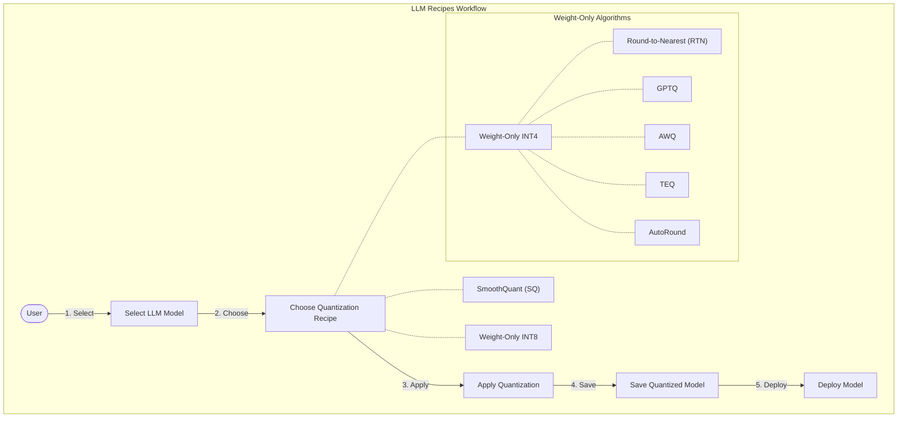
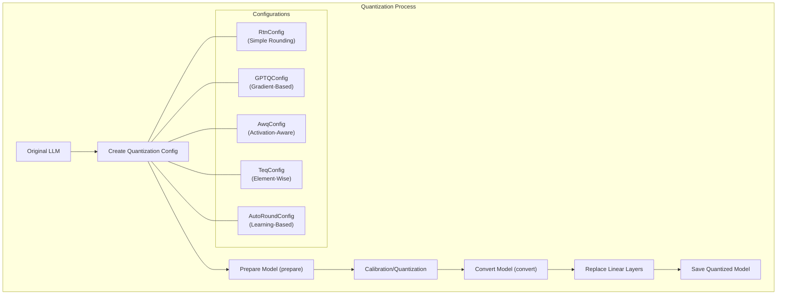
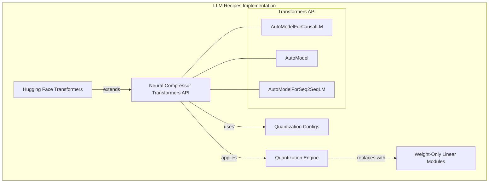
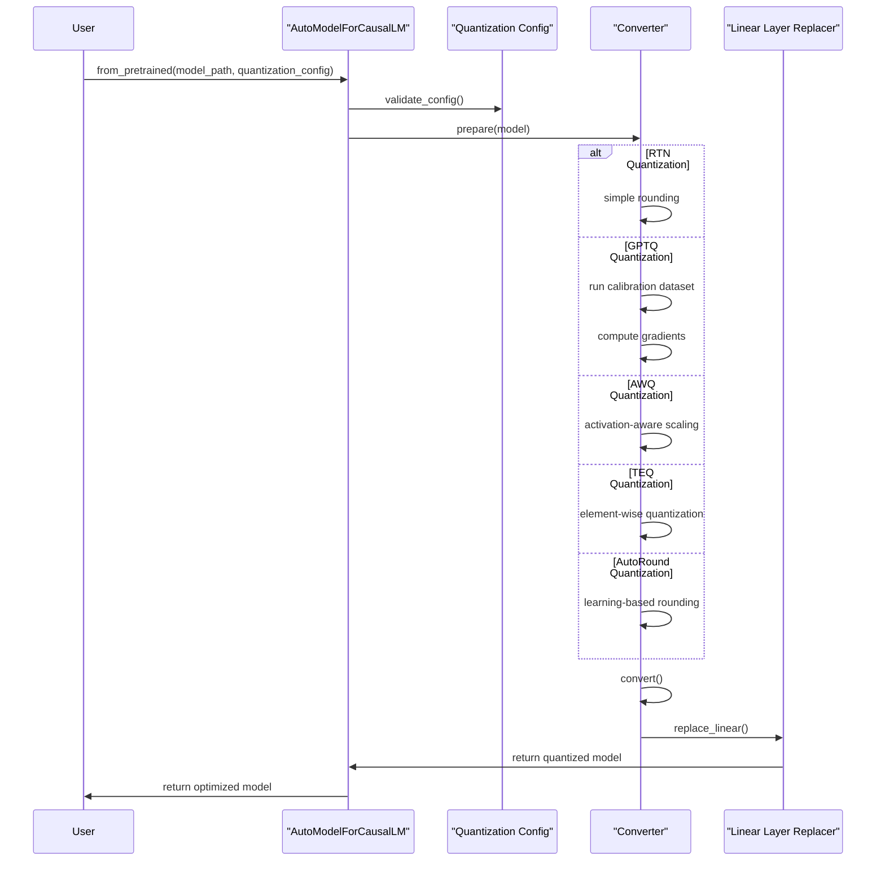

<!-- source: DeepWiki mcp.deepwiki.com · repo intel/neural-compressor · page 8.2 Model Save and Load · fetched 2026-10-21 -->

# LLM Recipes

<details>
<summary>Relevant source files</summary>

The following files were used as context for generating this wiki page:

- [docs/source/quantization_weight_only.md](docs/source/quantization_weight_only.md)
- [examples/pytorch/multimodal-modeling/quantization/auto_round/mllm.py](examples/pytorch/multimodal-modeling/quantization/auto_round/mllm.py)
- [neural_compressor/adaptor/pytorch.py](neural_compressor/adaptor/pytorch.py)
- [neural_compressor/adaptor/pytorch_cpu.yaml](neural_compressor/adaptor/pytorch_cpu.yaml)
- [neural_compressor/adaptor/pytorch_ipex.yaml](neural_compressor/adaptor/pytorch_ipex.yaml)
- [neural_compressor/adaptor/torch_utils/awq.py](neural_compressor/adaptor/torch_utils/awq.py)
- [neural_compressor/adaptor/torch_utils/bf16_convert.py](neural_compressor/adaptor/torch_utils/bf16_convert.py)
- [neural_compressor/adaptor/torch_utils/model_wrapper.py](neural_compressor/adaptor/torch_utils/model_wrapper.py)
- [neural_compressor/adaptor/torch_utils/teq.py](neural_compressor/adaptor/torch_utils/teq.py)
- [neural_compressor/adaptor/torch_utils/util.py](neural_compressor/adaptor/torch_utils/util.py)
- [neural_compressor/adaptor/torch_utils/weight_only.py](neural_compressor/adaptor/torch_utils/weight_only.py)
- [neural_compressor/algorithm/smooth_quant.py](neural_compressor/algorithm/smooth_quant.py)
- [neural_compressor/model/torch_model.py](neural_compressor/model/torch_model.py)
- [neural_compressor/torch/algorithms/layer_wise/utils.py](neural_compressor/torch/algorithms/layer_wise/utils.py)
- [neural_compressor/torch/algorithms/mixed_low_precision/modules.py](neural_compressor/torch/algorithms/mixed_low_precision/modules.py)
- [neural_compressor/torch/algorithms/mixed_low_precision/quantizer.py](neural_compressor/torch/algorithms/mixed_low_precision/quantizer.py)
- [neural_compressor/torch/algorithms/weight_only/__init__.py](neural_compressor/torch/algorithms/weight_only/__init__.py)
- [neural_compressor/torch/algorithms/weight_only/autoround.py](neural_compressor/torch/algorithms/weight_only/autoround.py)
- [neural_compressor/torch/algorithms/weight_only/awq.py](neural_compressor/torch/algorithms/weight_only/awq.py)
- [neural_compressor/torch/algorithms/weight_only/gptq.py](neural_compressor/torch/algorithms/weight_only/gptq.py)
- [neural_compressor/torch/algorithms/weight_only/modules.py](neural_compressor/torch/algorithms/weight_only/modules.py)
- [neural_compressor/torch/algorithms/weight_only/rtn.py](neural_compressor/torch/algorithms/weight_only/rtn.py)
- [neural_compressor/torch/algorithms/weight_only/save_load.py](neural_compressor/torch/algorithms/weight_only/save_load.py)
- [neural_compressor/torch/algorithms/weight_only/teq.py](neural_compressor/torch/algorithms/weight_only/teq.py)
- [neural_compressor/torch/algorithms/weight_only/utility.py](neural_compressor/torch/algorithms/weight_only/utility.py)
- [neural_compressor/torch/quantization/__init__.py](neural_compressor/torch/quantization/__init__.py)
- [neural_compressor/torch/quantization/algorithm_entry.py](neural_compressor/torch/quantization/algorithm_entry.py)
- [neural_compressor/torch/quantization/config.py](neural_compressor/torch/quantization/config.py)
- [neural_compressor/torch/quantization/quantize.py](neural_compressor/torch/quantization/quantize.py)
- [neural_compressor/torch/quantization/save_load_entry.py](neural_compressor/torch/quantization/save_load_entry.py)
- [neural_compressor/torch/utils/constants.py](neural_compressor/torch/utils/constants.py)
- [neural_compressor/torch/utils/utility.py](neural_compressor/torch/utils/utility.py)
- [neural_compressor/transformers/models/modeling_auto.py](neural_compressor/transformers/models/modeling_auto.py)
- [neural_compressor/transformers/quantization/utils.py](neural_compressor/transformers/quantization/utils.py)
- [neural_compressor/transformers/utils/quantization_config.py](neural_compressor/transformers/utils/quantization_config.py)
- [neural_compressor/utils/pytorch.py](neural_compressor/utils/pytorch.py)
- [test/3x/torch/algorithms/weight_only/test_teq_quantizer.py](test/3x/torch/algorithms/weight_only/test_teq_quantizer.py)
- [test/3x/torch/quantization/fp8_quant/test_fp8_jsons/test_pow2_w4a8_quant.json](test/3x/torch/quantization/fp8_quant/test_fp8_jsons/test_pow2_w4a8_quant.json)
- [test/3x/torch/quantization/fp8_quant/test_gptq_mixed_precision.py](test/3x/torch/quantization/fp8_quant/test_gptq_mixed_precision.py)
- [test/3x/torch/quantization/weight_only/test_autoround.py](test/3x/torch/quantization/weight_only/test_autoround.py)
- [test/3x/torch/quantization/weight_only/test_awq.py](test/3x/torch/quantization/weight_only/test_awq.py)
- [test/3x/torch/quantization/weight_only/test_gptq.py](test/3x/torch/quantization/weight_only/test_gptq.py)
- [test/3x/torch/quantization/weight_only/test_rtn.py](test/3x/torch/quantization/weight_only/test_rtn.py)
- [test/3x/torch/quantization/weight_only/test_teq.py](test/3x/torch/quantization/weight_only/test_teq.py)
- [test/3x/torch/quantization/weight_only/test_transformers.py](test/3x/torch/quantization/weight_only/test_transformers.py)
- [test/3x/torch/requirements.txt](test/3x/torch/requirements.txt)
- [test/adaptor/pytorch_adaptor/test_adaptor_pytorch_2x.py](test/adaptor/pytorch_adaptor/test_adaptor_pytorch_2x.py)
- [test/algorithm/test_smooth_quant.py](test/algorithm/test_smooth_quant.py)
- [test/ipex/test_adaptor_ipex.py](test/ipex/test_adaptor_ipex.py)
- [test/quantization/test_weight_only_quantization.py](test/quantization/test_weight_only_quantization.py)
- [test/utils/test_huggingface.py](test/utils/test_huggingface.py)

</details>


Intel® Neural Compressor provides optimized quantization recipes for popular large language models (LLMs), enabling efficient inference with minimal accuracy loss. This page documents the pre-defined recipes for quantizing LLMs using various techniques supported by Neural Compressor, their implementation details, and accuracy benchmarks.

For information about the underlying transformer-specific quantization techniques, see [Transformer-specific Quantization](#6.1).

## Overview of LLM Recipes

LLM Recipes provide validated quantization configurations for popular LLMs that maintain accuracy while significantly reducing model size and improving inference performance. These recipes leverage advanced quantization techniques including:

1. **SmoothQuant (SQ)** - Activation-aware quantization for improved accuracy
2. **Weight-Only Quantization (WOQ)** - Focused on quantizing only model weights
   - INT8 precision (8-bit weights)
   - INT4 precision (4-bit weights)



Sources:
- [neural_compressor/transformers/utils/quantization_config.py:38-43]()
- [neural_compressor/transformers/quantization/utils.py:368-618]()
- [docs/source/llm_recipes.md:1-14]()

## Supported Quantization Methods

Neural Compressor supports multiple weight-only quantization algorithms for LLMs:

| Method | Description | Bits Support | Implementation |
|--------|-------------|--------------|----------------|
| RTN (Round-to-Nearest) | Simple round-to-nearest quantization | INT4, INT8 | [RtnConfig](neural_compressor/transformers/utils/quantization_config.py) |
| GPTQ | Gradient-based quantization with Hessian information | INT4, INT8 | [GPTQConfig](neural_compressor/transformers/utils/quantization_config.py) |
| AWQ | Activation-aware weight quantization | INT4, INT8 | [AwqConfig](neural_compressor/transformers/utils/quantization_config.py) |
| TEQ | Tensor-oriented element-wise quantization | INT4, INT8 | [TeqConfig](neural_compressor/transformers/utils/quantization_config.py) |
| AutoRound | Learning-based weight rounding with fine-tuning | INT4, INT8 | [AutoRoundConfig](neural_compressor/transformers/utils/quantization_config.py) |

The quantization process involves several key steps:



Sources:
- [neural_compressor/transformers/utils/quantization_config.py:38-527]()
- [neural_compressor/transformers/quantization/utils.py:368-618]()
- [neural_compressor/transformers/models/modeling_auto.py:90-237]()

## Supported LLM Models

Intel® Neural Compressor has validated recipes for the following LLMs:

| Model | SQ INT8 | WOQ INT8 | WOQ INT4 |
|-------|---------|----------|----------|
| EleutherAI/gpt-j-6b | ✓ | ✓ | ✓ |
| facebook/opt-1.3b | ✓ | ✓ | ✓ |
| facebook/opt-30b | ✓ | ✓ | ✓ |
| meta-llama/Llama-2-7b-hf | WIP | ✓ | ✓ |
| meta-llama/Llama-2-13b-hf | WIP | ✓ | ✓ |
| meta-llama/Llama-2-70b-hf | ✓ | ✓ | ✓ |
| tiiuae/falcon-7b | ✓ | ✓ | ✓ |
| tiiuae/falcon-40b | ✓ | ✓ | ✓ |
| baichuan-inc/Baichuan-13B-Chat | ✓ | ✓ | ✓ |
| baichuan-inc/Baichuan2-13B-Chat | ✓ | ✓ | ✓ |
| baichuan-inc/Baichuan2-7B-Chat | ✓ | ✓ | ✓ |
| bigscience/bloom-1b7 | ✓ | ✓ | ✓ |
| databricks/dolly-v2-12b | ✗ | ✓ | ✗ |
| EleutherAI/gpt-neox-20b | ✗ | ✓ | ✓ |
| mistralai/Mistral-7B-v0.1 | ✗ | ✓ | ✓ |
| THUDM/chatglm2-6b | WIP | ✓ | WIP |
| THUDM/chatglm3-6b | WIP | ✓ | ✓ |

(WIP = Work in Progress, ✓ = Supported, ✗ = Not Supported)

Sources:
- [docs/source/llm_recipes.md:15-35]()

## Implementation Architecture

The LLM recipes implementation is built on top of the Hugging Face Transformers library, extending it with specialized quantization capabilities:



The core of the implementation is in the `_BaseINCAutoModelClass` which handles loading pretrained models and applying quantization. The process involves:

1. Loading the original model
2. Creating a quantization configuration
3. Preparing the model for quantization
4. Converting the model to use quantized weights
5. Replacing standard linear layers with weight-only quantized linear layers

Sources:
- [neural_compressor/transformers/models/modeling_auto.py:90-240]()
- [neural_compressor/transformers/quantization/utils.py:368-618]()
- [neural_compressor/transformers/__init__.py:15-27]()

## Usage Examples

### CPU Example

```python
from transformers import AutoTokenizer
from neural_compressor.transformers import AutoModelForCausalLM, RtnConfig

# 1. Create the quantization configuration
model_name = "facebook/opt-1.3b"
tokenizer = AutoTokenizer.from_pretrained(model_name)
woq_config = RtnConfig(
    bits=4,               # Use 4-bit quantization
    group_size=128,       # Group size for quantization
    compute_dtype="fp32"  # Compute in FP32
)

# 2. Load and quantize the model
quantized_model = AutoModelForCausalLM.from_pretrained(
    model_name,
    quantization_config=woq_config
)

# 3. Save the quantized model
quantized_model.save_pretrained("./quantized_opt_1.3b")

# 4. Run inference
prompt = "Once upon a time, a little girl"
input_ids = tokenizer(prompt, return_tensors="pt").input_ids
generated_ids = quantized_model.generate(input_ids, max_new_tokens=50)
generated_text = tokenizer.batch_decode(generated_ids, skip_special_tokens=True)
print(generated_text)
```

### GPU Example

```python
import torch
import intel_extension_for_pytorch as ipex
from transformers import AutoTokenizer
from neural_compressor.transformers import AutoModelForCausalLM, RtnConfig

# 1. Create the quantization configuration
model_name = "facebook/opt-1.3b"
tokenizer = AutoTokenizer.from_pretrained(model_name)
woq_config = RtnConfig(
    bits=4,
    group_size=128,
    compute_dtype="fp16",  # Use FP16 for GPU compute
    weight_dtype="int4_fullrange"
)

# 2. Load and quantize the model (on GPU)
quantized_model = AutoModelForCausalLM.from_pretrained(
    model_name,
    device_map="xpu",  # Use Intel GPU
    quantization_config=woq_config
)

# 3. Optimize with IPEX for better performance
quantized_model = ipex.optimize_transformers(
    quantized_model.eval(),
    device="xpu",
    dtype=torch.float16
)

# 4. Run inference
prompt = "Once upon a time, a little girl"
input_ids = tokenizer(prompt, return_tensors="pt").input_ids.to("xpu")
generated_ids = quantized_model.generate(input_ids, max_new_tokens=50)
generated_text = tokenizer.batch_decode(generated_ids, skip_special_tokens=True)
print(generated_text)
```

Sources:
- [examples/3.x_api/pytorch/nlp/huggingface_models/language-modeling/quantization/transformers/weight_only/text-generation/run_generation_cpu_woq.py:1-391]()
- [examples/3.x_api/pytorch/nlp/huggingface_models/language-modeling/quantization/transformers/weight_only/text-generation/run_generation_gpu_woq.py:1-322]()
- [docs/source/3x/transformers_like_api.md:30-202]()

## Performance and Accuracy Results

Neural Compressor has validated the quantization recipes on Intel® hardware, particularly on 4th Gen Intel® Xeon® Scalable Processors (codenamed Sapphire Rapids). The accuracy benchmarks show minimal accuracy loss (typically less than 1%) with the validated recipes:

Here's a sample of accuracy results on the lambada_openai benchmark:

| Model | FP32 Accuracy | WOQ INT8 Accuracy | WOQ INT4 (GPTQ) Accuracy | WOQ INT4 (AutoRound) Accuracy |
|-------|---------------|-------------------|--------------------------|-------------------------------|
| facebook/opt-1.3b | 57.89% | 58.12% (100.40%) | 58.01% (100.21%) | N/A |
| EleutherAI/gpt-j-6b | 68.31% | 68.27% (99.94%) | 68.23% (99.88%) | 67.40% (98.67%) |
| meta-llama/Llama-2-7b-hf | 73.92% | 73.90% (99.97%) | 73.51% (99.45%) | N/A |
| tiiuae/falcon-7b | 74.67% | 74.73% (100.08%) | 74.79% (100.16%) | N/A |
| meta-llama/Llama-2-70b-hf | 79.64% | 79.62% (99.97%) | 80.05% (100.51%) | N/A |

The values in parentheses represent the ratio to FP32 accuracy. As shown, many models maintain or even slightly improve accuracy with INT8 and INT4 quantization.

Sources:
- [docs/source/llm_recipes.md:42-272]()

## Implementation Details

The quantization workflow in Neural Compressor involves several key components:

1. **Quantization Configurations**: Defined in [neural_compressor/transformers/utils/quantization_config.py](), these classes (RtnConfig, GPTQConfig, etc.) specify the parameters for each quantization method.

2. **Model Loading and Quantization**: The `from_pretrained` method in [neural_compressor/transformers/models/modeling_auto.py]() handles loading pretrained models and applying quantization based on the provided configuration.

3. **Linear Layer Replacement**: The `replace_linear` function in [neural_compressor/transformers/quantization/utils.py]() replaces standard linear layers with weight-only quantized versions.

4. **Model Saving**: The `save_low_bit` function in [neural_compressor/transformers/quantization/utils.py]() handles saving the quantized model.

The typical code flow during quantization is:



Sources:
- [neural_compressor/transformers/models/modeling_auto.py:90-240]()
- [neural_compressor/transformers/quantization/utils.py:368-618]()
- [neural_compressor/transformers/utils/quantization_config.py:38-527]()

## Device Support

LLM recipes in Neural Compressor support both CPU and GPU (Intel) devices:

| Device | RTN | AWQ | TEQ | GPTQ | AutoRound |
|--------|-----|-----|-----|------|-----------|
| Intel CPU | ✓ | ✓ | ✓ | ✓ | ✓ |
| Intel GPU | ✓ | Coming soon | Coming soon | ✓ | ✓ |

For Intel GPU support, the Intel Extension for PyTorch (IPEX) is required. The quantization process is performed on the CPU by default, but can be configured to run on a GPU by setting the `INC_TARGET_DEVICE` environment variable.

Sources:
- [docs/source/3x/transformers_like_api.md:22-24]()
- [examples/3.x_api/pytorch/nlp/huggingface_models/language-modeling/quantization/transformers/weight_only/text-generation/run_generation_gpu_woq.py:140-166]()

## Conclusion

Intel® Neural Compressor's LLM Recipes provide validated, ready-to-use quantization configurations for popular large language models. These recipes enable significant model size reduction and inference performance improvements with minimal accuracy loss, making efficient LLM deployment practical on Intel hardware.

For practical examples, see the example scripts in [examples/3.x_api/pytorch/nlp/huggingface_models/language-modeling/quantization/transformers/weight_only/text-generation/]().

---

