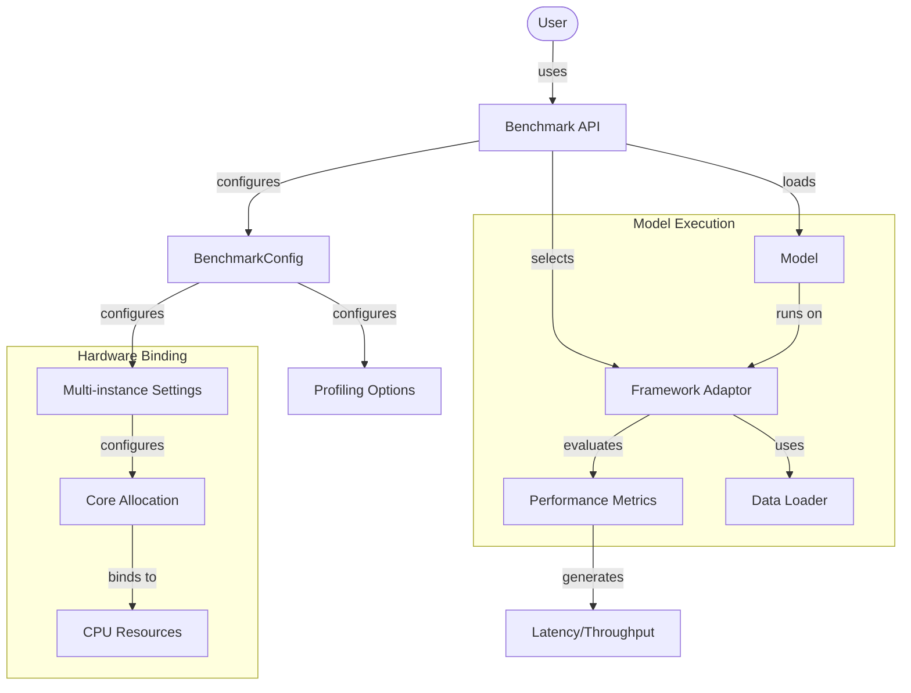
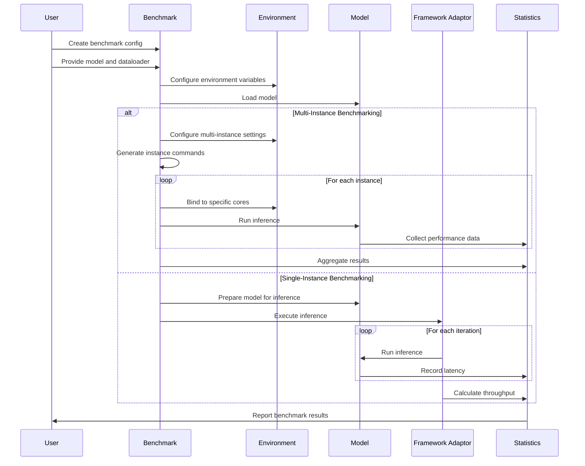
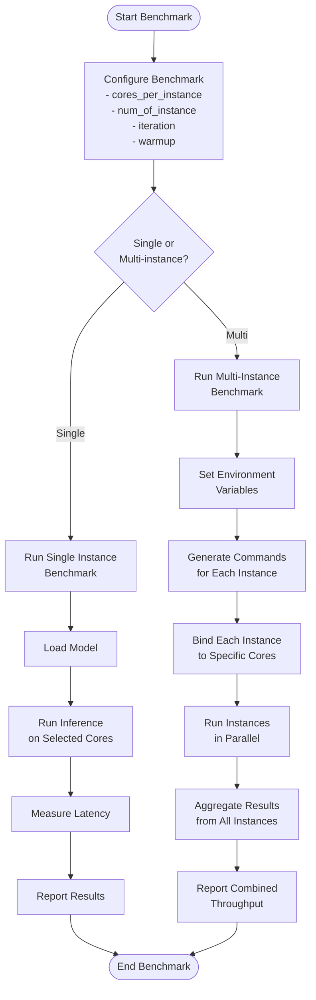
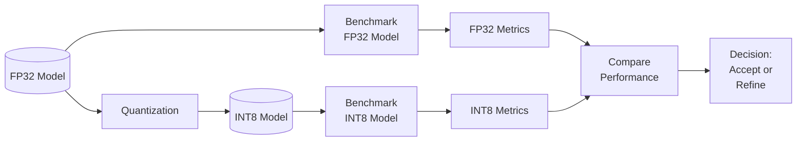

<!-- source: DeepWiki mcp.deepwiki.com · repo intel/neural-compressor · page 9 Benchmarking · fetched 2026-10-21 -->

# Benchmarking

<details>
<summary>Relevant source files</summary>

The following files were used as context for generating this wiki page:

- [neural_compressor/benchmark.py](neural_compressor/benchmark.py)
- [neural_compressor/config.py](neural_compressor/config.py)
- [neural_compressor/mix_precision.py](neural_compressor/mix_precision.py)
- [neural_compressor/model/model.py](neural_compressor/model/model.py)
- [neural_compressor/quantization.py](neural_compressor/quantization.py)
- [neural_compressor/training.py](neural_compressor/training.py)
- [neural_compressor/utils/utility.py](neural_compressor/utils/utility.py)
- [test/adaptor/pytorch_adaptor/test_adaptor_security.py](test/adaptor/pytorch_adaptor/test_adaptor_security.py)

</details>


Intel Neural Compressor (INC) provides a comprehensive benchmarking capability for evaluating model performance after optimization techniques such as quantization have been applied. The benchmarking system allows users to measure critical inference performance metrics like throughput and latency across different hardware configurations, with support for multi-instance testing and detailed performance profiling.

## Benchmarking Architecture

The benchmarking system in Neural Compressor is designed to evaluate model performance across different frameworks (TensorFlow, PyTorch, ONNX Runtime) with a consistent interface. It leverages framework-specific adaptors to execute inference and collect performance metrics.



Sources: [neural_compressor/benchmark.py:41-214](neural_compressor/benchmark.py), [neural_compressor/model/model.py:149-184](neural_compressor/model/model.py)

## Benchmarking Configuration

The benchmarking system is controlled through the `BenchmarkConfig` class, which allows you to specify various parameters:

| Parameter | Description |
|-----------|-------------|
| `cores_per_instance` | Number of CPU cores per instance |
| `num_of_instance` | Number of parallel instances to run |
| `iteration` | Number of inference iterations |
| `warmup` | Number of warmup iterations to exclude from measurement |
| `device` | Target device (cpu, gpu) |
| `framework` | Deep learning framework to use |
| `inputs` | Input tensor names |
| `outputs` | Output tensor names |
| `backend` | Backend to use (default, ipex, itex, etc.) |

Sources: [neural_compressor/benchmark.py:54-70](neural_compressor/benchmark.py)

## Benchmarking Workflow

The benchmarking process follows a structured workflow that prepares the environment, executes the model, and collects performance data.



Sources: [neural_compressor/benchmark.py:140-214](neural_compressor/benchmark.py), [neural_compressor/benchmark.py:319-347](neural_compressor/benchmark.py)

## Single Instance vs Multi-Instance Benchmarking

Neural Compressor supports two main benchmarking modes:

### Single Instance Mode

Used to measure the latency of a model on a single set of CPU cores. This mode is useful for latency-sensitive applications where response time is critical.

### Multi-Instance Mode

Used to measure the total throughput by running multiple model instances in parallel, each bound to a different set of CPU cores. This mode is suitable for throughput-oriented scenarios where overall processing capacity is more important than individual request latency.



Sources: [neural_compressor/benchmark.py:214-316](neural_compressor/benchmark.py)

## Core Binding for Optimal Performance

For multi-instance benchmarking, Neural Compressor handles core binding to ensure optimal performance:

1. It identifies the physical core topology of the system
2. It allocates specific cores to each instance
3. For Linux, it uses `numactl` to bind instances to cores
4. For Windows, it sets processor affinity

This binding ensures that:
- Instances don't compete for the same CPU resources
- Cache locality is maintained
- Cross-socket communication is minimized

Sources: [neural_compressor/benchmark.py:215-241](neural_compressor/benchmark.py)

## Performance Profiling

Neural Compressor includes profiling capabilities to identify bottlenecks in model execution:

```python
profile(model, conf, b_dataloader)
```

This function leverages framework-specific profilers to collect detailed information about:
- Per-operation execution time
- Memory usage
- CPU utilization

The profiling results can be used to identify optimization opportunities in the model architecture or quantization approach.

Sources: [neural_compressor/benchmark.py:352-412](neural_compressor/benchmark.py)

## Practical Usage

### Basic Benchmarking

```python
from neural_compressor.benchmark import fit
from neural_compressor.config import BenchmarkConfig

# Create benchmark configuration
conf = BenchmarkConfig(
    cores_per_instance=4,
    num_of_instance=2,
    iteration=100,
    warmup=10
)

# Load model and create dataloader
model = ...  # Your model
dataloader = ...  # Your dataloader

# Run benchmark
results = fit(model, conf, b_dataloader=dataloader)
```

### Using the OOB Benchmark Utility

Neural Compressor provides out-of-box (OOB) scripts for benchmarking models across different frameworks:

For TensorFlow models:
```bash
python tf_benchmark.py --model_path /path/to/model.pb --batch_size 32 --num_iter 100 --num_warmup 10 --benchmark
```

This script supports various options:
- `--model_path`: Path to the model file
- `--model_name`: Model name (for predefined models)
- `--batch_size`: Batch size for inference
- `--num_iter`: Number of inference iterations
- `--num_warmup`: Number of warmup iterations
- `--disable_optimize`: Disable graph optimization
- `--profile`: Enable profiling

Sources: [examples/tensorflow/oob_models/quantization/ptq/tf_benchmark.py:232-252](examples/tensorflow/oob_models/quantization/ptq/tf_benchmark.py)

## Performance Metrics

The benchmarking system reports two primary metrics:

1. **Latency**: The average time to process a single inference request (in milliseconds)
2. **Throughput**: The number of samples processed per second

For multi-instance benchmarking, it also reports:
- Average latency across all instances
- Total throughput (sum of all instances)

The metrics are collected after warmup iterations to ensure measurements aren't affected by initialization overhead.

Sources: [examples/tensorflow/oob_models/quantization/ptq/tf_benchmark.py:168-173](examples/tensorflow/oob_models/quantization/ptq/tf_benchmark.py), [neural_compressor/benchmark.py:319-347](neural_compressor/benchmark.py)

## Integration with Quantization Workflow

Benchmarking is often used as part of a larger workflow that includes quantization to evaluate the performance improvements achieved through model optimization:



This workflow allows users to quantify the performance gains achieved through quantization while ensuring accuracy requirements are still met.

Sources: [neural_compressor/quantization.py:33-142](neural_compressor/quantization.py), [neural_compressor/benchmark.py:42-46](neural_compressor/benchmark.py)

## Best Practices

When benchmarking models with Neural Compressor, consider the following best practices:

1. **Warmup iterations**: Always use sufficient warmup iterations (typically 10-50) to avoid including initialization overhead in measurements.

2. **Iteration count**: Use a large enough iteration count (typically 100+) to get statistically significant measurements.

3. **Core allocation**: For multi-instance benchmarking, ensure that the total number of cores used doesn't exceed the available physical cores.

4. **Batch size exploration**: Try different batch sizes to find the optimal throughput for your model and hardware.

5. **Hardware consistency**: Ensure that the benchmarking environment matches your production environment as closely as possible.

6. **Background processes**: Minimize background processes during benchmarking to avoid interference with measurements.

7. **Power settings**: Configure your system for performance mode to prevent CPU frequency scaling during benchmarks.

Sources: [examples/tensorflow/oob_models/quantization/ptq/tf_benchmark.py:232-252](examples/tensorflow/oob_models/quantization/ptq/tf_benchmark.py)

---

