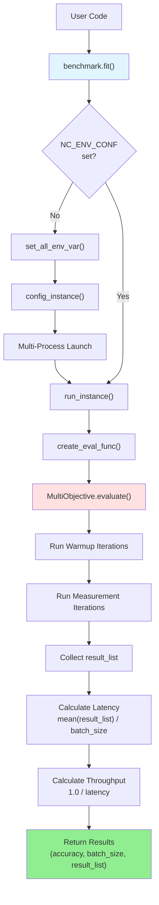
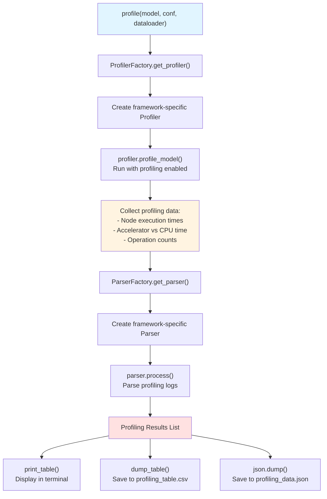
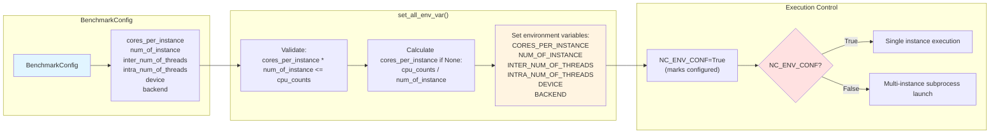

<!-- source: DeepWiki mcp.deepwiki.com · repo intel/neural-compressor · page 9.1 Performance Testing · fetched 2026-10-21 -->

# Performance Testing

<details>
<summary>Relevant source files</summary>

The following files were used as context for generating this wiki page:

- [neural_compressor/benchmark.py](neural_compressor/benchmark.py)
- [neural_compressor/config.py](neural_compressor/config.py)
- [neural_compressor/mix_precision.py](neural_compressor/mix_precision.py)
- [neural_compressor/model/model.py](neural_compressor/model/model.py)
- [neural_compressor/quantization.py](neural_compressor/quantization.py)
- [neural_compressor/training.py](neural_compressor/training.py)
- [neural_compressor/utils/utility.py](neural_compressor/utils/utility.py)
- [test/adaptor/pytorch_adaptor/test_adaptor_security.py](test/adaptor/pytorch_adaptor/test_adaptor_security.py)

</details>


## Purpose and Scope

Performance Testing in Neural Compressor provides comprehensive benchmarking capabilities to measure and profile model performance characteristics. This system enables users to evaluate quantized and optimized models by measuring latency, throughput, and detailed operation-level performance metrics across different hardware configurations and execution modes.

The performance testing system is part of the 2.x API and is primarily accessed through the `benchmark.fit()` function. For information about accuracy-aware tuning during quantization, see [Accuracy-Aware Tuning Pipeline](#3.1). For multi-objective evaluation during tuning, see [Strategy and Tuning System](#4.3).

**Sources:** [neural_compressor/benchmark.py:1-520]()

---

## BenchmarkConfig Class

The `BenchmarkConfig` class provides configuration parameters for performance testing. This class controls all aspects of benchmark execution including iteration counts, multi-instance settings, thread configuration, and backend selection.

### Configuration Parameters

| Parameter | Type | Default | Description |
|-----------|------|---------|-------------|
| `inputs` | list | `[]` | Input tensor names (TensorFlow only) |
| `outputs` | list | `[]` | Output tensor names (TensorFlow only) |
| `backend` | str | `"default"` | Backend for execution: `"default"`, `"itex"`, `"ipex"`, `"onnxrt_trt_ep"`, `"onnxrt_cuda_ep"`, `"onnxrt_dnnl_ep"`, `"onnxrt_dml_ep"` |
| `device` | str | `"cpu"` | Device for execution: `"cpu"`, `"gpu"`, `"npu"`, `"xpu"` |
| `warmup` | int | `5` | Number of warmup iterations before measurement |
| `iteration` | int | `-1` | Number of iterations to run (-1 means run entire dataloader) |
| `model_name` | str | `""` | Name identifier for the model |
| `cores_per_instance` | int | `None` | Number of CPU cores to bind per instance |
| `num_of_instance` | int | `1` | Number of parallel instances to run |
| `inter_num_of_threads` | int | `None` | Number of threads for inter-op parallelism |
| `intra_num_of_threads` | int | `None` | Number of threads for intra-op parallelism |

```python
from neural_compressor.config import BenchmarkConfig

# Example configuration for multi-instance CPU benchmark
conf = BenchmarkConfig(
    warmup=10,
    iteration=100,
    cores_per_instance=4,
    num_of_instance=7,
    backend="default"
)
```

**Sources:** [neural_compressor/config.py:261-487](), [neural_compressor/benchmark.py:43-71]()

---

## Benchmark Workflow

### Single-Instance Execution



The benchmark system follows two execution paths depending on whether it's running in single-instance or multi-instance mode. The `NC_ENV_CONF` environment variable controls this behavior.

**Sources:** [neural_compressor/benchmark.py:140-213](), [neural_compressor/benchmark.py:482-520]()

---

## Core Benchmark Functions

### benchmark.fit()

The primary entry point for performance testing:

```python
def fit(model, conf, b_dataloader=None, b_func=None):
    """
    Parameters:
    - model: Neural Compressor Model instance or raw model
    - conf: BenchmarkConfig instance
    - b_dataloader: DataLoader for benchmark (required if b_func not provided)
    - b_func: Custom benchmark function (alternative to b_dataloader)
    
    Returns:
    - Dictionary with performance metrics
    """
```

The function performs the following operations:

1. **Model Wrapping**: Wraps the input model using `Model()` class
2. **Environment Configuration**: Calls `set_all_env_var()` to configure execution environment
3. **Execution Mode Selection**: 
   - Single instance: Directly calls `run_instance()`
   - Multi-instance: Launches subprocess via `config_instance()`
4. **Results Collection**: Aggregates performance metrics

**Sources:** [neural_compressor/benchmark.py:482-520]()

### run_instance()

Executes benchmark on a single instance:

```python
def run_instance(model, conf, b_dataloader=None, b_func=None):
    """
    Core benchmark execution function that:
    1. Creates framework-specific adaptor
    2. Generates evaluation function
    3. Uses MultiObjective to measure performance
    4. Calculates latency and throughput
    """
```

**Key Steps:**

1. **Framework Setup**: Initializes `framework_specific_info` dictionary with device, backend, workspace settings
2. **Adaptor Creation**: Instantiates framework-specific adaptor from `FRAMEWORKS` registry
3. **Evaluation Function**: Creates `eval_func` using `create_eval_func()` if `b_func` not provided
4. **Measurement**: Uses `MultiObjective.evaluate()` to collect timing data
5. **Metric Calculation**: 
   - Filters warmup iterations from `result_list`
   - Calculates latency: `mean(result_list) / batch_size`
   - Calculates throughput: `1.0 / latency`

**Sources:** [neural_compressor/benchmark.py:140-213]()

---

## Performance Metrics

### Latency Measurement

Latency represents the time required to process a single sample:

```
latency (seconds) = mean(result_list[warmup:]) / batch_size
```

The system:
1. Runs `warmup` iterations (default: 5) to warm up the model and runtime
2. Collects timing data for subsequent iterations
3. Calculates mean execution time across measured iterations
4. Divides by batch size to get per-sample latency

### Throughput Calculation

Throughput represents the number of samples processed per second:

```
throughput (samples/sec) = 1.0 / latency
```

### Result Structure

```python
results = {
    "performance": (accuracy, batch_size, result_list)
}
# where:
# - accuracy: scalar performance metric from MultiObjective
# - batch_size: batch size from dataloader
# - result_list: list of per-iteration timings (after warmup)
```

**Sources:** [neural_compressor/benchmark.py:186-210]()

---

## Multi-Instance Execution

Multi-instance execution enables parallel benchmark runs across multiple CPU cores or sockets for improved throughput measurement. This is particularly important for deployment scenarios where multiple inference requests are processed concurrently.

### Architecture

```mermaid
graph TB
    subgraph "Main Process"
        Main["benchmark.fit()"] --> SetEnv["set_all_env_var()"]
        SetEnv --> Config["config_instance()"]
    end
    
    subgraph "Environment Setup"
        SetEnv --> CalcCores["Calculate cores_per_instance<br/>= cpu_counts / num_of_instance"]
        CalcCores --> SetVars["Set environment variables:<br/>NUM_OF_INSTANCE<br/>CORES_PER_INSTANCE<br/>INTER_NUM_OF_THREADS<br/>INTRA_NUM_OF_THREADS"]
    end
    
    subgraph "Instance Configuration - Linux"
        Config --> GetBounded["get_bounded_threads()"]
        GetBounded --> Loop["For each instance i:"]
        Loop --> CoreList["core_list = bounded_threads[i*cores:(i+1)*cores]"]
        CoreList --> Prefix["generate_prefix(core_list)<br/>numactl --localalloc --physcpubind=cores"]
        Prefix --> Cmd["instance_cmd = prefix + python script"]
        Cmd --> Log["Redirect to log file:<br/>instance_i.log"]
    end
    
    subgraph "Instance Configuration - Windows"
        Config --> WinLoop["For each instance i:"]
        WinLoop --> WinCore["Calculate socket and core mask"]
        WinCore --> WinPrefix["start /b /WAIT /node X /affinity MASK"]
        WinPrefix --> WinThread["Launch in separate thread"]
    end
    
    subgraph "Execution"
        Log --> Exec["subprocess.Popen()<br/>Execute all instances"]
        WinThread --> WinExec["Thread.start() for each"]
        Exec --> Wait["Wait for completion"]
        WinExec --> WinWait["Thread.join()"]
    end
    
    subgraph "Summary"
        Wait --> Summary["summary_benchmark()"]
        Summary --> Parse["Parse all log files"]
        Parse --> Extract["Extract latency and throughput"]
        Extract --> Aggregate["Aggregate results:<br/>Avg Latency, Sum Throughput"]
    end
    
    style Main fill:#e1f5ff
    style SetEnv fill:#fff4e1
    style Exec fill:#ffe1e1
    style Aggregate fill:#90EE90
```

### Core Binding Strategy

The system binds each instance to specific physical CPU cores to maximize cache locality and minimize cross-socket communication:

1. **Physical Core Detection**: Uses `psutil.cpu_count(logical=False)` to get physical core count
2. **Core Allocation**: Distributes cores evenly across instances
3. **Thread Binding**: Uses platform-specific mechanisms:
   - **Linux**: `numactl --localalloc --physcpubind=<cores>`
   - **Windows**: `start /node <socket> /affinity <hex_mask>`

**Example**: 28 physical cores, 4 cores per instance, 7 instances:
- Instance 0: cores 0-3
- Instance 1: cores 4-7
- ...
- Instance 6: cores 24-27

**Sources:** [neural_compressor/benchmark.py:54-71](), [neural_compressor/benchmark.py:256-317]()

### Platform-Specific Implementation

#### Linux Implementation

```python
def generate_prefix(core_list):
    """Generate numactl command for core binding"""
    return "OMP_NUM_THREADS={} numactl --localalloc --physcpubind={}".format(
        len(core_list), ",".join(core_list.astype(str))
    )
```

The system:
1. Queries CPU topology using `/proc/cpuinfo`
2. Identifies physical cores using `get_bounded_threads()`
3. Generates shell commands with `numactl` for each instance
4. Launches all instances in background with output redirection
5. Waits for all instances to complete

**Sources:** [neural_compressor/benchmark.py:215-241](), [neural_compressor/benchmark.py:269-294]()

#### Windows Implementation

Uses Windows-specific process affinity:
1. Calculates socket ID and core affinity mask
2. Launches each instance in separate thread
3. Uses `start /b /WAIT /node <socket> /affinity <mask>` command
4. Collects output in instance-specific log files

**Sources:** [neural_compressor/benchmark.py:225-240](), [neural_compressor/benchmark.py:295-312]()

### Result Aggregation

After multi-instance execution completes, `summary_benchmark()` aggregates results:

```python
def summary_benchmark():
    """Parse log files and calculate aggregate metrics"""
    # For Linux (Windows has different log format)
    latency_list = []
    throughput_list = []
    
    for i in range(num_of_instance):
        log = f"{num_of_instance}_{cores_per_instance}_{i}.log"
        # Parse latency and throughput from each log
        # Regex: r"[L,l]atency:\s+(\d+(\.\d+)?)"
        # Regex: r"[T,t]hroughput:\s+(\d+(\.\d+)?)"
    
    # Calculate aggregates
    avg_latency = sum(latency_list) / len(latency_list) / 1000  # to seconds
    sum_throughput = sum(throughput_list)
```

**Sources:** [neural_compressor/benchmark.py:319-350]()

---

## Profiling Capabilities

Beyond basic performance measurement, Neural Compressor provides detailed operation-level profiling to understand model execution bottlenecks.

### Profiling Architecture



### Profiling Function

```python
def profile(model, conf, b_dataloader) -> None:
    """
    Execute profiling for benchmark configuration.
    
    Configuration:
    - intra_num_of_threads: Default 1
    - inter_num_of_threads: Default 1
    - num_warmup: Default 10
    
    Outputs:
    - profiling_table.csv: CSV format results
    - profiling_data.json: JSON format results
    - Terminal output: Pretty table display
    """
```

**Profiler Workflow:**

1. **Configuration Extraction**: Gets thread counts and warmup settings from `BenchmarkConfig`
2. **Profiler Creation**: Factory creates framework-specific profiler (PyTorch, TensorFlow, ONNX)
3. **Model Profiling**: Executes model with profiling enabled via `profiler.profile_model()`
4. **Parser Creation**: Factory creates corresponding parser for profiling data
5. **Result Processing**: Parser extracts structured profiling information
6. **Output Generation**: Saves results in multiple formats

**Profiling Metrics:**

| Metric | Description |
|--------|-------------|
| `node_name` | Operation or layer name |
| `total_execution_time` | Total time in microseconds |
| `accelerator_execution_time` | Time spent on GPU/accelerator |
| `cpu_execution_time` | Time spent on CPU |
| `op_run` | Runtime operation type |
| `op_defined` | Defined operation type |

**Sources:** [neural_compressor/benchmark.py:352-451]()

### Output Files

1. **profiling_table.csv**: Tabular format for spreadsheet analysis
2. **profiling_data.json**: Structured format for programmatic access
3. **Terminal output**: Human-readable table with prettytable formatting

**Sources:** [neural_compressor/benchmark.py:426-450]()

---

## Environment Variables

The benchmark system configures multiple environment variables to control execution. These are set automatically by `set_all_env_var()` but can be overridden.

### Automatically Configured Variables



### Key Environment Variables

| Variable | Purpose | Set By |
|----------|---------|--------|
| `NC_ENV_CONF` | Indicates environment is configured | `set_env_var()` |
| `NUM_OF_INSTANCE` | Number of parallel instances | `set_all_env_var()` |
| `CORES_PER_INSTANCE` | CPU cores per instance | `set_all_env_var()` |
| `INTER_NUM_OF_THREADS` | Inter-op thread count | `set_all_env_var()` |
| `INTRA_NUM_OF_THREADS` | Intra-op thread count | `set_all_env_var()` |
| `OMP_NUM_THREADS` | OpenMP threads (Linux) | `generate_prefix()` |

**Sources:** [neural_compressor/benchmark.py:43-71](), [neural_compressor/benchmark.py:215-224]()

---

## Integration with 2.x API

The benchmark system integrates with Neural Compressor's 2.x quantization API to provide post-quantization performance evaluation.

### Usage Pattern

```python
from neural_compressor import quantization, benchmark
from neural_compressor.config import PostTrainingQuantConfig, BenchmarkConfig

# Step 1: Quantize model
quant_conf = PostTrainingQuantConfig()
q_model = quantization.fit(
    model=fp32_model,
    conf=quant_conf,
    calib_dataloader=calib_dataloader,
    eval_func=eval_func
)

# Step 2: Benchmark quantized model
bench_conf = BenchmarkConfig(
    warmup=10,
    iteration=100,
    cores_per_instance=4,
    num_of_instance=7
)
results = benchmark.fit(
    model=q_model,
    conf=bench_conf,
    b_dataloader=test_dataloader
)
```

### Multi-Objective Evaluation

During tuning, the benchmark infrastructure is used internally by the `MultiObjective` class to evaluate performance objectives:

```python
objectives = MultiObjective(["performance"], {"relative": 0.1}, is_measure=True)
val = objectives.evaluate(eval_func, model)
```

The `MultiObjective.evaluate()` method:
1. Calls the evaluation function with the model
2. Collects timing data in `result_list`
3. Returns accuracy and performance metrics
4. Used by tuning strategies to select optimal configurations

**Sources:** [neural_compressor/benchmark.py:186-202](), [neural_compressor/quantization.py:1-242]()

---

## CPU Topology Detection

The benchmark system includes comprehensive CPU topology detection to optimize multi-instance execution:

### System Information Utilities

```python
# Functions from benchmark.py
get_architecture()           # Returns "x86_64", "aarch64", etc.
get_threads_per_core()       # Returns hyperthreading config
get_threads()                # List of all logical CPUs
get_physical_ids()           # Socket IDs for each CPU
get_core_ids()               # Physical core IDs
get_bounded_threads()        # Physical cores only (one per core)
```

### CpuInfo Singleton

The `CpuInfo` class from `neural_compressor/utils/utility.py` provides:

```python
cpu_info = CpuInfo()
cpu_info.cores              # Physical core count
cpu_info.sockets            # Socket count
cpu_info.cores_per_socket   # Cores per socket
cpu_info.bf16               # BF16 support flag
cpu_info.vnni               # VNNI instruction support
```

**Sources:** [neural_compressor/benchmark.py:73-138](), [neural_compressor/utils/utility.py:311-416]()

---

## Complete Example

### Basic Benchmark

```python
from neural_compressor.config import BenchmarkConfig
from neural_compressor.benchmark import fit
from neural_compressor.model import Model

# Load quantized model
model = Model("path/to/quantized_model.pb")

# Configure benchmark
conf = BenchmarkConfig(
    iteration=100,
    warmup=10,
    cores_per_instance=4,
    num_of_instance=1
)

# Run benchmark
results = fit(
    model=model,
    conf=conf,
    b_dataloader=dataloader
)
```

### Multi-Instance Benchmark

```python
# Configure for multi-instance throughput testing
conf = BenchmarkConfig(
    iteration=100,
    warmup=10,
    cores_per_instance=4,
    num_of_instance=7  # 28 cores / 4 cores per instance
)

# Benchmark will automatically:
# 1. Bind each instance to 4 physical cores
# 2. Run 7 instances in parallel
# 3. Aggregate throughput results
results = fit(model=model, conf=conf, b_dataloader=dataloader)
```

### Custom Benchmark Function

```python
def custom_benchmark_func(model):
    """Custom benchmark logic"""
    for batch in dataloader:
        output = model(batch)
        # Custom metric computation
    return results

# Use custom function instead of dataloader
results = fit(
    model=model,
    conf=conf,
    b_func=custom_benchmark_func
)
```

### With Profiling

```python
from neural_compressor.benchmark import profile

# Run detailed profiling
profile(
    model=model,
    conf=conf,
    b_dataloader=dataloader
)
# Outputs:
# - profiling_table.csv
# - profiling_data.json
# - Terminal table display
```

**Sources:** [neural_compressor/benchmark.py:482-520](), [neural_compressor/benchmark.py:352-451]()

---

