# Page: Overview

# Overview

<details>
<summary>Relevant source files</summary>

The following files were used as context for generating this wiki page:

- [README.md](README.md)
- [docs/source/add_new_adaptor.md](docs/source/add_new_adaptor.md)
- [docs/source/add_new_data_type.md](docs/source/add_new_data_type.md)
- [docs/source/calibration.md](docs/source/calibration.md)
- [docs/source/examples_readme.md](docs/source/examples_readme.md)
- [docs/source/framework_yaml.md](docs/source/framework_yaml.md)
- [docs/source/infrastructure.md](docs/source/infrastructure.md)
- [docs/source/mixed_precision.md](docs/source/mixed_precision.md)
- [docs/source/publication_list.md](docs/source/publication_list.md)
- [docs/source/quantization.md](docs/source/quantization.md)
- [docs/source/quantization_mixed_precision.md](docs/source/quantization_mixed_precision.md)
- [examples/README.md](examples/README.md)
- [neural_compressor/benchmark.py](neural_compressor/benchmark.py)
- [neural_compressor/config.py](neural_compressor/config.py)
- [neural_compressor/mix_precision.py](neural_compressor/mix_precision.py)
- [neural_compressor/model/model.py](neural_compressor/model/model.py)
- [neural_compressor/quantization.py](neural_compressor/quantization.py)
- [neural_compressor/training.py](neural_compressor/training.py)
- [neural_compressor/utils/utility.py](neural_compressor/utils/utility.py)
- [test/adaptor/pytorch_adaptor/test_adaptor_security.py](test/adaptor/pytorch_adaptor/test_adaptor_security.py)

</details>


Intel® Neural Compressor is an open-source Python library that enables efficient deployment of deep learning models through model compression techniques. The library provides quantization, pruning, knowledge distillation, and neural architecture search across TensorFlow, PyTorch, and ONNX Runtime frameworks.

The primary value proposition is **accuracy-aware optimization**: automatically tuning quantization configurations to achieve optimal performance while maintaining accuracy targets. For large language models, Intel Neural Compressor offers specialized weight-only quantization algorithms (RTN, GPTQ, AWQ, TEQ, AutoRound) that reduce memory footprint and improve inference throughput.

Sources: [README.md:1-20](), [neural_compressor/config.py:1-17]()

## Purpose and Core Capabilities

Intel Neural Compressor addresses three main optimization goals:

1. **Performance Acceleration**: Up to 4.2x speedup on Intel VNNI hardware with INT8 quantization
2. **Memory Reduction**: INT4 weight-only quantization for large language models reduces memory requirements by ~75%
3. **Accuracy Preservation**: Automated tuning strategies minimize accuracy degradation during compression

The library has validated 10,000+ models from Hugging Face, TorchVision, TensorFlow Model Hub, and ONNX Model Zoo, with performance geomean of 2.2x across validated models.

Sources: [README.md:18-26](), [docs/source/quantization.md:16-18]()

## System Architecture

Intel Neural Compressor uses a layered architecture that separates optimization strategies from framework-specific implementations:

**Architecture: Layered Design with Framework Abstraction**

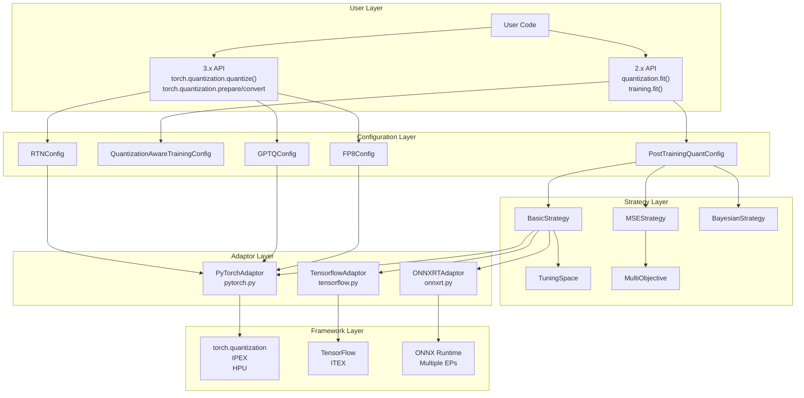

Sources: [neural_compressor/quantization.py:1-242](), [neural_compressor/strategy/strategy.py:1-50](), [neural_compressor/adaptor/__init__.py:1-30]()

The architecture consists of five layers:

1. **User Layer**: `quantization.fit()` (2.x) and `torch.quantization.quantize()` (3.x) entry points
2. **Configuration Layer**: Config classes define quantization parameters (`PostTrainingQuantConfig`, `RTNConfig`, `FP8Config`)
3. **Strategy Layer**: Tuning algorithms (`BasicStrategy`, `MSEStrategy`) build search spaces and select configurations
4. **Adaptor Layer**: Framework-specific implementations (`PyTorchAdaptor`, `TensorflowAdaptor`, `ONNXRTAdaptor`) in [neural_compressor/adaptor/]()
5. **Framework Layer**: Native quantization APIs (PyTorch, TensorFlow, ONNX Runtime)

The `Model` class wraps user models and routes them to appropriate adaptors based on framework detection in [neural_compressor/model/model.py:66-147]().

Sources: [neural_compressor/quantization.py:33-241](), [neural_compressor/model/model.py:150-253](), [neural_compressor/config.py:715-1502]()

## Framework and Hardware Support

Intel Neural Compressor supports three deep learning frameworks with multiple backend variants:

| Framework | Backends | Supported Precisions | Target Hardware |
|-----------|----------|---------------------|-----------------|
| PyTorch | PyTorch Eager, PyTorch FX, IPEX, HPU | INT8, INT4, FP8, BF16, FP16, MXFP4/MXFP8 | Intel CPUs (Xeon), Intel GPUs (XPU), Intel Gaudi (HPU) |
| TensorFlow (2.x API) | TensorFlow, ITEX | INT8, BF16 | Intel CPUs (Xeon) |
| ONNX Runtime (2.x API) | CPUExecutionProvider, DnnlExecutionProvider, CUDAExecutionProvider, TensorrtExecutionProvider, DmlExecutionProvider | INT8, BF16, FP16 | Intel CPUs, Nvidia GPUs, AMD CPUs, ARM CPUs, NPUs (experimental) |

**Note**: From version 3.0, TensorFlow and ONNX Runtime support is primarily available in the 2.x API. The 3.x API focuses on PyTorch with enhanced LLM optimization capabilities.

Sources: [README.md:22-23](), [README.md:39-45](), [neural_compressor/config.py:28-33]()

**Hardware Platform Support**:

- **Intel Xeon Scalable Processors**: INT8/BF16 quantization with AVX-512 VNNI and AMX acceleration
- **Intel Xeon CPU Max Series**: INT8/BF16 with HBM memory
- **Intel Core Ultra Processors**: INT8/BF16 for client devices
- **Intel Data Center GPU Flex/Max Series**: INT8/INT4/BF16/FP16 for GPU inference
- **Intel Gaudi AI Accelerators**: FP8 (E4M3/E5M2) static/dynamic quantization, INT8, BF16
- **Other Platforms**: AMD CPU, ARM CPU, Nvidia GPU via ONNX Runtime with limited testing

Version compatibility for Intel Gaudi is documented in [docs/source/3x/gaudi_version_map.md]().

Sources: [README.md:22-23](), [README.md:42]()

## API Versions and Package Distribution

Intel Neural Compressor provides two API versions with different optimization focuses:

**API Comparison**

| Feature | 2.x API (Unified) | 3.x API (PyTorch-Focused) |
|---------|------------------|---------------------------|
| **Primary Use Case** | Accuracy-aware tuning across frameworks | Direct quantization for PyTorch/LLMs |
| **Entry Points** | `quantization.fit()`, `training.fit()`, `mix_precision.fit()`, `benchmark.fit()` | `torch.quantization.quantize()`, `torch.quantization.prepare()/convert()` |
| **Frameworks** | TensorFlow, PyTorch, ONNX Runtime | PyTorch only |
| **Tuning** | Automated accuracy-aware tuning with strategies | One-shot quantization (no tuning) |
| **LLM Support** | Basic weight-only quantization | Advanced: RTN, GPTQ, AWQ, TEQ, AutoRound |
| **FP8 Support** | Limited | Full support for Intel Gaudi |
| **Recommendation** | Use for QAT, pruning, distillation | Use for post-training optimization |

Sources: [README.md:176-177](), [neural_compressor/quantization.py:33-242]()

**Package Installation Options**:

```bash
# Full package: 2.x API + Framework extension API + PyTorch dependency
pip install neural-compressor[pt]

# Full package with TensorFlow dependency
pip install neural-compressor[tf]

# PyTorch-only binary (smaller footprint)
pip install neural-compressor-pt

# TensorFlow-only binary
pip install neural-compressor-tf
```

The `neural-compressor` package includes all frameworks, while `neural-compressor-pt` and `neural-compressor-tf` are lightweight distributions containing only framework-specific code.

Sources: [README.md:46-52]()

## Quantization Capabilities

**Quantization Approaches and Techniques**

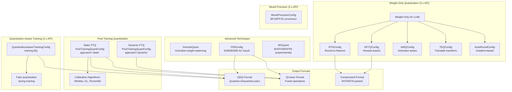

Sources: [neural_compressor/config.py:715-1502](), [docs/source/quantization.md:93-117]()

**Key Quantization Methods**:

1. **Post-Training Static Quantization**: Calibrates on representative dataset, quantizes both weights and activations (INT8/INT4)
2. **Post-Training Dynamic Quantization**: Quantizes weights offline, activations at runtime (beneficial for NLP models)
3. **Weight-Only Quantization**: Specialized for LLMs, quantizes only weights (INT4/UINT4/NF4) while keeping activations in FP16/BF16
4. **Quantization-Aware Training**: Simulates quantization during training for better accuracy recovery
5. **FP8 Quantization**: E4M3/E5M2 formats for Intel Gaudi accelerators with static/dynamic modes
6. **Mixed Precision**: Selective BF16/FP16 conversion with accuracy-driven fallback

Sources: [docs/source/quantization.md:93-117](), [neural_compressor/config.py:715-1502]()

## Accuracy-Aware Tuning (2.x API)

The 2.x API provides automated accuracy-aware tuning to find optimal quantization configurations:

**Tuning Workflow with Strategy System**

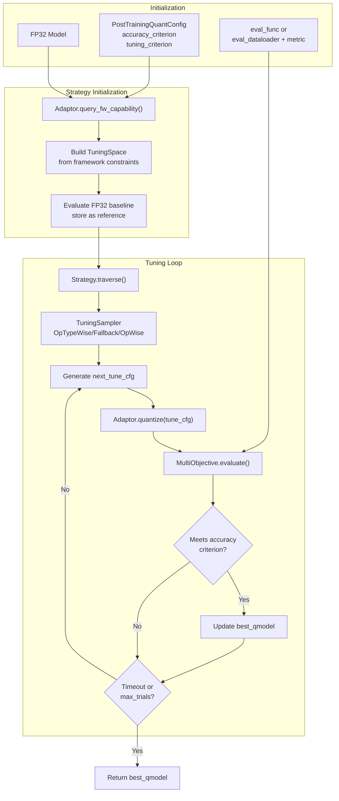

Sources: [neural_compressor/quantization.py:138-241](), [neural_compressor/strategy/strategy.py:1-50]()

**Tuning Strategies**:

- `BasicStrategy`: Explores tuning space sequentially in three stages (OpTypeWise → Fallback → OpWise)
- `MSEStrategy`: Optimizes mean squared error between FP32 and quantized outputs
- `BayesianStrategy`: Uses Bayesian optimization for efficient search space exploration
- `AutoStrategy`: Combines conservative (quant_level=0) and aggressive (quant_level=1) approaches

The `TuningSpace` is constructed by `Adaptor.query_fw_capability()` which parses framework YAML files defining quantization capabilities per operator type.

Sources: [neural_compressor/quantization.py:156-200](), [neural_compressor/config.py:592-713]()

## Quick Start Examples

**Example 1: Static Quantization with Accuracy-Aware Tuning (2.x API)**

```python
from neural_compressor import quantization
from neural_compressor.config import PostTrainingQuantConfig

# Define evaluation function
def eval_func(model):
    # User implements evaluation logic
    # Returns accuracy scalar (higher is better)
    accuracy = evaluate_model(model, val_dataloader)
    return accuracy

# Configure quantization with accuracy target
conf = PostTrainingQuantConfig(
    approach="static",
    accuracy_criterion={'relative': 0.01},  # Allow 1% accuracy loss
    tuning_criterion={'timeout': 0, 'max_trials': 100}
)

# Run accuracy-aware tuning
q_model = quantization.fit(
    model=model,
    conf=conf,
    calib_dataloader=calib_dataloader,
    eval_func=eval_func
)

q_model.save("./quantized_model")
```

Sources: [neural_compressor/quantization.py:33-138](), [README.md:213-278]()

**Example 2: Weight-Only Quantization for LLMs (3.x API)**

```python
from neural_compressor.torch.quantization import quantize, RTNConfig

# Configure RTN weight-only quantization
config = RTNConfig(bits=4, group_size=128)

# One-shot quantization (no tuning)
q_model = quantize(model, config)
q_model.save("./int4_model")
```

**Example 3: FP8 Quantization for Intel Gaudi (3.x API)**

```python
from neural_compressor.torch.quantization import FP8Config, prepare, convert
import torch

model = models.resnet18()
qconfig = FP8Config(fp8_config="E4M3")

# Prepare model for calibration
model = prepare(model, qconfig)

# Run calibration
model(torch.randn(1, 3, 224, 224).to("hpu"))

# Convert to FP8 quantized model
model = convert(model)
```

Sources: [README.md:67-88](), [README.md:92-103]()

**Example 4: Loading Pre-Quantized LLM**

```python
from neural_compressor.torch.quantization import load

# Load GPTQ-quantized model from HuggingFace
model = load(
    model_name_or_path="TheBloke/Llama-2-7B-GPTQ",
    format="huggingface",
    device="hpu",
)
```

Sources: [README.md:92-103]()

## Validated Models and Results

Intel Neural Compressor has validated more than 10,000 models from popular model hubs, including:

- Large Language Models: LLama2, Falcon, GPT-J, Bloom, OPT
- Computer Vision: ResNet50, Stable Diffusion, BERT-Large
- Model sources: Hugging Face, TorchVision, ONNX Model Zoo

Performance improvements include speedups of up to 4.2x on Intel VNNI with a geomean of 2.2x across validated models.

Sources: [README.md:25](), [examples/README.md:3](), [docs/source/examples_readme.md:11-12]()

## Framework and API Compatibility

Intel Neural Compressor provides multiple API versions:

| API Version | Features | Recommendation |
|-------------|----------|----------------|
| 3.X API | Post-training optimization techniques | Recommended for new users |
| 2.X API | Training-time techniques (QAT, Pruning, Distillation) | For advanced compression needs |
| Framework Extension API | Direct framework integration | For framework-specific optimization |

Sources: [README.md:171-172]()

## Additional Resources

For more detailed information, refer to these related pages:

- [Architecture](#2) for a deeper dive into the system design
- [Configuration System](#2.1) for details on quantization configuration
- [Tuning Strategies](#2.2) for automatic optimization algorithms
- [Framework Adaptors](#4) for framework-specific implementations
- [Quantization Techniques](#5) for comprehensive coverage of methods

Intel Neural Compressor is actively maintained with regular updates and collaborations with cloud providers, AI frameworks, and the open-source community.

Sources: [README.md:27-28](), [docs/source/publication_list.md:1-102]()

---

# Page: Installation and Setup

# Installation and Setup

<details>
<summary>Relevant source files</summary>

The following files were used as context for generating this wiki page:

- [.azure-pipelines/scripts/ut/3x/collect_log_3x.sh](.azure-pipelines/scripts/ut/3x/collect_log_3x.sh)
- [.azure-pipelines/template/ut-template.yml](.azure-pipelines/template/ut-template.yml)
- [README.md](README.md)
- [docs/source/add_new_adaptor.md](docs/source/add_new_adaptor.md)
- [docs/source/add_new_data_type.md](docs/source/add_new_data_type.md)
- [docs/source/calibration.md](docs/source/calibration.md)
- [docs/source/examples_readme.md](docs/source/examples_readme.md)
- [docs/source/framework_yaml.md](docs/source/framework_yaml.md)
- [docs/source/infrastructure.md](docs/source/infrastructure.md)
- [docs/source/mixed_precision.md](docs/source/mixed_precision.md)
- [docs/source/publication_list.md](docs/source/publication_list.md)
- [docs/source/quantization.md](docs/source/quantization.md)
- [docs/source/quantization_mixed_precision.md](docs/source/quantization_mixed_precision.md)
- [examples/README.md](examples/README.md)
- [neural_compressor/__init__.py](neural_compressor/__init__.py)
- [requirements.txt](requirements.txt)
- [setup.py](setup.py)
- [test/3x/torch/algorithms/fp8_quant/__init__.py](test/3x/torch/algorithms/fp8_quant/__init__.py)
- [test/3x/torch/algorithms/fp8_quant/conftest.py](test/3x/torch/algorithms/fp8_quant/conftest.py)
- [test/3x/torch/quantization/fp8_quant/conftest.py](test/3x/torch/quantization/fp8_quant/conftest.py)

</details>


This document provides comprehensive guidance on how to install and set up Intel® Neural Compressor (INC) for model optimization tasks. It covers different installation methods, system requirements, and initial configuration steps to help you get started.

For information about the overall architecture of Neural Compressor, see [Architecture](#2).

## System Requirements

Before installing Intel Neural Compressor, ensure your system meets the following requirements:

### Software Requirements

| Requirement | Specification |
|-------------|---------------|
| Python      | Python 3.7.0 or later (Python 3.10+ recommended) |
| Operating Systems | Linux (primary support)<br>Windows (limited support) |

### Hardware Requirements

Intel Neural Compressor works with various Intel hardware platforms:

- Intel CPUs (Xeon, Core series)
- Intel GPUs (Data Center GPU Max Series, Arc GPUs)
- Intel Habana Gaudi accelerators

## Installation Methods

Intel Neural Compressor can be installed using different methods depending on your needs:

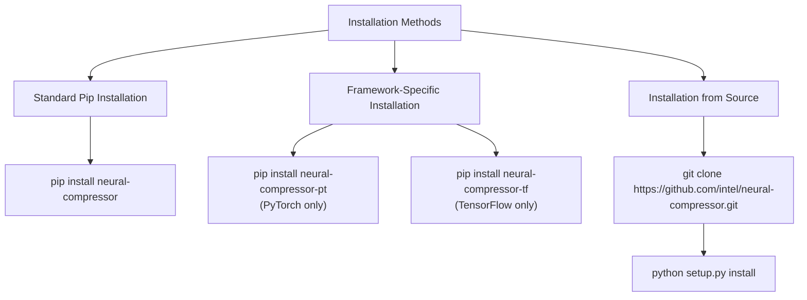

Sources: [setup.py:86-134]()

### Standard Installation

The simplest way to install Neural Compressor is using pip:

```bash
pip install neural-compressor
```

This will install the complete package with support for all frameworks.

### Framework-Specific Installation

If you only need support for a specific framework, you can install a more targeted package:

#### PyTorch Only:
```bash
pip install neural-compressor-pt
```

#### TensorFlow Only:
```bash
pip install neural-compressor-tf
```

Sources: [setup.py:147-156]()

### Installation from Source

For the latest features or development purposes, you can install Neural Compressor from source:

```bash
git clone https://github.com/intel/neural-compressor.git
cd neural-compressor
python setup.py install
```

## Package Structure

Intel Neural Compressor is organized into multiple components for different frameworks and functionalities:

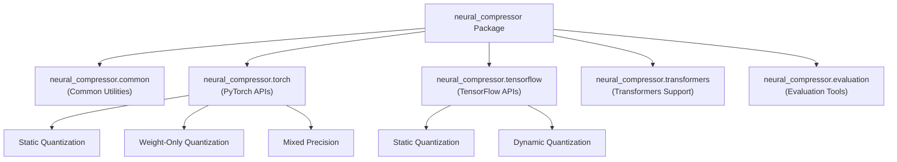

Sources: [setup.py:104-134](), [neural_compressor/__init__.py:20-32]()

## Dependencies

Neural Compressor requires several dependencies, which are automatically installed when using pip:

### Core Dependencies

The following dependencies are installed with the base package:

```
deprecated >= 1.2.13
numpy < 2.0
opencv-python-headless
pandas
Pillow
prettytable
psutil
py-cpuinfo
pyyaml
requests
schema
scikit-learn
```

Sources: [requirements.txt:1-15]()

### Framework-Specific Dependencies

When installing framework-specific packages, additional dependencies will be installed:

- `neural-compressor-pt`: PyTorch and related libraries
- `neural-compressor-tf`: TensorFlow and related libraries

## Framework Extensions

For optimal performance, Intel provides extensions for supported frameworks:

### Intel Extension for TensorFlow

#### For Intel GPUs (Required for GPU quantization):
```bash
pip install --upgrade intel-extension-for-tensorflow[xpu]
```

#### For Intel CPUs (Optional):
```bash
pip install --upgrade intel-extension-for-tensorflow[cpu]
```

### Intel Extension for PyTorch

For PyTorch optimizations:

```bash
pip install --upgrade intel-extension-for-pytorch
```

Sources: [examples/3.x_api/tensorflow/object_detection/yolo_v5/quantization/ptq/README.md:26-44]()

## Verifying Installation

To verify that Neural Compressor has been installed correctly, you can check the version:

```python
import neural_compressor
print(neural_compressor.__version__)
```

The output should match the current version: `3.3.1`

Sources: [neural_compressor/version.py:18]()

## Installation for Large Language Model (LLM) Optimization

Neural Compressor provides specialized support for quantizing large language models. The installation process is the same, but for optimal LLM support, we recommend installing the PyTorch version and additional dependencies:

```bash
pip install neural-compressor-pt
pip install intel-extension-for-transformers
```

This combination provides support for advanced techniques like:
- SmoothQuant (SQ)
- Weight-Only Quantization (WOQ)
- GPTQ, AWQ, RTN, and other LLM-specific algorithms

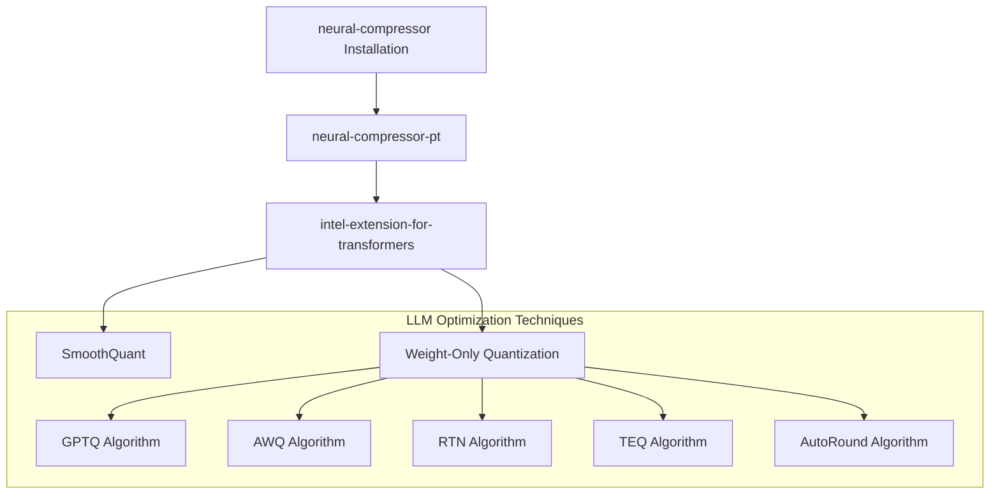

Sources: [docs/source/llm_recipes.md:1-40]()

## Benchmark Tool Installation

Neural Compressor includes a benchmarking tool `incbench` that is automatically installed with the package. This tool is useful for evaluating model performance after quantization:

```bash
# Using the benchmark tool
incbench --num_c 4 main.py [additional parameters]
```

Sources: [examples/3.x_api/tensorflow/object_detection/yolo_v5/quantization/ptq/run_benchmark.sh:49-55]()

## Troubleshooting

### Version Compatibility

When using Intel Extensions (ITEX), make sure to check the compatibility between your TensorFlow version and the ITEX version. The compatibility table can be found in the [Intel Extension for TensorFlow repository](https://github.com/intel/intel-extension-for-tensorflow#compatibility-table).

### Common Installation Issues

1. **Missing dependencies**: If you encounter errors about missing dependencies, try installing them manually:
   ```bash
   pip install [missing_dependency]
   ```

2. **GPU driver issues**: For GPU usage, ensure you have installed the appropriate drivers. Follow the [installation guide for XPU](https://github.com/intel/intel-extension-for-tensorflow/blob/main/docs/install/install_for_xpu.md#install-gpu-drivers).

3. **Version conflicts**: If you encounter version conflicts, consider using a virtual environment:
   ```bash
   python -m venv inc_env
   source inc_env/bin/activate  # On Linux/Mac
   inc_env\Scripts\activate     # On Windows
   pip install neural-compressor
   ```

## Next Steps

After successful installation, you can start optimizing your models. For framework-specific adaptor information:
- For PyTorch: see [PyTorch Adaptor](#4.1)
- For TensorFlow: see [TensorFlow Adaptor](#4.2)
- For ONNX Runtime: see [ONNX Runtime Adaptor](#4.3)

For quantization techniques available in Neural Compressor, refer to [Quantization Techniques](#5).

---

# Page: API Guide

# API Guide

<details>
<summary>Relevant source files</summary>

The following files were used as context for generating this wiki page:

- [README.md](README.md)
- [docs/source/add_new_adaptor.md](docs/source/add_new_adaptor.md)
- [docs/source/add_new_data_type.md](docs/source/add_new_data_type.md)
- [docs/source/calibration.md](docs/source/calibration.md)
- [docs/source/examples_readme.md](docs/source/examples_readme.md)
- [docs/source/framework_yaml.md](docs/source/framework_yaml.md)
- [docs/source/infrastructure.md](docs/source/infrastructure.md)
- [docs/source/mixed_precision.md](docs/source/mixed_precision.md)
- [docs/source/publication_list.md](docs/source/publication_list.md)
- [docs/source/quantization.md](docs/source/quantization.md)
- [docs/source/quantization_mixed_precision.md](docs/source/quantization_mixed_precision.md)
- [examples/README.md](examples/README.md)
- [examples/pytorch/multimodal-modeling/quantization/auto_round/mllm.py](examples/pytorch/multimodal-modeling/quantization/auto_round/mllm.py)
- [neural_compressor/benchmark.py](neural_compressor/benchmark.py)
- [neural_compressor/config.py](neural_compressor/config.py)
- [neural_compressor/mix_precision.py](neural_compressor/mix_precision.py)
- [neural_compressor/model/model.py](neural_compressor/model/model.py)
- [neural_compressor/quantization.py](neural_compressor/quantization.py)
- [neural_compressor/torch/algorithms/layer_wise/utils.py](neural_compressor/torch/algorithms/layer_wise/utils.py)
- [neural_compressor/torch/algorithms/mixed_low_precision/modules.py](neural_compressor/torch/algorithms/mixed_low_precision/modules.py)
- [neural_compressor/torch/algorithms/mixed_low_precision/quantizer.py](neural_compressor/torch/algorithms/mixed_low_precision/quantizer.py)
- [neural_compressor/torch/algorithms/weight_only/__init__.py](neural_compressor/torch/algorithms/weight_only/__init__.py)
- [neural_compressor/torch/algorithms/weight_only/autoround.py](neural_compressor/torch/algorithms/weight_only/autoround.py)
- [neural_compressor/torch/algorithms/weight_only/awq.py](neural_compressor/torch/algorithms/weight_only/awq.py)
- [neural_compressor/torch/algorithms/weight_only/gptq.py](neural_compressor/torch/algorithms/weight_only/gptq.py)
- [neural_compressor/torch/algorithms/weight_only/modules.py](neural_compressor/torch/algorithms/weight_only/modules.py)
- [neural_compressor/torch/algorithms/weight_only/rtn.py](neural_compressor/torch/algorithms/weight_only/rtn.py)
- [neural_compressor/torch/algorithms/weight_only/save_load.py](neural_compressor/torch/algorithms/weight_only/save_load.py)
- [neural_compressor/torch/algorithms/weight_only/teq.py](neural_compressor/torch/algorithms/weight_only/teq.py)
- [neural_compressor/torch/algorithms/weight_only/utility.py](neural_compressor/torch/algorithms/weight_only/utility.py)
- [neural_compressor/torch/quantization/__init__.py](neural_compressor/torch/quantization/__init__.py)
- [neural_compressor/torch/quantization/algorithm_entry.py](neural_compressor/torch/quantization/algorithm_entry.py)
- [neural_compressor/torch/quantization/config.py](neural_compressor/torch/quantization/config.py)
- [neural_compressor/torch/quantization/quantize.py](neural_compressor/torch/quantization/quantize.py)
- [neural_compressor/torch/quantization/save_load_entry.py](neural_compressor/torch/quantization/save_load_entry.py)
- [neural_compressor/torch/utils/constants.py](neural_compressor/torch/utils/constants.py)
- [neural_compressor/torch/utils/utility.py](neural_compressor/torch/utils/utility.py)
- [neural_compressor/training.py](neural_compressor/training.py)
- [neural_compressor/transformers/models/modeling_auto.py](neural_compressor/transformers/models/modeling_auto.py)
- [neural_compressor/transformers/quantization/utils.py](neural_compressor/transformers/quantization/utils.py)
- [neural_compressor/transformers/utils/quantization_config.py](neural_compressor/transformers/utils/quantization_config.py)
- [neural_compressor/utils/utility.py](neural_compressor/utils/utility.py)
- [test/3x/torch/algorithms/weight_only/test_teq_quantizer.py](test/3x/torch/algorithms/weight_only/test_teq_quantizer.py)
- [test/3x/torch/quantization/fp8_quant/test_fp8_jsons/test_pow2_w4a8_quant.json](test/3x/torch/quantization/fp8_quant/test_fp8_jsons/test_pow2_w4a8_quant.json)
- [test/3x/torch/quantization/fp8_quant/test_gptq_mixed_precision.py](test/3x/torch/quantization/fp8_quant/test_gptq_mixed_precision.py)
- [test/3x/torch/quantization/weight_only/test_autoround.py](test/3x/torch/quantization/weight_only/test_autoround.py)
- [test/3x/torch/quantization/weight_only/test_awq.py](test/3x/torch/quantization/weight_only/test_awq.py)
- [test/3x/torch/quantization/weight_only/test_gptq.py](test/3x/torch/quantization/weight_only/test_gptq.py)
- [test/3x/torch/quantization/weight_only/test_rtn.py](test/3x/torch/quantization/weight_only/test_rtn.py)
- [test/3x/torch/quantization/weight_only/test_teq.py](test/3x/torch/quantization/weight_only/test_teq.py)
- [test/3x/torch/quantization/weight_only/test_transformers.py](test/3x/torch/quantization/weight_only/test_transformers.py)
- [test/3x/torch/requirements.txt](test/3x/torch/requirements.txt)
- [test/adaptor/pytorch_adaptor/test_adaptor_security.py](test/adaptor/pytorch_adaptor/test_adaptor_security.py)

</details>


## Purpose and Scope

This document provides an overview of Intel® Neural Compressor's two API versions and guidance on selecting the appropriate API for your use case. Intel Neural Compressor offers two distinct API paradigms:

- **2.x API (Unified)**: A framework-agnostic API with automated accuracy-aware tuning across TensorFlow, PyTorch, and ONNX Runtime
- **3.x API (PyTorch-focused)**: A direct quantization API optimized for PyTorch workflows with explicit algorithm control

For detailed information on specific quantization techniques, see [Quantization Techniques](#6). For framework-specific implementations, see [Framework Adaptors](#5).

---

## API Version Comparison

The two API versions serve different purposes and offer distinct capabilities:

### 2.x API Characteristics

- **Framework Support**: TensorFlow, PyTorch, ONNX Runtime
- **Tuning Mode**: Automatic accuracy-aware tuning with Strategy system
- **Use Cases**: Production deployments requiring accuracy guarantees, multi-framework projects
- **Configuration**: `PostTrainingQuantConfig`, `QuantizationAwareTrainingConfig`, `MixedPrecisionConfig`
- **Entry Points**: `quantization.fit()`, `mix_precision.fit()`, `training.fit()`, `benchmark.fit()`

### 3.x API Characteristics

- **Framework Support**: PyTorch (CPU, Intel XPU, Intel Gaudi HPU)
- **Tuning Mode**: Direct quantization without automated tuning (one-shot)
- **Use Cases**: Research, LLM quantization, explicit algorithm control
- **Configuration**: `RTNConfig`, `GPTQConfig`, `AWQConfig`, `FP8Config`, `AutoRoundConfig`, etc.
- **Entry Points**: `quantize()`, `prepare()`/`convert()`, `load()`, `save()`

```mermaid
graph TB
    subgraph "2.x API Flow"
        Model2x["FP32 Model"]
        Config2x["PostTrainingQuantConfig"]
        Fit2x["quantization.fit()"]
        Strategy["Strategy System<br/>BasicStrategy/MSEStrategy"]
        Tuning["Accuracy-Aware Tuning<br/>TuningSpace + Samplers"]
        QModel2x["Quantized Model<br/>with accuracy guarantee"]
        
        Model2x --> Fit2x
        Config2x --> Fit2x
        Fit2x --> Strategy
        Strategy --> Tuning
        Tuning --> QModel2x
    end
    
    subgraph "3.x API Flow"
        Model3x["FP32 Model"]
        Config3x["RTNConfig/GPTQConfig/etc"]
        Quantize3x["quantize()"]
        AlgoEntry["algorithm_entry.py<br/>rtn_entry/gptq_entry"]
        Quantizer["Quantizer Classes<br/>RTNQuantizer/GPTQuantizer"]
        QModel3x["Quantized Model<br/>one-shot"]
        
        Model3x --> Quantize3x
        Config3x --> Quantize3x
        Quantize3x --> AlgoEntry
        AlgoEntry --> Quantizer
        Quantizer --> QModel3x
    end
    
    style Strategy fill:#f9f9f9
    style AlgoEntry fill:#f9f9f9
```

**Diagram 1: API Flow Comparison - 2.x Accuracy-Aware Tuning vs 3.x Direct Quantization**

Sources: [neural_compressor/torch/quantization/quantize.py:113-152](), [neural_compressor/quantization.py:1-100](), [neural_compressor/config.py:489-580]()

---

## 2.x API: Unified Framework Interface

The 2.x API provides a unified interface across frameworks with automated accuracy-aware tuning. This API is recommended for production deployments where accuracy preservation is critical.

### Entry Point Functions

| Function | Purpose | Key Arguments |
|----------|---------|---------------|
| `quantization.fit()` | Post-training quantization with tuning | `model`, `conf`, `eval_func`, `eval_dataloader` |
| `mix_precision.fit()` | BF16/FP16 mixed precision optimization | `model`, `conf`, `eval_func` |
| `training.fit()` | QAT + pruning + distillation orchestration | `model`, `conf`, `train_func` |
| `benchmark.fit()` | Performance measurement | `model`, `conf`, `b_dataloader` |

### Configuration Classes

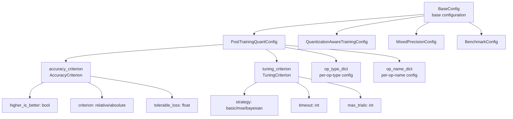

**Diagram 2: 2.x Configuration Class Hierarchy**

Sources: [neural_compressor/config.py:489-1240](), [neural_compressor/quantization.py:100-200]()

### 2.x Workflow Example Pattern

The typical workflow for 2.x API involves creating a configuration, defining evaluation criteria, and calling `fit()`:

```python
# Pattern from neural_compressor/config.py and neural_compressor/quantization.py
from neural_compressor import quantization
from neural_compressor.config import PostTrainingQuantConfig, AccuracyCriterion, TuningCriterion

# Define accuracy requirement
accuracy_criterion = AccuracyCriterion(
    higher_is_better=True,
    criterion='relative',
    tolerable_loss=0.01
)

# Define tuning budget
tuning_criterion = TuningCriterion(
    strategy='mse',
    timeout=0,
    max_trials=100
)

# Create configuration
conf = PostTrainingQuantConfig(
    device='cpu',
    backend='default',
    accuracy_criterion=accuracy_criterion,
    tuning_criterion=tuning_criterion
)

# Quantize with automatic tuning
q_model = quantization.fit(
    model=fp32_model,
    conf=conf,
    calib_dataloader=calib_dataloader,
    eval_func=eval_func
)
```

Sources: [neural_compressor/config.py:580-800](), [neural_compressor/quantization.py:1-150]()

---

## 3.x API: PyTorch Direct Quantization

The 3.x API provides explicit control over quantization algorithms without automated tuning. This API is optimized for PyTorch and recommended for LLM quantization and research workflows.

### Core Entry Points

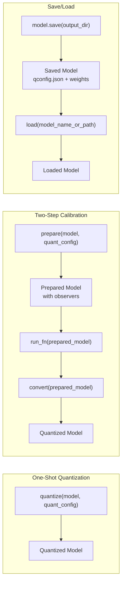

**Diagram 3: 3.x API Entry Point Workflows**

Sources: [neural_compressor/torch/quantization/quantize.py:113-288](), [neural_compressor/torch/algorithms/weight_only/save_load.py:55-143]()

### Function Signatures

**`quantize()`** - One-shot quantization
```python
# From neural_compressor/torch/quantization/quantize.py:115-152
def quantize(
    model: torch.nn.Module,
    quant_config: BaseConfig,
    run_fn: Callable = None,
    run_args: Any = None,
    inplace: bool = True,
    example_inputs: Any = None,
) -> torch.nn.Module
```

**`prepare()`** - Insert observers for calibration
```python
# From neural_compressor/torch/quantization/quantize.py:155-192
def prepare(
    model: torch.nn.Module,
    quant_config: BaseConfig,
    inplace: bool = True,
    example_inputs: Any = None,
) -> torch.nn.Module
```

**`convert()`** - Convert prepared model to quantized
```python
# From neural_compressor/torch/quantization/quantize.py:226-288
def convert(
    model: torch.nn.Module,
    quant_config: BaseConfig = None,
    inplace: bool = True,
) -> torch.nn.Module
```

Sources: [neural_compressor/torch/quantization/quantize.py:113-288]()

### Configuration Classes

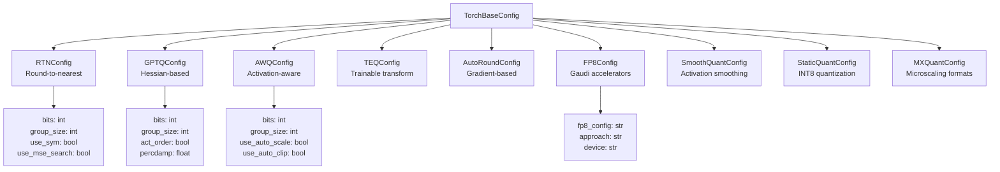

**Diagram 4: 3.x Configuration Classes and Key Parameters**

Sources: [neural_compressor/torch/quantization/config.py:104-1200]()

### Configuration Class Details

| Config Class | Algorithm | Priority | Key Parameters |
|--------------|-----------|----------|----------------|
| `RTNConfig` | Round-to-nearest | PRIORITY_RTN | `dtype`, `bits`, `group_size`, `use_mse_search` |
| `GPTQConfig` | GPTQ | PRIORITY_GPTQ | `bits`, `group_size`, `act_order`, `percdamp`, `block_size` |
| `AWQConfig` | AWQ | PRIORITY_AWQ | `bits`, `group_size`, `use_auto_scale`, `use_auto_clip` |
| `TEQConfig` | TEQ | PRIORITY_TEQ | `bits`, `group_size`, `absorb_to_layer`, `folding` |
| `AutoRoundConfig` | AutoRound | PRIORITY_AUTOROUND | `bits`, `group_size`, `nsamples`, `iters` |
| `HQQConfig` | HQQ | PRIORITY_HQQ | `bits`, `group_size`, `quant_scale`, `quant_zero` |
| `FP8Config` | FP8 | N/A | `fp8_config` (E4M3/E5M2), `approach`, `device` |
| `StaticQuantConfig` | INT8 PTQ | N/A | `w_dtype`, `act_dtype`, `w_granularity`, `act_granularity` |
| `SmoothQuantConfig` | SmoothQuant | N/A | `alpha`, `folding`, `scale_sharing`, `auto_alpha_args` |

Sources: [neural_compressor/torch/quantization/config.py:104-1200](), [neural_compressor/torch/utils/constants.py:1-100]()

---

## Algorithm Dispatch System

The 3.x API uses a registry-based algorithm dispatch system that routes configurations to specific quantization implementations.

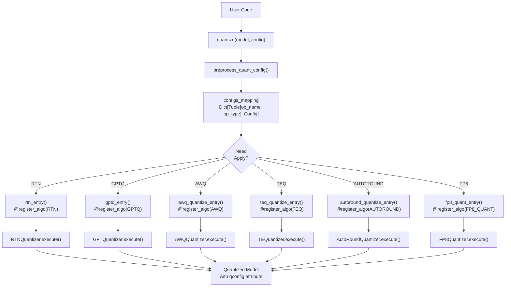

**Diagram 5: 3.x Algorithm Dispatch Flow from Config to Quantizer**

Sources: [neural_compressor/torch/quantization/quantize.py:49-152](), [neural_compressor/torch/quantization/algorithm_entry.py:62-700](), [neural_compressor/torch/utils/utility.py:63-82]()

### Algorithm Entry Registry

The `@register_algo` decorator registers algorithm implementations in `algos_mapping`:

```python
# Pattern from neural_compressor/torch/utils/utility.py:63-82
algos_mapping: Dict[str, Callable] = {}

def register_algo(name):
    def decorator(algo_func):
        algos_mapping[name] = algo_func
        return algo_func
    return decorator

# Usage in neural_compressor/torch/quantization/algorithm_entry.py:63-117
@register_algo(RTN)
@torch.no_grad()
def rtn_entry(model, configs_mapping, mode=Mode.QUANTIZE, *args, **kwargs):
    quantizer = get_quantizer(model, quantizer_cls=RTNQuantizer, quant_config=weight_config)
    model = quantizer.execute(model, mode=mode, *args, **kwargs)
    return model
```

Sources: [neural_compressor/torch/utils/utility.py:63-82](), [neural_compressor/torch/quantization/algorithm_entry.py:62-700]()

---

## Configuration to Model Mapping

Both APIs convert user configurations into per-operator quantization specifications through a mapping process.

### 2.x Configuration Expansion

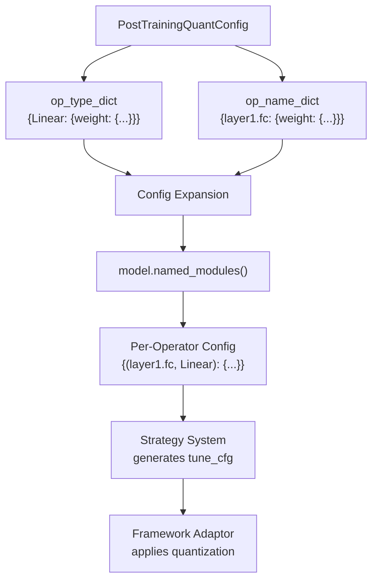

**Diagram 6: 2.x Configuration Expansion to Per-Operator Tuning**

Sources: [neural_compressor/config.py:580-1240]()

### 3.x Configuration Expansion

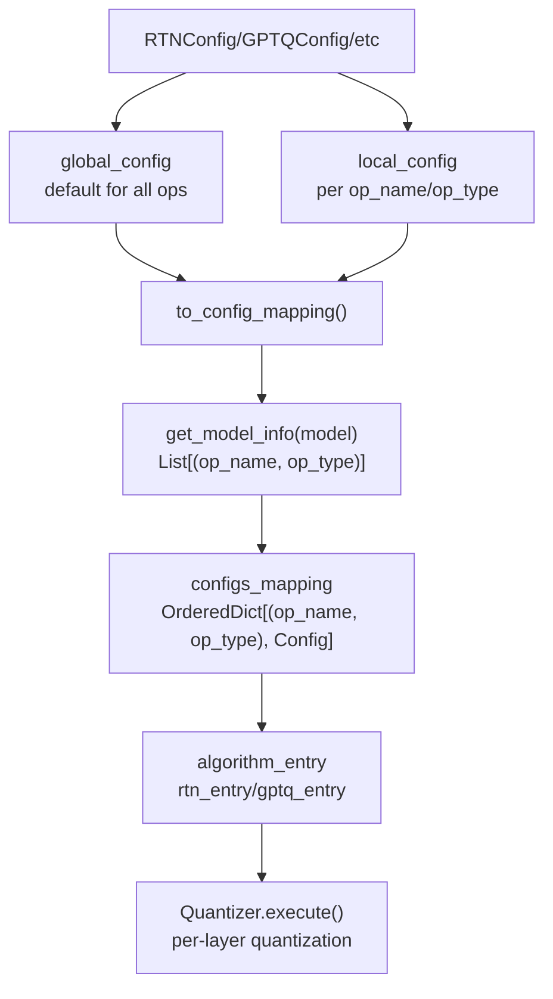

**Diagram 7: 3.x Configuration to Per-Operator Mapping**

Sources: [neural_compressor/torch/quantization/config.py:104-300](), [neural_compressor/torch/quantization/quantize.py:49-110]()

---

## Choosing the Right API

### Decision Matrix

| Requirement | Recommended API | Rationale |
|-------------|-----------------|-----------|
| Accuracy must meet specific threshold | 2.x API | Automated tuning with `AccuracyCriterion` |
| Multi-framework deployment | 2.x API | Unified interface for TF, PyTorch, ONNX |
| LLM quantization (weight-only) | 3.x API | Specialized algorithms (GPTQ, AWQ, AutoRound) |
| PyTorch-only deployment | 3.x API | Optimized for PyTorch, simpler workflow |
| Research/experimentation | 3.x API | Direct algorithm control, faster iteration |
| Intel Gaudi FP8 quantization | 3.x API | `FP8Config` with HPU-specific optimizations |
| QAT, pruning, or distillation | 2.x API | Only available in 2.x |
| Need fastest time-to-quantize | 3.x API | One-shot quantization, no tuning loop |

### Migration from 2.x to 3.x

For PyTorch users, the 3.x API provides equivalent functionality with a simpler interface:

**2.x Pattern:**
```python
# From neural_compressor/config.py and neural_compressor/quantization.py
from neural_compressor import quantization
from neural_compressor.config import PostTrainingQuantConfig

conf = PostTrainingQuantConfig(approach='static', ...)
q_model = quantization.fit(model, conf, calib_dataloader, eval_func)
```

**3.x Equivalent:**
```python
# From neural_compressor/torch/quantization/quantize.py
from neural_compressor.torch.quantization import quantize, StaticQuantConfig

quant_config = StaticQuantConfig()
q_model = quantize(model, quant_config, run_fn=calib_func, example_inputs=inputs)
```

Sources: [neural_compressor/quantization.py:1-150](), [neural_compressor/torch/quantization/quantize.py:113-152]()

---

## Package Distribution

Intel Neural Compressor is available in multiple package formats to minimize installation footprint:

| Package Name | Contents | Use Case |
|--------------|----------|----------|
| `neural-compressor` | Full package: 2.x + 3.x + all frameworks | Multi-framework development |
| `neural-compressor[pt]` | Full + PyTorch dependencies | PyTorch-focused projects |
| `neural-compressor[tf]` | Full + TensorFlow dependencies | TensorFlow-focused projects |

```python
# Installation examples
pip install neural-compressor         # Full package
pip install neural-compressor[pt]     # With PyTorch deps
pip install neural-compressor[tf]     # With TensorFlow deps
```

Sources: [README.md:46-53]()

---

## Configuration Attributes Reference

### Common Attributes (2.x and 3.x)

| Attribute | Type | Description | Default |
|-----------|------|-------------|---------|
| `white_list` | `List[OP_NAME_OR_MODULE_TYPE]` | Operators to quantize | `DEFAULT_WHITE_LIST` |
| `op_type_dict` / `local_config` | `Dict` | Per-operator-type config | `{}` |
| `op_name_dict` / `local_config` | `Dict` | Per-operator-name config | `{}` |

### Weight-Only Quantization Attributes (3.x)

| Attribute | Type | Description | Default | Applicable Configs |
|-----------|------|-------------|---------|-------------------|
| `dtype` | `str` | Data type: "int", "int4", "int8", "nf4", "fp4", "fp8_e5m2", etc. | `"int"` | RTN, GPTQ, AWQ, TEQ |
| `bits` | `int` | Number of bits for quantization | `4` | RTN, GPTQ, AWQ, TEQ, AutoRound |
| `use_sym` | `bool` | Symmetric vs asymmetric quantization | `True` | RTN, GPTQ, AWQ, TEQ |
| `group_size` | `int` | Quantization group size (-1 for per-channel) | `32` | RTN, GPTQ, AWQ, TEQ, AutoRound |
| `use_mse_search` | `bool` | Enable MSE-based clip value search | `False` | RTN, AWQ |
| `use_double_quant` | `bool` | Enable double quantization | `False` | RTN, GPTQ, AWQ |
| `quant_lm_head` | `bool` | Quantize language model head layer | `False` | RTN, GPTQ, AWQ, TEQ |

### GPTQ-Specific Attributes

| Attribute | Type | Description | Default |
|-----------|------|-------------|---------|
| `act_order` | `bool` | Activation-based channel reordering | `False` |
| `percdamp` | `float` | Hessian diagonal dampening percentage | `0.01` |
| `block_size` | `int` | Block size for GPTQ execution | `2048` |
| `static_groups` | `bool` | Pre-calculate group-wise parameters | `False` |
| `true_sequential` | `bool` | Quantize layers in original order | `False` |

### AWQ-Specific Attributes

| Attribute | Type | Description | Default |
|-----------|------|-------------|---------|
| `use_auto_scale` | `bool` | Enable automatic scaling search | `True` |
| `use_auto_clip` | `bool` | Enable automatic clip range search | `True` |
| `folding` | `bool` | Allow scale insertion when absorption fails | `False` |

### FP8-Specific Attributes

| Attribute | Type | Description | Default |
|-----------|------|-------------|---------|
| `fp8_config` | `str` | FP8 format: "E4M3" or "E5M2" | `"E4M3"` |
| `approach` | `str` | Quantization approach: "static" or "dynamic" | `"static"` |
| `device` | `str` | Target device (must be "hpu" for FP8) | `"hpu"` |

Sources: [neural_compressor/torch/quantization/config.py:104-1200]()

---

## Save and Load Operations

### 3.x Save/Load API

The 3.x API provides integrated save/load operations for quantized models:

```mermaid
graph TB
    subgraph "Save Operations"
        QModel["Quantized Model<br/>with qconfig"]
        SaveFunc["model.save(output_dir, format)"]
        
        SaveFunc --> CheckFormat{format?}
        
        CheckFormat -->|DEFAULT| DefaultSave["Save INC Format"]
        CheckFormat -->|HUGGINGFACE| HFSave["Save HF Format"]
        
        DefaultSave --> INCFiles["qconfig.json<br/>quantized_weight.pt"]
        HFSave --> HFFiles["config.json<br/>quantize_config.json<br/>model.safetensors"]
        
        QModel --> SaveFunc
    end
    
    subgraph "Load Operations"
        LoadFunc["load(model_name_or_path, format)"]
        
        LoadFunc --> CheckSource{Source?}
        
        CheckSource -->|Local INC| LoadINC["load_inc_format_woq_model()"]
        CheckSource -->|Local/Remote HF| LoadHF["load_hf_format_woq_model()"]
        
        LoadINC --> BuildWOQ["_build_woq_model()"]
        LoadHF --> BuildWOQ
        
        BuildWOQ --> ReplaceLinear["Replace torch.nn.Linear<br/>with INCWeightOnlyLinear"]
        ReplaceLinear --> LoadedModel["Loaded Quantized Model"]
    end
```

**Diagram 8: 3.x Save/Load System with Format Support**

Sources: [neural_compressor/torch/algorithms/weight_only/save_load.py:55-600]()

### Save Function

```python
# From neural_compressor/torch/algorithms/weight_only/save_load.py:55-108
def save(model, output_dir="./saved_results", format=SaveLoadFormat.DEFAULT, **kwargs):
    """Save the quantized model and config.
    
    Args:
        model: Quantized model
        output_dir: Output directory
        format: "default" or "huggingface"
        kwargs: Additional format-specific arguments
            - safe_serialization (bool): Use safetensors for HF format
            - tokenizer: Tokenizer to save with model (HF format)
            - max_shard_size (str): Maximum shard size (HF format)
    """
```

### Load Function

```python
# From neural_compressor/torch/algorithms/weight_only/save_load.py:110-143
def load(model_name_or_path, original_model=None, format=SaveLoadFormat.DEFAULT, device="cpu", **kwargs):
    """Load quantized weight-only quantization model.
    
    Args:
        model_name_or_path: Path to saved model or HF model name
        original_model: Original FP32 model (required for DEFAULT format)
        format: "default" or "huggingface"
        device: Target device ("cpu", "hpu", etc.)
        kwargs: Additional loading arguments
    
    Returns:
        Quantized model
    """
```

Sources: [neural_compressor/torch/algorithms/weight_only/save_load.py:55-143]()

---

## Summary

This guide covered the two API versions available in Intel Neural Compressor:

- **2.x API**: Use for production deployments requiring accuracy guarantees, multi-framework support, or training-time compression (QAT, pruning, distillation)
- **3.x API**: Use for PyTorch-only workflows, LLM quantization, research, or when direct algorithm control is needed

For detailed algorithm descriptions and parameters, see [Weight-Only Quantization](#6.3). For framework-specific implementation details, see [Framework Adaptors](#5).

Sources: [README.md:1-203](), [neural_compressor/torch/quantization/quantize.py:1-288](), [neural_compressor/quantization.py:1-200]()

---

# Page: 2.x API (Unified)

# 2.x API (Unified)

<details>
<summary>Relevant source files</summary>

The following files were used as context for generating this wiki page:

- [README.md](README.md)
- [docs/source/add_new_adaptor.md](docs/source/add_new_adaptor.md)
- [docs/source/add_new_data_type.md](docs/source/add_new_data_type.md)
- [docs/source/calibration.md](docs/source/calibration.md)
- [docs/source/examples_readme.md](docs/source/examples_readme.md)
- [docs/source/framework_yaml.md](docs/source/framework_yaml.md)
- [docs/source/infrastructure.md](docs/source/infrastructure.md)
- [docs/source/mixed_precision.md](docs/source/mixed_precision.md)
- [docs/source/publication_list.md](docs/source/publication_list.md)
- [docs/source/quantization.md](docs/source/quantization.md)
- [docs/source/quantization_mixed_precision.md](docs/source/quantization_mixed_precision.md)
- [examples/README.md](examples/README.md)
- [neural_compressor/benchmark.py](neural_compressor/benchmark.py)
- [neural_compressor/config.py](neural_compressor/config.py)
- [neural_compressor/mix_precision.py](neural_compressor/mix_precision.py)
- [neural_compressor/model/model.py](neural_compressor/model/model.py)
- [neural_compressor/quantization.py](neural_compressor/quantization.py)
- [neural_compressor/training.py](neural_compressor/training.py)
- [neural_compressor/utils/utility.py](neural_compressor/utils/utility.py)
- [test/adaptor/pytorch_adaptor/test_adaptor_security.py](test/adaptor/pytorch_adaptor/test_adaptor_security.py)

</details>


## Purpose and Scope

The 2.x API is Intel® Neural Compressor's unified, framework-agnostic interface for model optimization. This API provides a consistent experience across TensorFlow, PyTorch, and ONNX Runtime frameworks with built-in accuracy-aware tuning capabilities. The 2.x API is designed for users who need automated optimization that balances performance gains with accuracy preservation.

This page documents the 2.x API's core functions, configuration system, and accuracy-aware tuning workflow. For direct quantization without tuning (PyTorch-focused), see the 3.x API documentation [3.2](#3.2). For framework-specific implementation details, see Framework Adaptors [5](#5).

Sources: [README.md:176-177](), [docs/source/quantization.md:1-15]()

## API Overview

The 2.x API consists of four primary entry point functions, each serving a distinct optimization purpose:

| Function | Purpose | Module | Primary Use Case |
|----------|---------|--------|------------------|
| `quantization.fit()` | Post-training quantization with optional accuracy tuning | `neural_compressor.quantization` | INT8 model generation with accuracy guarantees |
| `mix_precision.fit()` | BF16/FP16 conversion with optional accuracy tuning | `neural_compressor.mix_precision` | Mixed precision optimization |
| `training.fit()` | Quantization-aware training with tuning | `neural_compressor.training` | QAT with accuracy-driven configuration search |
| `benchmark.fit()` | Performance measurement | `neural_compressor.benchmark` | Latency and throughput benchmarking |

Sources: [neural_compressor/quantization.py:1-242](), [neural_compressor/mix_precision.py:1-180](), [neural_compressor/training.py:1-303](), [neural_compressor/benchmark.py:1-402]()

## Configuration System

### Configuration Class Hierarchy

The 2.x API uses a hierarchical configuration system with specialized classes for each optimization technique:

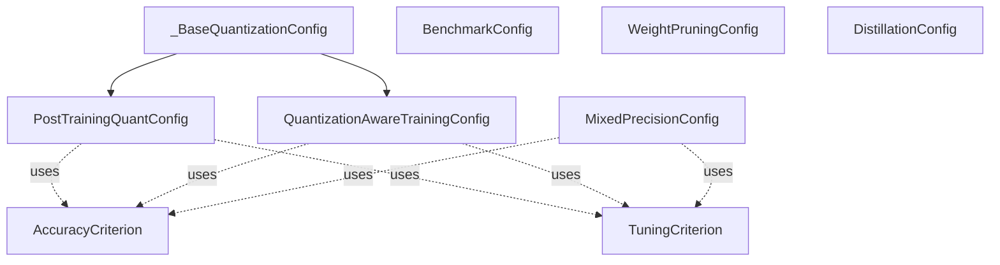

Sources: [neural_compressor/config.py:715-1296]()

### PostTrainingQuantConfig

The `PostTrainingQuantConfig` class controls post-training quantization behavior. Key parameters:

| Parameter | Type | Default | Description |
|-----------|------|---------|-------------|
| `approach` | str | "auto" | Quantization approach: "static", "dynamic", "auto", "weight_only" |
| `backend` | str | "default" | Backend library: "default", "ipex", "itex", "onnxrt_trt_ep", etc. |
| `device` | str | "cpu" | Target device: "cpu", "gpu", "xpu", "npu" |
| `calibration_sampling_size` | list[int] | [100] | Number of samples for calibration |
| `op_type_dict` | dict | None | Per-operator-type quantization constraints |
| `op_name_dict` | dict | None | Per-operator-name quantization constraints |
| `recipes` | dict | {} | Quantization recipes (smooth_quant, layer_wise_quant, etc.) |
| `quant_level` | str/int | "auto" | Quantization level: "auto", 0 (conservative), 1 (basic) |
| `accuracy_criterion` | AccuracyCriterion | Default | Accuracy goal for tuning |
| `tuning_criterion` | TuningCriterion | Default | Tuning strategy and stop criteria |
| `excluded_precisions` | list[str] | [] | Precisions to exclude (e.g., ["bf16"]) |

Sources: [neural_compressor/config.py:715-1048]()

### QuantizationAwareTrainingConfig

The `QuantizationAwareTrainingConfig` extends `PostTrainingQuantConfig` with QAT-specific settings:

| Parameter | Type | Default | Description |
|-----------|------|---------|-------------|
| `approach` | str | "quant_aware_training" | Fixed to QAT approach |
| All PTQ parameters | - | - | Inherits all PostTrainingQuantConfig parameters |

Sources: [neural_compressor/config.py:1050-1100]()

### AccuracyCriterion

The `AccuracyCriterion` class defines accuracy goals for tuning:

| Parameter | Type | Default | Description |
|-----------|------|---------|-------------|
| `higher_is_better` | bool | True | Whether higher metric values indicate better accuracy |
| `criterion` | str | "relative" | Loss criterion: "relative" or "absolute" |
| `tolerable_loss` | float | 0.01 | Maximum acceptable accuracy degradation |

Example: For a baseline accuracy of 0.90, a relative tolerance of 0.01 means the quantized model must achieve at least 0.891 accuracy (99% of baseline).

Sources: [neural_compressor/config.py:489-589]()

### TuningCriterion

The `TuningCriterion` class controls the tuning process:

| Parameter | Type | Default | Description |
|-----------|------|---------|-------------|
| `strategy` | str | "basic" | Tuning strategy: "basic", "mse", "bayesian", "random", "exhaustive", "sigopt", "tpe", "mse_v2", "hawq_v2" |
| `strategy_kwargs` | dict | None | Strategy-specific parameters |
| `timeout` | int/float | 0 | Maximum tuning time in seconds (0 = no limit) |
| `max_trials` | int | 100 | Maximum number of tuning trials |
| `objective` | str/list/dict | "performance" | Optimization objective: "performance", "accuracy", "modelsize", "footprint" |

Sources: [neural_compressor/config.py:592-713]()

### MixedPrecisionConfig

The `MixedPrecisionConfig` class configures BF16/FP16 conversion:

| Parameter | Type | Default | Description |
|-----------|------|---------|-------------|
| `precisions` | str/list[str] | "bf16" | Target precisions: "bf16", "fp16" |
| `backend` | str | "default" | Backend for execution |
| `device` | str | "cpu" | Target device |
| `excluded_precisions` | list[str] | [] | Precisions to avoid |
| `accuracy_criterion` | AccuracyCriterion | Default | Accuracy goal (for accuracy-aware mode) |
| `tuning_criterion` | TuningCriterion | Default | Tuning configuration |

Sources: [neural_compressor/config.py:1102-1192]()

### BenchmarkConfig

The `BenchmarkConfig` class defines performance measurement parameters:

| Parameter | Type | Default | Description |
|-----------|------|---------|-------------|
| `warmup` | int | 5 | Number of warmup iterations |
| `iteration` | int | -1 | Number of benchmark iterations (-1 = all data) |
| `cores_per_instance` | int | None | CPU cores per instance for multi-instance |
| `num_of_instance` | int | 1 | Number of parallel instances |
| `inter_num_of_threads` | int | None | Inter-op parallelism threads |
| `intra_num_of_threads` | int | None | Intra-op parallelism threads |

Sources: [neural_compressor/config.py:261-487]()

## Core API Functions

### quantization.fit()

The `quantization.fit()` function is the primary entry point for post-training quantization:

```python
def fit(
    model,
    conf: PostTrainingQuantConfig,
    calib_dataloader=None,
    calib_func=None,
    eval_func=None,
    eval_dataloader=None,
    eval_metric=None,
    **kwargs
) -> Model
```

**Parameters:**
- `model`: Framework model object or path to model file
- `conf`: PostTrainingQuantConfig instance
- `calib_dataloader`: Calibration data loader (required for static quantization)
- `calib_func`: Alternative calibration function (optional)
- `eval_func`: Evaluation function for accuracy-aware tuning (optional)
- `eval_dataloader`: Evaluation data loader (optional, requires eval_metric)
- `eval_metric`: Metric for evaluation (optional, requires eval_dataloader)

**Behavior:**
1. If `eval_func` or (`eval_dataloader` + `eval_metric`) provided: Performs accuracy-aware tuning
2. If neither provided: Performs direct quantization without tuning

**Return Value:**
Returns a quantized model wrapped in the framework-specific Model class.

Sources: [neural_compressor/quantization.py:33-242]()

### mix_precision.fit()

The `mix_precision.fit()` function converts models to BF16/FP16:

```python
def fit(
    model,
    conf: MixedPrecisionConfig,
    eval_func=None,
    eval_dataloader=None,
    eval_metric=None,
    **kwargs
) -> Model
```

**Key Differences from quantization.fit():**
- No calibration dataloader required
- Focuses on BF16/FP16 conversion rather than INT8 quantization
- Hardware validation: BF16 requires AVX512_BF16 instruction set or ITEX/IPEX backend

Sources: [neural_compressor/mix_precision.py:36-179]()

### training.fit()

The `training.fit()` function enables quantization-aware training with tuning:

```python
def fit(
    compression_manager: CompressionManager,
    train_func: Callable,
    eval_func=None,
    eval_dataloader=None,
    eval_metric=None,
    **kwargs
) -> Model
```

**Workflow:**
1. User creates `CompressionManager` with model and config via `prepare_compression()`
2. User provides `train_func` that performs training loop with callback hooks
3. Function performs accuracy-aware tuning by invoking `train_func` with different configurations
4. Returns best quantized model that meets accuracy criterion

**CompressionManager Callbacks:**
- `on_train_begin()`: Initialize quantization
- `on_epoch_begin(epoch)`: Epoch start hook
- `on_step_begin(step)`: Step start hook
- `on_after_compute_loss(input, output, loss)`: Loss modification hook
- `on_before_optimizer_step()`: Pre-optimization hook
- `on_step_end()`: Step end hook
- `on_epoch_end()`: Epoch end hook
- `on_train_end()`: Finalize quantization

Sources: [neural_compressor/training.py:197-303](), [neural_compressor/training.py:38-195]()

### benchmark.fit()

The `benchmark.fit()` function measures model performance:

```python
def fit(
    model,
    conf: BenchmarkConfig,
    b_dataloader=None,
    b_func=None
) -> dict
```

**Features:**
- Latency and throughput measurement
- Multi-instance execution for server scenarios
- Warmup iterations to stabilize measurements
- NUMA-aware core binding (Linux only)

Sources: [neural_compressor/benchmark.py:140-213]()

## Accuracy-Aware Tuning Workflow

The accuracy-aware tuning mechanism is the distinguishing feature of the 2.x API. The workflow operates as follows:

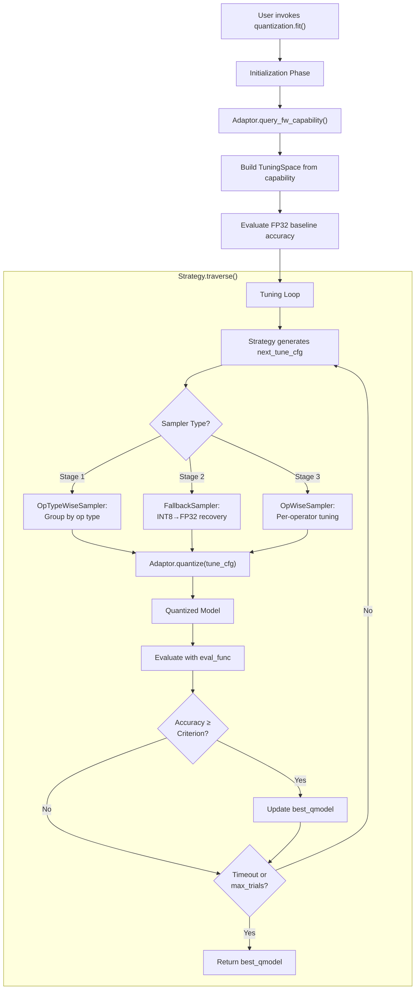

Sources: [neural_compressor/quantization.py:158-241](), [docs/source/quantization.md:118-132]()

### Tuning Space Construction

The tuning space is built by querying framework capabilities through the adaptor layer:

1. **Capability Query**: `Adaptor.query_fw_capability()` returns opwise and optypewise quantization capabilities
   ```python
   capability = {
       'opwise': {
           ('conv1', 'Conv2D'): [
               {'weight': {'dtype': 'int8'}, 'activation': {'dtype': 'int8'}},
               {'weight': {'dtype': 'bf16'}, 'activation': {'dtype': 'bf16'}},
               {'weight': {'dtype': 'fp32'}, 'activation': {'dtype': 'fp32'}}
           ]
       },
       'optypewise': {...}
   }
   ```

2. **Space Construction**: Strategy builds a tree of possible configurations by combining:
   - Framework capabilities from YAML files
   - User-specified constraints in `op_type_dict` and `op_name_dict`
   - Recipe settings (smooth_quant, layer_wise_quant, etc.)

Sources: [neural_compressor/quantization.py:158-173]()

### Tuning Strategies

The `TuningCriterion.strategy` parameter selects the search algorithm:

| Strategy | Description | Best For |
|----------|-------------|----------|
| `basic` | Sequential exploration of tuning space | Default, reliable approach |
| `bayesian` | Bayesian optimization for efficient search | Large tuning spaces |
| `mse` | Mean Squared Error-driven tuning | Minimizing output divergence from FP32 |
| `mse_v2` | Enhanced MSE with layer-wise sensitivity | Complex models with varied layer sensitivities |
| `random` | Random sampling of configurations | Quick exploration |
| `exhaustive` | Try all possible configurations | Small tuning spaces only |
| `sigopt` | Integration with SigOpt service | Advanced hyperparameter optimization |
| `tpe` | Tree-structured Parzen Estimator | Efficient probabilistic search |
| `hawq_v2` | Hessian Aware Quantization v2 | Second-order sensitivity-based |

The strategy is automatically selected as `"auto"` when `quant_level="auto"`, or `"conservative"` when `quant_level=0`.

Sources: [neural_compressor/config.py:615-699](), [neural_compressor/quantization.py:161-173]()

### Tuning Samplers

Samplers generate configurations from the tuning space in stages:

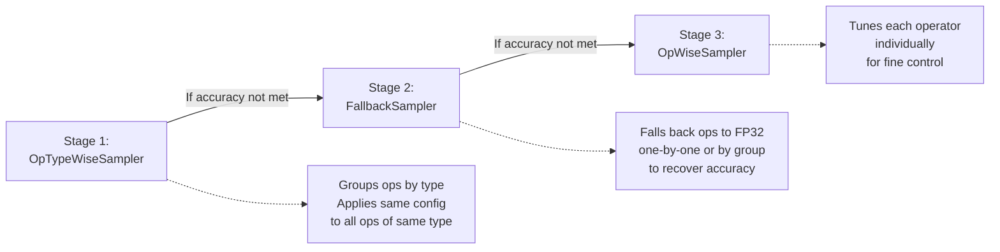

Sources: Inferred from architecture diagrams

### MultiObjective Evaluation

The `MultiObjective` class evaluates quantized models against multiple criteria:

| Objective | Metric | Description |
|-----------|--------|-------------|
| `accuracy` | User-defined metric | Model accuracy on evaluation dataset |
| `performance` | Latency/Throughput | Inference speed measurement |
| `modelsize` | Disk footprint | Saved model file size |
| `footprint` | Runtime memory | Memory usage during inference |

Objectives can be weighted when specified as a dict:
```python
objective = {
    "objective": ["performance", "modelsize"],
    "weight": [0.7, 0.3]  # 70% weight on performance, 30% on model size
}
```

Sources: [neural_compressor/config.py:650-684]()

## Framework Adaptor Integration

The 2.x API achieves framework-agnostic behavior through the adaptor layer:

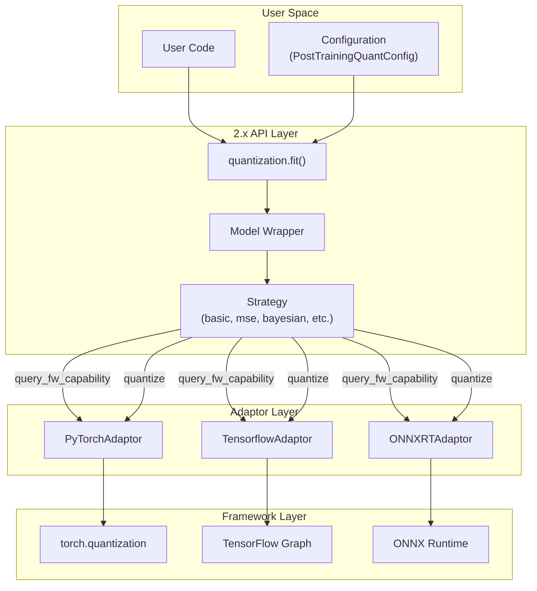

**Framework Detection:**
The `Model` wrapper automatically detects the framework using `get_model_fwk_name()`:
- TensorFlow: Detected via `get_model_type()` which checks for GraphDef, SavedModel, or Keras model
- PyTorch: Detected via `isinstance(model, torch.nn.Module)`
- ONNX Runtime: Detected by attempting to load with `onnxruntime.InferenceSession`

**Adaptor Selection:**
Based on the detected framework and configuration, the appropriate adaptor is instantiated:
- `pytorch_adaptor.py` for PyTorch backend="default"
- `pytorch_cpu.py` for PyTorch backend="ipex"
- `tensorflow.py` for TensorFlow backend="default"
- `tensorflow.py` for TensorFlow backend="itex"
- `onnxrt.py` for ONNX Runtime

Sources: [neural_compressor/model/model.py:66-253](), [neural_compressor/quantization.py:148-156]()

## Usage Examples

### Basic Post-Training Quantization (No Tuning)

```python
from neural_compressor import quantization
from neural_compressor.config import PostTrainingQuantConfig

# Create model and dataloader
model = create_model()
calib_dataloader = create_dataloader(dataset, batch_size=32)

# Configure for static quantization
conf = PostTrainingQuantConfig(
    approach="static",
    backend="default"
)

# Quantize without accuracy tuning
q_model = quantization.fit(
    model=model,
    conf=conf,
    calib_dataloader=calib_dataloader
)

# Save quantized model
q_model.save("./output/model_int8")
```

Sources: [docs/source/quantization.md:214-240]()

### Post-Training Quantization with Accuracy Tuning

```python
from neural_compressor import quantization
from neural_compressor.config import PostTrainingQuantConfig, AccuracyCriterion, TuningCriterion

# Define evaluation function
def eval_func(model):
    accuracy = evaluate_model(model, val_dataloader)
    return accuracy

# Configure with accuracy criterion
conf = PostTrainingQuantConfig(
    approach="static",
    accuracy_criterion=AccuracyCriterion(
        criterion="relative",
        tolerable_loss=0.01  # Allow 1% accuracy loss
    ),
    tuning_criterion=TuningCriterion(
        strategy="bayesian",
        max_trials=100,
        timeout=3600  # 1 hour timeout
    )
)

# Quantize with accuracy-aware tuning
q_model = quantization.fit(
    model=model,
    conf=conf,
    calib_dataloader=calib_dataloader,
    eval_func=eval_func
)
```

Sources: [docs/source/quantization.md:243-278]()

### Quantization with Operator-Specific Constraints

```python
from neural_compressor.config import PostTrainingQuantConfig

# Define per-operator-type constraints
op_type_dict = {
    "Conv2D": {
        "weight": {"dtype": ["int8"]},
        "activation": {"dtype": ["int8"]}
    },
    "MatMul": {
        "weight": {"dtype": ["int8"]},
        "activation": {"dtype": ["uint8"]}
    }
}

# Define per-operator-name constraints
op_name_dict = {
    "layer1.0.conv1": {
        "weight": {"dtype": ["fp32"]},  # Keep this layer in FP32
        "activation": {"dtype": ["fp32"]}
    }
}

conf = PostTrainingQuantConfig(
    op_type_dict=op_type_dict,
    op_name_dict=op_name_dict
)

q_model = quantization.fit(model, conf, calib_dataloader=calib_dataloader)
```

Sources: [docs/source/quantization.md:370-406]()

### Mixed Precision Conversion

```python
from neural_compressor import mix_precision
from neural_compressor.config import MixedPrecisionConfig

# BF16 conversion with accuracy tuning
conf = MixedPrecisionConfig(
    precisions="bf16",
    accuracy_criterion=AccuracyCriterion(
        criterion="relative",
        tolerable_loss=0.01
    )
)

bf16_model = mix_precision.fit(
    model=model,
    conf=conf,
    eval_func=eval_func
)
bf16_model.save("./output/model_bf16")
```

Sources: [docs/source/mixed_precision.md:137-144]()

### Quantization-Aware Training

```python
from neural_compressor import QuantizationAwareTrainingConfig
from neural_compressor.training import prepare_compression, fit

# Define training function
def train_func(model):
    compression_manager.callbacks.on_train_begin()
    for epoch in range(num_epochs):
        compression_manager.callbacks.on_epoch_begin(epoch)
        for step, (batch, label) in enumerate(train_dataloader):
            compression_manager.callbacks.on_step_begin(step)
            
            output = model(batch)
            loss = criterion(output, label)
            loss = compression_manager.callbacks.on_after_compute_loss(
                batch, output, loss
            )
            
            loss.backward()
            compression_manager.callbacks.on_before_optimizer_step()
            optimizer.step()
            compression_manager.callbacks.on_step_end()
        compression_manager.callbacks.on_epoch_end()
    compression_manager.callbacks.on_train_end()
    return model

# Configure QAT
conf = QuantizationAwareTrainingConfig()
compression_manager = prepare_compression(model, conf)

# Perform QAT with accuracy tuning
q_model = fit(
    compression_manager=compression_manager,
    train_func=train_func,
    eval_func=eval_func
)
```

Sources: [docs/source/quantization.md:333-368](), [neural_compressor/training.py:38-68]()

### Benchmarking

```python
from neural_compressor import benchmark
from neural_compressor.config import BenchmarkConfig

conf = BenchmarkConfig(
    warmup=10,
    iteration=100,
    cores_per_instance=4,
    num_of_instance=1
)

results = benchmark.fit(
    model=q_model,
    conf=conf,
    b_dataloader=benchmark_dataloader
)

# Results contain performance metrics
# results['performance'] = (accuracy, batch_size, latency_list)
```

Sources: [neural_compressor/config.py:261-290](), [neural_compressor/benchmark.py:140-213]()

## Advanced Features

### Recipes

The `recipes` parameter in configuration enables advanced quantization techniques:

| Recipe | Description | Supported Frameworks |
|--------|-------------|---------------------|
| `smooth_quant` | Activation-weight balancing for better quantization | PyTorch, ONNX Runtime |
| `smooth_quant_args` | SmoothQuant hyperparameters (alpha tuning) | PyTorch, ONNX Runtime |
| `layer_wise_quant` | Layer-by-layer quantization to reduce memory | PyTorch |
| `layer_wise_quant_args` | Layer-wise quantization parameters | PyTorch |
| `fast_bias_correction` | Fast bias correction for accuracy recovery | (In progress) |
| `weight_correction` | Weight correction technique | (In progress) |

Example:
```python
conf = PostTrainingQuantConfig(
    recipes={
        "smooth_quant": True,
        "smooth_quant_args": {
            "alpha": 0.5  # or "auto" for automatic tuning
        }
    }
)
```

Sources: [neural_compressor/config.py:855-910]()

### Multi-Objective Optimization

The 2.x API supports optimizing for multiple objectives simultaneously:

```python
from neural_compressor.config import TuningCriterion

# Optimize for both performance and model size
tuning_criterion = TuningCriterion(
    objective={
        "objective": ["performance", "modelsize"],
        "weight": [0.8, 0.2],  # 80% performance, 20% model size
        "higher_is_better": [True, False]  # higher perf better, lower size better
    }
)

conf = PostTrainingQuantConfig(tuning_criterion=tuning_criterion)
```

Sources: [neural_compressor/config.py:650-684]()

### Orchestration (Multiple Techniques)

The `CompressionManager` supports orchestrating multiple optimization techniques:

```python
from neural_compressor import QuantizationAwareTrainingConfig, WeightPruningConfig
from neural_compressor.training import prepare_compression

# Combine QAT with pruning
confs = [
    QuantizationAwareTrainingConfig(),
    WeightPruningConfig(target_sparsity=0.5)
]

compression_manager = prepare_compression(model, confs)

# Training loop with both QAT and pruning callbacks
train_with_compression(compression_manager)
compression_manager.save("./output")
```

Sources: [neural_compressor/training.py:70-123]()

### Resume from Checkpoint

The 2.x API supports resuming interrupted tuning sessions:

```python
from neural_compressor.config import options

# Set workspace and resume path
options.workspace = "./workspace"
options.resume_from = "./workspace/history.snapshot"

# Tuning will resume from saved state
q_model = quantization.fit(model, conf, calib_dataloader, eval_func)
```

The tuning history is automatically saved to `{workspace}/history.snapshot` during tuning.

Sources: [neural_compressor/quantization.py:177-186](), [neural_compressor/config.py:209-258]()

## Differences from 3.x API

The 2.x API differs from the 3.x API in several key aspects:

| Aspect | 2.x API | 3.x API |
|--------|---------|---------|
| **Scope** | Unified across frameworks | PyTorch-focused |
| **Tuning** | Built-in accuracy-aware tuning | Direct quantization (no tuning by default) |
| **Entry Points** | `quantization.fit()`, `mix_precision.fit()`, etc. | `torch.quantization.quantize()`, `prepare()`/`convert()` |
| **Configuration** | `PostTrainingQuantConfig` with tuning criteria | Algorithm-specific configs (RTNConfig, GPTQConfig, etc.) |
| **Primary Use Case** | Automated optimization with accuracy guarantees | Manual quantization with explicit algorithm selection |
| **Weight-Only** | Limited support via approach="weight_only" | Rich weight-only support (RTN, GPTQ, AWQ, TEQ, AUTOROUND) |
| **Framework Support** | TensorFlow, PyTorch, ONNX Runtime | PyTorch only |
| **LLM Support** | Basic | Advanced (dedicated weight-only algorithms) |

For direct quantization of PyTorch models without tuning, especially for LLMs with weight-only quantization, see the 3.x API documentation [3.2](#3.2).

Sources: [README.md:176-177]()

---

# Page: 3.x API (PyTorch)

# 3.x API (PyTorch)

<details>
<summary>Relevant source files</summary>

The following files were used as context for generating this wiki page:

- [README.md](README.md)
- [docs/source/add_new_adaptor.md](docs/source/add_new_adaptor.md)
- [docs/source/add_new_data_type.md](docs/source/add_new_data_type.md)
- [docs/source/calibration.md](docs/source/calibration.md)
- [docs/source/examples_readme.md](docs/source/examples_readme.md)
- [docs/source/framework_yaml.md](docs/source/framework_yaml.md)
- [docs/source/infrastructure.md](docs/source/infrastructure.md)
- [docs/source/mixed_precision.md](docs/source/mixed_precision.md)
- [docs/source/publication_list.md](docs/source/publication_list.md)
- [docs/source/quantization.md](docs/source/quantization.md)
- [docs/source/quantization_mixed_precision.md](docs/source/quantization_mixed_precision.md)
- [examples/README.md](examples/README.md)
- [examples/pytorch/multimodal-modeling/quantization/auto_round/mllm.py](examples/pytorch/multimodal-modeling/quantization/auto_round/mllm.py)
- [neural_compressor/torch/algorithms/layer_wise/utils.py](neural_compressor/torch/algorithms/layer_wise/utils.py)
- [neural_compressor/torch/algorithms/mixed_low_precision/modules.py](neural_compressor/torch/algorithms/mixed_low_precision/modules.py)
- [neural_compressor/torch/algorithms/mixed_low_precision/quantizer.py](neural_compressor/torch/algorithms/mixed_low_precision/quantizer.py)
- [neural_compressor/torch/algorithms/weight_only/__init__.py](neural_compressor/torch/algorithms/weight_only/__init__.py)
- [neural_compressor/torch/algorithms/weight_only/autoround.py](neural_compressor/torch/algorithms/weight_only/autoround.py)
- [neural_compressor/torch/algorithms/weight_only/awq.py](neural_compressor/torch/algorithms/weight_only/awq.py)
- [neural_compressor/torch/algorithms/weight_only/gptq.py](neural_compressor/torch/algorithms/weight_only/gptq.py)
- [neural_compressor/torch/algorithms/weight_only/modules.py](neural_compressor/torch/algorithms/weight_only/modules.py)
- [neural_compressor/torch/algorithms/weight_only/rtn.py](neural_compressor/torch/algorithms/weight_only/rtn.py)
- [neural_compressor/torch/algorithms/weight_only/save_load.py](neural_compressor/torch/algorithms/weight_only/save_load.py)
- [neural_compressor/torch/algorithms/weight_only/teq.py](neural_compressor/torch/algorithms/weight_only/teq.py)
- [neural_compressor/torch/algorithms/weight_only/utility.py](neural_compressor/torch/algorithms/weight_only/utility.py)
- [neural_compressor/torch/quantization/__init__.py](neural_compressor/torch/quantization/__init__.py)
- [neural_compressor/torch/quantization/algorithm_entry.py](neural_compressor/torch/quantization/algorithm_entry.py)
- [neural_compressor/torch/quantization/config.py](neural_compressor/torch/quantization/config.py)
- [neural_compressor/torch/quantization/quantize.py](neural_compressor/torch/quantization/quantize.py)
- [neural_compressor/torch/quantization/save_load_entry.py](neural_compressor/torch/quantization/save_load_entry.py)
- [neural_compressor/torch/utils/constants.py](neural_compressor/torch/utils/constants.py)
- [neural_compressor/torch/utils/utility.py](neural_compressor/torch/utils/utility.py)
- [neural_compressor/transformers/models/modeling_auto.py](neural_compressor/transformers/models/modeling_auto.py)
- [neural_compressor/transformers/quantization/utils.py](neural_compressor/transformers/quantization/utils.py)
- [neural_compressor/transformers/utils/quantization_config.py](neural_compressor/transformers/utils/quantization_config.py)
- [test/3x/torch/algorithms/weight_only/test_teq_quantizer.py](test/3x/torch/algorithms/weight_only/test_teq_quantizer.py)
- [test/3x/torch/quantization/fp8_quant/test_fp8_jsons/test_pow2_w4a8_quant.json](test/3x/torch/quantization/fp8_quant/test_fp8_jsons/test_pow2_w4a8_quant.json)
- [test/3x/torch/quantization/fp8_quant/test_gptq_mixed_precision.py](test/3x/torch/quantization/fp8_quant/test_gptq_mixed_precision.py)
- [test/3x/torch/quantization/weight_only/test_autoround.py](test/3x/torch/quantization/weight_only/test_autoround.py)
- [test/3x/torch/quantization/weight_only/test_awq.py](test/3x/torch/quantization/weight_only/test_awq.py)
- [test/3x/torch/quantization/weight_only/test_gptq.py](test/3x/torch/quantization/weight_only/test_gptq.py)
- [test/3x/torch/quantization/weight_only/test_rtn.py](test/3x/torch/quantization/weight_only/test_rtn.py)
- [test/3x/torch/quantization/weight_only/test_teq.py](test/3x/torch/quantization/weight_only/test_teq.py)
- [test/3x/torch/quantization/weight_only/test_transformers.py](test/3x/torch/quantization/weight_only/test_transformers.py)
- [test/3x/torch/requirements.txt](test/3x/torch/requirements.txt)

</details>


## Purpose and Scope

The 3.x API provides a PyTorch-focused interface for model quantization without accuracy-aware tuning. It offers direct, one-shot quantization through simple function calls (`quantize()`, `prepare()`, `convert()`) and supports a wide range of quantization algorithms including weight-only techniques (RTN, GPTQ, AWQ, TEQ, AutoRound), FP8 quantization for specialized hardware, static/dynamic quantization, and mixed precision conversion.

**Key Differences from 2.x API:**
- **No accuracy-aware tuning**: The 3.x API applies quantization directly without iterative search through configuration space
- **PyTorch-only**: Focused exclusively on PyTorch models, while the 2.x API supports TensorFlow and ONNX Runtime as well
- **Algorithm-specific configs**: Each algorithm has its own dedicated configuration class (e.g., `RTNConfig`, `GPTQConfig`) rather than unified `PostTrainingQuantConfig`
- **Simpler workflow**: Direct quantization via `quantize()` or two-step via `prepare()` + `convert()`

For accuracy-aware tuning with automatic configuration search, see the [2.x API](#3.1). For framework adaptors and low-level implementation details, see [Framework Adaptors](#5).

---

## API Architecture

The following diagram shows the high-level architecture of the 3.x API, illustrating how user code flows through configuration, algorithm dispatch, and module replacement.

```mermaid
graph TB
    User["User Code"]
    
    subgraph "Public API Layer"
        Quantize["quantize()<br/>neural_compressor.torch.quantization.quantize"]
        Prepare["prepare()<br/>neural_compressor.torch.quantization.quantize"]
        Convert["convert()<br/>neural_compressor.torch.quantization.quantize"]
        SaveLoad["save()/load()<br/>neural_compressor.torch.quantization.save_load_entry"]
    end
    
    subgraph "Configuration Layer"
        BaseConfig["BaseConfig<br/>neural_compressor.common.base_config"]
        RTNConfig["RTNConfig"]
        GPTQConfig["GPTQConfig"]
        AWQConfig["AWQConfig"]
        TEQConfig["TEQConfig"]
        AutoRoundConfig["AutoRoundConfig"]
        FP8Config["FP8Config"]
        StaticQuantConfig["StaticQuantConfig"]
        MixedPrecisionConfig["MixedPrecisionConfig"]
        
        BaseConfig --> RTNConfig
        BaseConfig --> GPTQConfig
        BaseConfig --> AWQConfig
        BaseConfig --> TEQConfig
        BaseConfig --> AutoRoundConfig
        BaseConfig --> FP8Config
        BaseConfig --> StaticQuantConfig
        BaseConfig --> MixedPrecisionConfig
    end
    
    subgraph "Algorithm Entry Layer"
        AlgoEntry["algorithm_entry.py<br/>Dispatch to algorithm implementations"]
        RTNEntry["rtn_entry()"]
        GPTQEntry["gptq_entry()"]
        AWQEntry["awq_quantize_entry()"]
        TEQEntry["teq_quantize_entry()"]
        AutoRoundEntry["autoround_quantize_entry()"]
        FP8Entry["fp8_static_quant_entry()"]
        StaticEntry["static_quant_entry()"]
        
        AlgoEntry --> RTNEntry
        AlgoEntry --> GPTQEntry
        AlgoEntry --> AWQEntry
        AlgoEntry --> TEQEntry
        AlgoEntry --> AutoRoundEntry
        AlgoEntry --> FP8Entry
        AlgoEntry --> StaticEntry
    end
    
    subgraph "Quantizer Layer"
        RTNQuantizer["RTNQuantizer<br/>neural_compressor.torch.algorithms.weight_only.rtn"]
        GPTQuantizer["GPTQuantizer<br/>neural_compressor.torch.algorithms.weight_only.gptq"]
        AWQQuantizer["AWQQuantizer<br/>neural_compressor.torch.algorithms.weight_only.awq"]
        TEQuantizer["TEQuantizer<br/>neural_compressor.torch.algorithms.weight_only.teq"]
        AutoRoundQuantizer["AutoRoundQuantizer<br/>neural_compressor.torch.algorithms.weight_only.autoround"]
        FP8Quantizer["FP8Quantizer<br/>neural_compressor.torch.algorithms.fp8_quant"]
        StaticQuantizer["StaticQuantQuantizer<br/>neural_compressor.torch.algorithms.static_quant"]
    end
    
    subgraph "Module Layer"
        INCWeightOnlyLinear["INCWeightOnlyLinear"]
        HPUWeightOnlyLinear["HPUWeightOnlyLinear"]
        PatchedModule["PatchedModule (FP8)"]
        MulLinear["MulLinear (AWQ/TEQ)"]
    end
    
    User --> Quantize
    User --> Prepare
    User --> Convert
    User --> SaveLoad
    
    Quantize --> RTNConfig
    Quantize --> GPTQConfig
    Quantize --> AWQConfig
    Quantize --> FP8Config
    
    Prepare --> RTNConfig
    Prepare --> FP8Config
    
    Convert --> RTNConfig
    Convert --> FP8Config
    
    RTNConfig --> AlgoEntry
    GPTQConfig --> AlgoEntry
    AWQConfig --> AlgoEntry
    FP8Config --> AlgoEntry
    
    RTNEntry --> RTNQuantizer
    GPTQEntry --> GPTQuantizer
    AWQEntry --> AWQQuantizer
    TEQEntry --> TEQuantizer
    AutoRoundEntry --> AutoRoundQuantizer
    FP8Entry --> FP8Quantizer
    StaticEntry --> StaticQuantizer
    
    RTNQuantizer --> INCWeightOnlyLinear
    GPTQuantizer --> INCWeightOnlyLinear
    AWQQuantizer --> MulLinear
    TEQuantizer --> MulLinear
    AutoRoundQuantizer --> INCWeightOnlyLinear
    FP8Quantizer --> PatchedModule
    
    INCWeightOnlyLinear --> HPUWeightOnlyLinear
```

**Sources:** [neural_compressor/torch/quantization/quantize.py:1-297](), [neural_compressor/torch/quantization/algorithm_entry.py:1-700](), [neural_compressor/torch/quantization/config.py:1-2500]()

---

## Core API Functions

### quantize()

The `quantize()` function provides one-shot quantization in a single call. It internally handles both the preparation and conversion phases.

**Function Signature:**
```python
def quantize(
    model: torch.nn.Module,
    quant_config: BaseConfig,
    run_fn: Callable = None,
    run_args: Any = None,
    inplace: bool = True,
    example_inputs: Any = None,
) -> torch.nn.Module
```

**Parameters:**
- `model`: The float model to be quantized
- `quant_config`: Quantization configuration (e.g., `RTNConfig`, `GPTQConfig`, `FP8Config`)
- `run_fn`: Calibration function for algorithms that require calibration data (GPTQ, AWQ, TEQ, SmoothQuant)
- `run_args`: Positional arguments for `run_fn`
- `inplace`: If True, modifies the model in-place; otherwise creates a copy
- `example_inputs`: Example inputs for model tracing (required for some algorithms)

**Returns:** Quantized model with `is_quantized` attribute set to `True`

**Workflow:**
1. Preprocess configuration via `preprocess_quant_config()` [neural_compressor/torch/quantization/quantize.py:49-111]()
2. Convert configuration to per-operator mapping via `to_config_mapping()`
3. Iterate through `algos_mapping` dictionary to find matching algorithms
4. Dispatch to algorithm-specific entry function (e.g., `rtn_entry()`, `gptq_entry()`)
5. Attach `save()` method to quantized model for persistence

**Sources:** [neural_compressor/torch/quantization/quantize.py:113-153]()

---

### prepare()

The `prepare()` function inserts observers or fake quantization modules into the model for calibration. This is the first step in the two-phase workflow.

**Function Signature:**
```python
def prepare(
    model: torch.nn.Module,
    quant_config: BaseConfig,
    inplace: bool = True,
    example_inputs: Any = None,
) -> torch.nn.Module
```

**Parameters:**
- `model`: Original float model
- `quant_config`: Quantization configuration
- `inplace`: If True, modifies the model in-place
- `example_inputs`: Example inputs for model tracing

**Returns:** Prepared model with `is_prepared` attribute set to `True` and `quant_config` stored for later use

**Use Cases:**
- **FP8 Quantization**: Inserts `PatchedModule` wrappers to collect activation statistics during calibration [neural_compressor/torch/algorithms/fp8_quant/model_configs.py:1-500]()
- **Static Quantization**: Inserts IPEX or PT2E observers
- **QAT (Quantization-Aware Training)**: Inserts fake quantization modules via `prepare_qat()` [neural_compressor/torch/quantization/quantize.py:195-224]()

**Workflow:**
1. Preprocess configuration
2. Dispatch to algorithm-specific entry with `mode=Mode.PREPARE`
3. Store `quant_config` and `example_inputs` as model attributes
4. Return prepared model for calibration

**Sources:** [neural_compressor/torch/quantization/quantize.py:155-193]()

---

### convert()

The `convert()` function converts a prepared model to its quantized form. This is the second step in the two-phase workflow.

**Function Signature:**
```python
def convert(
    model: torch.nn.Module,
    quant_config: BaseConfig = None,
    inplace: bool = True,
) -> torch.nn.Module
```

**Parameters:**
- `model`: Prepared model (with `is_prepared=True`) or float model
- `quant_config`: Quantization configuration (optional if model is already prepared)
- `inplace`: If True, modifies the model in-place

**Returns:** Quantized model with `is_quantized` attribute set to `True`

**Workflow:**
1. Check if model is prepared or requires new configuration
2. Retrieve stored `quant_config` and `example_inputs` from prepared model
3. Generate per-operator configuration mapping
4. Dispatch to algorithm-specific entry with `mode=Mode.CONVERT`
5. Replace modules with quantized equivalents

**Sources:** [neural_compressor/torch/quantization/quantize.py:226-290]()

---

### finalize_calibration()

The `finalize_calibration()` function generates and saves calibration results for FP8 quantization.

**Function Signature:**
```python
def finalize_calibration(model: torch.nn.Module)
```

**Purpose:** Extracts calibration data from `PatchedModule` instances and saves to disk for later use during inference.

**Sources:** [neural_compressor/torch/quantization/quantize.py:292-297]()

---

## Configuration System

### Configuration Class Hierarchy

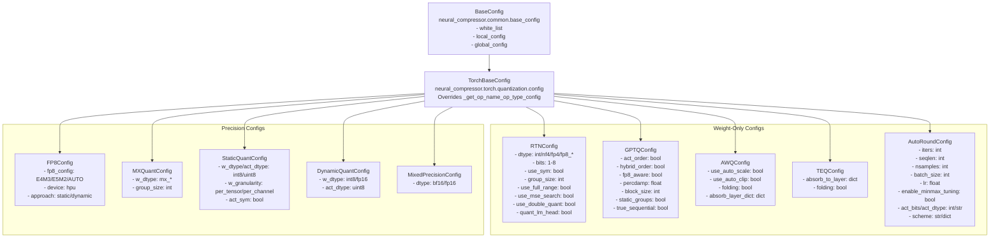

**Sources:** [neural_compressor/torch/quantization/config.py:83-2500](), [neural_compressor/common/base_config.py:1-500]()

---

### Configuration to Algorithm Mapping

The following table shows how configuration classes map to algorithm entry functions and quantizer implementations:

| Config Class | Algorithm Name | Entry Function | Quantizer Class | Priority |
|-------------|----------------|----------------|-----------------|----------|
| `RTNConfig` | `RTN` | `rtn_entry()` | `RTNQuantizer` | `PRIORITY_RTN` (100) |
| `GPTQConfig` | `GPTQ` | `gptq_entry()` | `GPTQuantizer` | `PRIORITY_GPTQ` (90) |
| `AWQConfig` | `AWQ` | `awq_quantize_entry()` | `AWQQuantizer` | `PRIORITY_AWQ` (80) |
| `TEQConfig` | `TEQ` | `teq_quantize_entry()` | `TEQuantizer` | `PRIORITY_TEQ` (70) |
| `AutoRoundConfig` | `AUTOROUND` | `autoround_quantize_entry()` | `AutoRoundQuantizer` | `PRIORITY_AUTOROUND` (60) |
| `HQQConfig` | `HQQ` | `hqq_quantize_entry()` | `HQQQuantizer` | `PRIORITY_HQQ` (50) |
| `FP8Config` | `FP8_QUANT` | `fp8_static_quant_entry()` | `FP8Quantizer` | N/A |
| `StaticQuantConfig` | `STATIC_QUANT` | `static_quant_entry()` or `pt2e_static_quant_entry()` | `StaticQuantQuantizer` or `W8A8PT2EQuantizer` | N/A |
| `DynamicQuantConfig` | `PT2E_DYNAMIC_QUANT` | `pt2e_dynamic_quant_entry()` | `W8A8PT2EQuantizer` | N/A |
| `SmoothQuantConfig` | `SMOOTH_QUANT` | `smooth_quant_entry()` | `SmoothQuantQuantizer` | N/A |
| `MixedPrecisionConfig` | `MIXED_PRECISION` | `mixed_precision_entry()` | `MixedPrecisionQuantizer` | N/A |
| `MXQuantConfig` | `MX_QUANT` | `mx_quant_entry()` | `MXQuantizer` | N/A |

**Registration Mechanism:**
Algorithms are registered via the `@register_algo()` decorator in [neural_compressor/torch/quantization/algorithm_entry.py:1-700](). The decorator adds the entry function to the `algos_mapping` dictionary in [neural_compressor/torch/utils/utility.py:48]().

**Sources:** [neural_compressor/torch/quantization/algorithm_entry.py:62-700](), [neural_compressor/torch/utils/constants.py:1-100]()

---

### Global vs. Local Configuration

Configurations can be set globally (for all operators) or locally (for specific operators or operator types).

**Global Configuration Example:**
```python
# All Linear layers quantized with 4-bit RTN
config = RTNConfig(bits=4, group_size=32, use_sym=True)
```

**Local Configuration Example:**
```python
# Most layers 4-bit, but specific layers use different settings
config = RTNConfig(bits=4, group_size=32, use_sym=True)
config.set_local("model.layer1.linear", RTNConfig(bits=8))
config.set_local("model.lm_head", RTNConfig(dtype="fp32"))  # Skip quantization
```

**Configuration Resolution:**
1. `to_config_mapping()` generates per-operator configuration via [neural_compressor/common/base_config.py:200-300]()
2. Local configs override global configs
3. `_get_op_name_op_type_config()` separates operator names from operator types [neural_compressor/torch/quantization/config.py:88-100]()
4. Result is `OrderedDict[(op_name, op_type), config]`

**Sources:** [neural_compressor/common/base_config.py:1-500](), [neural_compressor/torch/quantization/config.py:83-100]()

---

## Algorithm Entry Points

### Entry Point Workflow

```mermaid
graph TB
    PreprocessConfig["preprocess_quant_config()<br/>- Parse user config<br/>- Get model info<br/>- Generate configs_mapping"]
    
    IterateAlgos["Iterate algos_mapping<br/>for algo_name, algo_func"]
    
    CheckNeed["need_apply()<br/>Check if any config.name == algo_name"]
    
    CallEntry["algo_func(model, configs_mapping, mode, **kwargs)"]
    
    subgraph "Entry Function Pattern"
        RebuildConfig["Rebuild weight_config<br/>Extract params from BaseConfig"]
        GetQuantizer["get_quantizer(model, quantizer_cls, weight_config)"]
        Execute["quantizer.execute(model, mode, **kwargs)"]
        AttachSave["model.qconfig = configs_mapping<br/>model.save = save"]
        Postprocess["postprocess_model(model, mode, quantizer)"]
    end
    
    PreprocessConfig --> IterateAlgos
    IterateAlgos --> CheckNeed
    CheckNeed -->|True| CallEntry
    CheckNeed -->|False| IterateAlgos
    
    CallEntry --> RebuildConfig
    RebuildConfig --> GetQuantizer
    GetQuantizer --> Execute
    Execute --> AttachSave
    AttachSave --> Postprocess
```

**Sources:** [neural_compressor/torch/quantization/quantize.py:49-153](), [neural_compressor/torch/quantization/algorithm_entry.py:62-700]()

---

### RTN Entry Point

**Location:** [neural_compressor/torch/quantization/algorithm_entry.py:62-118]()

**Key Steps:**
1. Rebuild `weight_config` dictionary from `configs_mapping`
2. Extract RTN-specific parameters: `dtype`, `bits`, `use_sym`, `group_size`, `use_full_range`, `use_mse_search`, `use_double_quant`
3. Initialize `RTNQuantizer` via `get_quantizer()`
4. Execute quantization via `quantizer.execute()`
5. Attach `save()` method and `qconfig` attribute to model

**Weight Config Format:**
```python
weight_config = {
    "layer_name": {
        "dtype": "int",
        "bits": 4,
        "scheme": "sym" / "asym",
        "group_size": 32,
        "use_full_range": False,
        "use_mse_search": False,
        "use_double_quant": False,
        "double_quant_bits": 8,
        "double_quant_scheme": "sym",
        "double_quant_group_size": 256
    }
}
```

**Sources:** [neural_compressor/torch/quantization/algorithm_entry.py:62-118]()

---

### GPTQ Entry Point

**Location:** [neural_compressor/torch/quantization/algorithm_entry.py:120-187]()

**Key Steps:**
1. Rebuild `weight_config` with GPTQ-specific parameters: `act_order`, `hybrid_order`, `fp8_aware`, `percdamp`, `block_size`, `static_groups`, `true_sequential`
2. Initialize `GPTQuantizer` 
3. Execute block-wise quantization via transformer tracing [neural_compressor/torch/algorithms/weight_only/gptq.py:68-128]()
4. Collect Hessian information during calibration
5. Perform column-by-column optimal quantization

**Calibration Requirement:**
GPTQ requires `run_fn` or calibration dataloader to collect activation inputs for Hessian calculation. Without calibration data, GPTQ cannot execute.

**Sources:** [neural_compressor/torch/quantization/algorithm_entry.py:120-187](), [neural_compressor/torch/algorithms/weight_only/gptq.py:1-1000]()

---

### AWQ Entry Point

**Location:** [neural_compressor/torch/quantization/algorithm_entry.py:399-482]()

**Key Steps:**
1. Rebuild `weight_config` with AWQ-specific parameters: `use_auto_scale`, `use_auto_clip`, `folding`, `absorb_layer_dict`
2. Initialize `AWQQuantizer`
3. Search optimal scales per layer via `auto_scale` [neural_compressor/torch/algorithms/weight_only/awq.py:1-500]()
4. Search optimal clip range via `auto_clip`
5. Insert `MulLinear` modules to apply scaling during inference

**Module Structure:**
```
MulLinear(
  (mul): ScalingModule  # Applies learned scaling
  (linear): INCWeightOnlyLinear  # Quantized linear layer
)
```

**Sources:** [neural_compressor/torch/quantization/algorithm_entry.py:399-482](), [neural_compressor/torch/algorithms/weight_only/awq.py:1-800]()

---

### TEQ Entry Point

**Location:** [neural_compressor/torch/quantization/algorithm_entry.py:484-552]()

**Key Steps:**
1. Rebuild `weight_config` with TEQ-specific parameters: `absorb_to_layer`, `folding`
2. Wrap linear layers with `TEQLinearFakeQuant` for training
3. Train learnable alpha parameters via forward-backward passes
4. Apply learned transformation and quantize
5. Optionally fold transformation into preceding layers or insert `MulLinear`

**Sources:** [neural_compressor/torch/quantization/algorithm_entry.py:484-552](), [neural_compressor/torch/algorithms/weight_only/teq.py:1-500]()

---

### AutoRound Entry Point

**Location:** [neural_compressor/torch/quantization/algorithm_entry.py:554-700]()

**Key Features:**
- Integrates external `auto_round` library
- Supports multimodal models via `AutoRoundMLLM`
- Uses gradient-based weight rounding optimization
- Supports W4A8 quantization scheme via `act_bits` parameter
- Multiple export formats: `itrex` (default), `fake`, `auto_gptq`, `auto_round`

**Weight Config Format:**
```python
weight_config = {
    "layer_name": {
        "data_type": "int",
        "bits": 4,
        "group_size": 128,
        "sym": True,
        "act_bits": 32,        # For activation quantization
        "act_data_type": "int",
        "act_dynamic": True,
        "super_bits": 8,       # For super-quantization
        "super_group_size": 128
    }
}
```

**Sources:** [neural_compressor/torch/quantization/algorithm_entry.py:554-700](), [neural_compressor/torch/algorithms/weight_only/autoround.py:1-500]()

---

### FP8 Entry Point

**Location:** [neural_compressor/torch/quantization/algorithm_entry.py:700-800]()

**Supported Devices:** Intel Gaudi (HPU) accelerators only

**FP8 Formats:**
- `E4M3`: 4 exponent bits, 3 mantissa bits
- `E5M2`: 5 exponent bits, 2 mantissa bits
- `AUTO`: Automatic format selection

**Workflow:**
1. **Prepare Phase**: Insert `PatchedModule` wrappers around target operations [neural_compressor/torch/algorithms/fp8_quant/model_configs.py:1-500]()
2. **Calibration Phase**: Collect activation statistics via `run_fn`
3. **Convert Phase**: Calculate per-tensor scales and replace with FP8 modules
4. **Finalize**: Save calibration results via `finalize_calibration()`

**Sources:** [neural_compressor/torch/quantization/algorithm_entry.py:700-800](), [neural_compressor/torch/algorithms/fp8_quant/]()

---

## Module Types

### Module Replacement Flow

```mermaid
graph LR
    subgraph "Original Model"
        FP32Linear["torch.nn.Linear<br/>FP32 weights + bias"]
        Conv1D["transformers.Conv1D<br/>FP32 weights"]
    end
    
    subgraph "Quantization Process"
        Quantizer["Quantizer.execute()"]
        PackWeights["Pack weights:<br/>- Quantize to INT4/INT8<br/>- Compress into compact format<br/>- Store scales and zero-points"]
    end
    
    subgraph "Quantized Modules"
        INCWeightOnlyLinear["INCWeightOnlyLinear<br/>- qweight (compressed)<br/>- scales<br/>- qzeros<br/>- g_idx (optional)"]
        
        HPUWeightOnlyLinear["HPUWeightOnlyLinear<br/>HPU-specific format<br/>+ optimized kernels"]
        
        MulLinear["MulLinear<br/>(AWQ/TEQ)<br/>- scaling module<br/>- INCWeightOnlyLinear"]
        
        PatchedModule["PatchedModule<br/>(FP8)<br/>- original module<br/>- scales<br/>- measurement hook"]
    end
    
    FP32Linear --> Quantizer
    Conv1D --> Quantizer
    Quantizer --> PackWeights
    PackWeights --> INCWeightOnlyLinear
    INCWeightOnlyLinear -.device=hpu.-> HPUWeightOnlyLinear
    INCWeightOnlyLinear -.AWQ/TEQ.-> MulLinear
    FP32Linear -.FP8.-> PatchedModule
```

**Sources:** [neural_compressor/torch/algorithms/weight_only/modules.py:1-800](), [neural_compressor/torch/algorithms/weight_only/save_load.py:399-544]()

---

### INCWeightOnlyLinear

**Location:** [neural_compressor/torch/algorithms/weight_only/modules.py:156-510]()

**Purpose:** CPU-based weight-only quantized linear layer with compressed weight storage.

**Key Attributes:**
- `qweight`: Packed quantized weights (dtype: `torch.int32` or `torch.int64`)
- `scales`: Per-group dequantization scales (dtype: `torch.float16` or `torch.float32`)
- `qzeros`: Packed zero-points for asymmetric quantization (optional)
- `g_idx`: Group index for act_order (GPTQ) (optional)
- `bias`: Optional bias tensor
- `use_optimum_format`: If True, uses HuggingFace-compatible format (transposed qweight/qzeros, qzeros -= 1)

**Packing Format:**
- Weights are packed along the input channel dimension
- `n_pack = compress_bits // bits` (e.g., 8 INT4 values packed into 1 INT32)
- HuggingFace format: `qweight.shape = [in_features // n_pack, out_features]`
- INC native format: `qweight.shape = [out_features, in_features // n_pack]`

**Forward Pass:**
1. Unpack compressed weights via `unpack_tensor()`
2. Dequantize: `weight = (int_weight - zp) * scales`
3. Perform matrix multiplication: `output = input @ weight.T + bias`

**Sources:** [neural_compressor/torch/algorithms/weight_only/modules.py:156-510]()

---

### HPUWeightOnlyLinear

**Location:** [neural_compressor/torch/algorithms/weight_only/modules.py:697-1000]()

**Purpose:** HPU (Gaudi) optimized weight-only quantized linear layer using native HPU operations.

**Key Differences from INCWeightOnlyLinear:**
- Uses HPU-specific packing format optimized for `hpu_ops.matmul_i4`
- Supports ordered `g_idx` check via `is_g_idx_ordered()` [neural_compressor/torch/algorithms/weight_only/modules.py:770-780]()
- If `g_idx` is ordered, sets to `None` for better performance
- Forward pass uses `hpu_ops.fp8_gemm_i4` for computation

**Conversion Flow:**
When loading models, if `device="hpu"` is specified, `INCWeightOnlyLinear` modules are converted to `HPUWeightOnlyLinear`:
1. Unpack CPU format weights
2. Re-pack into HPU format
3. Replace module
4. Save HPU format to disk for faster future loading

**Sources:** [neural_compressor/torch/algorithms/weight_only/modules.py:697-1000](), [neural_compressor/torch/algorithms/weight_only/save_load.py:515-544]()

---

### MulLinear

**Location:** [neural_compressor/torch/algorithms/weight_only/modules.py:1033-1080]()

**Purpose:** Wrapper module that applies learned scaling before quantized linear layer (used by AWQ and TEQ algorithms).

**Structure:**
```python
class MulLinear(torch.nn.Module):
    def __init__(self, module):
        self.scale = torch.nn.Parameter(...)  # Learned per-channel scales
        self.linear = INCWeightOnlyLinear(...)
    
    def forward(self, x):
        x = x * self.scale  # Apply scaling
        return self.linear(x)
```

**Use Cases:**
- **AWQ**: `scale` contains optimal activation scales found via search
- **TEQ**: `scale` contains learned alpha parameters from training

**Folding Option:**
If `folding=True`, scales are absorbed into the preceding layer's weights, and `MulLinear` is not inserted.

**Sources:** [neural_compressor/torch/algorithms/weight_only/modules.py:1033-1080]()

---

### PatchedModule (FP8)

**Location:** [neural_compressor/torch/algorithms/fp8_quant/model_configs.py:1-500]()

**Purpose:** Wraps original FP32/BF16 modules for FP8 quantization on Intel Gaudi accelerators.

**Key Components:**
- `orig_module`: Original unmodified module
- `scales`: Computed per-tensor FP8 scales
- `is_quantized`: Flag indicating quantization state
- Measurement hooks for collecting activation statistics

**Workflow:**
1. **Prepare**: Wrap modules with `PatchedModule.from_float()`
2. **Measurement**: Run calibration, hooks collect min/max statistics
3. **Scale Calculation**: Compute optimal FP8 scales from collected stats
4. **Convert**: Replace `PatchedModule` with FP8-quantized module or remove wrapper

**Supported Module Types:**
- `torch.nn.Linear`
- `torch.nn.Conv1d` / `Conv2d` / `Conv3d`
- `torch.nn.BatchNorm1d` / `BatchNorm2d` / `BatchNorm3d`

**Sources:** [neural_compressor/torch/algorithms/fp8_quant/model_configs.py:1-500]()

---

## Save and Load System

### Save Formats

```mermaid
graph TB
    subgraph "Save Function Dispatch"
        SaveCall["model.save(output_dir, format=...)"]
        GetFormat["get_enum_from_format()<br/>Convert string to SaveLoadFormat enum"]
        
        SaveCall --> GetFormat
    end
    
    subgraph "Format: DEFAULT (INC Native)"
        SaveDefault["save(model, format=DEFAULT)"]
        SaveQConfig["Save qconfig.json<br/>Contains per-layer configs"]
        SaveWeights["Save quantized_weight.pt<br/>torch.save(model.state_dict())"]
        
        SaveDefault --> SaveQConfig
        SaveDefault --> SaveWeights
    end
    
    subgraph "Format: HUGGINGFACE"
        SaveHF["save(model, format=HUGGINGFACE)"]
        SaveModelConfig["model.config.quantization_config<br/>Add to config.json"]
        SaveQuantConfig["Save quantize_config.json<br/>HF-compatible format"]
        SavePretrained["model.save_pretrained()<br/>Uses safetensors or pickle"]
        SaveTokenizer["Save tokenizer (optional)"]
        
        SaveHF --> SaveModelConfig
        SaveHF --> SaveQuantConfig
        SaveHF --> SavePretrained
        SaveHF --> SaveTokenizer
    end
    
    subgraph "HPU Optimization"
        CheckHPU{"HPU format<br/>tensor exists?"}
        SaveHPUWeights["Save quantized_hpu_weight.pt<br/>or hpu_model.safetensors"]
        ConvertAndSave["Convert INC → HPU format<br/>then save"]
        
        CheckHPU -->|Yes| SaveHPUWeights
        CheckHPU -->|No| ConvertAndSave
    end
    
    GetFormat --> SaveDefault
    GetFormat --> SaveHF
    
    SaveWeights -.if HPU device.-> CheckHPU
```

**Sources:** [neural_compressor/torch/algorithms/weight_only/save_load.py:55-108]()

---

### Load Process

```mermaid
graph TB
    LoadCall["load(model_name_or_path, format=...)"]
    
    CreateLoader["WOQModelLoader(model_name_or_path, format, device, ...)"]
    
    CheckFormat{"Format?"}
    
    subgraph "Load DEFAULT Format"
        LoadINC["load_inc_format_woq_model()"]
        CheckDevice{"Check device"}
        LoadCPUWeights["Load quantized_weight.pt"]
        LoadHPUWeights["Load quantized_hpu_weight.pt"]
        LoadQConfig["Load qconfig.json"]
        BuildModel["_build_woq_model()<br/>Replace Linear with WeightOnlyLinear"]
        LoadStateDict["Load remaining weights<br/>if meta device or AWQ/TEQ"]
    end
    
    subgraph "Load HUGGINGFACE Format"
        LoadHF["load_hf_format_woq_model()"]
        GetModelClass["_get_model_class_and_config()<br/>AutoModelForCausalLM"]
        GetStateDict["_get_loaded_state_dict()<br/>from safetensors or pickle"]
        InitEmptyModel["_init_hf_model()<br/>FP32 empty model"]
        BuildModelHF["_build_woq_model()"]
        LoadRemainingHF["_load_remaining_pretrained_weight()"]
    end
    
    LoadCall --> CreateLoader
    CreateLoader --> CheckFormat
    
    CheckFormat -->|DEFAULT| LoadINC
    CheckFormat -->|HUGGINGFACE| LoadHF
    
    LoadINC --> CheckDevice
    CheckDevice -->|CPU/XPU| LoadCPUWeights
    CheckDevice -->|HPU| LoadHPUWeights
    LoadINC --> LoadQConfig
    LoadINC --> BuildModel
    BuildModel --> LoadStateDict
    
    LoadHF --> GetModelClass
    LoadHF --> GetStateDict
    LoadHF --> InitEmptyModel
    LoadHF --> BuildModelHF
    BuildModelHF --> LoadRemainingHF
    
    LoadStateDict --> ReturnModel["Return quantized model"]
    LoadRemainingHF --> ReturnModel
```

**Sources:** [neural_compressor/torch/algorithms/weight_only/save_load.py:110-595]()

---

### Format Comparison

| Aspect | DEFAULT (INC Native) | HUGGINGFACE |
|--------|---------------------|-------------|
| **File Structure** | `qconfig.json` + `quantized_weight.pt` | `config.json` + `quantize_config.json` + `model.safetensors` |
| **Weight Format** | INC custom format (optional transpose) | HuggingFace Optimum format (transposed, qzeros -= 1) |
| **Compatibility** | INC-specific | Compatible with `transformers`, `auto-gptq` |
| **Size** | Smaller (more compact) | Larger (HF standard) |
| **Zero-points** | Optional for symmetric | Always present |
| **g_idx** | Channel order indices | Inverted group indices |
| **Loading** | Requires `original_model` parameter | Loads from config alone |
| **Use Case** | Production deployment | Sharing on HuggingFace Hub |

**Sources:** [neural_compressor/torch/algorithms/weight_only/save_load.py:55-800]()

---

### HPU Format Optimization

**Purpose:** Optimize loading speed on Intel Gaudi accelerators by saving weights in HPU-native format.

**Automatic Conversion Flow:**
1. First load detects `device="hpu"` and INC/HF format weights
2. Converts `INCWeightOnlyLinear` → `HPUWeightOnlyLinear`
3. Saves HPU format to `quantized_hpu_weight.pt` or `hpu_model.safetensors`
4. Future loads detect HPU format file and load directly

**Flag for Manual Saving:**
Set `_should_save_hpu_format_tensor = True` during loading to trigger HPU format save [neural_compressor/torch/algorithms/weight_only/save_load.py:279-282]().

**Sources:** [neural_compressor/torch/algorithms/weight_only/save_load.py:206-284](), [neural_compressor/torch/algorithms/weight_only/save_load.py:357-360]()

---

## Configuration Options Reference

### RTNConfig Parameters

| Parameter | Type | Default | Description |
|-----------|------|---------|-------------|
| `dtype` | str | "int" | Data type: "int", "nf4", "fp4", "fp4_e2m1_bnb", "fp4_e2m1", "fp8_e5m2", "fp8_e4m3fn" |
| `bits` | int | 4 | Number of bits: 1-8 |
| `use_sym` | bool | True | Symmetric vs asymmetric quantization |
| `group_size` | int | 32 | Group size for per-group quantization (-1 for per-channel) |
| `group_dim` | int | 1 | Dimension for grouping (0=output, 1=input) |
| `use_full_range` | bool | False | Use full integer range vs. symmetric range |
| `use_mse_search` | bool | False | Search for optimal clip range via MSE |
| `use_layer_wise` | bool | False | Quantize per layer (memory efficient) |
| `model_path` | str | "" | Path to load FP32 weights per layer |
| `use_double_quant` | bool | False | Enable double quantization for scales |
| `double_quant_dtype` | str | "int" | Data type for scale quantization |
| `double_quant_bits` | int | 8 | Bits for scale quantization |
| `double_quant_use_sym` | bool | False | Symmetric scale quantization |
| `double_quant_group_size` | int | 256 | Group size for scale quantization |
| `quant_lm_head` | bool | False | Quantize language model head layer |

**Sources:** [neural_compressor/torch/quantization/config.py:104-254]()

---

### GPTQConfig Parameters

| Parameter | Type | Default | Description |
|-----------|------|---------|-------------|
| `act_order` | bool | False | Reorder weights based on Hessian diagonal (desc_act) |
| `hybrid_order` | bool | False | Act_order within groups only (no cross-group mixing) |
| `fp8_aware` | bool | False | Include FP8 step for W4A8 schemes |
| `percdamp` | float | 0.01 | Damping factor for Hessian (stability) |
| `block_size` | int | 2048 | Block size for GPTQ processing |
| `static_groups` | bool | False | Pre-compute group-wise params (faster with act_order) |
| `true_sequential` | bool | False | Quantize layers in original order (slower but more accurate) |
| `use_block_wise` | bool | False | Load and quantize per block (for large GPU/HPU) |

**Sources:** [neural_compressor/torch/quantization/config.py:326-553]()

---

### AWQConfig Parameters

| Parameter | Type | Default | Description |
|-----------|------|---------|-------------|
| `use_auto_scale` | bool | True | Search optimal per-channel scales |
| `use_auto_clip` | bool | True | Search optimal clip range |
| `folding` | bool | False | Fold scales into preceding layer vs. insert MulLinear |
| `absorb_layer_dict` | dict | {} | Manual specification of scale absorption layers |

**Sources:** [neural_compressor/torch/quantization/config.py:555-735]()

---

### TEQConfig Parameters

| Parameter | Type | Default | Description |
|-----------|------|---------|-------------|
| `absorb_to_layer` | dict | {} | Target layers for scale absorption |
| `folding` | bool | True | Fold learned transformations into preceding layers |

**Sources:** [neural_compressor/torch/quantization/config.py:737-867]()

---

### AutoRoundConfig Parameters

| Parameter | Type | Default | Description |
|-----------|------|---------|-------------|
| `iters` | int | 200 | Number of optimization iterations |
| `seqlen` | int | 2048 | Sequence length for calibration |
| `nsamples` | int | 128 | Number of calibration samples |
| `batch_size` | int | 8 | Batch size for training |
| `lr` | float | None | Learning rate (auto if None) |
| `enable_minmax_tuning` | bool | True | Tune min/max clip values |
| `act_bits` | int | None | Activation quantization bits (for W4A8) |
| `act_dtype` | str | None | Activation data type |
| `act_dynamic` | bool | True | Dynamic activation quantization |
| `scheme` | str/dict | "W4A16" | Quantization scheme ("W4A8", "W4A16", custom dict) |
| `export_format` | str | "itrex" | Export format: "itrex", "auto_gptq", "auto_round" |

**Sources:** [neural_compressor/torch/quantization/config.py:869-1300](), [neural_compressor/torch/algorithms/weight_only/autoround.py:48-227]()

---

### FP8Config Parameters

| Parameter | Type | Default | Description |
|-----------|------|---------|-------------|
| `fp8_config` | str | "E4M3" | FP8 format: "E4M3", "E5M2", "AUTO" |
| `approach` | str | "static" | "static" (calibration) or "dynamic" (runtime) |
| `device` | str | "hpu" | Target device (HPU only supported) |

**Sources:** [neural_compressor/torch/quantization/config.py:1800-1900]()

---

## Usage Examples

### Example 1: RTN Weight-Only Quantization

```python
from neural_compressor.torch.quantization import quantize, RTNConfig

# Load model
model = transformers.AutoModelForCausalLM.from_pretrained("meta-llama/Llama-2-7b-hf")

# Configure RTN quantization
config = RTNConfig(
    bits=4,
    use_sym=True,
    group_size=128,
    use_mse_search=True
)

# Quantize (one-shot, no calibration needed)
quantized_model = quantize(model, config)

# Save
quantized_model.save("./quantized_model")
```

**Sources:** [test/3x/torch/quantization/weight_only/test_rtn.py:1-300]()

---

### Example 2: GPTQ with Calibration

```python
from neural_compressor.torch.quantization import quantize, GPTQConfig
from datasets import load_dataset

# Load model
model = transformers.AutoModelForCausalLM.from_pretrained("facebook/opt-125m")
tokenizer = transformers.AutoTokenizer.from_pretrained("facebook/opt-125m")

# Prepare calibration data
def run_fn(model):
    dataset = load_dataset("lambada", split="validation[:10]")
    for sample in dataset:
        input_ids = tokenizer(sample["text"], return_tensors="pt").input_ids
        model(input_ids)

# Configure GPTQ
config = GPTQConfig(
    bits=4,
    group_size=128,
    use_sym=False,
    act_order=True,
    percdamp=0.01
)

# Quantize with calibration
quantized_model = quantize(model, config, run_fn=run_fn)
```

**Sources:** [test/3x/torch/quantization/weight_only/test_gptq.py:1-500]()

---

### Example 3: FP8 Quantization (Prepare + Convert)

```python
from neural_compressor.torch.quantization import prepare, convert, finalize_calibration, FP8Config
import torch
import torchvision.models as models

# Load model
model = models.resnet18().to("hpu")

# Configure FP8
config = FP8Config(fp8_config="E4M3", approach="static")

# Prepare: insert measurement hooks
prepared_model = prepare(model, config)

# Calibrate: run forward passes
for _ in range(10):
    prepared_model(torch.randn(1, 3, 224, 224).to("hpu"))

# Convert: apply FP8 quantization
quantized_model = convert(prepared_model)

# Finalize: save calibration results
finalize_calibration(quantized_model)

# Save
quantized_model.save("./fp8_resnet18")
```

**Sources:** [README.md:67-89](), [test/3x/torch/quantization/fp8_quant/test_fp8.py:1-500]()

---

### Example 4: Loading Quantized Models

```python
from neural_compressor.torch.quantization import load
import torch

# Load INC format (requires original model)
original_model = transformers.AutoModelForCausalLM.from_pretrained("meta-llama/Llama-2-7b-hf")
quantized_model = load(
    model_name_or_path="./saved_results",
    original_model=original_model,
    format="default",
    device="cpu"
)

# Load HuggingFace format (no original model needed)
quantized_model = load(
    model_name_or_path="TheBloke/Llama-2-7B-GPTQ",
    format="huggingface",
    device="hpu",  # Automatically converts to HPU format
    torch_dtype=torch.bfloat16
)
```

**Sources:** [neural_compressor/torch/algorithms/weight_only/save_load.py:110-143](), [README.md:91-103]()

---

### Example 5: Per-Layer Configuration

```python
from neural_compressor.torch.quantization import quantize, RTNConfig

# Global config: 4-bit for most layers
config = RTNConfig(bits=4, group_size=128)

# Local overrides
config.set_local("model.embed_tokens", RTNConfig(dtype="fp32"))  # Skip embedding
config.set_local("model.lm_head", RTNConfig(dtype="fp32"))       # Skip lm_head
config.set_local("model.layers.0", RTNConfig(bits=8))            # First layer 8-bit

quantized_model = quantize(model, config)
```

**Sources:** [neural_compressor/common/base_config.py:200-350]()

---

### Example 6: HuggingFace Transformers-like API

```python
from neural_compressor.transformers import AutoModelForCausalLM, RtnConfig

# Quantize during model loading
config = RtnConfig(bits=4, group_size=32)
model = AutoModelForCausalLM.from_pretrained(
    "meta-llama/Llama-2-7b-hf",
    quantization_config=config
)

# Save in HuggingFace format
model.save_low_bit("./quantized_model")

# Load later
model = AutoModelForCausalLM.from_pretrained("./quantized_model")
```

**Sources:** [neural_compressor/transformers/models/modeling_auto.py:92-300](), [test/3x/torch/quantization/weight_only/test_transformers.py:45-100]()

---

## Supported Operations and Frameworks

### Quantizable Module Types

| Module Type | Weight-Only | Static INT8 | Dynamic INT8 | FP8 | Mixed Precision |
|-------------|-------------|-------------|--------------|-----|-----------------|
| `torch.nn.Linear` | ✓ | ✓ | ✓ | ✓ | ✓ |
| `transformers.Conv1D` | ✓ | ✗ | ✗ | ✗ | ✗ |
| `torch.nn.Conv1d` | ✗ | ✓ | ✗ | ✓ | ✓ |
| `torch.nn.Conv2d` | ✗ | ✓ | ✗ | ✓ | ✓ |
| `torch.nn.Conv3d` | ✗ | ✓ | ✗ | ✓ | ✓ |
| `torch.nn.LSTM` | ✗ | ✗ | ✓ | ✗ | ✗ |
| `torch.nn.GRU` | ✗ | ✗ | ✓ | ✗ | ✗ |
| `torch.nn.Embedding` | ✗ | ✗ | ✗ | ✗ | ✓ |

**Sources:** [neural_compressor/torch/utils/utility.py:40-53]()

---

### Backend and Device Support

| Algorithm | CPU | Intel GPU (XPU) | Intel Gaudi (HPU) | NVIDIA GPU | Backend |
|-----------|-----|-----------------|-------------------|------------|---------|
| RTN | ✓ | ✓ | ✓ | ✓ | PyTorch native |
| GPTQ | ✓ | ✓ | ✓ | ✓ | PyTorch native |
| AWQ | ✓ | ✓ | ✓ | ✓ | PyTorch native |
| TEQ | ✓ | ✓ | ✓ | ✓ | PyTorch native |
| AutoRound | ✓ | ✓ | ✓ | ✓ | External library |
| FP8 | ✗ | ✗ | ✓ | ✗ | HPU-specific |
| Static INT8 | ✓ (IPEX) | ✓ (IPEX) | ✗ | ✗ | IPEX or PT2E |
| Dynamic INT8 | ✓ | ✓ | ✗ | ✗ | PT2E |
| SmoothQuant | ✓ (IPEX) | ✓ (IPEX) | ✗ | ✗ | IPEX |
| Mixed Precision | ✓ | ✓ | ✓ | ✓ | PyTorch native |

**Sources:** [neural_compressor/torch/utils/auto_accelerator.py:1-200](), [neural_compressor/torch/algorithms/fp8_quant/]()

---

## Algorithm Comparison

| Algorithm | Calibration Required | Training Required | Speed | Accuracy | Memory | Use Case |
|-----------|---------------------|------------------|-------|----------|--------|----------|
| **RTN** | ✗ | ✗ | Fastest | Good | Low | Quick deployment, baseline |
| **GPTQ** | ✓ (Hessian) | ✗ | Slow | Best | Medium | Best accuracy for LLMs |
| **AWQ** | ✓ (Search) | ✗ | Medium | Better | Medium | Accuracy-aware, practical |
| **TEQ** | ✓ | ✓ (Few steps) | Medium | Better | Medium | Learnable transformation |
| **AutoRound** | ✓ | ✓ (Gradient) | Slow | Best | High | State-of-art accuracy |
| **FP8** | ✓ | ✗ | Fast | Good | Low | Gaudi accelerators only |

**Sources:** [docs/source/quantization.md:1-500](), [neural_compressor/torch/algorithms/weight_only/]()

---

## Migration Guide from 2.x API

| 2.x API | 3.x API | Notes |
|---------|---------|-------|
| `quantization.fit(model, conf, ...)` | `quantize(model, config, ...)` | No tuning loop in 3.x |
| `PostTrainingQuantConfig` | `RTNConfig`, `GPTQConfig`, etc. | Algorithm-specific configs |
| `accuracy_criterion` | Not supported | Use `autotune()` for tuning |
| `tuning_criterion` | Not supported | Use `autotune()` for tuning |
| `op_type_dict` | `config.set_local(op_name/type, ...)` | Per-operator config |
| `recipes` | Config parameters | Direct parameters in config |
| `approach="static"` | `StaticQuantConfig` | Separate config class |
| `approach="dynamic"` | `DynamicQuantConfig` | Separate config class |
| `model.save()` | `model.save()` | Same API |
| Backend selection via config | Backend auto-detected | Based on installed packages |

**Sources:** [neural_compressor/torch/quantization/config.py:1-2500](), [README.md:176-178]()

---

# Page: Architecture

# Architecture

<details>
<summary>Relevant source files</summary>

The following files were used as context for generating this wiki page:

- [README.md](README.md)
- [docs/source/add_new_adaptor.md](docs/source/add_new_adaptor.md)
- [docs/source/add_new_data_type.md](docs/source/add_new_data_type.md)
- [docs/source/calibration.md](docs/source/calibration.md)
- [docs/source/examples_readme.md](docs/source/examples_readme.md)
- [docs/source/framework_yaml.md](docs/source/framework_yaml.md)
- [docs/source/infrastructure.md](docs/source/infrastructure.md)
- [docs/source/mixed_precision.md](docs/source/mixed_precision.md)
- [docs/source/publication_list.md](docs/source/publication_list.md)
- [docs/source/quantization.md](docs/source/quantization.md)
- [docs/source/quantization_mixed_precision.md](docs/source/quantization_mixed_precision.md)
- [examples/README.md](examples/README.md)
- [neural_compressor/benchmark.py](neural_compressor/benchmark.py)
- [neural_compressor/config.py](neural_compressor/config.py)
- [neural_compressor/mix_precision.py](neural_compressor/mix_precision.py)
- [neural_compressor/model/model.py](neural_compressor/model/model.py)
- [neural_compressor/quantization.py](neural_compressor/quantization.py)
- [neural_compressor/training.py](neural_compressor/training.py)
- [neural_compressor/utils/utility.py](neural_compressor/utils/utility.py)
- [test/adaptor/pytorch_adaptor/test_adaptor_security.py](test/adaptor/pytorch_adaptor/test_adaptor_security.py)

</details>


## Purpose and Scope

This document describes the overall system architecture of Intel® Neural Compressor, including its layered design, core components, and how they interact to provide model optimization capabilities across multiple deep learning frameworks. This page covers the high-level structural design and component interactions.

For specific details on:
- Configuration options and usage, see [Configuration System](#4.2)
- Tuning strategies and algorithms, see [Strategy and Tuning System](#4.3)
- Framework-specific implementations, see [Framework Adaptors](#5)
- API usage patterns, see [API Guide](#3)

## System Overview

Intel® Neural Compressor is built on a layered architecture that abstracts framework-specific operations through a unified interface. The system supports two primary API styles (2.x and 3.x) and provides model compression across TensorFlow, PyTorch, and ONNX Runtime.

### Layered Architecture

```mermaid
graph TB
    subgraph UserLayer["User Layer"]
        UserCode["User Code"]
        API2x["2.x API<br/>quantization.fit()<br/>mix_precision.fit()<br/>training.fit()"]
        API3x["3.x API<br/>torch.quantization.quantize()<br/>torch.quantization.prepare/convert"]
    end
    
    subgraph ConfigLayer["Configuration Layer"]
        Configs2x["PostTrainingQuantConfig<br/>QuantizationAwareTrainingConfig<br/>MixedPrecisionConfig<br/>BenchmarkConfig"]
        AccCrit["AccuracyCriterion"]
        TuneCrit["TuningCriterion"]
    end
    
    subgraph StrategyLayer["Strategy & Tuning Layer"]
        Strategy["STRATEGIES<br/>basic, mse, bayesian<br/>auto, conservative"]
        TuningSpace["TuningSpace"]
        MultiObjective["MultiObjective"]
    end
    
    subgraph AdaptorLayer["Adaptor Layer"]
        FRAMEWORKS["FRAMEWORKS registry"]
        PyTorchAdaptor["PyTorchAdaptor"]
        TFAdaptor["TensorflowAdaptor"]
        ONNXAdaptor["ONNXRTAdaptor"]
    end
    
    subgraph ModelLayer["Model Abstraction Layer"]
        ModelWrapper["Model<br/>BaseModel subclasses"]
        TFModel["TensorflowModel"]
        PTModel["PyTorchModel"]
        ONNXModel["ONNXModel"]
    end
    
    subgraph FrameworkLayer["Framework Layer"]
        TorchFW["torch.nn.Module<br/>torch.quantization"]
        TFFW["tensorflow.Graph<br/>GraphDef"]
        ONNXFW["onnx.ModelProto<br/>onnxruntime.InferenceSession"]
    end
    
    UserCode --> API2x
    UserCode --> API3x
    
    API2x --> Configs2x
    Configs2x --> AccCrit
    Configs2x --> TuneCrit
    
    Configs2x --> Strategy
    Strategy --> TuningSpace
    Strategy --> MultiObjective
    
    Strategy --> FRAMEWORKS
    FRAMEWORKS --> PyTorchAdaptor
    FRAMEWORKS --> TFAdaptor
    FRAMEWORKS --> ONNXAdaptor
    
    API2x --> ModelWrapper
    API3x --> ModelWrapper
    ModelWrapper --> TFModel
    ModelWrapper --> PTModel
    ModelWrapper --> ONNXModel
    
    PyTorchAdaptor --> TorchFW
    TFAdaptor --> TFFW
    ONNXAdaptor --> ONNXFW
```

**Sources:** [README.md:13-27](), [docs/source/infrastructure.md:13-18](), [neural_compressor/model/model.py:51-63](), [neural_compressor/quantization.py:1-242]()

The architecture consists of six distinct layers, each with specific responsibilities:

| Layer | Components | Responsibilities |
|-------|-----------|-----------------|
| **User Layer** | User code, API entry points | Provides simple interfaces for model optimization |
| **Configuration Layer** | Config classes, criteria objects | Defines optimization goals and constraints |
| **Strategy & Tuning Layer** | Strategy implementations, tuning space | Orchestrates accuracy-aware optimization process |
| **Adaptor Layer** | Framework adaptors | Bridges generic tuning logic to framework-specific APIs |
| **Model Abstraction Layer** | Model wrapper classes | Provides unified model interface across frameworks |
| **Framework Layer** | Native framework APIs | Executes actual quantization/optimization operations |

**Sources:** [neural_compressor/config.py:1-1577](), [neural_compressor/quantization.py:33-242]()

## Core Components

### Model Wrapper System

The `Model` class in [neural_compressor/model/model.py:150-253]() serves as a factory that creates framework-specific model wrappers. It automatically detects the framework from the input model object or file path and instantiates the appropriate wrapper class.

```mermaid
graph TB
    Model["Model factory<br/>__new__()"]
    
    BaseModel["BaseModel<br/>abstract base"]
    
    TFModels["TensorFlow Models"]
    TensorflowModel["TensorflowModel"]
    TensorflowQATModel["TensorflowQATModel"]
    TensorflowLLMModel["TensorflowLLMModel"]
    KerasModel["KerasModel"]
    
    PTModels["PyTorch Models"]
    PyTorchModel["PyTorchModel"]
    PyTorchFXModel["PyTorchFXModel"]
    IPEXModel["IPEXModel"]
    
    ONNXModel["ONNXModel"]
    
    Model --> BaseModel
    
    BaseModel --> TFModels
    TFModels --> TensorflowModel
    TFModels --> TensorflowQATModel
    TFModels --> TensorflowLLMModel
    TFModels --> KerasModel
    
    BaseModel --> PTModels
    PTModels --> PyTorchModel
    PTModels --> PyTorchFXModel
    PTModels --> IPEXModel
    
    BaseModel --> ONNXModel
    
    MODELS["MODELS dict<br/>framework → class mapping"]
    Model -.registry.-> MODELS
```

**Sources:** [neural_compressor/model/model.py:51-253](), [neural_compressor/model/base_model.py:1-100]()

The `MODELS` dictionary at [neural_compressor/model/model.py:51-63]() maps framework names to their corresponding model classes:

```python
MODELS = {
    "tensorflow": TensorflowModel,
    "tensorflow_itex": TensorflowModel,
    "tensorflow_qat": TensorflowQATModel,
    "keras": KerasModel,
    "pytorch": PyTorchModel,
    "pytorch_ipex": IPEXModel,
    "pytorch_fx": PyTorchFXModel,
    "onnxruntime": ONNXModel,
    # ... additional mappings
}
```

Framework detection occurs in `get_model_fwk_name()` at [neural_compressor/model/model.py:66-147](), which attempts to identify the framework by inspecting the model object type or file structure.

**Sources:** [neural_compressor/model/model.py:66-147](), [neural_compressor/model/model.py:150-253]()

### Configuration System

Configuration classes define the parameters for different optimization approaches. The base configuration class `_BaseQuantizationConfig` at [neural_compressor/config.py:715-1100]() provides common parameters inherited by specific config types.

```mermaid
graph TB
    BaseQuantConfig["_BaseQuantizationConfig<br/>base class"]
    
    PTQConfig["PostTrainingQuantConfig<br/>static/dynamic quantization"]
    QATConfig["QuantizationAwareTrainingConfig<br/>training-time quantization"]
    MixedPrecConfig["MixedPrecisionConfig<br/>bf16/fp16 conversion"]
    
    AccCrit["AccuracyCriterion<br/>higher_is_better<br/>criterion: relative/absolute<br/>tolerable_loss"]
    
    TuneCrit["TuningCriterion<br/>strategy: basic/mse/bayesian<br/>timeout<br/>max_trials<br/>objective"]
    
    OpConfig["op_type_dict<br/>op_name_dict<br/>specify per-op rules"]
    
    Recipes["recipes dict<br/>smooth_quant<br/>layer_wise_quant<br/>fast_bias_correction"]
    
    BaseQuantConfig --> PTQConfig
    BaseQuantConfig --> QATConfig
    BaseQuantConfig --> MixedPrecConfig
    
    PTQConfig --> AccCrit
    PTQConfig --> TuneCrit
    PTQConfig --> OpConfig
    PTQConfig --> Recipes
    
    QATConfig --> AccCrit
    QATConfig --> TuneCrit
    
    MixedPrecConfig --> AccCrit
    MixedPrecConfig --> TuneCrit
```

**Sources:** [neural_compressor/config.py:489-712](), [neural_compressor/config.py:715-1577]()

Key configuration parameters:

| Configuration Class | Primary Purpose | Key Parameters |
|-------------------|-----------------|----------------|
| `PostTrainingQuantConfig` | Static/dynamic PTQ | `approach`, `calibration_sampling_size`, `op_type_dict`, `recipes` |
| `QuantizationAwareTrainingConfig` | QAT during training | `approach="quant_aware_training"`, training parameters |
| `MixedPrecisionConfig` | BF16/FP16 conversion | `precisions`, `excluded_precisions`, `backend` |
| `AccuracyCriterion` | Accuracy goals | `higher_is_better`, `criterion`, `tolerable_loss` |
| `TuningCriterion` | Tuning process control | `strategy`, `timeout`, `max_trials`, `objective` |
| `BenchmarkConfig` | Performance evaluation | `warmup`, `iteration`, `cores_per_instance` |

**Sources:** [neural_compressor/config.py:1103-1577](), [neural_compressor/config.py:489-587](), [neural_compressor/config.py:592-712](), [neural_compressor/config.py:261-487]()

### Strategy and Tuning System

The `STRATEGIES` registry at [neural_compressor/strategy/__init__.py]() maps strategy names to implementation classes. When a user calls `quantization.fit()`, the system instantiates the appropriate strategy based on the configuration.

```mermaid
graph LR
    User["User calls<br/>quantization.fit()"]
    
    StrategySelect["Strategy Selection<br/>from TuningCriterion"]
    
    STRATEGIES["STRATEGIES registry"]
    
    BasicStrategy["BasicStrategy"]
    MSEStrategy["MSEStrategy"]
    BayesianStrategy["BayesianStrategy"]
    AutoStrategy["AutoStrategy"]
    ConservativeStrategy["ConservativeStrategy"]
    
    TuningSpace["TuningSpace<br/>build from<br/>query_fw_capability()"]
    
    Traverse["traverse()<br/>iterate through<br/>configurations"]
    
    User --> StrategySelect
    StrategySelect --> STRATEGIES
    
    STRATEGIES --> BasicStrategy
    STRATEGIES --> MSEStrategy
    STRATEGIES --> BayesianStrategy
    STRATEGIES --> AutoStrategy
    STRATEGIES --> ConservativeStrategy
    
    BasicStrategy --> TuningSpace
    MSEStrategy --> TuningSpace
    BayesianStrategy --> TuningSpace
    
    TuningSpace --> Traverse
```

**Sources:** [neural_compressor/quantization.py:158-220](), [neural_compressor/strategy/strategy.py:1-1000]()

The strategy workflow in `quantization.fit()` at [neural_compressor/quantization.py:33-242]():

1. **Strategy instantiation** ([neural_compressor/quantization.py:190-200]()):
   - Based on `conf.tuning_criterion.strategy` or `conf.quant_level`
   - Maps to strategy class from `STRATEGIES` registry
   - Special handling for "auto" → `AutoStrategy`, quant_level=0 → `ConservativeStrategy`

2. **Capability query**:
   - Strategy calls `adaptor.query_fw_capability(model)` 
   - Returns quantization capabilities for each operator
   - Format: `{'opwise': {...}, 'optypewise': {...}}`

3. **Tuning space construction**:
   - Strategy builds search space from capabilities and config constraints
   - Applies `op_type_dict` and `op_name_dict` filters
   - Creates tree structure of possible configurations

4. **Configuration traversal**:
   - `strategy.traverse()` generates next tuning configuration
   - Calls `adaptor.quantize(tune_cfg, model, dataloader)`
   - Evaluates with `eval_func` or `eval_dataloader` + `eval_metric`
   - Checks against `AccuracyCriterion`

**Sources:** [neural_compressor/quantization.py:158-242](), [docs/source/quantization.md:118-132]()

### Adaptor Layer

The `FRAMEWORKS` registry at [neural_compressor/adaptor/__init__.py]() maps framework names to adaptor classes. Adaptors implement the bridge between strategy logic and framework-specific quantization APIs.

```mermaid
graph TB
    FRAMEWORKS["FRAMEWORKS dict<br/>framework name → adaptor class"]
    
    Adaptor["Adaptor base class<br/>query_fw_capability()<br/>quantize()<br/>evaluate()"]
    
    PyTorchAdaptor["PyTorchAdaptor<br/>neural_compressor/adaptor/pytorch.py"]
    TFAdaptor["TensorFlowAdaptor<br/>neural_compressor/adaptor/tensorflow.py"]
    ONNXAdaptor["ONNXRTAdaptor<br/>neural_compressor/adaptor/onnxrt.py"]
    
    FRAMEWORKS --> Adaptor
    
    Adaptor --> PyTorchAdaptor
    Adaptor --> TFAdaptor
    Adaptor --> ONNXAdaptor
    
    FrameworkYAML["Framework YAML<br/>pytorch_cpu.yaml<br/>tensorflow.yaml<br/>onnxrt.yaml"]
    
    QueryCapability["query_fw_capability()<br/>parse YAML<br/>return capabilities"]
    
    Quantize["quantize(tune_cfg)<br/>apply quantization<br/>return q_model"]
    
    PyTorchAdaptor --> FrameworkYAML
    TFAdaptor --> FrameworkYAML
    ONNXAdaptor --> FrameworkYAML
    
    PyTorchAdaptor --> QueryCapability
    PyTorchAdaptor --> Quantize
```

**Sources:** [docs/source/add_new_adaptor.md:13-43](), [neural_compressor/adaptor/__init__.py:1-100]()

Each adaptor must implement two critical methods:

1. **`query_fw_capability(model)`** - Returns framework quantization capabilities
   - Output format specified at [docs/source/add_new_adaptor.md:49-50]()
   - Includes `opwise` (per-operator) and `optypewise` (per-op-type) capabilities
   - Parsed from framework YAML files

2. **`quantize(tune_cfg, model, dataloader, q_func=None)`** - Performs quantization
   - Takes tuning configuration from strategy
   - Invokes framework-specific quantization kernels
   - Returns quantized model object

**Sources:** [docs/source/add_new_adaptor.md:46-50](), [docs/source/add_new_adaptor.md:107-132]()

### Framework YAML Configuration

Framework YAML files define the quantization capabilities of each framework. They specify which operators can be quantized, supported data types, quantization schemes, and calibration algorithms.

**Structure of framework YAML:**

| Section | Purpose | Example |
|---------|---------|---------|
| `version` | Supported framework versions | `['2.1.0', '2.2.0', ...]` |
| `precisions` | Supported data types | `int8, uint8, bf16, fp32` |
| `ops` | Valid op types per precision | `int8: ['Conv2D', 'MatMul']` |
| `capabilities` | Per-op quantization details | dtype, scheme, granularity, algorithm |
| `patterns` | Supported fusion patterns | `'Conv2D + BiasAdd + Relu'` |

**Sources:** [docs/source/framework_yaml.md:1-194](), [docs/source/add_new_data_type.md:14-90]()

## Data Flow

### 2.x API Flow (Accuracy-Aware Tuning)

The following diagram illustrates the complete data flow for the 2.x API with accuracy-aware tuning:

```mermaid
sequenceDiagram
    participant User
    participant quantization_fit as "quantization.fit()"
    participant Model as "Model wrapper"
    participant Strategy
    participant Adaptor
    participant Framework as "Native Framework"
    
    User->>quantization_fit: model, conf, dataloader, eval_func
    quantization_fit->>Model: Model(model, conf)
    Model-->>quantization_fit: wrapped_model
    
    quantization_fit->>Strategy: instantiate strategy<br/>STRATEGIES[strategy_name]
    
    Strategy->>Adaptor: query_fw_capability(model)
    Adaptor->>Adaptor: parse framework YAML
    Adaptor-->>Strategy: capability dict<br/>opwise, optypewise
    
    Strategy->>Strategy: build TuningSpace<br/>from capability
    
    loop Tuning Loop
        Strategy->>Strategy: generate next_tune_cfg<br/>via TuningSampler
        
        Strategy->>Adaptor: quantize(tune_cfg, model, dataloader)
        Adaptor->>Framework: invoke quantization APIs
        Framework-->>Adaptor: quantized_model
        Adaptor-->>Strategy: quantized_model
        
        Strategy->>Strategy: evaluate(quantized_model)<br/>run eval_func
        
        alt Accuracy meets criterion
            Strategy->>Strategy: update best_qmodel
            Strategy->>Strategy: deploy_config()
        else Continue tuning
            Strategy->>Strategy: check timeout/max_trials
        end
    end
    
    Strategy-->>quantization_fit: best_qmodel
    quantization_fit-->>User: quantized model
```

**Sources:** [neural_compressor/quantization.py:33-242](), [docs/source/quantization.md:127-132]()

Key data structures passed between components:

1. **Configuration objects** ([neural_compressor/config.py:715-1577]()):
   - `PostTrainingQuantConfig` with `op_type_dict`, `op_name_dict`, `recipes`
   - `AccuracyCriterion` with `tolerable_loss`, `criterion`
   - `TuningCriterion` with `strategy`, `timeout`, `max_trials`

2. **Capability dictionary** (returned by `query_fw_capability()`):
   ```python
   {
       'opwise': {
           ('conv1', 'Conv2D'): [
               {'weight': {'dtype': 'int8', ...}, 'activation': {'dtype': 'uint8', ...}},
               {'weight': {'dtype': 'fp32', ...}, 'activation': {'dtype': 'fp32', ...}}
           ]
       },
       'optypewise': {
           'Conv2D': {'weight': {...}, 'activation': {...}}
       }
   }
   ```

3. **Tuning configuration** (passed to `quantize()`):
   ```python
   tune_cfg = {
       'op': {
           ('conv1', 'Conv2D'): {
               'weight': {'dtype': 'int8', 'scheme': 'sym', 'granularity': 'per_channel'},
               'activation': {'dtype': 'uint8', 'scheme': 'asym', 'granularity': 'per_tensor'}
           }
       }
   }
   ```

**Sources:** [docs/source/add_new_adaptor.md:56-105](), [neural_compressor/quantization.py:158-220]()

### 3.x API Flow (Direct Quantization)

The 3.x API provides a simplified flow without accuracy-aware tuning, primarily for PyTorch:

```mermaid
sequenceDiagram
    participant User
    participant API_3x as "torch.quantization API"
    participant AlgoEntry as "algorithm_entry.py"
    participant Quantizer as "Quantizer class"
    participant Model as "torch.nn.Module"
    
    User->>API_3x: quantize(model, config)
    API_3x->>AlgoEntry: dispatch by config type<br/>RTNConfig/GPTQConfig/etc
    
    AlgoEntry->>Quantizer: instantiate quantizer<br/>RTNQuantizer/GPTQQuantizer
    
    Quantizer->>Model: prepare model<br/>insert observers/fake_quant
    
    User->>Model: run calibration<br/>model(calib_data)
    
    Quantizer->>Model: convert to quantized<br/>replace modules
    
    Model-->>API_3x: quantized model
    API_3x-->>User: quantized model
```

**Sources:** [examples/README.md:1-79](), [docs/source/quantization.md:206-240]()

## API Entry Points

### Primary 2.x API Functions

The 2.x API provides unified entry points for different optimization approaches:

| Function | Module | Purpose | Key Parameters |
|----------|--------|---------|----------------|
| `quantization.fit()` | [neural_compressor/quantization.py:33-242]() | Post-training quantization with optional accuracy tuning | `model`, `conf`, `calib_dataloader`, `eval_func` |
| `training.fit()` | [neural_compressor/training.py:197-339]() | Quantization-aware training with accuracy tuning | `compression_manager`, `train_func`, `eval_func` |
| `training.prepare_compression()` | [neural_compressor/training.py:342-396]() | Setup compression manager for QAT/pruning/distillation | `model`, `confs` |
| `mix_precision.fit()` | [neural_compressor/mix_precision.py:36-179]() | BF16/FP16 mixed precision conversion | `model`, `conf`, `eval_func` |
| `benchmark.fit()` | [neural_compressor/benchmark.py:140-213]() | Performance benchmarking | `model`, `conf`, `b_dataloader` |

**Sources:** [neural_compressor/quantization.py:33-138](), [neural_compressor/training.py:38-195](), [neural_compressor/mix_precision.py:36-83](), [neural_compressor/benchmark.py:1-486]()

### CompressionManager for Training

The `CompressionManager` class at [neural_compressor/training.py:38-195]() orchestrates compression during training:

```mermaid
graph TB
    PrepareComp["prepare_compression(model, confs)"]
    
    CompMgr["CompressionManager<br/>manages callbacks"]
    
    Callbacks["callbacks property"]
    
    QATCallbacks["QuantizationAwareTrainingCallbacks"]
    PruningCallbacks["PruningCallbacks"]
    DistCallbacks["DistillationCallbacks"]
    
    TrainLoop["Training Loop<br/>on_train_begin()<br/>on_epoch_begin()<br/>on_step_begin()<br/>on_after_compute_loss()<br/>on_before_optimizer_step()<br/>on_step_end()<br/>on_epoch_end()<br/>on_train_end()"]
    
    PrepareComp --> CompMgr
    CompMgr --> Callbacks
    
    Callbacks --> QATCallbacks
    Callbacks --> PruningCallbacks
    Callbacks --> DistCallbacks
    
    CompMgr --> TrainLoop
```

**Sources:** [neural_compressor/training.py:38-195](), [neural_compressor/training.py:342-396]()

### Configuration Object Lifecycle

```mermaid
stateDiagram-v2
    [*] --> ConfigCreated: User instantiates config
    
    ConfigCreated --> ConfigValidated: Config validation
    
    ConfigValidated --> ModelWrapped: Model(model, conf)
    
    ModelWrapped --> StrategyInit: Strategy instantiation
    
    StrategyInit --> CapabilityQuery: query_fw_capability()
    
    CapabilityQuery --> TuningSpaceBuild: Build tuning space
    
    TuningSpaceBuild --> Traverse: strategy.traverse()
    
    Traverse --> TuneCfgGen: Generate tune_cfg
    
    TuneCfgGen --> AdaptorQuantize: adaptor.quantize(tune_cfg)
    
    AdaptorQuantize --> Evaluate: eval_func()
    
    Evaluate --> CheckCriterion: Check AccuracyCriterion
    
    CheckCriterion --> TuneCfgGen: Not met, continue
    CheckCriterion --> [*]: Met or timeout
```

**Sources:** [neural_compressor/quantization.py:139-242](), [neural_compressor/config.py:715-1100]()

### Global Configuration Options

The `options` singleton at [neural_compressor/config.py:209-259]() provides global settings:

```python
options = Options(
    random_seed=1978,
    workspace=default_workspace,
    resume_from=None,
    tensorboard=False
)
```

Users can modify these via utility functions at [neural_compressor/utils/utility.py:678-703]():
- `set_random_seed(seed)`
- `set_workspace(workspace)`
- `set_resume_from(resume_from)`
- `set_tensorboard(tensorboard)`

**Sources:** [neural_compressor/config.py:176-259](), [neural_compressor/utils/utility.py:678-703]()

## Component Interactions

### Strategy-Adaptor Interaction Protocol

```mermaid
sequenceDiagram
    participant Strategy
    participant Adaptor
    participant FrameworkYAML as "Framework YAML"
    participant TuningSpace
    participant Framework
    
    Note over Strategy,Adaptor: Initialization Phase
    
    Strategy->>Adaptor: __init__(framework_specific_info)
    Adaptor->>FrameworkYAML: load and parse YAML
    FrameworkYAML-->>Adaptor: capabilities definition
    
    Strategy->>Adaptor: query_fw_capability(model)
    Adaptor->>Adaptor: iterate over model ops
    Adaptor->>Adaptor: match against YAML capabilities
    Adaptor-->>Strategy: return capability dict
    
    Strategy->>TuningSpace: build from capability
    
    Note over Strategy,Framework: Tuning Phase
    
    loop For each configuration
        Strategy->>Strategy: generate tune_cfg
        Strategy->>Adaptor: quantize(tune_cfg, model, dataloader)
        
        Adaptor->>Framework: prepare quantization
        Adaptor->>Framework: calibrate with dataloader
        Adaptor->>Framework: convert to quantized
        
        Framework-->>Adaptor: quantized_model
        Adaptor-->>Strategy: quantized_model
        
        Strategy->>Adaptor: evaluate(quantized_model)
        Adaptor-->>Strategy: accuracy metric
    end
```

**Sources:** [docs/source/add_new_adaptor.md:20-43](), [neural_compressor/adaptor/__init__.py:1-100]()

### Model Wrapper Integration

The `Model` factory integrates with other components:

```mermaid
graph TB
    UserModel["User's model<br/>torch.nn.Module<br/>tf.Graph<br/>onnx.ModelProto"]
    
    get_model_fwk_name["get_model_fwk_name()<br/>detect framework"]
    
    ModelNew["Model.__new__()<br/>factory method"]
    
    FrameworkModel["Framework-specific<br/>Model subclass"]
    
    Strategy["Strategy uses<br/>wrapped_model"]
    
    Adaptor["Adaptor operates on<br/>wrapped_model"]
    
    SaveLoad["model.save(path)<br/>model.export(path)"]
    
    UserModel --> get_model_fwk_name
    get_model_fwk_name --> ModelNew
    
    ModelNew --> FrameworkModel
    
    FrameworkModel --> Strategy
    FrameworkModel --> Adaptor
    FrameworkModel --> SaveLoad
```

**Sources:** [neural_compressor/model/model.py:150-253](), [neural_compressor/model/model.py:66-147]()

### Configuration Validation Flow

```mermaid
graph LR
    UserConfig["User Config<br/>PostTrainingQuantConfig"]
    
    Setters["Property setters<br/>validate inputs"]
    
    Schema["Schema validation<br/>for op_type_dict<br/>op_name_dict"]
    
    ListWrapper["_list_wrapper()<br/>normalize to lists"]
    
    ConfigObject["Validated Config<br/>Object"]
    
    UserConfig --> Setters
    Setters --> Schema
    Schema --> ListWrapper
    ListWrapper --> ConfigObject
```

**Sources:** [neural_compressor/config.py:82-131](), [neural_compressor/config.py:113-130](), [neural_compressor/config.py:36-79]()

The configuration system uses property setters with validation:
- `_check_value()` function at [neural_compressor/config.py:82-110]() validates types and allowed values
- `ops_schema` at [neural_compressor/config.py:36-79]() defines schema for operator configurations
- `_list_wrapper()` at [neural_compressor/config.py:113-130]() normalizes values to list format

**Sources:** [neural_compressor/config.py:36-131](), [neural_compressor/config.py:715-1100]()

---

# Page: System Overview

# System Overview

<details>
<summary>Relevant source files</summary>

The following files were used as context for generating this wiki page:

- [README.md](README.md)
- [docs/source/add_new_adaptor.md](docs/source/add_new_adaptor.md)
- [docs/source/add_new_data_type.md](docs/source/add_new_data_type.md)
- [docs/source/calibration.md](docs/source/calibration.md)
- [docs/source/examples_readme.md](docs/source/examples_readme.md)
- [docs/source/framework_yaml.md](docs/source/framework_yaml.md)
- [docs/source/infrastructure.md](docs/source/infrastructure.md)
- [docs/source/mixed_precision.md](docs/source/mixed_precision.md)
- [docs/source/publication_list.md](docs/source/publication_list.md)
- [docs/source/quantization.md](docs/source/quantization.md)
- [docs/source/quantization_mixed_precision.md](docs/source/quantization_mixed_precision.md)
- [examples/README.md](examples/README.md)
- [neural_compressor/contrib/strategy/sigopt.py](neural_compressor/contrib/strategy/sigopt.py)
- [neural_compressor/contrib/strategy/tpe.py](neural_compressor/contrib/strategy/tpe.py)
- [neural_compressor/objective.py](neural_compressor/objective.py)
- [neural_compressor/strategy/auto_mixed_precision.py](neural_compressor/strategy/auto_mixed_precision.py)
- [neural_compressor/strategy/basic.py](neural_compressor/strategy/basic.py)
- [neural_compressor/strategy/bayesian.py](neural_compressor/strategy/bayesian.py)
- [neural_compressor/strategy/conservative.py](neural_compressor/strategy/conservative.py)
- [neural_compressor/strategy/exhaustive.py](neural_compressor/strategy/exhaustive.py)
- [neural_compressor/strategy/hawq_v2.py](neural_compressor/strategy/hawq_v2.py)
- [neural_compressor/strategy/mse.py](neural_compressor/strategy/mse.py)
- [neural_compressor/strategy/mse_v2.py](neural_compressor/strategy/mse_v2.py)
- [neural_compressor/strategy/random.py](neural_compressor/strategy/random.py)
- [neural_compressor/strategy/strategy.py](neural_compressor/strategy/strategy.py)
- [neural_compressor/strategy/utils/constant.py](neural_compressor/strategy/utils/constant.py)
- [neural_compressor/strategy/utils/tuning_sampler.py](neural_compressor/strategy/utils/tuning_sampler.py)
- [neural_compressor/strategy/utils/tuning_space.py](neural_compressor/strategy/utils/tuning_space.py)
- [neural_compressor/strategy/utils/tuning_structs.py](neural_compressor/strategy/utils/tuning_structs.py)
- [test/strategy/test_tuning_sampler.py](test/strategy/test_tuning_sampler.py)
- [test/strategy/test_tuning_space.py](test/strategy/test_tuning_space.py)
- [test/strategy/test_tuning_space_v2.py](test/strategy/test_tuning_space_v2.py)

</details>


## Purpose and Scope

This document describes the overall system architecture of Intel® Neural Compressor, focusing on the three-layer architecture that enables accuracy-aware model quantization. It covers the data flow from user configuration through strategy selection, tuning space exploration, and framework-specific quantization.

For details on specific configuration options, see [Configuration System](#4.2). For framework-specific implementation details, see [Framework Adaptors](#5). For quantization algorithms and techniques, see [Quantization Techniques](#6).

## High-Level Architecture

Intel® Neural Compressor implements a three-layer architecture that separates tuning strategy logic, framework-agnostic interfaces, and framework-specific implementations:

```mermaid
graph TB
    subgraph "User Interface Layer"
        UserCode["User Code"]
        API2x["quantization.fit()"]
        Config["PostTrainingQuantConfig<br/>QuantizationAwareTrainingConfig"]
    end
    
    subgraph "Strategy Layer"
        TuneStrategy["TuneStrategy<br/>(strategy.py)"]
        BasicStrategy["BasicTuneStrategy"]
        MSEStrategy["MSETuneStrategy"]
        BayesianStrategy["BayesianTuneStrategy"]
        
        TuningSpace["TuningSpace<br/>(tuning_space.py)"]
        Sampler["TuningSampler<br/>OpTypeWiseTuningSampler<br/>FallbackTuningSampler"]
        
        TuneStrategy --> BasicStrategy
        TuneStrategy --> MSEStrategy
        TuneStrategy --> BayesianStrategy
        
        BasicStrategy --> TuningSpace
        BasicStrategy --> Sampler
    end
    
    subgraph "Adaptor Layer"
        AdaptorInterface["FRAMEWORKS registry"]
        PyTorchAdaptor["PyTorchAdaptor"]
        TensorFlowAdaptor["TensorFlowAdaptor"]
        ONNXAdaptor["ONNXRTAdaptor"]
        
        AdaptorInterface --> PyTorchAdaptor
        AdaptorInterface --> TensorFlowAdaptor
        AdaptorInterface --> ONNXAdaptor
    end
    
    subgraph "Framework Layer"
        PyTorch["PyTorch<br/>torch.quantization"]
        TensorFlow["TensorFlow<br/>Graph optimization"]
        ONNX["ONNX Runtime<br/>Quantizer"]
        
        PyTorchAdaptor --> PyTorch
        TensorFlowAdaptor --> TensorFlow
        ONNXAdaptor --> ONNX
    end
    
    UserCode --> API2x
    API2x --> Config
    Config --> TuneStrategy
    TuneStrategy --> AdaptorInterface
```

**Three-Layer Architecture**

Sources: [neural_compressor/strategy/strategy.py:1-1344](), [README.md:1-203]()

The architecture consists of three distinct layers:

1. **Strategy Layer**: Implements tuning logic and search algorithms
2. **Adaptor Layer**: Provides framework-agnostic quantization interface
3. **Framework Layer**: Native framework quantization implementations

## Strategy Layer Components

### TuneStrategy Base Class

The `TuneStrategy` class is the foundation of the strategy layer, providing common infrastructure for all tuning strategies:

```mermaid
graph TB
    TuneStrategy["TuneStrategy<br/>Base Class"]
    
    subgraph "Core Attributes"
        Model["model<br/>FP32 model"]
        Config["config<br/>User configuration"]
        Adaptor["adaptor<br/>Framework adaptor"]
        Capability["capability<br/>Framework constraints"]
        TuningSpace["tuning_space<br/>Search space tree"]
        Objectives["objectives<br/>MultiObjective evaluator"]
    end
    
    subgraph "Tuning State"
        TrialsCount["trials_count<br/>Current trial number"]
        Baseline["baseline<br/>FP32 accuracy"]
        BestQModel["best_qmodel<br/>Best quantized model"]
        BestTuneCfg["cur_best_tuning_cfg<br/>Best configuration"]
        LastTuneResult["last_tune_result<br/>Latest evaluation"]
    end
    
    subgraph "Core Methods"
        NextTuneCfg["next_tune_cfg()<br/>Generate configurations"]
        Traverse["traverse()<br/>Main tuning loop"]
        Evaluate["_evaluate()<br/>Run evaluation"]
        Stop["stop()<br/>Check termination"]
    end
    
    TuneStrategy --> Model
    TuneStrategy --> Config
    TuneStrategy --> Adaptor
    TuneStrategy --> Capability
    TuneStrategy --> TuningSpace
    TuneStrategy --> Objectives
    
    TuneStrategy --> TrialsCount
    TuneStrategy --> Baseline
    TuneStrategy --> BestQModel
    TuneStrategy --> BestTuneCfg
    TuneStrategy --> LastTuneResult
    
    TuneStrategy --> NextTuneCfg
    TuneStrategy --> Traverse
    TuneStrategy --> Evaluate
    TuneStrategy --> Stop
```

Sources: [neural_compressor/strategy/strategy.py:117-454]()

### Strategy Registry and Concrete Strategies

The system uses a registry pattern to manage different tuning strategies:

| Strategy Class | Strategy Name | Key Characteristics | Use Case |
|---------------|---------------|---------------------|----------|
| `BasicTuneStrategy` | `basic` | 3-stage tuning: OpType-wise → Fallback → Accumulate | Default, general-purpose |
| `MSETuneStrategy` | `mse` | MSE-guided fallback ordering | Accuracy-sensitive models |
| `MSE_V2TuneStrategy` | `mse_v2` | Two-stage fallback with revert | Advanced accuracy recovery |
| `BayesianTuneStrategy` | `bayesian` | Bayesian optimization search | Large search spaces |
| `ConservativeTuneStrategy` | `conservative` | Accuracy-first, OpType-wise quantization | Strict accuracy requirements |
| `AutoMixedPrecisionTuneStrategy` | `auto_mixed_precision` | BF16/FP16 conversion | Mixed precision optimization |

Sources: [neural_compressor/strategy/strategy.py:65-83](), [neural_compressor/strategy/basic.py:34-40](), [neural_compressor/strategy/mse.py:30-37](), [neural_compressor/strategy/bayesian.py:33-43](), [neural_compressor/strategy/conservative.py:27-34]()

### TuningSpace Construction

The `TuningSpace` class constructs a tree representation of all possible quantization configurations:

```mermaid
graph TB
    RootItem["Root TuningItem"]
    
    CalibSize["calib_sampling_size<br/>TuningItem"]
    
    Op1["('op_name1', 'op_type1')<br/>TuningItem"]
    Op2["('op_name2', 'op_type2')<br/>TuningItem"]
    
    Static["static<br/>Quant Mode"]
    Dynamic["dynamic<br/>Quant Mode"]
    Precision["precision<br/>BF16/FP16/FP32"]
    
    Activation["activation"]
    Weight["weight"]
    
    ActDtype["dtype: int8"]
    ActScheme["scheme: sym/asym"]
    ActAlgo["algorithm: minmax/kl"]
    ActGran["granularity: per_tensor/per_channel"]
    
    WgtDtype["dtype: int8"]
    WgtScheme["scheme: sym"]
    WgtGran["granularity: per_channel"]
    
    RootItem --> CalibSize
    RootItem --> Op1
    RootItem --> Op2
    
    Op1 --> Static
    Op1 --> Dynamic
    Op1 --> Precision
    
    Static --> Activation
    Static --> Weight
    
    Activation --> ActDtype
    Activation --> ActScheme
    Activation --> ActAlgo
    Activation --> ActGran
    
    Weight --> WgtDtype
    Weight --> WgtScheme
    Weight --> WgtGran
```

Sources: [neural_compressor/strategy/utils/tuning_space.py:117-146](), [neural_compressor/strategy/utils/tuning_space.py:155-200]()

The `TuningSpace` is created by:
1. Querying framework capability via `adaptor.query_fw_capability()`
2. Merging with user-specified constraints from `op_type_dict` and `op_name_dict`
3. Building a tree structure with `TuningItem` nodes
4. Indexing operations by quantization mode and operator type

### Tuning Samplers

Samplers generate quantization configurations by traversing the tuning space:

```mermaid
graph LR
    TuningSampler["TuningSampler<br/>Base Class"]
    
    OpTypeWise["OpTypeWiseTuningSampler<br/>Group by op type<br/>Traverse type-level options"]
    
    OpWise["OpWiseTuningSampler<br/>Per-operator tuning<br/>Full combinatorial search"]
    
    Fallback["FallbackTuningSampler<br/>INT8 → FP32 fallback<br/>One-by-one or accumulated"]
    
    BlockFallback["BlockFallbackTuningSampler<br/>Fallback operator blocks<br/>For graph-level patterns"]
    
    TuningSampler --> OpTypeWise
    TuningSampler --> OpWise
    TuningSampler --> Fallback
    TuningSampler --> BlockFallback
```

Sources: [neural_compressor/strategy/utils/tuning_sampler.py:53-92](), [neural_compressor/strategy/utils/tuning_sampler.py:177-273](), [neural_compressor/strategy/utils/tuning_sampler.py:275-367](), [neural_compressor/strategy/utils/tuning_sampler.py:370-519]()

**Sampler Characteristics:**

| Sampler | Search Strategy | Configuration Count | Typical Stage |
|---------|----------------|---------------------|---------------|
| `OpTypeWiseTuningSampler` | Product of type-level options | O(options^types) | Stage 1: Initial quantization |
| `OpWiseTuningSampler` | Product of per-op options | O(options^ops) | Exhaustive search |
| `FallbackTuningSampler` | Sequential fallback | O(ops) per precision | Stage 2-3: Accuracy recovery |
| `BlockFallbackTuningSampler` | Block-level fallback | O(blocks) | Graph-aware fallback |

## Data Flow Through the System

### Initialization Phase

```mermaid
sequenceDiagram
    participant User
    participant quantization_fit as "quantization.fit()"
    participant Strategy as "TuneStrategy"
    participant Adaptor
    participant Framework
    
    User->>quantization_fit: model, config, dataloader
    quantization_fit->>Strategy: Initialize strategy
    
    Strategy->>Strategy: _initial_adaptor()
    Strategy->>Adaptor: Create framework adaptor
    
    Strategy->>Adaptor: query_fw_capability(model)
    Adaptor->>Framework: Introspect model
    Framework-->>Adaptor: Op capabilities
    Adaptor-->>Strategy: Framework capability dict
    
    Strategy->>Strategy: build_tuning_space(config)
    Note over Strategy: Merge user config with capability
    Note over Strategy: Create TuningSpace tree
    
    Strategy->>Strategy: _eval_baseline()
    Strategy->>Strategy: _evaluate(fp32_model)
    Strategy-->>Strategy: Store baseline accuracy
```

Sources: [neural_compressor/strategy/strategy.py:120-222](), [neural_compressor/strategy/strategy.py:371-385]()

### Tuning Loop Execution

```mermaid
sequenceDiagram
    participant Strategy as "TuneStrategy.traverse()"
    participant NextCfg as "next_tune_cfg()"
    participant Sampler as "TuningSampler"
    participant Adaptor
    participant Objective as "MultiObjective"
    
    loop For each tuning configuration
        Strategy->>NextCfg: Request next config
        NextCfg->>Sampler: Generate op_tuning_cfg
        Sampler-->>NextCfg: op_tuning_cfg
        NextCfg-->>Strategy: op_tuning_cfg
        
        Strategy->>Strategy: _tune_cfg_converter()
        Note over Strategy: Convert to adaptor format
        
        Strategy->>Adaptor: quantize(tune_cfg, model, dataloader)
        Adaptor-->>Strategy: q_model
        
        Strategy->>Strategy: _evaluate(q_model)
        Strategy->>Objective: evaluate()
        Note over Objective: Run eval_func or eval_dataloader
        Objective-->>Strategy: (accuracy, performance)
        
        Strategy->>Strategy: update_best_op_tuning_cfg()
        Strategy->>Strategy: stop(timeout, trials_count)
        
        alt Accuracy meets criterion
            Strategy->>Strategy: Store best_qmodel
            break Exit loop
        else Continue tuning
            Note over Strategy: trials_count += 1
        end
    end
```

Sources: [neural_compressor/strategy/strategy.py:455-563](), [neural_compressor/strategy/basic.py:284-434]()

### Configuration Conversion Flow

The system converts between different configuration representations:

```mermaid
graph LR
    UserConfig["User Config<br/>PostTrainingQuantConfig<br/>op_type_dict/op_name_dict"]
    
    OpTuningConfig["op_tuning_cfg<br/>Dict[op_name_type, OpTuningConfig]<br/>Per-operator configuration"]
    
    TuneCfg["tune_cfg<br/>Dict[str, Dict]<br/>Adaptor-compatible format"]
    
    AdaptorCfg["Framework-Specific Config<br/>QConfig (PyTorch)<br/>GraphDef (TensorFlow)<br/>ModelProto (ONNX)"]
    
    UserConfig -->|"TuningSpace.build()"| OpTuningConfig
    OpTuningConfig -->|"_tune_cfg_converter()"| TuneCfg
    TuneCfg -->|"Adaptor.quantize()"| AdaptorCfg
```

Sources: [neural_compressor/strategy/utils/tuning_space.py:297-437](), [neural_compressor/strategy/strategy.py:1195-1272](), [neural_compressor/strategy/utils/tuning_structs.py:25-112]()

**OpTuningConfig Structure:**
- Created by samplers for each operation
- Contains: `op_name`, `op_type`, `op_quant_mode`, tuning parameters
- Methods: `get_state()` returns dict with activation/weight dtypes and algorithms

**tune_cfg Structure:**
- Keyed by operation name (string)
- Values are dicts with `activation` and `weight` subdicts
- Contains `dtype`, `algorithm`, `scheme`, `granularity` for each

## Objective Evaluation System

The `MultiObjective` class coordinates evaluation of multiple optimization objectives:

```mermaid
graph TB
    MultiObjective["MultiObjective"]
    
    subgraph "Individual Objectives"
        Accuracy["Accuracy<br/>Compare vs baseline"]
        Performance["Performance<br/>Latency measurement"]
        ModelSize["ModelSize<br/>Disk footprint"]
        Footprint["Footprint<br/>Runtime memory"]
    end
    
    subgraph "Evaluation Logic"
        EvalFunc["eval_func<br/>User-provided function"]
        EvalDataloader["eval_dataloader + eval_metric<br/>Auto-generated function"]
        
        EvalFunc -.alternative.-> EvalDataloader
    end
    
    subgraph "Comparison Methods"
        AccuracyMeetReq["accuracy_meet_req()<br/>Check accuracy criterion"]
        Compare["compare()<br/>Multi-objective comparison"]
        BestResult["best_result()<br/>Select optimal from history"]
    end
    
    MultiObjective --> Accuracy
    MultiObjective --> Performance
    MultiObjective --> ModelSize
    MultiObjective --> Footprint
    
    MultiObjective --> EvalFunc
    MultiObjective --> EvalDataloader
    
    MultiObjective --> AccuracyMeetReq
    MultiObjective --> Compare
    MultiObjective --> BestResult
```

Sources: [neural_compressor/objective.py:203-449](), [neural_compressor/strategy/strategy.py:1045-1194]()

**Objective Evaluation Flow:**

1. **Measure**: Each objective's `start()` and `end()` methods bracket measurement
2. **Aggregate**: `result()` computes mean over multiple iterations
3. **Compare**: `accuracy_meet_req()` checks accuracy criterion (absolute or relative)
4. **Select**: `compare()` implements multi-objective optimization logic

## Component Interaction Summary

The following table summarizes key interactions between components:

| Source Component | Target Component | Interface | Purpose |
|-----------------|------------------|-----------|---------|
| `quantization.fit()` | `TuneStrategy` | Constructor | Initialize tuning process |
| `TuneStrategy` | `Adaptor` | `query_fw_capability()` | Get framework constraints |
| `TuneStrategy` | `TuningSpace` | `build_tuning_space()` | Create search space |
| `TuneStrategy` | `TuningSampler` | `__iter__()` | Generate configurations |
| `TuneStrategy` | `Adaptor` | `quantize()` | Apply quantization |
| `TuneStrategy` | `MultiObjective` | `evaluate()` | Measure model quality |
| `TuningSpace` | `TuningItem` | Tree traversal | Navigate search space |
| `Sampler` | `OpTuningConfig` | Create instances | Build op configs |

Sources: [neural_compressor/strategy/strategy.py:455-563](), [neural_compressor/strategy/utils/tuning_sampler.py:241-272]()

## Key Design Patterns

**Registry Pattern**: Strategies and objectives use class decorators for registration
- `@strategy_registry` registers `TuneStrategy` subclasses
- `@objective_registry` registers `Objective` subclasses
- Enables dynamic strategy selection via string names

Sources: [neural_compressor/strategy/strategy.py:68-83](), [neural_compressor/objective.py:34-46]()

**Iterator Pattern**: Samplers implement `__iter__()` to yield configurations
- Enables lazy generation of tuning configurations
- Memory-efficient for large search spaces
- Compatible with Python for-loops

Sources: [neural_compressor/strategy/utils/tuning_sampler.py:81-83]()

**Strategy Pattern**: `TuneStrategy` defines abstract `next_tune_cfg()` method
- Subclasses implement different search algorithms
- Common infrastructure in base class
- Easy to add new strategies

Sources: [neural_compressor/strategy/strategy.py:441-453]()

**Adapter Pattern**: `Adaptor` provides framework-agnostic interface
- Hides framework-specific quantization APIs
- Enables uniform quantization workflow
- See [Framework Adaptors](#5) for details

---

# Page: Configuration System

# Configuration System

<details>
<summary>Relevant source files</summary>

The following files were used as context for generating this wiki page:

- [README.md](README.md)
- [docs/source/add_new_adaptor.md](docs/source/add_new_adaptor.md)
- [docs/source/add_new_data_type.md](docs/source/add_new_data_type.md)
- [docs/source/calibration.md](docs/source/calibration.md)
- [docs/source/examples_readme.md](docs/source/examples_readme.md)
- [docs/source/framework_yaml.md](docs/source/framework_yaml.md)
- [docs/source/infrastructure.md](docs/source/infrastructure.md)
- [docs/source/mixed_precision.md](docs/source/mixed_precision.md)
- [docs/source/publication_list.md](docs/source/publication_list.md)
- [docs/source/quantization.md](docs/source/quantization.md)
- [docs/source/quantization_mixed_precision.md](docs/source/quantization_mixed_precision.md)
- [examples/README.md](examples/README.md)
- [neural_compressor/benchmark.py](neural_compressor/benchmark.py)
- [neural_compressor/config.py](neural_compressor/config.py)
- [neural_compressor/mix_precision.py](neural_compressor/mix_precision.py)
- [neural_compressor/model/model.py](neural_compressor/model/model.py)
- [neural_compressor/quantization.py](neural_compressor/quantization.py)
- [neural_compressor/training.py](neural_compressor/training.py)
- [neural_compressor/utils/utility.py](neural_compressor/utils/utility.py)
- [test/adaptor/pytorch_adaptor/test_adaptor_security.py](test/adaptor/pytorch_adaptor/test_adaptor_security.py)

</details>


The Configuration System in Intel Neural Compressor provides a structured way to define and manage parameters for model optimization techniques, particularly quantization. Intel Neural Compressor has two distinct configuration systems:

- **2.x API Configuration System**: Used with accuracy-aware tuning through `quantization.fit()`, `training.fit()`, and `mix_precision.fit()`. This system uses configuration classes like `PostTrainingQuantConfig`, `AccuracyCriterion`, and `TuningCriterion`.

- **3.x API Configuration System**: Used with direct quantization through `torch.quantization.quantize()` and algorithm-specific APIs. This system uses algorithm-specific configuration classes like `RTNConfig`, `GPTQConfig`, and `FP8Config`.

This page covers both configuration systems, their core architecture, and how they are used within the framework. For information about specific quantization techniques, see page 6.

Sources: [neural_compressor/config.py:1-803](), [neural_compressor/quantization.py:33-242]()

## Overview: Two Configuration Systems

Intel Neural Compressor provides two distinct configuration systems that serve different use cases:

| Aspect | 2.x API | 3.x API |
|--------|---------|---------|
| **Primary Use Case** | Accuracy-aware tuning with automatic fallback | Direct quantization with explicit control |
| **Main Entry Points** | `quantization.fit()`, `training.fit()`, `mix_precision.fit()` | `torch.quantization.quantize()`, `prepare()`, `convert()` |
| **Configuration Classes** | `PostTrainingQuantConfig`, `QuantizationAwareTrainingConfig`, `MixedPrecisionConfig` | `RTNConfig`, `GPTQConfig`, `AWQConfig`, `FP8Config`, `StaticQuantConfig` |
| **Tuning Support** | Built-in via `TuningCriterion` and `Strategy` | Optional via `autotune()` |
| **Framework Support** | TensorFlow, PyTorch, ONNX Runtime | Primarily PyTorch |
| **Configuration Approach** | Unified configuration for all frameworks | Algorithm-specific configurations |

Sources: [neural_compressor/config.py:715-803](), [README.md:67-102]()

## 2.x Configuration System

The 2.x configuration system is designed for accuracy-aware tuning workflows where the framework automatically searches for the best quantization configuration that meets accuracy criteria.

### Configuration Classes

#### Options Class

The `Options` class manages global settings that apply across all quantization operations:

```mermaid
classDiagram
    class Options {
        +random_seed: int
        +workspace: str
        +resume_from: str
        +tensorboard: bool
    }
    
    class UtilityFunctions {
        +set_random_seed(seed)
        +set_workspace(workspace)
        +set_resume_from(resume_from)
        +set_tensorboard(tensorboard)
    }
    
    Options -- UtilityFunctions : modified by
```

**Default Values:**
- `random_seed`: 1978
- `workspace`: `./nc_workspace/{timestamp}/`
- `resume_from`: None
- `tensorboard`: False

Sources: [neural_compressor/config.py:176-259](), [neural_compressor/utils/utility.py:678-704]()

#### AccuracyCriterion Class

The `AccuracyCriterion` class defines the acceptable accuracy loss during quantization:

| Parameter | Type | Default | Description |
|-----------|------|---------|-------------|
| `higher_is_better` | bool | True | Whether higher metric values indicate better accuracy |
| `criterion` | str | "relative" | Type of accuracy loss calculation: "relative" or "absolute" |
| `tolerable_loss` | float | 0.01 | Maximum acceptable accuracy loss (e.g., 0.01 = 1% loss) |

**Example Usage:**
```python
from neural_compressor.config import AccuracyCriterion

accuracy_criterion = AccuracyCriterion(
    higher_is_better=True,
    criterion="relative",  # or "absolute"
    tolerable_loss=0.01    # 1% relative loss
)
```

Sources: [neural_compressor/config.py:489-587]()

#### TuningCriterion Class

The `TuningCriterion` class controls the tuning process behavior:

| Parameter | Type | Default | Description |
|-----------|------|---------|-------------|
| `strategy` | str | "basic" | Tuning strategy: "basic", "mse", "bayesian", "random", "exhaustive", "sigopt", "tpe", "mse_v2", "hawq_v2" |
| `strategy_kwargs` | dict | None | Parameters specific to the chosen strategy |
| `timeout` | int/float | 0 | Maximum tuning time in seconds (0 = no timeout) |
| `max_trials` | int | 100 | Maximum number of tuning trials |
| `objective` | str/list/dict | "performance" | Optimization objectives: "performance", "accuracy", "modelsize", "footprint" |

**Example Usage:**
```python
from neural_compressor.config import TuningCriterion

tuning_criterion = TuningCriterion(
    strategy="basic",
    timeout=3600,      # 1 hour
    max_trials=100,
    objective="performance"
)
```

Sources: [neural_compressor/config.py:592-712]()

#### Quantization Configuration Classes

The base class `_BaseQuantizationConfig` and its subclasses define quantization parameters:

```mermaid
classDiagram
    class _BaseQuantizationConfig {
        +inputs: list
        +outputs: list
        +backend: str
        +domain: str
        +model_name: str
        +recipes: dict
        +quant_format: str
        +device: str
        +calibration_sampling_size: list
        +op_type_dict: dict
        +op_name_dict: dict
        +reduce_range: bool
        +excluded_precisions: list
        +quant_level: str
        +accuracy_criterion: AccuracyCriterion
        +tuning_criterion: TuningCriterion
    }
    
    class PostTrainingQuantConfig {
        +approach: str
        +example_inputs
    }
    
    class QuantizationAwareTrainingConfig {
        +approach: "quant_aware_training"
    }
    
    class MixedPrecisionConfig {
        +precisions: str/list
    }
    
    _BaseQuantizationConfig <|-- PostTrainingQuantConfig
    _BaseQuantizationConfig <|-- QuantizationAwareTrainingConfig
    _BaseQuantizationConfig <|-- MixedPrecisionConfig
```

Sources: [neural_compressor/config.py:715-825]()

### Operator-Level Configuration: op_type_dict and op_name_dict

The 2.x configuration system provides fine-grained control over quantization through two dictionaries:

#### op_type_dict

Controls quantization settings for all operators of a specific type:

```python
op_type_dict = {
    "Conv": {
        "weight": {
            "dtype": ["fp32"],
            "granularity": ["per_channel"],
            "scheme": ["sym"],
            "algorithm": ["minmax"]
        },
        "activation": {
            "dtype": ["fp32"],
            "granularity": ["per_tensor"],
            "scheme": ["sym"],
            "algorithm": ["minmax"]
        }
    },
    "Linear": {
        "weight": {"dtype": ["int8"]},
        "activation": {"dtype": ["uint8"]}
    }
}
```

#### op_name_dict

Controls quantization settings for specific operators by name:

```python
op_name_dict = {
    "layer1.0.conv1": {
        "activation": {"dtype": ["fp32"]},
        "weight": {"dtype": ["fp32"]}
    },
    "layer2.0.conv1": {
        "activation": {
            "dtype": ["uint8"],
            "algorithm": ["minmax"],
            "granularity": ["per_tensor"],
            "scheme": ["sym"]
        },
        "weight": {
            "dtype": ["int8"],
            "algorithm": ["minmax"],
            "granularity": ["per_channel"],
            "scheme": ["sym"]
        }
    }
}
```

**Configuration Format:**

Each operator configuration can specify:
- `dtype`: Data type(s) - "int8", "uint8", "int4", "nf4", "fp4", "fp32", "bf16", "fp16"
- `scheme`: Quantization scheme - "sym" (symmetric), "asym" (asymmetric), "asym_float"
- `granularity`: Quantization granularity - "per_channel", "per_tensor"
- `algorithm`: Calibration algorithm - "minmax", "kl", "percentile", "RTN", "AWQ", "GPTQ", "TEQ", "AUTOROUND"
- `bits`: Bit width for weight-only quantization (1-8)
- `group_size`: Group size for weight-only quantization

**Priority:** `op_name_dict` settings override `op_type_dict` settings, which override global settings.

Sources: [neural_compressor/config.py:36-79](), [neural_compressor/config.py:748-774](), [docs/source/quantization.md:370-405]()

### Schema Validation

The configuration system validates operator-level settings using the `schema` library:

```python
ops_schema = Schema({
    Optional("weight", default=None): {
        Optional("granularity"): And(list, lambda s: all(i in ["per_channel", "per_tensor"] for i in s)),
        Optional("scheme"): And(list, lambda s: all(i in ["asym", "sym", "asym_float"] for i in s)),
        Optional("dtype"): And(list, lambda s: all(i in ["int", "int4", "nf4", "fp4", ..., "fp16"] for i in s)),
        Optional("algorithm"): And(list, lambda s: all(i in ["minmax", "RTN", "AWQ", "GPTQ", ...] for i in s)),
        Optional("bits"): And(list, lambda s: all(0 < i <= 8 and type(i) == int for i in s)),
        Optional("group_size"): And(list, lambda s: all(i >= -1 and i != 0 and type(i) == int for i in s)),
    },
    Optional("activation", default=None): {
        # Similar structure for activations
    }
})
```

Values are automatically wrapped in lists using the `_list_wrapper()` helper function to ensure consistent formatting.

Sources: [neural_compressor/config.py:36-79](), [neural_compressor/config.py:113-131]()

### Recipes System

The `recipes` parameter provides additional optimization techniques that can be applied during quantization:

| Recipe | Description | Frameworks | Parameters |
|--------|-------------|------------|------------|
| `smooth_quant` | Applies SmoothQuant algorithm to balance activation/weight quantization | PyTorch, ONNX | boolean |
| `smooth_quant_args` | Parameters for SmoothQuant | PyTorch, ONNX | `alpha` (float or "auto"), other algorithm-specific parameters |
| `layer_wise_quant` | Enables layer-by-layer quantization for large models | PyTorch | boolean |
| `layer_wise_quant_args` | Parameters for layer-wise quantization | PyTorch | dict |
| `fast_bias_correction` | Applies fast bias correction | TensorFlow | boolean |
| `weight_correction` | Applies weight correction | TensorFlow | boolean |
| `gemm_to_matmul` | Converts GEMM to MatMul + Add | ONNX | boolean |
| `graph_optimization_level` | Graph optimization level | ONNX | "DISABLE_ALL", "ENABLE_BASIC", "ENABLE_EXTENDED", "ENABLE_ALL" |
| `first_conv_or_matmul_quantization` | Whether to quantize first conv/matmul | TensorFlow, ONNX | boolean |
| `last_conv_or_matmul_quantization` | Whether to quantize last conv/matmul | TensorFlow, ONNX | boolean |
| `pre_post_process_quantization` | Whether to quantize preprocessing/postprocessing ops | TensorFlow, ONNX | boolean |
| `add_qdq_pair_to_weight` | Add QDQ pairs for weights | ONNX (TensorRT) | boolean |
| `optypes_to_exclude_output_quant` | Op types to exclude from output quantization | ONNX | list |
| `dedicated_qdq_pair` | Use dedicated QDQ pairs | ONNX (TensorRT) | boolean |

**Example Usage:**

```python
from neural_compressor.config import PostTrainingQuantConfig

recipes = {
    "smooth_quant": True,
    "smooth_quant_args": {
        "alpha": 0.5,  # or "auto" for automatic tuning
    },
    "layer_wise_quant": True,
    "first_conv_or_matmul_quantization": False,
    "last_conv_or_matmul_quantization": False
}

config = PostTrainingQuantConfig(recipes=recipes)
```

The `alpha` parameter in `smooth_quant_args` can be:
- A single float value (e.g., 0.5)
- A list of float values for tuning (e.g., [0.3, 0.5, 0.7])
- The string "auto" for automatic alpha selection

Sources: [neural_compressor/config.py:729-742](), [neural_compressor/config.py:860-910](), [docs/source/quantization.md:407-437]()

### Configuration Usage in 2.x API

Diagram: Configuration Flow in 2.x API
```mermaid
flowchart TD
    User([User]) -->|Creates| Config["PostTrainingQuantConfig\n+ accuracy_criterion\n+ tuning_criterion\n+ op_type_dict\n+ op_name_dict\n+ recipes"]
    
    Config -->|Passed to| QuantFit["quantization.fit()\nmodel, conf, calib_dataloader,\neval_func"]
    
    QuantFit -->|Wrapped in| InternalConfig["_Config\nquantization, benchmark,\npruning, distillation, nas"]
    
    InternalConfig -->|Selects| Strategy["Strategy\nbasic, mse, bayesian,\nrandom, exhaustive"]
    
    Strategy -->|Queries| Adaptor["Framework Adaptor\nquery_fw_capability()"]
    
    Adaptor -->|Returns| Capability["Framework Capability\nopwise + optypewise"]
    
    Capability -->|Builds| TuningSpace["TuningSpace\nConfiguration tree"]
    
    TuningSpace -->|Generates| TuneCfg["tune_cfg\nPer-operator quantization settings"]
    
    TuneCfg -->|Applied via| Quantize["Adaptor.quantize()\ntune_cfg, model, dataloader"]
    
    Quantize -->|Produces| QModel["Quantized Model"]
    
    QModel -->|Evaluated by| EvalFunc["eval_func\nor eval_dataloader + eval_metric"]
    
    EvalFunc -->|Meets criterion?| Decision{Accuracy OK?}
    
    Decision -->|No| TuningSpace
    Decision -->|Yes or timeout| BestModel["Return best_qmodel"]
```

Sources: [neural_compressor/quantization.py:33-242](), [neural_compressor/config.py:715-825]()

## 3.x Configuration System

The 3.x configuration system is designed for direct quantization workflows where users explicitly specify the quantization algorithm and parameters.

### Core Architecture

The configuration system is built around a hierarchical structure of classes that enable flexible parameter specification and reuse across different optimization algorithms.

```mermaid
classDiagram
    class BaseConfig {
        +name: str
        +params_list: list
        +white_list: list
        +_global_config: BaseConfig
        +_local_config: dict
        +get_params_dict()
        +to_dict()
        +from_dict()
        +set_local()
        +expand()
        +__add__()
    }
    
    class ConfigRegistry {
        +registered_configs: dict
        +register_config_impl()
        +get_all_configs()
        +get_sorted_configs()
        +get_cls_configs()
    }
    
    class ComposableConfig {
        +config_list: list
        +__add__()
        +to_dict()
        +to_config_mapping()
    }
    
    class AlgorithmSpecificConfig {
        +algorithm_specific_params
    }
    
    class TuningParam {
        +name: str
        +default_val
        +tunable_type
        +options
        +level: ParamLevel
        +is_tunable()
    }
    
    BaseConfig <|-- ComposableConfig
    BaseConfig <|-- AlgorithmSpecificConfig
    BaseConfig -- TuningParam : uses
    ConfigRegistry -- BaseConfig : registers
```

Sources: [neural_compressor/common/base_config.py:182-442](), [neural_compressor/common/base_config.py:57-142](), [neural_compressor/common/base_config.py:643-786](), [neural_compressor/common/tuning_param.py:40-131]()

### BaseConfig

The `BaseConfig` is the foundation of the configuration system. It's an abstract base class that provides essential functionality for all configuration types:

- **Parameter Management**: Stores and manages configuration parameters
- **Hierarchical Configuration**: Supports global and local (operator-specific) settings
- **Configuration Conversion**: Converts between Python objects and serializable formats
- **Configuration Composition**: Allows combining multiple configurations
- **Configuration Expansion**: Expands configurations with tunable parameters for auto-tuning

Key methods in `BaseConfig` include:
- `set_local()`: Sets custom configuration for specific operators or types
- `to_dict()` and `from_dict()`: Serializes/deserializes configurations
- `expand()`: Generates configurations with different parameter combinations
- `__add__()`: Combines two configurations

Sources: [neural_compressor/common/base_config.py:182-442]()

### ConfigRegistry

The `ConfigRegistry` serves as a central registry for all configuration classes in the framework. It:

- Maintains a dictionary of registered configurations by framework and algorithm
- Provides decorator functions for registering new configurations
- Enables retrieval of configurations by priority or framework

```mermaid
flowchart TD
    User["User"] -->|"Uses"| API["Configuration API"]
    API -->|"Creates"| Config["Configuration Object"]
    Config -->|"Registered in"| Registry["ConfigRegistry"]
    Registry -->|"Stores by"| FW["Framework\n(torch, tensorflow, onnx)"]
    FW -->|"Organizes"| Algo["Algorithm\n(RTN, GPTQ, Static, etc.)"]
    Algo -->|"Contains"| Priority["Priority & Config Class"]
    
    Config -->|"Applied to"| Model["Model"]
    Config -->|"Drives"| QProcess["Quantization Process"]
    
    subgraph "Configuration Components"
        Registry
        FW
        Algo
        Priority
    end
    
    subgraph "Configuration Usage"
        Config
        Model
        QProcess
    end
```

Sources: [neural_compressor/common/base_config.py:57-142](), [neural_compressor/common/base_config.py:163-179]()

## Configuration Hierarchy

Configurations in Neural Compressor follow a hierarchical structure that allows for granular control:

```mermaid
flowchart TD
    Config["BaseConfig"] -->|"Applied to"| Global["Global Configuration\n(All operators)"]
    Config -->|"Overridden by"| Local["Local Configuration\n(Specific operators)"]
    
    Local -->|"Targets"| OpName["Operator by Name\n(e.g., 'fc1', 'conv2')"]
    Local -->|"Targets"| OpType["Operator by Type\n(e.g., torch.nn.Linear)"]
    
    Global -->|"Default"| AllOps["All Operators"]
    OpName -->|"Overrides"| AllOps
    OpType -->|"Overrides"| AllOps
    
    subgraph "Priority (Highest to Lowest)"
        OpName
        OpType
        AllOps
    end
```

A configuration can have:

1. **Global Configuration**: Applied to all operators in the model
2. **Local Configuration**: Specifically for certain operators, which can be targeted by:
   - Operator name (e.g., 'fc1')
   - Operator type (e.g., `torch.nn.Linear`)
   - Regular expression pattern matching on operator names

Local configurations override global configurations when applied to their target operators.

Sources: [neural_compressor/common/base_config.py:193-206](), [neural_compressor/common/base_config.py:278-297]()

## Composable Configurations

Neural Compressor allows combining multiple configurations using the `+` operator, which creates a `ComposableConfig`. This enables mixing different quantization approaches for different parts of a model.

```mermaid
flowchart TD
    User([User]) -->|"Creates"| Config1["RTNConfig\n(For Transformer Blocks)"]
    User -->|"Creates"| Config2["GPTQConfig\n(For Attention Layers)"]
    User -->|"Combines with +"| Combined["ComposableConfig"]
    
    Config1 -->|"Added to"| Combined
    Config2 -->|"Added to"| Combined
    
    Combined -->|"Applied to"| Model["Model"]
    
    Model -->|"Partitioned by"| ModelInfo["Model Information\n(op_name, op_type pairs)"]
    ModelInfo -->|"Mapped to"| ConfigMapping["Configuration Mapping"]
    
    ConfigMapping -->|"Drives"| Quant["Quantization\nAlgorithms"]
    Quant -->|"Produces"| QModel["Quantized Model"]
```

For example, combining RTN and GPTQ configurations:

```python
rtn_config = RTNConfig(white_list=[".*mlp.*"])  # Apply to MLP layers
gptq_config = GPTQConfig(white_list=[".*attn.*"])  # Apply to attention layers
combined_config = rtn_config + gptq_config  # Composite configuration
```

Sources: [neural_compressor/common/base_config.py:643-786]()

## Configuration Creation and Usage

There are multiple ways to create configurations:

1. **Using Configuration Classes**:
   ```python
   from neural_compressor.torch.quantization import RTNConfig
   config = RTNConfig(bits=4, dtype="nf4", group_size=32)
   ```

2. **Using Dictionary Format**:
   ```python
   config = {
       "rtn": {
           "dtype": "nf4",
           "bits": 4,
           "group_size": 32
       }
   }
   ```

3. **Using Helper Functions**:
   ```python
   from neural_compressor.torch.quantization import get_default_rtn_config
   config = get_default_rtn_config()
   ```

### Configuration Setup Flow

```mermaid
sequenceDiagram
    participant User
    participant Config as Configuration
    participant Registry as ConfigRegistry
    participant Runner as Quantization Process
    
    User->>Config: Create configuration
    User->>Config: Set local configurations
    User->>Runner: Pass configuration
    Runner->>Registry: Verify configuration
    Runner->>Config: Get model information
    Config->>Config: Generate configuration mapping
    Runner->>Runner: Apply algorithms based on mapping
```

Sources: [neural_compressor/torch/quantization/quantize.py:45-112]()

## Using the Configuration System

The configuration system integrates with three main workflows in Neural Compressor:

1. **Direct Quantization**:
   ```python
   from neural_compressor.torch.quantization import quantize, RTNConfig
   
   # Create configuration
   config = RTNConfig(bits=4, dtype="nf4")
   
   # Set local configuration for specific layers
   fc1_config = RTNConfig(bits=8, dtype="int8")
   config.set_local("model.fc1", fc1_config)
   
   # Apply quantization
   quantized_model = quantize(model, quant_config=config)
   ```

2. **Prepare-Calibrate-Convert Flow**:
   ```python
   from neural_compressor.torch.quantization import prepare, convert, RTNConfig
   
   # Create configuration
   config = RTNConfig(bits=4, dtype="nf4")
   
   # Prepare model (insert observers)
   prepared_model = prepare(model, quant_config=config)
   
   # Calibrate model
   with torch.no_grad():
       for batch in calibration_data:
           prepared_model(batch)
   
   # Convert model (replace with quantized operations)
   quantized_model = convert(prepared_model)
   ```

3. **Auto-Tuning**:
   ```python
   from neural_compressor.torch.quantization import autotune, TuningConfig, RTNConfig
   
   # Define possible configurations
   config_set = [RTNConfig(bits=[4, 6])]  # Will try both 4 and 6 bits
   
   # Create tuning configuration
   tune_config = TuningConfig(config_set=config_set, max_trials=5)
   
   # Perform auto-tuning
   best_model = autotune(
       model, 
       tune_config=tune_config,
       eval_fn=evaluation_function,
       run_fn=calibration_function
   )
   ```

Sources: [neural_compressor/torch/quantization/quantize.py:45-112](), [neural_compressor/torch/quantization/quantize.py:116-170](), [neural_compressor/torch/quantization/quantize.py:174-234]()

## Configuration Expansion for Auto-Tuning

The configuration system supports auto-tuning by allowing configurations to expand into multiple configurations with different parameter combinations.

For example, a configuration with multiple options for weight bits:

```python
config = RTNConfig(weight_bits=[4, 6, 8])
```

Will expand to three separate configurations:
1. `RTNConfig(weight_bits=4)`
2. `RTNConfig(weight_bits=6)`
3. `RTNConfig(weight_bits=8)`

This expansion is used in auto-tuning to systematically explore the configuration space.

```mermaid
flowchart LR
    Config["RTNConfig\nweight_bits=[4, 6, 8]\ngroup_size=[32, 64]"] --> Expand["expand()"]
    Expand --> Config1["RTNConfig\nweight_bits=4\ngroup_size=32"]
    Expand --> Config2["RTNConfig\nweight_bits=4\ngroup_size=64"]
    Expand --> Config3["RTNConfig\nweight_bits=6\ngroup_size=32"]
    Expand --> Config4["RTNConfig\nweight_bits=6\ngroup_size=64"]
    Expand --> Config5["RTNConfig\nweight_bits=8\ngroup_size=32"]
    Expand --> Config6["RTNConfig\nweight_bits=8\ngroup_size=64"]
    
    subgraph "Auto-Tuning"
        Config1 --> Try1["Trial 1"]
        Config2 --> Try2["Trial 2"]
        Config3 --> Try3["Trial 3"]
        Config4 --> Try4["Trial 4"]
        Config5 --> Try5["Trial 5"]
        Config6 --> Try6["Trial 6"]
    end
    
    subgraph "Evaluation"
        Try1 --> Eval1["Accuracy: 0.92"]
        Try2 --> Eval2["Accuracy: 0.94"]
        Try3 --> Eval3["Accuracy: 0.95"]
        Try4 --> Eval4["Accuracy: 0.93"]
        Try5 --> Eval5["Accuracy: 0.92"]
        Try6 --> Eval6["Accuracy: 0.91"]
    end
    
    Eval1 & Eval2 & Eval3 & Eval4 & Eval5 & Eval6 --> Best["Select Best Configuration"]
```

Sources: [neural_compressor/common/base_config.py:471-547]()

## 3.x Global Settings

The 3.x API also provides global settings, though with a different interface than the 2.x API:

```python
from neural_compressor.common.utils import set_random_seed, set_workspace, set_resume_from, set_tensorboard

set_random_seed(42)
set_workspace("./my_workspace")
set_resume_from("./previous_tuning")
set_tensorboard(True)
```

Sources: [neural_compressor/common/base_config.py:852-939]()

## Internal Configuration Flow

The following diagram illustrates how configurations are processed internally during quantization:

```mermaid
flowchart TD
    User([User]) -->|"Creates"| Config["Configuration"]
    Config -->|"Passed to"| Quantize["quantize() Function"]
    
    Quantize -->|"Processes"| ConfigValid["Validate Configuration"]
    ConfigValid -->|"Gets"| ModelInfo["Model Information\n(op_name, op_type pairs)"]
    ModelInfo -->|"Used to create"| ConfigMap["Configuration Mapping"]
    
    ConfigMap -->|"Determines"| Algos["Algorithm Selection"]
    Algos -->|"Applies"| QAlgos["Quantization Algorithms"]
    QAlgos -->|"Produces"| QModel["Quantized Model"]
    
    subgraph "Configuration Processing"
        ConfigValid
        ModelInfo
        ConfigMap
    end
    
    subgraph "Algorithm Application"
        Algos
        QAlgos
    end
```

Sources: [neural_compressor/torch/quantization/quantize.py:45-112](), [neural_compressor/common/base_config.py:561-592]()

## Summary

The Configuration System in Intel Neural Compressor provides a flexible and powerful way to control optimization techniques. Key features include:

- Hierarchical configurations with global and local settings
- Composable configurations for mixing different optimization approaches
- Parameter expansion for auto-tuning
- Configuration serialization for saving and loading

This system enables precise control over how models are optimized while maintaining flexibility for different use cases and model architectures.

---

# Page: Strategy and Tuning System

# Strategy and Tuning System

<details>
<summary>Relevant source files</summary>

The following files were used as context for generating this wiki page:

- [neural_compressor/benchmark.py](neural_compressor/benchmark.py)
- [neural_compressor/config.py](neural_compressor/config.py)
- [neural_compressor/contrib/strategy/sigopt.py](neural_compressor/contrib/strategy/sigopt.py)
- [neural_compressor/contrib/strategy/tpe.py](neural_compressor/contrib/strategy/tpe.py)
- [neural_compressor/mix_precision.py](neural_compressor/mix_precision.py)
- [neural_compressor/model/model.py](neural_compressor/model/model.py)
- [neural_compressor/objective.py](neural_compressor/objective.py)
- [neural_compressor/quantization.py](neural_compressor/quantization.py)
- [neural_compressor/strategy/auto_mixed_precision.py](neural_compressor/strategy/auto_mixed_precision.py)
- [neural_compressor/strategy/basic.py](neural_compressor/strategy/basic.py)
- [neural_compressor/strategy/bayesian.py](neural_compressor/strategy/bayesian.py)
- [neural_compressor/strategy/conservative.py](neural_compressor/strategy/conservative.py)
- [neural_compressor/strategy/exhaustive.py](neural_compressor/strategy/exhaustive.py)
- [neural_compressor/strategy/hawq_v2.py](neural_compressor/strategy/hawq_v2.py)
- [neural_compressor/strategy/mse.py](neural_compressor/strategy/mse.py)
- [neural_compressor/strategy/mse_v2.py](neural_compressor/strategy/mse_v2.py)
- [neural_compressor/strategy/random.py](neural_compressor/strategy/random.py)
- [neural_compressor/strategy/strategy.py](neural_compressor/strategy/strategy.py)
- [neural_compressor/strategy/utils/constant.py](neural_compressor/strategy/utils/constant.py)
- [neural_compressor/strategy/utils/tuning_sampler.py](neural_compressor/strategy/utils/tuning_sampler.py)
- [neural_compressor/strategy/utils/tuning_space.py](neural_compressor/strategy/utils/tuning_space.py)
- [neural_compressor/strategy/utils/tuning_structs.py](neural_compressor/strategy/utils/tuning_structs.py)
- [neural_compressor/training.py](neural_compressor/training.py)
- [neural_compressor/utils/utility.py](neural_compressor/utils/utility.py)
- [test/adaptor/pytorch_adaptor/test_adaptor_security.py](test/adaptor/pytorch_adaptor/test_adaptor_security.py)
- [test/strategy/test_tuning_sampler.py](test/strategy/test_tuning_sampler.py)
- [test/strategy/test_tuning_space.py](test/strategy/test_tuning_space.py)
- [test/strategy/test_tuning_space_v2.py](test/strategy/test_tuning_space_v2.py)

</details>


## Purpose and Scope

The Strategy and Tuning System is the core orchestration layer in Neural Compressor's 2.x API that automates the search for optimal quantization configurations. This system combines **strategy algorithms** (which define the search logic), **tuning space** (representing all possible configurations), **samplers** (which generate configurations to try), and **multi-objective evaluation** (which measures quality) to automatically find quantized models that meet accuracy constraints while optimizing for performance.

This page covers the accuracy-aware tuning workflow used by the 2.x API's `quantization.fit()` interface. For direct quantization without tuning (3.x API), see page [3.2](#3.2). For framework-specific adaptors that execute quantization, see page [5](#5).

---

## System Architecture

The strategy system orchestrates four key components that work together to explore the quantization configuration space:

```mermaid
graph TB
    subgraph "Strategy Layer"
        Strategy["TuneStrategy<br/>(Base Class)"]
        BasicStrat["BasicTuneStrategy"]
        MSEStrat["MSETuneStrategy"]
        BayesStrat["BayesianTuneStrategy"]
        Strategy --> BasicStrat
        Strategy --> MSEStrat
        Strategy --> BayesStrat
    end
    
    subgraph "Configuration Space"
        TuningSpace["TuningSpace<br/>Tree structure of options"]
        Capability["Framework Capability<br/>Adaptor.query_fw_capability()"]
        UserConfig["User Config<br/>op_type_dict, op_name_dict"]
        
        Capability --> TuningSpace
        UserConfig --> TuningSpace
    end
    
    subgraph "Sampling Layer"
        OpTypeSampler["OpTypeWiseTuningSampler<br/>Group by op type"]
        OpWiseSampler["OpWiseTuningSampler<br/>Individual ops"]
        FallbackSampler["FallbackTuningSampler<br/>Fallback to FP32"]
        BlockSampler["BlockFallbackTuningSampler<br/>Block-wise fallback"]
    end
    
    subgraph "Evaluation"
        MultiObj["MultiObjective<br/>Accuracy, Performance,<br/>ModelSize, Footprint"]
        AccCriterion["AccuracyCriterion<br/>tolerable_loss,<br/>higher_is_better"]
        TuningCriterion["TuningCriterion<br/>timeout, max_trials,<br/>strategy name"]
    end
    
    Strategy --> TuningSpace
    Strategy --> OpTypeSampler
    Strategy --> OpWiseSampler
    Strategy --> FallbackSampler
    Strategy --> BlockSampler
    
    TuningSpace --> OpTypeSampler
    TuningSpace --> OpWiseSampler
    TuningSpace --> FallbackSampler
    
    Strategy --> MultiObj
    MultiObj --> AccCriterion
    Strategy --> TuningCriterion
```

**Sources:** [neural_compressor/strategy/strategy.py:1-2000](), [neural_compressor/strategy/utils/tuning_space.py:1-800](), [neural_compressor/strategy/utils/tuning_sampler.py:1-600](), [neural_compressor/objective.py:1-500]()

---

## TuneStrategy Base Class

The `TuneStrategy` class ([neural_compressor/strategy/strategy.py:117-1500]()) is the abstract base class for all tuning strategies. It defines the core tuning workflow and provides infrastructure for configuration management, history tracking, and model evaluation.

### Key Responsibilities

| Responsibility | Implementation |
|---|---|
| **Tuning Space Construction** | `build_tuning_space()` builds tree from capability |
| **Configuration Generation** | `next_tune_cfg()` abstract method implemented by subclasses |
| **Model Quantization** | Delegates to `adaptor.quantize()` with tune_cfg |
| **Evaluation** | `_evaluate()` uses eval_func or MultiObjective |
| **History Management** | Tracks all trials in `tuning_history` |
| **Recipe Management** | Handles smooth_quant, fast_bias_correction, etc. |
| **Stop Criteria** | Checks timeout, max_trials, accuracy met |

### Core Attributes

```python
# From neural_compressor/strategy/strategy.py:120-220
class TuneStrategy:
    model               # FP32 model to quantize
    config              # User configuration (PostTrainingQuantConfig)
    adaptor             # Framework adaptor (pytorch/tensorflow/onnx)
    tuning_space        # TuningSpace object with all options
    objectives          # MultiObjective for evaluation
    
    # Tuning state
    baseline            # FP32 baseline accuracy
    best_qmodel         # Best quantized model found
    best_tune_result    # Best evaluation result
    cur_best_tuning_cfg # Current best config
    trials_count        # Number of trials so far
    
    # Recipe management
    _tuning_recipes                 # Recipes to tune
    _not_tuning_recipes_values      # User-specified recipes
    _tuning_recipes_default_values  # Default values
```

**Sources:** [neural_compressor/strategy/strategy.py:117-220]()

### Main Workflow: traverse()

The `traverse()` method ([neural_compressor/strategy/strategy.py:455-564]()) is the main entry point that executes the tuning loop:

```mermaid
graph TB
    Start["traverse() called"] --> SetupPreTune["_setup_pre_tuning_algo_scheduler()<br/>Run SmoothQuant if configured"]
    SetupPreTune --> PrepareTuning["_prepare_tuning()<br/>Query capability<br/>Build tuning space<br/>Evaluate baseline"]
    
    PrepareTuning --> NextCfg["next_tune_cfg() generator<br/>Strategy-specific config generation"]
    
    NextCfg --> IncTrial["trials_count += 1"]
    IncTrial --> ConvertCfg["_tune_cfg_converter()<br/>OpTuningConfig → dict"]
    
    ConvertCfg --> CheckHistory{"Config in<br/>tuning_history?"}
    CheckHistory -->|Yes| SkipTrial["Skip trial<br/>Reuse cached result"]
    CheckHistory -->|No| PreQuant["Run pre-quantization algos<br/>algo_scheduler('pre_quantization')"]
    
    PreQuant --> Quantize["adaptor.quantize(tune_cfg)<br/>Apply configuration"]
    Quantize --> PostQuant["Run post-quantization algos<br/>algo_scheduler('post_quantization')"]
    
    PostQuant --> EvalCheck{Not tuning?}
    EvalCheck -->|Yes| ReturnLast["Return last_qmodel"]
    EvalCheck -->|No| Evaluate["_evaluate(qmodel)<br/>Run eval_func"]
    
    Evaluate --> UpdateBest["Update best_qmodel<br/>if accuracy improved"]
    UpdateBest --> RecordHistory["_add_tuning_history()<br/>Save trial result"]
    
    RecordHistory --> CheckStop{"stop() criteria?<br/>timeout or max_trials"}
    
    CheckStop -->|No| NextCfg
    CheckStop -->|Yes| RecoverBest["_recover_best_qmodel_from_tuning_cfg()<br/>Restore best model"]
    
    SkipTrial --> CheckStop
    RecoverBest --> End["Return best_qmodel"]
```

**Sources:** [neural_compressor/strategy/strategy.py:455-564]()

---

## Strategy Types

Neural Compressor provides multiple strategy implementations, each with different search algorithms:

### Strategy Registry and Selection

Strategies are registered using the `@strategy_registry` decorator ([neural_compressor/strategy/strategy.py:68-83]()):

```python
STRATEGIES = {}

@strategy_registry
class BasicTuneStrategy(TuneStrategy):
    # Registered as 'basic'
```

Strategy selection happens in `quantization.fit()` ([neural_compressor/quantization.py:159-173]()):

```python
strategy_name = conf.tuning_criterion.strategy  # From TuningCriterion
if conf.quant_level == "auto":
    strategy_name = "auto"  # Maps to BasicTuneStrategy
elif conf.quant_level == 0:
    strategy_name = "conservative"

strategy = STRATEGIES[strategy_name](
    model=wrapped_model,
    conf=config,
    q_dataloader=calib_dataloader,
    eval_func=eval_func,
    # ...
)
```

### Available Strategies

| Strategy | Class | Search Algorithm | Use Case |
|----------|-------|------------------|----------|
| **basic** | `BasicTuneStrategy` | OpType-wise → Fallback stages | Default, general purpose |
| **mse** | `MSETuneStrategy` | MSE-based op scoring | Minimize quantization error |
| **mse_v2** | `MSE_V2TuneStrategy` | Multi-batch MSE scoring | TensorFlow/PyTorch FX only |
| **bayesian** | `BayesianTuneStrategy` | Gaussian Process optimization | Sample-efficient search |
| **random** | `RandomTuneStrategy` | Random sampling | Quick exploration |
| **exhaustive** | `ExhaustiveTuneStrategy` | All combinations | Small search spaces |
| **hawq_v2** | `HAWQ_V2TuneStrategy` | Hessian trace scoring | Hardware-aware |
| **conservative** | `ConservativeTuneStrategy` | FP32 → INT8 gradually | quant_level=0 |
| **auto** | Maps to `BasicTuneStrategy` | See Basic strategy | quant_level="auto" |

**Sources:** [neural_compressor/strategy/basic.py:35](), [neural_compressor/strategy/mse.py:31](), [neural_compressor/strategy/bayesian.py:34](), [neural_compressor/strategy/conservative.py:28](), [neural_compressor/config.py:686-699]()

---

## BasicTuneStrategy in Detail

The `BasicTuneStrategy` ([neural_compressor/strategy/basic.py:35-420]()) implements a three-stage tuning process that is the default for most quantization workflows.

### Three-Stage Process

```mermaid
graph TB
    subgraph "Stage 1: OpType-Wise Tuning"
        S1Start["Initialize all ops to default config<br/>(INT8 static/dynamic based on capability)"]
        S1Sample["OpTypeWiseTuningSampler<br/>Try all combinations of:<br/>- activation scheme (sym/asym)<br/>- activation algorithm (minmax/kl)<br/>- weight granularity (per_channel/per_tensor)"]
        S1Best["Track best config that meets accuracy"]
        S1Start --> S1Sample --> S1Best
    end
    
    subgraph "Stage 2: Fallback by Block"
        S2Start["Start from best Stage 1 config"]
        S2Block["BlockFallbackTuningSampler<br/>Fallback transformer blocks to FP32<br/>Use capability['block_wise'] info"]
        S2Best["Update best if accuracy improves"]
        S2Start --> S2Block --> S2Best
    end
    
    subgraph "Stage 3: Fallback One-by-One"
        S3Start["Start from best Stage 2 config"]
        S3Individual["FallbackTuningSampler(accumulate=False)<br/>Try FP32 fallback for each op individually<br/>bottom-to-top order"]
        S3Score["Score each op by accuracy impact"]
        S3Start --> S3Individual --> S3Score
    end
    
    subgraph "Stage 4: Accumulated Fallback"
        S4Start["Sort ops by impact from Stage 3"]
        S4Accum["FallbackTuningSampler(accumulate=True)<br/>Incrementally add ops to FP32 set<br/>in order of highest impact"]
        S4Final["Return best config found"]
        S4Start --> S4Accum --> S4Final
    end
    
    S1Best --> S2Start
    S2Best --> S3Start
    S3Score --> S4Start
```

### Implementation: next_tune_cfg()

The `next_tune_cfg()` generator ([neural_compressor/strategy/basic.py:284-420]()) yields configurations in the order described above:

```python
def next_tune_cfg(self):
    # Stage 1: OpType-wise tuning
    op_type_wise_tuning_sampler = OpTypeWiseTuningSampler(
        tuning_space, [], [], op_item_dtype_dict, initial_op_tuning_cfg
    )
    for op_tuning_cfg in op_type_wise_tuning_sampler:
        op_tuning_cfg["calib_sampling_size"] = calib_sampling_size
        yield op_tuning_cfg
    
    # Stage 2: Fallback by block
    for op_tuning_cfg in self.fallback_by_block(
        fallback_items_lst, best_op_tuning_cfg_stage1, 
        target_dtype, tuning_space, calib_sampling_size
    ):
        yield op_tuning_cfg
    
    # Stage 3: Fallback one-by-one
    fallback_sampler = FallbackTuningSampler(
        tuning_space,
        tuning_order_lst=[],
        initial_op_tuning_cfg=initial_op_tuning_cfg,
        op_dtypes=op_dtypes,
        accumulate=False,  # Try each op individually
    )
    for op_tuning_cfg in fallback_sampler:
        yield op_tuning_cfg
    
    # Stage 4: Accumulated fallback
    ordered_ops = sorted(
        op_fallback_acc_impact.keys(),
        key=lambda key: op_fallback_acc_impact[key],
        reverse=self.higher_is_better,
    )
    fallback_sampler = FallbackTuningSampler(
        # ... accumulate=True
    )
    for op_tuning_cfg in fallback_sampler:
        yield op_tuning_cfg
```

**Sources:** [neural_compressor/strategy/basic.py:284-420]()

---

## Tuning Space

The `TuningSpace` class ([neural_compressor/strategy/utils/tuning_space.py:117-800]()) represents all possible quantization configurations as a tree structure built from framework capabilities and user constraints.

### Tree Structure

```mermaid
graph TB
    Root["root<br/>TuningItem"]
    
    Calib["calib_sampling_size<br/>[100, 500, 1000]"]
    
    Op1["('op1_name', 'Conv2D')<br/>TuningItem"]
    Op2["('op2_name', 'MatMul')<br/>TuningItem"]
    
    Root --> Calib
    Root --> Op1
    Root --> Op2
    
    subgraph "Op1 Options"
        Static1["static<br/>TuningItem"]
        Dynamic1["dynamic<br/>TuningItem"]
        Precision1["precision<br/>TuningItem"]
        
        Op1 --> Static1
        Op1 --> Dynamic1
        Op1 --> Precision1
        
        ActStatic["activation<br/>TuningItem"]
        WeightStatic["weight<br/>TuningItem"]
        
        Static1 --> ActStatic
        Static1 --> WeightStatic
        
        ActScheme["('activation', 'scheme')<br/>['sym', 'asym']"]
        ActAlgo["('activation', 'algorithm')<br/>['minmax', 'kl']"]
        
        ActStatic --> ActScheme
        ActStatic --> ActAlgo
        
        WeightGran["('weight', 'granularity')<br/>['per_channel', 'per_tensor']"]
        WeightStatic --> WeightGran
        
        Bf16["bf16"]
        Fp32["fp32"]
        Precision1 --> Bf16
        Precision1 --> Fp32
    end
```

### Key Methods

| Method | Purpose | Returns |
|--------|---------|---------|
| `query_items_by_quant_mode(mode)` | Get all ops supporting a mode | List of TuningItem |
| `get_default_config(op_name_type, mode)` | Default OpTuningConfig for op | OpTuningConfig |
| `get_op_default_path_by_pattern(op, mode)` | Full path through tree | Dict of paths |
| `query_quant_mode_item_by_full_path(op, path)` | Navigate to specific node | TuningItem |
| `query_item_option(op, path, item, option)` | Check if option exists | bool |

**Example: Building Tuning Space**

```python
# From neural_compressor/strategy/strategy.py:1180-1250
def build_tuning_space(self, config):
    from .utils.tuning_space import TuningSpace
    
    # Query framework capability
    capability = self.adaptor.query_fw_capability(self.model)
    
    # Merge with user config
    tuning_space = TuningSpace(capability, config, framework=self.framework)
    
    return tuning_space
```

### Internal Representation

The tuning space stores operator data types and paths:

```python
# neural_compressor/strategy/utils/tuning_space.py:141-144
self.ops_data_type = OrderedDefaultDict()  
# {(op_name, op_type): {path: data_type}}

self.ops_path_set = defaultdict(set)
# {(op_name, op_type): {path1, path2, ...}}

self.ops_attr = {"activation": set(), "weight": set()}
# Ops with activation/weight quantization
```

**Sources:** [neural_compressor/strategy/utils/tuning_space.py:117-800](), [neural_compressor/strategy/strategy.py:1180-1250]()

---

## Tuning Samplers

Samplers generate quantization configurations by traversing the tuning space. Each sampler implements a different traversal strategy.

### Sampler Hierarchy

```mermaid
graph TB
    Base["TuningSampler<br/>(abstract base)"]
    
    ModelWise["ModelWiseTuningSampler<br/>All combinations at model level"]
    OpTypeWise["OpTypeWiseTuningSampler<br/>Combinations per op type"]
    OpWise["OpWiseTuningSampler<br/>Individual op configs"]
    Fallback["FallbackTuningSampler<br/>Progressive FP32 fallback"]
    BlockFallback["BlockFallbackTuningSampler<br/>Block-wise fallback"]
    LowerBits["LowerBitsSampler<br/>INT4 quantization"]
    
    Base --> ModelWise
    Base --> OpTypeWise
    Base --> OpWise
    Base --> Fallback
    Base --> BlockFallback
    Base --> LowerBits
```

### OpTypeWiseTuningSampler

The `OpTypeWiseTuningSampler` ([neural_compressor/strategy/utils/tuning_sampler.py:177-330]()) groups operators by type and tries all combinations of tuning items for each type:

```python
# Example: Grouping ops by type
# Conv2D ops: [('conv1', 'Conv2D'), ('conv2', 'Conv2D')]
# MatMul ops: [('mm1', 'MatMul'), ('mm2', 'MatMul')]

# Tries combinations like:
# All Conv2D: sym activation + minmax algorithm
# All Conv2D: asym activation + kl algorithm
# All MatMul: per_channel weight + sym scheme
# ...
```

**Key Features:**
- Groups ops by `op_type` 
- Generates all combinations of tuning items per group
- Uses `itertools.product()` for exhaustive combinations
- Yields `op_tuning_cfg` dict with `OpTuningConfig` for each op

**Sources:** [neural_compressor/strategy/utils/tuning_sampler.py:177-330]()

### FallbackTuningSampler

The `FallbackTuningSampler` ([neural_compressor/strategy/utils/tuning_sampler.py:400-550]()) progressively converts quantized ops back to higher precision:

```python
class FallbackTuningSampler:
    def __init__(
        self,
        tuning_space,
        tuning_order_lst,
        initial_op_tuning_cfg,
        op_dtypes,           # {op_name_type: target_dtype}
        accumulate=False,    # If True, add ops incrementally
    ):
        self.accumulate = accumulate
        self.op_dtypes = op_dtypes  # OrderedDict of ops to fallback
```

**Two Modes:**

1. **accumulate=False**: Try each op individually
   - Config 1: fallback op1 to FP32
   - Config 2: fallback op2 to FP32  
   - Config 3: fallback op3 to FP32

2. **accumulate=True**: Incrementally add ops
   - Config 1: fallback op1 to FP32
   - Config 2: fallback op1 + op2 to FP32
   - Config 3: fallback op1 + op2 + op3 to FP32

**Sources:** [neural_compressor/strategy/utils/tuning_sampler.py:400-550]()

### OpWiseTuningSampler

The `OpWiseTuningSampler` ([neural_compressor/strategy/utils/tuning_sampler.py:570-700]()) tries all possible configurations for each individual operator:

```python
# For each op, tries all combinations:
# op1: [int8 sym minmax, int8 asym kl, ...]
# op2: [int8 sym minmax, int8 asym kl, ...]
# Then generates all model-level combinations
```

This produces the most fine-grained search but can be very expensive (exponential in number of ops).

**Sources:** [neural_compressor/strategy/utils/tuning_sampler.py:570-700]()

---

## Multi-Objective Evaluation

The `MultiObjective` class ([neural_compressor/objective.py:290-500]()) evaluates quantized models against multiple objectives and determines if they meet accuracy requirements.

### Supported Objectives

```mermaid
graph LR
    MultiObj["MultiObjective"]
    
    Acc["Accuracy<br/>eval_func result<br/>Compare to baseline"]
    Perf["Performance<br/>Latency or throughput<br/>Time measurement"]
    Size["ModelSize<br/>Disk footprint<br/>File size in bytes"]
    Mem["Footprint<br/>Runtime memory<br/>Tracked with tracemalloc"]
    
    MultiObj --> Acc
    MultiObj --> Perf
    MultiObj --> Size
    MultiObj --> Mem
```

### Accuracy Criterion Checking

The `accuracy_meet_req()` method ([neural_compressor/objective.py:350-380]()) compares evaluation results against the accuracy criterion:

```python
def accuracy_meet_req(self, eval_result):
    acc, performance = eval_result
    baseline_acc, _ = self.baseline
    
    if self.accuracy_criterion.criterion == "relative":
        # Relative tolerance
        if self.accuracy_criterion.higher_is_better:
            threshold = baseline_acc * (1 - self.accuracy_criterion.tolerable_loss)
            return acc >= threshold
        else:
            threshold = baseline_acc * (1 + self.accuracy_criterion.tolerable_loss)
            return acc <= threshold
    
    elif self.accuracy_criterion.criterion == "absolute":
        # Absolute tolerance
        if self.accuracy_criterion.higher_is_better:
            return acc >= (baseline_acc - self.accuracy_criterion.tolerable_loss)
        else:
            return acc <= (baseline_acc + self.accuracy_criterion.tolerable_loss)
```

### Configuration

From `AccuracyCriterion` ([neural_compressor/config.py:489-587]()):

```python
accuracy_criterion = AccuracyCriterion(
    higher_is_better=True,    # Accuracy metric direction
    criterion="relative",      # "relative" or "absolute"
    tolerable_loss=0.01,      # 1% relative loss allowed
)
```

From `TuningCriterion` ([neural_compressor/config.py:592-712]()):

```python
tuning_criterion = TuningCriterion(
    strategy="basic",              # Strategy name
    strategy_kwargs=None,          # Strategy-specific params
    timeout=0,                     # Timeout in seconds (0=no limit)
    max_trials=100,                # Maximum trials
    objective="performance",       # Primary objective
)
```

**Sources:** [neural_compressor/objective.py:290-500](), [neural_compressor/config.py:489-712]()

---

## Complete Tuning Flow

This diagram shows how all components interact during the tuning process:

```mermaid
sequenceDiagram
    participant User as User Code
    participant Fit as quantization.fit()
    participant Strat as TuneStrategy
    participant Space as TuningSpace
    participant Sampler as TuningSampler
    participant Adaptor as FrameworkAdaptor
    participant Multi as MultiObjective
    
    User->>Fit: fit(model, conf, eval_func)
    Fit->>Strat: Create strategy instance
    Fit->>Strat: strategy.traverse()
    
    Strat->>Adaptor: query_fw_capability(model)
    Adaptor-->>Strat: Return capability dict
    
    Strat->>Space: TuningSpace(capability, conf)
    Space-->>Strat: Return tuning_space tree
    
    Strat->>Multi: evaluate(fp32_model)
    Multi-->>Strat: baseline = (acc, perf)
    
    loop For each trial
        Strat->>Strat: next_tune_cfg()
        Strat->>Sampler: Create sampler instance
        Sampler-->>Strat: Yield op_tuning_cfg
        
        Strat->>Strat: _tune_cfg_converter(op_tuning_cfg)
        Strat->>Adaptor: quantize(tune_cfg, model)
        Adaptor-->>Strat: Return q_model
        
        Strat->>Multi: evaluate(q_model)
        Multi->>User: eval_func(q_model)
        User-->>Multi: Return accuracy
        Multi-->>Strat: (acc, perf)
        
        Strat->>Multi: accuracy_meet_req(result)
        Multi-->>Strat: meets_requirement (bool)
        
        alt Accuracy meets requirement
            Strat->>Strat: Update best_qmodel
        end
        
        Strat->>Strat: Check stop criteria
        
        alt timeout or max_trials reached
            Strat-->>Fit: Return best_qmodel
        end
    end
    
    Fit-->>User: Return optimized model
```

**Sources:** [neural_compressor/quantization.py:33-241](), [neural_compressor/strategy/strategy.py:455-564]()

---

## Recipe System

Recipes are optimization techniques that can be automatically tuned alongside quantization configurations. The strategy system manages recipe tuning through three categories:

### Recipe Categories

| Category | When Applied | Examples |
|----------|-------------|----------|
| **Not Tuning** | User explicitly set value | `smooth_quant=True` |
| **Tuning** | Default value, will be explored | `fast_bias_correction` |
| **Fallback** | Post-quantization fallback | `first_conv_or_matmul_quantization` |

### Recipe Initialization

From `_initialize_recipe()` ([neural_compressor/strategy/strategy.py:565-604]()):

```python
def _initialize_recipe(self):
    # Get adaptor-supported recipes
    adaptor_recipes = fwk_recipes["common"]
    for adaptor_name_key, adaptor_recipes_val in fwk_recipes.items():
        if adaptor_name_key.startswith(adaptor_name):
            adaptor_recipes.update(adaptor_recipes_val)
    
    # Divide into tuning vs not tuning
    usr_recipes_cfg = self.config.recipes if self.config.recipes else {}
    for recipe_name, recipe_val in usr_recipes_cfg.items():
        if recipe_name in adaptor_recipes and recipe_val != adaptor_recipes[recipe_name][0]:
            # User set non-default value -> don't tune
            self._not_tuning_recipes_values[recipe_name] = recipe_val
    
    # Remaining recipes use default and will be tuned
    for recipe_name in fwk_recipes_priority:
        if recipe_name in adaptor_recipes and recipe_name not in self._not_tuning_recipes_values:
            self._tuning_recipes[recipe_name] = adaptor_recipes[recipe_name]
            self._tuning_recipes_default_values[recipe_name] = adaptor_recipes[recipe_name][0]
```

### Recipe Tuning Methods

**Apply All Recipes**: Tries enabling all recipes at once

```python
# neural_compressor/strategy/strategy.py:1810-1830
def apply_all_tuning_recipes(self, op_tuning_cfg):
    """Apply all tuning recipes to the config."""
    new_op_tuning_cfg = deepcopy(op_tuning_cfg)
    for recipe_name, recipe_options in self._tuning_recipes.items():
        # Try the non-default value
        new_op_tuning_cfg[recipe_name] = recipe_options[1]
    return new_op_tuning_cfg
```

**Apply One by One**: Tries each recipe individually to measure impact

```python
# neural_compressor/strategy/strategy.py:1830-1850
def apply_recipe_one_by_one(self, op_tuning_cfg):
    """Try each recipe one at a time."""
    for recipe_name, recipe_options in self._tuning_recipes.items():
        new_op_tuning_cfg = deepcopy(op_tuning_cfg)
        new_op_tuning_cfg[recipe_name] = recipe_options[1]
        yield new_op_tuning_cfg
```

### Common Recipes

From [neural_compressor/utils/constant.py]():

| Recipe | Purpose | Options |
|--------|---------|---------|
| `smooth_quant` | Activation-weight balancing | `False`, `True`, `auto` |
| `smooth_quant_args` | SmoothQuant parameters | `{'alpha': 0.5, 'folding': True}` |
| `layer_wise_quant` | Layer-by-layer quantization | `False`, `True` |
| `fast_bias_correction` | Bias correction | `False`, `True` |
| `weight_correction` | Weight correction | `False`, `True` |
| `first_conv_or_matmul_quantization` | Quantize first layer | `True`, `False` |
| `last_conv_or_matmul_quantization` | Quantize last layer | `True`, `False` |
| `pre_post_process_quantization` | Quantize pre/post ops | `False`, `True` |

**Sources:** [neural_compressor/strategy/strategy.py:565-604](), [neural_compressor/strategy/strategy.py:1810-1860]()

---

## OpTuningConfig Structure

The `OpTuningConfig` class ([neural_compressor/strategy/utils/tuning_structs.py:25-120]()) represents the quantization configuration for a single operator:

```python
class OpTuningConfig:
    def __init__(self, op_name, op_type, quant_mode, tuning_space, kwargs=None):
        self.op_name = op_name
        self.op_type = op_type
        self.quant_mode = quant_mode  # "static", "dynamic", "fp32", etc.
        
        # Activation config
        self.activation_dtype = None      # "int8", "uint8", "fp32"
        self.activation_scheme = None     # "sym", "asym"
        self.activation_algorithm = None  # "minmax", "kl", "percentile"
        self.activation_granularity = None # "per_channel", "per_tensor"
        
        # Weight config (if applicable)
        self.weight_dtype = None
        self.weight_scheme = None
        self.weight_algorithm = None
        self.weight_granularity = None
        self.weight_bits = None           # For weight-only: 4, 8
        self.weight_group_size = None     # For weight-only: 32, 128, -1
        
        # Set from kwargs if provided
        if kwargs:
            for key, val in kwargs.items():
                setattr(self, key, val)
```

**Tuple Representation**: OpTuningConfig can be converted to a hashable tuple for history tracking:

```python
def to_tuple(self):
    return (
        self.op_name, self.op_type, self.quant_mode,
        self.activation_dtype, self.activation_scheme, 
        self.activation_algorithm, self.activation_granularity,
        self.weight_dtype, self.weight_scheme,
        self.weight_algorithm, self.weight_granularity,
        # ...
    )
```

**Sources:** [neural_compressor/strategy/utils/tuning_structs.py:25-120]()

---

## Distributed Tuning

For large search spaces, the strategy system supports distributed tuning using MPI ([neural_compressor/strategy/strategy.py:827-900]()):

```mermaid
graph TB
    subgraph "Master Node (Rank 0)"
        Master["Master Worker"]
        SendTask["Send tune_cfg_id to slaves"]
        RecvResult["Receive evaluation results"]
        TrackBest["Track best config"]
        CheckDone["All trials done?"]
        
        Master --> SendTask
        SendTask --> RecvResult
        RecvResult --> TrackBest
        TrackBest --> CheckDone
        CheckDone -->|No| SendTask
        CheckDone -->|Yes| Finalize["Quantize with best config"]
    end
    
    subgraph "Slave Nodes (Rank 1-N)"
        Slave["Slave Worker"]
        RecvTask["Receive tune_cfg_id"]
        Quantize["Quantize model with config"]
        Evaluate["Run evaluation"]
        SendBack["Send result to master"]
        
        Slave --> RecvTask
        RecvTask --> Quantize
        Quantize --> Evaluate
        Evaluate --> SendBack
        SendBack --> RecvTask
    end
    
    SendTask -.MPI.-> RecvTask
    SendBack -.MPI.-> RecvResult
```

**Usage**: Automatically enabled when `mpi4py` is installed and MPI.COMM_WORLD.Get_size() > 2:

```python
# neural_compressor/strategy/strategy.py:461-481
try:
    from mpi4py import MPI
    if MPI.COMM_WORLD.Get_size() > 2:
        logger.info("Use distributed tuning on {} nodes".format(
            MPI.COMM_WORLD.Get_size()))
        return self.distributed_traverse()
except ImportError:
    pass
```

**Sources:** [neural_compressor/strategy/strategy.py:461-481](), [neural_compressor/strategy/strategy.py:827-900]()

---

## Tuning History and Resumption

The strategy system maintains a complete history of all trials to enable:
1. Skipping duplicate configurations
2. Resuming interrupted tuning
3. Post-analysis of tuning results

### History Structure

```python
# neural_compressor/strategy/strategy.py:2600-2650
tuning_history = [
    {
        "version": __version__,
        "cfg": self.conf,           # Configuration used
        "baseline": self.baseline,  # FP32 baseline
        "last_tune_result": (acc, perf),
        "best_tune_result": (acc, perf),
        "history": [
            {
                "tune_cfg": tune_cfg_dict,     # Full config
                "tune_result": (acc, perf),    # Result
                "q_config": q_model.q_config,  # Quantized config
            },
            # ... more trials
        ]
    }
]
```

### Saving and Loading

**Save**: Automatically saved to `options.workspace/history.snapshot` using pickle:

```python
# neural_compressor/strategy/strategy.py:2650-2680
def _add_tuning_history(self, tune_cfg, tune_result, q_config=None):
    history_item = {
        "tune_cfg": tune_cfg,
        "tune_result": tune_result,
        "q_config": q_config,
    }
    
    # Save to file
    with fault_tolerant_file(self.history_path) as f:
        pickle.dump(self, f, protocol=pickle.HIGHEST_PROTOCOL)
```

**Resume**: Load from file and restore state:

```python
# neural_compressor/quantization.py:179-185
resume_file = os.path.abspath(os.path.expanduser(options.resume_from))
if resume_file:
    with open(resume_file, "rb") as f:
        _resume = pickle.load(f).__dict__
    
strategy = STRATEGIES[strategy_name](
    # ...
    resume=_resume,
)
```

**Sources:** [neural_compressor/strategy/strategy.py:2600-2680](), [neural_compressor/quantization.py:179-185]()

---

## Summary

The Strategy and Tuning System provides automated quantization configuration search through:

1. **TuneStrategy**: Base class orchestrating the tuning workflow
2. **Strategy Implementations**: Different search algorithms (Basic, MSE, Bayesian, etc.)
3. **TuningSpace**: Tree representation of all possible configurations
4. **Samplers**: Generate configurations using different traversal strategies
5. **MultiObjective**: Evaluate models and check accuracy criteria
6. **Recipe System**: Tune optimization techniques alongside quantization

The system is designed to be extensible—new strategies can be added by subclassing `TuneStrategy` and implementing `next_tune_cfg()`, while new samplers can be created by subclassing `TuningSampler`.

**Key Files:**
- [neural_compressor/strategy/strategy.py:1-3000]() - Base strategy and orchestration
- [neural_compressor/strategy/basic.py:1-420]() - Default strategy implementation
- [neural_compressor/strategy/utils/tuning_space.py:1-800]() - Tuning space tree
- [neural_compressor/strategy/utils/tuning_sampler.py:1-700]() - Configuration samplers
- [neural_compressor/objective.py:1-500]() - Multi-objective evaluation
- [neural_compressor/config.py:489-712]() - Accuracy and tuning criteria

---

# Page: Framework Adaptors

# Framework Adaptors

<details>
<summary>Relevant source files</summary>

The following files were used as context for generating this wiki page:

- [README.md](README.md)
- [docs/source/add_new_adaptor.md](docs/source/add_new_adaptor.md)
- [docs/source/add_new_data_type.md](docs/source/add_new_data_type.md)
- [docs/source/calibration.md](docs/source/calibration.md)
- [docs/source/examples_readme.md](docs/source/examples_readme.md)
- [docs/source/framework_yaml.md](docs/source/framework_yaml.md)
- [docs/source/infrastructure.md](docs/source/infrastructure.md)
- [docs/source/mixed_precision.md](docs/source/mixed_precision.md)
- [docs/source/publication_list.md](docs/source/publication_list.md)
- [docs/source/quantization.md](docs/source/quantization.md)
- [docs/source/quantization_mixed_precision.md](docs/source/quantization_mixed_precision.md)
- [examples/README.md](examples/README.md)
- [neural_compressor/benchmark.py](neural_compressor/benchmark.py)
- [neural_compressor/config.py](neural_compressor/config.py)
- [neural_compressor/mix_precision.py](neural_compressor/mix_precision.py)
- [neural_compressor/model/model.py](neural_compressor/model/model.py)
- [neural_compressor/quantization.py](neural_compressor/quantization.py)
- [neural_compressor/training.py](neural_compressor/training.py)
- [neural_compressor/utils/utility.py](neural_compressor/utils/utility.py)
- [test/adaptor/pytorch_adaptor/test_adaptor_security.py](test/adaptor/pytorch_adaptor/test_adaptor_security.py)

</details>


## Purpose and Scope

Framework Adaptors serve as the abstraction layer between Intel® Neural Compressor's tuning strategies and native framework quantization APIs. This document covers the overall adaptor architecture, the common APIs that all adaptors implement, and the framework capability system. For detailed information about specific framework implementations, see [PyTorch Adaptor](#5.1), [TensorFlow Adaptor](#5.2), and [ONNX Runtime Adaptor](#5.3).

The adaptor layer enables Neural Compressor to support multiple deep learning frameworks (TensorFlow, PyTorch, ONNX Runtime) and their extensions (IPEX, ITEX, TensorRT) through a unified interface. Each adaptor translates framework-agnostic tuning configurations into framework-specific quantization operations.

## Adaptor Architecture Overview

### Position in System Architecture

Framework Adaptors occupy a critical position in the Neural Compressor architecture, bridging the high-level tuning strategies with low-level framework implementations:

```mermaid
graph TB
    subgraph "Configuration Layer"
        UserConfig["User Configuration<br/>PostTrainingQuantConfig<br/>QuantizationAwareTrainingConfig"]
    end
    
    subgraph "Strategy Layer"
        Strategy["Strategy<br/>BasicStrategy, MSEStrategy, etc."]
        TuningSpace["TuningSpace<br/>Build from capability"]
        TuningConfig["Tuning Configuration<br/>tune_cfg dict"]
    end
    
    subgraph "Adaptor Layer"
        AdaptorFactory["FRAMEWORKS Registry<br/>neural_compressor.adaptor"]
        PyTorchAdaptor["PyTorchAdaptor"]
        TensorFlowAdaptor["TensorFlowAdaptor"]
        ONNXAdaptor["ONNXRTAdaptor"]
        
        AdaptorFactory --> PyTorchAdaptor
        AdaptorFactory --> TensorFlowAdaptor
        AdaptorFactory --> ONNXAdaptor
    end
    
    subgraph "Framework Layer"
        PyTorchFramework["torch.quantization<br/>IPEX APIs"]
        TFFramework["TensorFlow Graph APIs<br/>ITEX APIs"]
        ONNXFramework["ONNX Runtime APIs<br/>Multiple Execution Providers"]
    end
    
    UserConfig --> Strategy
    Strategy --> TuningSpace
    TuningSpace -.query_fw_capability.-> PyTorchAdaptor
    TuningSpace -.query_fw_capability.-> TensorFlowAdaptor
    TuningSpace -.query_fw_capability.-> ONNXAdaptor
    
    Strategy --> TuningConfig
    TuningConfig -.quantize.-> PyTorchAdaptor
    TuningConfig -.quantize.-> TensorFlowAdaptor
    TuningConfig -.quantize.-> ONNXAdaptor
    
    PyTorchAdaptor --> PyTorchFramework
    TensorFlowAdaptor --> TFFramework
    ONNXAdaptor --> ONNXFramework
```

**Sources:** [neural_compressor/quantization.py:158-200](), [docs/source/add_new_adaptor.md:20-42]()

### Adaptor Lifecycle

The adaptor follows a well-defined lifecycle during the quantization process:

```mermaid
sequenceDiagram
    participant User
    participant QuantizationAPI as quantization.fit()
    participant Strategy
    participant Adaptor
    participant Framework
    
    User->>QuantizationAPI: Call with model, config, dataloader
    QuantizationAPI->>Strategy: Initialize strategy with config
    
    Note over Strategy,Adaptor: Phase 1: Capability Query
    Strategy->>Adaptor: query_fw_capability(model)
    Adaptor->>Adaptor: Parse framework YAML
    Adaptor->>Framework: Inspect model structure
    Adaptor-->>Strategy: Return capability dict<br/>{opwise, optypewise}
    Strategy->>Strategy: Build TuningSpace from capability
    
    Note over Strategy,Adaptor: Phase 2: Iterative Tuning
    loop For each tuning iteration
        Strategy->>Strategy: Generate next tune_cfg
        Strategy->>Adaptor: quantize(tune_cfg, model, dataloader)
        Adaptor->>Framework: Insert observers/fake_quant
        Adaptor->>Framework: Run calibration
        Adaptor->>Framework: Convert to quantized model
        Adaptor-->>Strategy: Return quantized model
        Strategy->>Strategy: Evaluate accuracy
    end
    
    Strategy-->>QuantizationAPI: Return best quantized model
    QuantizationAPI-->>User: Return optimized model
```

**Sources:** [neural_compressor/quantization.py:33-241](), [docs/source/add_new_adaptor.md:20-43]()

## Framework Support Matrix

Neural Compressor supports multiple frameworks through dedicated adaptors. The framework detection and adaptor selection happens automatically:

| Framework | Adaptor Class | Backend Options | Model Detection |
|-----------|--------------|-----------------|-----------------|
| PyTorch | `PyTorchAdaptor` | `default` (Eager/FX), `ipex` | `torch.nn.Module`, `torch.fx.GraphModule`, `torch.jit.RecursiveScriptModule` |
| TensorFlow | `TensorflowAdaptor` | `default`, `itex` | `tf.Graph`, GraphDef, SavedModel, Keras Model |
| ONNX Runtime | `ONNXRTAdaptor` | `default`, `onnxrt_trt_ep`, `onnxrt_cuda_ep`, `onnxrt_dnnl_ep`, `onnxrt_dml_ep` | ONNX ModelProto, `.onnx` file path |

**Sources:** [neural_compressor/model/model.py:51-63](), [neural_compressor/model/model.py:66-147]()

### Adaptor Registry and Factory

The `FRAMEWORKS` registry maps framework names to adaptor classes:

```mermaid
graph LR
    subgraph "Adaptor Registry"
        Registry["FRAMEWORKS dict<br/>in neural_compressor.adaptor"]
    end
    
    subgraph "Framework Keys"
        TFKey["'tensorflow'<br/>'tensorflow_itex'<br/>'tensorflow_qat'"]
        PTKey["'pytorch'<br/>'pytorch_ipex'<br/>'pytorch_fx'"]
        ONNXKey["'onnxruntime'<br/>'onnxrt_qlinearops'<br/>'onnxrt_qdq'"]
    end
    
    subgraph "Adaptor Classes"
        TFAdaptor["TensorflowAdaptor"]
        PTAdaptor["PyTorchAdaptor"]
        IPEXAdaptor["PyTorchIPEXAdaptor"]
        ONNXAdaptor["ONNXRTAdaptor"]
    end
    
    TFKey --> Registry
    PTKey --> Registry
    ONNXKey --> Registry
    
    Registry --> TFAdaptor
    Registry --> PTAdaptor
    Registry --> IPEXAdaptor
    Registry --> ONNXAdaptor
```

The framework is automatically detected using `get_model_fwk_name()` which inspects the model object type and attempts to load it with each framework's APIs.

**Sources:** [neural_compressor/model/model.py:66-147](), [neural_compressor/benchmark.py:162-178]()

## Core Adaptor APIs

Every adaptor must implement a standard interface. The key methods are:

### 1. query_fw_capability

Returns the quantization capabilities of the framework for a given model.

**Method Signature:**
```python
def query_fw_capability(self, model) -> dict
```

**Return Format:**
```python
{
    'opwise': {
        ('layer1.0.conv1', 'Conv2d'): [
            {
                'weight': {
                    'dtype': ['int8'],
                    'scheme': ['sym'],
                    'granularity': ['per_channel'],
                    'algorithm': ['minmax']
                },
                'activation': {
                    'dtype': ['uint8'],
                    'scheme': ['asym'],
                    'granularity': ['per_tensor'],
                    'algorithm': ['minmax', 'kl']
                }
            },
            {'weight': {'dtype': ['fp32']}, 'activation': {'dtype': ['fp32']}},
            {'weight': {'dtype': ['bf16']}, 'activation': {'dtype': ['bf16']}}
        ],
        # ... other ops
    },
    'optypewise': {
        'Conv2d': {
            'weight': {
                'dtype': ['int8'],
                'scheme': ['sym'],
                'granularity': ['per_channel'],
                'algorithm': ['minmax']
            },
            'activation': {
                'dtype': ['uint8'],
                'scheme': ['asym'],
                'granularity': ['per_tensor'],
                'algorithm': ['minmax', 'kl']
            }
        },
        # ... other op types
    }
}
```

The capability dictionary has two sections:
- **opwise**: Per-operator instance capabilities (keyed by `(op_name, op_type)` tuple)
- **optypewise**: Per-operator type capabilities (keyed by op type string)

Each capability lists possible configurations including data types, quantization schemes (symmetric/asymmetric), granularity (per-channel/per-tensor), and calibration algorithms (minmax/kl/percentile).

**Sources:** [docs/source/add_new_adaptor.md:46-105]()

### 2. quantize

Applies quantization to the model based on the tuning configuration.

**Method Signature:**
```python
def quantize(self, tune_cfg, model, dataloader, q_func=None) -> BaseModel
```

**Parameters:**
- `tune_cfg`: Dictionary mapping operators to their quantization configuration
- `model`: The model to quantize (BaseModel wrapper)
- `dataloader`: Calibration data loader
- `q_func`: Optional training function for QAT mode

**Tuning Configuration Format:**
```python
tune_cfg = {
    'op': {
        ('conv1', 'Conv2d'): {
            'weight': {
                'dtype': 'int8',
                'scheme': 'sym',
                'granularity': 'per_channel',
                'algorithm': 'minmax'
            },
            'activation': {
                'dtype': 'uint8',
                'scheme': 'asym',
                'granularity': 'per_tensor',
                'algorithm': 'kl'
            }
        },
        # ... configurations for other ops
    },
    'calib_iteration': 100,
    'calib_sampling_size': 100
}
```

The `quantize` method:
1. Parses the `tune_cfg` to determine which operators to quantize and how
2. Inserts observers or fake quantization nodes in the model
3. Runs calibration using the provided dataloader
4. Converts the model to use quantized operators
5. Returns the quantized model

**Sources:** [docs/source/add_new_adaptor.md:46-51](), [neural_compressor/quantization.py:43-241]()

### 3. evaluate

Evaluates the model using the provided evaluation function or dataloader.

**Method Signature:**
```python
def evaluate(self, model, dataloader, postprocess, metrics, measurer, iteration, tensorboard, fp32_baseline)
```

This method wraps the user's evaluation function and measures accuracy and performance metrics.

**Sources:** [neural_compressor/benchmark.py:140-213]()

## Framework Capability System

### Framework YAML Files

Each framework defines its capabilities in a YAML file that specifies:
- Supported operator types for each precision
- Quantization schemes (symmetric/asymmetric)
- Granularity options (per-channel/per-tensor)
- Calibration algorithms (minmax/kl/percentile)

```mermaid
graph TB
    subgraph "YAML Configuration"
        YAMLFile["Framework YAML<br/>e.g. pytorch_cpu.yaml"]
        
        YAMLFile --> Precisions["Precisions<br/>int8, uint8, bf16, fp32"]
        YAMLFile --> OpTypes["Op Types<br/>Conv2d, Linear, etc."]
        YAMLFile --> Capabilities["Capabilities<br/>per op type"]
        
        Capabilities --> WeightConfig["Weight Config<br/>dtype, scheme, granularity, algorithm"]
        Capabilities --> ActivationConfig["Activation Config<br/>dtype, scheme, granularity, algorithm"]
    end
    
    subgraph "Adaptor Parsing"
        QueryBackendCapability["QueryBackendCapability<br/>Base class"]
        PyTorchQuery["PyTorchQuery"]
        TFQuery["TensorflowQuery"]
        ONNXQuery["ONNXQuery"]
        
        QueryBackendCapability --> PyTorchQuery
        QueryBackendCapability --> TFQuery
        QueryBackendCapability --> ONNXQuery
    end
    
    YAMLFile --> PyTorchQuery
    YAMLFile --> TFQuery
    YAMLFile --> ONNXQuery
    
    PyTorchQuery --> AdaptorCapability["Adaptor capability dict"]
    TFQuery --> AdaptorCapability
    ONNXQuery --> AdaptorCapability
```

**Example YAML structure:**

```yaml
version:
  name: ['1.13.0', '2.0.0']

precisions:
  names: int8, uint8, bf16, fp32

ops:
  int8: ['Conv2d', 'Linear', 'LSTM']
  fp32: ['*']

capabilities:
  int8:
    Conv2d:
      weight:
        dtype: ['int8']
        scheme: ['sym']
        granularity: ['per_channel', 'per_tensor']
        algorithm: ['minmax']
      activation:
        dtype: ['uint8']
        scheme: ['asym', 'sym']
        granularity: ['per_tensor']
        algorithm: ['minmax', 'kl']
```

**Sources:** [docs/source/framework_yaml.md:1-194](), [docs/source/add_new_adaptor.md:52-54]()

### Capability Query Flow

```mermaid
sequenceDiagram
    participant Strategy
    participant Adaptor
    participant YAMLParser as QueryBackendCapability
    participant ModelInspector as Model Inspector
    participant FrameworkYAML as Framework YAML
    
    Strategy->>Adaptor: query_fw_capability(model)
    
    Adaptor->>YAMLParser: Load framework YAML
    YAMLParser->>FrameworkYAML: Read YAML file
    FrameworkYAML-->>YAMLParser: Return parsed config
    YAMLParser-->>Adaptor: Return framework capabilities
    
    Adaptor->>ModelInspector: Iterate over model graph
    
    loop For each operator in model
        ModelInspector->>ModelInspector: Get op name and type
        ModelInspector->>YAMLParser: Query capability for op type
        YAMLParser-->>ModelInspector: Return op type capability
        ModelInspector->>Adaptor: Add to opwise capability
    end
    
    Adaptor->>Adaptor: Build final capability dict<br/>{opwise, optypewise}
    Adaptor-->>Strategy: Return capability
```

**Sources:** [docs/source/add_new_adaptor.md:20-43]()

## Quantization Process Flow

The quantization process varies by approach (PTQ, QAT, dynamic) but follows a general pattern:

### Post-Training Static Quantization (PTQ)

```mermaid
graph TB
    subgraph "Input"
        Model["FP32 Model"]
        TuneCfg["Tuning Config<br/>tune_cfg"]
        Dataloader["Calibration<br/>Dataloader"]
    end
    
    subgraph "Phase 1: Observer Insertion"
        ParseCfg["Parse tune_cfg"]
        InsertObservers["Insert Observers<br/>or FakeQuantize modules"]
    end
    
    subgraph "Phase 2: Calibration"
        RunCalib["Run calibration<br/>forward passes"]
        CollectStats["Collect min/max<br/>statistics"]
        CalcScale["Calculate scales<br/>and zero points"]
    end
    
    subgraph "Phase 3: Conversion"
        Convert["Convert to<br/>quantized operators"]
        OptimizeGraph["Apply graph<br/>optimizations"]
    end
    
    subgraph "Output"
        QuantModel["INT8 Quantized Model"]
    end
    
    Model --> ParseCfg
    TuneCfg --> ParseCfg
    ParseCfg --> InsertObservers
    
    InsertObservers --> RunCalib
    Dataloader --> RunCalib
    RunCalib --> CollectStats
    CollectStats --> CalcScale
    
    CalcScale --> Convert
    Convert --> OptimizeGraph
    OptimizeGraph --> QuantModel
```

**PyTorch PTQ Example Flow:**
1. Parse `tune_cfg` to identify ops to quantize
2. Insert `torch.quantization.observer` modules or `FakeQuantize` modules
3. Run calibration using dataloader
4. Compute quantization parameters from collected statistics
5. Convert to quantized operators using `torch.quantization.convert`
6. Apply backend-specific optimizations (e.g., operator fusion)

**TensorFlow PTQ Example Flow:**
1. Parse `tune_cfg` and build quantization config
2. Insert `QuantizeV2` and `Dequantize` ops in graph
3. Insert calibration nodes to collect min/max values
4. Run calibration on dataloader
5. Freeze calibration values and optimize graph
6. Fuse quantization ops with compute ops

**Sources:** [docs/source/quantization.md:94-117](), [docs/source/add_new_adaptor.md:107-134]()

### Quantization-Aware Training (QAT)

For QAT, the adaptor inserts fake quantization nodes during training:

```mermaid
graph TB
    subgraph "Preparation Phase"
        FP32Model["FP32 Model"]
        InsertFakeQuant["Insert FakeQuantize<br/>modules"]
        PreparedModel["Prepared Model<br/>with fake quant"]
    end
    
    subgraph "Training Phase"
        TrainLoop["Training Loop<br/>provided by user"]
        FakeQuantForward["Forward: FakeQuantize<br/>simulates quantization"]
        Backward["Backward: Gradients<br/>flow through"]
        UpdateWeights["Update weights<br/>aware of quantization"]
    end
    
    subgraph "Conversion Phase"
        ConvertModel["Convert fake quant<br/>to real quantization"]
        QuantizedModel["INT8 Model"]
    end
    
    FP32Model --> InsertFakeQuant
    InsertFakeQuant --> PreparedModel
    PreparedModel --> TrainLoop
    TrainLoop --> FakeQuantForward
    FakeQuantForward --> Backward
    Backward --> UpdateWeights
    UpdateWeights -.iterate.-> TrainLoop
    UpdateWeights --> ConvertModel
    ConvertModel --> QuantizedModel
```

**Sources:** [docs/source/quantization.md:114-117](), [neural_compressor/training.py:38-194]()

## Backend Selection and Configuration

### Backend Configuration

Different backends are specified via the `backend` parameter in the configuration:

```python
# PyTorch Default (Eager/FX mode)
conf = PostTrainingQuantConfig(backend='default')

# PyTorch IPEX
conf = PostTrainingQuantConfig(backend='ipex')

# TensorFlow ITEX
conf = PostTrainingQuantConfig(backend='itex')

# ONNX Runtime with different execution providers
conf = PostTrainingQuantConfig(backend='onnxrt_cuda_ep')  # CUDA
conf = PostTrainingQuantConfig(backend='onnxrt_dnnl_ep')  # DNNL
conf = PostTrainingQuantConfig(backend='onnxrt_trt_ep')   # TensorRT
```

**Sources:** [neural_compressor/config.py:261-357]()

### Backend-Specific Information

Adaptors receive backend-specific configuration through `framework_specific_info`:

```mermaid
graph LR
    subgraph "Configuration"
        Config["BenchmarkConfig or<br/>QuantizationConfig"]
    end
    
    subgraph "Framework Specific Info"
        FSI["framework_specific_info<br/>dict"]
        
        FSI --> Device["device: cpu/gpu/hpu"]
        FSI --> Backend["backend: default/ipex/itex"]
        FSI --> Approach["approach: static/dynamic/qat"]
        FSI --> Format["format: default/QDQ/QLinear"]
    end
    
    subgraph "Framework-Specific Fields"
        TFFields["TensorFlow:<br/>inputs, outputs, recipes"]
        PTFields["PyTorch:<br/>q_dataloader, workspace_path"]
        ONNXFields["ONNX Runtime:<br/>graph_optimization"]
    end
    
    Config --> FSI
    FSI --> TFFields
    FSI --> PTFields
    FSI --> ONNXFields
```

**Example for PyTorch:**
```python
framework_specific_info = {
    'device': 'cpu',
    'approach': 'post_training_static_quant',
    'random_seed': 1978,
    'backend': 'ipex',
    'format': 'default',
    'workspace_path': './nc_workspace',
    'q_dataloader': None
}
```

**Example for ONNX Runtime:**
```python
framework_specific_info = {
    'device': 'gpu',
    'backend': 'onnxrt_cuda_ep',
    'workspace_path': './nc_workspace',
    'graph_optimization': {
        'level': 'ENABLE_EXTENDED',
        'disabled_optimizers': []
    }
}
```

**Sources:** [neural_compressor/benchmark.py:155-175](), [neural_compressor/training.py:95-106]()

## Adaptor Initialization and Registration

### Adaptor Factory Pattern

The adaptor selection happens through the `FRAMEWORKS` registry:

```python
from neural_compressor.adaptor import FRAMEWORKS

# Framework detection from model
framework = get_model_fwk_name(model)  # Returns 'pytorch', 'tensorflow', 'onnxruntime'

# Adaptor instantiation
adaptor = FRAMEWORKS[framework](framework_specific_info)
```

The registry maps framework strings to adaptor classes and handles backend variants:

- `'pytorch'` → `PyTorchAdaptor` (Eager mode)
- `'pytorch_ipex'` → `PyTorchIPEXAdaptor`
- `'pytorch_fx'` → `PyTorchFXAdaptor`
- `'tensorflow'` → `TensorflowAdaptor`
- `'tensorflow_itex'` → `TensorflowAdaptor` (with ITEX backend)
- `'onnxruntime'` → `ONNXRTAdaptor`

**Sources:** [neural_compressor/benchmark.py:162-178](), [neural_compressor/model/model.py:51-63]()

### Model Wrapping

Before being passed to adaptors, raw models are wrapped in Neural Compressor's `Model` class:

```python
from neural_compressor.model import Model

wrapped_model = Model(raw_model, conf=config)
```

The `Model` wrapper:
- Provides a unified interface across frameworks
- Stores framework-specific metadata (input/output names, etc.)
- Manages model serialization and deserialization

**Sources:** [neural_compressor/model/model.py:150-253](), [neural_compressor/quantization.py:149]()

## Summary

Framework Adaptors serve as the critical abstraction layer that enables Neural Compressor to support multiple deep learning frameworks through a unified interface. Key characteristics:

1. **Standardized API**: All adaptors implement `query_fw_capability()` and `quantize()` methods
2. **Framework-Specific Logic**: Each adaptor handles the nuances of its target framework
3. **Backend Flexibility**: Single frameworks can have multiple backend implementations (e.g., PyTorch with default/IPEX/FX)
4. **Capability-Driven**: Adaptors declare what quantization configurations are possible through capability dictionaries
5. **Configuration Translation**: Adaptors translate framework-agnostic tuning configurations into framework-specific operations

The adaptor layer allows Neural Compressor's strategies to remain framework-agnostic while still leveraging the native quantization capabilities of each framework.

**Sources:** [docs/source/add_new_adaptor.md:1-134](), [neural_compressor/quantization.py:1-242](), [neural_compressor/benchmark.py:1-448]()

---

# Page: PyTorch Adaptor

# PyTorch Adaptor

<details>
<summary>Relevant source files</summary>

The following files were used as context for generating this wiki page:

- [README.md](README.md)
- [docs/source/add_new_adaptor.md](docs/source/add_new_adaptor.md)
- [docs/source/add_new_data_type.md](docs/source/add_new_data_type.md)
- [docs/source/calibration.md](docs/source/calibration.md)
- [docs/source/examples_readme.md](docs/source/examples_readme.md)
- [docs/source/framework_yaml.md](docs/source/framework_yaml.md)
- [docs/source/infrastructure.md](docs/source/infrastructure.md)
- [docs/source/mixed_precision.md](docs/source/mixed_precision.md)
- [docs/source/publication_list.md](docs/source/publication_list.md)
- [docs/source/quantization.md](docs/source/quantization.md)
- [docs/source/quantization_mixed_precision.md](docs/source/quantization_mixed_precision.md)
- [docs/source/quantization_weight_only.md](docs/source/quantization_weight_only.md)
- [examples/README.md](examples/README.md)
- [neural_compressor/adaptor/pytorch.py](neural_compressor/adaptor/pytorch.py)
- [neural_compressor/adaptor/pytorch_cpu.yaml](neural_compressor/adaptor/pytorch_cpu.yaml)
- [neural_compressor/adaptor/pytorch_ipex.yaml](neural_compressor/adaptor/pytorch_ipex.yaml)
- [neural_compressor/adaptor/torch_utils/awq.py](neural_compressor/adaptor/torch_utils/awq.py)
- [neural_compressor/adaptor/torch_utils/bf16_convert.py](neural_compressor/adaptor/torch_utils/bf16_convert.py)
- [neural_compressor/adaptor/torch_utils/model_wrapper.py](neural_compressor/adaptor/torch_utils/model_wrapper.py)
- [neural_compressor/adaptor/torch_utils/teq.py](neural_compressor/adaptor/torch_utils/teq.py)
- [neural_compressor/adaptor/torch_utils/util.py](neural_compressor/adaptor/torch_utils/util.py)
- [neural_compressor/adaptor/torch_utils/weight_only.py](neural_compressor/adaptor/torch_utils/weight_only.py)
- [neural_compressor/algorithm/smooth_quant.py](neural_compressor/algorithm/smooth_quant.py)
- [neural_compressor/model/torch_model.py](neural_compressor/model/torch_model.py)
- [neural_compressor/utils/pytorch.py](neural_compressor/utils/pytorch.py)
- [test/adaptor/pytorch_adaptor/test_adaptor_pytorch_2x.py](test/adaptor/pytorch_adaptor/test_adaptor_pytorch_2x.py)
- [test/algorithm/test_smooth_quant.py](test/algorithm/test_smooth_quant.py)
- [test/ipex/test_adaptor_ipex.py](test/ipex/test_adaptor_ipex.py)
- [test/quantization/test_weight_only_quantization.py](test/quantization/test_weight_only_quantization.py)
- [test/utils/test_huggingface.py](test/utils/test_huggingface.py)

</details>


## Purpose and Scope

The PyTorch Adaptor is the framework-specific component that bridges Intel® Neural Compressor's quantization strategies with PyTorch's native quantization APIs. It translates high-level quantization configurations from the tuning system into PyTorch-specific qconfig objects, manages the prepare-calibrate-convert workflow, and provides multiple backend implementations (Eager, FX, IPEX) to support different execution modes and hardware targets.

For information about other framework adaptors, see [TensorFlow Adaptor](#5.2) and [ONNX Runtime Adaptor](#5.3). For quantization techniques that the adaptor enables, see [Post-Training Quantization](#6.1) and [Weight-Only Quantization](#6.3).

---

## Adaptor Architecture

### Class Hierarchy

The PyTorch adaptor uses an inheritance-based design with `TemplateAdaptor` as the base class and specialized adaptors for different PyTorch execution modes.

```mermaid
graph TB
    Adaptor["Adaptor<br/>(base class)"]
    TemplateAdaptor["TemplateAdaptor<br/>neural_compressor.adaptor.pytorch"]
    PyTorch_FXAdaptor["PyTorch_FXAdaptor<br/>(FX graph mode)"]
    
    Adaptor --> TemplateAdaptor
    TemplateAdaptor --> PyTorch_FXAdaptor
    
    TemplateAdaptor --> Backend{Backend Selection}
    Backend -->|backend='default'| Eager["Eager Mode<br/>torch.quantization"]
    Backend -->|backend='ipex'| IPEX["IPEX Mode<br/>intel_extension_for_pytorch"]
    Backend -->|approach='pytorch_fx'| FX["FX Mode<br/>torch.fx"]
    
    TemplateAdaptor --> Components["Core Components"]
    Components --> query_fw_capability["query_fw_capability()<br/>Returns framework capabilities"]
    Components --> quantize["quantize()<br/>Applies quantization config"]
    Components --> evaluate["evaluate()<br/>Model evaluation"]
    
    style TemplateAdaptor fill:#f9f9f9
    style Backend fill:#e8e8e8
```

**Diagram: PyTorch Adaptor Class Structure and Backend Selection**

The `TemplateAdaptor` class [neural_compressor/adaptor/pytorch.py:772-1518]() serves as the primary implementation for all PyTorch quantization workflows. It contains:
- Backend selection logic based on `framework_specific_info['backend']` and `framework_specific_info['approach']`
- Device management (CPU, XPU, HPU)
- Workspace and model management
- Recipe handling (e.g., SmoothQuant parameters)

Sources: [neural_compressor/adaptor/pytorch.py:772-820]()

---

## Configuration Translation System

### From Tune Config to QConfig

The adaptor translates Neural Compressor's internal tune configuration format into PyTorch's `QConfig` objects through a multi-step process:

```mermaid
graph LR
    TuneCfg["tune_cfg<br/>{op: {activation: {...}, weight: {...}}}"]
    
    TuneCfg --> _cfg_to_qconfig["_cfg_to_qconfig()<br/>line 199-342"]
    
    _cfg_to_qconfig --> OpQCfgs["op_qcfgs<br/>{op_name: QConfig}"]
    
    OpQCfgs --> Decision{Framework?}
    
    Decision -->|"framework='pytorch'"| PropagateEager["_propagate_qconfig()<br/>line 585-611"]
    Decision -->|"framework='pytorch_fx'"| PropagateFX["_cfgs_to_fx_cfgs()<br/>line 345-418"]
    
    PropagateEager --> EagerModel["Model with qconfig<br/>attributes set"]
    PropagateFX --> FXMapping["QConfigMapping<br/>(torch >= 1.13)"]
    
    style _cfg_to_qconfig fill:#f9f9f9
    style Decision fill:#e8e8e8
```

**Diagram: Configuration Translation Pipeline**

### QConfig Construction

The `_cfg_to_qconfig` function [neural_compressor/adaptor/pytorch.py:199-342]() constructs PyTorch `QConfig` objects by:

1. **Observer Creation**: Uses `_observer()` [neural_compressor/adaptor/pytorch.py:421-509]() to create activation and weight observers based on:
   - Algorithm: `minmax` → `MinMaxObserver`, `kl` → `HistogramObserver`
   - Scheme: `sym` → symmetric qscheme, `asym` → asymmetric qscheme
   - Granularity: `per_channel` or `per_tensor`
   - Dtype: `torch.qint8`, `torch.quint8`, or `torch.float` (for placeholder)

2. **Fake Quantize Creation** (QAT mode): Uses `_fake_quantize()` [neural_compressor/adaptor/pytorch.py:512-582]() to create `FakeQuantize` modules for quantization-aware training.

3. **Special Cases Handling**:
   - Dynamic quantization: Creates `QConfigDynamic` for LSTM, Embedding layers
   - BF16 ops: Sets `qconfig=None` and adds to `bf16_ops_list`
   - FP32 fallback: Sets `qconfig=None`

| Operator Type | Static PTQ | Dynamic PTQ | QAT |
|---------------|------------|-------------|-----|
| Linear, Conv2d | `QConfig(activation_observer, weight_observer)` | `QConfigDynamic(weight=weight_observer)` | `QConfig(activation_fake_quant, weight_fake_quant)` |
| Embedding, LSTM | N/A | `QConfigDynamic` or `float_qparams_weight_only_qconfig` | `QConfigDynamic` |
| Other ops | `QConfig` with observers | Not supported | `QConfig` with fake quants |

Sources: [neural_compressor/adaptor/pytorch.py:199-342](), [neural_compressor/adaptor/pytorch.py:421-509](), [neural_compressor/adaptor/pytorch.py:512-582]()

---

## QConfig Propagation Mechanism

### Eager Mode Propagation

For Eager mode, qconfig propagation assigns qconfig attributes to each module in the model hierarchy:

```mermaid
graph TB
    Start["_propagate_qconfig(model, op_qcfgs)"]
    
    Start --> Recursive["_propagate_qconfig_recursively()<br/>line 613-641"]
    
    Recursive --> NameMatch{"op_name in<br/>op_qcfgs?"}
    NameMatch -->|Yes| AssignQConfig["child.qconfig = op_qcfgs[op_name]"]
    NameMatch -->|No| InheritQConfig["child.qconfig = qconfig_parent"]
    
    AssignQConfig --> Recurse["Recurse to children"]
    InheritQConfig --> Recurse
    
    Recurse --> CheckFallback{"Approach is<br/>post_training_dynamic_quant?"}
    CheckFallback -->|No| FindFallback["Find fallback ops<br/>(qconfig=None)"]
    CheckFallback -->|Yes| Done
    
    FindFallback --> WrapFallback["_fallback_quantizable_ops_recursively()<br/>line 665-768"]
    
    WrapFallback --> Wrapper["Wrap with DequantQuantWrapper<br/>Insert QuantStub/DeQuantStub"]
    
    Wrapper --> Done["Model with qconfig propagated"]
    
    style Recursive fill:#f9f9f9
    style WrapFallback fill:#f9f9f9
```

**Diagram: Eager Mode QConfig Propagation Flow**

### Fallback Handling

When an operator is configured as FP32 (`qconfig=None`), but surrounding operators are INT8, the adaptor uses `DequantQuantWrapper` [neural_compressor/adaptor/pytorch.py:678-768]() to:
1. Add `DeQuantStub` to dequantize inputs
2. Execute the FP32 operation
3. Add `QuantStub` to requantize outputs

This prevents dtype mismatches in the execution graph.

### FX Mode Configuration

For FX mode (PyTorch >= 1.8), `_cfgs_to_fx_cfgs()` [neural_compressor/adaptor/pytorch.py:345-418]() creates:
- PyTorch 1.8-1.12: Dictionary with `{"": default_qconfig, "module_name": [(name, qconfig), ...]}`
- PyTorch >= 1.13: `QConfigMapping` object with `set_global()`, `set_module_name()`, `set_object_type()` methods

Sources: [neural_compressor/adaptor/pytorch.py:585-641](), [neural_compressor/adaptor/pytorch.py:665-768](), [neural_compressor/adaptor/pytorch.py:345-418]()

---

## Backend-Specific Implementations

### Eager Backend (Default)

The default backend uses PyTorch's eager mode quantization APIs:

| Phase | API | Purpose |
|-------|-----|---------|
| Prepare | `torch.quantization.prepare(model, inplace=True)` | Inserts observers into model |
| Calibrate | `model(calibration_data)` | Observers collect statistics |
| Convert | `torch.quantization.convert(model, inplace=True)` | Replaces modules with quantized versions |

**Key characteristics:**
- Module-level granularity
- Supports all operator types in `get_torch_white_list()` [neural_compressor/adaptor/pytorch.py:65-87]()
- Requires manual qconfig propagation via `_propagate_qconfig()`

Implementation: [neural_compressor/adaptor/pytorch.py:1057-1282]()

### FX Backend

FX backend uses symbolic tracing to capture computation graph:

```mermaid
graph LR
    Model["FP32 Model"]
    
    Model --> Trace["torch.fx.symbolic_trace()<br/>Capture graph"]
    
    Trace --> PrepareQAT["prepare_qat_fx() or prepare_fx()"]
    
    PrepareQAT --> Insert["Insert observers<br/>in graph nodes"]
    
    Insert --> Calib["Calibration<br/>or Training"]
    
    Calib --> Convert["convert_fx()<br/>Replace nodes"]
    
    Convert --> QModel["Quantized Model"]
    
    Trace -.fallback.-> SubGraph["prepare_sub_graph()<br/>Quantize sub-modules"]
    
    style Trace fill:#f9f9f9
    style SubGraph fill:#f9f9f9
```

**Diagram: FX Backend Workflow**

**Advantages:**
- Finer-grained control at node level
- Automatic fusion detection
- Better optimization opportunities

**Fallback mechanism**: If entire model tracing fails, `prepare_sub_graph()` [neural_compressor/adaptor/pytorch.py:2169-2272]() quantizes individual sub-modules.

Implementation: [neural_compressor/adaptor/pytorch.py:1543-1934]()

### IPEX Backend

Intel Extension for PyTorch (IPEX) provides optimized quantization for Intel hardware:

```mermaid
graph TB
    Start["IPEX Quantization Flow"]
    
    Start --> Version{IPEX Version?}
    
    Version -->|"< 1.12"| Old["ipex.quantization.prepare()<br/>+ calibrate() context"]
    Version -->|">= 1.12"| New["ipex.quantization.prepare()<br/>Static qconfig_mapping"]
    
    Old --> Calib1["with calibrate(conf):<br/>    model(data)"]
    New --> Calib2["model(calibration_data)"]
    
    Calib1 --> Save["model.save_qconf_summary()"]
    Calib2 --> Save
    
    Save --> Convert["ipex.quantization.convert()"]
    
    Convert --> JIT["torch.jit.trace()<br/>torch.jit.freeze()"]
    
    JIT --> Optimized["Optimized TorchScript"]
    
    style Version fill:#e8e8e8
    style JIT fill:#f9f9f9
```

**Diagram: IPEX Backend Quantization Workflow**

**IPEX-specific features:**
- OneDNN kernel optimization
- Static quantization configuration JSON (`ipex_config_path`)
- SmoothQuant scale injection via `update_sq_scale()` [neural_compressor/adaptor/torch_utils/util.py:504-536]()
- TorchScript export for deployment

**Configuration format** [neural_compressor/adaptor/torch_utils/util.py:384-441]():
```python
{
    "module_name": {
        "q_op_infos": {
            "op_id": {
                "fqn": "fully_qualified_name",
                "input_tensor_infos": [...],
                "weight_tensor_infos": [...],
                "activation_observer": {...}
            }
        }
    }
}
```

Implementation: [neural_compressor/adaptor/pytorch.py:1936-2520]()

Sources: [neural_compressor/adaptor/pytorch.py:1057-1282](), [neural_compressor/adaptor/pytorch.py:1543-1934](), [neural_compressor/adaptor/pytorch.py:1936-2520](), [neural_compressor/adaptor/torch_utils/util.py:504-536]()

---

## Advanced Integration Features

### Weight-Only Quantization Integration

The PyTorch adaptor integrates weight-only quantization algorithms through a unified interface:

```mermaid
graph TB
    Adaptor["TemplateAdaptor.quantize()"]
    
    Adaptor --> CheckApproach{"approach ==<br/>'post_training_weight_only'?"}
    
    CheckApproach -->|Yes| DispatchAlgo["Dispatch to algorithm"]
    
    DispatchAlgo --> RTN["rtn_quantize()<br/>weight_only.py:359"]
    DispatchAlgo --> GPTQ["gptq_quantize()<br/>weight_only.py:464"]
    DispatchAlgo --> AWQ["awq_quantize()<br/>weight_only.py:606"]
    DispatchAlgo --> TEQ["teq_quantize()<br/>weight_only.py:741"]
    DispatchAlgo --> AutoRound["autoround_quantize()<br/>weight_only.py:672"]
    
    RTN --> CompressOpt{"return_int=True?"}
    GPTQ --> CompressOpt
    AWQ --> CompressOpt
    TEQ --> CompressOpt
    AutoRound --> CompressOpt
    
    CompressOpt -->|Yes| Compress["WeightOnlyLinear modules<br/>Compressed INT4/INT8"]
    CompressOpt -->|No| FakeQuant["FP32 model<br/>Fake quantized weights"]
    
    Compress --> Export["Export via model.save()"]
    FakeQuant --> FurtherQuant["Can apply PTQ on top"]
    
    style DispatchAlgo fill:#e8e8e8
    style CompressOpt fill:#e8e8e8
```

**Diagram: Weight-Only Quantization Integration**

**Key integration points**:
1. **Algorithm selection**: Based on `weight_config` parameter
2. **Module replacement**: Linear layers → `WeightOnlyLinear` or `INCWeightOnlyLinear` [neural_compressor/adaptor/torch_utils/model_wrapper.py:341-584]()
3. **Calibration data**: Passed to algorithms via `q_dataloader`
4. **Example inputs**: Required for graph tracing in AWQ/TEQ

**Weight-only configuration storage** [neural_compressor/model/torch_model.py:330-371]():
- `qconfig.json`: Contains quantization parameters per layer
- `gptq_config.json`: GPTQ-specific parameters (optional)
- Layer-wise mode: Individual `.pt` files per module for large models

Sources: [neural_compressor/adaptor/torch_utils/weight_only.py:359-800](), [neural_compressor/adaptor/torch_utils/model_wrapper.py:341-584](), [neural_compressor/model/torch_model.py:330-371]()

### SmoothQuant Support

SmoothQuant is integrated as a pre-quantization transformation:

```mermaid
graph LR
    Recipe["recipes={'smooth_quant': True,<br/>'smooth_quant_args': {...}}"]
    
    Recipe --> Check{"smooth_quant<br/>enabled?"}
    
    Check -->|Yes| SQ["TorchSmoothQuant(model, dataloader)"]
    
    SQ --> Transform["sq.transform(alpha, folding=True/False)"]
    
    Transform --> FoldingCheck{"folding?"}
    
    FoldingCheck -->|True| Absorb["Absorb scales into weights<br/>No runtime overhead"]
    FoldingCheck -->|False| WrapperInsert["Insert SQLinearWrapper<br/>Runtime scale multiplication"]
    
    Absorb --> PTQ["Proceed with PTQ"]
    WrapperInsert --> PTQ
    
    Check -->|No| PTQ
    
    style SQ fill:#f9f9f9
    style FoldingCheck fill:#e8e8e8
```

**Diagram: SmoothQuant Integration Flow**

**Implementation details**:
- **Alpha parameter**: Controls activation-weight smoothing balance [0, 1]
  - `alpha='auto'`: Automatically searches optimal alpha per layer
  - `alpha=0.5`: Default fixed value
- **Folding modes**:
  - `folding=True`: Scales absorbed into preceding layer weights (Eager mode default)
  - `folding=False`: Scales applied at runtime via `SQLinearWrapper` (IPEX mode required)
- **IPEX integration**: Scales injected into IPEX config via `update_sq_scale()` [neural_compressor/adaptor/torch_utils/util.py:504-536]()

Sources: [test/algorithm/test_smooth_quant.py:732-811](), [neural_compressor/adaptor/torch_utils/util.py:504-536](), [neural_compressor/adaptor/pytorch.py:809-811]()

---

## Example Inputs Handling

The adaptor provides `get_example_inputs()` [neural_compressor/adaptor/pytorch.py:110-155]() to automatically extract example inputs from calibration dataloader:

```mermaid
graph TB
    DataLoader["Calibration DataLoader"]
    
    DataLoader --> Iterate["for input, label in dataloader"]
    
    Iterate --> DeviceMove["move_input_device(input, device)"]
    
    DeviceMove --> ForwardTest["model(input)<br/>Test forward pass"]
    
    ForwardTest --> TypeCheck{"Input type?"}
    
    TypeCheck -->|dict/UserDict| DictProcess["Remove 'label' key<br/>Return dict or tuple(values)"]
    TypeCheck -->|list/tuple| TupleReturn["Return tuple(input)"]
    TypeCheck -->|torch.Tensor| TensorReturn["Return input"]
    
    DictProcess --> Cache["Cache as example_inputs"]
    TupleReturn --> Cache
    TensorReturn --> Cache
    
    Cache --> FXTrace["Used for FX tracing<br/>IPEX prepare()"]
    
    style TypeCheck fill:#e8e8e8
    style Cache fill:#f9f9f9
```

**Diagram: Example Inputs Extraction Process**

**Use cases**:
1. **FX symbolic tracing**: Requires concrete inputs to trace computation graph
2. **IPEX prepare**: IPEX quantization APIs require `example_inputs` parameter
3. **Shape inference**: Some models need input shape information

**Version compatibility**:
- PyTorch < 1.12: Not supported for IPEX
- PyTorch 1.12-2.0: Returns `tuple(values)` for dict inputs
- PyTorch > 2.0: Returns `dict` for dict inputs (preserves key names)

Sources: [neural_compressor/adaptor/pytorch.py:110-155](), [neural_compressor/adaptor/torch_utils/util.py:34-58](), [neural_compressor/adaptor/torch_utils/util.py:61-86]()

---

## Capability Query System

The `query_fw_capability()` method returns framework-specific quantization capabilities:

```mermaid
graph TB
    Query["query_fw_capability(model)"]
    
    Query --> Handler["QueryBackendCapability"]
    
    Handler --> LoadYAML{Backend?}
    
    LoadYAML -->|"backend='default'<br/>device='cpu'"| CPUYaml["Load pytorch_cpu.yaml"]
    LoadYAML -->|"backend='ipex'<br/>device='cpu'"| IPEXYaml["Load pytorch_ipex.yaml"]
    LoadYAML -->|"device='xpu'"| XPUYaml["Load pytorch_ipex.yaml<br/>xpu section"]
    LoadYAML -->|"device='hpu'"| HPUYaml["HPU capabilities"]
    
    CPUYaml --> Parse["Parse YAML structure"]
    IPEXYaml --> Parse
    XPUYaml --> Parse
    HPUYaml --> Parse
    
    Parse --> Capability["OpTypeWiseCap dictionary<br/>{op_type: {dtype: {granularity: [...]}}}"]
    
    Capability --> Version["Version-specific filtering<br/>Based on torch.__version__"]
    
    Version --> Return["Return capability dict"]
    
    style LoadYAML fill:#e8e8e8
    style Parse fill:#f9f9f9
```

**Diagram: Capability Query System**

### Capability Structure

The capability dictionary defines supported configurations per operator type:

```python
{
    'Linear': {
        'activation': {
            'dtype': ['uint8', 'fp32'],
            'scheme': ['asym', 'sym'],
            'granularity': ['per_tensor'],
            'algorithm': ['minmax', 'kl']
        },
        'weight': {
            'dtype': ['int8', 'fp32'],
            'scheme': ['sym'],
            'granularity': ['per_channel', 'per_tensor'],
            'algorithm': ['minmax']
        }
    },
    'Conv2d': {...},
    'default': {...}  # Fallback for unspecified ops
}
```

### YAML Configuration Files

| Backend | Device | YAML File | Key Features |
|---------|--------|-----------|--------------|
| default | CPU | `pytorch_cpu.yaml` | Native PyTorch capabilities, per version |
| ipex | CPU | `pytorch_ipex.yaml` | IPEX-optimized ops, OneDNN kernels |
| ipex | XPU | `pytorch_ipex.yaml` (xpu section) | GPU-specific quantization |
| default | HPU | Programmatic | FP8 quantization for Gaudi |

**Version-specific capabilities**: The YAML files contain multiple version entries (1.11, 1.12, 1.13, 2.0, etc.) to handle API changes across PyTorch versions [neural_compressor/adaptor/pytorch_cpu.yaml:17-20]().

Sources: [neural_compressor/adaptor/pytorch_cpu.yaml:1-300](), [neural_compressor/adaptor/pytorch_ipex.yaml:1-200](), [neural_compressor/adaptor/pytorch.py:844-938]()

---

## Model Wrapping and Export

### Model Wrapper Classes

The adaptor provides specialized wrapper classes for different quantization scenarios:

| Wrapper Class | Purpose | File Location |
|---------------|---------|---------------|
| `SQLinearWrapper` | SmoothQuant with runtime scaling | [model_wrapper.py:109-151]() |
| `WeightOnlyLinear` | Compressed weight-only quantization | [model_wrapper.py:341-584]() |
| `QDQLinear` | QDQ (Quantize-Dequantize) pattern | [model_wrapper.py:46-73]() |
| `MulLinear` | AWQ/TEQ scaling layer | [model_wrapper.py:154-205]() |
| `DequantQuantWrapper` | Fallback FP32 ops in INT8 graph | [pytorch.py:678-742]() |

### Export Workflow

```mermaid
graph TB
    SaveModel["model.save(checkpoint_dir)"]
    
    SaveModel --> CheckApproach{"Approach?"}
    
    CheckApproach -->|weight_only| WOQSave["Save qconfig.json<br/>+ best_model.pt"]
    CheckApproach -->|orchestration| OrchSave["Save state_dict<br/>with best_configure"]
    CheckApproach -->|ptq/qat| StandardSave["Save state_dict<br/>+ config"]
    
    WOQSave --> LayerWiseCheck{"Layer-wise mode?"}
    
    LayerWiseCheck -->|Yes| Individual["Save per-module .pt files<br/>{module_name}.pt"]
    LayerWiseCheck -->|No| Combined["Combined best_model.pt"]
    
    Individual --> LoadFunc["load() function<br/>Reconstructs model"]
    Combined --> LoadFunc
    OrchSave --> LoadFunc
    StandardSave --> LoadFunc
    
    LoadFunc --> Restore["Restored quantized model"]
    
    style CheckApproach fill:#e8e8e8
    style LayerWiseCheck fill:#e8e8e8
```

**Diagram: Model Save and Load System**

**Loading process** [neural_compressor/utils/pytorch.py:256-400]():
1. Check for `qconfig.json` → weight-only mode
2. Check for `best_configure.yaml` → standard PTQ/QAT
3. Load appropriate modules based on detected format
4. Reconstruct qconfig and apply quantization

Sources: [neural_compressor/model/torch_model.py:323-377](), [neural_compressor/utils/pytorch.py:256-400](), [neural_compressor/adaptor/torch_utils/model_wrapper.py:46-584]()

---

## Summary

The PyTorch Adaptor serves as the critical translation layer between Neural Compressor's framework-agnostic quantization system and PyTorch's diverse quantization APIs. Its key responsibilities include:

1. **Configuration Translation**: Converting `tune_cfg` to PyTorch `QConfig` objects
2. **Backend Abstraction**: Supporting Eager, FX, and IPEX backends with unified interface
3. **Qconfig Propagation**: Managing hierarchical qconfig assignment and fallback handling
4. **Algorithm Integration**: Seamless integration of weight-only algorithms (RTN, GPTQ, AWQ, TEQ, AUTOROUND)
5. **Advanced Features**: SmoothQuant transformation, example inputs extraction, capability querying
6. **Model Export**: Flexible save/load system supporting various quantization modes

The adaptor's modular design enables Neural Compressor to leverage PyTorch's evolving quantization APIs while maintaining backward compatibility and providing a consistent user experience across different PyTorch versions and hardware backends.

Sources: [neural_compressor/adaptor/pytorch.py:1-2520](), [neural_compressor/adaptor/torch_utils/util.py:1-1200](), [neural_compressor/model/torch_model.py:1-700]()

---

# Page: TensorFlow Adaptor

# TensorFlow Adaptor

<details>
<summary>Relevant source files</summary>

The following files were used as context for generating this wiki page:

- [README.md](README.md)
- [docs/source/add_new_adaptor.md](docs/source/add_new_adaptor.md)
- [docs/source/add_new_data_type.md](docs/source/add_new_data_type.md)
- [docs/source/calibration.md](docs/source/calibration.md)
- [docs/source/examples_readme.md](docs/source/examples_readme.md)
- [docs/source/framework_yaml.md](docs/source/framework_yaml.md)
- [docs/source/infrastructure.md](docs/source/infrastructure.md)
- [docs/source/mixed_precision.md](docs/source/mixed_precision.md)
- [docs/source/publication_list.md](docs/source/publication_list.md)
- [docs/source/quantization.md](docs/source/quantization.md)
- [docs/source/quantization_mixed_precision.md](docs/source/quantization_mixed_precision.md)
- [examples/README.md](examples/README.md)
- [neural_compressor/adaptor/tensorflow.py](neural_compressor/adaptor/tensorflow.py)
- [neural_compressor/adaptor/tensorflow.yaml](neural_compressor/adaptor/tensorflow.yaml)
- [neural_compressor/adaptor/tf_utils/graph_converter.py](neural_compressor/adaptor/tf_utils/graph_converter.py)
- [neural_compressor/adaptor/tf_utils/graph_converter_without_calib.py](neural_compressor/adaptor/tf_utils/graph_converter_without_calib.py)
- [neural_compressor/adaptor/tf_utils/graph_rewriter/bf16/bf16_convert.py](neural_compressor/adaptor/tf_utils/graph_rewriter/bf16/bf16_convert.py)
- [neural_compressor/adaptor/tf_utils/graph_rewriter/generic/convert_add_to_biasadd.py](neural_compressor/adaptor/tf_utils/graph_rewriter/generic/convert_add_to_biasadd.py)
- [neural_compressor/adaptor/tf_utils/graph_rewriter/generic/dilated_contraction.py](neural_compressor/adaptor/tf_utils/graph_rewriter/generic/dilated_contraction.py)
- [neural_compressor/adaptor/tf_utils/graph_rewriter/generic/dummy_biasadd.py](neural_compressor/adaptor/tf_utils/graph_rewriter/generic/dummy_biasadd.py)
- [neural_compressor/adaptor/tf_utils/graph_rewriter/generic/fetch_weight_from_reshape.py](neural_compressor/adaptor/tf_utils/graph_rewriter/generic/fetch_weight_from_reshape.py)
- [neural_compressor/adaptor/tf_utils/graph_rewriter/generic/fuse_pad_with_conv.py](neural_compressor/adaptor/tf_utils/graph_rewriter/generic/fuse_pad_with_conv.py)
- [neural_compressor/adaptor/tf_utils/graph_rewriter/generic/fuse_pad_with_fp32_conv.py](neural_compressor/adaptor/tf_utils/graph_rewriter/generic/fuse_pad_with_fp32_conv.py)
- [neural_compressor/adaptor/tf_utils/graph_rewriter/generic/insert_print_node.py](neural_compressor/adaptor/tf_utils/graph_rewriter/generic/insert_print_node.py)
- [neural_compressor/adaptor/tf_utils/graph_rewriter/generic/pre_optimize.py](neural_compressor/adaptor/tf_utils/graph_rewriter/generic/pre_optimize.py)
- [neural_compressor/adaptor/tf_utils/graph_rewriter/generic/rename_batch_norm.py](neural_compressor/adaptor/tf_utils/graph_rewriter/generic/rename_batch_norm.py)
- [neural_compressor/adaptor/tf_utils/graph_rewriter/generic/split_shared_input.py](neural_compressor/adaptor/tf_utils/graph_rewriter/generic/split_shared_input.py)
- [neural_compressor/adaptor/tf_utils/graph_rewriter/int8/freeze_value.py](neural_compressor/adaptor/tf_utils/graph_rewriter/int8/freeze_value.py)
- [neural_compressor/adaptor/tf_utils/graph_rewriter/int8/fuse_conv_redundant_dequantize.py](neural_compressor/adaptor/tf_utils/graph_rewriter/int8/fuse_conv_redundant_dequantize.py)
- [neural_compressor/adaptor/tf_utils/graph_rewriter/int8/fuse_conv_requantize.py](neural_compressor/adaptor/tf_utils/graph_rewriter/int8/fuse_conv_requantize.py)
- [neural_compressor/adaptor/tf_utils/graph_rewriter/int8/fuse_matmul_requantize.py](neural_compressor/adaptor/tf_utils/graph_rewriter/int8/fuse_matmul_requantize.py)
- [neural_compressor/adaptor/tf_utils/graph_rewriter/qdq/insert_qdq_pattern.py](neural_compressor/adaptor/tf_utils/graph_rewriter/qdq/insert_qdq_pattern.py)
- [neural_compressor/adaptor/tf_utils/graph_util.py](neural_compressor/adaptor/tf_utils/graph_util.py)
- [neural_compressor/adaptor/tf_utils/quantize_graph/qdq/fuse_qdq_concatv2.py](neural_compressor/adaptor/tf_utils/quantize_graph/qdq/fuse_qdq_concatv2.py)
- [neural_compressor/adaptor/tf_utils/quantize_graph/qdq/fuse_qdq_conv.py](neural_compressor/adaptor/tf_utils/quantize_graph/qdq/fuse_qdq_conv.py)
- [neural_compressor/adaptor/tf_utils/quantize_graph/qdq/fuse_qdq_matmul.py](neural_compressor/adaptor/tf_utils/quantize_graph/qdq/fuse_qdq_matmul.py)
- [neural_compressor/adaptor/tf_utils/quantize_graph/qdq/fuse_qdq_pooling.py](neural_compressor/adaptor/tf_utils/quantize_graph/qdq/fuse_qdq_pooling.py)
- [neural_compressor/adaptor/tf_utils/quantize_graph/qdq/optimize_qdq.py](neural_compressor/adaptor/tf_utils/quantize_graph/qdq/optimize_qdq.py)
- [neural_compressor/adaptor/tf_utils/quantize_graph/quantize_graph_base.py](neural_compressor/adaptor/tf_utils/quantize_graph/quantize_graph_base.py)
- [neural_compressor/adaptor/tf_utils/quantize_graph/quantize_graph_conv.py](neural_compressor/adaptor/tf_utils/quantize_graph/quantize_graph_conv.py)
- [neural_compressor/adaptor/tf_utils/quantize_graph/quantize_graph_for_intel_cpu.py](neural_compressor/adaptor/tf_utils/quantize_graph/quantize_graph_for_intel_cpu.py)
- [neural_compressor/adaptor/tf_utils/quantize_graph/quantize_graph_matmul.py](neural_compressor/adaptor/tf_utils/quantize_graph/quantize_graph_matmul.py)
- [neural_compressor/adaptor/tf_utils/quantize_graph_common.py](neural_compressor/adaptor/tf_utils/quantize_graph_common.py)
- [neural_compressor/adaptor/tf_utils/transform_graph/rerange_quantized_concat.py](neural_compressor/adaptor/tf_utils/transform_graph/rerange_quantized_concat.py)
- [neural_compressor/adaptor/tf_utils/util.py](neural_compressor/adaptor/tf_utils/util.py)

</details>


The TensorFlow Adaptor is a core component of the Intel Neural Compressor (INC) that enables quantization, optimization, and benchmarking of TensorFlow models. This adaptor translates between INC's framework-agnostic API and TensorFlow's specific implementation, handling graph transformations, quantization techniques, and hardware-specific optimizations for Intel platforms.

## Architecture Overview

The TensorFlow Adaptor follows a modular architecture that bridges INC's optimization strategies with TensorFlow's graph representation and execution model.

```mermaid
flowchart TD
    User([User]) --> |"uses"| API["Neural Compressor APIs"]
    API --> |"quantize"| Quant["Quantization"]
    
    Quant --> Strategy["Tuning Strategies"]
    Strategy --> |"interfaces with"| TFA["TensorFlowAdaptor"]
    
    TFA --> GraphConv["GraphConverter"]
    GraphConv --> PreOpt["Pre-Optimization"]
    GraphConv --> QuantizeGraph["Quantize Graph"]
    GraphConv --> PostOpt["Post-Optimization"]
    
    PreOpt --> RemoveTraining["RemoveTrainingNodes"]
    PreOpt --> FoldBN["FoldBatchNorm"]
    PreOpt --> FuseOps["FuseOperations"]
    
    QuantizeGraph --> QuantizeConv["Quantize Conv/MatMul"]
    QuantizeGraph --> InsertQDQ["Insert QDQ Patterns"]
    QuantizeGraph --> FreezeValues["Freeze Min/Max Values"]
    
    PostOpt --> FuseQuantized["Fuse Quantized Ops"]
    PostOpt --> OptimizeQDQ["Optimize QDQ Graph"]
    
    GraphConv --> |"bf16 conversion"| BF16Conv["BF16Convert"]
    GraphConv --> |"returns quantized model"| Output["Optimized TF Model"]
```

Sources: [neural_compressor/adaptor/tensorflow.py:58-139](neural_compressor/adaptor/tensorflow.py:58-139), [neural_compressor/adaptor/tf_utils/graph_converter.py:92-191](neural_compressor/adaptor/tf_utils/graph_converter.py:92-191)

Key components include:

- **TensorFlowAdaptor**: The main class that implements the Adaptor interface for TensorFlow models
- **GraphConverter**: Handles the transformation and optimization of TensorFlow graphs
- **Graph Rewriters**: Modules that implement specific graph transformations
- **Quantization Implementation**: Modules for converting operations to their quantized versions

## Quantization Process

The TensorFlow Adaptor supports multiple quantization approaches:

```mermaid
flowchart TD
    Model["TensorFlow Model"] --> |"quantize() method"| TFA["TensorFlowAdaptor"]
    TFA --> |"parse configuration"| Config["Quantization Config"]
    
    Config --> |"determine approach"| Approach{"Quantization Approach"}
    
    Approach -->|"Traditional API"| Traditional["Direct Quantization"]
    Approach -->|"Post-TF 2.8 API"| QDQ["QDQ Pattern Insertion"]
    
    Traditional --> ConvRewrite["Rewrite Conv/MatMul Nodes"]
    Traditional --> FuseReq["Fuse Requantize Operations"]
    Traditional --> |"frozen graph"| QuantizedModel["Quantized TF Model"]
    
    QDQ --> InsertQDQ["Insert QDQ Patterns"]
    QDQ --> OptimizeQDQ["Optimize QDQ Graph"]
    QDQ --> |"frozen graph"| QuantizedModel
    
    subgraph "Calibration Process"
        DataLoader["Calibration DataLoader"]
        Inference["Model Inference"]
        CollectStats["Collect Min/Max Statistics"]
        FreezeValues["Freeze Quantization Values"]
    end
    
    Traditional --> DataLoader
    QDQ --> DataLoader
    DataLoader --> Inference
    Inference --> CollectStats
    CollectStats --> FreezeValues
    FreezeValues --> QuantizedModel
```

Sources: [neural_compressor/adaptor/tensorflow.py:551-717](neural_compressor/adaptor/tensorflow.py:551-717), [neural_compressor/adaptor/tf_utils/graph_converter.py:416-616](neural_compressor/adaptor/tf_utils/graph_converter.py:416-616)

The quantization workflow:

1. **Configuration Parsing**: Converts INC's configuration to TensorFlow-specific settings
2. **Approach Selection**: Decides between traditional or QDQ pattern approach based on TensorFlow version and configuration
3. **Graph Transformation**: Applies pre-optimization, quantization, and post-optimization transformations
4. **Calibration**: Uses a provided dataset to determine optimal quantization parameters
5. **Value Freezing**: Freezes the min/max values for quantization
6. **Fusion Operations**: Fuses operations like quantized convolution with requantization

## Graph Transformation Details

Graph transformation is the core of the TensorFlow Adaptor's functionality and consists of several phases:

```mermaid
flowchart TD
    InputGraph["TensorFlow GraphDef"] --> PreOpt["Pre-Optimization Phase"]
    PreOpt --> QuantGraph["Quantization Phase"]
    QuantGraph --> PostOpt["Post-Optimization Phase"]
    PostOpt --> OutputGraph["Optimized GraphDef"]
    
    subgraph "Pre-Optimization"
        StripUnused["StripUnusedNodesOptimizer"]
        RemoveTraining["RemoveTrainingNodesOptimizer"]
        FoldConst["GraphFoldConstantOptimizer"]
        FoldBatchNorm["FoldBatchNormNodesOptimizer"]
        FusePad["FusePadWithConv2DOptimizer"]
        CSE["GraphCseOptimizer"]
        DummyBias["InjectDummyBiasAddOptimizer"]
    end
    
    subgraph "Quantization"
        direction TB
        QuantForIntel["QuantizeGraphForIntel"]
        InsertQDQ["GenerateGraphWithQDQPattern"]
        FuseQDQ["OptimizeQDQGraph"]
    end
    
    subgraph "Post-Optimization"
        FuseConvReq["FuseConvRequantizeTransformer"]
        FuseMatMulReq["FuseMatMulRequantizeTransformer"]
        ScaleProp["ScaleProPagationTransformer"]
        PostCSE["PostCseOptimizer"]
    end
```

Sources: [neural_compressor/adaptor/tf_utils/graph_rewriter/generic/pre_optimize.py:103-130](neural_compressor/adaptor/tf_utils/graph_rewriter/generic/pre_optimize.py:103-130), [neural_compressor/adaptor/tf_utils/graph_converter.py:416-467](neural_compressor/adaptor/tf_utils/graph_converter.py:416-467)

Key transformation steps:

1. **Pre-Optimization**:
   - Removes unused and training-only nodes
   - Folds constant operations and batch normalization
   - Fuses operations like padding with convolution
   - Optimizes the graph through common subexpression elimination
   - Injects dummy bias add operations to enable fusion patterns

2. **Quantization**:
   - For traditional approach: directly quantizes operations like convolution and matrix multiplication
   - For QDQ approach: inserts quantize-dequantize patterns around operations
   - Freezes quantization parameters based on calibration data

3. **Post-Optimization**:
   - Fuses quantized operations with requantization operations
   - Propagates scales through the graph
   - Optimizes the graph further with quantization-aware common subexpression elimination

## QDQ Pattern Approach

For TensorFlow versions 2.8+ and SPR-BASE, the adaptor uses the QDQ (Quantize-Dequantize) pattern approach:

```mermaid
graph TD
    subgraph "Original Model"
        Op1["Conv2D"] --> Op2["BiasAdd"]
        Op2 --> Op3["Relu"]
    end
    
    subgraph "With QDQ Patterns"
        Q1["QuantizeV2"] --> DQ1["Dequantize"]
        DQ1 --> QOp1["Conv2D"]
        QOp1 --> QOp2["BiasAdd"]
        QOp2 --> QOp3["Relu"]
        QOp3 --> Q2["QuantizeV2"]
        Q2 --> DQ2["Dequantize"]
    end
    
    subgraph "Optimized QDQ Model"
        QFinal["_FusedQuantizedConv2D"]
        QFinal --> DQFinal["Dequantize"]
    end
    
    Op3 -.-> Q1
    DQ2 -.-> QFinal
```

Sources: [neural_compressor/adaptor/tf_utils/graph_rewriter/qdq/insert_qdq_pattern.py:34-194](neural_compressor/adaptor/tf_utils/graph_rewriter/qdq/insert_qdq_pattern.py:34-194), [neural_compressor/adaptor/tf_utils/quantize_graph/qdq/fuse_qdq_conv.py:29-130](neural_compressor/adaptor/tf_utils/quantize_graph/qdq/fuse_qdq_conv.py:29-130)

The QDQ pattern workflow:

1. **Pattern Insertion**: Inserts QuantizeV2 and Dequantize nodes around operations like Conv2D, MatMul
2. **Weight Quantization**: Quantizes weights by adding QDQ patterns around weight inputs
3. **Optimization**: Fuses the QDQ patterns with operations to create optimized quantized operations
4. **Pattern Merging**: Merges consecutive QDQ patterns to reduce computational overhead

## BF16 Conversion

The TensorFlow Adaptor supports BF16 (Brain Float 16) conversion for compatible operations:

```mermaid
flowchart TD
    FP32Model["FP32 TensorFlow Model"] --> BF16Convert["BF16Convert Class"]
    BF16Convert --> AnalyzeGraph["Analyze Graph"]
    AnalyzeGraph --> CheckConfig["Check BF16 Configuration"]
    
    CheckConfig --> FilterOps["Filter Operations"]
    FilterOps --> CheckHW["Check Hardware Support"]
    CheckHW --> SupportCheck{"Is Supported?"}
    
    SupportCheck -->|"Yes"| ConvertOp["Convert Op to BF16"]
    SupportCheck -->|"No"| SkipOp["Keep as FP32"]
    
    ConvertOp --> UpdateType["Update Data Type Attribute"]
    UpdateType --> InsertCast["Insert Cast Ops If Needed"]
    InsertCast --> NextOp["Process Next Op"]
    SkipOp --> NextOp
    
    NextOp --> |"until all ops processed"| BF16Model["BF16/FP32 Mixed Precision Model"]
```

Sources: [neural_compressor/adaptor/tf_utils/graph_rewriter/bf16/bf16_convert.py:42-131](neural_compressor/adaptor/tf_utils/graph_rewriter/bf16/bf16_convert.py:42-131), [neural_compressor/adaptor/tf_utils/graph_converter.py:619-637](neural_compressor/adaptor/tf_utils/graph_converter.py:619-637)

BF16 conversion process:

1. **Configuration Check**: Checks the configuration to determine which operations should be converted to BF16
2. **Operation Filtering**: Filters operations based on the BF16 operation list in `tensorflow.yaml`
3. **Hardware Support Verification**: Verifies that the operation has BF16 kernel support
4. **Type Conversion**: Updates the data type attributes of operations to BF16
5. **Cast Operation Insertion**: Inserts cast operations to maintain compatibility between FP32 and BF16 operations

## Operation Fusion

A key optimization in the TensorFlow Adaptor is the fusion of operations to reduce computational overhead:

```mermaid
flowchart TD
    subgraph "Before Fusion"
        QConv["QuantizedConv2D"] --> Bias["BiasAdd"]
        Bias --> Req["Requantize"]
        Req --> DeQ["Dequantize"]
    end
    
    subgraph "After Fusion"
        Fused["QuantizedConv2DWithBiasAndDequantize"]
    end
    
    DeQ -.-> Fused
```

Sources: [neural_compressor/adaptor/tf_utils/graph_rewriter/int8/fuse_conv_requantize.py:29-68](neural_compressor/adaptor/tf_utils/graph_rewriter/int8/fuse_conv_requantize.py:29-68), [neural_compressor/adaptor/tf_utils/graph_rewriter/int8/fuse_matmul_requantize.py:31-202](neural_compressor/adaptor/tf_utils/graph_rewriter/int8/fuse_matmul_requantize.py:31-202)

Key fusion patterns include:

1. **Conv2D Fusion**:
   - `QuantizedConv2D + Requantize` → `QuantizedConv2DAndRequantize`
   - `QuantizedConv2D + BiasAdd + Requantize` → `QuantizedConv2DWithBiasAndRequantize`
   - `QuantizedConv2D + BiasAdd + Relu + Requantize` → `QuantizedConv2DWithBiasAndReluAndRequantize`

2. **MatMul Fusion**:
   - `QuantizedMatMul + Requantize` → `QuantizedMatMulAndRequantize`
   - `QuantizedMatMul + BiasAdd + Requantize` → `QuantizedMatMulWithBiasAndRequantize`
   - `QuantizedMatMul + BiasAdd + Relu + Requantize` → `QuantizedMatMulWithBiasAndReluAndRequantize`

3. **Dequantize Fusion**:
   - `QuantizedOp + Requantize + Dequantize` → `QuantizedOpAndDequantize`

## Version Compatibility

The TensorFlow Adaptor handles different TensorFlow versions through configuration in `tensorflow.yaml`:

| Version Range | Features | Configuration |
|---------------|----------|--------------|
| SPR-BASE (2.11.0202242+) | Extended BF16 support, Enhanced INT8 | Full op support for bf16, int8, fp32 |
| 2.1.0 - 2.13.0 | BF16 support, INT8 support | Limited bf16 support, standard int8 support |
| 1.15.0 - 2.0.1 | Basic INT8 support | No bf16 support, basic int8 support |

Sources: [neural_compressor/adaptor/tensorflow.yaml:16-245](neural_compressor/adaptor/tensorflow.yaml:16-245), [neural_compressor/adaptor/tf_utils/graph_converter.py:313-367](neural_compressor/adaptor/tf_utils/graph_converter.py:313-367)

Version compatibility features:

- **Version Detection**: Detects the installed TensorFlow version and loads appropriate configurations
- **API Differences**: Handles differences between TensorFlow 1.x and 2.x APIs
- **Feature Detection**: Enables or disables features based on version capabilities
- **SPR-BASE Special Handling**: Provides special optimizations for Intel's SPR-BASE TensorFlow version

## Evaluation and Benchmarking

The TensorFlow Adaptor provides functionality for evaluating and benchmarking models:

```mermaid
flowchart TD
    Model["TensorFlow Model"] --> Evaluate["evaluate() method"]
    Evaluate --> PrepInputs["Prepare Input Tensors"]
    PrepInputs --> CreateSession["Create TF Session"]
    CreateSession --> RunInference["Run Model Inference"]
    RunInference --> PostProcess["Post-Process Results"]
    
    subgraph "Benchmarking"
        Measurer["Performance Measurer"]
        Measurer --> StartTiming["Start Timing"]
        StartTiming --> RunModel["Run Model"]
        RunModel --> EndTiming["End Timing"]
        EndTiming --> CalcMetrics["Calculate Metrics"]
    end
    
    RunInference --> |"if measurer provided"| Measurer
    PostProcess --> CalcAccuracy["Calculate Accuracy"]
    CalcAccuracy --> |"return results"| Results["Evaluation Results"]
```

Sources: [neural_compressor/adaptor/tensorflow.py:289-549](neural_compressor/adaptor/tensorflow.py:289-549)

Evaluation and benchmarking features:

1. **Model Evaluation**: Evaluates the model accuracy on a validation dataset
2. **Performance Measurement**: Measures throughput, latency, and other performance metrics
3. **TensorBoard Integration**: Supports logging tensor values for inspection in TensorBoard
4. **Custom Metrics**: Allows custom metric calculations for model evaluation
5. **Distributed Inference**: Supports distributed inference for better utilization of hardware resources

## Conclusion

The TensorFlow Adaptor is a crucial component of Intel Neural Compressor that bridges the gap between framework-agnostic optimization strategies and TensorFlow-specific implementations. It handles complex graph transformations, quantization, and optimization to improve the performance of TensorFlow models on Intel hardware while maintaining accuracy.

The adaptor's modular design allows it to support various TensorFlow versions and optimization techniques, making it a versatile tool for optimizing deep learning models for deployment on Intel platforms.

Sources: [neural_compressor/adaptor/tensorflow.py:58-139](neural_compressor/adaptor/tensorflow.py:58-139), [neural_compressor/adaptor/tf_utils/graph_converter.py:92-191](neural_compressor/adaptor/tf_utils/graph_converter.py:92-191)

---

# Page: ONNX Runtime Adaptor

# ONNX Runtime Adaptor

<details>
<summary>Relevant source files</summary>

The following files were used as context for generating this wiki page:

- [README.md](README.md)
- [docs/source/add_new_adaptor.md](docs/source/add_new_adaptor.md)
- [docs/source/add_new_data_type.md](docs/source/add_new_data_type.md)
- [docs/source/calibration.md](docs/source/calibration.md)
- [docs/source/examples_readme.md](docs/source/examples_readme.md)
- [docs/source/framework_yaml.md](docs/source/framework_yaml.md)
- [docs/source/infrastructure.md](docs/source/infrastructure.md)
- [docs/source/mixed_precision.md](docs/source/mixed_precision.md)
- [docs/source/publication_list.md](docs/source/publication_list.md)
- [docs/source/quantization.md](docs/source/quantization.md)
- [docs/source/quantization_mixed_precision.md](docs/source/quantization_mixed_precision.md)
- [examples/README.md](examples/README.md)
- [neural_compressor/adaptor/onnxrt.py](neural_compressor/adaptor/onnxrt.py)
- [neural_compressor/adaptor/onnxrt.yaml](neural_compressor/adaptor/onnxrt.yaml)
- [neural_compressor/adaptor/onnxrt_cuda.yaml](neural_compressor/adaptor/onnxrt_cuda.yaml)
- [neural_compressor/adaptor/onnxrt_trt.yaml](neural_compressor/adaptor/onnxrt_trt.yaml)
- [neural_compressor/adaptor/ox_utils/calibration.py](neural_compressor/adaptor/ox_utils/calibration.py)
- [neural_compressor/adaptor/ox_utils/calibrator.py](neural_compressor/adaptor/ox_utils/calibrator.py)
- [neural_compressor/adaptor/ox_utils/operators/activation.py](neural_compressor/adaptor/ox_utils/operators/activation.py)
- [neural_compressor/adaptor/ox_utils/operators/binary_op.py](neural_compressor/adaptor/ox_utils/operators/binary_op.py)
- [neural_compressor/adaptor/ox_utils/operators/concat.py](neural_compressor/adaptor/ox_utils/operators/concat.py)
- [neural_compressor/adaptor/ox_utils/operators/conv.py](neural_compressor/adaptor/ox_utils/operators/conv.py)
- [neural_compressor/adaptor/ox_utils/operators/direct_q8.py](neural_compressor/adaptor/ox_utils/operators/direct_q8.py)
- [neural_compressor/adaptor/ox_utils/operators/gather.py](neural_compressor/adaptor/ox_utils/operators/gather.py)
- [neural_compressor/adaptor/ox_utils/operators/matmul.py](neural_compressor/adaptor/ox_utils/operators/matmul.py)
- [neural_compressor/adaptor/ox_utils/operators/maxpool.py](neural_compressor/adaptor/ox_utils/operators/maxpool.py)
- [neural_compressor/adaptor/ox_utils/operators/ops.py](neural_compressor/adaptor/ox_utils/operators/ops.py)
- [neural_compressor/adaptor/ox_utils/operators/pad.py](neural_compressor/adaptor/ox_utils/operators/pad.py)
- [neural_compressor/adaptor/ox_utils/operators/pooling.py](neural_compressor/adaptor/ox_utils/operators/pooling.py)
- [neural_compressor/adaptor/ox_utils/operators/reduce.py](neural_compressor/adaptor/ox_utils/operators/reduce.py)
- [neural_compressor/adaptor/ox_utils/operators/split.py](neural_compressor/adaptor/ox_utils/operators/split.py)
- [neural_compressor/adaptor/ox_utils/operators/unary_op.py](neural_compressor/adaptor/ox_utils/operators/unary_op.py)
- [neural_compressor/adaptor/ox_utils/quantizer.py](neural_compressor/adaptor/ox_utils/quantizer.py)
- [neural_compressor/adaptor/ox_utils/smooth_quant.py](neural_compressor/adaptor/ox_utils/smooth_quant.py)
- [neural_compressor/adaptor/ox_utils/util.py](neural_compressor/adaptor/ox_utils/util.py)
- [neural_compressor/model/onnx_model.py](neural_compressor/model/onnx_model.py)
- [test/adaptor/onnxrt_adaptor/test_adaptor_onnxrt.py](test/adaptor/onnxrt_adaptor/test_adaptor_onnxrt.py)
- [test/adaptor/onnxrt_adaptor/test_onnxrt_augment.py](test/adaptor/onnxrt_adaptor/test_onnxrt_augment.py)
- [test/adaptor/onnxrt_adaptor/test_onnxrt_operators.py](test/adaptor/onnxrt_adaptor/test_onnxrt_operators.py)
- [test/algorithm/test_smooth_quant_onnx.py](test/algorithm/test_smooth_quant_onnx.py)
- [test/model/test_onnx_model.py](test/model/test_onnx_model.py)

</details>


The ONNX Runtime Adaptor is a key component in the Intel Neural Compressor framework that enables quantization and optimization of ONNX models. This adaptor serves as the bridge between Neural Compressor's tuning strategies and the ONNX Runtime, providing a standardized interface for applying various quantization techniques to ONNX models.

## Overview and Architecture

The ONNX Runtime Adaptor integrates with the Neural Compressor's framework adaptor pattern to provide consistent quantization capabilities for ONNX models. It supports multiple execution providers, quantization formats, and optimization techniques.

```mermaid
flowchart TD
    subgraph "Neural Compressor Framework"
        TuningStrategy["Tuning Strategy"]
        Config["Configuration"]
        Metrics["Metrics"]
    end

    subgraph "ONNX Runtime Adaptor"
        ONNXAdaptor["ONNXRUNTIMEAdaptor"]
        QueryHandler["ONNXRTQuery"]
        Quantizer["Quantizer"]
        Calibrator["ONNXRTAugment"]
        SQ["ORTSmoothQuant"]
    end

    subgraph "Model & Data"
        ONNXModel["ONNX Model"]
        Dataloader["Calibration Dataloader"]
    end

    subgraph "Operators & Utilities"
        Operators["Operator Handlers"]
        Utils["Utility Functions"]
    end

    TuningStrategy --> |"Chooses config"| Config
    Config --> |"Configures"| ONNXAdaptor
    ONNXAdaptor --> |"Queries capabilities"| QueryHandler
    ONNXAdaptor --> |"Quantizes model"| Quantizer
    ONNXAdaptor --> |"Calibrates model"| Calibrator
    ONNXAdaptor --> |"Apply Smooth Quant"| SQ
    
    ONNXModel --> |"Input"| ONNXAdaptor
    Dataloader --> |"Calibration data"| Calibrator
    
    Quantizer --> |"Uses"| Operators
    Calibrator --> |"Uses"| Utils
```

Sources:
- [neural_compressor/adaptor/onnxrt.py:51-595](neural_compressor/adaptor/onnxrt.py:51-595)
- [neural_compressor/adaptor/ox_utils/quantizer.py:61-98](neural_compressor/adaptor/ox_utils/quantizer.py:61-98)
- [neural_compressor/adaptor/ox_utils/calibration.py:53-114](neural_compressor/adaptor/ox_utils/calibration.py:53-114)

## Supported Backend Providers

The ONNX Runtime Adaptor supports various execution providers (backends) for model execution, each optimized for different hardware targets.

```mermaid
flowchart TD
    ONNXAdaptor["ONNXRUNTIMEAdaptor"]

    subgraph "Execution Providers"
        CPU["CPUExecutionProvider\n(Default)"]
        TRT["TensorrtExecutionProvider\n(NVIDIA GPUs)"]
        CUDA["CUDAExecutionProvider\n(NVIDIA GPUs)"]
        DNNL["DnnlExecutionProvider\n(Intel CPUs with DNNL)"]
        DML["DmlExecutionProvider\n(DirectML for Windows)"]
    end

    ONNXAdaptor --> CPU
    ONNXAdaptor --> TRT
    ONNXAdaptor --> CUDA
    ONNXAdaptor --> DNNL
    ONNXAdaptor --> DML
```

Sources:
- [neural_compressor/adaptor/onnxrt.py:80-108](neural_compressor/adaptor/onnxrt.py:80-108)
- [neural_compressor/adaptor/ox_utils/util.py:79-95](neural_compressor/adaptor/ox_utils/util.py:79-95)

## Quantization Formats and Approaches

The ONNX Runtime Adaptor provides multiple quantization formats and approaches to accommodate different use cases and hardware targets.

```mermaid
flowchart TD
    Config["Quantization Configuration"] --> Approach

    subgraph "Approaches"
        Approach["Quantization Approach"]
        Approach --> Static["Static Quantization\n(with calibration)"]
        Approach --> Dynamic["Dynamic Quantization\n(runtime quantization)"]
        Approach --> Auto["Auto Quantization\n(try both)"]
    end
    
    subgraph "Formats"
        Format["Quantization Format"]
        Static --> QlinearOps["QLinearOps Format\n(quantized operators)"]
        Static --> QDQ["QDQ Format\n(Quantize-Dequantize patterns)"]
        Dynamic --> IntegerOps["IntegerOps Format"]
    end
    
    subgraph "Operators"
        Op["Supported Operators"]
        QlinearOps --> |"implemented as"| QConv["QLinearConv"]
        QlinearOps --> |"implemented as"| QMatMul["QLinearMatMul"]
        QlinearOps --> |"implemented as"| QGemm["QLinearGemm"]
        QlinearOps --> |"implemented as"| QAvgPool["QLinearAveragePool"]
        
        QDQ --> |"inserts"| QuantizeNodes["QuantizeLinear Nodes"]
        QDQ --> |"inserts"| DequantizeNodes["DequantizeLinear Nodes"]
    end
```

Sources:
- [neural_compressor/adaptor/onnxrt.py:60-88](neural_compressor/adaptor/onnxrt.py:60-88)
- [neural_compressor/adaptor/ox_utils/quantizer.py:98-166](neural_compressor/adaptor/ox_utils/quantizer.py:98-166)

## Initialization and Configuration

The ONNXRUNTIMEAdaptor is initialized with framework-specific information that determines its behavior. This includes the quantization approach (static or dynamic), the backend execution provider, the quantization format, and various optimization recipes.

```python
# Example configuration for ONNX Runtime Adaptor
framework_specific_info = {
    "device": "cpu",  # Options: "cpu", "gpu", "npu"
    "approach": "post_training_static_quant",  # Or "post_training_dynamic_quant", "post_training_auto_quant"
    "backend": "default",  # Options: "default", "onnxrt_trt_ep", "onnxrt_cuda_ep", "onnxrt_dnnl_ep", "onnxrt_dml_ep"
    "domain": "auto",  # Options: "auto", "cv", "nlp", etc.
    "format": "qlinearops",  # Options: "qlinearops", "qdq"
    "workspace_path": "./workspace",
    "recipes": {
        "smooth_quant": False,  # Enable/disable smooth quantization
        "layer_wise_quant": False,  # Enable/disable layer-wise quantization
        "first_conv_or_matmul_quantization": True,  # Enable/disable first Conv/MatMul quantization
        "graph_optimization_level": "ENABLE_EXTENDED"  # ONNX graph optimization level
    }
}
```

Sources:
- [neural_compressor/adaptor/onnxrt.py:59-152](neural_compressor/adaptor/onnxrt.py:59-152)
- [neural_compressor/config.py:713-985](neural_compressor/config.py:713-985)

## Quantization Workflow

The quantization process in the ONNX Runtime Adaptor follows a specific workflow, which is illustrated below:

```mermaid
sequenceDiagram
    participant User
    participant Strategy as Tuning Strategy
    participant Adaptor as ONNXRUNTIMEAdaptor
    participant Calibrator as ONNXRTAugment
    participant Quantizer as Quantizer
    
    User->>Strategy: Create quantization config
    Strategy->>Adaptor: quantize(tune_cfg, model, data_loader)
    
    alt SmoothQuant Enabled
        Adaptor->>Adaptor: smooth_quant(model, dataloader)
    end
    
    alt Static Quantization
        Adaptor->>Calibrator: Get quantization parameters
        Calibrator->>Calibrator: Model calibration
        Calibrator->>Adaptor: Return quantize_params
    end
    
    Adaptor->>Quantizer: quantize_model(model, quantize_config, quantize_params)
    Quantizer->>Quantizer: Insert quantization operators
    Quantizer->>Quantizer: Convert quantization format
    Quantizer->>Adaptor: Return quantized model
    
    Adaptor->>Strategy: Return quantized model
```

Sources:
- [neural_compressor/adaptor/onnxrt.py:254-442](neural_compressor/adaptor/onnxrt.py:254-442)
- [neural_compressor/adaptor/ox_utils/calibration.py:232-336](neural_compressor/adaptor/ox_utils/calibration.py:232-336)
- [neural_compressor/adaptor/ox_utils/quantizer.py:179-198](neural_compressor/adaptor/ox_utils/quantizer.py:179-198)

## Calibration and Quantization Parameters

Calibration is a critical step in static quantization that determines the optimal scale and zero-point values for quantization. The ONNXRTAugment class handles model calibration by:

1. Augmenting the model with nodes to collect tensor values
2. Running inference with calibration data
3. Computing statistics from the collected data
4. Determining quantization parameters (scale and zero-point)

```mermaid
flowchart TD
    subgraph "Calibration Process"
        direction LR
        Original["Original Model"] --> Augmented["Augmented Model\n(with tensor collection)"]
        Augmented --> Inference["Inference\nwith Calibration Data"]
        Inference --> Statistics["Compute Statistics\n(min, max, etc.)"]
        Statistics --> QuantParams["Generate Quantization\nParameters (scale, zero-point)"]
    end
    
    subgraph "Quantization Parameters"
        direction LR
        QuantParams --> ScaleParams["Scale Parameters\n(convert float to int)"]
        QuantParams --> ZeroPointParams["Zero-Point Parameters\n(shift for symmetric/asymmetric)"]
    end
    
    subgraph "Output"
        QuantizedModel["Quantized Model"] 
    end
    
    QuantParams --> QuantizedModel
```

Sources:
- [neural_compressor/adaptor/onnxrt.py:797-819](neural_compressor/adaptor/onnxrt.py:797-819)
- [neural_compressor/adaptor/ox_utils/calibration.py:232-336](neural_compressor/adaptor/ox_utils/calibration.py:232-336)
- [neural_compressor/adaptor/ox_utils/util.py:307-397](neural_compressor/adaptor/ox_utils/util.py:307-397)

## Smooth Quantization

The adaptor supports Smooth Quantization (SmoothQuant), an advanced quantization technique particularly useful for transformer models and LLMs. SmoothQuant balances the quantization difficulty between activations and weights to achieve better accuracy.

```mermaid
flowchart TD
    subgraph "SmoothQuant Process"
        direction TB
        Inputs["Model + Calibration Data"] --> ChannelWise["Channel-wise Max\nValue Collection"]
        ChannelWise --> CalcScales["Calculate Scaling Factors\n(with alpha parameter)"]
        CalcScales --> InsertOps["Insert Mul Operators\nfor Activation Scaling"]
        InsertOps --> AdjustWeights["Adjust Weights\n(compensate for activation scaling)"]
        AdjustWeights --> Folding["Optional: Fold Mul\nOperations into Weights"]
    end
    
    subgraph "Alpha Parameter"
        direction LR
        Alpha0["Alpha=0\n(Weight-focused)"] --- Alpha05["Alpha=0.5\n(Balanced)"] --- Alpha1["Alpha=1.0\n(Activation-focused)"]
    end
    
    subgraph "Supported Operations"
        MatMul["MatMul"]
        Conv["Conv"]
        Gemm["Gemm"]
        FusedConv["FusedConv"]
    end
    
    Alpha05 --> CalcScales
    MatMul & Conv & Gemm & FusedConv --> Inputs
```

Sources:
- [neural_compressor/adaptor/onnxrt.py:168-237](neural_compressor/adaptor/onnxrt.py:168-237)
- [neural_compressor/adaptor/ox_utils/smooth_quant.py:144-194](neural_compressor/adaptor/ox_utils/smooth_quant.py:144-194)

## Layer-wise Quantization

For large models, the adaptor supports layer-wise quantization which splits the model into smaller parts, quantizes each part separately, and then merges them back.

```mermaid
flowchart TD
    subgraph "Layer-wise Quantization"
        direction TB
        OriginalModel["Original Model"] --> FindSplitNodes["Find Split Nodes"]
        FindSplitNodes --> SplitModel["Split Model into Parts"]
        
        subgraph "For Each Split Part"
            SplitPart["Split Model Part"] --> CalibratePart["Calibrate Part"]
            CalibratePart --> QuantizePart["Quantize Part"]
            QuantizePart --> QuantizedPart["Quantized Part"]
        end
        
        SplitModel --> SplitPart
        QuantizedPart --> MergeParts["Merge Quantized Parts"]
        MergeParts --> FinalModel["Final Quantized Model"]
    end
```

Sources:
- [neural_compressor/adaptor/onnxrt.py:317-382](neural_compressor/adaptor/onnxrt.py:317-382)
- [neural_compressor/adaptor/onnxrt.py:444-513](neural_compressor/adaptor/onnxrt.py:444-513)

## Operator Support

The ONNX Runtime Adaptor supports quantization for a wide range of ONNX operators. Different backends and quantization approaches may support different sets of operators.

| Operator Type | Static Quantization | Dynamic Quantization | Weight-Only Quantization |
|---------------|---------------------|----------------------|--------------------------|
| Conv          | ✅                  | ✅                   | ✅                       |
| MatMul        | ✅                  | ✅                   | ✅                       |
| Gemm          | ✅                  | ✅                   | ✅                       |
| Gather        | ✅                  | ✅                   | ✅                       |
| LSTM          | ✅                  | ✅                   | ✅                       |
| Attention     | ✅                  | ✅                   | ✅                       |
| Concat        | ✅                  | ✅                   | ❌                       |
| AveragePool   | ✅                  | ❌                   | ❌                       |
| MaxPool       | ✅                  | ❌                   | ❌                       |
| Add           | ✅                  | ✅                   | ❌                       |
| Mul           | ✅                  | ✅                   | ❌                       |
| Relu          | ✅                  | ✅                   | ❌                       |
| Reshape       | ✅                  | ✅                   | ❌                       |
| Transpose     | ✅                  | ✅                   | ❌                       |

Sources:
- [neural_compressor/adaptor/onnxrt.yaml:34-517](neural_compressor/adaptor/onnxrt.yaml:34-517)
- [neural_compressor/adaptor/ox_utils/operators](neural_compressor/adaptor/ox_utils/operators)

## Statistics and Performance Metrics

The adaptor provides methods to analyze the quantized model and report statistics about the operators and their precision types.

```python
# Example output from _dump_model_op_stats
# ---------------------------------------------------------
# Mixed Precision Statistics
# ---------------------------------------------------------
# Op Type      | Total | INT8 | BF16 | FP16 | FP32
# ---------------------------------------------------------
# Conv         |   5   |   3  |   0  |   0  |   2  
# MatMul       |  10   |   8  |   0  |   0  |   2  
# Gemm         |   3   |   3  |   0  |   0  |   0  
# QuantizeLinear |  11 |  11  |   0  |   0  |   0  
# DequantizeLinear | 11 |  11  |   0  |   0  |   0  
# Relu         |   5   |   0  |   0  |   0  |   5  
# Add          |   4   |   0  |   0  |   0  |   4  
# ---------------------------------------------------------
```

Sources:
- [neural_compressor/adaptor/onnxrt.py:742-796](neural_compressor/adaptor/onnxrt.py:742-796)

## Integration with Neural Compressor

The ONNX Runtime Adaptor integrates with the broader Neural Compressor framework, particularly the tuning strategies. The following diagram shows this integration:

```mermaid
flowchart TB
    User["User Code"] --> NC["Neural Compressor API"]
    
    subgraph "Neural Compressor Framework"
        NC --> Config["Configuration System"]
        NC --> Strategy["Tuning Strategy"]
        Strategy --> Objective["Optimization Objective"]
        Strategy --> Criterion["Accuracy Criterion"]
    end
    
    Strategy --> |"tune()"| Adaptor["ONNXRUNTIMEAdaptor"]
    
    subgraph "ONNX Runtime Integration"
        Adaptor --> Quantize["quantize()"]
        Adaptor --> Calibrate["_get_quantize_params()"]
        Adaptor --> ModelConversion["_quantize_model()"]
        Adaptor --> Benchmark["inspect_tensor()"]
    end
    
    ModelConversion --> |"Optimized Model"| Result["Quantized ONNX Model"]
```

Sources:
- [neural_compressor/strategy/strategy.py:484-509](neural_compressor/strategy/strategy.py:484-509)
- [neural_compressor/adaptor/onnxrt.py:254-442](neural_compressor/adaptor/onnxrt.py:254-442)

## Advanced Features

### Model Recovery

The adaptor supports recovering a quantized model from a quantization configuration (`q_config`) without needing to rerun the calibration process. This is useful for deployment scenarios.

```python
def recover(model, q_config):
    """
    Recover quantized model from q_config without calibration
    """
    # Parse quantization parameters from q_config
    quantize_params, tune_cfg = self._parse_qconfig(q_config)
    
    # Convert to quantize config format used by quantizer
    quantize_config = self._cfg_to_quantize_config(tune_cfg)
    
    # Quantize the model using loaded parameters
    model = self._quantize_model(model, quantize_config, quantize_params)
    
    return model
```

Sources:
- [neural_compressor/adaptor/onnxrt.py:603-719](neural_compressor/adaptor/onnxrt.py:603-719)

### Tensor Inspection

The adaptor provides functionality to inspect tensors within the model, which is useful for debugging and analysis purposes.

```python
def inspect_tensor(model, dataloader, op_list, iteration_list, 
                   inspect_type="activation", save_to_disk=False):
    """
    Inspect tensor values during model execution
    """
    # Create augmented model with tensor extraction nodes
    augment = ONNXRTAugment(model, dataloader, op_list)
    augment.augment_graph()
    
    # Run model to collect tensor values
    session = create_session(augment.augmented_model)
    results = run_model(session, dataloader, iteration_list)
    
    return results
```

Sources:
- [neural_compressor/adaptor/onnxrt.py:822-903](neural_compressor/adaptor/onnxrt.py:822-903)

## Conclusion

The ONNX Runtime Adaptor provides a comprehensive interface for quantizing and optimizing ONNX models within the Neural Compressor framework. It supports multiple quantization formats, backends, and optimization techniques. By leveraging the ONNX Runtime's ecosystem and extending it with advanced quantization capabilities, the adaptor enables significant performance improvements while maintaining model accuracy.

For more information about other adaptors in Neural Compressor, see:
- PyTorch Adaptor [#4.1](#4.1)
- TensorFlow Adaptor [#4.2](#4.2)

For information about specific quantization techniques, see:
- Post-Training Quantization [#5.1](#5.1)
- Weight-Only Quantization [#5.2](#5.2)

---

# Page: Quantization Techniques

# Quantization Techniques

<details>
<summary>Relevant source files</summary>

The following files were used as context for generating this wiki page:

- [README.md](README.md)
- [docs/source/add_new_adaptor.md](docs/source/add_new_adaptor.md)
- [docs/source/add_new_data_type.md](docs/source/add_new_data_type.md)
- [docs/source/calibration.md](docs/source/calibration.md)
- [docs/source/examples_readme.md](docs/source/examples_readme.md)
- [docs/source/framework_yaml.md](docs/source/framework_yaml.md)
- [docs/source/infrastructure.md](docs/source/infrastructure.md)
- [docs/source/mixed_precision.md](docs/source/mixed_precision.md)
- [docs/source/publication_list.md](docs/source/publication_list.md)
- [docs/source/quantization.md](docs/source/quantization.md)
- [docs/source/quantization_mixed_precision.md](docs/source/quantization_mixed_precision.md)
- [examples/README.md](examples/README.md)
- [neural_compressor/benchmark.py](neural_compressor/benchmark.py)
- [neural_compressor/config.py](neural_compressor/config.py)
- [neural_compressor/mix_precision.py](neural_compressor/mix_precision.py)
- [neural_compressor/model/model.py](neural_compressor/model/model.py)
- [neural_compressor/quantization.py](neural_compressor/quantization.py)
- [neural_compressor/training.py](neural_compressor/training.py)
- [neural_compressor/utils/utility.py](neural_compressor/utils/utility.py)
- [test/adaptor/pytorch_adaptor/test_adaptor_security.py](test/adaptor/pytorch_adaptor/test_adaptor_security.py)

</details>


## Introduction

This page provides a comprehensive overview of the quantization techniques supported by Intel Neural Compressor (INC). Quantization is a model optimization technique that converts higher precision data (like FP32) to lower precision (such as INT8 or INT4) to improve inference performance with minimal impact on accuracy. Intel Neural Compressor offers a rich set of quantization capabilities across multiple frameworks including TensorFlow, PyTorch, and ONNX Runtime.

For information about the overall architecture of Neural Compressor, see [Architecture](#2). For benchmark information, see [Benchmarking](#7).

## Quantization Fundamentals

Neural Compressor supports two main quantization methods: affine quantization and scale quantization.

### Affine Quantization (Asymmetric)

Affine quantization maps the floating-point range to the integer range using both a scale factor and a zero point:

```
X_int8 = round(Scale × X_fp32 + ZeroPoint)
```

Where for INT8:
- Scale = |X_f_max - X_f_min| / 127
- ZeroPoint = -128 - X_f_min / Scale

### Scale Quantization (Symmetric)

Scale quantization uses only a scale factor (with zero point = 0):

```
X_int8 = round(Scale × X_fp32)
```

Where for INT8:
- Scale = max(abs(X_f_max), abs(X_f_min)) / 127
- ZeroPoint = 0

Sources: [docs/source/quantization.md:22-54](https://github.com/intel/neural-compressor/blob/master/docs/source/quantization.md)

## Supported Numeric Formats

Intel Neural Compressor supports various lower precision formats:

| Format | Description |
|--------|-------------|
| INT8   | 8-bit integer quantization (most common) |
| INT4   | 4-bit integer quantization for weights |
| BF16   | Brain Floating Point Format (16-bit) |
| FP8    | 8-bit floating-point format |
| Mixed Precision | Combination of different precisions for different parts of a model |

Sources: [README.md:24-23](https://github.com/intel/neural-compressor/blob/master/README.md), [docs/source/mixed_precision.md:10-17](https://github.com/intel/neural-compressor/blob/master/docs/source/mixed_precision.md)

## Quantization Hierarchy

Intel Neural Compressor provides a range of quantization techniques organized in a hierarchical manner:

```mermaid
flowchart TD
    QT["Quantization Techniques"] --> PTQ["Post-Training Quantization"]
    QT --> QAT["Quantization-Aware Training"]
    QT --> WOQ["Weight-Only Quantization"]
    QT --> FP8["FP8 Quantization"]
    QT --> MP["Mixed Precision"]
    
    PTQ --> Static["Static Quantization"]
    PTQ --> Dynamic["Dynamic Quantization"]
    Static --> SmoothQuant["Smooth Quantization"]
    
    WOQ --> RTN["Round-to-Nearest"]
    WOQ --> GPTQ["GPTQ"]
    WOQ --> AWQ["AWQ"]
    WOQ --> TEQ["TEQ"]
    WOQ --> AR["AutoRound"]
    
    subgraph "Hardware Support"
        CPU["Intel CPU"]
        GPU["Intel GPU"]
        Gaudi["Intel Gaudi"]
        OtherHW["Other Hardware via ONNX"]
    end
    
    INT8["INT8"] -.-> CPU & GPU & Gaudi
    INT4["INT4"] -.-> CPU & GPU
    FP8 -.-> Gaudi
    BF16["BF16"] -.-> CPU & GPU & Gaudi
```

Sources: [README.md:15-27](https://github.com/intel/neural-compressor/blob/master/README.md), [README.md:54-65](https://github.com/intel/neural-compressor/blob/master/README.md)

## Quantization Approaches

### Post-Training Quantization (PTQ)

Post-Training Quantization applies quantization after a model has been trained. Neural Compressor supports two main variants:

#### Static Quantization

Static quantization quantizes both weights and activations of a model. It requires a calibration dataset to determine the appropriate quantization parameters (scales and zero points) for activations by analyzing their distributions. This approach typically delivers the best performance.

```python
from neural_compressor import quantization
from neural_compressor.config import PostTrainingQuantConfig

conf = PostTrainingQuantConfig(approach="static")
q_model = quantization.fit(
    model=model,
    conf=conf,
    calib_dataloader=calib_dataloader,
    eval_func=eval_func,
)
```

#### Dynamic Quantization

Dynamic quantization only pre-quantizes weights, while activations are quantized during inference. This approach doesn't require a calibration dataset but generally offers less performance improvement compared to static quantization.

```python
conf = PostTrainingQuantConfig(approach="dynamic")
```

#### Smooth Quantization

Smooth Quantization is an advanced technique that addresses the problem of activation outliers by redistributing the quantization difficulty between weights and activations. This is particularly helpful for transformer-based models.

Sources: [docs/source/quantization.md:93-105](https://github.com/intel/neural-compressor/blob/master/docs/source/quantization.md), [docs/source/quantization.md:207-240](https://github.com/intel/neural-compressor/blob/master/docs/source/quantization.md)

### Weight-Only Quantization (WOQ)

Weight-Only Quantization focuses on quantizing only the weights of a model while keeping activations in higher precision. This approach is particularly beneficial for Large Language Models (LLMs) where quantizing activations can lead to significant accuracy loss.

Intel Neural Compressor supports several WOQ algorithms:

| Algorithm | Description |
|-----------|-------------|
| RTN (Round-to-Nearest) | Simple rounding to nearest quantized value |
| GPTQ | Greedy path approach for weight quantization |
| AWQ | Activation-aware weight quantization |
| TEQ | Trainable equivalent transformation for LLMs |
| AutoRound | Weight rounding via signed gradient descent |

Example of loading a weight-only quantized model:

```python
from neural_compressor.torch.quantization import load

model_name = "TheBloke/Llama-2-7B-GPTQ"
model = load(
    model_name_or_path=model_name,
    format="huggingface",
    device="hpu",
    torch_dtype=torch.bfloat16,
)
```

Sources: [README.md:86-98](https://github.com/intel/neural-compressor/blob/master/README.md), [docs/source/publication_list.md:19-21](https://github.com/intel/neural-compressor/blob/master/docs/source/publication_list.md)

### Quantization-Aware Training (QAT)

Quantization-Aware Training incorporates quantization effects during the training process by inserting fake quantization operations. This approach typically yields better accuracy compared to post-training techniques at the cost of requiring model retraining.

```python
from neural_compressor import QuantizationAwareTrainingConfig
from neural_compressor.training import prepare_compression

conf = QuantizationAwareTrainingConfig()
compression_manager = prepare_compression(model, conf)
compression_manager.callbacks.on_train_begin()
model = compression_manager.model
# Training loop here
compression_manager.callbacks.on_train_end()
compression_manager.save("./output")
```

Sources: [docs/source/quantization.md:298-329](https://github.com/intel/neural-compressor/blob/master/docs/source/quantization.md), [neural_compressor/training.py:66-67](https://github.com/intel/neural-compressor/blob/master/neural_compressor/training.py)

### FP8 Quantization

FP8 Quantization is a specialized technique supported on Intel Gaudi AI Accelerators. It provides a higher dynamic range compared to INT8 while still offering performance benefits.

```python
from neural_compressor.torch.quantization import (
    FP8Config,
    prepare,
    convert,
)

model = models.resnet18()
qconfig = FP8Config(fp8_config="E4M3")
model = prepare(model, qconfig)

# Calibration
model(torch.randn(1, 3, 224, 224).to("hpu"))

model = convert(model)
```

Sources: [README.md:62-83](https://github.com/intel/neural-compressor/blob/master/README.md), [docs/source/publication_list.md:4-6](https://github.com/intel/neural-compressor/blob/master/docs/source/publication_list.md)

### Mixed Precision

Mixed Precision combines different numeric formats within a single model, typically placing more sensitive operations in higher precision and less sensitive ones in lower precision to balance accuracy and performance.

```python
from neural_compressor import mix_precision
from neural_compressor.config import MixedPrecisionConfig

conf = MixedPrecisionConfig()
converted_model = mix_precision.fit(model, conf=conf)
```

Sources: [docs/source/mixed_precision.md:31-84](https://github.com/intel/neural-compressor/blob/master/docs/source/mixed_precision.md), [neural_compressor/mix_precision.py:36-40](https://github.com/intel/neural-compressor/blob/master/neural_compressor/mix_precision.py)

## Framework-Specific Quantization Flows

### PyTorch Quantization Flow

Neural Compressor supports multiple backends for PyTorch quantization:

```mermaid
flowchart TD
    PyModel["PyTorch Model"] --> QuantType{"Quantization Type"}
    QuantType -->|"Post-Training"| Static["Static Quantization"]
    QuantType -->|"Weight-Only"| WOQ["Weight-Only Quantization"]
    QuantType -->|"FP8"| FP8["FP8 Quantization"]
    
    Static --> S1["prepare()"]
    S1 --> S2["Insert Observers"]
    S2 --> S3["Calibration"]
    S3 --> S4["convert()"]
    S4 --> S5["Quantized Model"]
    
    WOQ --> W1["prepare()"]
    W1 --> W2["Algorithm Selection"]
    W2 --> W3["RTN/GPTQ/AWQ/TEQ/AutoRound"]
    W3 --> W4["convert()"]
    W4 --> W5["Replace Linear Layers"]
    W5 --> W6["WeightOnlyLinear"]
    W6 --> W7["Quantized Model"]
    
    FP8 --> F1["FP8Config"]
    F1 --> F2["Patch Modules"]
    F2 --> F3["Measure/Scale"]
    F3 --> F4["HPU Quantized Ops"]
    F4 --> F5["Quantized Model"]
    
    subgraph "PyTorch Adaptor"
        PTA["PyTorch Adaptor"]
        CQC["_cfg_to_qconfig"]
        FXC["_cfgs_to_fx_cfgs"]
        MC["model_calibration"]
        PQC["_propagate_qconfig"]
    end
    
    Static -.-> PTA
    CQC -.-> S1
    MC -.-> S3
    PQC -.-> S4
```

PyTorch quantization in Neural Compressor supports three main paths:
1. Static quantization with observers and calibration
2. Weight-only quantization with multiple algorithm options
3. FP8 quantization for Habana accelerators

Sources: [README.md:124-136](https://github.com/intel/neural-compressor/blob/master/README.md)

### TensorFlow Quantization Flow

```mermaid
flowchart TD
    TFModel["TensorFlow Model"] --> TFA["TensorFlowAdaptor"]
    TFA --> GC["GraphConverter"]
    
    GC --> PreOpt["Pre-Optimization"]
    PreOpt --> GOpt["Graph Optimization"]
    
    GOpt --> QA{"Quantization Approach"}
    QA -->|"PTQ Static"| QG["Quantize Graph"]
    QA -->|"QDQ"| QDQ["Insert QDQ Patterns"]
    
    QG --> Cal["Calibration"]
    Cal --> FV["Freeze Values"]
    FV --> FO["Fuse Operations"]
    
    QDQ --> CQDQ["Convert QDQ"]
    CQDQ --> FO
    
    FO --> PO["Post-Optimization"]
    PO --> QM["Quantized TF Model"]
    
    subgraph "Graph Rewriters"
        FR["Fusion Patterns"]
        CBR["Conv+BiasAdd+Relu"]
        MBR["MatMul+BiasAdd"]
        OP["Other Patterns"]
        
        FR --> CBR & MBR & OP
    end
    
    FO -.-> FR
```

TensorFlow quantization in Neural Compressor involves several key steps:
1. Graph conversion and pre-optimization
2. Quantization (either direct static quantization or QDQ pattern insertion)
3. Calibration and parameter freezing
4. Operation fusion and post-optimization

Sources: [neural_compressor/model/model.py:151-252](https://github.com/intel/neural-compressor/blob/master/neural_compressor/model/model.py)

### ONNX Quantization Flow

```mermaid
flowchart TD
    OM["ONNX Model"] --> ORA["ONNXRUNTIMEAdaptor"]
    ORA --> GA["GraphAnalyzer"]
    GA --> PG["Parse Model Graph"]
    
    PG --> QS{"Quantization Style"}
    QS -->|"QDQ"| IQDQ["Insert QDQ Patterns"]
    QS -->|"QLinearOps"| QL["Convert to QLinear"]
    
    IQDQ --> Calib["Calibration"]
    QL --> Calib
    
    Calib --> CMM["Collect Min/Max Values"]
    CMM --> CSZ["Create Scale & ZeroPoint"]
    CSZ --> AQ["Apply Quantization"]
    
    AQ --> QOM["Quantized ONNX Model"]
    
    subgraph "Operator Handling"
        OR["Operator Registry"]
        CO["Conv Operator"]
        MO["MatMul Operator"]
        PO["Pool Operator"]
        AO["Attention Operator"]
        OO["Other Operators"]
        
        OR --> CO & MO & PO & AO & OO
    end
    
    AQ -.-> OR
```

ONNX Runtime quantization in Neural Compressor provides two main quantization styles:
1. QDQ (Quantize-Dequantize) pattern insertion
2. QLinearOps conversion

The process includes analyzing the model graph, calibration, determining quantization parameters, and applying quantization through an operator registry.

Sources: [neural_compressor/model/model.py:140-146](https://github.com/intel/neural-compressor/blob/master/neural_compressor/model/model.py)

## Accuracy-Aware Tuning

A unique feature of Intel Neural Compressor is its accuracy-aware tuning capability, which automatically finds the optimal quantization configuration that meets accuracy goals while maximizing performance.

```mermaid
flowchart TD
    Start["Start Tuning"] --> QS["Query Framework Capability"]
    QS --> CS["Create Tuning Space"]
    CS --> TS["Select Strategy"]
    TS --> GC["Generate Quantization Config"]
    GC --> EQ["Apply Quantization"]
    EQ --> Eval["Evaluate Model"]
    Eval --> AccOK{"Accuracy\nMeets Goal?"}
    AccOK -->|"Yes"| DQ["Deploy Quantized Model"]
    AccOK -->|"No"| MC{"Max Trials or\nTimeout Reached?"}
    MC -->|"Yes"| Stop["Stop Tuning"]
    MC -->|"No"| GC
    
    subgraph "Exit Policy"
        EP["Exit based on:"]
        TO["Timeout"]
        MT["Max Trials"]
        EP --> TO
        EP --> MT
    end
    
    MC -.-> EP
```

The tuning process:
1. Queries framework capabilities to determine possible quantization options
2. Creates a tuning space based on model structure and capabilities
3. Selects and applies a tuning strategy (Basic, MSE, Bayesian, etc.)
4. Iteratively generates and evaluates quantization configurations
5. Exits when finding a configuration that meets accuracy goals or exhausting the search

Users can control tuning behavior through `TuningCriterion` and `AccuracyCriterion` configuration.

Sources: [docs/source/quantization.md:118-133](https://github.com/intel/neural-compressor/blob/master/docs/source/quantization.md), [docs/source/tuning_strategies.md:39-101](https://github.com/intel/neural-compressor/blob/master/docs/source/tuning_strategies.md), [neural_compressor/quantization.py:150-239](https://github.com/intel/neural-compressor/blob/master/neural_compressor/quantization.py)

## Usage Examples

### Post-Training Static Quantization

```python
from neural_compressor import quantization
from neural_compressor.config import PostTrainingQuantConfig

# Create configuration
conf = PostTrainingQuantConfig()

# Quantize the model
q_model = quantization.fit(
    model=model,
    conf=conf,
    calib_dataloader=calib_dataloader,
    eval_func=eval_func,
)

# Save the quantized model
q_model.save("./output")
```

### Weight-Only Quantization for LLMs

```python
from neural_compressor.torch.quantization import load

# Load a pre-quantized model
model = load(
    model_name_or_path="TheBloke/Llama-2-7B-GPTQ",
    format="huggingface",
    device="hpu",
    torch_dtype=torch.bfloat16,
)
```

### FP8 Quantization

```python
from neural_compressor.torch.quantization import FP8Config, prepare, convert
import torch
import torchvision.models as models

# Load model
model = models.resnet18()

# Configure FP8 quantization
qconfig = FP8Config(fp8_config="E4M3")
model = prepare(model, qconfig)

# Calibration
model(torch.randn(1, 3, 224, 224).to("hpu"))

# Convert to FP8 model
model = convert(model)

# Run inference
output = model(torch.randn(1, 3, 224, 224).to("hpu")).to("cpu")
```

Sources: [README.md:54-98](https://github.com/intel/neural-compressor/blob/master/README.md), [docs/source/quantization.md:213-293](https://github.com/intel/neural-compressor/blob/master/docs/source/quantization.md)

## Calibration Algorithms

Neural Compressor supports several calibration algorithms to determine quantization parameters:

| Algorithm | Description |
|-----------|-------------|
| MinMax | Uses min/max values of the tensor for range calculation |
| KL Divergence (Entropy) | Minimizes KL divergence between original and quantized distributions |
| Percentile | Uses a specific percentile of values rather than absolute min/max |

Different frameworks support different calibration algorithms:

| Framework | Weight Calibration | Activation Calibration |
|-----------|-------------------|------------------------|
| PyTorch | minmax | minmax, kl |
| TensorFlow | minmax | minmax, kl, percentile |
| ONNX Runtime | minmax | minmax, kl |

Sources: [docs/source/calibration.md:12-20](https://github.com/intel/neural-compressor/blob/master/docs/source/calibration.md)

## Hardware Support

Neural Compressor quantization techniques support various Intel hardware platforms:

| Hardware | Supported Quantization Types |
|----------|----------------------------|
| Intel Xeon CPUs | INT8, INT4, BF16 |
| Intel GPUs | INT8, INT4, BF16 |
| Intel Gaudi AI Accelerators | INT8, FP8, BF16 |
| Other hardware (via ONNX Runtime) | INT8 |

Sources: [docs/source/installation_guide.md:97-116](https://github.com/intel/neural-compressor/blob/master/docs/source/installation_guide.md), [README.md:22-23](https://github.com/intel/neural-compressor/blob/master/README.md)

## Conclusion

Intel Neural Compressor provides a comprehensive suite of quantization techniques to optimize deep learning models for improved inference performance. From simple post-training quantization to advanced techniques like weight-only quantization and FP8, it supports various frameworks and hardware platforms with a unified API.

The accuracy-aware tuning capability automatically finds optimal quantization configurations, balancing performance gains with accuracy requirements. This makes Neural Compressor a powerful tool for deploying efficient AI models across Intel's hardware portfolio.

---

# Page: Post-Training Quantization

# Post-Training Quantization

<details>
<summary>Relevant source files</summary>

The following files were used as context for generating this wiki page:

- [README.md](README.md)
- [docs/source/add_new_adaptor.md](docs/source/add_new_adaptor.md)
- [docs/source/add_new_data_type.md](docs/source/add_new_data_type.md)
- [docs/source/calibration.md](docs/source/calibration.md)
- [docs/source/examples_readme.md](docs/source/examples_readme.md)
- [docs/source/framework_yaml.md](docs/source/framework_yaml.md)
- [docs/source/infrastructure.md](docs/source/infrastructure.md)
- [docs/source/mixed_precision.md](docs/source/mixed_precision.md)
- [docs/source/publication_list.md](docs/source/publication_list.md)
- [docs/source/quantization.md](docs/source/quantization.md)
- [docs/source/quantization_mixed_precision.md](docs/source/quantization_mixed_precision.md)
- [docs/source/quantization_weight_only.md](docs/source/quantization_weight_only.md)
- [examples/README.md](examples/README.md)
- [neural_compressor/adaptor/pytorch.py](neural_compressor/adaptor/pytorch.py)
- [neural_compressor/adaptor/pytorch_cpu.yaml](neural_compressor/adaptor/pytorch_cpu.yaml)
- [neural_compressor/adaptor/pytorch_ipex.yaml](neural_compressor/adaptor/pytorch_ipex.yaml)
- [neural_compressor/adaptor/tensorflow.py](neural_compressor/adaptor/tensorflow.py)
- [neural_compressor/adaptor/tensorflow.yaml](neural_compressor/adaptor/tensorflow.yaml)
- [neural_compressor/adaptor/tf_utils/graph_converter.py](neural_compressor/adaptor/tf_utils/graph_converter.py)
- [neural_compressor/adaptor/tf_utils/graph_converter_without_calib.py](neural_compressor/adaptor/tf_utils/graph_converter_without_calib.py)
- [neural_compressor/adaptor/tf_utils/graph_rewriter/bf16/bf16_convert.py](neural_compressor/adaptor/tf_utils/graph_rewriter/bf16/bf16_convert.py)
- [neural_compressor/adaptor/tf_utils/graph_rewriter/generic/convert_add_to_biasadd.py](neural_compressor/adaptor/tf_utils/graph_rewriter/generic/convert_add_to_biasadd.py)
- [neural_compressor/adaptor/tf_utils/graph_rewriter/generic/dilated_contraction.py](neural_compressor/adaptor/tf_utils/graph_rewriter/generic/dilated_contraction.py)
- [neural_compressor/adaptor/tf_utils/graph_rewriter/generic/dummy_biasadd.py](neural_compressor/adaptor/tf_utils/graph_rewriter/generic/dummy_biasadd.py)
- [neural_compressor/adaptor/tf_utils/graph_rewriter/generic/fetch_weight_from_reshape.py](neural_compressor/adaptor/tf_utils/graph_rewriter/generic/fetch_weight_from_reshape.py)
- [neural_compressor/adaptor/tf_utils/graph_rewriter/generic/fuse_pad_with_conv.py](neural_compressor/adaptor/tf_utils/graph_rewriter/generic/fuse_pad_with_conv.py)
- [neural_compressor/adaptor/tf_utils/graph_rewriter/generic/fuse_pad_with_fp32_conv.py](neural_compressor/adaptor/tf_utils/graph_rewriter/generic/fuse_pad_with_fp32_conv.py)
- [neural_compressor/adaptor/tf_utils/graph_rewriter/generic/insert_print_node.py](neural_compressor/adaptor/tf_utils/graph_rewriter/generic/insert_print_node.py)
- [neural_compressor/adaptor/tf_utils/graph_rewriter/generic/pre_optimize.py](neural_compressor/adaptor/tf_utils/graph_rewriter/generic/pre_optimize.py)
- [neural_compressor/adaptor/tf_utils/graph_rewriter/generic/rename_batch_norm.py](neural_compressor/adaptor/tf_utils/graph_rewriter/generic/rename_batch_norm.py)
- [neural_compressor/adaptor/tf_utils/graph_rewriter/generic/split_shared_input.py](neural_compressor/adaptor/tf_utils/graph_rewriter/generic/split_shared_input.py)
- [neural_compressor/adaptor/tf_utils/graph_rewriter/int8/freeze_value.py](neural_compressor/adaptor/tf_utils/graph_rewriter/int8/freeze_value.py)
- [neural_compressor/adaptor/tf_utils/graph_rewriter/int8/fuse_conv_redundant_dequantize.py](neural_compressor/adaptor/tf_utils/graph_rewriter/int8/fuse_conv_redundant_dequantize.py)
- [neural_compressor/adaptor/tf_utils/graph_rewriter/int8/fuse_conv_requantize.py](neural_compressor/adaptor/tf_utils/graph_rewriter/int8/fuse_conv_requantize.py)
- [neural_compressor/adaptor/tf_utils/graph_rewriter/int8/fuse_matmul_requantize.py](neural_compressor/adaptor/tf_utils/graph_rewriter/int8/fuse_matmul_requantize.py)
- [neural_compressor/adaptor/tf_utils/graph_rewriter/qdq/insert_qdq_pattern.py](neural_compressor/adaptor/tf_utils/graph_rewriter/qdq/insert_qdq_pattern.py)
- [neural_compressor/adaptor/tf_utils/graph_util.py](neural_compressor/adaptor/tf_utils/graph_util.py)
- [neural_compressor/adaptor/tf_utils/quantize_graph/qdq/fuse_qdq_concatv2.py](neural_compressor/adaptor/tf_utils/quantize_graph/qdq/fuse_qdq_concatv2.py)
- [neural_compressor/adaptor/tf_utils/quantize_graph/qdq/fuse_qdq_conv.py](neural_compressor/adaptor/tf_utils/quantize_graph/qdq/fuse_qdq_conv.py)
- [neural_compressor/adaptor/tf_utils/quantize_graph/qdq/fuse_qdq_matmul.py](neural_compressor/adaptor/tf_utils/quantize_graph/qdq/fuse_qdq_matmul.py)
- [neural_compressor/adaptor/tf_utils/quantize_graph/qdq/fuse_qdq_pooling.py](neural_compressor/adaptor/tf_utils/quantize_graph/qdq/fuse_qdq_pooling.py)
- [neural_compressor/adaptor/tf_utils/quantize_graph/qdq/optimize_qdq.py](neural_compressor/adaptor/tf_utils/quantize_graph/qdq/optimize_qdq.py)
- [neural_compressor/adaptor/tf_utils/quantize_graph/quantize_graph_base.py](neural_compressor/adaptor/tf_utils/quantize_graph/quantize_graph_base.py)
- [neural_compressor/adaptor/tf_utils/quantize_graph/quantize_graph_conv.py](neural_compressor/adaptor/tf_utils/quantize_graph/quantize_graph_conv.py)
- [neural_compressor/adaptor/tf_utils/quantize_graph/quantize_graph_for_intel_cpu.py](neural_compressor/adaptor/tf_utils/quantize_graph/quantize_graph_for_intel_cpu.py)
- [neural_compressor/adaptor/tf_utils/quantize_graph/quantize_graph_matmul.py](neural_compressor/adaptor/tf_utils/quantize_graph/quantize_graph_matmul.py)
- [neural_compressor/adaptor/tf_utils/quantize_graph_common.py](neural_compressor/adaptor/tf_utils/quantize_graph_common.py)
- [neural_compressor/adaptor/tf_utils/transform_graph/rerange_quantized_concat.py](neural_compressor/adaptor/tf_utils/transform_graph/rerange_quantized_concat.py)
- [neural_compressor/adaptor/tf_utils/util.py](neural_compressor/adaptor/tf_utils/util.py)
- [neural_compressor/adaptor/torch_utils/awq.py](neural_compressor/adaptor/torch_utils/awq.py)
- [neural_compressor/adaptor/torch_utils/bf16_convert.py](neural_compressor/adaptor/torch_utils/bf16_convert.py)
- [neural_compressor/adaptor/torch_utils/model_wrapper.py](neural_compressor/adaptor/torch_utils/model_wrapper.py)
- [neural_compressor/adaptor/torch_utils/teq.py](neural_compressor/adaptor/torch_utils/teq.py)
- [neural_compressor/adaptor/torch_utils/util.py](neural_compressor/adaptor/torch_utils/util.py)
- [neural_compressor/adaptor/torch_utils/weight_only.py](neural_compressor/adaptor/torch_utils/weight_only.py)
- [neural_compressor/algorithm/smooth_quant.py](neural_compressor/algorithm/smooth_quant.py)
- [neural_compressor/model/torch_model.py](neural_compressor/model/torch_model.py)
- [neural_compressor/utils/pytorch.py](neural_compressor/utils/pytorch.py)
- [test/adaptor/pytorch_adaptor/test_adaptor_pytorch_2x.py](test/adaptor/pytorch_adaptor/test_adaptor_pytorch_2x.py)
- [test/algorithm/test_smooth_quant.py](test/algorithm/test_smooth_quant.py)
- [test/ipex/test_adaptor_ipex.py](test/ipex/test_adaptor_ipex.py)
- [test/quantization/test_weight_only_quantization.py](test/quantization/test_weight_only_quantization.py)
- [test/utils/test_huggingface.py](test/utils/test_huggingface.py)

</details>


Post-Training Quantization (PTQ) is a model optimization technique that converts a trained floating-point model to a lower-precision representation (such as INT8, INT4, or BF16), with minimal or no accuracy loss. Unlike Quantization-Aware Training, PTQ does not require retraining the model, making it a faster and more convenient approach to achieve inference acceleration. This page explains how to use Post-Training Quantization in Neural Compressor, covering the concepts, API, workflow, and configuration options.

For information about Weight-Only Quantization which specifically targets weight parameters, see section 5.2. For Quantization-Aware Training approaches, see section 5.3.

## Quantization Fundamentals

Post-Training Quantization maps model weights and/or activations from a higher-precision format (typically FP32) to a lower-precision format. Neural Compressor supports various approaches to post-training quantization.

```mermaid
flowchart TD
    A["Post-Training Quantization"]
    B["Static Quantization"]
    C["Dynamic Quantization"]
    D["Symmetric Quantization"]
    E["Asymmetric Quantization"]
    F["Smooth Quantization"]
    G["Per-tensor Quantization"]
    H["Per-channel Quantization"]

    A --> B
    A --> C
    B --> D & E & F
    D & E --> G
    D & E --> H

    classDef default fill:#f9f9f9,stroke:#333,stroke-width:1px;
```

**Static Quantization**: Both weights and activations are quantized. Requires a calibration dataset to determine optimal quantization parameters.

**Dynamic Quantization**: Only weights are quantized offline; activations are quantized during runtime.

Sources: [neural_compressor/quantization.py:33-135](neural_compressor/quantization.py:33-135), [docs/source/quantization.md:94-114](docs/source/quantization.md:94-114)

## Architecture and Workflow

The post-training quantization process in Neural Compressor follows a modular design:

```mermaid
flowchart TD
    FP32["FP32 Model"] --> Config["Quantization Config"]
    Config --> |Prepare| ObsModel["Model with Observers"]
    ObsModel --> |Calibration| CalibModel["Calibrated Model"]
    CalibModel --> |Convert| QuantModel["Quantized Model"]
    
    Dataloader["Calibration Dataloader"] --> ObsModel
    OptEval["Optional Evaluation\n(for accuracy-aware tuning)"] --> |Provides Feedback| Strategy
    Strategy["Tuning Strategy"] --> |Controls| Config
    
    subgraph "Neural Compressor Framework"
        Config
        Strategy
        ObsModel
        CalibModel
    end
    
    classDef default fill:#f9f9f9,stroke:#333,stroke-width:1px;
```

This workflow can be implemented either through the unified `fit()` API, which handles the entire process, or through the granular APIs (`prepare()`, `calibrate()`, `convert()`) for more control over the quantization process.

Sources: [neural_compressor/torch/quantization/quantize.py:43-126](neural_compressor/torch/quantization/quantize.py:43-126), [neural_compressor/torch/quantization/quantize.py:115-170](neural_compressor/torch/quantization/quantize.py:115-170)

## Supported Methods and Frameworks

The table below shows the quantization methods supported across different frameworks:

| Framework | Static Quantization | Dynamic Quantization | Symmetric | Asymmetric | INT8 | INT4 | BF16 |
|-----------|:-------------------:|:--------------------:|:---------:|:----------:|:----:|:----:|:----:|
| PyTorch   | ✓                   | ✓                    | ✓         | ✓          | ✓    | ✓    | ✓    |
| TensorFlow| ✓                   | ✓                    | ✓         | ✗          | ✓    | ✗    | ✓    |
| ONNX Runtime | ✓                | ✓                    | ✓         | ✓          | ✓    | ✗    | ✓    |

Sources: [docs/source/quantization.md:135-186](docs/source/quantization.md:135-186)

## Configuration System

Neural Compressor uses a flexible configuration system to specify quantization parameters. The `PostTrainingQuantConfig` class is the main configuration for PTQ.

```mermaid
classDiagram
    BaseConfig <|-- PostTrainingQuantConfig
    PostTrainingQuantConfig <|-- INT8StaticQuantConfig
    PostTrainingQuantConfig <|-- SmoothQuantConfig
    PostTrainingQuantConfig <|-- DynamicQuantConfig
    
    class BaseConfig {
        +params_list
        +white_list
        +to_dict()
        +from_dict()
    }
    
    class PostTrainingQuantConfig {
        +approach: str
        +quant_level: [0, 1, "auto"]
        +op_type_dict: dict
        +op_name_dict: dict
        +recipes: dict
        +tuning_criterion: TuningCriterion
        +accuracy_criterion: AccuracyCriterion
    }
    
    class INT8StaticQuantConfig {
        +activation_dtype: "uint8"/"int8"
        +weight_dtype: "int8"
    }
    
    class SmoothQuantConfig {
        +alpha: float
        +folding: bool
    }
    
    class DynamicQuantConfig {
        +weight_dtype: "int8"
    }
    
    classDef default fill:#f9f9f9,stroke:#333,stroke-width:1px;
```

Sources: [neural_compressor/common/base_config.py:182-447](neural_compressor/common/base_config.py:182-447), [neural_compressor/torch/quantization/__init__.py:16-47](neural_compressor/torch/quantization/__init__.py:16-47)

## Accuracy-Aware Tuning

One of Neural Compressor's unique features is accuracy-aware tuning for post-training quantization. This feature optimizes the balance between quantization and accuracy by:

1. Starting with a fully quantized model
2. Evaluating the model against an accuracy target
3. Selectively reverting quantization for certain layers if needed
4. Finding the optimal configuration that meets accuracy requirements

```mermaid
flowchart TD
    A["Initialize\nQuantized Model"] --> B["Evaluate Accuracy"]
    B --> C{"Meets Accuracy\nTarget?"}
    C -->|Yes| D["Return\nOptimized Model"]
    C -->|No| E["Apply Tuning Strategy"]
    E --> F["Try Different\nQuantization Config"]
    F --> B
    
    classDef default fill:#f9f9f9,stroke:#333,stroke-width:1px;
```

The tuning process is controlled by the following parameters:
- `tuning_criterion`: Defines the strategy, max trials, and timeout
- `accuracy_criterion`: Defines the acceptable accuracy loss

Sources: [neural_compressor/quantization.py:141-178](neural_compressor/quantization.py:141-178), [docs/source/tuning_strategies.md:44-105](docs/source/tuning_strategies.md:44-105)

## Usage Examples

### Basic Post-Training Quantization

```python
from neural_compressor import quantization
from neural_compressor.config import PostTrainingQuantConfig

# Create configuration
conf = PostTrainingQuantConfig()

# Quantize model
q_model = quantization.fit(
    model=model,
    conf=conf,
    calib_dataloader=calib_dataloader
)

# Save quantized model
q_model.save("./quantized_model")
```

### With Accuracy-Aware Tuning

```python
from neural_compressor import quantization
from neural_compressor.config import PostTrainingQuantConfig

# Define evaluation function
def evaluate(model):
    accuracy = run_validation(model, val_dataloader)
    return accuracy

# Create configuration with accuracy criteria
conf = PostTrainingQuantConfig(
    accuracy_criterion={"relative": 0.01}  # Allow 1% accuracy drop
)

# Quantize with accuracy-aware tuning
q_model = quantization.fit(
    model=model,
    conf=conf,
    calib_dataloader=calib_dataloader,
    eval_func=evaluate
)
```

### PyTorch Step-by-Step Approach

For PyTorch, Neural Compressor offers a more granular API that allows finer control:

```python
from neural_compressor.torch.quantization import prepare, convert
from neural_compressor.torch.quantization import StaticQuantConfig

# Create configuration
quant_config = StaticQuantConfig()

# Prepare model for calibration
prepared_model = prepare(model, quant_config)

# Calibrate
for batch in calib_dataloader:
    prepared_model(batch)
    
# Convert to quantized model
quantized_model = convert(prepared_model)
```

Sources: [neural_compressor/torch/quantization/quantize.py:43-112](neural_compressor/torch/quantization/quantize.py:43-112), [neural_compressor/torch/quantization/quantize.py:115-170](neural_compressor/torch/quantization/quantize.py:115-170), [neural_compressor/torch/quantization/quantize.py:173-235](neural_compressor/torch/quantization/quantize.py:173-235)

## Advanced Configuration Options

### Specifying Quantization Rules

Neural Compressor allows fine-grained control over which operators are quantized and how:

```python
# Specify quantization rules by operator name
op_name_dict = {
    "layer1.0.conv1": {
        "activation": {"dtype": ["fp32"]},
        "weight": {"dtype": ["fp32"]}
    },
    "layer2.0.conv1": {
        "activation": {
            "dtype": ["uint8"],
            "algorithm": ["minmax"],
            "granularity": ["per_tensor"],
            "scheme": ["sym"]
        },
        "weight": {
            "dtype": ["int8"],
            "algorithm": ["minmax"],
            "granularity": ["per_channel"],
            "scheme": ["sym"]
        }
    }
}

# Specify quantization rules by operator type
op_type_dict = {
    "Conv": {
        "weight": {"dtype": ["fp32"]},
        "activation": {"dtype": ["fp32"]}
    }
}

conf = PostTrainingQuantConfig(
    op_name_dict=op_name_dict,
    op_type_dict=op_type_dict
)
```

### Quantization Recipes

Neural Compressor provides various recipes to enhance quantization results:

```python
recipes = {
    "smooth_quant": True,  # Apply Smooth Quantization
    "smooth_quant_args": {
        "alpha": 0.5,  # Balance between weight/activation quantization
    },
}

conf = PostTrainingQuantConfig(recipes=recipes)
```

Sources: [docs/source/quantization.md:371-435](docs/source/quantization.md:371-435)

## Auto-Tuning for Post-Training Quantization

Neural Compressor also provides an auto-tuning capability that automatically searches for the best quantization configuration:

```python
from neural_compressor.torch.quantization import TuningConfig, autotune

# Define evaluation function
def eval_func(model):
    # Run validation and return accuracy
    return accuracy

# Create tuning config
tune_config = TuningConfig(
    max_trials=10  # Maximum number of quantization configurations to try
)

# Auto-tune the model
best_model = autotune(
    model=model,
    tune_config=tune_config,
    eval_fn=eval_func,
    run_fn=calib_func,  # Optional calibration function
    example_inputs=example_inputs  # Optional example inputs for tracing
)
```

Sources: [neural_compressor/torch/quantization/autotune.py:66-134](neural_compressor/torch/quantization/autotune.py:66-134)

## Framework-Specific Considerations

### PyTorch

- Supports both static and dynamic quantization
- Provides backend options:
  - `default`: Uses PyTorch's built-in quantization with FBGEMM
  - `ipex`: Uses Intel Extension for PyTorch with oneDNN

### TensorFlow

- Quantizes graph-level operations
- Fusion patterns like Conv+BiasAdd+Relu are automatically detected and quantized together

### ONNX Runtime

- Supports QDQ (Quantize-Dequantize) pattern and QLinearOps styles
- Provides multiple execution providers (CPU, CUDA, TensorRT)

Sources: [docs/source/quantization.md:437-517](docs/source/quantization.md:437-517)

## Conclusion

Post-Training Quantization in Neural Compressor offers a powerful and flexible approach to optimize deep learning models for inference. With support for various quantization methods, frameworks, and a unique accuracy-aware tuning capability, it enables users to achieve the best balance between performance and accuracy for their specific use cases.

---

# Page: Quantization-Aware Training

# Quantization-Aware Training

<details>
<summary>Relevant source files</summary>

The following files were used as context for generating this wiki page:

- [docs/source/quantization_weight_only.md](docs/source/quantization_weight_only.md)
- [neural_compressor/adaptor/pytorch.py](neural_compressor/adaptor/pytorch.py)
- [neural_compressor/adaptor/pytorch_cpu.yaml](neural_compressor/adaptor/pytorch_cpu.yaml)
- [neural_compressor/adaptor/pytorch_ipex.yaml](neural_compressor/adaptor/pytorch_ipex.yaml)
- [neural_compressor/adaptor/torch_utils/awq.py](neural_compressor/adaptor/torch_utils/awq.py)
- [neural_compressor/adaptor/torch_utils/bf16_convert.py](neural_compressor/adaptor/torch_utils/bf16_convert.py)
- [neural_compressor/adaptor/torch_utils/model_wrapper.py](neural_compressor/adaptor/torch_utils/model_wrapper.py)
- [neural_compressor/adaptor/torch_utils/teq.py](neural_compressor/adaptor/torch_utils/teq.py)
- [neural_compressor/adaptor/torch_utils/util.py](neural_compressor/adaptor/torch_utils/util.py)
- [neural_compressor/adaptor/torch_utils/weight_only.py](neural_compressor/adaptor/torch_utils/weight_only.py)
- [neural_compressor/algorithm/smooth_quant.py](neural_compressor/algorithm/smooth_quant.py)
- [neural_compressor/benchmark.py](neural_compressor/benchmark.py)
- [neural_compressor/config.py](neural_compressor/config.py)
- [neural_compressor/mix_precision.py](neural_compressor/mix_precision.py)
- [neural_compressor/model/model.py](neural_compressor/model/model.py)
- [neural_compressor/model/torch_model.py](neural_compressor/model/torch_model.py)
- [neural_compressor/quantization.py](neural_compressor/quantization.py)
- [neural_compressor/training.py](neural_compressor/training.py)
- [neural_compressor/utils/pytorch.py](neural_compressor/utils/pytorch.py)
- [neural_compressor/utils/utility.py](neural_compressor/utils/utility.py)
- [test/adaptor/pytorch_adaptor/test_adaptor_pytorch_2x.py](test/adaptor/pytorch_adaptor/test_adaptor_pytorch_2x.py)
- [test/adaptor/pytorch_adaptor/test_adaptor_security.py](test/adaptor/pytorch_adaptor/test_adaptor_security.py)
- [test/algorithm/test_smooth_quant.py](test/algorithm/test_smooth_quant.py)
- [test/ipex/test_adaptor_ipex.py](test/ipex/test_adaptor_ipex.py)
- [test/quantization/test_weight_only_quantization.py](test/quantization/test_weight_only_quantization.py)
- [test/utils/test_huggingface.py](test/utils/test_huggingface.py)

</details>


## Purpose and Scope

This document describes the Quantization-Aware Training (QAT) functionality in Intel Neural Compressor. QAT is a quantization approach that simulates quantization effects during the training process, enabling the model to learn parameters that are robust to quantization errors. 

For post-training quantization without retraining, see [Post-Training Quantization](#6.1). For weight-only quantization methods, see [Weight-Only Quantization](#6.3). For the overall training API and orchestration with pruning/distillation, see [Pruning and Distillation](#7.2).

---

## Overview

Quantization-Aware Training addresses the accuracy degradation that can occur with post-training quantization by incorporating quantization simulation during the training phase. Unlike Post-Training Quantization (PTQ), which quantizes a pre-trained model, QAT inserts fake quantization operations into the model and continues training. This allows the model's weights and activations to adapt to the reduced precision representation.

**Key Characteristics:**

| Aspect | Description |
|--------|-------------|
| **Training Required** | Yes - model must be trained/fine-tuned with quantization simulation |
| **Accuracy** | Generally better than PTQ, especially for models sensitive to quantization |
| **Time Cost** | Higher - requires training iterations |
| **Use Case** | When PTQ accuracy is insufficient and training budget is available |

**QAT vs PTQ:**

```mermaid
graph LR
    subgraph "Post-Training Quantization"
        PTQ_FP32["FP32 Model<br/>(Pre-trained)"]
        PTQ_Calib["Calibration"]
        PTQ_INT8["INT8 Model"]
        PTQ_FP32 --> PTQ_Calib --> PTQ_INT8
    end
    
    subgraph "Quantization-Aware Training"
        QAT_FP32["FP32 Model<br/>(Pre-trained)"]
        QAT_Prep["Insert Fake Quant"]
        QAT_Train["Training Loop<br/>(with fake quant)"]
        QAT_Conv["Convert to INT8"]
        QAT_INT8["INT8 Model"]
        QAT_FP32 --> QAT_Prep --> QAT_Train --> QAT_Conv --> QAT_INT8
    end
```

Sources: [neural_compressor/adaptor/pytorch.py:199-342](), [neural_compressor/training.py:1-100]()

---

## QAT Workflow

The QAT workflow consists of four main phases: configuration, preparation, training, and conversion.

```mermaid
graph TB
    subgraph "1. Configuration Phase"
        UserModel["User Model<br/>torch.nn.Module"]
        QATConfig["QuantizationAwareTrainingConfig<br/>- op_type_dict<br/>- op_name_dict<br/>- tuning settings"]
        TrainFunc["Training Function<br/>train_func(model)"]
    end
    
    subgraph "2. Preparation Phase"
        PrepComp["prepare_compression(model, config)"]
        CompMgr["CompressionManager"]
        PrepModel["Prepared Model<br/>with FakeQuantize modules"]
        
        PrepComp --> CompMgr
        CompMgr --> PrepModel
    end
    
    subgraph "3. Training Phase"
        TrainLoop["Training Loop"]
        OnEpochBegin["callbacks.on_epoch_begin()"]
        OnStepBegin["callbacks.on_step_begin()"]
        Forward["model(batch)"]
        Loss["compute_loss()"]
        OnAfterLoss["callbacks.on_after_compute_loss()"]
        Backward["loss.backward()"]
        OnStepEnd["callbacks.on_step_end()"]
        OnEpochEnd["callbacks.on_epoch_end()"]
        
        TrainLoop --> OnEpochBegin
        OnEpochBegin --> OnStepBegin
        OnStepBegin --> Forward
        Forward --> Loss
        Loss --> OnAfterLoss
        OnAfterLoss --> Backward
        Backward --> OnStepEnd
        OnStepEnd --> OnEpochEnd
    end
    
    subgraph "4. Conversion Phase"
        Convert["Convert FakeQuantize to<br/>actual quantized ops"]
        INT8Model["Quantized INT8 Model"]
        
        Convert --> INT8Model
    end
    
    UserModel --> PrepComp
    QATConfig --> PrepComp
    PrepModel --> TrainLoop
    OnEpochEnd --> Convert
    TrainFunc -.used during.-> TrainLoop
```

Sources: [neural_compressor/training.py:38-200](), [neural_compressor/adaptor/pytorch.py:199-342]()

---

## Configuration

QAT is configured using the `QuantizationAwareTrainingConfig` class, which specifies quantization parameters and tuning strategy.

**Configuration Structure:**

```mermaid
graph TB
    QATConfig["QuantizationAwareTrainingConfig"]
    
    QATConfig --> OpConfig["Operation Configuration"]
    QATConfig --> TuningCrit["Tuning Criterion"]
    QATConfig --> AccCrit["Accuracy Criterion"]
    QATConfig --> Backend["Backend Selection"]
    
    OpConfig --> OpTypeDict["op_type_dict<br/>Per-type settings"]
    OpConfig --> OpNameDict["op_name_dict<br/>Per-operator settings"]
    
    OpTypeDict --> WeightSpec["weight:<br/>- dtype: int8<br/>- scheme: sym/asym<br/>- granularity: per_channel"]
    OpTypeDict --> ActSpec["activation:<br/>- dtype: uint8<br/>- scheme: sym/asym<br/>- granularity: per_tensor<br/>- algorithm: minmax/kl"]
    
    TuningCrit --> Strategy["strategy: basic/mse/bayesian"]
    TuningCrit --> Timeout["timeout: seconds"]
    TuningCrit --> MaxTrials["max_trials: integer"]
    
    AccCrit --> Criterion["criterion: relative/absolute"]
    AccCrit --> Tolerance["tolerable_loss: 0.01"]
    
    Backend --> PyTorch["'default' - PyTorch eager"]
    Backend --> FX["'pytorch_fx' - PyTorch FX"]
    Backend --> IPEX["'ipex' - Intel Extension"]
```

**Example Configuration:**

| Parameter | Example Value | Description |
|-----------|---------------|-------------|
| `approach` | `"quant_aware_training"` | Automatically set for QAT config |
| `backend` | `"default"` / `"pytorch_fx"` | PyTorch quantization backend |
| `device` | `"cpu"` / `"gpu"` | Target device |
| `op_type_dict` | `{"Conv2d": {...}, "Linear": {...}}` | Per-type quantization settings |
| `op_name_dict` | `{"layer1.conv1": {...}}` | Per-operator overrides |
| `accuracy_criterion` | `AccuracyCriterion(tolerable_loss=0.01)` | Accuracy target |
| `tuning_criterion` | `TuningCriterion(strategy="basic", max_trials=100)` | Tuning parameters |

Sources: [neural_compressor/config.py:715-1200]()

---

## Fake Quantization

Fake quantization is the core mechanism in QAT. It simulates the quantization effect during forward pass while maintaining FP32 precision for backward propagation.

**Fake Quantization Operation:**

```mermaid
graph LR
    FP32_Input["FP32 Input<br/>(x)"]
    Quantize["Quantize<br/>q = round(x/scale) + zero_point"]
    Clamp["Clamp<br/>q = clamp(q, qmin, qmax)"]
    Dequantize["Dequantize<br/>x' = (q - zero_point) * scale"]
    FP32_Output["FP32 Output<br/>(x')"]
    
    FP32_Input --> Quantize
    Quantize --> Clamp
    Clamp --> Dequantize
    Dequantize --> FP32_Output
    
    FP32_Output -.Forward Pass.-> Loss["Loss Computation"]
    Loss -.Backward Pass.-> Gradients["Gradients flow through<br/>as if no quantization"]
    Gradients -.-> FP32_Input
```

**Fake Quantization Modules:**

The adaptor creates different fake quantization modules based on the configuration:

| Configuration | Fake Quantize Module | Observer Used |
|---------------|---------------------|---------------|
| Per-tensor symmetric | `FusedMovingAvgObsFakeQuantize` (PT 1.10+) | `MovingAverageMinMaxObserver` |
| Per-channel symmetric | `FusedMovingAvgObsFakeQuantize` | `MovingAveragePerChannelMinMaxObserver` |
| Per-tensor asymmetric | `FusedMovingAvgObsFakeQuantize` | `MovingAverageMinMaxObserver` |
| Per-channel asymmetric | `FusedMovingAvgObsFakeQuantize` | `MovingAveragePerChannelMinMaxObserver` |

**Key Functions:**

- [neural_compressor/adaptor/pytorch.py:512-582]() - `_fake_quantize()`: Constructs fake quantize module based on algorithm, scheme, granularity, and dtype
- [neural_compressor/adaptor/pytorch.py:262-326]() - QAT-specific qconfig creation with fake quantize modules

Sources: [neural_compressor/adaptor/pytorch.py:512-582](), [neural_compressor/adaptor/pytorch.py:262-326]()

---

## Model Preparation

Model preparation transforms a FP32 model into a QAT-ready model by inserting fake quantization modules and configuring quantization parameters.

**Preparation Pipeline:**

```mermaid
graph TB
    subgraph "Input"
        FP32Model["FP32 Model<br/>torch.nn.Module"]
        TuneCfg["tune_cfg<br/>Quantization config<br/>per operator"]
    end
    
    subgraph "QConfig Generation"
        CfgToQConfig["_cfg_to_qconfig()<br/>observer_type='quant_aware_training'"]
        OpQCfgs["op_qcfgs<br/>Dict of QConfig per op"]
        
        CfgToQConfig --> OpQCfgs
    end
    
    subgraph "PyTorch Eager Mode"
        PropagateQConfig["_propagate_qconfig()<br/>Assign qconfig to modules"]
        PrepareQAT["torch.quantization.prepare_qat()<br/>Insert FakeQuantize modules"]
        
        PropagateQConfig --> PrepareQAT
    end
    
    subgraph "PyTorch FX Mode"
        FXQCfgs["_cfgs_to_fx_cfgs()<br/>Convert to FX format"]
        PrepareFX["prepare_qat_fx()<br/>Symbolic trace + insert FakeQuantize"]
        
        FXQCfgs --> PrepareFX
    end
    
    subgraph "Output"
        PreparedModel["Prepared Model<br/>- FakeQuantize modules inserted<br/>- Ready for training"]
    end
    
    FP32Model --> CfgToQConfig
    TuneCfg --> CfgToQConfig
    
    OpQCfgs --> PropagateQConfig
    OpQCfgs --> FXQCfgs
    
    PrepareQAT --> PreparedModel
    PrepareFX --> PreparedModel
```

**QConfig Mapping:**

The `_cfg_to_qconfig()` function creates PyTorch `QConfig` objects with fake quantize modules for QAT:

```mermaid
graph LR
    subgraph "Input: tune_cfg"
        TuneCfgOp["tune_cfg['op']<br/>{('layer1.conv', 'Conv2d'): {...}}"]
    end
    
    subgraph "Processing per Operator"
        WeightCfg["weight config<br/>- dtype<br/>- scheme<br/>- granularity<br/>- algorithm"]
        ActCfg["activation config<br/>- dtype<br/>- scheme<br/>- granularity<br/>- algorithm"]
        
        WeightFQ["_fake_quantize()<br/>Create weight fake quant"]
        ActFQ["_fake_quantize()<br/>Create activation fake quant"]
    end
    
    subgraph "Output: QConfig"
        QConfig["torch.quantization.QConfig<br/>activation=ActFQ<br/>weight=WeightFQ"]
    end
    
    TuneCfgOp --> WeightCfg
    TuneCfgOp --> ActCfg
    WeightCfg --> WeightFQ
    ActCfg --> ActFQ
    WeightFQ --> QConfig
    ActFQ --> QConfig
```

**Special Cases:**

- **Embedding/EmbeddingBag/LSTM/GRU/LSTMCell/GRUCell/RNNCell**: Use dynamic quantization qconfig even in QAT mode [neural_compressor/adaptor/pytorch.py:313-322]()
- **DeQuantStub**: Gets a special qconfig with MinMaxObserver [neural_compressor/adaptor/pytorch.py:634-641]()

Sources: [neural_compressor/adaptor/pytorch.py:199-342](), [neural_compressor/adaptor/pytorch.py:345-418](), [neural_compressor/adaptor/pytorch.py:585-611]()

---

## Training Loop Integration

QAT integrates with the training loop through the `CompressionManager` and its callback system.

**2.x API Integration (with CompressionManager):**

```mermaid
graph TB
    subgraph "Setup Phase"
        CreateConfig["Create QuantizationAwareTrainingConfig"]
        PrepareComp["compression_manager = prepare_compression(model, config)"]
        GetModel["model = compression_manager.model"]
    end
    
    subgraph "Training Loop"
        TrainBegin["compression_manager.callbacks.on_train_begin()"]
        
        EpochLoop["for epoch in range(epochs):"]
        EpochBegin["callbacks.on_epoch_begin(epoch)"]
        
        BatchLoop["for batch in dataloader:"]
        StepBegin["callbacks.on_step_begin(step)"]
        Forward["output = model(batch)"]
        ComputeLoss["loss = criterion(output, label)"]
        AfterLoss["loss = callbacks.on_after_compute_loss(batch, output, loss)"]
        BeforeOpt["callbacks.on_before_optimizer_step()"]
        Backward["loss.backward()"]
        OptStep["optimizer.step()"]
        StepEnd["callbacks.on_step_end()"]
        
        EpochEnd["callbacks.on_epoch_end()"]
        TrainEnd["callbacks.on_train_end()"]
    end
    
    CreateConfig --> PrepareComp
    PrepareComp --> GetModel
    GetModel --> TrainBegin
    
    TrainBegin --> EpochLoop
    EpochLoop --> EpochBegin
    EpochBegin --> BatchLoop
    BatchLoop --> StepBegin
    StepBegin --> Forward
    Forward --> ComputeLoss
    ComputeLoss --> AfterLoss
    AfterLoss --> BeforeOpt
    BeforeOpt --> Backward
    Backward --> OptStep
    OptStep --> StepEnd
    StepEnd --> BatchLoop
    BatchLoop --> EpochEnd
    EpochEnd --> EpochLoop
    EpochLoop --> TrainEnd
```

**CompressionManager Workflow:**

The `CompressionManager` class coordinates QAT callbacks:

| Method | Purpose | QAT Behavior |
|--------|---------|--------------|
| `on_train_begin()` | Initialize training | Setup fake quantization modules |
| `on_epoch_begin(epoch)` | Start of epoch | Update learning rate schedules, enable/disable quantization per epoch |
| `on_step_begin(batch)` | Start of training step | Prepare for forward pass |
| `on_after_compute_loss(batch, output, loss)` | After loss computation | Can modify loss (for distillation, etc.) |
| `on_before_optimizer_step()` | Before optimizer step | Can apply gradient modifications |
| `on_step_end()` | End of training step | Update statistics |
| `on_epoch_end()` | End of epoch | Evaluation, checkpointing |
| `on_train_end()` | End of training | Final model conversion |

**Alternative: Direct Fit API:**

For simpler use cases, the `training.fit()` function handles the training loop internally:

```mermaid
graph LR
    Model["Model"]
    Config["QuantizationAwareTrainingConfig"]
    TrainFunc["train_func(model)"]
    EvalFunc["eval_func(model)"]
    
    FitCall["training.fit(model, config,<br/>train_func, eval_func)"]
    
    QModel["Quantized Model"]
    
    Model --> FitCall
    Config --> FitCall
    TrainFunc --> FitCall
    EvalFunc --> FitCall
    FitCall --> QModel
```

Sources: [neural_compressor/training.py:38-300](), [neural_compressor/training.py:303-450](), [neural_compressor/compression/callbacks.py]()

---

## Conversion to INT8

After training, the model with fake quantization modules is converted to an actual INT8 quantized model.

**Conversion Process:**

```mermaid
graph TB
    subgraph "Trained QAT Model"
        QATModel["Model with FakeQuantize modules<br/>- Learned scale/zero_point<br/>- Simulated INT8 behavior"]
    end
    
    subgraph "Conversion Step"
        ConvertFunc{Backend?}
        
        ConvertEager["torch.quantization.convert(model)<br/>- Replace FakeQuantize with actual quant ops<br/>- Replace modules with quantized versions"]
        
        ConvertFX["convert_fx(model)<br/>- Symbolic trace and convert<br/>- Generate quantized graph"]
        
        ConvertIPEX["ipex.quantization.convert(model)<br/>- IPEX-specific conversion<br/>- Generate TorchScript"]
    end
    
    subgraph "INT8 Model"
        INT8Eager["Quantized Model<br/>- nn.quantized.* modules<br/>- INT8 weights<br/>- INT8 activations"]
        
        INT8FX["Quantized GraphModule<br/>- Fused ops<br/>- QLinear operations"]
        
        INT8IPEX["TorchScript Model<br/>- IPEX optimized<br/>- OneDNN backend"]
    end
    
    QATModel --> ConvertFunc
    
    ConvertFunc -->|Eager Mode| ConvertEager
    ConvertFunc -->|FX Mode| ConvertFX
    ConvertFunc -->|IPEX| ConvertIPEX
    
    ConvertEager --> INT8Eager
    ConvertFX --> INT8FX
    ConvertIPEX --> INT8IPEX
```

**Module Replacement:**

During conversion, FP32 modules with fake quantization are replaced with their quantized counterparts:

| FP32 Module | Quantized Module (Eager) | Quantized Module (FX) |
|-------------|-------------------------|----------------------|
| `torch.nn.Linear` | `torch.nn.quantized.Linear` | Fused into graph |
| `torch.nn.Conv2d` | `torch.nn.quantized.Conv2d` | Fused into graph |
| `torch.nn.Conv2d + ReLU` | `torch.nn.intrinsic.quantized.ConvReLU2d` | Fused operation |
| `torch.nn.Linear + ReLU` | `torch.nn.intrinsic.quantized.LinearReLU` | Fused operation |

**Activation Scale/Zero-Point Setting:**

The conversion process also sets the learned activation scale and zero-point values from the fake quantization modules to the actual quantized operations [neural_compressor/utils/pytorch.py:106-142]().

Sources: [neural_compressor/utils/pytorch.py:144-207](), [neural_compressor/adaptor/pytorch.py:820-828]()

---

## Backend Support

QAT is supported across multiple PyTorch backends with varying capabilities.

**Backend Comparison:**

```mermaid
graph TB
    subgraph "PyTorch Eager Mode"
        EagerDesc["backend='default'<br/>- Module-level quantization<br/>- prepare_qat() + convert()<br/>- Limited fusion"]
        EagerSupport["Supported Operations:<br/>- Linear<br/>- Conv1d/2d/3d<br/>- ConvTranspose1d/2d/3d<br/>- Embedding/EmbeddingBag<br/>- LSTM/GRU/LSTMCell/GRUCell"]
        EagerQConfig["QConfig per module<br/>Direct module replacement"]
    end
    
    subgraph "PyTorch FX Mode"
        FXDesc["backend='default' + FX<br/>- Graph-level quantization<br/>- prepare_qat_fx() + convert_fx()<br/>- Advanced fusion"]
        FXSupport["Supported Operations:<br/>- All Eager ops<br/>- Functional operations<br/>- Custom operations<br/>- Automatic fusion patterns"]
        FXQConfig["QConfigMapping<br/>Pattern-based fusion"]
    end
    
    subgraph "Intel Extension for PyTorch"
        IPEXDesc["backend='ipex'<br/>- IPEX-optimized quantization<br/>- prepare() + convert()<br/>- OneDNN backend"]
        IPEXSupport["Supported Operations:<br/>- Linear<br/>- Conv2d/3d<br/>- Optimized fusions<br/>- TorchScript output"]
        IPEXQConfig["IPEX qconfig<br/>Different calibration"]
    end
```

**Backend Selection:**

| Backend | Configuration | PyTorch Version | Use Case |
|---------|---------------|----------------|----------|
| `default` (Eager) | `backend="default"` | ≥ 1.11 | Simple models, module-level control |
| `default` (FX) | Automatic if FX available | ≥ 1.11 | Complex models, better fusion |
| `ipex` | `backend="ipex"` | ≥ 1.12 (IPEX ≥ 1.12) | Intel hardware optimization |

**Capability Files:**

- [neural_compressor/adaptor/pytorch_cpu.yaml:1-500]() - Default PyTorch backend capabilities
- [neural_compressor/adaptor/pytorch_ipex.yaml:1-200]() - IPEX backend capabilities

These YAML files define supported operations, data types, schemes, and granularities for each backend.

Sources: [neural_compressor/adaptor/pytorch.py:813-841](), [neural_compressor/adaptor/pytorch_cpu.yaml:1-500](), [neural_compressor/adaptor/pytorch_ipex.yaml:1-200]()

---

## Advanced Features

### FX Mode Quantization

FX mode provides more advanced quantization through symbolic tracing:

```mermaid
graph LR
    Model["torch.nn.Module"]
    Trace["torch.fx.symbolic_trace()<br/>Create GraphModule"]
    PrepQAT["prepare_qat_fx()<br/>Insert observers in graph"]
    Train["Training Loop"]
    ConvFX["convert_fx()<br/>Fuse and quantize graph"]
    QModel["Quantized GraphModule"]
    
    Model --> Trace
    Trace --> PrepQAT
    PrepQAT --> Train
    Train --> ConvFX
    ConvFX --> QModel
```

**FX Advantages:**

- Automatic operator fusion (Conv+BN+ReLU, Linear+ReLU, etc.)
- Support for functional operations (torch.nn.functional.*)
- Better handling of control flow
- More aggressive optimizations

**FX Limitations:**

- Not all models are symbolically traceable
- Dynamic control flow requires manual intervention
- Sub-module handling is more complex [neural_compressor/adaptor/pytorch.py:2500-2600]()

### Fallback Mechanism

When specific operators should remain in FP32 during QAT:

```mermaid
graph TB
    PropQConfig["Propagate QConfig"]
    FindFallback["Identify fallback ops<br/>(qconfig=None)"]
    CheckQuant["Check quantized op count<br/>in module"]
    
    Decision{Only 1 quantized<br/>op in module?}
    
    RemoveStubs["Remove QuantStub/<br/>DeQuantStub"]
    WrapDQQ["Wrap op with<br/>DequantQuantWrapper"]
    
    PropQConfig --> FindFallback
    FindFallback --> CheckQuant
    CheckQuant --> Decision
    
    Decision -->|Yes| RemoveStubs
    Decision -->|No| WrapDQQ
```

The `DequantQuantWrapper` class [neural_compressor/adaptor/pytorch.py:678-768]() wraps FP32 fallback operations with dequantize and quantize stubs to maintain INT8 input/output interfaces.

Sources: [neural_compressor/adaptor/pytorch.py:665-768](), [neural_compressor/adaptor/pytorch.py:2500-2700]()

---

## TensorFlow QAT Support

While PyTorch is the primary framework for QAT in Neural Compressor, TensorFlow also has QAT support through the `TensorflowQATModel` class.

**TensorFlow QAT Characteristics:**

| Aspect | Implementation |
|--------|----------------|
| **Model Type** | Keras models primarily |
| **Fake Quantization** | `tf.quantization.fake_quant_*` operations |
| **Configuration** | Similar to PyTorch with `QuantizationAwareTrainingConfig` |
| **Training** | Standard Keras training loop with fake quant layers |
| **Conversion** | Convert fake quant to actual quantized ops |

**Model Class:**

- `TensorflowQATModel` [neural_compressor/model/tensorflow_model.py]() - Wrapper for TensorFlow QAT models
- Integrates with TensorFlow's built-in QAT functionality
- Supports both graph-based and eager execution

Sources: [neural_compressor/model/tensorflow_model.py:100-300](), [neural_compressor/model/model.py:28-34]()

---

## Implementation Details

### QConfig Structure

The PyTorch `QConfig` object contains two components:

```mermaid
graph LR
    QConfig["torch.quantization.QConfig"]
    
    QConfig --> ActFQ["activation<br/>FakeQuantize module<br/>- observer<br/>- quant_min/max<br/>- dtype<br/>- qscheme"]
    
    QConfig --> WeightFQ["weight<br/>FakeQuantize module<br/>- observer<br/>- quant_min/max<br/>- dtype<br/>- qscheme"]
    
    ActFQ --> ActObs["Observer Type<br/>- MovingAverageMinMaxObserver<br/>- MovingAveragePerChannelMinMaxObserver"]
    
    WeightFQ --> WeightObs["Observer Type<br/>- MovingAveragePerChannelMinMaxObserver<br/>- Default per-channel weight observer"]
```

**QConfig Creation Logic:**

The `_cfg_to_qconfig()` function [neural_compressor/adaptor/pytorch.py:199-342]() handles QAT-specific logic:

1. For weight: Create fake quantize module unless operator is special (Embedding, LSTM, etc.)
2. For activation: Create fake quantize module for most operators
3. For RNN operators: Use dynamic quantization qconfig
4. For Embedding operators: Use float qparams weight-only qconfig (PyTorch ≥ 1.11)

### Reduce Range

The `REDUCE_RANGE` flag affects quantization range:

```python
REDUCE_RANGE = False if CpuInfo().vnni else True
```

- **False** (VNNI available): Use full INT8 range [-128, 127] or [0, 255]
- **True** (No VNNI): Use reduced range [-127, 127] or [0, 254] to avoid saturation issues

This flag is set in fake quantize modules [neural_compressor/adaptor/pytorch.py:367-377]().

### Version Compatibility

Different PyTorch versions have different APIs:

| PyTorch Version | Key Differences |
|-----------------|-----------------|
| < 1.7.0 | Basic quantization support |
| 1.7.0 - 1.9.x | `QConfigDynamic` for dynamic quantization |
| 1.10.0+ | `FusedMovingAvgObsFakeQuantize` (better performance) |
| 1.11.0+ | Improved Embedding/EmbeddingBag QAT support |
| 1.13.0+ | `QConfigMapping` replaces dict-based qconfig |

The code handles these differences with version checks [neural_compressor/adaptor/pytorch.py:311-341]().

Sources: [neural_compressor/adaptor/pytorch.py:43-63](), [neural_compressor/adaptor/pytorch.py:199-342](), [neural_compressor/adaptor/pytorch.py:512-582]()

---

## Usage Example

**Basic QAT Workflow:**

```python
# 1. Define model and config
model = MyModel()
from neural_compressor import QuantizationAwareTrainingConfig
from neural_compressor.training import prepare_compression

config = QuantizationAwareTrainingConfig(
    backend="default",
    device="cpu"
)

# 2. Prepare model for QAT
compression_manager = prepare_compression(model, config)
model = compression_manager.model

# 3. Training loop
compression_manager.callbacks.on_train_begin()
for epoch in range(num_epochs):
    compression_manager.callbacks.on_epoch_begin(epoch)
    for batch_idx, (data, target) in enumerate(train_loader):
        compression_manager.callbacks.on_step_begin(batch_idx)
        
        # Forward pass
        output = model(data)
        loss = criterion(output, target)
        
        # Allow callbacks to modify loss
        loss = compression_manager.callbacks.on_after_compute_loss(
            data, output, loss
        )
        
        # Backward pass
        optimizer.zero_grad()
        loss.backward()
        
        compression_manager.callbacks.on_before_optimizer_step()
        optimizer.step()
        compression_manager.callbacks.on_step_end()
    
    compression_manager.callbacks.on_epoch_end()

compression_manager.callbacks.on_train_end()

# 4. Get quantized model
quantized_model = compression_manager.model
```

**Simplified API with Automatic Training:**

```python
from neural_compressor import QuantizationAwareTrainingConfig
from neural_compressor.training import fit

config = QuantizationAwareTrainingConfig()

def train_func(model):
    # Your training logic
    for epoch in range(num_epochs):
        for data, target in train_loader:
            output = model(data)
            loss = criterion(output, target)
            loss.backward()
            optimizer.step()

def eval_func(model):
    # Your evaluation logic
    return accuracy

quantized_model = fit(
    model=model,
    conf=config,
    train_func=train_func,
    eval_func=eval_func
)
```

Sources: [neural_compressor/training.py:303-450](), [test/adaptor/pytorch_adaptor/test_adaptor_pytorch_2x.py:1-100]()

---

## Summary

Quantization-Aware Training in Neural Compressor provides a comprehensive solution for training INT8 models with minimal accuracy loss. The key components are:

| Component | Purpose |
|-----------|---------|
| **QuantizationAwareTrainingConfig** | Defines QAT parameters and tuning strategy |
| **Fake Quantization** | Simulates quantization during training |
| **CompressionManager** | Orchestrates QAT callbacks in training loop |
| **Backend Adaptors** | Implement framework-specific QAT logic |
| **Conversion** | Transforms fake quant model to actual INT8 model |

QAT is most effective when:
- Post-training quantization accuracy is insufficient
- Training budget is available
- Model architecture is quantization-friendly
- Target deployment requires INT8 precision

For models where training is not feasible, consider [Post-Training Quantization](#6.1) methods first.

---

# Page: Weight-Only Quantization

# Weight-Only Quantization

<details>
<summary>Relevant source files</summary>

The following files were used as context for generating this wiki page:

- [docs/source/quantization_weight_only.md](docs/source/quantization_weight_only.md)
- [examples/pytorch/multimodal-modeling/quantization/auto_round/mllm.py](examples/pytorch/multimodal-modeling/quantization/auto_round/mllm.py)
- [neural_compressor/adaptor/pytorch.py](neural_compressor/adaptor/pytorch.py)
- [neural_compressor/adaptor/pytorch_cpu.yaml](neural_compressor/adaptor/pytorch_cpu.yaml)
- [neural_compressor/adaptor/pytorch_ipex.yaml](neural_compressor/adaptor/pytorch_ipex.yaml)
- [neural_compressor/adaptor/torch_utils/awq.py](neural_compressor/adaptor/torch_utils/awq.py)
- [neural_compressor/adaptor/torch_utils/bf16_convert.py](neural_compressor/adaptor/torch_utils/bf16_convert.py)
- [neural_compressor/adaptor/torch_utils/model_wrapper.py](neural_compressor/adaptor/torch_utils/model_wrapper.py)
- [neural_compressor/adaptor/torch_utils/teq.py](neural_compressor/adaptor/torch_utils/teq.py)
- [neural_compressor/adaptor/torch_utils/util.py](neural_compressor/adaptor/torch_utils/util.py)
- [neural_compressor/adaptor/torch_utils/weight_only.py](neural_compressor/adaptor/torch_utils/weight_only.py)
- [neural_compressor/algorithm/smooth_quant.py](neural_compressor/algorithm/smooth_quant.py)
- [neural_compressor/model/torch_model.py](neural_compressor/model/torch_model.py)
- [neural_compressor/torch/algorithms/layer_wise/utils.py](neural_compressor/torch/algorithms/layer_wise/utils.py)
- [neural_compressor/torch/algorithms/mixed_low_precision/modules.py](neural_compressor/torch/algorithms/mixed_low_precision/modules.py)
- [neural_compressor/torch/algorithms/mixed_low_precision/quantizer.py](neural_compressor/torch/algorithms/mixed_low_precision/quantizer.py)
- [neural_compressor/torch/algorithms/weight_only/__init__.py](neural_compressor/torch/algorithms/weight_only/__init__.py)
- [neural_compressor/torch/algorithms/weight_only/autoround.py](neural_compressor/torch/algorithms/weight_only/autoround.py)
- [neural_compressor/torch/algorithms/weight_only/awq.py](neural_compressor/torch/algorithms/weight_only/awq.py)
- [neural_compressor/torch/algorithms/weight_only/gptq.py](neural_compressor/torch/algorithms/weight_only/gptq.py)
- [neural_compressor/torch/algorithms/weight_only/modules.py](neural_compressor/torch/algorithms/weight_only/modules.py)
- [neural_compressor/torch/algorithms/weight_only/rtn.py](neural_compressor/torch/algorithms/weight_only/rtn.py)
- [neural_compressor/torch/algorithms/weight_only/save_load.py](neural_compressor/torch/algorithms/weight_only/save_load.py)
- [neural_compressor/torch/algorithms/weight_only/teq.py](neural_compressor/torch/algorithms/weight_only/teq.py)
- [neural_compressor/torch/algorithms/weight_only/utility.py](neural_compressor/torch/algorithms/weight_only/utility.py)
- [neural_compressor/torch/quantization/__init__.py](neural_compressor/torch/quantization/__init__.py)
- [neural_compressor/torch/quantization/algorithm_entry.py](neural_compressor/torch/quantization/algorithm_entry.py)
- [neural_compressor/torch/quantization/config.py](neural_compressor/torch/quantization/config.py)
- [neural_compressor/torch/quantization/quantize.py](neural_compressor/torch/quantization/quantize.py)
- [neural_compressor/torch/quantization/save_load_entry.py](neural_compressor/torch/quantization/save_load_entry.py)
- [neural_compressor/torch/utils/constants.py](neural_compressor/torch/utils/constants.py)
- [neural_compressor/torch/utils/utility.py](neural_compressor/torch/utils/utility.py)
- [neural_compressor/transformers/models/modeling_auto.py](neural_compressor/transformers/models/modeling_auto.py)
- [neural_compressor/transformers/quantization/utils.py](neural_compressor/transformers/quantization/utils.py)
- [neural_compressor/transformers/utils/quantization_config.py](neural_compressor/transformers/utils/quantization_config.py)
- [neural_compressor/utils/pytorch.py](neural_compressor/utils/pytorch.py)
- [test/3x/torch/algorithms/weight_only/test_teq_quantizer.py](test/3x/torch/algorithms/weight_only/test_teq_quantizer.py)
- [test/3x/torch/quantization/fp8_quant/test_fp8_jsons/test_pow2_w4a8_quant.json](test/3x/torch/quantization/fp8_quant/test_fp8_jsons/test_pow2_w4a8_quant.json)
- [test/3x/torch/quantization/fp8_quant/test_gptq_mixed_precision.py](test/3x/torch/quantization/fp8_quant/test_gptq_mixed_precision.py)
- [test/3x/torch/quantization/weight_only/test_autoround.py](test/3x/torch/quantization/weight_only/test_autoround.py)
- [test/3x/torch/quantization/weight_only/test_awq.py](test/3x/torch/quantization/weight_only/test_awq.py)
- [test/3x/torch/quantization/weight_only/test_gptq.py](test/3x/torch/quantization/weight_only/test_gptq.py)
- [test/3x/torch/quantization/weight_only/test_rtn.py](test/3x/torch/quantization/weight_only/test_rtn.py)
- [test/3x/torch/quantization/weight_only/test_teq.py](test/3x/torch/quantization/weight_only/test_teq.py)
- [test/3x/torch/quantization/weight_only/test_transformers.py](test/3x/torch/quantization/weight_only/test_transformers.py)
- [test/3x/torch/requirements.txt](test/3x/torch/requirements.txt)
- [test/adaptor/pytorch_adaptor/test_adaptor_pytorch_2x.py](test/adaptor/pytorch_adaptor/test_adaptor_pytorch_2x.py)
- [test/algorithm/test_smooth_quant.py](test/algorithm/test_smooth_quant.py)
- [test/ipex/test_adaptor_ipex.py](test/ipex/test_adaptor_ipex.py)
- [test/quantization/test_weight_only_quantization.py](test/quantization/test_weight_only_quantization.py)
- [test/utils/test_huggingface.py](test/utils/test_huggingface.py)

</details>


Weight-Only Quantization (WOQ) is a technique that reduces model size and accelerates inference by quantizing only the weights of neural networks while keeping activations in full precision. Intel Neural Compressor provides several state-of-the-art algorithms for WOQ, specifically designed for large language models (LLMs) and other transformer-based architectures.

For post-training quantization that quantizes both weights and activations, see [Post-Training Quantization](#5.1).

## Overview

```mermaid
flowchart TD
    subgraph "Weight-Only Quantization Algorithms"
        RTN["RTN (Round-to-Nearest)"]
        GPTQ["GPTQ (Generative Pretrained Transformer Quantization)"]
        AWQ["AWQ (Activation-aware Weight Quantization)"]
        TEQ["TEQ (Trainable Equivalent Quantization)"]
        AR["AutoRound"]
    end

    subgraph "Configuration System"
        RC["RTNConfig"]
        GC["GPTQConfig"]
        AC["AWQConfig"]
        TC["TEQConfig"]
        ARC["AutoRoundConfig"]
    end

    subgraph "Implementation"
        WOQL["WeightOnlyLinear Modules"]
        WOQL --> INCWOL["INCWeightOnlyLinear"]
        WOQL --> HPUWOL["HPUWeightOnlyLinear"]
        WOQL --> ML["MulLinear (for AWQ/TEQ)"]
    end

    RTN --> RC
    GPTQ --> GC
    AWQ --> AC
    TEQ --> TC
    AR --> ARC

    RC --> WOQL
    GC --> WOQL
    AC --> WOQL
    TC --> WOQL
    ARC --> WOQL

    User["User"] -->|"prepare(model, config)"| Prepare["Prepare Model"]
    Prepare -->|"run calibration"| Calibrate
    Calibrate -->|"convert(model)"| Convert["Convert to Quantized Model"]
    Convert --> Save["Save/Deploy Model"]
```

Sources:
- [neural_compressor/torch/quantization/config.py:101-292](neural_compressor/torch/quantization/config.py:101-292)
- [neural_compressor/torch/algorithms/weight_only/rtn.py:44-66](neural_compressor/torch/algorithms/weight_only/rtn.py:44-66)
- [neural_compressor/torch/algorithms/weight_only/modules.py:117-193](neural_compressor/torch/algorithms/weight_only/modules.py:117-193)
- [neural_compressor/torch/quantization/algorithm_entry.py:60-115](neural_compressor/torch/quantization/algorithm_entry.py:60-115)

## Supported Algorithms

Intel Neural Compressor implements several weight-only quantization algorithms, each with different characteristics and trade-offs:

### RTN (Round-to-Nearest)

The most straightforward approach, where weights are simply rounded to the nearest representable value in the quantized format. It offers a good baseline for weight quantization with minimal computational overhead.

```python
from neural_compressor.torch.quantization import RTNConfig, prepare, convert

# Create RTN configuration
rtn_config = RTNConfig(
    dtype="int",      # Data type for weights
    bits=4,           # Number of bits
    use_sym=True,     # Symmetric quantization
    group_size=32     # Size of weight groups
)

# Prepare and convert model
model = prepare(model, rtn_config)
quantized_model = convert(model)
```

Sources:
- [neural_compressor/torch/quantization/config.py:101-292](neural_compressor/torch/quantization/config.py:101-292)
- [neural_compressor/torch/algorithms/weight_only/rtn.py:45-66](neural_compressor/torch/algorithms/weight_only/rtn.py:45-66)

### GPTQ (Generative Pretrained Transformer Quantization)

GPTQ is a more advanced quantization method specifically designed for transformer models. It uses a layer-by-layer quantization approach that approximates the weight matrix in a way that minimizes the error introduced by quantization.

```python
from neural_compressor.torch.quantization import GPTQConfig, prepare, convert

# Create GPTQ configuration
gptq_config = GPTQConfig(
    bits=4,
    use_sym=True,
    group_size=128,
    act_order=True,     # Whether to use activation order
    percdamp=0.01       # Percentage of Hessian's diagonal values
)

# Prepare model
model = prepare(model, gptq_config)

# Run calibration function (required)
run_fn(model)

# Convert to quantized model
quantized_model = convert(model)
```

Sources:
- [neural_compressor/torch/quantization/config.py:324-516](neural_compressor/torch/quantization/config.py:324-516)
- [neural_compressor/torch/algorithms/weight_only/gptq.py:174-266](neural_compressor/torch/algorithms/weight_only/gptq.py:174-266)
- [neural_compressor/torch/quantization/algorithm_entry.py:118-181](neural_compressor/torch/quantization/algorithm_entry.py:118-181)

### AWQ (Activation-aware Weight Quantization)

AWQ analyzes the activation patterns during inference to identify important weights and quantize them more precisely. This algorithm typically provides better accuracy than simpler methods like RTN by focusing quantization precision where it matters most.

```python
from neural_compressor.torch.quantization import AWQConfig, prepare, convert

# Create AWQ configuration
awq_config = AWQConfig(
    bits=4,
    group_size=128,
    use_sym=True,
    use_auto_scale=True,    # Auto-scale based on activations
    use_auto_clip=True      # Automatic clip range search
)

# Prepare, calibrate and convert
model = prepare(model, awq_config)
model = convert(model, example_inputs=example_inputs)  # example_inputs required
```

Sources:
- [neural_compressor/torch/quantization/config.py:534-704](neural_compressor/torch/quantization/config.py:534-704)
- [neural_compressor/torch/algorithms/weight_only/awq.py:39-85](neural_compressor/torch/algorithms/weight_only/awq.py:39-85)
- [neural_compressor/torch/quantization/algorithm_entry.py:394-476](neural_compressor/torch/quantization/algorithm_entry.py:394-476)

### TEQ (Trainable Equivalent Quantization)

TEQ allows for trainable transformation of the model during quantization, enabling better adaptation to the quantized format and often preserving more of the original model's accuracy.

```python
from neural_compressor.torch.quantization import TEQConfig, prepare, convert

# Create TEQ configuration
teq_config = TEQConfig(
    bits=4,
    group_size=128,
    use_sym=True,
    folding=True        # Allow inserting mul before linear
)

# Prepare, calibrate and convert
model = prepare(model, teq_config)
model = convert(model, example_inputs=example_inputs)  # example_inputs required
```

Sources:
- [neural_compressor/torch/quantization/config.py:716-873](neural_compressor/torch/quantization/config.py:716-873)
- [neural_compressor/torch/algorithms/weight_only/teq.py:35-70](neural_compressor/torch/algorithms/weight_only/teq.py:35-70)
- [neural_compressor/torch/quantization/algorithm_entry.py:480-546](neural_compressor/torch/quantization/algorithm_entry.py:480-546)

### AutoRound

AutoRound optimizes weight rounding via signed gradient descent for quantizing LLMs, potentially offering better quantization results compared to deterministic rounding methods.

```python
from neural_compressor.torch.quantization import AutoRoundConfig, prepare, convert

# Create AutoRound configuration
autoround_config = AutoRoundConfig(
    bits=4,
    group_size=128,
    use_sym=False,
    iters=200,          # Training iterations
    nsamples=128        # Number of calibration samples
)

# Prepare model
model = prepare(model, autoround_config)

# Run calibration (required)
run_fn(model, dataloader)

# Convert to quantized model
quantized_model = convert(model)
```

Sources:
- [neural_compressor/torch/quantization/config.py:884-964](neural_compressor/torch/quantization/config.py:884-964)
- [neural_compressor/torch/algorithms/weight_only/autoround.py:47-113](neural_compressor/torch/algorithms/weight_only/autoround.py:47-113)
- [neural_compressor/torch/quantization/algorithm_entry.py:549-665](neural_compressor/torch/quantization/algorithm_entry.py:549-665)

## Configuration System

The weight-only quantization algorithms share many common parameters but also have algorithm-specific options. Here's a summary of the key configuration parameters:

### Common Parameters

| Parameter | Description | Default | Applicable To |
|-----------|-------------|---------|--------------|
| `dtype` | Data type for quantized weights (`int`, `nf4`, `fp4`, etc.) | `"int"` | All |
| `bits` | Number of bits for quantization | `4` | All |
| `group_size` | Number of elements that share quantization parameters | `32` | All |
| `use_sym` | Whether to use symmetric quantization | `True` | All |
| `use_layer_wise` | Whether to quantize model per layer | `False` | All |
| `model_path` | Path to load state_dict per layer (for layer-wise) | `""` | All |
| `quant_lm_head` | Whether to quantize the LM head in transformers | `False` | All |
| `white_list` | List of operators to be quantized | `DEFAULT_WHITE_LIST` | All |

### Algorithm-Specific Parameters

#### RTN
- `use_full_range`: Uses full quantization range for symmetric quantization
- `use_mse_search`: Enables MSE-based search for quantization parameters
- `use_double_quant`: Enables double quantization for quantization parameters
- Various double quantization parameters (`double_quant_bits`, etc.)

#### GPTQ
- `act_order`: Whether to sort Hessian's diagonal values for channel-wise quantization
- `percdamp`: Percentage used for damping Hessian diagonals
- `block_size`: Size of blocks for GPTQ quantization
- `static_groups`: Whether to calculate group-wise parameters in advance
- `true_sequential`: Whether to quantize transformer layers in their original order

#### AWQ
- `use_auto_scale`: Enables scale search based on activation distribution
- `use_auto_clip`: Enables clip range search
- `folding`: Allow inserting multiplication before linear layers
- `absorb_layer_dict`: Dictionary of layers where scale can be absorbed

#### TEQ
- `absorb_to_layer`: Dictionary of layers where scale can be absorbed
- `folding`: Similar to AWQ, controls if operations can be folded into layers

#### AutoRound
- `batch_size`: Batch size for training
- `enable_minmax_tuning`: Enables tuning of min/max values
- `lr` & `minmax_lr`: Learning rates for weight and min/max tuning
- `iters`: Number of training iterations
- `nsamples`: Number of samples for calibration
- Various training-related parameters

Sources:
- [neural_compressor/torch/quantization/config.py:101-964](neural_compressor/torch/quantization/config.py:101-964)

## Quantization Flow

```mermaid
flowchart TB
    subgraph "User API"
        API1["prepare(model, config)"]
        API2["convert(model)"]
        API3["quantize(model, config, run_fn)"]
    end

    subgraph "Algorithm Entry Points"
        Entry["algorithm_entry.py"]
        RTNEntry["rtn_entry()"]
        GPTQEntry["gptq_entry()"]
        AWQEntry["awq_quantize_entry()"]
        TEQEntry["teq_quantize_entry()"]
        AREntry["autoround_quantize_entry()"]
    end

    subgraph "Implementation"
        RTNQuant["RTNQuantizer"]
        GPTQuant["GPTQuantizer"]
        AWQQuant["AWQQuantizer"]
        TEQQuant["TEQuantizer"]
        ARQuant["AutoRoundQuantizer"]
    end

    subgraph "Weight-Only Linear Modules"
        INCLin["INCWeightOnlyLinear"]
        HPULin["HPUWeightOnlyLinear"]
        MulLin["MulLinear (for AWQ/TEQ)"]
    end

    API1 --> |"based on config.name"| Entry
    API2 --> |"based on config.name"| Entry
    API3 --> |"combines prepare+convert"| Entry

    Entry --> RTNEntry
    Entry --> GPTQEntry
    Entry --> AWQEntry
    Entry --> TEQEntry
    Entry --> AREntry

    RTNEntry --> RTNQuant
    GPTQEntry --> GPTQuant
    AWQEntry --> AWQQuant
    TEQEntry --> TEQQuant
    AREntry --> ARQuant

    RTNQuant --> |"replace linear layers"| INCLin
    GPTQuant --> |"replace linear layers"| INCLin
    AWQQuant --> |"replace linear layers"| MulLin
    TEQQuant --> |"replace linear layers"| MulLin
    ARQuant --> |"replace linear layers"| INCLin

    INCLin --> |"on HPU device"| HPULin
```

Sources:
- [neural_compressor/torch/quantization/algorithm_entry.py:60-665](neural_compressor/torch/quantization/algorithm_entry.py:60-665)
- [neural_compressor/torch/algorithms/weight_only/modules.py:117-644](neural_compressor/torch/algorithms/weight_only/modules.py:117-644)

## API Usage

Neural Compressor provides three main API approaches for weight-only quantization:

### 1. Two-Step Approach: Prepare and Convert

```python
from neural_compressor.torch.quantization import RTNConfig, prepare, convert

# Define configuration
config = RTNConfig(bits=4, group_size=128, use_sym=True)

# Prepare the model for quantization
prepared_model = prepare(model, config)

# For some algorithms (GPTQ, AutoRound), calibration is required
run_fn(prepared_model)  # Run calibration function

# Convert the model to use quantized weights
quantized_model = convert(prepared_model)
```

### 2. One-Step Approach: Quantize API

```python
from neural_compressor.torch.quantization import AWQConfig, quantize

# Define configuration
config = AWQConfig(bits=4, group_size=128, use_sym=True)

# Quantize in one step
quantized_model = quantize(
    model=model,
    quant_config=config,
    run_fn=run_fn,                # Optional for some algorithms
    example_inputs=example_inputs # Required for AWQ/TEQ
)
```

### 3. Predefined Configurations

```python
from neural_compressor.torch.quantization import get_default_rtn_config, get_default_gptq_config

# Get default configurations based on processor type
rtn_config = get_default_rtn_config("Client")  # For client-side inference
gptq_config = get_default_gptq_config("Server") # For server-side inference
```

Sources:
- [neural_compressor/torch/quantization/config.py:294-306](neural_compressor/torch/quantization/config.py:294-306)
- [neural_compressor/torch/quantization/config.py:519-530](neural_compressor/torch/quantization/config.py:519-530)
- [test/3x/torch/quantization/weight_only/test_rtn.py:54-63](test/3x/torch/quantization/weight_only/test_rtn.py:54-63)
- [test/3x/torch/quantization/weight_only/test_gptq.py:61-79](test/3x/torch/quantization/weight_only/test_gptq.py:61-79)

## Weight-Only Linear Modules

All weight-only quantization algorithms in Neural Compressor replace the standard `torch.nn.Linear` layers with specialized weight-only linear layers:

### INCWeightOnlyLinear

The default implementation used by most algorithms:

```python
class INCWeightOnlyLinear(WeightOnlyLinear):
    def __init__(
        self,
        in_features,
        out_features,
        dtype="int",         # Data type for weights
        bits=4,              # Number of bits
        group_size=32,       # Size of weight groups
        zp=False,            # Zero point (for asymmetric)
        bias=False,          # Whether to include bias
        scale_dtype=torch.float32,
        g_idx=False,         # Group indices
        device="cpu",
        use_optimum_format=True,
        **kwargs
    )
```

Key features:
- Supports various numeric formats (int4/8, nf4, fp4, etc.)
- Implements both symmetric and asymmetric quantization
- Supports group-wise quantization
- Provides optimized forward implementations for different hardware

### HPUWeightOnlyLinear

A specialized implementation for Habana Processor Units:

```python
class HPUWeightOnlyLinear(WeightOnlyLinear):
    def __init__(
        self,
        in_features,
        out_features,
        dtype="int",
        bits=4,
        group_size=32,
        zp=False,
        bias=False,
        scale_dtype=torch.float32,
        g_idx=False,
        device="hpu",
        use_optimum_format=True,
        **kwargs
    )
```

Key features:
- Optimized specifically for Habana HPU hardware
- Implements HPU-specific optimizations for faster inference
- Automatically selected when using HPU device

### MulLinear

Used by AWQ and TEQ algorithms for handling activation scale factors:

```python
class MulLinear(torch.nn.Module):
    def __init__(self, linear_layer):
        """Wraps a linear layer with a learned input scaling factor."""
```

Key features:
- Applies a scaling factor to inputs before the linear layer
- Used for algorithms that compute activation-aware scaling factors
- Helps maintain accuracy when quantizing weights

Sources:
- [neural_compressor/torch/algorithms/weight_only/modules.py:117-193](neural_compressor/torch/algorithms/weight_only/modules.py:117-193)
- [neural_compressor/torch/algorithms/weight_only/modules.py:489-644](neural_compressor/torch/algorithms/weight_only/modules.py:489-644)
- [neural_compressor/torch/algorithms/weight_only/modules.py:647-689](neural_compressor/torch/algorithms/weight_only/modules.py:647-689)

## Save and Load

After quantizing a model, you can save it for later use:

```python
# Save the quantized model
quantized_model.save("./saved_model")

# Load the quantized model
from neural_compressor.torch.quantization import load
loaded_model = load("./saved_model", original_model)
```

Neural Compressor supports two formats for saving weight-only quantized models:

1. **Default Format**: Saves the model weights and configuration to standard PyTorch state_dict format
2. **Hugging Face Format**: Compatible with Hugging Face's model hub

```python
# Save in Hugging Face format
quantized_model.save("./saved_model", format="huggingface")

# Load from Hugging Face format
loaded_model = load(model_name_or_path, format="huggingface")
```

Sources:
- [neural_compressor/torch/algorithms/weight_only/save_load.py:53-101](neural_compressor/torch/algorithms/weight_only/save_load.py:53-101)
- [neural_compressor/torch/algorithms/weight_only/save_load.py:104-136](neural_compressor/torch/algorithms/weight_only/save_load.py:104-136)

## Hardware Support and Optimizations

Neural Compressor optimizes weight-only quantized models for different hardware targets:

### CPU Optimizations

When targeting CPU, Neural Compressor leverages Intel Extension for PyTorch (IPEX) for hardware-specific optimizations:

```python
from intel_extension_for_pytorch.nn.modules import WeightOnlyQuantizedLinear as ipex_linear
```

Key features:
- Optimizes memory layout for Intel CPUs
- Implements efficient kernels for quantized operations
- Provides acceleration through AVX-512 and other instruction sets

### GPU/XPU Optimizations

For Intel GPUs (XPU), specific optimizations are applied:

```python
from intel_extension_for_pytorch.nn.utils._quantize_convert import (
    WeightOnlyQuantizedLinear as ipex_linear
)
```

Key features:
- GPU-specific memory layouts
- Kernels optimized for Intel GPUs
- Different handling of scale factors and zero points

### HPU (Habana) Support

For Habana Gaudi processors, specialized implementations are provided:

```python
# Using HPU-specific implementations
device = "hpu"
model_hpu = model.to(device)
```

Sources:
- [neural_compressor/transformers/quantization/utils.py:143-262](neural_compressor/transformers/quantization/utils.py:143-262)
- [neural_compressor/torch/algorithms/weight_only/save_load.py:139-353](neural_compressor/torch/algorithms/weight_only/save_load.py:139-353)

## Use with Transformers Models

Neural Compressor provides specialized support for Hugging Face Transformers models through a transformers-like API:

```python
from neural_compressor.transformers import AutoModelForCausalLM, RtnConfig

# Create configuration
config = RtnConfig(bits=4, group_size=128)

# Load and quantize model in one step
model = AutoModelForCausalLM.from_pretrained(
    "model_name",
    quantization_config=config,
    device_map="auto"
)
```

Key features:
- Seamless integration with Hugging Face workflows
- Support for all popular transformer architectures
- Automatic handling of model-specific features (tied weights, etc.)
- Integration with Transformers generation API

Sources:
- [neural_compressor/transformers/models/modeling_auto.py:90-239](neural_compressor/transformers/models/modeling_auto.py:90-239)
- [examples/3.x_api/pytorch/nlp/huggingface_models/language-modeling/quantization/transformers/weight_only/text-generation/run_generation_gpu_woq.py:1-108](examples/3.x_api/pytorch/nlp/huggingface_models/language-modeling/quantization/transformers/weight_only/text-generation/run_generation_gpu_woq.py:1-108)

## Comparison of Algorithms

Each weight-only quantization algorithm has different characteristics in terms of accuracy, speed, and memory usage:

| Algorithm | Accuracy | Speed | Memory Usage | Calibration Required | Best For |
|-----------|----------|-------|--------------|----------------------|----------|
| RTN | Good | Fastest | Lowest | No | Quick deployment, resource-constrained environments |
| GPTQ | Better | Fast | Low | Yes | Transformer models when accuracy is important |
| AWQ | Better | Medium | Low | Yes | Models where activation patterns vary significantly |
| TEQ | Better | Medium | Low | Yes | Cases where AWQ isn't sufficient |
| AutoRound | Best | Slowest | Higher during training | Yes (extensive) | When maximum accuracy is required |

Sources:
- [test/3x/torch/quantization/weight_only/test_gptq.py:60-79](test/3x/torch/quantization/weight_only/test_gptq.py:60-79)
- [neural_compressor/torch/algorithms/weight_only/rtn.py:44-66](neural_compressor/torch/algorithms/weight_only/rtn.py:44-66)
- [neural_compressor/torch/algorithms/weight_only/gptq.py:174-262](neural_compressor/torch/algorithms/weight_only/gptq.py:174-262)

## Advanced Features

### Double Quantization

Neural Compressor supports double quantization where the quantization parameters themselves are quantized:

```python
# Enable double quantization in RTN
config = RTNConfig(
    bits=4,
    use_double_quant=True,
    double_quant_bits=8,
    double_quant_group_size=256
)

# Use predefined double quantization configurations
from neural_compressor.torch.quantization import get_default_double_quant_config
double_quant_config = get_default_double_quant_config("BNB_NF4")
```

### Layer-Wise Quantization

For large models that don't fit in memory, layer-wise quantization allows processing one layer at a time:

```python
config = RTNConfig(
    bits=4,
    group_size=128,
    use_layer_wise=True,
    model_path="path/to/model"  # Path to load state_dict per layer
)
```

### Numeric Formats

Neural Compressor supports various numeric formats beyond standard int4/int8:

- `int4`/`int8`: Standard integer quantization
- `nf4`: 4-bit normalized float format (similar to NVIDIA's FP4)
- `fp4`: 4-bit floating point format
- `fp4_e2m1_bnb`: 4-bit format with 2 exponent bits, 1 mantissa bit (BitsAndBytes)
- `fp8_e5m2`/`fp8_e4m3fn`: 8-bit floating point formats

Sources:
- [neural_compressor/torch/quantization/config.py:294-321](neural_compressor/torch/quantization/config.py:294-321)
- [neural_compressor/torch/algorithms/weight_only/utility.py:51-95](neural_compressor/torch/algorithms/weight_only/utility.py:51-95)
- [neural_compressor/torch/algorithms/layer_wise/utils.py:18-85](neural_compressor/torch/algorithms/layer_wise/utils.py:18-85)

## Best Practices

1. **Algorithm Selection**:
   - Start with RTN for quick experiments
   - Try GPTQ if accuracy is more important
   - Consider AWQ/TEQ for further accuracy improvements
   - Use AutoRound when maximum accuracy is critical

2. **Configuration Tuning**:
   - Smaller group sizes generally improve accuracy but increase memory usage
   - Symmetric quantization (`use_sym=True`) works better for most models
   - Use MSE search (`use_mse_search=True`) to improve quantization accuracy

3. **Mixed Precision**:
   - Apply different quantization configs to different parts of the model
   - Keep critical layers (e.g., input/output layers) at higher precision
   - Example: `config.set_local("*.attention.*", RTNConfig(bits=8))`

4. **Hardware Considerations**:
   - Use device-specific settings for optimal performance
   - Enable layer-wise quantization for very large models
   - Consider double quantization to further reduce memory usage

Sources:
- [test/3x/torch/quantization/weight_only/test_rtn.py:219-229](test/3x/torch/quantization/weight_only/test_rtn.py:219-229)
- [neural_compressor/torch/utils/utility.py:26-52](neural_compressor/torch/utils/utility.py:26-52)

---

# Page: RTN Algorithm

# RTN Algorithm

<details>
<summary>Relevant source files</summary>

The following files were used as context for generating this wiki page:

- [.azure-pipelines/scripts/ut/env_setup.sh](.azure-pipelines/scripts/ut/env_setup.sh)
- [docs/source/quantization_weight_only.md](docs/source/quantization_weight_only.md)
- [examples/pytorch/multimodal-modeling/quantization/auto_round/mllm.py](examples/pytorch/multimodal-modeling/quantization/auto_round/mllm.py)
- [neural_compressor/adaptor/pytorch.py](neural_compressor/adaptor/pytorch.py)
- [neural_compressor/adaptor/pytorch_cpu.yaml](neural_compressor/adaptor/pytorch_cpu.yaml)
- [neural_compressor/adaptor/pytorch_ipex.yaml](neural_compressor/adaptor/pytorch_ipex.yaml)
- [neural_compressor/adaptor/torch_utils/auto_round.py](neural_compressor/adaptor/torch_utils/auto_round.py)
- [neural_compressor/adaptor/torch_utils/awq.py](neural_compressor/adaptor/torch_utils/awq.py)
- [neural_compressor/adaptor/torch_utils/bf16_convert.py](neural_compressor/adaptor/torch_utils/bf16_convert.py)
- [neural_compressor/adaptor/torch_utils/model_wrapper.py](neural_compressor/adaptor/torch_utils/model_wrapper.py)
- [neural_compressor/adaptor/torch_utils/teq.py](neural_compressor/adaptor/torch_utils/teq.py)
- [neural_compressor/adaptor/torch_utils/util.py](neural_compressor/adaptor/torch_utils/util.py)
- [neural_compressor/adaptor/torch_utils/weight_only.py](neural_compressor/adaptor/torch_utils/weight_only.py)
- [neural_compressor/algorithm/smooth_quant.py](neural_compressor/algorithm/smooth_quant.py)
- [neural_compressor/model/torch_model.py](neural_compressor/model/torch_model.py)
- [neural_compressor/torch/algorithms/layer_wise/utils.py](neural_compressor/torch/algorithms/layer_wise/utils.py)
- [neural_compressor/torch/algorithms/mixed_low_precision/modules.py](neural_compressor/torch/algorithms/mixed_low_precision/modules.py)
- [neural_compressor/torch/algorithms/mixed_low_precision/quantizer.py](neural_compressor/torch/algorithms/mixed_low_precision/quantizer.py)
- [neural_compressor/torch/algorithms/weight_only/__init__.py](neural_compressor/torch/algorithms/weight_only/__init__.py)
- [neural_compressor/torch/algorithms/weight_only/autoround.py](neural_compressor/torch/algorithms/weight_only/autoround.py)
- [neural_compressor/torch/algorithms/weight_only/awq.py](neural_compressor/torch/algorithms/weight_only/awq.py)
- [neural_compressor/torch/algorithms/weight_only/gptq.py](neural_compressor/torch/algorithms/weight_only/gptq.py)
- [neural_compressor/torch/algorithms/weight_only/modules.py](neural_compressor/torch/algorithms/weight_only/modules.py)
- [neural_compressor/torch/algorithms/weight_only/rtn.py](neural_compressor/torch/algorithms/weight_only/rtn.py)
- [neural_compressor/torch/algorithms/weight_only/save_load.py](neural_compressor/torch/algorithms/weight_only/save_load.py)
- [neural_compressor/torch/algorithms/weight_only/teq.py](neural_compressor/torch/algorithms/weight_only/teq.py)
- [neural_compressor/torch/algorithms/weight_only/utility.py](neural_compressor/torch/algorithms/weight_only/utility.py)
- [neural_compressor/torch/quantization/__init__.py](neural_compressor/torch/quantization/__init__.py)
- [neural_compressor/torch/quantization/algorithm_entry.py](neural_compressor/torch/quantization/algorithm_entry.py)
- [neural_compressor/torch/quantization/config.py](neural_compressor/torch/quantization/config.py)
- [neural_compressor/torch/quantization/quantize.py](neural_compressor/torch/quantization/quantize.py)
- [neural_compressor/torch/quantization/save_load_entry.py](neural_compressor/torch/quantization/save_load_entry.py)
- [neural_compressor/torch/utils/constants.py](neural_compressor/torch/utils/constants.py)
- [neural_compressor/torch/utils/utility.py](neural_compressor/torch/utils/utility.py)
- [neural_compressor/transformers/models/modeling_auto.py](neural_compressor/transformers/models/modeling_auto.py)
- [neural_compressor/transformers/quantization/utils.py](neural_compressor/transformers/quantization/utils.py)
- [neural_compressor/transformers/utils/quantization_config.py](neural_compressor/transformers/utils/quantization_config.py)
- [neural_compressor/utils/pytorch.py](neural_compressor/utils/pytorch.py)
- [test/3x/torch/algorithms/weight_only/test_teq_quantizer.py](test/3x/torch/algorithms/weight_only/test_teq_quantizer.py)
- [test/3x/torch/quantization/fp8_quant/test_fp8_jsons/test_pow2_w4a8_quant.json](test/3x/torch/quantization/fp8_quant/test_fp8_jsons/test_pow2_w4a8_quant.json)
- [test/3x/torch/quantization/fp8_quant/test_gptq_mixed_precision.py](test/3x/torch/quantization/fp8_quant/test_gptq_mixed_precision.py)
- [test/3x/torch/quantization/weight_only/test_autoround.py](test/3x/torch/quantization/weight_only/test_autoround.py)
- [test/3x/torch/quantization/weight_only/test_awq.py](test/3x/torch/quantization/weight_only/test_awq.py)
- [test/3x/torch/quantization/weight_only/test_gptq.py](test/3x/torch/quantization/weight_only/test_gptq.py)
- [test/3x/torch/quantization/weight_only/test_rtn.py](test/3x/torch/quantization/weight_only/test_rtn.py)
- [test/3x/torch/quantization/weight_only/test_teq.py](test/3x/torch/quantization/weight_only/test_teq.py)
- [test/3x/torch/quantization/weight_only/test_transformers.py](test/3x/torch/quantization/weight_only/test_transformers.py)
- [test/3x/torch/requirements.txt](test/3x/torch/requirements.txt)
- [test/adaptor/pytorch_adaptor/test_adaptor_pytorch_2x.py](test/adaptor/pytorch_adaptor/test_adaptor_pytorch_2x.py)
- [test/adaptor/pytorch_adaptor/test_weight_only_adaptor_pytorch.py](test/adaptor/pytorch_adaptor/test_weight_only_adaptor_pytorch.py)
- [test/algorithm/test_smooth_quant.py](test/algorithm/test_smooth_quant.py)
- [test/ipex/test_adaptor_ipex.py](test/ipex/test_adaptor_ipex.py)
- [test/quantization/test_weight_only_quantization.py](test/quantization/test_weight_only_quantization.py)
- [test/requirements.txt](test/requirements.txt)
- [test/utils/test_huggingface.py](test/utils/test_huggingface.py)

</details>


## Purpose and Scope

This page documents the **Round-To-Nearest (RTN)** weight-only quantization algorithm, one of the primary quantization techniques in Intel® Neural Compressor for compressing large language models (LLMs). RTN is the simplest and fastest weight-only quantization method, using straightforward rounding to convert FP32/FP16 weights to low-bit integer representations (typically INT4 or INT8).

For information about other weight-only quantization algorithms, see:
- [GPTQ Algorithm](#6.3.2) - Hessian-based quantization with higher accuracy
- [AWQ Algorithm](#6.3.3) - Activation-aware quantization
- [TEQ Algorithm](#6.3.4) - Trainable equivalent transformation
- [AutoRound Algorithm](#6.3.5) - Gradient-based weight rounding

For general weight-only quantization concepts, see [Weight-Only Quantization](#6.3).

**Sources:** [neural_compressor/torch/quantization/config.py:104-294](), [neural_compressor/torch/algorithms/weight_only/rtn.py:1-400](), [docs/source/quantization_weight_only.md:1-200]()

---

## Overview of RTN Quantization

Round-To-Nearest (RTN) quantization is a post-training weight-only quantization technique that quantizes model weights using simple rounding operations. The algorithm converts floating-point weights to low-bit integer representations without requiring calibration data or additional training.

### Key Characteristics

- **Speed**: Fastest among weight-only quantization algorithms (no calibration required)
- **Simplicity**: Direct weight quantization using rounding operations
- **Flexibility**: Supports multiple data types (INT, NF4, FP4) and bit-widths (1-8 bits)
- **Granularity**: Per-channel or per-group quantization with configurable group sizes
- **Enhanced Options**: Optional MSE search for better clipping ranges, double quantization for further compression

### Quantization Formula

For symmetric quantization (use_sym=True):
```
scale = max(abs(weight)) / (2^(bits-1) - 1)
quantized_weight = round(weight / scale)
dequantized_weight = quantized_weight * scale
```

For asymmetric quantization (use_sym=False):
```
min_val = min(weight)
max_val = max(weight)
scale = (max_val - min_val) / (2^bits - 1)
zero_point = round(-min_val / scale)
quantized_weight = round(weight / scale) + zero_point
dequantized_weight = (quantized_weight - zero_point) * scale
```

**Sources:** [neural_compressor/adaptor/torch_utils/weight_only.py:100-143](), [neural_compressor/torch/algorithms/weight_only/utility.py:1-100](), [docs/source/quantization_weight_only.md:14-50]()

---

## RTN System Architecture

```mermaid
graph TB
    subgraph "User API Layer"
        User["User Code"]
        RTNConfig["RTNConfig<br/>dtype, bits, group_size<br/>use_sym, use_mse_search"]
        QuantizeFunc["quantize()<br/>or prepare()/convert()"]
    end
    
    subgraph "Algorithm Entry Layer"
        AlgoEntry["rtn_entry()<br/>algorithm_entry.py:62-118"]
        ConfigMapping["configs_mapping<br/>Dict[Tuple[op_name, op_type], RTNConfig]"]
    end
    
    subgraph "Quantizer Layer"
        RTNQuantizer["RTNQuantizer<br/>rtn.py"]
        WeightConfig["weight_config<br/>Per-op settings"]
    end
    
    subgraph "Quantization Operations"
        QuantWeight["quant_weight_w_scale()<br/>Core quantization logic"]
        SearchClip["search_clip()<br/>Optional MSE-based clipping"]
        DoubleQuant["double_quant_weight()<br/>Quantize scales"]
    end
    
    subgraph "Output Layer"
        INCLinear["INCWeightOnlyLinear<br/>Quantized module"]
        PackedWeight["Packed qweight<br/>scales, qzeros, g_idx"]
    end
    
    User --> RTNConfig
    User --> QuantizeFunc
    RTNConfig --> AlgoEntry
    QuantizeFunc --> AlgoEntry
    AlgoEntry --> ConfigMapping
    ConfigMapping --> RTNQuantizer
    RTNQuantizer --> WeightConfig
    WeightConfig --> QuantWeight
    QuantWeight --> SearchClip
    QuantWeight --> DoubleQuant
    QuantWeight --> INCLinear
    INCLinear --> PackedWeight
    
    style AlgoEntry fill:#f9f9f9
    style RTNQuantizer fill:#f9f9f9
    style INCLinear fill:#f9f9f9
```

**Diagram: RTN Quantization Flow from User API to Quantized Modules**

**Sources:** [neural_compressor/torch/quantization/algorithm_entry.py:62-118](), [neural_compressor/torch/algorithms/weight_only/rtn.py:1-400](), [neural_compressor/torch/algorithms/weight_only/modules.py:156-375]()

---

## Configuration Parameters

The `RTNConfig` class defines all parameters for RTN quantization. It is located in [neural_compressor/torch/quantization/config.py:104-294]().

### Core Parameters

| Parameter | Type | Default | Description |
|-----------|------|---------|-------------|
| `dtype` | str | "int" | Data type: "int", "int4", "int8", "nf4", "fp4", "fp4_e2m1", "fp8_*" |
| `bits` | int | 4 | Number of bits for quantization (1-8) |
| `use_sym` | bool | True | Symmetric vs asymmetric quantization |
| `group_size` | int | 32 | Size of quantization groups (-1 for per-channel) |
| `group_dim` | int | 1 | Dimension for grouping (0=output, 1=input channel) |

### Advanced Parameters

| Parameter | Type | Default | Description |
|-----------|------|---------|-------------|
| `use_full_range` | bool | False | Use full integer range (e.g., -128 to 127 for INT8 sym) |
| `use_mse_search` | bool | False | Search for optimal clipping range using MSE |
| `use_layer_wise` | bool | False | Quantize model layer-by-layer to save memory |
| `model_path` | str | "" | Path to load weights when using layer-wise quantization |

### Double Quantization Parameters

Double quantization further compresses the quantization scales themselves:

| Parameter | Type | Default | Description |
|-----------|------|---------|-------------|
| `use_double_quant` | bool | False | Enable double quantization of scales |
| `double_quant_dtype` | str | "int" | Data type for quantized scales |
| `double_quant_bits` | int | 8 | Bits for quantized scales |
| `double_quant_use_sym` | bool | False | Symmetric quantization for scales |
| `double_quant_group_size` | int | 256 | Group size for scale quantization |

### Model-Specific Parameters

| Parameter | Type | Default | Description |
|-----------|------|---------|-------------|
| `quant_lm_head` | bool | False | Whether to quantize language model head layer |
| `white_list` | List | DEFAULT_WHITE_LIST | Modules to quantize |

### Example Configuration

```python
from neural_compressor.torch.quantization import RTNConfig, quantize

# Basic INT4 symmetric quantization
config = RTNConfig(
    dtype="int",
    bits=4,
    use_sym=True,
    group_size=128
)

# With MSE search for better accuracy
config = RTNConfig(
    dtype="int4",
    bits=4,
    use_sym=True,
    group_size=32,
    use_mse_search=True
)

# With double quantization for higher compression
config = RTNConfig(
    dtype="int4",
    bits=4,
    use_double_quant=True,
    double_quant_bits=8,
    double_quant_group_size=256
)

# Layer-wise quantization for memory efficiency
config = RTNConfig(
    dtype="int4",
    bits=4,
    use_layer_wise=True,
    model_path="path/to/model"
)

model = quantize(model, config)
```

**Sources:** [neural_compressor/torch/quantization/config.py:104-294](), [test/3x/torch/quantization/weight_only/test_rtn.py:1-500]()

---

## RTN Quantization Workflow

```mermaid
graph TB
    Start["FP32 Model + RTNConfig"]
    
    PreProcess["preprocess_quant_config()<br/>quantize.py:49-110"]
    
    GetModelInfo["RTNConfig.get_model_info()<br/>Extract Linear layers"]
    
    ToConfigMapping["RTNConfig.to_config_mapping()<br/>Create per-op configs"]
    
    AlgoEntry["rtn_entry()<br/>algorithm_entry.py:65"]
    
    BuildWeightConfig["Build weight_config dict<br/>Convert RTNConfig to internal format"]
    
    InitQuantizer["Initialize RTNQuantizer<br/>rtn.py"]
    
    Execute["RTNQuantizer.execute()"]
    
    subgraph "Per-Layer Quantization"
        IterateLayers["Iterate over Linear layers"]
        
        GetWeight["Get layer weight"]
        
        QuantizeWeight["quant_weight_w_scale()<br/>Apply RTN quantization"]
        
        MSESearch{MSE Search<br/>Enabled?}
        
        SearchClip["search_clip()<br/>Find optimal clip range"]
        
        DoubleQuantCheck{Double Quant<br/>Enabled?}
        
        DoubleQuantize["double_quant_weight()<br/>Quantize scales"]
        
        ReplaceLayer["Replace nn.Linear with<br/>INCWeightOnlyLinear"]
    end
    
    SaveAttrs["Attach qconfig & save method<br/>to model"]
    
    QuantizedModel["Quantized Model<br/>with INCWeightOnlyLinear"]
    
    Start --> PreProcess
    PreProcess --> GetModelInfo
    GetModelInfo --> ToConfigMapping
    ToConfigMapping --> AlgoEntry
    AlgoEntry --> BuildWeightConfig
    BuildWeightConfig --> InitQuantizer
    InitQuantizer --> Execute
    Execute --> IterateLayers
    IterateLayers --> GetWeight
    GetWeight --> QuantizeWeight
    QuantizeWeight --> MSESearch
    MSESearch -->|Yes| SearchClip
    MSESearch -->|No| DoubleQuantCheck
    SearchClip --> DoubleQuantCheck
    DoubleQuantCheck -->|Yes| DoubleQuantize
    DoubleQuantCheck -->|No| ReplaceLayer
    DoubleQuantize --> ReplaceLayer
    ReplaceLayer --> IterateLayers
    IterateLayers -->|Done| SaveAttrs
    SaveAttrs --> QuantizedModel
    
    style AlgoEntry fill:#f9f9f9
    style Execute fill:#f9f9f9
    style QuantizeWeight fill:#f9f9f9
```

**Diagram: Detailed RTN Quantization Execution Flow**

**Sources:** [neural_compressor/torch/quantization/quantize.py:49-153](), [neural_compressor/torch/quantization/algorithm_entry.py:62-118](), [neural_compressor/torch/algorithms/weight_only/rtn.py:1-400]()

---

## RTNQuantizer Implementation

The `RTNQuantizer` class in [neural_compressor/torch/algorithms/weight_only/rtn.py]() implements the core RTN quantization logic.

### Class Structure

```mermaid
graph TB
    RTNQuantizer["RTNQuantizer"]
    
    Init["__init__()<br/>Initialize with weight_config"]
    
    Execute["execute()<br/>Main quantization entry point"]
    
    QuantizeModel["quantize()<br/>Iterate and quantize layers"]
    
    PrepareModel["_prepare_model()<br/>Setup for layer-wise quantization"]
    
    QuantWeight["quant_weight_w_scale()<br/>Core quantization function"]
    
    SearchClip["search_clip()<br/>MSE-based clip search"]
    
    DoubleQuant["double_quant_weight()<br/>Quantize scales"]
    
    ConvertDtype["convert_dtype_torch2str()<br/>Type conversions"]
    
    RTNQuantizer --> Init
    RTNQuantizer --> Execute
    RTNQuantizer --> QuantizeModel
    RTNQuantizer --> PrepareModel
    RTNQuantizer --> QuantWeight
    RTNQuantizer --> SearchClip
    RTNQuantizer --> DoubleQuant
    RTNQuantizer --> ConvertDtype
    
    Execute --> PrepareModel
    Execute --> QuantizeModel
    QuantizeModel --> QuantWeight
    QuantWeight --> SearchClip
    QuantWeight --> DoubleQuant
```

**Diagram: RTNQuantizer Class Methods and Dependencies**

### Key Methods

#### 1. execute() Method

The main entry point that orchestrates the quantization process:

```python
def execute(self, model, mode=Mode.QUANTIZE, *args, **kwargs):
    # Get layer-wise settings
    use_layer_wise = kwargs.get("use_layer_wise", False)
    model_path = kwargs.get("model_path", "")
    
    # Prepare model if layer-wise
    if use_layer_wise:
        model = self._prepare_model(model, model_path)
    
    # Quantize all layers
    model = self.quantize(model, *args, **kwargs)
    
    return model
```

Located at [neural_compressor/torch/algorithms/weight_only/rtn.py:100-150]() (approximate).

#### 2. quantize() Method

Iterates through all Linear layers and quantizes them:

- Identifies layers to quantize based on `weight_config`
- Extracts weight tensors
- Calls `quant_weight_w_scale()` for quantization
- Replaces original `torch.nn.Linear` with `INCWeightOnlyLinear`

#### 3. quant_weight_w_scale() Method

Core quantization logic that performs the actual weight transformation. The method signature and key steps:

```python
def quant_weight_w_scale(
    weight,           # FP32 weight tensor [out_features, in_features]
    num_bits=4,       # Quantization bits
    group_size=32,    # Group size for quantization
    scheme="asym",    # "sym" or "asym"
    dtype="int",      # Data type
    full_range=False, # Use full integer range
    return_int=True,  # Return quantized integers
    **kwargs
):
    # Step 1: Determine quantization range
    if scheme == "sym":
        maxq = 2 ** (num_bits - 1) - 1
        if full_range:
            maxq = 2 ** (num_bits - 1)
    else:  # asym
        maxq = 2 ** num_bits - 1
    
    # Step 2: Reshape for group quantization
    # weight: [out_features, in_features] 
    # -> [out_features, n_groups, group_size]
    
    # Step 3: Calculate scale (and zero_point for asym)
    if scheme == "sym":
        scale = weight.abs().max(dim=-1)[0] / maxq
    else:
        min_val = weight.min(dim=-1)[0]
        max_val = weight.max(dim=-1)[0]
        scale = (max_val - min_val) / maxq
        zero_point = round(-min_val / scale)
    
    # Step 4: Quantize
    q_weight = torch.round(weight / scale)
    if scheme == "asym":
        q_weight = q_weight + zero_point
    
    # Step 5: Clip to valid range
    q_weight = torch.clamp(q_weight, 0 if scheme == "asym" else -maxq, maxq)
    
    return q_weight, scale, zero_point
```

Located in [neural_compressor/adaptor/torch_utils/weight_only.py:136-250]() and [neural_compressor/torch/algorithms/weight_only/utility.py:200-400]().

**Sources:** [neural_compressor/torch/algorithms/weight_only/rtn.py:1-400](), [neural_compressor/adaptor/torch_utils/weight_only.py:100-250](), [neural_compressor/torch/algorithms/weight_only/utility.py:1-600]()

---

## MSE Search for Optimal Clipping

When `use_mse_search=True`, RTN performs a search to find the optimal clipping range that minimizes mean squared error (MSE) between original and quantized weights.

### MSE Search Algorithm

```mermaid
graph TB
    Start["Original Weight Tensor"]
    
    InitRange["Initialize clip range<br/>scale = max(abs(weight))"]
    
    SearchLoop["For scale_ratio in [0.8, 0.9, 1.0, 1.1, 1.2]"]
    
    CalcClip["clip_val = scale * scale_ratio"]
    
    ClipWeight["clipped_weight = clip(weight, -clip_val, clip_val)"]
    
    Quantize["quantized = round(clipped_weight / scale)"]
    
    Dequantize["dequantized = quantized * scale"]
    
    CalcMSE["mse = mean((weight - dequantized)^2)"]
    
    UpdateBest{MSE < best_mse?}
    
    SaveBest["best_mse = mse<br/>best_scale = scale<br/>best_zp = zero_point"]
    
    NextRatio["Next scale_ratio"]
    
    ReturnBest["Return best_scale, best_zp"]
    
    Start --> InitRange
    InitRange --> SearchLoop
    SearchLoop --> CalcClip
    CalcClip --> ClipWeight
    ClipWeight --> Quantize
    Quantize --> Dequantize
    Dequantize --> CalcMSE
    CalcMSE --> UpdateBest
    UpdateBest -->|Yes| SaveBest
    UpdateBest -->|No| NextRatio
    SaveBest --> NextRatio
    NextRatio --> SearchLoop
    SearchLoop -->|Done| ReturnBest
```

**Diagram: MSE Search Process for Optimal Clipping Range**

### Implementation

The `search_clip()` function implements this search:

```python
def search_clip(
    weight,
    num_bits=4,
    group_size=32,
    scheme="asym",
    dtype="int",
    enable_full_range=False,
    **kwargs
):
    # Initialize
    best_error = float('inf')
    best_scale = None
    best_zp = None
    
    # Try different clipping ratios
    for ratio in [0.8, 0.85, 0.9, 0.95, 1.0]:
        # Quantize with current ratio
        q_weight, scale, zp = quant_weight_w_scale(
            weight, 
            num_bits=num_bits,
            group_size=group_size,
            scheme=scheme,
            clip_ratio=ratio,
            return_int=True
        )
        
        # Dequantize
        dequant_weight = dequantize(q_weight, scale, zp)
        
        # Calculate MSE
        error = torch.mean((weight - dequant_weight) ** 2)
        
        # Update best
        if error < best_error:
            best_error = error
            best_scale = scale
            best_zp = zp
    
    return best_scale, best_zp
```

Located at [neural_compressor/torch/algorithms/weight_only/utility.py:400-500]() (approximate location).

**Sources:** [neural_compressor/torch/algorithms/weight_only/utility.py:1-600](), [neural_compressor/adaptor/torch_utils/weight_only.py:250-350]()

---

## Double Quantization

Double quantization (DQ) quantizes the quantization scales themselves to achieve higher compression ratios. This is particularly effective for large models where scales can occupy significant memory.

### Double Quantization Concept

```mermaid
graph LR
    subgraph "Standard Quantization"
        W1["FP32 Weights<br/>[N, K]"]
        Q1["INT4 Weights<br/>[N, K/2]"]
        S1["FP32 Scales<br/>[N, K/group_size]"]
        
        W1 -->|"Quantize"| Q1
        W1 -->|"Compute"| S1
    end
    
    subgraph "Double Quantization"
        W2["FP32 Weights<br/>[N, K]"]
        Q2["INT4 Weights<br/>[N, K/2]"]
        S2["FP32 Scales<br/>[N, K/group_size]"]
        QS["INT8 Quantized Scales<br/>[N, K/group_size/2]"]
        SS["FP32 Scale of Scales<br/>[N, K/dq_group_size]"]
        
        W2 -->|"Quantize"| Q2
        W2 -->|"Compute"| S2
        S2 -->|"Quantize"| QS
        S2 -->|"Compute"| SS
    end
    
    style S1 fill:#f9f9f9
    style QS fill:#f9f9f9
    style SS fill:#f9f9f9
```

**Diagram: Standard Quantization vs Double Quantization Memory Layout**

### Configuration Example

```python
from neural_compressor.torch.quantization import RTNConfig

# Enable double quantization
config = RTNConfig(
    # Primary quantization
    dtype="int",
    bits=4,
    use_sym=True,
    group_size=128,
    
    # Double quantization settings
    use_double_quant=True,
    double_quant_dtype="int",
    double_quant_bits=8,
    double_quant_use_sym=False,
    double_quant_group_size=256
)
```

### Implementation

The `double_quant_weight()` function handles scale quantization:

```python
def double_quant_weight(
    scale,                      # FP32 scales to quantize
    double_quant_dtype="int",   # Data type for quantized scales  
    double_quant_bits=8,        # Bits for scale quantization
    double_quant_use_sym=False, # Symmetric or asymmetric
    double_quant_group_size=256 # Group size for scale quantization
):
    # Quantize scales using same logic as weights
    quantized_scale, scale_of_scale, zp = quant_weight_w_scale(
        scale,
        num_bits=double_quant_bits,
        group_size=double_quant_group_size,
        scheme="sym" if double_quant_use_sym else "asym",
        dtype=double_quant_dtype,
        return_int=True
    )
    
    return quantized_scale, scale_of_scale, zp
```

Located at [neural_compressor/torch/algorithms/weight_only/utility.py:500-600]() (approximate).

### Memory Savings

Consider a model with:
- Weight tensor: `[4096, 4096]` (16M FP32 = 64MB)
- Group size: 128
- Number of groups: `4096 * 4096 / 128 = 131,072`

**Standard INT4 quantization:**
- Quantized weights: `16M * 4 bits / 8 = 8MB`
- FP32 scales: `131,072 * 4 bytes = 512KB`
- **Total: 8.5MB**

**INT4 with INT8 double quantization (DQ group_size=256):**
- Quantized weights: `8MB`
- INT8 quantized scales: `131,072 * 8 bits / 8 = 128KB`
- FP32 scale of scales: `131,072 / 256 * 4 bytes = 2KB`
- **Total: 8.13MB** (saves ~370KB or 4.4% on scales)

**Sources:** [neural_compressor/torch/quantization/config.py:143-192](), [neural_compressor/torch/algorithms/weight_only/utility.py:1-600]()

---

## Quantized Module Format

RTN produces `INCWeightOnlyLinear` modules that replace the original `torch.nn.Linear` layers. These modules store compressed weights and perform dynamic dequantization during forward passes.

### INCWeightOnlyLinear Structure

```mermaid
graph TB
    subgraph "INCWeightOnlyLinear Module"
        ModuleClass["INCWeightOnlyLinear<br/>modules.py:156"]
        
        subgraph "Quantized Parameters"
            QWeight["qweight<br/>Packed INT4/INT8<br/>Shape: [out_features, in_features/n_pack]"]
            Scales["scales<br/>FP16/FP32<br/>Shape: [out_features, n_groups]"]
            QZeros["qzeros (optional)<br/>Packed zero points<br/>Shape: [out_features, n_groups/n_pack]"]
            GIdx["g_idx (optional)<br/>Channel reordering<br/>Shape: [in_features]"]
            Bias["bias (optional)<br/>FP32<br/>Shape: [out_features]"]
        end
        
        subgraph "Methods"
            Pack["pack()<br/>Compress weights & scales"]
            Unpack["unpack()<br/>Decompress for export"]
            Forward["forward(x)<br/>Dynamic dequantization<br/>+ matmul"]
        end
        
        ModuleClass --> QWeight
        ModuleClass --> Scales
        ModuleClass --> QZeros
        ModuleClass --> GIdx
        ModuleClass --> Bias
        ModuleClass --> Pack
        ModuleClass --> Unpack
        ModuleClass --> Forward
    end
    
    Input["Input Activation<br/>FP32/FP16<br/>[batch, in_features]"]
    
    Output["Output Activation<br/>FP32/FP16<br/>[batch, out_features]"]
    
    Input --> Forward
    Forward --> Output
    
    style QWeight fill:#f9f9f9
    style Forward fill:#f9f9f9
```

**Diagram: INCWeightOnlyLinear Module Structure and Data Flow**

### Storage Format

#### Packed Weight Format

Weights are packed to reduce storage. For INT4 quantization:
- 8 INT4 values are packed into one INT32 value
- `n_pack = 32 / bits = 8` for INT4

```
Original INT4 values: [v0, v1, v2, v3, v4, v5, v6, v7]
Packed INT32: (v0 << 0) | (v1 << 4) | (v2 << 8) | ... | (v7 << 28)
```

Implementation in [neural_compressor/torch/algorithms/weight_only/modules.py:320-375]().

#### Tensor Shapes

For a Linear layer with `in_features=4096`, `out_features=4096`, `group_size=128`, `bits=4`:

| Tensor | Dtype | Shape | Size |
|--------|-------|-------|------|
| qweight | int32 | [4096, 512] | 8 MB |
| scales | float16 | [4096, 32] | 256 KB |
| qzeros | int32 | [4096, 4] | 64 KB |
| g_idx | int32 | [4096] | 16 KB |
| bias | float32 | [4096] | 16 KB |
| **Total** | | | **~8.35 MB** |

Compared to original FP32 Linear: `4096 * 4096 * 4 bytes = 64 MB`, this is **~13% of original size**.

### Forward Pass with Dynamic Dequantization

```python
def forward(self, x):
    # x: [batch_size, in_features] FP32/FP16
    
    # Step 1: Unpack quantized weights
    int_weight = self.unpack_tensor(self.qweight)  # [out_features, in_features]
    
    # Step 2: Dequantize
    if self.g_idx is not None:
        # Apply channel reordering for GPTQ compatibility
        int_weight = int_weight[:, self.g_idx]
    
    # Expand scales to match weight shape
    scales_expanded = self.scales.repeat_interleave(self.group_size, dim=1)
    
    # Dequantize: weight_fp = int_weight * scale
    if self.qzeros is not None:
        # Asymmetric: weight = (int_weight - zero_point) * scale
        zp_expanded = self.unpack_tensor(self.qzeros).repeat_interleave(self.group_size, dim=1)
        weight = (int_weight - zp_expanded) * scales_expanded
    else:
        # Symmetric: weight = int_weight * scale
        weight = int_weight * scales_expanded
    
    # Step 3: Matrix multiplication
    output = torch.matmul(x, weight.T)  # [batch, out_features]
    
    # Step 4: Add bias if present
    if self.bias is not None:
        output = output + self.bias
    
    return output
```

Located at [neural_compressor/torch/algorithms/weight_only/modules.py:376-450]() (approximate).

**Sources:** [neural_compressor/torch/algorithms/weight_only/modules.py:156-500](), [neural_compressor/torch/algorithms/weight_only/utility.py:1-200]()

---

## Layer-Wise Quantization

Layer-wise quantization reduces peak memory usage by quantizing one layer at a time and immediately offloading it from GPU memory. This is essential for quantizing very large models that don't fit in memory.

### Memory Comparison

```mermaid
graph TB
    subgraph "Standard Quantization"
        S1["Load entire FP32 model<br/>~60GB for 13B model"]
        S2["Quantize all layers<br/>Peak: 60GB + workspace"]
        S3["Save quantized model<br/>~8GB"]
        
        S1 --> S2
        S2 --> S3
    end
    
    subgraph "Layer-Wise Quantization"
        L1["Load model metadata"]
        L2["For each layer:"]
        L3["- Load FP32 weights from disk<br/>- Quantize layer<br/>- Save INT4 weights<br/>- Free memory"]
        L4["Peak: ~500MB per layer"]
        
        L1 --> L2
        L2 --> L3
        L3 --> L4
    end
    
    style S2 fill:#ffcccc
    style L4 fill:#ccffcc
```

**Diagram: Memory Usage Comparison - Standard vs Layer-Wise Quantization**

### Configuration

```python
from neural_compressor.torch.quantization import RTNConfig, quantize

# Enable layer-wise quantization
config = RTNConfig(
    dtype="int4",
    bits=4,
    use_sym=True,
    group_size=128,
    use_layer_wise=True,              # Enable layer-wise
    model_path="path/to/model/checkpoint"  # Path to load weights
)

# The model_path should point to a directory containing:
# - config.json (model configuration)
# - pytorch_model.bin or model.safetensors (weights)

quantized_model = quantize(model, config)
```

### Implementation Details

Layer-wise quantization is orchestrated in [neural_compressor/torch/algorithms/weight_only/rtn.py]() using utilities from [neural_compressor/torch/algorithms/layer_wise/utils.py]().

Key steps:
1. **Model Initialization**: Create model with `torch.device("meta")` to avoid loading weights
2. **Layer Iteration**: For each `nn.Linear` layer:
   - Load FP32 weights from checkpoint using `load_value()`
   - Quantize using standard RTN algorithm
   - Replace with `INCWeightOnlyLinear`
   - Move to target device
   - Clear cache
3. **Workspace Management**: Temporary files stored in `LWQ_WORKSPACE` directory

Located at [neural_compressor/torch/algorithms/layer_wise/utils.py:1-500]().

**Sources:** [neural_compressor/torch/quantization/config.py:140-192](), [neural_compressor/torch/algorithms/layer_wise/utils.py:1-500](), [neural_compressor/torch/algorithms/weight_only/rtn.py:1-400]()

---

## Save and Load

Quantized RTN models can be saved and loaded using the built-in save/load system.

### Save Formats

INC supports two save formats:

| Format | Description | File Structure | Use Case |
|--------|-------------|----------------|----------|
| `default` | INC native format | `qconfig.json` + `quantized_weight.pt` | General INC usage |
| `huggingface` | HuggingFace compatible | `quantize_config.json` + `pytorch_model.bin` | HF model hub, Optimum |

### Saving a Model

```python
from neural_compressor.torch.quantization import quantize, RTNConfig

# Quantize model
config = RTNConfig(dtype="int4", bits=4)
q_model = quantize(model, config)

# Save in default format
q_model.save("./saved_model")

# Save in HuggingFace format
q_model.save(
    "./saved_model_hf",
    format="huggingface",
    safe_serialization=True,  # Use safetensors
    tokenizer=tokenizer       # Optional: save tokenizer too
)
```

### Loading a Model

```python
from neural_compressor.torch.quantization import load

# Load INC format (requires original FP32 model)
q_model = load(
    model_name_or_path="./saved_model",
    original_model=fp32_model,
    format="default"
)

# Load HuggingFace format (standalone)
q_model = load(
    model_name_or_path="./saved_model_hf",
    format="huggingface"
)

# Load from HuggingFace hub
q_model = load(
    model_name_or_path="Intel/neural-chat-7b-v3-1-int4",
    format="huggingface"
)
```

### File Structure

#### Default Format

```
saved_model/
├── qconfig.json          # Quantization configuration
└── quantized_weight.pt   # Model state dict with quantized weights
```

The `qconfig.json` contains per-layer configuration:
```json
{
  "('model.layers.0.self_attn.q_proj', 'Linear')": {
    "rtn": {
      "dtype": "int",
      "bits": 4,
      "use_sym": true,
      "group_size": 128,
      "use_full_range": false,
      "use_mse_search": false,
      "use_double_quant": false
    }
  },
  ...
}
```

#### HuggingFace Format

```
saved_model_hf/
├── config.json               # Model architecture config
├── quantize_config.json      # Quantization settings
├── pytorch_model.bin         # Quantized weights (or .safetensors)
├── generation_config.json    # Generation parameters (optional)
└── tokenizer files           # Tokenizer files (optional)
```

### WOQModelLoader Implementation

The loading logic is implemented in [neural_compressor/torch/algorithms/weight_only/save_load.py:145-600]():

```mermaid
graph TB
    LoadCall["load(model_name_or_path, format)"]
    
    Loader["WOQModelLoader"]
    
    CheckFormat{Format?}
    
    LoadINC["load_inc_format_woq_model()<br/>save_load.py:206"]
    
    LoadHF["load_hf_format_woq_model()<br/>save_load.py:308"]
    
    LoadQConfig["Load qconfig.json"]
    
    LoadStateDict["Load quantized_weight.pt"]
    
    LoadHFConfig["Load HF config + quantize_config.json"]
    
    LoadHFWeights["Load pytorch_model.bin"]
    
    BuildModel["_build_woq_model()<br/>Replace Linear with INCWeightOnlyLinear"]
    
    PackWeights["Pack quantized data into modules"]
    
    ReturnModel["Return quantized model"]
    
    LoadCall --> Loader
    Loader --> CheckFormat
    CheckFormat -->|default| LoadINC
    CheckFormat -->|huggingface| LoadHF
    LoadINC --> LoadQConfig
    LoadINC --> LoadStateDict
    LoadQConfig --> BuildModel
    LoadStateDict --> BuildModel
    LoadHF --> LoadHFConfig
    LoadHF --> LoadHFWeights
    LoadHFConfig --> BuildModel
    LoadHFWeights --> BuildModel
    BuildModel --> PackWeights
    PackWeights --> ReturnModel
    
    style Loader fill:#f9f9f9
    style BuildModel fill:#f9f9f9
```

**Diagram: Model Loading Flow for RTN Quantized Models**

**Sources:** [neural_compressor/torch/algorithms/weight_only/save_load.py:1-600](), [neural_compressor/torch/utils/__init__.py:1-100]()

---

## Data Type Support

RTN supports multiple data types beyond standard integers, enabling flexible compression strategies.

### Supported Data Types

| Data Type | Description | Value Range | Use Case |
|-----------|-------------|-------------|----------|
| `int` | Standard integer | Depends on bits | General quantization |
| `int4` | 4-bit integer | [-8, 7] (sym) or [0, 15] (asym) | High compression |
| `int8` | 8-bit integer | [-128, 127] (sym) | Better accuracy |
| `nf4` | NormalFloat 4-bit | [-1, 1] with 16 levels | QLoRA-style |
| `fp4` | FloatingPoint 4-bit (BNB) | Asymmetric float range | BitsAndBytes compat |
| `fp4_e2m1` | FP4 E2M1 format | 1 sign, 2 exp, 1 mantissa | Standard FP4 |
| `fp8_e4m3fn` | FP8 E4M3 format | High precision | NVIDIA H100 |
| `fp8_e5m2` | FP8 E5M2 format | Wider range | Alternative FP8 |

### NF4 and FP4 Quantization

Non-standard data types like NF4 and FP4 use predefined quantization levels:

#### NF4 Lookup Table
```python
NF4 = [
    -1.0, -0.6961928009986877, -0.5250730514526367, -0.39491748809814453,
    -0.28444138169288635, -0.18477343022823334, -0.09105003625154495, 0.0,
    0.07958029955625534, 0.16093020141124725, 0.24611230194568634,
    0.33791524171829224, 0.44070982933044434, 0.5626170039176941,
    0.7229568362236023, 1.0
]
```

#### FP4 Lookup Table
```python
FP4_BNB = [
    -12.0, -8.0, -6.0, -4.0, -3.0, -2.0, -0.0625, 0,
    0.0625, 2.0, 3.0, 4.0, 6.0, 8.0, 12.0
]
```

### Quantization with Non-Standard Types

```python
def quantize_4bit(tensor, data_type="nf4"):
    allow_data = FLOAT_MAPPING[data_type]  # Get lookup table
    
    # Calculate scale
    scale = tensor.abs().max() / max(allow_data)
    tensor = tensor / scale
    
    # Find nearest value in lookup table
    mid_points = [(allow_data[i] + allow_data[i+1])/2 
                  for i in range(len(allow_data)-1)]
    
    q_tensor = torch.zeros_like(tensor)
    for i, val in enumerate(allow_data):
        if i == 0:
            mask = tensor <= mid_points[i]
        elif i == len(allow_data) - 1:
            mask = tensor > mid_points[i-1]
        else:
            mask = (tensor > mid_points[i-1]) & (tensor <= mid_points[i])
        q_tensor[mask] = val
    
    return q_tensor * scale
```

Located at [neural_compressor/adaptor/torch_utils/weight_only.py:65-98]() and [neural_compressor/torch/algorithms/weight_only/utility.py:1-100]().

### Example Usage

```python
# NF4 quantization (QLoRA-style)
config = RTNConfig(
    dtype="nf4",
    bits=4,  # Ignored for nf4, always 4-bit
    use_sym=True
)

# FP4 quantization
config = RTNConfig(
    dtype="fp4_e2m1",
    bits=4
)

# FP8 quantization (for supported hardware)
config = RTNConfig(
    dtype="fp8_e4m3fn",
    bits=8
)
```

**Sources:** [neural_compressor/adaptor/torch_utils/weight_only.py:33-98](), [neural_compressor/torch/algorithms/weight_only/utility.py:1-150](), [neural_compressor/torch/quantization/config.py:204-216]()

---

## Integration with 2.x API

RTN can also be used through the legacy 2.x unified API with accuracy-aware tuning. However, the 3.x API (documented above) is recommended for new projects.

### 2.x API Usage

```python
from neural_compressor import PostTrainingQuantConfig, quantization

# Configure RTN via 2.x API
config = PostTrainingQuantConfig(
    approach="post_training_weight_only",
    recipes={
        "rtn_args": {
            "bits": 4,
            "use_sym": True,
            "group_size": 128,
            "use_mse_search": False
        }
    }
)

# Quantize with accuracy-aware tuning
q_model = quantization.fit(
    model,
    config,
    calib_dataloader=dataloader,
    eval_func=eval_function
)
```

The 2.x API routes through [neural_compressor/adaptor/pytorch.py]() which internally calls the same RTN implementation.

**Sources:** [neural_compressor/adaptor/pytorch.py:1-1000](), [neural_compressor/adaptor/torch_utils/weight_only.py:1-1000]()

---

## Performance Considerations

### Speed vs Accuracy Trade-offs

| Configuration | Quantization Time | Model Size | Accuracy | Use Case |
|---------------|-------------------|------------|----------|----------|
| Basic RTN (no MSE) | **Fastest** (~1 min for 7B) | 25% of FP32 | Good | Quick prototyping |
| RTN + MSE search | Medium (~5 min for 7B) | 25% of FP32 | **Better** | Production |
| RTN + Double Quant | Fast (~2 min for 7B) | **22% of FP32** | Good | Memory-constrained |
| Layer-wise RTN | Medium (depends on I/O) | 25% of FP32 | Good | **Very large models** |

### Memory Usage During Quantization

| Method | Peak Memory | Notes |
|--------|-------------|-------|
| Standard RTN | 2x model size | Keeps both FP32 and quantized |
| Layer-wise RTN | ~500MB per layer | **Best for large models** |
| With MSE search | 2.5x model size | Additional workspace for search |

### Inference Performance

RTN quantized models provide significant speedup through:
1. **Reduced memory bandwidth**: INT4 weights are 8x smaller than FP32
2. **Faster data transfer**: Less data movement from DRAM to cache
3. **Potential kernel optimization**: Custom INT4 GEMM kernels (with appropriate hardware/software support)

Typical speedups for LLM inference (generation):
- **2-3x faster** on CPU with proper INT4 kernel support
- **Memory bandwidth bound** scenarios benefit most
- Actual speedup depends on hardware and kernel implementations

**Sources:** [docs/source/quantization_weight_only.md:1-100](), [neural_compressor/torch/algorithms/weight_only/rtn.py:1-400]()

---

## Example Usage Patterns

### Basic Quantization

```python
import torch
from transformers import AutoModelForCausalLM
from neural_compressor.torch.quantization import RTNConfig, quantize

# Load model
model = AutoModelForCausalLM.from_pretrained("facebook/opt-125m")

# Configure RTN
config = RTNConfig(
    dtype="int4",
    bits=4,
    use_sym=True,
    group_size=128
)

# Quantize
q_model = quantize(model, config)

# Save
q_model.save("./opt-125m-int4")
```

### Advanced Configuration

```python
# High accuracy with MSE search
config = RTNConfig(
    dtype="int4",
    bits=4,
    use_sym=True,
    group_size=32,              # Smaller groups for better accuracy
    use_mse_search=True,        # Optimize clipping
    use_full_range=False        # Standard range
)

# High compression with double quantization
config = RTNConfig(
    dtype="int4",
    bits=4,
    use_double_quant=True,
    double_quant_bits=8,
    double_quant_group_size=256
)

# Memory-efficient for large models
config = RTNConfig(
    dtype="int4",
    bits=4,
    use_layer_wise=True,
    model_path="path/to/checkpoint",
    quant_lm_head=False         # Skip LM head for better generation quality
)
```

### Using Predefined Configs

```python
from neural_compressor.torch.quantization import get_default_rtn_config

# Get default config optimized for client/server
config = get_default_rtn_config(processor_type="Server")
# Server: use_layer_wise=False
# Client: use_layer_wise=True

q_model = quantize(model, config)
```

### Double Quantization Presets

```python
from neural_compressor.torch.quantization import get_default_double_quant_config

# BitsAndBytes NF4 compatible
config = get_default_double_quant_config(type="BNB_NF4")

q_model = quantize(model, config)
```

**Sources:** [neural_compressor/torch/quantization/config.py:297-324](), [test/3x/torch/quantization/weight_only/test_rtn.py:1-500](), [neural_compressor/torch/quantization/quantize.py:115-153]()

---

## Comparison with Other Algorithms

### RTN vs GPTQ vs AWQ

```mermaid
graph TB
    subgraph "RTN"
        RTN1["No calibration data needed"]
        RTN2["Simple rounding"]
        RTN3["Fastest quantization"]
        RTN4["Good accuracy"]
    end
    
    subgraph "GPTQ"
        GPTQ1["Requires calibration data"]
        GPTQ2["Hessian-based optimization"]
        GPTQ3["Slower quantization"]
        GPTQ4["Better accuracy"]
    end
    
    subgraph "AWQ"
        AWQ1["Requires calibration data"]
        AWQ2["Activation-aware scaling"]
        AWQ3["Medium quantization time"]
        AWQ4["Best accuracy for same bits"]
    end
    
    Compare["Choose Algorithm Based On:"]
    
    Compare --> Speed{Speed Priority?}
    Compare --> Data{Have Calibration Data?}
    Compare --> Accuracy{Accuracy Critical?}
    
    Speed -->|Yes| RTN1
    Data -->|No| RTN1
    Accuracy -->|Less Critical| RTN4
    
    Accuracy -->|Critical| AWQ4
    Data -->|Yes + Time| GPTQ4
```

**Diagram: Algorithm Selection Decision Tree**

### Feature Comparison Table

| Feature | RTN | GPTQ | AWQ | TEQ | AutoRound |
|---------|-----|------|-----|-----|-----------|
| Calibration Required | ❌ | ✅ | ✅ | ✅ | ✅ |
| Quantization Speed | **Fastest** | Slow | Medium | Medium | Slowest |
| Memory Usage | Low | High | Medium | Medium | Medium |
| Accuracy (INT4) | Good | Better | **Best** | Better | Better |
| Implementation | Simple | Complex | Medium | Medium | Complex |
| Hardware Specific | ❌ | ❌ | ❌ | ❌ | ❌ |
| MSE Search Option | ✅ | ❌ | ✅ | ❌ | ❌ |
| Double Quant | ✅ | ✅ | ✅ | ✅ | ✅ |
| Layer-wise Support | ✅ | ✅ | ✅ | ✅ | ✅ |

### When to Use RTN

**Use RTN when:**
- Quick prototyping or experimentation
- No calibration dataset available
- Speed is more important than optimal accuracy
- Model is not extremely sensitive to quantization
- Baseline for comparison with other methods

**Consider alternatives when:**
- Maximum accuracy is required → Use AWQ
- Have calibration data and time → Use GPTQ
- Need trainable quantization → Use TEQ
- Want best results with tuning → Use AutoRound

**Sources:** [docs/source/quantization_weight_only.md:1-200](), [neural_compressor/torch/quantization/config.py:104-800]()

---

## Common Issues and Troubleshooting

### Issue 1: Out of Memory During Quantization

**Problem**: `RuntimeError: CUDA out of memory` when quantizing large models.

**Solution**: Use layer-wise quantization:
```python
config = RTNConfig(
    use_layer_wise=True,
    model_path="path/to/checkpoint"
)
```

### Issue 2: Poor Generation Quality

**Problem**: Quantized model generates low-quality text.

**Solutions**:
1. Don't quantize the LM head:
```python
config = RTNConfig(quant_lm_head=False)
```

2. Use smaller group sizes:
```python
config = RTNConfig(group_size=32)  # vs default 128
```

3. Enable MSE search:
```python
config = RTNConfig(use_mse_search=True)
```

### Issue 3: Accuracy Drop Too Large

**Problem**: Significant accuracy degradation after quantization.

**Solutions**:
1. Try higher bit-width:
```python
config = RTNConfig(bits=8)  # vs 4
```

2. Use asymmetric quantization:
```python
config = RTNConfig(use_sym=False)
```

3. Consider other algorithms (GPTQ, AWQ) for better accuracy.

### Issue 4: Loading Errors

**Problem**: `KeyError` or `RuntimeError` when loading saved models.

**Solution**: Ensure format matches save format:
```python
# If saved with format="default"
model = load(path, original_model=fp32_model, format="default")

# If saved with format="huggingface"
model = load(path, format="huggingface")
```

### Issue 5: Slow Inference

**Problem**: Quantized model is not faster than FP32.

**Possible Causes**:
1. Missing optimized kernels for INT4
2. Small batch size (not utilizing parallelism)
3. Compute-bound vs memory-bound workload

**Check**: Verify you're using optimized inference framework (e.g., IPEX, vLLM with INT4 support).

**Sources:** [test/3x/torch/quantization/weight_only/test_rtn.py:1-500](), [neural_compressor/torch/algorithms/weight_only/save_load.py:1-600]()

---

## Summary

RTN (Round-To-Nearest) algorithm is the simplest and fastest weight-only quantization method in Intel® Neural Compressor:

**Key Takeaways:**
- Simple rounding-based quantization without calibration
- Supports INT4, INT8, NF4, FP4, FP8 data types
- Configurable with symmetric/asymmetric schemes and group sizes
- Optional MSE search for better accuracy
- Double quantization for higher compression
- Layer-wise execution for memory efficiency
- Compatible with HuggingFace ecosystem

**Main Classes and Functions:**
- `RTNConfig` [neural_compressor/torch/quantization/config.py:104-294]()
- `rtn_entry()` [neural_compressor/torch/quantization/algorithm_entry.py:62-118]()
- `RTNQuantizer` [neural_compressor/torch/algorithms/weight_only/rtn.py]()
- `INCWeightOnlyLinear` [neural_compressor/torch/algorithms/weight_only/modules.py:156-500]()

**Related Documentation:**
- [Weight-Only Quantization Overview](#6.3)
- [GPTQ Algorithm](#6.3.2) for better accuracy
- [AWQ Algorithm](#6.3.3) for activation-aware quantization
- [Model Save and Load](#8.2) for persistence details

---

# Page: GPTQ Algorithm

# GPTQ Algorithm

<details>
<summary>Relevant source files</summary>

The following files were used as context for generating this wiki page:

- [.azure-pipelines/scripts/ut/env_setup.sh](.azure-pipelines/scripts/ut/env_setup.sh)
- [docs/source/quantization_weight_only.md](docs/source/quantization_weight_only.md)
- [examples/pytorch/multimodal-modeling/quantization/auto_round/mllm.py](examples/pytorch/multimodal-modeling/quantization/auto_round/mllm.py)
- [neural_compressor/adaptor/pytorch.py](neural_compressor/adaptor/pytorch.py)
- [neural_compressor/adaptor/pytorch_cpu.yaml](neural_compressor/adaptor/pytorch_cpu.yaml)
- [neural_compressor/adaptor/pytorch_ipex.yaml](neural_compressor/adaptor/pytorch_ipex.yaml)
- [neural_compressor/adaptor/torch_utils/auto_round.py](neural_compressor/adaptor/torch_utils/auto_round.py)
- [neural_compressor/adaptor/torch_utils/awq.py](neural_compressor/adaptor/torch_utils/awq.py)
- [neural_compressor/adaptor/torch_utils/bf16_convert.py](neural_compressor/adaptor/torch_utils/bf16_convert.py)
- [neural_compressor/adaptor/torch_utils/model_wrapper.py](neural_compressor/adaptor/torch_utils/model_wrapper.py)
- [neural_compressor/adaptor/torch_utils/teq.py](neural_compressor/adaptor/torch_utils/teq.py)
- [neural_compressor/adaptor/torch_utils/util.py](neural_compressor/adaptor/torch_utils/util.py)
- [neural_compressor/adaptor/torch_utils/weight_only.py](neural_compressor/adaptor/torch_utils/weight_only.py)
- [neural_compressor/algorithm/smooth_quant.py](neural_compressor/algorithm/smooth_quant.py)
- [neural_compressor/model/torch_model.py](neural_compressor/model/torch_model.py)
- [neural_compressor/torch/algorithms/layer_wise/utils.py](neural_compressor/torch/algorithms/layer_wise/utils.py)
- [neural_compressor/torch/algorithms/mixed_low_precision/modules.py](neural_compressor/torch/algorithms/mixed_low_precision/modules.py)
- [neural_compressor/torch/algorithms/mixed_low_precision/quantizer.py](neural_compressor/torch/algorithms/mixed_low_precision/quantizer.py)
- [neural_compressor/torch/algorithms/weight_only/__init__.py](neural_compressor/torch/algorithms/weight_only/__init__.py)
- [neural_compressor/torch/algorithms/weight_only/autoround.py](neural_compressor/torch/algorithms/weight_only/autoround.py)
- [neural_compressor/torch/algorithms/weight_only/awq.py](neural_compressor/torch/algorithms/weight_only/awq.py)
- [neural_compressor/torch/algorithms/weight_only/gptq.py](neural_compressor/torch/algorithms/weight_only/gptq.py)
- [neural_compressor/torch/algorithms/weight_only/modules.py](neural_compressor/torch/algorithms/weight_only/modules.py)
- [neural_compressor/torch/algorithms/weight_only/rtn.py](neural_compressor/torch/algorithms/weight_only/rtn.py)
- [neural_compressor/torch/algorithms/weight_only/save_load.py](neural_compressor/torch/algorithms/weight_only/save_load.py)
- [neural_compressor/torch/algorithms/weight_only/teq.py](neural_compressor/torch/algorithms/weight_only/teq.py)
- [neural_compressor/torch/algorithms/weight_only/utility.py](neural_compressor/torch/algorithms/weight_only/utility.py)
- [neural_compressor/torch/quantization/__init__.py](neural_compressor/torch/quantization/__init__.py)
- [neural_compressor/torch/quantization/algorithm_entry.py](neural_compressor/torch/quantization/algorithm_entry.py)
- [neural_compressor/torch/quantization/config.py](neural_compressor/torch/quantization/config.py)
- [neural_compressor/torch/quantization/quantize.py](neural_compressor/torch/quantization/quantize.py)
- [neural_compressor/torch/quantization/save_load_entry.py](neural_compressor/torch/quantization/save_load_entry.py)
- [neural_compressor/torch/utils/constants.py](neural_compressor/torch/utils/constants.py)
- [neural_compressor/torch/utils/utility.py](neural_compressor/torch/utils/utility.py)
- [neural_compressor/transformers/models/modeling_auto.py](neural_compressor/transformers/models/modeling_auto.py)
- [neural_compressor/transformers/quantization/utils.py](neural_compressor/transformers/quantization/utils.py)
- [neural_compressor/transformers/utils/quantization_config.py](neural_compressor/transformers/utils/quantization_config.py)
- [neural_compressor/utils/pytorch.py](neural_compressor/utils/pytorch.py)
- [test/3x/torch/algorithms/weight_only/test_teq_quantizer.py](test/3x/torch/algorithms/weight_only/test_teq_quantizer.py)
- [test/3x/torch/quantization/fp8_quant/test_fp8_jsons/test_pow2_w4a8_quant.json](test/3x/torch/quantization/fp8_quant/test_fp8_jsons/test_pow2_w4a8_quant.json)
- [test/3x/torch/quantization/fp8_quant/test_gptq_mixed_precision.py](test/3x/torch/quantization/fp8_quant/test_gptq_mixed_precision.py)
- [test/3x/torch/quantization/weight_only/test_autoround.py](test/3x/torch/quantization/weight_only/test_autoround.py)
- [test/3x/torch/quantization/weight_only/test_awq.py](test/3x/torch/quantization/weight_only/test_awq.py)
- [test/3x/torch/quantization/weight_only/test_gptq.py](test/3x/torch/quantization/weight_only/test_gptq.py)
- [test/3x/torch/quantization/weight_only/test_rtn.py](test/3x/torch/quantization/weight_only/test_rtn.py)
- [test/3x/torch/quantization/weight_only/test_teq.py](test/3x/torch/quantization/weight_only/test_teq.py)
- [test/3x/torch/quantization/weight_only/test_transformers.py](test/3x/torch/quantization/weight_only/test_transformers.py)
- [test/3x/torch/requirements.txt](test/3x/torch/requirements.txt)
- [test/adaptor/pytorch_adaptor/test_adaptor_pytorch_2x.py](test/adaptor/pytorch_adaptor/test_adaptor_pytorch_2x.py)
- [test/adaptor/pytorch_adaptor/test_weight_only_adaptor_pytorch.py](test/adaptor/pytorch_adaptor/test_weight_only_adaptor_pytorch.py)
- [test/algorithm/test_smooth_quant.py](test/algorithm/test_smooth_quant.py)
- [test/ipex/test_adaptor_ipex.py](test/ipex/test_adaptor_ipex.py)
- [test/quantization/test_weight_only_quantization.py](test/quantization/test_weight_only_quantization.py)
- [test/requirements.txt](test/requirements.txt)
- [test/utils/test_huggingface.py](test/utils/test_huggingface.py)

</details>


## Purpose and Scope

This document describes the GPTQ (Generative Pre-trained Transformer Quantization) algorithm implementation in Intel Neural Compressor. GPTQ is a weight-only post-training quantization method that uses second-order (Hessian-based) information to achieve optimal compression of large language models while maintaining accuracy.

For general weight-only quantization concepts, see [Weight-Only Quantization](#6.3). For other weight-only algorithms, see [RTN Algorithm](#6.3.1), [AWQ Algorithm](#6.3.3), [TEQ Algorithm](#6.3.4), and [AutoRound Algorithm](#6.3.5).

**Key Characteristics:**
- **Hessian-based optimization**: Uses second-order derivative information for optimal weight quantization
- **Layer-wise quantization**: Processes transformer blocks sequentially to minimize memory overhead
- **Activation ordering**: Optional feature to reorder weights based on activation magnitude for better accuracy
- **Calibration data required**: Needs representative samples to compute Hessian matrices

Sources: [neural_compressor/torch/quantization/config.py:326-553](), [neural_compressor/torch/algorithms/weight_only/gptq.py:1-17](), [docs/source/quantization_weight_only.md:1-14]()

---

## Algorithm Overview

GPTQ quantizes weights by solving a layer-wise optimization problem that minimizes the squared error between the original and quantized outputs. The algorithm leverages the inverse Hessian matrix of the loss with respect to weights to determine the optimal quantization order and compensate for quantization errors.

### Mathematical Foundation

For each layer, GPTQ solves:

```
argmin_Wq ||W X - Wq X||²
```

where:
- `W` is the original weight matrix
- `Wq` is the quantized weight matrix
- `X` represents calibration inputs

The Hessian matrix `H = 2 X Xᵀ` provides second-order information used to guide the quantization process. GPTQ quantizes weights column-by-column and updates the remaining weights to compensate for quantization errors using the inverse Hessian.

Sources: [neural_compressor/torch/algorithms/weight_only/gptq.py:184-189](), [docs/source/quantization_weight_only.md:15-18]()

---

## Configuration

### GPTQConfig Class

The `GPTQConfig` class defines all parameters for GPTQ quantization.

**Basic Quantization Parameters:**

| Parameter | Type | Default | Description |
|-----------|------|---------|-------------|
| `dtype` | str | "int" | Data type for weights (int, int4, int8) |
| `bits` | int | 4 | Number of bits for quantization (1-8) |
| `use_sym` | bool | True | Use symmetric quantization |
| `group_size` | int | 32 | Size of weight groups for per-group quantization |
| `use_mse_search` | bool | False | Enable MSE-based clip range search |

**GPTQ-Specific Parameters:**

| Parameter | Type | Default | Description |
|-----------|------|---------|-------------|
| `act_order` | bool | False | Reorder weights based on Hessian diagonal values |
| `hybrid_order` | bool | False | Activation re-ordering within groups (no runtime overhead) |
| `fp8_aware` | bool | False | Include FP8 quantization step for W4A8 schemes |
| `percdamp` | float | 0.01 | Damping factor for numerical stability (% of Hessian diagonal average) |
| `block_size` | int | 2048 | Execute GPTQ per block [C_out, block_size] |
| `static_groups` | bool | False | Pre-calculate group-wise quantization parameters |
| `true_sequential` | bool | False | Quantize layers in original order within transformer blocks |

**Layer-wise Processing:**

| Parameter | Type | Default | Description |
|-----------|------|---------|-------------|
| `use_layer_wise` | bool | False | Quantize model per layer (memory efficient) |
| `use_block_wise` | bool | False | Quantize model per transformer block (for large GPU/HPU) |
| `model_path` | str | "" | Path to load state_dict per layer |

**Double Quantization:**

| Parameter | Type | Default | Description |
|-----------|------|---------|-------------|
| `use_double_quant` | bool | False | Enable double quantization of scales |
| `double_quant_dtype` | str | "int" | Data type for double quantization |
| `double_quant_bits` | int | 8 | Bits for double quantization |
| `double_quant_use_sym` | bool | False | Symmetric double quantization |
| `double_quant_group_size` | int | 256 | Group size for double quantization |

Sources: [neural_compressor/torch/quantization/config.py:326-456]()

---

## Architecture and Implementation

### High-Level Workflow

```mermaid
graph TB
    User["User Code"] --> Config["GPTQConfig"]
    User --> Model["FP32 Model"]
    User --> CalibData["Calibration DataLoader"]
    
    Config --> Entry["gptq_entry()<br/>algorithm_entry.py"]
    Model --> Entry
    CalibData --> Entry
    
    Entry --> WeightCfg["Build weight_config dict<br/>per-layer settings"]
    
    WeightCfg --> Quantizer["GPTQuantizer<br/>get_quantizer()"]
    
    Quantizer --> Execute["quantizer.execute()"]
    
    Execute --> Trace["trace_gptq_target_blocks()<br/>Find transformer blocks"]
    Trace --> Process["Process each block:<br/>1. Move to device<br/>2. Capture inputs<br/>3. Quantize layers<br/>4. Replace modules"]
    
    Process --> Pack["Pack quantized weights<br/>INCWeightOnlyLinear"]
    
    Pack --> QModel["Quantized Model<br/>+ qconfig attribute<br/>+ save() method"]
```

**Workflow Steps:**

1. **Configuration**: User creates `GPTQConfig` with algorithm parameters
2. **Entry Point**: `gptq_entry()` validates config and builds per-layer weight configuration
3. **Initialization**: `GPTQuantizer` is instantiated with the weight config
4. **Model Structure Analysis**: `trace_gptq_target_blocks()` identifies transformer architecture
5. **Block-wise Processing**: Each transformer block is processed sequentially
6. **Layer Quantization**: Hessian matrices are computed and used to quantize layers
7. **Module Replacement**: Original `torch.nn.Linear` modules are replaced with `INCWeightOnlyLinear`
8. **Return**: Quantized model with attached configuration and save method

Sources: [neural_compressor/torch/quantization/algorithm_entry.py:120-187](), [neural_compressor/torch/algorithms/weight_only/gptq.py:184-207]()

### Core Components

```mermaid
graph TB
    subgraph "Entry Layer"
        Entry["gptq_entry()<br/>algorithm_entry.py:123"]
    end
    
    subgraph "Quantizer Classes"
        GPTQuant["GPTQuantizer<br/>gptq.py:604"]
        RAWQuant["RAWGPTQuantizer<br/>gptq.py:184"]
        GPTQuant --> RAWQuant
    end
    
    subgraph "Model Analysis"
        Trace["trace_gptq_target_blocks()<br/>gptq.py:68"]
        FindLayers["find_layers()<br/>gptq.py:141"]
        LogLayers["log_quantizable_layers_per_transformer()<br/>gptq.py:167"]
    end
    
    subgraph "Quantization Engine"
        GPTQ["GPTQ class<br/>gptq.py:242"]
        Hessian["H matrix calculation<br/>Capture inputs"]
        QuantLoop["Column-wise quantization<br/>Error compensation"]
        GPTQ --> Hessian
        GPTQ --> QuantLoop
    end
    
    subgraph "Weight Modules"
        INCLinear["INCWeightOnlyLinear<br/>modules.py:156"]
        Pack["pack() method<br/>Compress to INT4/INT8"]
        Unpack["unpack() method<br/>Decompress for inference"]
        INCLinear --> Pack
        INCLinear --> Unpack
    end
    
    Entry --> GPTQuant
    GPTQuant --> Trace
    GPTQuant --> FindLayers
    GPTQuant --> LogLayers
    GPTQuant --> GPTQ
    GPTQ --> INCLinear
```

**Component Descriptions:**

- **`gptq_entry()`**: Main entry point that processes configuration mapping and dispatches to quantizer
- **`GPTQuantizer`**: High-level wrapper that handles layer-wise and block-wise execution modes
- **`RAWGPTQuantizer`**: Core quantization engine that processes transformer blocks sequentially
- **`GPTQ` class**: Implements the Hessian-based quantization algorithm for individual layers
- **`trace_gptq_target_blocks()`**: Analyzes model structure to identify embeddings, transformer blocks, and post-processing layers
- **`INCWeightOnlyLinear`**: Custom module that stores compressed quantized weights

Sources: [neural_compressor/torch/quantization/algorithm_entry.py:120-187](), [neural_compressor/torch/algorithms/weight_only/gptq.py:184-603](), [neural_compressor/torch/algorithms/weight_only/modules.py:156-375]()

---

## Quantization Process

### Hessian Computation and Layer Processing

```mermaid
graph TB
    Block["Transformer Block"] --> Inputs["Capture Layer Inputs<br/>Run calibration data"]
    
    Inputs --> Hessian["Compute Hessian Matrix<br/>H = 2 * X * X^T<br/>+ damping"]
    
    Hessian --> InvH["Cholesky Decomposition<br/>Compute H^(-1)"]
    
    InvH --> Order{act_order?}
    Order -->|Yes| Reorder["Reorder by Hessian diagonal<br/>Largest magnitude first"]
    Order -->|No| Sequential["Process in original order"]
    
    Reorder --> ColumnLoop["For each column i"]
    Sequential --> ColumnLoop
    
    ColumnLoop --> QuantCol["Quantize W[:,i]<br/>Q[:,i] = quant(W[:,i])"]
    
    QuantCol --> CalcError["Calculate error<br/>E[:,i] = W[:,i] - Q[:,i]"]
    
    CalcError --> Compensate["Update remaining weights<br/>W[:,i+1:] -= E[:,i] * H^(-1)[i,i+1:] / H^(-1)[i,i]"]
    
    Compensate --> NextCol{More columns?}
    NextCol -->|Yes| ColumnLoop
    NextCol -->|No| RestoreOrder["Restore original order<br/>if act_order"]
    
    RestoreOrder --> Pack["Pack to INCWeightOnlyLinear<br/>with scales, zeros, g_idx"]
```

**Detailed Process:**

1. **Input Capture**: Forward pass through calibration data captures inputs to each layer
2. **Hessian Calculation**: 
   - Compute `H = 2 X Xᵀ` where X contains calibration inputs
   - Add damping: `H[i,i] += percdamp * mean(diag(H))`
3. **Matrix Inversion**: Use Cholesky decomposition for numerical stability
4. **Activation Ordering** (if enabled):
   - Sort columns by `diag(H)` in descending order
   - Track permutation in `g_idx` tensor
5. **Column-wise Quantization**:
   - Quantize column i: `Q[:,i] = round((W[:,i] - zero) / scale) * scale + zero`
   - Calculate quantization error: `E[:,i] = W[:,i] - Q[:,i]`
   - Compensate remaining columns: Uses inverse Hessian to distribute error
6. **Weight Packing**:
   - Store quantized weights in compressed INT4/INT8 format
   - Save scales, zero points, and permutation index (`g_idx`)

Sources: [neural_compressor/torch/algorithms/weight_only/gptq.py:242-596]()

### Block-wise Execution

GPTQ supports three execution modes for memory efficiency:

**1. Standard Mode** (`use_layer_wise=False, use_block_wise=False`):
- All transformer blocks quantized in sequence
- Entire model kept in memory
- Fastest but highest memory usage

**2. Layer-wise Mode** (`use_layer_wise=True`):
- Each transformer block loaded from disk individually
- Block quantized and saved back to disk
- Minimal memory footprint
- Slower due to I/O overhead

**3. Block-wise Mode** (`use_block_wise=True`):
- Multiple transformer blocks processed together
- Balances memory usage and speed
- Suitable for large GPU/HPU memory

Sources: [neural_compressor/torch/algorithms/weight_only/gptq.py:604-900](), [neural_compressor/torch/quantization/config.py:403-405]()

---

## Key Features

### Activation Ordering

When `act_order=True`, GPTQ reorders weight columns based on Hessian diagonal values before quantization. This prioritizes columns with larger activation magnitudes, which typically have larger quantization errors, allowing better error compensation.

**Hybrid Ordering** (`hybrid_order=True`):
- Weights reordered within their groups only (no cross-group mixing)
- Eliminates runtime permutation overhead
- Maintains most benefits of activation ordering

**Implementation:**
- Permutation stored in `g_idx` tensor
- During inference, weights are unpacked in the permuted order
- For ordered `g_idx`, overhead can be eliminated by setting `g_idx=None`

Sources: [neural_compressor/torch/quantization/config.py:412-415](), [neural_compressor/torch/algorithms/weight_only/gptq.py:242-596]()

### Static Groups

When `static_groups=True`, group-wise quantization parameters (scales and zero points) are computed in advance rather than during the quantization loop. This optimization:

- Reduces computational overhead of activation ordering
- Pre-computes all scale/zero-point values
- Useful for models with many quantization groups

Sources: [neural_compressor/torch/quantization/config.py:422-424]()

### True Sequential Processing

By default, GPTQ processes all layers of the same type within a transformer block simultaneously. When `true_sequential=True`:

- Layers quantized in their original forward pass order
- Higher accuracy but slower quantization
- More sequential error propagation

Sources: [neural_compressor/torch/quantization/config.py:425-427]()

### FP8-Aware Quantization

When `fp8_aware=True`, GPTQ includes an additional FP8 quantization step during the process. This improves accuracy for W4A8 (4-bit weights, 8-bit activations) quantization schemes by considering the activation quantization during weight quantization.

Sources: [neural_compressor/torch/quantization/config.py:416-418]()

---

## Integration with Neural Compressor

### Algorithm Entry Point

```mermaid
graph TB
    QuantizeCall["quantize(model, quant_config)"] --> Preprocess["preprocess_quant_config()<br/>Convert config to mapping"]
    
    Preprocess --> Mapping["configs_mapping<br/>Dict[(op_name, op_type), GPTQConfig]"]
    
    Mapping --> NeedApply["need_apply(configs_mapping, 'gptq')"]
    
    NeedApply --> Entry["gptq_entry()<br/>algorithm_entry.py:123"]
    
    Entry --> BuildCfg["Build weight_config dict:<br/>- bits, sym, group_size<br/>- act_order, percdamp, etc."]
    
    BuildCfg --> GetQuant["get_quantizer(model, GPTQuantizer, weight_config)"]
    
    GetQuant --> Exec["quantizer.execute(model, mode=QUANTIZE)"]
    
    Exec --> Attach["Attach to model:<br/>- model.qconfig<br/>- model.save()"]
    
    Attach --> Return["Return quantized model"]
```

**Configuration Mapping Example:**

```python
# User configuration
config = GPTQConfig(
    bits=4,
    group_size=128,
    act_order=True,
    percdamp=0.01
)

# Converted to configs_mapping
configs_mapping = {
    ("model.layers.0.self_attn.q_proj", "Linear"): config,
    ("model.layers.0.self_attn.k_proj", "Linear"): config,
    # ... all quantizable layers
}

# Converted to weight_config for GPTQuantizer
weight_config = {
    "model.layers.0.self_attn.q_proj": {
        "bits": 4,
        "group_size": 128,
        "sym": True,
        "act_order": True,
        "percdamp": 0.01,
        # ... other parameters
    },
    # ... all layers
}
```

Sources: [neural_compressor/torch/quantization/algorithm_entry.py:120-187](), [neural_compressor/torch/quantization/quantize.py:115-153]()

### Module Replacement

GPTQ replaces standard `torch.nn.Linear` modules with `INCWeightOnlyLinear`:

**Original Module:**
```
torch.nn.Linear(in_features=4096, out_features=4096, bias=True)
```

**Quantized Module:**
```
INCWeightOnlyLinear(
    in_features=4096,
    out_features=4096,
    bits=4,
    group_size=128,
    bias=True
)
```

The `INCWeightOnlyLinear` module stores:
- `qweight`: Compressed INT4/INT8 tensor
- `scales`: Per-group scaling factors
- `qzeros`: Per-group zero points (if asymmetric)
- `g_idx`: Permutation indices (if activation ordering used)
- `bias`: Original bias values

Sources: [neural_compressor/torch/algorithms/weight_only/modules.py:156-375](), [neural_compressor/torch/algorithms/weight_only/gptq.py:242-596]()

### Save and Load

Quantized models can be saved in two formats:

**1. INC Native Format** (default):
```python
model.save("./saved_model")
# Saves:
# - quantized_weight.pt (or quantized_hpu_weight.pt for HPU)
# - qconfig.json
```

**2. HuggingFace Format**:
```python
model.save("./saved_model", format="huggingface")
# Saves:
# - pytorch_model.bin (or safetensors)
# - quantize_config.json
# - config.json
```

The HuggingFace format includes compatibility with optimum and auto-gptq formats, with metadata such as:
- `quant_method`: "gptq"
- `bits`, `group_size`, `desc_act` (activation ordering)
- Weights stored with keys: `qweight`, `qzeros`, `scales`, `g_idx`

Sources: [neural_compressor/torch/algorithms/weight_only/save_load.py:55-108](), [neural_compressor/torch/algorithms/weight_only/save_load.py:308-362]()

---

## Usage Patterns

### Basic Usage

```python
from neural_compressor.torch.quantization import GPTQConfig, quantize

# Configure GPTQ
config = GPTQConfig(
    bits=4,                    # 4-bit quantization
    group_size=128,           # 128 weights per group
    act_order=True,           # Enable activation ordering
    use_sym=True              # Symmetric quantization
)

# Quantize model
quantized_model = quantize(
    model=fp32_model,
    quant_config=config,
    run_fn=calibration_function,  # Runs calibration data
    example_inputs=example_inputs
)

# Save quantized model
quantized_model.save("./gptq_model")
```

Sources: [neural_compressor/torch/quantization/quantize.py:115-153](), [neural_compressor/torch/quantization/algorithm_entry.py:120-187]()

### Advanced Configuration

```python
config = GPTQConfig(
    # Basic quantization
    bits=4,
    group_size=128,
    use_sym=True,
    
    # GPTQ-specific optimizations
    act_order=True,           # Reorder by activation magnitude
    static_groups=True,       # Pre-compute group parameters
    percdamp=0.01,           # Hessian damping factor
    block_size=2048,         # Block size for computation
    
    # Memory management
    use_layer_wise=True,     # Process layer-by-layer
    model_path="./fp32_model",  # Load weights from disk
    
    # Double quantization (quantize scales too)
    use_double_quant=True,
    double_quant_bits=8,
    double_quant_group_size=256,
    
    # LM head handling
    quant_lm_head=False      # Keep lm_head in FP32
)
```

Sources: [neural_compressor/torch/quantization/config.py:364-456]()

### Layer-wise Quantization

For memory-constrained environments:

```python
config = GPTQConfig(
    bits=4,
    group_size=128,
    use_layer_wise=True,     # Enable layer-wise processing
    model_path="./model",    # Path to load state_dict
)

# Model will be processed layer-by-layer
# Each layer loaded, quantized, and saved independently
quantized_model = quantize(model, config, run_fn=calib_fn)
```

This approach:
- Minimizes peak memory usage
- Loads one transformer block at a time
- Saves quantized blocks back to disk
- Slower but necessary for large models on limited hardware

Sources: [neural_compressor/torch/algorithms/weight_only/gptq.py:604-900](), [neural_compressor/torch/quantization/config.py:403]()

### Custom Per-Layer Configuration

```python
from neural_compressor.torch.quantization import quantize

# Create base config
base_config = GPTQConfig(bits=4, group_size=128)

# Customize specific layers
base_config.set_local(
    ["model.layers.0.self_attn.q_proj"],
    GPTQConfig(bits=8, group_size=64)  # Higher precision
)

base_config.set_local(
    ["model.lm_head"],
    GPTQConfig(dtype="fp32")  # Keep in FP32
)

quantized_model = quantize(model, base_config, run_fn=calib_fn)
```

Sources: [neural_compressor/torch/quantization/config.py:472-496]()

---

## Limitations and Considerations

### Calibration Data Requirements

GPTQ requires representative calibration data to compute accurate Hessian matrices. The quality of calibration data significantly impacts quantization accuracy:

- **Sample Count**: Typically 128-512 samples recommended
- **Diversity**: Should cover model's expected input distribution
- **Sequence Length**: For LLMs, longer sequences provide better statistics

Sources: [neural_compressor/torch/algorithms/weight_only/gptq.py:192-198]()

### Computational Overhead

GPTQ is more computationally intensive than simpler methods (e.g., RTN):

- Hessian matrix computation: O(n²) memory and O(n²m) time per layer
- Matrix inversion: Additional O(n³) complexity
- Typically 10-100x slower than RTN
- Suitable for offline quantization scenarios

Sources: [neural_compressor/torch/algorithms/weight_only/gptq.py:242-596]()

### Memory Requirements

Standard GPTQ mode requires:
- Full model in memory
- Hessian matrices per layer (can be large for wide layers)
- Calibration data batches

Use `use_layer_wise=True` or `use_block_wise=True` for memory-constrained scenarios.

Sources: [neural_compressor/torch/algorithms/weight_only/gptq.py:604-900]()

### Supported Operations

GPTQ currently quantizes:
- `torch.nn.Linear`
- `transformers.Conv1D` (if transformers installed)
- `torch.nn.Conv1d`, `torch.nn.Conv2d` (experimental)

Other layer types (LayerNorm, activations, etc.) remain in FP32.

Sources: [neural_compressor/torch/algorithms/weight_only/gptq.py:42-47]()

---

## Performance Characteristics

### Accuracy vs. Speed Trade-off

GPTQ provides superior accuracy compared to simple rounding methods:

**Typical INT4 Quantization Results:**
- **RTN**: Fastest, baseline accuracy
- **GPTQ**: 1-3% accuracy improvement over RTN, 10-100x slower quantization
- **GPTQ + act_order**: Additional 0.5-1% improvement, 1.5-2x slower than standard GPTQ

The accuracy improvement justifies the longer quantization time for production deployments.

Sources: [docs/source/quantization_weight_only.md:1-14]()

### Memory Efficiency Options

| Mode | Memory Usage | Speed | Use Case |
|------|-------------|-------|----------|
| Standard | High (full model) | Fast | Small models, ample memory |
| Layer-wise | Low (single block) | Slow | Large models, limited memory |
| Block-wise | Medium (few blocks) | Medium | Balanced approach |

Sources: [neural_compressor/torch/algorithms/weight_only/gptq.py:604-900]()

### Hardware Acceleration

GPTQ supports multiple execution devices:
- **CPU**: Default, works on all systems
- **GPU**: Recommended for faster quantization (CUDA)
- **HPU**: Intel Gaudi accelerators for specialized deployment

The quantized model format is device-agnostic and can be loaded on different hardware.

Sources: [neural_compressor/torch/algorithms/weight_only/gptq.py:192-207](), [neural_compressor/torch/utils/auto_accelerator.py]()

---

# Page: AWQ Algorithm

# AWQ Algorithm

<details>
<summary>Relevant source files</summary>

The following files were used as context for generating this wiki page:

- [.azure-pipelines/scripts/ut/env_setup.sh](.azure-pipelines/scripts/ut/env_setup.sh)
- [docs/source/quantization_weight_only.md](docs/source/quantization_weight_only.md)
- [examples/pytorch/multimodal-modeling/quantization/auto_round/mllm.py](examples/pytorch/multimodal-modeling/quantization/auto_round/mllm.py)
- [neural_compressor/adaptor/pytorch.py](neural_compressor/adaptor/pytorch.py)
- [neural_compressor/adaptor/pytorch_cpu.yaml](neural_compressor/adaptor/pytorch_cpu.yaml)
- [neural_compressor/adaptor/pytorch_ipex.yaml](neural_compressor/adaptor/pytorch_ipex.yaml)
- [neural_compressor/adaptor/torch_utils/auto_round.py](neural_compressor/adaptor/torch_utils/auto_round.py)
- [neural_compressor/adaptor/torch_utils/awq.py](neural_compressor/adaptor/torch_utils/awq.py)
- [neural_compressor/adaptor/torch_utils/bf16_convert.py](neural_compressor/adaptor/torch_utils/bf16_convert.py)
- [neural_compressor/adaptor/torch_utils/model_wrapper.py](neural_compressor/adaptor/torch_utils/model_wrapper.py)
- [neural_compressor/adaptor/torch_utils/teq.py](neural_compressor/adaptor/torch_utils/teq.py)
- [neural_compressor/adaptor/torch_utils/util.py](neural_compressor/adaptor/torch_utils/util.py)
- [neural_compressor/adaptor/torch_utils/weight_only.py](neural_compressor/adaptor/torch_utils/weight_only.py)
- [neural_compressor/algorithm/smooth_quant.py](neural_compressor/algorithm/smooth_quant.py)
- [neural_compressor/model/torch_model.py](neural_compressor/model/torch_model.py)
- [neural_compressor/torch/algorithms/layer_wise/utils.py](neural_compressor/torch/algorithms/layer_wise/utils.py)
- [neural_compressor/torch/algorithms/mixed_low_precision/modules.py](neural_compressor/torch/algorithms/mixed_low_precision/modules.py)
- [neural_compressor/torch/algorithms/mixed_low_precision/quantizer.py](neural_compressor/torch/algorithms/mixed_low_precision/quantizer.py)
- [neural_compressor/torch/algorithms/weight_only/__init__.py](neural_compressor/torch/algorithms/weight_only/__init__.py)
- [neural_compressor/torch/algorithms/weight_only/autoround.py](neural_compressor/torch/algorithms/weight_only/autoround.py)
- [neural_compressor/torch/algorithms/weight_only/awq.py](neural_compressor/torch/algorithms/weight_only/awq.py)
- [neural_compressor/torch/algorithms/weight_only/gptq.py](neural_compressor/torch/algorithms/weight_only/gptq.py)
- [neural_compressor/torch/algorithms/weight_only/modules.py](neural_compressor/torch/algorithms/weight_only/modules.py)
- [neural_compressor/torch/algorithms/weight_only/rtn.py](neural_compressor/torch/algorithms/weight_only/rtn.py)
- [neural_compressor/torch/algorithms/weight_only/save_load.py](neural_compressor/torch/algorithms/weight_only/save_load.py)
- [neural_compressor/torch/algorithms/weight_only/teq.py](neural_compressor/torch/algorithms/weight_only/teq.py)
- [neural_compressor/torch/algorithms/weight_only/utility.py](neural_compressor/torch/algorithms/weight_only/utility.py)
- [neural_compressor/torch/quantization/__init__.py](neural_compressor/torch/quantization/__init__.py)
- [neural_compressor/torch/quantization/algorithm_entry.py](neural_compressor/torch/quantization/algorithm_entry.py)
- [neural_compressor/torch/quantization/config.py](neural_compressor/torch/quantization/config.py)
- [neural_compressor/torch/quantization/quantize.py](neural_compressor/torch/quantization/quantize.py)
- [neural_compressor/torch/quantization/save_load_entry.py](neural_compressor/torch/quantization/save_load_entry.py)
- [neural_compressor/torch/utils/constants.py](neural_compressor/torch/utils/constants.py)
- [neural_compressor/torch/utils/utility.py](neural_compressor/torch/utils/utility.py)
- [neural_compressor/transformers/models/modeling_auto.py](neural_compressor/transformers/models/modeling_auto.py)
- [neural_compressor/transformers/quantization/utils.py](neural_compressor/transformers/quantization/utils.py)
- [neural_compressor/transformers/utils/quantization_config.py](neural_compressor/transformers/utils/quantization_config.py)
- [neural_compressor/utils/pytorch.py](neural_compressor/utils/pytorch.py)
- [test/3x/torch/algorithms/weight_only/test_teq_quantizer.py](test/3x/torch/algorithms/weight_only/test_teq_quantizer.py)
- [test/3x/torch/quantization/fp8_quant/test_fp8_jsons/test_pow2_w4a8_quant.json](test/3x/torch/quantization/fp8_quant/test_fp8_jsons/test_pow2_w4a8_quant.json)
- [test/3x/torch/quantization/fp8_quant/test_gptq_mixed_precision.py](test/3x/torch/quantization/fp8_quant/test_gptq_mixed_precision.py)
- [test/3x/torch/quantization/weight_only/test_autoround.py](test/3x/torch/quantization/weight_only/test_autoround.py)
- [test/3x/torch/quantization/weight_only/test_awq.py](test/3x/torch/quantization/weight_only/test_awq.py)
- [test/3x/torch/quantization/weight_only/test_gptq.py](test/3x/torch/quantization/weight_only/test_gptq.py)
- [test/3x/torch/quantization/weight_only/test_rtn.py](test/3x/torch/quantization/weight_only/test_rtn.py)
- [test/3x/torch/quantization/weight_only/test_teq.py](test/3x/torch/quantization/weight_only/test_teq.py)
- [test/3x/torch/quantization/weight_only/test_transformers.py](test/3x/torch/quantization/weight_only/test_transformers.py)
- [test/3x/torch/requirements.txt](test/3x/torch/requirements.txt)
- [test/adaptor/pytorch_adaptor/test_adaptor_pytorch_2x.py](test/adaptor/pytorch_adaptor/test_adaptor_pytorch_2x.py)
- [test/adaptor/pytorch_adaptor/test_weight_only_adaptor_pytorch.py](test/adaptor/pytorch_adaptor/test_weight_only_adaptor_pytorch.py)
- [test/algorithm/test_smooth_quant.py](test/algorithm/test_smooth_quant.py)
- [test/ipex/test_adaptor_ipex.py](test/ipex/test_adaptor_ipex.py)
- [test/quantization/test_weight_only_quantization.py](test/quantization/test_weight_only_quantization.py)
- [test/requirements.txt](test/requirements.txt)
- [test/utils/test_huggingface.py](test/utils/test_huggingface.py)

</details>


This document describes the **AWQ (Activation-aware Weight Quantization)** algorithm implementation in Intel Neural Compressor. AWQ is a weight-only quantization technique specifically designed for large language models (LLMs) that leverages activation statistics to protect salient weights and improve quantization accuracy.

For general information about weight-only quantization, see [Weight-Only Quantization](#6.3). For comparisons with other weight-only algorithms, see [RTN](#6.3.1), [GPTQ](#6.3.2), [TEQ](#6.3.4), and [AutoRound](#6.3.5).

## Overview

AWQ addresses a key challenge in weight-only quantization: not all weights contribute equally to model accuracy. The algorithm identifies and protects "salient" weights—those corresponding to channels with larger activation magnitudes—by applying learned per-channel scaling factors. This activation-aware approach typically achieves better accuracy than simpler methods like RTN while being faster than Hessian-based methods like GPTQ.

### Key Features

- **Activation-aware scaling**: Uses activation statistics to determine optimal per-channel scales
- **Auto-clip search**: Optionally searches for optimal clipping ranges to reduce quantization error
- **Scale absorption**: Can fold scaling factors into subsequent layers when possible
- **MulLinear insertion**: Inserts multiplication layers when scales cannot be absorbed

### Algorithm Comparison

| Feature | AWQ | RTN | GPTQ | TEQ |
|---------|-----|-----|------|-----|
| Activation awareness | ✓ | ✗ | ✗ | ✓ |
| Calibration data required | ✓ | ✗ | ✓ | ✓ |
| Relative speed | Medium | Fast | Slow | Medium |
| Scale factor handling | Per-channel | None | None | Learned |
| Typical accuracy | High | Medium | Highest | High |

Sources: [neural_compressor/torch/quantization/config.py:556-735](), [docs/source/quantization_weight_only.md:1-200]()

## Configuration

AWQ quantization is configured via the `AWQConfig` class, which extends the base configuration with AWQ-specific parameters.

### AWQConfig Class

```mermaid
classDiagram
    class TorchBaseConfig {
        +white_list
        +_get_op_name_op_type_config()
    }
    
    class AWQConfig {
        +str dtype
        +int bits
        +bool use_sym
        +int group_size
        +int group_dim
        +bool use_full_range
        +bool use_mse_search
        +bool use_layer_wise
        +bool use_double_quant
        +bool use_auto_scale
        +bool use_auto_clip
        +bool folding
        +dict absorb_layer_dict
        +bool quant_lm_head
        +to_config_mapping()
        +get_model_info()
    }
    
    TorchBaseConfig <|-- AWQConfig
    
    note for AWQConfig "Default: use_auto_scale=True\nuse_auto_clip=True\nfolding=False"
```

Sources: [neural_compressor/torch/quantization/config.py:556-735]()

### Key Parameters

| Parameter | Type | Default | Description |
|-----------|------|---------|-------------|
| `dtype` | str | "int" | Data type for quantized weights |
| `bits` | int | 4 | Number of bits for weight quantization |
| `use_sym` | bool | True | Use symmetric quantization |
| `group_size` | int | 32 | Size of weight groups for quantization |
| `use_auto_scale` | bool | True | Enable automatic scale factor search based on activations |
| `use_auto_clip` | bool | True | Enable automatic clipping range search |
| `folding` | bool | False | Allow insertion of MulLinear when scales cannot be absorbed |
| `absorb_layer_dict` | dict | {} | Dictionary specifying which layers can absorb scales |
| `use_layer_wise` | bool | False | Process model layer-by-layer to reduce memory usage |
| `use_double_quant` | bool | False | Apply quantization to scale factors themselves |
| `quant_lm_head` | bool | False | Whether to quantize the language model head |

Sources: [neural_compressor/torch/quantization/config.py:589-663]()

### Example Configuration

```python
from neural_compressor.torch.quantization import AWQConfig, quantize

# Basic AWQ configuration
config = AWQConfig(
    bits=4,
    group_size=128,
    use_auto_scale=True,
    use_auto_clip=True
)

# Advanced configuration with double quantization
config_dq = AWQConfig(
    bits=4,
    group_size=128,
    use_double_quant=True,
    double_quant_bits=8,
    double_quant_group_size=256
)
```

Sources: [neural_compressor/torch/quantization/config.py:728-735]()

## Algorithm Workflow

The AWQ algorithm follows a multi-stage process to quantize model weights while preserving accuracy through activation-aware scaling.

```mermaid
graph TB
    Input["FP32 Model + Calibration Data"]
    
    subgraph "AWQ Algorithm Pipeline"
        Config["AWQConfig\nConfiguration"]
        Entry["awq_quantize_entry()\nAlgorithm Entry Point"]
        
        subgraph "AWQQuantizer Processing"
            CollectAct["Collect Activation Statistics\nRun calibration data through model"]
            SearchScale["Search Scale Factors\nPer-block optimization\nuse_auto_scale=True"]
            ApplyScale["Apply Scales to Weights\nW' = W * scale"]
            SearchClip["Search Clipping Range\nOptional: use_auto_clip=True"]
            Quantize["Quantize Scaled Weights\nINT4/INT8 quantization"]
        end
        
        Absorb{"Can absorb scales\ninto next layer?"}
        Insert["Insert MulLinear Module\nFor unabsorbed scales"]
        Fold["Fold Scales\nInto subsequent layer"]
        
        Pack["Pack Quantized Weights\nINCWeightOnlyLinear"]
    end
    
    Output["Quantized Model\nwith MulLinear modules"]
    
    Input --> Config
    Config --> Entry
    Entry --> CollectAct
    CollectAct --> SearchScale
    SearchScale --> ApplyScale
    ApplyScale --> SearchClip
    SearchClip --> Quantize
    Quantize --> Absorb
    Absorb -->|No, folding=True| Insert
    Absorb -->|Yes| Fold
    Insert --> Pack
    Fold --> Pack
    Pack --> Output
```

Sources: [neural_compressor/torch/quantization/algorithm_entry.py:399-481](), [neural_compressor/torch/quantization/config.py:556-735]()

### Stage-by-Stage Process

#### 1. Entry Point Dispatch

The `awq_quantize_entry()` function serves as the main entry point for AWQ quantization.

```
awq_quantize_entry() processes:
1. Converts AWQConfig to weight_config dictionary
2. Extracts AWQ-specific parameters (use_auto_scale, use_auto_clip, folding)
3. Initializes AWQQuantizer with config and absorb_layer_dict
4. Executes quantization with calibration data
```

**Key code locations:**
- Entry function: [neural_compressor/torch/quantization/algorithm_entry.py:399-481]()
- Config mapping: [neural_compressor/torch/quantization/algorithm_entry.py:423-455]()

#### 2. Activation Statistics Collection

AWQ collects activation statistics during calibration to identify salient weight channels.

```
For each transformer block:
  - Run example_inputs through the block
  - Record activation magnitudes per channel
  - Identify high-magnitude channels (salient weights)
```

The `example_inputs` parameter is **required** for AWQ quantization:

```python
assert example_inputs is not None, "Please provide example_inputs for AWQ quantization."
```

Sources: [neural_compressor/torch/quantization/algorithm_entry.py:459-460]()

#### 3. Scale Search and Application

When `use_auto_scale=True` (default), AWQ searches for optimal per-channel scaling factors:

```
For each weight matrix W:
  - Compute per-channel activation magnitudes: a = max(|activations|)
  - Search for scale s that minimizes quantization error
  - Apply scale: W' = W * s
  - Track scale for later handling
```

The search process balances protecting salient weights while avoiding excessive scale factors that could harm less important weights.

#### 4. Clipping Range Search

When `use_auto_clip=True` (default), AWQ searches for optimal clipping ranges:

```
For each quantized tensor:
  - Test multiple clipping percentiles
  - Measure quantization error (MSE) for each
  - Select clipping range that minimizes error
```

This is controlled by the `use_mse_search` parameter passed to the quantizer.

Sources: [neural_compressor/torch/quantization/algorithm_entry.py:451-452]()

#### 5. Scale Handling: Absorption vs. Insertion

AWQ must handle the per-channel scales applied to weights. Two strategies are available:

**Scale Absorption (folding=False, default):**
- Scales are mathematically folded into the subsequent layer's weights
- No runtime overhead
- Only works when the next layer is quantization-compatible

**MulLinear Insertion (folding=True):**
- When scales cannot be absorbed, insert a `MulLinear` module
- Performs runtime multiplication: `output = linear(input * scale)`
- Allows AWQ to work with more complex model architectures

```mermaid
graph LR
    subgraph "Without Folding: Scale Absorption"
        W1["W1 * scale"] --> L1["Linear1"]
        L1 --> L2["Linear2\n(absorbs scale)"]
    end
    
    subgraph "With Folding: MulLinear Insertion"
        W2["W2 * scale"] --> M["MulLinear\n(stores scale)"]
        M --> L3["Linear3"]
    end
```

Sources: [neural_compressor/torch/quantization/config.py:636-638](), [neural_compressor/torch/quantization/algorithm_entry.py:452-453]()

## Key Components

### AWQQuantizer Class

The `AWQQuantizer` class (located in `neural_compressor.torch.algorithms.weight_only.awq`) implements the core AWQ algorithm logic. It is initialized by the algorithm entry point and orchestrates the quantization process.

**Initialization:**
```
AWQQuantizer(
    quant_config=weight_config,
    absorb_layer_dict=absorb_layer_dict
)
```

**Execution:**
```
model = quantizer.execute(
    model,
    mode=Mode.QUANTIZE,
    bits=-1,  # Use config for each op
    example_inputs=example_inputs,
    run_fn=run_fn,
    run_args=run_args,
    use_auto_scale=use_auto_scale,
    use_mse_search=use_mse_search,
    folding=folding,
    use_full_range=use_full_range
)
```

Sources: [neural_compressor/torch/quantization/algorithm_entry.py:461-475]()

### MulLinear Module

The `MulLinear` module wraps a linear layer with scaling functionality. It is inserted when AWQ scales cannot be absorbed into subsequent layers.

**Module structure:**
```
MulLinear:
  - Wraps torch.nn.Linear module
  - Stores per-channel scaling factors
  - Forward: output = wrapped_linear(input * scale)
```

**Detection during loading:**
When loading an AWQ-quantized model, the presence of `.linear.qweight` in the state dict indicates a `MulLinear` wrapper:

```python
if name + ".linear.qweight" in self.loaded_state_dict_keys:
    new_module = MulLinear(linear_module)
    set_module(self.original_model, name, new_module)
    name += ".linear"
```

Sources: [neural_compressor/torch/algorithms/weight_only/save_load.py:458-461](), [neural_compressor/torch/algorithms/weight_only/modules.py:38-71]()

### INCWeightOnlyLinear

AWQ-quantized weights are ultimately stored in `INCWeightOnlyLinear` modules, which provide:
- Compressed INT4/INT8 weight storage
- Dynamic dequantization during forward pass
- Compatible with both CPU and HPU execution

Sources: [neural_compressor/torch/algorithms/weight_only/modules.py:156-319]()

## Usage Examples

### Basic AWQ Quantization

```python
from neural_compressor.torch.quantization import AWQConfig, quantize
import torch

# Load model
model = AutoModelForCausalLM.from_pretrained("model_name")

# Configure AWQ
config = AWQConfig(
    bits=4,
    group_size=128,
    use_auto_scale=True,
    use_auto_clip=True
)

# Prepare example inputs for calibration
example_inputs = torch.randint(0, 1000, (1, 512))

# Quantize
quantized_model = quantize(
    model,
    quant_config=config,
    example_inputs=example_inputs
)
```

### AWQ with Custom Calibration Function

```python
def calibration_fn(model):
    for batch in calibration_dataloader:
        model(**batch)

config = AWQConfig(bits=4, group_size=128)

quantized_model = quantize(
    model,
    quant_config=config,
    run_fn=calibration_fn,
    example_inputs=example_inputs
)
```

### AWQ with Double Quantization

```python
config = AWQConfig(
    bits=4,
    group_size=128,
    use_double_quant=True,
    double_quant_dtype="int",
    double_quant_bits=8,
    double_quant_group_size=256
)

quantized_model = quantize(model, config, example_inputs=example_inputs)
```

Sources: [neural_compressor/torch/quantization/config.py:556-735](), [neural_compressor/torch/quantization/algorithm_entry.py:399-481]()

## Model Saving and Loading

### Saving AWQ Models

AWQ-quantized models can be saved in two formats:

**1. INC Native Format:**
```python
quantized_model.save("./saved_model", format="default")
# Saves: quantized_weight.pt, qconfig.json
```

**2. HuggingFace Format:**
```python
quantized_model.save("./saved_model", format="huggingface")
# Saves: model.safetensors, quantize_config.json, config.json
```

Sources: [neural_compressor/torch/algorithms/weight_only/save_load.py:55-108]()

### Loading AWQ Models

AWQ models are loaded using the standard loading mechanism, which automatically detects and reconstructs `MulLinear` modules:

```python
from neural_compressor.torch.quantization import load

# Load INC format
model = load("./saved_model", original_model=fp32_model, format="default")

# Load HuggingFace format
model = load("./saved_model", format="huggingface")
```

During loading, the system:
1. Detects `.linear.qweight` keys in state dict
2. Reconstructs `MulLinear` wrappers around quantized linear layers
3. Loads quantized weights into `INCWeightOnlyLinear` modules
4. Restores activation scaling factors

Sources: [neural_compressor/torch/algorithms/weight_only/save_load.py:110-143](), [neural_compressor/torch/algorithms/weight_only/save_load.py:455-505]()

## State Dict Structure

AWQ-quantized models have a distinctive state dict structure when scales cannot be absorbed:

```
Standard quantized layer:
  - layer.qweight
  - layer.scales
  - layer.qzeros (if asymmetric)

AWQ layer with MulLinear:
  - layer.linear.qweight      # Wrapped linear's quantized weights
  - layer.linear.scales        # Quantization scales
  - layer.linear.qzeros        # Zero points
  - layer.scale                # AWQ activation scaling factors
```

The presence of nested `.linear.` in the key indicates AWQ-specific scaling.

Sources: [neural_compressor/torch/algorithms/weight_only/save_load.py:458-461]()

## Configuration Mapping

The `AWQConfig.to_config_mapping()` method converts the high-level configuration into per-operator settings. Special handling includes:

**LM Head Exclusion:**
By default, language model head layers are excluded from quantization unless `quant_lm_head=True`:

```python
if not self.quant_lm_head:
    self.set_local(
        LM_HEAD_NAMES, 
        AWQConfig(dtype="fp32", use_layer_wise=self.use_layer_wise, model_path=self.model_path)
    )
```

**Model Info Extraction:**
The configuration queries the model for all `torch.nn.Linear` and `transformers.Conv1D` layers that will be quantized.

Sources: [neural_compressor/torch/quantization/config.py:679-697](), [neural_compressor/torch/quantization/config.py:699-715]()

## Integration with Other Systems

```mermaid
graph TB
    User["User Code"]
    
    subgraph "Quantization API"
        Quantize["quantize()"]
        Config["AWQConfig"]
    end
    
    subgraph "Algorithm Entry"
        Entry["awq_quantize_entry()"]
        WeightCfg["weight_config dict"]
    end
    
    subgraph "AWQ Core"
        Quantizer["AWQQuantizer"]
        ActStats["Activation Statistics"]
        ScaleSearch["Scale Search"]
    end
    
    subgraph "Module Replacement"
        Replace["Module Replacement Logic"]
        MulLin["MulLinear insertion"]
        INCLinear["INCWeightOnlyLinear"]
    end
    
    subgraph "Save/Load"
        SaveFunc["model.save()"]
        LoadFunc["load()"]
        StateDictHandler["State Dict Handler"]
    end
    
    User --> Quantize
    User --> Config
    Quantize --> Entry
    Config --> Entry
    Entry --> WeightCfg
    WeightCfg --> Quantizer
    Quantizer --> ActStats
    ActStats --> ScaleSearch
    ScaleSearch --> Replace
    Replace --> MulLin
    Replace --> INCLinear
    INCLinear --> SaveFunc
    MulLin --> SaveFunc
    SaveFunc --> StateDictHandler
    LoadFunc --> StateDictHandler
    StateDictHandler --> User
```

Sources: [neural_compressor/torch/quantization/quantize.py:115-152](), [neural_compressor/torch/quantization/algorithm_entry.py:399-481](), [neural_compressor/torch/algorithms/weight_only/save_load.py:55-505]()

## Performance Characteristics

### Memory Usage

AWQ requires loading calibration data into memory to collect activation statistics. Memory usage is proportional to:
- Model size (full FP32 model during quantization)
- Calibration batch size
- Number of calibration samples

Use `use_layer_wise=True` to reduce peak memory by processing the model layer-by-layer.

### Quantization Time

AWQ quantization time depends on:
- Number of calibration samples (more = better accuracy but slower)
- Whether `use_auto_scale=True` (scale search adds overhead)
- Whether `use_auto_clip=True` (clip search adds overhead)
- Model architecture (number of linear layers)

Typical quantization times:
- **Small models** (< 1B params): Seconds to minutes
- **Large models** (7B+ params): Minutes to hours

### Runtime Performance

**With scale absorption (folding=False):**
- No runtime overhead beyond standard weight-only quantization
- Scales are folded into weights

**With MulLinear insertion (folding=True):**
- Additional per-channel multiplication overhead
- Typically < 5% runtime overhead
- Enables AWQ on more model architectures

Sources: [neural_compressor/torch/quantization/config.py:626-663]()

## Comparison with Related Algorithms

| Aspect | AWQ | RTN | GPTQ | TEQ |
|--------|-----|-----|------|-----|
| **Calibration Required** | Yes | No | Yes | Yes |
| **Activation Awareness** | Yes (statistics) | No | No | Yes (learned) |
| **Scale Handling** | Per-channel | None | None | Learnable transform |
| **Memory Overhead** | Medium | Low | High | Medium |
| **Time Complexity** | Medium | Fast | Slow | Medium |
| **Typical Accuracy** | High | Medium | Highest | High |
| **Best Use Case** | General LLM quantization | Quick prototyping | Maximum accuracy | Flexible quantization |

**When to use AWQ:**
- Need better accuracy than RTN without GPTQ's computational cost
- Have calibration data available
- Want to protect salient weights automatically
- Model has regular transformer structure

**When to use alternatives:**
- **RTN**: No calibration data, need fast quantization
- **GPTQ**: Maximum accuracy required, willing to spend more time
- **TEQ**: Need learnable transformation, willing to train
- **AutoRound**: Want gradient-based optimization

Sources: [docs/source/quantization_weight_only.md:1-200]()

## Troubleshooting

### Common Issues

**Issue: "Please provide example_inputs for AWQ quantization"**
- **Cause**: AWQ requires example inputs to collect activation statistics
- **Solution**: Pass `example_inputs` parameter to `quantize()`:
  ```python
  quantize(model, config, example_inputs=sample_input)
  ```

**Issue: Model accuracy degradation**
- **Possible causes:**
  - Insufficient calibration data
  - `use_auto_clip=False` (default is True)
  - Wrong `group_size` for model architecture
- **Solutions:**
  - Increase calibration samples
  - Enable `use_auto_clip=True`
  - Try `group_size=128` instead of 32

**Issue: Out of memory during quantization**
- **Solutions:**
  - Set `use_layer_wise=True` in config
  - Reduce calibration batch size
  - Use smaller calibration dataset

**Issue: MulLinear modules causing performance issues**
- **Cause**: `folding=True` inserts runtime multiplication layers
- **Solution**: Set `folding=False` (default) to absorb scales into weights

Sources: [neural_compressor/torch/quantization/config.py:556-735](), [neural_compressor/torch/quantization/algorithm_entry.py:399-481]()

## References

### Related Documentation
- [Weight-Only Quantization Overview](#6.3)
- [RTN Algorithm](#6.3.1)
- [GPTQ Algorithm](#6.3.2)
- [TEQ Algorithm](#6.3.4)
- [AutoRound Algorithm](#6.3.5)
- [Model Save and Load](#8.2)

### Key Source Files
- Configuration: [neural_compressor/torch/quantization/config.py:556-735]()
- Algorithm Entry: [neural_compressor/torch/quantization/algorithm_entry.py:399-481]()
- Module Definitions: [neural_compressor/torch/algorithms/weight_only/modules.py:38-71]()
- Save/Load Logic: [neural_compressor/torch/algorithms/weight_only/save_load.py:55-505]()

### Academic Reference
- Paper: "AWQ: Activation-aware Weight Quantization for LLM Compression and Acceleration"
- URL: https://arxiv.org/abs/2306.00978

---

# Page: TEQ Algorithm

# TEQ Algorithm

<details>
<summary>Relevant source files</summary>

The following files were used as context for generating this wiki page:

- [.azure-pipelines/scripts/ut/env_setup.sh](.azure-pipelines/scripts/ut/env_setup.sh)
- [docs/source/quantization_weight_only.md](docs/source/quantization_weight_only.md)
- [examples/pytorch/multimodal-modeling/quantization/auto_round/mllm.py](examples/pytorch/multimodal-modeling/quantization/auto_round/mllm.py)
- [neural_compressor/adaptor/pytorch.py](neural_compressor/adaptor/pytorch.py)
- [neural_compressor/adaptor/pytorch_cpu.yaml](neural_compressor/adaptor/pytorch_cpu.yaml)
- [neural_compressor/adaptor/pytorch_ipex.yaml](neural_compressor/adaptor/pytorch_ipex.yaml)
- [neural_compressor/adaptor/torch_utils/auto_round.py](neural_compressor/adaptor/torch_utils/auto_round.py)
- [neural_compressor/adaptor/torch_utils/awq.py](neural_compressor/adaptor/torch_utils/awq.py)
- [neural_compressor/adaptor/torch_utils/bf16_convert.py](neural_compressor/adaptor/torch_utils/bf16_convert.py)
- [neural_compressor/adaptor/torch_utils/model_wrapper.py](neural_compressor/adaptor/torch_utils/model_wrapper.py)
- [neural_compressor/adaptor/torch_utils/teq.py](neural_compressor/adaptor/torch_utils/teq.py)
- [neural_compressor/adaptor/torch_utils/util.py](neural_compressor/adaptor/torch_utils/util.py)
- [neural_compressor/adaptor/torch_utils/weight_only.py](neural_compressor/adaptor/torch_utils/weight_only.py)
- [neural_compressor/algorithm/smooth_quant.py](neural_compressor/algorithm/smooth_quant.py)
- [neural_compressor/model/torch_model.py](neural_compressor/model/torch_model.py)
- [neural_compressor/torch/algorithms/layer_wise/utils.py](neural_compressor/torch/algorithms/layer_wise/utils.py)
- [neural_compressor/torch/algorithms/mixed_low_precision/modules.py](neural_compressor/torch/algorithms/mixed_low_precision/modules.py)
- [neural_compressor/torch/algorithms/mixed_low_precision/quantizer.py](neural_compressor/torch/algorithms/mixed_low_precision/quantizer.py)
- [neural_compressor/torch/algorithms/weight_only/__init__.py](neural_compressor/torch/algorithms/weight_only/__init__.py)
- [neural_compressor/torch/algorithms/weight_only/autoround.py](neural_compressor/torch/algorithms/weight_only/autoround.py)
- [neural_compressor/torch/algorithms/weight_only/awq.py](neural_compressor/torch/algorithms/weight_only/awq.py)
- [neural_compressor/torch/algorithms/weight_only/gptq.py](neural_compressor/torch/algorithms/weight_only/gptq.py)
- [neural_compressor/torch/algorithms/weight_only/modules.py](neural_compressor/torch/algorithms/weight_only/modules.py)
- [neural_compressor/torch/algorithms/weight_only/rtn.py](neural_compressor/torch/algorithms/weight_only/rtn.py)
- [neural_compressor/torch/algorithms/weight_only/save_load.py](neural_compressor/torch/algorithms/weight_only/save_load.py)
- [neural_compressor/torch/algorithms/weight_only/teq.py](neural_compressor/torch/algorithms/weight_only/teq.py)
- [neural_compressor/torch/algorithms/weight_only/utility.py](neural_compressor/torch/algorithms/weight_only/utility.py)
- [neural_compressor/torch/quantization/__init__.py](neural_compressor/torch/quantization/__init__.py)
- [neural_compressor/torch/quantization/algorithm_entry.py](neural_compressor/torch/quantization/algorithm_entry.py)
- [neural_compressor/torch/quantization/config.py](neural_compressor/torch/quantization/config.py)
- [neural_compressor/torch/quantization/quantize.py](neural_compressor/torch/quantization/quantize.py)
- [neural_compressor/torch/quantization/save_load_entry.py](neural_compressor/torch/quantization/save_load_entry.py)
- [neural_compressor/torch/utils/constants.py](neural_compressor/torch/utils/constants.py)
- [neural_compressor/torch/utils/utility.py](neural_compressor/torch/utils/utility.py)
- [neural_compressor/transformers/models/modeling_auto.py](neural_compressor/transformers/models/modeling_auto.py)
- [neural_compressor/transformers/quantization/utils.py](neural_compressor/transformers/quantization/utils.py)
- [neural_compressor/transformers/utils/quantization_config.py](neural_compressor/transformers/utils/quantization_config.py)
- [neural_compressor/utils/pytorch.py](neural_compressor/utils/pytorch.py)
- [test/3x/torch/algorithms/weight_only/test_teq_quantizer.py](test/3x/torch/algorithms/weight_only/test_teq_quantizer.py)
- [test/3x/torch/quantization/fp8_quant/test_fp8_jsons/test_pow2_w4a8_quant.json](test/3x/torch/quantization/fp8_quant/test_fp8_jsons/test_pow2_w4a8_quant.json)
- [test/3x/torch/quantization/fp8_quant/test_gptq_mixed_precision.py](test/3x/torch/quantization/fp8_quant/test_gptq_mixed_precision.py)
- [test/3x/torch/quantization/weight_only/test_autoround.py](test/3x/torch/quantization/weight_only/test_autoround.py)
- [test/3x/torch/quantization/weight_only/test_awq.py](test/3x/torch/quantization/weight_only/test_awq.py)
- [test/3x/torch/quantization/weight_only/test_gptq.py](test/3x/torch/quantization/weight_only/test_gptq.py)
- [test/3x/torch/quantization/weight_only/test_rtn.py](test/3x/torch/quantization/weight_only/test_rtn.py)
- [test/3x/torch/quantization/weight_only/test_teq.py](test/3x/torch/quantization/weight_only/test_teq.py)
- [test/3x/torch/quantization/weight_only/test_transformers.py](test/3x/torch/quantization/weight_only/test_transformers.py)
- [test/3x/torch/requirements.txt](test/3x/torch/requirements.txt)
- [test/adaptor/pytorch_adaptor/test_adaptor_pytorch_2x.py](test/adaptor/pytorch_adaptor/test_adaptor_pytorch_2x.py)
- [test/adaptor/pytorch_adaptor/test_weight_only_adaptor_pytorch.py](test/adaptor/pytorch_adaptor/test_weight_only_adaptor_pytorch.py)
- [test/algorithm/test_smooth_quant.py](test/algorithm/test_smooth_quant.py)
- [test/ipex/test_adaptor_ipex.py](test/ipex/test_adaptor_ipex.py)
- [test/quantization/test_weight_only_quantization.py](test/quantization/test_weight_only_quantization.py)
- [test/requirements.txt](test/requirements.txt)
- [test/utils/test_huggingface.py](test/utils/test_huggingface.py)

</details>


## Overview

TEQ (Trainable Equivalent Transformation) is a weight-only quantization algorithm designed for large language model (LLM) compression. TEQ applies learnable equivalent transformations to model weights before quantization, allowing the model to adapt the transformation parameters through training to minimize quantization error. This approach differs from other weight-only quantization methods by introducing trainable alpha parameters that control the transformation applied to weights.

TEQ is part of the 3.x API's weight-only quantization suite. For information about other weight-only quantization algorithms, see:
- RTN (Round-To-Nearest): [6.3.1](#6.3.1)
- GPTQ: [6.3.2](#6.3.2) 
- AWQ (Activation-Aware Weight Quantization): [6.3.3](#6.3.3)
- AutoRound: [6.3.5](#6.3.5)

For general weight-only quantization concepts, see [6.3](#6.3).

**Sources:** [neural_compressor/torch/quantization/config.py:737-829](), [docs/source/quantization_weight_only.md:1-30]()

## Algorithm Methodology

TEQ quantizes model weights by learning optimal transformation parameters (alpha values) that create an equivalent representation with reduced quantization error. The algorithm proceeds in distinct phases:

```mermaid
graph TB
    Input["FP32 Model<br/>+ Calibration Data"]
    
    subgraph "Phase 1: Preparation"
        Wrap["Wrap Linear Layers<br/>with TEQLinearFakeQuant"]
        InitAlpha["Initialize Alpha<br/>Parameters"]
    end
    
    subgraph "Phase 2: Training"
        Forward["Forward Pass<br/>with Fake Quantization"]
        ComputeLoss["Compute<br/>Transformation Loss"]
        UpdateAlpha["Update Alpha<br/>via Gradient Descent"]
        Converge{Converged?}
    end
    
    subgraph "Phase 3: Application"
        ApplyTransform["Apply Learned<br/>Transformation"]
        Quantize["Quantize Transformed<br/>Weights"]
        Fold{Folding<br/>Enabled?}
        InsertScale["Insert MulLinear<br/>for Scaling"]
        DirectPack["Pack Quantized<br/>Weights"]
    end
    
    Output["Quantized Model<br/>INCWeightOnlyLinear"]
    
    Input --> Wrap
    Wrap --> InitAlpha
    InitAlpha --> Forward
    Forward --> ComputeLoss
    ComputeLoss --> UpdateAlpha
    UpdateAlpha --> Converge
    Converge -->|No| Forward
    Converge -->|Yes| ApplyTransform
    ApplyTransform --> Quantize
    Quantize --> Fold
    Fold -->|No| InsertScale
    Fold -->|Yes| DirectPack
    InsertScale --> Output
    DirectPack --> Output
```

**Algorithm Steps:**

1. **Wrapper Insertion**: Linear layers are wrapped with `TEQLinearFakeQuant` modules that simulate quantization behavior while maintaining differentiability
2. **Parameter Initialization**: Alpha parameters are initialized for controlling the equivalent transformation
3. **Training Phase**: The model performs forward passes with fake quantization, computing losses and updating alpha parameters through gradient descent
4. **Transformation Application**: Once training converges, the learned alpha transformations are applied to the actual weights
5. **Weight Quantization**: Transformed weights are quantized using the specified bit-width and grouping strategy
6. **Module Replacement**: Quantized weights are packed into `INCWeightOnlyLinear` modules, with optional `MulLinear` insertion if folding is disabled

**Sources:** [neural_compressor/torch/quantization/algorithm_entry.py:484-551](), [neural_compressor/torch/algorithms/weight_only/save_load.py:455-461]()

## Configuration

### TEQConfig Class

The `TEQConfig` class defines all parameters for TEQ quantization. It is registered in the framework with priority `PRIORITY_TEQ`.

```mermaid
graph LR
    subgraph "TEQConfig Parameters"
        Basic["Basic Quantization<br/>dtype, bits<br/>use_sym, group_size<br/>group_dim"]
        Advanced["Advanced Options<br/>use_full_range<br/>use_mse_search<br/>use_layer_wise"]
        DoubleQuant["Double Quantization<br/>use_double_quant<br/>double_quant_dtype<br/>double_quant_bits<br/>double_quant_use_sym<br/>double_quant_group_size"]
        TEQSpecific["TEQ-Specific<br/>absorb_to_layer<br/>folding<br/>quant_lm_head"]
    end
```

### Key Parameters

| Parameter | Type | Default | Description |
|-----------|------|---------|-------------|
| `dtype` | str | `"int"` | Data type for quantized weights |
| `bits` | int | `4` | Number of bits for weight representation |
| `use_sym` | bool | `True` | Use symmetric quantization |
| `group_size` | int | `32` | Size of weight groups for quantization |
| `group_dim` | int | `1` | Dimension along which grouping is applied |
| `use_full_range` | bool | `False` | Enable full quantization range |
| `use_mse_search` | bool | `False` | Search for optimal clipping using MSE |
| `use_layer_wise` | bool | `False` | Quantize model layer-by-layer to save memory |
| `use_double_quant` | bool | `False` | Apply double quantization to scales |
| `double_quant_dtype` | str | `"int"` | Data type for double quantization |
| `double_quant_bits` | int | `8` | Bits for double quantization |
| `double_quant_use_sym` | bool | `True` | Symmetric double quantization |
| `double_quant_group_size` | int | `256` | Group size for double quantization |
| `quant_lm_head` | bool | `False` | Quantize language model head layer |
| `absorb_to_layer` | dict | `{}` | Mapping of layers where transformations are absorbed |
| `folding` | bool | `True` | Fold transformation into weights (vs. runtime multiplication) |

**Sources:** [neural_compressor/torch/quantization/config.py:737-829]()

## Usage

### Basic Quantization

```python
from neural_compressor.torch.quantization import TEQConfig, quantize

# Create TEQ configuration
teq_config = TEQConfig(
    dtype="int",
    bits=4,
    use_sym=True,
    group_size=32,
    folding=True
)

# Prepare calibration function
def run_fn(model):
    for batch in calibration_dataloader:
        model(batch)

# Quantize model
q_model = quantize(
    model=fp32_model,
    quant_config=teq_config,
    run_fn=run_fn,
    example_inputs=example_batch
)
```

### Configuration Requirements

TEQ quantization requires:
- **`example_inputs`**: Sample input tensors used to trace the model structure
- **`run_fn`**: Calibration/training function that performs forward passes for learning alpha parameters

The `run_fn` is particularly important for TEQ as it drives the training process for the learnable transformation parameters.

**Sources:** [neural_compressor/torch/quantization/algorithm_entry.py:484-551]()

### Advanced Configuration

```python
# TEQ with custom layer absorption and double quantization
teq_config = TEQConfig(
    bits=4,
    group_size=128,
    absorb_to_layer={
        "layer1": ["layer2", "layer3"],  # Absorb transformations
    },
    folding=False,  # Insert MulLinear for runtime scaling
    use_double_quant=True,
    double_quant_bits=8,
    use_layer_wise=True  # Save memory for large models
)

q_model = quantize(
    model=large_model,
    quant_config=teq_config,
    run_fn=calibration_fn,
    example_inputs=example_inputs,
    inplace=True
)
```

### Prepare-Convert Workflow

```python
from neural_compressor.torch.quantization import prepare, convert

# Prepare model with TEQ configuration
prepared_model = prepare(
    model=fp32_model,
    quant_config=teq_config,
    example_inputs=example_inputs
)

# Run training/calibration to learn alpha parameters
for epoch in range(num_epochs):
    for batch in calibration_dataloader:
        prepared_model(batch)

# Convert to quantized model
q_model = convert(prepared_model)
```

**Sources:** [neural_compressor/torch/quantization/quantize.py:155-193](), [neural_compressor/torch/quantization/quantize.py:226-248]()

## Implementation Architecture

### Key Components

```mermaid
graph TB
    subgraph "Entry Point"
        AlgoEntry["teq_quantize_entry()<br/>algorithm_entry.py"]
    end
    
    subgraph "Configuration"
        TEQConfig["TEQConfig<br/>config.py<br/>- absorb_to_layer<br/>- folding<br/>- quantization params"]
    end
    
    subgraph "Quantizer"
        TEQuantizer["TEQuantizer<br/>teq.py<br/>- execute()<br/>- alpha training"]
    end
    
    subgraph "Modules"
        MulLinear["MulLinear<br/>modules.py<br/>Scale multiplication"]
        INCLinear["INCWeightOnlyLinear<br/>modules.py<br/>Packed weights"]
    end
    
    subgraph "Save/Load"
        SaveLoad["save_load.py<br/>- save()<br/>- load()"]
    end
    
    AlgoEntry --> TEQConfig
    AlgoEntry --> TEQuantizer
    TEQuantizer --> MulLinear
    TEQuantizer --> INCLinear
    MulLinear --> SaveLoad
    INCLinear --> SaveLoad
```

### Algorithm Entry Function

The `teq_quantize_entry` function serves as the main entry point for TEQ quantization:

**Function Signature:**
```python
def teq_quantize_entry(
    model: torch.nn.Module,
    configs_mapping: Dict[Tuple[str, callable], TEQConfig],
    mode: Mode,
    *args,
    **kwargs,
) -> torch.nn.Module
```

**Process Flow:**
1. Extracts weight configuration from `configs_mapping`
2. Validates required inputs (`example_inputs` must be provided)
3. Extracts `absorb_to_layer` and `folding` settings
4. Creates `TEQuantizer` instance with configuration
5. Executes quantization via `quantizer.execute()`
6. Attaches `qconfig` attribute to quantized model
7. Attaches `save` method for model persistence

**Sources:** [neural_compressor/torch/quantization/algorithm_entry.py:484-551]()

### Weight Configuration Structure

The algorithm entry converts `TEQConfig` objects into a weight configuration dictionary:

```python
weight_config = {
    "layer_name": {
        "dtype": "int",
        "bits": 4,
        "scheme": "sym",  # or "asym"
        "group_size": 32,
        "group_dim": 1,
        "use_full_range": False,
        "use_mse_search": False,
        "use_layer_wise": False,
        "use_double_quant": False,
        "double_quant_dtype": "int",
        "double_quant_bits": 8,
        "double_quant_scheme": "sym",
        "double_quant_group_size": 256,
    }
}
```

Layers with `dtype="fp32"` are skipped during quantization.

**Sources:** [neural_compressor/torch/quantization/algorithm_entry.py:507-532]()

## Module Replacement

### MulLinear Module

When `folding=False`, TEQ inserts `MulLinear` modules to apply learned scale transformations at runtime:

```mermaid
graph LR
    Input["Input Tensor"] --> Dequant["Dequantization"]
    Dequant --> Mul["Scale Multiplication<br/>MulLinear"]
    Mul --> Linear["Linear Operation"]
    Linear --> Output["Output Tensor"]
```

The `MulLinear` wrapper is detected during model loading by checking for `".linear.qweight"` keys in the state dictionary.

**Sources:** [neural_compressor/torch/algorithms/weight_only/save_load.py:458-461](), [neural_compressor/torch/algorithms/weight_only/modules.py:52-71]()

### INCWeightOnlyLinear Module

Regardless of folding setting, quantized weights are packed into `INCWeightOnlyLinear` modules which:
- Store compressed INT4/INT8 weights
- Store quantization scales and zero points
- Perform dynamic dequantization during forward pass
- Support group-wise and per-channel quantization

**Module Structure:**
```python
INCWeightOnlyLinear(
    in_features=...,
    out_features=...,
    dtype="int",
    bits=4,
    group_size=32,
    zp=True/False,  # Zero point
    bias=True/False,
    scale_dtype=torch.float32,
    compression_dtype=torch.int32,
    g_idx=True/False,  # Channel ordering for GPTQ compatibility
)
```

**Sources:** [neural_compressor/torch/algorithms/weight_only/modules.py:156-319]()

## Model Persistence

### Saving TEQ Models

TEQ quantized models are saved with metadata indicating the transformation strategy:

```python
# Save model with TEQ configuration
model.save(output_dir="./saved_model")
```

**Saved Artifacts:**
- `quantized_weight.pt` or `model_bin_index.json` (sharded): Quantized weight tensors
- `qconfig.json`: Configuration mapping including TEQ-specific settings

The configuration mapping structure for TEQ models:
```json
{
    "(layer_name, layer_type)": {
        "teq": {
            "dtype": "int",
            "bits": 4,
            "use_sym": true,
            "group_size": 32,
            "folding": true,
            "absorb_to_layer": {}
        }
    }
}
```

**Sources:** [neural_compressor/torch/algorithms/weight_only/save_load.py:55-108](), [neural_compressor/common/utils:26]()

### Loading TEQ Models

During loading, the system identifies TEQ models by detecting algorithm name in the configuration:

```python
from neural_compressor.torch.quantization import load

# Load TEQ quantized model
model = load(
    model_name_or_path="./saved_model",
    original_model=fp32_model,
    format="default"
)
```

**Loading Process:**
1. Read `qconfig.json` to identify TEQ configuration
2. Detect `MulLinear` patterns by searching for `".linear.qweight"` keys
3. Build model structure with `INCWeightOnlyLinear` modules
4. Insert `MulLinear` wrappers if `folding=False`
5. Load quantized weight data into modules
6. Load remaining FP32 weights using `load_state_dict()`

The TEQ algorithm name detection triggers special handling during the loading process to reconstruct the transformation structure.

**Sources:** [neural_compressor/torch/algorithms/weight_only/save_load.py:206-284](), [neural_compressor/torch/algorithms/weight_only/save_load.py:274]()

## Integration with Other Components

### Relationship to AWQ

TEQ shares similarities with AWQ in its use of transformation scaling, but differs in approach:

| Aspect | TEQ | AWQ |
|--------|-----|-----|
| **Transformation** | Learnable alpha parameters | Activation statistics-based |
| **Training** | Requires training phase | Search-based optimization |
| **Scaling** | MulLinear (if not folded) | MulLinear (if not folded) |
| **Default Folding** | True | False |
| **Parameter Source** | Gradient descent | Activation analysis |

Both algorithms can insert `MulLinear` modules when transformations cannot be fully absorbed into weights.

**Sources:** [neural_compressor/torch/quantization/config.py:555-735](), [neural_compressor/torch/quantization/config.py:737-829]()

### Layer-wise Quantization

TEQ supports layer-wise quantization for memory-constrained environments:

```mermaid
graph TB
    Start["Large Model"] --> CheckMode{use_layer_wise?}
    CheckMode -->|False| LoadFull["Load Full Model<br/>to Device"]
    CheckMode -->|Yes| LoadLayer["Load Single Layer"]
    LoadLayer --> QuantLayer["Quantize Layer<br/>with TEQ"]
    QuantLayer --> SaveLayer["Save to Disk"]
    SaveLayer --> MoreLayers{More Layers?}
    MoreLayers -->|Yes| UnloadLayer["Unload from Memory"]
    UnloadLayer --> LoadLayer
    MoreLayers -->|No| Combine["Combine Shards"]
    LoadFull --> QuantFull["Quantize Full Model"]
    QuantFull --> Complete["Quantized Model"]
    Combine --> Complete
```

This feature is shared across all weight-only quantization algorithms and is particularly useful for LLMs that exceed available device memory.

**Sources:** [neural_compressor/torch/algorithms/layer_wise/utils.py:1-200](), [neural_compressor/torch/quantization/config.py:778]()

### Double Quantization

TEQ supports double quantization of scale values to further reduce model size:

**Double Quantization Process:**
1. Quantize weights using primary quantization settings
2. Quantize the resulting scale tensors using `double_quant_*` parameters
3. Store both quantized weights and quantized scales

This technique is especially effective when using large group sizes, as it can significantly compress the scale storage overhead.

**Sources:** [neural_compressor/torch/quantization/config.py:780-784]()

## Comparison with Other Algorithms

### TEQ vs RTN

| Feature | TEQ | RTN |
|---------|-----|-----|
| **Complexity** | High (requires training) | Low (simple rounding) |
| **Accuracy** | Higher (learned transformations) | Lower (no optimization) |
| **Speed** | Slower (training phase) | Fastest (one-shot) |
| **Calibration Data** | Required for training | Optional (MSE search only) |
| **Best Use Case** | Critical accuracy applications | Quick quantization, baseline |

**Sources:** [neural_compressor/torch/quantization/config.py:104-294]()

### TEQ vs GPTQ

| Feature | TEQ | GPTQ |
|---------|-----|------|
| **Optimization** | Gradient-based alpha learning | Hessian-based weight adjustment |
| **Per-column Processing** | No | Yes |
| **Activation Order** | N/A | Optional (act_order) |
| **Training Required** | Yes (alpha parameters) | No (optimization during quantization) |
| **Memory Usage** | Moderate | High (Hessian computation) |

**Sources:** [neural_compressor/torch/quantization/config.py:326-553]()

### Algorithm Selection Guide

```mermaid
graph TD
    Start{Quantization<br/>Goal?}
    Start -->|Fastest| RTN["RTN<br/>Simple rounding"]
    Start -->|Best Accuracy| AccChoice{Training<br/>Possible?}
    Start -->|Balanced| BalChoice{Large Model?}
    
    AccChoice -->|Yes| TEQ["TEQ<br/>Learned transformations"]
    AccChoice -->|No| GPTQ["GPTQ<br/>Hessian optimization"]
    
    BalChoice -->|Yes| AWQ["AWQ<br/>Activation-aware"]
    BalChoice -->|No| AutoRound["AutoRound<br/>Gradient-based rounding"]
```

**Selection Criteria:**
- **TEQ**: When calibration data and compute time are available for training transformation parameters, and maximum accuracy is required
- **RTN**: When speed is critical or as a baseline for comparison
- **GPTQ**: When high accuracy is needed but training is not feasible
- **AWQ**: For large models where activation statistics provide good guidance
- **AutoRound**: When external library integration is acceptable

**Sources:** [docs/source/quantization_weight_only.md:1-200]()

---

# Page: AutoRound Algorithm

# AutoRound Algorithm

<details>
<summary>Relevant source files</summary>

The following files were used as context for generating this wiki page:

- [.azure-pipelines/scripts/ut/env_setup.sh](.azure-pipelines/scripts/ut/env_setup.sh)
- [docs/source/quantization_weight_only.md](docs/source/quantization_weight_only.md)
- [examples/pytorch/multimodal-modeling/quantization/auto_round/mllm.py](examples/pytorch/multimodal-modeling/quantization/auto_round/mllm.py)
- [neural_compressor/adaptor/pytorch.py](neural_compressor/adaptor/pytorch.py)
- [neural_compressor/adaptor/pytorch_cpu.yaml](neural_compressor/adaptor/pytorch_cpu.yaml)
- [neural_compressor/adaptor/pytorch_ipex.yaml](neural_compressor/adaptor/pytorch_ipex.yaml)
- [neural_compressor/adaptor/torch_utils/auto_round.py](neural_compressor/adaptor/torch_utils/auto_round.py)
- [neural_compressor/adaptor/torch_utils/awq.py](neural_compressor/adaptor/torch_utils/awq.py)
- [neural_compressor/adaptor/torch_utils/bf16_convert.py](neural_compressor/adaptor/torch_utils/bf16_convert.py)
- [neural_compressor/adaptor/torch_utils/model_wrapper.py](neural_compressor/adaptor/torch_utils/model_wrapper.py)
- [neural_compressor/adaptor/torch_utils/teq.py](neural_compressor/adaptor/torch_utils/teq.py)
- [neural_compressor/adaptor/torch_utils/util.py](neural_compressor/adaptor/torch_utils/util.py)
- [neural_compressor/adaptor/torch_utils/weight_only.py](neural_compressor/adaptor/torch_utils/weight_only.py)
- [neural_compressor/algorithm/smooth_quant.py](neural_compressor/algorithm/smooth_quant.py)
- [neural_compressor/model/torch_model.py](neural_compressor/model/torch_model.py)
- [neural_compressor/torch/algorithms/layer_wise/utils.py](neural_compressor/torch/algorithms/layer_wise/utils.py)
- [neural_compressor/torch/algorithms/mixed_low_precision/modules.py](neural_compressor/torch/algorithms/mixed_low_precision/modules.py)
- [neural_compressor/torch/algorithms/mixed_low_precision/quantizer.py](neural_compressor/torch/algorithms/mixed_low_precision/quantizer.py)
- [neural_compressor/torch/algorithms/weight_only/__init__.py](neural_compressor/torch/algorithms/weight_only/__init__.py)
- [neural_compressor/torch/algorithms/weight_only/autoround.py](neural_compressor/torch/algorithms/weight_only/autoround.py)
- [neural_compressor/torch/algorithms/weight_only/awq.py](neural_compressor/torch/algorithms/weight_only/awq.py)
- [neural_compressor/torch/algorithms/weight_only/gptq.py](neural_compressor/torch/algorithms/weight_only/gptq.py)
- [neural_compressor/torch/algorithms/weight_only/modules.py](neural_compressor/torch/algorithms/weight_only/modules.py)
- [neural_compressor/torch/algorithms/weight_only/rtn.py](neural_compressor/torch/algorithms/weight_only/rtn.py)
- [neural_compressor/torch/algorithms/weight_only/save_load.py](neural_compressor/torch/algorithms/weight_only/save_load.py)
- [neural_compressor/torch/algorithms/weight_only/teq.py](neural_compressor/torch/algorithms/weight_only/teq.py)
- [neural_compressor/torch/algorithms/weight_only/utility.py](neural_compressor/torch/algorithms/weight_only/utility.py)
- [neural_compressor/torch/quantization/__init__.py](neural_compressor/torch/quantization/__init__.py)
- [neural_compressor/torch/quantization/algorithm_entry.py](neural_compressor/torch/quantization/algorithm_entry.py)
- [neural_compressor/torch/quantization/config.py](neural_compressor/torch/quantization/config.py)
- [neural_compressor/torch/quantization/quantize.py](neural_compressor/torch/quantization/quantize.py)
- [neural_compressor/torch/quantization/save_load_entry.py](neural_compressor/torch/quantization/save_load_entry.py)
- [neural_compressor/torch/utils/constants.py](neural_compressor/torch/utils/constants.py)
- [neural_compressor/torch/utils/utility.py](neural_compressor/torch/utils/utility.py)
- [neural_compressor/transformers/models/modeling_auto.py](neural_compressor/transformers/models/modeling_auto.py)
- [neural_compressor/transformers/quantization/utils.py](neural_compressor/transformers/quantization/utils.py)
- [neural_compressor/transformers/utils/quantization_config.py](neural_compressor/transformers/utils/quantization_config.py)
- [neural_compressor/utils/pytorch.py](neural_compressor/utils/pytorch.py)
- [test/3x/torch/algorithms/weight_only/test_teq_quantizer.py](test/3x/torch/algorithms/weight_only/test_teq_quantizer.py)
- [test/3x/torch/quantization/fp8_quant/test_fp8_jsons/test_pow2_w4a8_quant.json](test/3x/torch/quantization/fp8_quant/test_fp8_jsons/test_pow2_w4a8_quant.json)
- [test/3x/torch/quantization/fp8_quant/test_gptq_mixed_precision.py](test/3x/torch/quantization/fp8_quant/test_gptq_mixed_precision.py)
- [test/3x/torch/quantization/weight_only/test_autoround.py](test/3x/torch/quantization/weight_only/test_autoround.py)
- [test/3x/torch/quantization/weight_only/test_awq.py](test/3x/torch/quantization/weight_only/test_awq.py)
- [test/3x/torch/quantization/weight_only/test_gptq.py](test/3x/torch/quantization/weight_only/test_gptq.py)
- [test/3x/torch/quantization/weight_only/test_rtn.py](test/3x/torch/quantization/weight_only/test_rtn.py)
- [test/3x/torch/quantization/weight_only/test_teq.py](test/3x/torch/quantization/weight_only/test_teq.py)
- [test/3x/torch/quantization/weight_only/test_transformers.py](test/3x/torch/quantization/weight_only/test_transformers.py)
- [test/3x/torch/requirements.txt](test/3x/torch/requirements.txt)
- [test/adaptor/pytorch_adaptor/test_adaptor_pytorch_2x.py](test/adaptor/pytorch_adaptor/test_adaptor_pytorch_2x.py)
- [test/adaptor/pytorch_adaptor/test_weight_only_adaptor_pytorch.py](test/adaptor/pytorch_adaptor/test_weight_only_adaptor_pytorch.py)
- [test/algorithm/test_smooth_quant.py](test/algorithm/test_smooth_quant.py)
- [test/ipex/test_adaptor_ipex.py](test/ipex/test_adaptor_ipex.py)
- [test/quantization/test_weight_only_quantization.py](test/quantization/test_weight_only_quantization.py)
- [test/requirements.txt](test/requirements.txt)
- [test/utils/test_huggingface.py](test/utils/test_huggingface.py)

</details>


## Purpose and Scope

This document describes the AutoRound (Adaptive Rounding) weight-only quantization algorithm implementation in Intel Neural Compressor. AutoRound is a gradient-based weight rounding optimization method designed for large language model (LLM) quantization. For general weight-only quantization concepts, see [Weight-Only Quantization](#6.3). For other weight-only algorithms, see [RTN](#6.3.1), [GPTQ](#6.3.2), [AWQ](#6.3.3), and [TEQ](#6.3.4).

## Overview

AutoRound is a weight-only quantization algorithm that optimizes weight rounding through gradient descent rather than using simple rounding or Hessian-based methods. Unlike RTN which uses deterministic rounding and GPTQ which relies on second-order information, AutoRound employs a sign gradient descent approach to find optimal rounding values for quantized weights.

**Key Characteristics:**
- **External Library**: Depends on the `auto_round` package (separate from INC)
- **Gradient-Based**: Uses iterative optimization with configurable learning rate and iterations
- **Flexible Data Types**: Supports INT (2-8 bits), FP8, MX formats (fp4, fp6, int8)
- **Multi-Backend**: Works on CPU, CUDA, XPU (Intel GPU), and HPU (Intel Gaudi)
- **Advanced Features**: Multimodal model support, W4A8 quantization, low memory mode

**Algorithm Flow:**
```
FP32 Model → AutoRound Library → Optimize Rounding → Quantized Weights → INC Modules → Quantized Model
```

Sources: [neural_compressor/torch/algorithms/weight_only/autoround.py:1-50](), [neural_compressor/torch/quantization/config.py:843-900]()

## AutoRound Library Integration

```mermaid
graph TB
    subgraph "User Interface"
        Config["AutoRoundConfig<br/>Configuration Parameters"]
        User["quantize(model, config)"]
    end
    
    subgraph "INC Entry Point"
        Entry["autoround_quantize_entry()<br/>algorithm_entry.py"]
        ConfigConvert["Convert INC Config<br/>to auto_round format"]
    end
    
    subgraph "INC Quantizer Wrapper"
        Quantizer["AutoRoundQuantizer<br/>autoround.py"]
        CheckDep["_is_auto_round_available()"]
        PrepareKwargs["Prepare auto_round kwargs"]
    end
    
    subgraph "External Library"
        AutoRoundLib["auto_round.AutoRound<br/>External Package"]
        Optimize["Sign Gradient Descent<br/>Weight Rounding Optimization"]
        Export["Export quantized model"]
    end
    
    subgraph "INC Post-Processing"
        Convert["Convert to INC Format<br/>INCWeightOnlyLinear"]
        Save["Save with qconfig.json<br/>save_load.py"]
    end
    
    User --> Config
    Config --> Entry
    Entry --> ConfigConvert
    ConfigConvert --> Quantizer
    Quantizer --> CheckDep
    CheckDep -->|Available| PrepareKwargs
    PrepareKwargs --> AutoRoundLib
    AutoRoundLib --> Optimize
    Optimize --> Export
    Export --> Convert
    Convert --> Save
    
    CheckDep -->|Not Available| Error["Raise Error:<br/>auto_round not installed"]
```

**Integration Architecture:**

The AutoRound implementation follows a wrapper pattern where INC provides the configuration interface and post-processing while delegating the core quantization to the external `auto_round` library.

Sources: [neural_compressor/torch/algorithms/weight_only/autoround.py:24-32](), [neural_compressor/torch/quantization/algorithm_entry.py:554-629]()

## Configuration Parameters

### AutoRoundConfig Class

The `AutoRoundConfig` class in [neural_compressor/torch/quantization/config.py:843-1120]() provides comprehensive configuration options:

**Core Quantization Parameters:**

| Parameter | Type | Default | Description |
|-----------|------|---------|-------------|
| `data_type` | str | "int" | Quantization data type: "int", "mx_fp4", "mx_fp6", "mx_int8", "fp8_e5m2", "fp8_e4m3" |
| `bits` | int | 4 | Number of bits for quantization (2-8 for int) |
| `group_size` | int | 128 | Size of quantization groups (-1 for per-channel) |
| `sym` | bool | False | Symmetric vs asymmetric quantization |

**Optimization Parameters:**

| Parameter | Type | Default | Description |
|-----------|------|---------|-------------|
| `iters` | int | 200 | Number of optimization iterations |
| `lr` | float | None | Learning rate (auto-calculated if None) |
| `minmax_lr` | float | None | Learning rate for min-max tuning |
| `enable_minmax_tuning` | bool | True | Enable min-max range optimization |
| `enable_quanted_input` | bool | True | Use quantized input during optimization |

**Advanced Features:**

| Parameter | Type | Default | Description |
|-----------|------|---------|-------------|
| `act_bits` | int | None | Activation quantization bits (enables W4A8) |
| `low_gpu_mem_usage` | bool | False | Optimize for low GPU memory |
| `quant_lm_head` | bool | False | Quantize language model head layer |
| `use_layer_wise` | bool | False | Layer-wise quantization mode |
| `to_quant_block_names` | str | None | Specific blocks to quantize |
| `data_type_dict` | dict | None | Per-layer data type configuration |

**Layer-Wise Quantization Parameters:**

```python
# Configuration for memory-constrained environments
AutoRoundConfig(
    use_layer_wise=True,          # Enable layer-wise mode
    model_path="path/to/model",   # Model checkpoint for reloading
    low_gpu_mem_usage=True        # Minimize memory footprint
)
```

Sources: [neural_compressor/torch/quantization/config.py:843-1000](), [neural_compressor/torch/algorithms/weight_only/autoround.py:100-200]()

### Configuration Mapping

```mermaid
graph LR
    subgraph "INC Configuration"
        INCConfig["AutoRoundConfig<br/>INC Parameters"]
        INCParams["bits, group_size<br/>iters, lr, sym<br/>enable_minmax_tuning"]
    end
    
    subgraph "Conversion Layer"
        Mapper["rebuild_autoround_config()<br/>autoround.py:400-500"]
    end
    
    subgraph "auto_round Configuration"
        ARConfig["auto_round.AutoRound<br/>External Library Parameters"]
        ARParams["bits, group_size<br/>iters, lr, sym<br/>enable_minmax_tuning"]
    end
    
    INCConfig --> INCParams
    INCParams --> Mapper
    Mapper --> ARParams
    ARParams --> ARConfig
```

Sources: [neural_compressor/torch/algorithms/weight_only/autoround.py:400-511]()

## Quantization Process

### Three-Phase Workflow

AutoRound supports the standard INC workflow with three modes:

```mermaid
graph TB
    subgraph "Mode.PREPARE"
        P1["prepare(model, config)"]
        P2["Set model.autoround_config"]
        P3["Set model.is_prepared = True"]
        P1 --> P2 --> P3
    end
    
    subgraph "Mode.CONVERT"
        C1["convert(prepared_model)"]
        C2["Retrieve model.autoround_config"]
        C3["Execute AutoRoundQuantizer"]
        C4["Replace with INCWeightOnlyLinear"]
        C5["Set model.is_quantized = True"]
        C1 --> C2 --> C3 --> C4 --> C5
    end
    
    subgraph "Mode.QUANTIZE"
        Q1["quantize(model, config)"]
        Q2["One-shot quantization"]
        Q3["Execute AutoRoundQuantizer"]
        Q4["Return quantized model"]
        Q1 --> Q2 --> Q3 --> Q4
    end
    
    P3 -.Calibration.-> C1
    Q1 -.Direct Path.-> Q4
```

Sources: [neural_compressor/torch/quantization/algorithm_entry.py:554-629]()

### AutoRoundQuantizer Execution Flow

The `AutoRoundQuantizer` class orchestrates the quantization process:

```mermaid
graph TB
    Start["AutoRoundQuantizer.quantize()"] --> Init["Initialize Parameters"]
    Init --> CheckLib["Check auto_round availability"]
    CheckLib -->|Not Found| Error["Raise ImportError"]
    CheckLib -->|Found| BuildConfig["rebuild_autoround_config()"]
    
    BuildConfig --> DataLoader["Get Calibration Data"]
    DataLoader --> Backend{Backend Type?}
    
    Backend -->|CPU/CUDA/XPU| Standard["Standard AutoRound"]
    Backend -->|HPU| HPU["HPU-specific handling"]
    
    Standard --> InitAR["Initialize auto_round.AutoRound"]
    HPU --> InitAR
    
    InitAR --> Quantize["ar.quantize() - Optimization"]
    Quantize --> Export["ar.export() or ar.save_quantized()"]
    
    Export --> Format{Output Format?}
    Format -->|HF Format| LoadHF["Load with transformers"]
    Format -->|INC Format| LoadINC["Load with INC modules"]
    
    LoadHF --> ConvertToINC["Convert to INCWeightOnlyLinear"]
    LoadINC --> ConvertToINC
    ConvertToINC --> AttachConfig["Attach qconfig to model"]
    AttachConfig --> End["Return quantized model"]
```

Sources: [neural_compressor/torch/algorithms/weight_only/autoround.py:100-400]()

### Key Implementation Details

**1. Calibration Data Preparation**

AutoRound requires calibration data for optimization. The quantizer extracts data from the provided `run_fn` or dataloader:

[neural_compressor/torch/algorithms/weight_only/autoround.py:200-250]()

**2. Backend-Specific Initialization**

Different backends require different handling:
- **CPU/CUDA/XPU**: Standard `auto_round.AutoRound` initialization
- **HPU (Gaudi)**: Special handling for `torch.compile` and lazy mode

[neural_compressor/torch/algorithms/weight_only/autoround.py:250-350]()

**3. Gradient-Based Optimization**

The core optimization happens in the external library via `ar.quantize()`, which:
1. Adds quantization layers with learnable rounding parameters
2. Runs forward passes on calibration data
3. Computes gradients and updates rounding values via sign gradient descent
4. Iterates for the specified number of steps

**4. Export and Conversion**

After optimization, weights are exported and converted to INC's format:
- Export to temporary directory or in-memory format
- Load into INC's `INCWeightOnlyLinear` modules
- Attach quantization configuration metadata

[neural_compressor/torch/algorithms/weight_only/autoround.py:350-400]()

Sources: [neural_compressor/torch/algorithms/weight_only/autoround.py:100-511]()

## Backend Support

### Multi-Backend Architecture

AutoRound supports multiple hardware backends through the external library:

| Backend | Device Type | Special Handling |
|---------|-------------|------------------|
| CPU | x86 CPUs | Standard support |
| CUDA | NVIDIA GPUs | Standard support, CUDA-specific optimizations |
| XPU | Intel GPUs | Intel Extension for PyTorch (IPEX) required |
| HPU | Intel Gaudi | Special handling for lazy mode and torch.compile |

### HPU (Gaudi) Integration

Intel Gaudi accelerators require special configuration:

```python
# HPU-specific environment setup
os.environ["PT_HPU_LAZY_MODE"] = "0"  # Disable lazy mode for compile
os.environ["PT_ENABLE_INT64_SUPPORT"] = "1"

# torch.compile settings
import torch._dynamo.config as dynamo_config
import torch._inductor.config as inductor_config
inductor_config.force_disable_caches = True
dynamo_config.inline_inbuilt_nn_modules = True
```

The AutoRound implementation detects HPU and applies appropriate configurations automatically.

Sources: [neural_compressor/torch/algorithms/weight_only/autoround.py:100-150](), [test/3x/torch/quantization/weight_only/test_autoround.py:23-38]()

## Output Formats

### INC Native Format

AutoRound produces models using INC's weight-only modules:

```
quantized_model/
├── quantized_weight.pt          # Model state dict with INCWeightOnlyLinear
├── qconfig.json                 # Quantization configuration metadata
└── (optional) model_bin_index.json  # For sharded checkpoints
```

**Module Replacement:**

Original `torch.nn.Linear` layers are replaced with `INCWeightOnlyLinear`:

```python
# Before quantization
self.layer = torch.nn.Linear(in_features, out_features)

# After quantization
self.layer = INCWeightOnlyLinear(
    in_features=in_features,
    out_features=out_features,
    bits=4,
    group_size=128,
    dtype="int",
    # ... other params
)
```

Sources: [neural_compressor/torch/algorithms/weight_only/modules.py:156-320](), [neural_compressor/torch/algorithms/weight_only/save_load.py:55-108]()

### HuggingFace Compatible Format

AutoRound can export to HuggingFace-compatible format:

```
saved_model/
├── config.json                  # Model configuration
├── quantize_config.json         # AutoRound quantization config
├── pytorch_model.bin (or .safetensors)
└── (optional) generation_config.json, tokenizer files
```

This format allows loading with standard HuggingFace `transformers` APIs:

```python
from transformers import AutoModelForCausalLM
model = AutoModelForCausalLM.from_pretrained("saved_model")
```

Sources: [neural_compressor/torch/algorithms/weight_only/save_load.py:70-89]()

## Advanced Features

### Multimodal Model Support

AutoRound has special support for multimodal models (vision-language models):

**Key Parameters:**
- `quant_vision`: Whether to quantize vision components
- `to_quant_block_names`: Specify which blocks to quantize
- Vision-specific handling for different architectures (Qwen, LLaVa, etc.)

```python
config = AutoRoundConfig(
    bits=4,
    group_size=128,
    quant_vision=True,  # Enable vision quantization
    to_quant_block_names="model.layers,model.vision_model"  # Specify blocks
)
```

Sources: [neural_compressor/torch/quantization/config.py:900-950]()

### W4A8 Quantization

AutoRound supports Weight-4bit Activation-8bit (W4A8) quantization for improved inference performance:

**Configuration:**

```python
config = AutoRoundConfig(
    bits=4,           # 4-bit weights
    act_bits=8,       # 8-bit activations
    data_type="int"   # Integer quantization
)
```

**Special Handling:**

When `act_bits` is specified, AutoRound:
1. Quantizes weights to INT4
2. Adds FP8 measurement for activations
3. Produces models compatible with W4A8 inference kernels

After quantization, the model may be post-processed to use specialized W4A8 modules:

[neural_compressor/torch/algorithms/weight_only/save_load.py:162-172]()

Sources: [neural_compressor/torch/quantization/config.py:920-930](), [neural_compressor/torch/algorithms/weight_only/save_load.py:286-292]()

### Low Memory Usage Mode

For large models that don't fit in GPU memory, AutoRound provides memory-efficient options:

```python
config = AutoRoundConfig(
    bits=4,
    low_gpu_mem_usage=True,    # Minimize GPU memory
    use_layer_wise=True,       # Quantize layer-by-layer
    model_path="path/to/checkpoint"  # Reload weights per layer
)
```

**Memory Optimization Strategies:**
- Layer-wise processing: Quantize and offload one layer at a time
- Checkpoint reloading: Load weights on-demand from disk
- Temporary offloading: Move quantized layers to CPU

Sources: [neural_compressor/torch/quantization/config.py:960-980](), [neural_compressor/torch/algorithms/layer_wise/utils.py:1-100]()

### Mixed Data Type Quantization

AutoRound allows different data types for different layers via `data_type_dict`:

```python
config = AutoRoundConfig(
    data_type="int",
    bits=4,
    data_type_dict={
        "lm_head": {"data_type": "fp8_e5m2", "bits": 8},
        "vision_layers": {"data_type": "int", "bits": 8}
    }
)
```

This enables fine-grained control over quantization precision across the model.

Sources: [neural_compressor/torch/quantization/config.py:870-890]()

## Save and Load

### Saving Quantized Models

AutoRound-quantized models use INC's standard save/load infrastructure:

```python
# Save in INC native format
model.save("./saved_model", format="default")

# Save in HuggingFace format
model.save("./saved_model", format="huggingface", 
           safe_serialization=True, tokenizer=tokenizer)
```

**Metadata Storage:**

The `qconfig.json` file contains all quantization configuration:

```json
{
  "('layer.0', 'Linear')": {
    "autoround": {
      "bits": 4,
      "group_size": 128,
      "sym": false,
      "dtype": "int",
      "scale_dtype": "fp16"
    }
  }
}
```

Sources: [neural_compressor/torch/algorithms/weight_only/save_load.py:55-108]()

### Loading Quantized Models

**INC Format:**

```python
from neural_compressor.torch.quantization import load

# Load requires original FP32 model structure
fp32_model = AutoModelForCausalLM.from_pretrained("model_name")
quantized_model = load("./saved_model", original_model=fp32_model)
```

**HuggingFace Format:**

```python
from neural_compressor.torch.quantization import load

# Can load directly without original model
quantized_model = load("./saved_model", format="huggingface")
```

The loader automatically detects AutoRound format by checking for the `"backend": "auto_round"` field in the configuration.

Sources: [neural_compressor/torch/algorithms/weight_only/save_load.py:110-363](), [neural_compressor/torch/algorithms/weight_only/save_load.py:305-340]()

## Usage Examples

### Basic Quantization

```python
from neural_compressor.torch.quantization import quantize, AutoRoundConfig
import transformers

# Load model
model = transformers.AutoModelForCausalLM.from_pretrained(
    "facebook/opt-125m", 
    torch_dtype=torch.float16
)

# Configure AutoRound
config = AutoRoundConfig(
    bits=4,
    group_size=128,
    sym=False,
    iters=200
)

# Quantize (requires calibration data via run_fn)
def run_fn(model, dataloader):
    for data in dataloader:
        model(**data)

quantized_model = quantize(
    model, 
    config, 
    run_fn=run_fn
)
```

Sources: [test/3x/torch/quantization/weight_only/test_autoround.py:100-200]()

### Prepare-Convert Workflow

```python
from neural_compressor.torch.quantization import prepare, convert

# Prepare model for calibration
prepared_model = prepare(model, config)

# Run calibration
for batch in calibration_dataloader:
    prepared_model(**batch)

# Convert to quantized model
quantized_model = convert(prepared_model)
```

Sources: [neural_compressor/torch/quantization/quantize.py:156-233]()

### Advanced Configuration

```python
# W4A8 with multimodal support
config = AutoRoundConfig(
    bits=4,
    act_bits=8,               # Enable W4A8
    group_size=128,
    iters=200,
    lr=0.001,
    enable_minmax_tuning=True,
    quant_vision=True,        # Quantize vision components
    low_gpu_mem_usage=True,   # Memory optimization
    data_type_dict={          # Mixed precision
        "lm_head": {"data_type": "fp8_e5m2"}
    }
)
```

Sources: [neural_compressor/torch/quantization/config.py:843-1000]()

## Comparison with Other Weight-Only Algorithms

### Algorithm Characteristics

| Algorithm | Method | Calibration Data | Optimization | Speed | Accuracy |
|-----------|--------|------------------|--------------|-------|----------|
| RTN | Round-to-nearest | Optional (for MSE search) | None | Fastest | Baseline |
| GPTQ | Hessian-based | Required | Second-order | Slow | High |
| AWQ | Activation-aware scaling | Required | First-order (scales) | Medium | High |
| TEQ | Trainable equivalent transform | Required | First-order (alpha) | Medium | High |
| **AutoRound** | **Gradient-based rounding** | **Required** | **First-order (rounding)** | **Medium** | **Highest** |

**Key Differences:**

1. **RTN**: Deterministic rounding, no optimization
   - See [RTN Algorithm](#6.3.1)
   
2. **GPTQ**: Uses Hessian information for optimal quantization
   - See [GPTQ Algorithm](#6.3.2)
   
3. **AWQ**: Applies per-channel scales to protect important weights
   - See [AWQ Algorithm](#6.3.3)
   
4. **TEQ**: Learns affine transformations before quantization
   - See [TEQ Algorithm](#6.3.4)
   
5. **AutoRound**: Optimizes rounding values directly via gradient descent
   - Most flexible: supports multiple data types and backends
   - External dependency: requires separate `auto_round` package
   - Highest accuracy: gradient-based optimization typically achieves best results

### Integration Pattern

```mermaid
graph TB
    subgraph "Algorithm Integration Patterns"
        RTN["RTN<br/>Native INC Implementation"]
        GPTQ["GPTQ<br/>Native INC Implementation"]
        AWQ["AWQ<br/>Native INC Implementation"]
        TEQ["TEQ<br/>Native INC Implementation"]
        AutoRound["AutoRound<br/>External Library Wrapper"]
    end
    
    subgraph "Execution"
        Native["Direct Quantization<br/>in INC Code"]
        External["Delegate to auto_round<br/>+ Post-process Results"]
    end
    
    RTN --> Native
    GPTQ --> Native
    AWQ --> Native
    TEQ --> Native
    AutoRound --> External
```

AutoRound is unique among INC's weight-only algorithms in that it wraps an external library rather than providing a native implementation. This design allows leveraging the specialized optimizations and continuous improvements from the AutoRound project while maintaining INC's unified configuration and save/load interfaces.

Sources: [neural_compressor/torch/algorithms/weight_only/autoround.py:1-50](), [neural_compressor/torch/quantization/algorithm_entry.py:554-629]()

---

**Related Documentation:**
- [Weight-Only Quantization Overview](#6.3)
- [Model Save and Load](#8.2)
- [HuggingFace Integration](#8.1)
- [3.x API Reference](#3.2)

---

# Page: FP8 Quantization

# FP8 Quantization

<details>
<summary>Relevant source files</summary>

The following files were used as context for generating this wiki page:

- [README.md](README.md)
- [docs/source/add_new_adaptor.md](docs/source/add_new_adaptor.md)
- [docs/source/add_new_data_type.md](docs/source/add_new_data_type.md)
- [docs/source/calibration.md](docs/source/calibration.md)
- [docs/source/examples_readme.md](docs/source/examples_readme.md)
- [docs/source/framework_yaml.md](docs/source/framework_yaml.md)
- [docs/source/infrastructure.md](docs/source/infrastructure.md)
- [docs/source/mixed_precision.md](docs/source/mixed_precision.md)
- [docs/source/publication_list.md](docs/source/publication_list.md)
- [docs/source/quantization.md](docs/source/quantization.md)
- [docs/source/quantization_mixed_precision.md](docs/source/quantization_mixed_precision.md)
- [examples/README.md](examples/README.md)
- [neural_compressor/torch/algorithms/fp8_quant/_core/common.py](neural_compressor/torch/algorithms/fp8_quant/_core/common.py)
- [neural_compressor/torch/algorithms/fp8_quant/_core/fp_utils.py](neural_compressor/torch/algorithms/fp8_quant/_core/fp_utils.py)
- [neural_compressor/torch/algorithms/fp8_quant/_core/measure.py](neural_compressor/torch/algorithms/fp8_quant/_core/measure.py)
- [neural_compressor/torch/algorithms/fp8_quant/_core/patching_common.py](neural_compressor/torch/algorithms/fp8_quant/_core/patching_common.py)
- [neural_compressor/torch/algorithms/fp8_quant/_core/quant_dequant.py](neural_compressor/torch/algorithms/fp8_quant/_core/quant_dequant.py)
- [neural_compressor/torch/algorithms/fp8_quant/_core/quantize.py](neural_compressor/torch/algorithms/fp8_quant/_core/quantize.py)
- [neural_compressor/torch/algorithms/fp8_quant/_core/scale.py](neural_compressor/torch/algorithms/fp8_quant/_core/scale.py)
- [neural_compressor/torch/algorithms/fp8_quant/_core/scale_handler.py](neural_compressor/torch/algorithms/fp8_quant/_core/scale_handler.py)
- [neural_compressor/torch/algorithms/fp8_quant/_core/scale_methods/ops_quantizer.py](neural_compressor/torch/algorithms/fp8_quant/_core/scale_methods/ops_quantizer.py)
- [neural_compressor/torch/algorithms/fp8_quant/_core/scale_methods/round_scales_function.py](neural_compressor/torch/algorithms/fp8_quant/_core/scale_methods/round_scales_function.py)
- [neural_compressor/torch/algorithms/fp8_quant/_core/scale_methods/scale_method_factory.py](neural_compressor/torch/algorithms/fp8_quant/_core/scale_methods/scale_method_factory.py)
- [neural_compressor/torch/algorithms/fp8_quant/_core/scale_methods/scales_method.py](neural_compressor/torch/algorithms/fp8_quant/_core/scale_methods/scales_method.py)
- [neural_compressor/torch/algorithms/fp8_quant/_core/utils.py](neural_compressor/torch/algorithms/fp8_quant/_core/utils.py)
- [neural_compressor/torch/algorithms/fp8_quant/_quant_common/helper_modules.py](neural_compressor/torch/algorithms/fp8_quant/_quant_common/helper_modules.py)
- [neural_compressor/torch/algorithms/fp8_quant/_quant_common/quant_config.py](neural_compressor/torch/algorithms/fp8_quant/_quant_common/quant_config.py)
- [test/3x/torch/algorithms/fp8_quant/tester.py](test/3x/torch/algorithms/fp8_quant/tester.py)
- [test/3x/torch/algorithms/fp8_quant/unit_tests/test_functions/test_config_json.py](test/3x/torch/algorithms/fp8_quant/unit_tests/test_functions/test_config_json.py)
- [test/3x/torch/algorithms/fp8_quant/unit_tests/test_layers/test_conv2d.py](test/3x/torch/algorithms/fp8_quant/unit_tests/test_layers/test_conv2d.py)
- [test/3x/torch/algorithms/fp8_quant/unit_tests/test_layers/test_linear.py](test/3x/torch/algorithms/fp8_quant/unit_tests/test_layers/test_linear.py)
- [test/3x/torch/algorithms/fp8_quant/unit_tests/test_layers/test_matmul.py](test/3x/torch/algorithms/fp8_quant/unit_tests/test_layers/test_matmul.py)
- [test/3x/torch/algorithms/fp8_quant/unit_tests/test_runtime_scale_patching.py](test/3x/torch/algorithms/fp8_quant/unit_tests/test_runtime_scale_patching.py)

</details>


## Purpose and Scope

This document covers FP8 (8-bit floating point) quantization for Intel Gaudi AI Accelerators (Gaudi2 and Gaudi3). FP8 quantization reduces model memory footprint and accelerates inference by converting FP32/BF16 weights and activations to 8-bit floating point formats (E4M3 and E5M2) with minimal accuracy loss.

For general quantization concepts and other precision formats (INT8, INT4), see [Post-Training Quantization](#6.1). For weight-only quantization techniques for LLMs, see [Weight-Only Quantization](#6.3).

**Sources:** [README.md:56-89](), [docs/source/quantization.md:1-20](), [neural_compressor/torch/algorithms/fp8_quant/_quant_common/quant_config.py:1-375]()

---

## FP8 Formats and Hardware Support

### Supported FP8 Formats

FP8 quantization supports two IEEE-like 8-bit floating point formats:

| Format | Exponent Bits | Mantissa Bits | Typical Use | Hardware Support |
|--------|--------------|---------------|-------------|------------------|
| **E4M3** (float8_e4m3fn) | 4 | 3 | Weights and activations | Gaudi2, Gaudi3 |
| **E5M2** (float8_e5m2) | 5 | 2 | Gradients (training) | Gaudi2, Gaudi3 |

The E4M3 format provides higher precision in the mantissa and is the primary format for inference quantization. E5M2 offers wider dynamic range and is typically used for training gradients.

### Hardware-Specific Implementation

```mermaid
graph TB
    subgraph "Device Detection"
        AutoDetect["auto_detect_accelerator()"]
        DeviceType["INCAcceleratorType"]
    end
    
    subgraph "Gaudi2 Implementation"
        G2["Gaudi2"]
        G2_Bias["Exponent Bias: 3,7,11,15"]
        G2_MaxRange["float8_e4m3fnuz"]
        G2_Scales["HW-Aligned Scales"]
    end
    
    subgraph "Gaudi3 Implementation"
        G3["Gaudi3"]
        G3_Bias["Exponent Bias: 0-63"]
        G3_MaxRange["float8_e4m3fn"]
        G3_Scales["Extended Scale Range"]
    end
    
    AutoDetect --> DeviceType
    DeviceType --> G2
    DeviceType --> G3
    G2 --> G2_Bias
    G2 --> G2_MaxRange
    G2 --> G2_Scales
    G3 --> G3_Bias
    G3 --> G3_MaxRange
    G3 --> G3_Scales
```

**Hardware Detection and Scale Calculation**

The system detects hardware type at runtime and adjusts scale calculation accordingly:

- **Gaudi2**: Uses `float8_e4m3fnuz` format with limited exponent bias options (3, 7, 11, 15)
- **Gaudi3**: Uses `float8_e4m3fn` with full range of exponent bias (0-63) for more flexible scale selection

**Sources:** [neural_compressor/torch/algorithms/fp8_quant/_quant_common/quant_config.py:47-99](), [neural_compressor/torch/algorithms/fp8_quant/_core/fp_utils.py:49-118](), [neural_compressor/torch/utils/auto_accelerator.py]()

---

## Configuration System

### FP8Config Class

The `FP8Config` class provides the primary user interface for configuring FP8 quantization. Configuration can be provided via Python dictionary or JSON file.

**Configuration Diagram**

```mermaid
graph TB
    subgraph "User Configuration"
        UserDict["Config Dictionary"]
        UserJSON["JSON File"]
        API["FP8Config.from_dict()"]
    end
    
    subgraph "Core Configuration - Fp8cfg"
        Mode["mode: MEASURE/QUANTIZE/LOAD"]
        FP8Type["fp8_config: E4M3/E5M2"]
        HPDtype["hp_dtype: BF16/FP16/FP32"]
        ScaleMethod["scale_method: MAXABS_HW/etc"]
        ScaleFormat["scale_format: CONST/SCALAR"]
        UseQDQ["use_qdq: True/False"]
        FakeQuant["fake_quant: True/False"]
        DynamicQuant["dynamic_quantization: True/False"]
    end
    
    subgraph "List Control"
        Allowlist["allowlist: types/names"]
        Blocklist["blocklist: types/names"]
    end
    
    subgraph "File Paths"
        DumpPath["dump_stats_path"]
        MeasureFile["measure_file"]
        ScaleFile["scale_file"]
        ShapeFile["shape_file"]
    end
    
    UserDict --> API
    UserJSON --> API
    API --> Mode
    API --> FP8Type
    API --> HPDtype
    API --> ScaleMethod
    API --> ScaleFormat
    API --> UseQDQ
    API --> FakeQuant
    API --> DynamicQuant
    API --> Allowlist
    API --> Blocklist
    API --> DumpPath
    DumpPath --> MeasureFile
    DumpPath --> ScaleFile
    DumpPath --> ShapeFile
```

**Key Configuration Parameters**

| Parameter | Options | Description |
|-----------|---------|-------------|
| `mode` | `MEASURE`, `QUANTIZE`, `LOAD` | Operating mode: calibration, quantization, or loading quantized model |
| `fp8_config` | `E4M3`, `E5M2` | Target FP8 format (E4M3 default for inference) |
| `hp_dtype` | `BF16`, `FP16`, `FP32` | High-precision dtype for non-quantized operations |
| `scale_method` | See Scale Methods section | Algorithm for calculating quantization scales |
| `scale_format` | `CONST`, `SCALAR` | Scale storage format (CONST for parameters, SCALAR for performance) |
| `use_qdq` | `True`, `False` | Use Quantize-Dequantize pattern (for inference/training) |
| `fake_quant` | `True`, `False` | Fake quantization for QAT |
| `dynamic_quantization` | `True`, `False` | Enable dynamic per-token quantization |

**Example Configuration**

```python
config_dict = {
    "mode": "MEASURE",
    "fp8_config": "E4M3",
    "hp_dtype": "BF16",
    "scale_method": "MAXABS_HW",
    "scale_format": "SCALAR",
    "observer": "maxabs",
    "dump_stats_path": "./stats",
    "allowlist": {"types": ["Linear"], "names": []},
    "blocklist": {"types": [], "names": ["lm_head"]}
}
```

**Sources:** [neural_compressor/torch/algorithms/fp8_quant/_quant_common/quant_config.py:146-333](), [test/3x/torch/algorithms/fp8_quant/unit_tests/test_functions/test_config_json.py:21-32]()

---

## Quantization Workflow

### Two-Phase Workflow

FP8 quantization follows a two-phase workflow: measurement (calibration) and quantization.

```mermaid
graph TB
    subgraph "Phase 1: Measurement"
        UserModel["FP32/BF16 Model"]
        PrepareAPI["prepare(model, config)"]
        MeasureMode["config.mode = MEASURE"]
        CalibData["Calibration Dataset"]
        ForwardPass["model(calibration_input)"]
        MeasureModule["Patched Measurement Modules"]
        Observer["MaxAbsObserver/etc"]
        Measurements["measurements.json"]
        FinalizeAPI["finalize_calibration(model)"]
    end
    
    subgraph "Phase 2: Quantization"
        ConvertAPI["convert(model, config)"]
        QuantMode["config.mode = QUANTIZE"]
        LoadMeasure["Load measurements.json"]
        CalcScales["Calculate Scales"]
        QuantWeights["Quantize Weights to FP8"]
        PatchModules["Patch with FP8 Modules"]
        QuantModel["FP8 Quantized Model"]
    end
    
    UserModel --> PrepareAPI
    MeasureMode --> PrepareAPI
    PrepareAPI --> MeasureModule
    CalibData --> ForwardPass
    MeasureModule --> ForwardPass
    ForwardPass --> Observer
    Observer --> Measurements
    Measurements --> FinalizeAPI
    
    FinalizeAPI --> ConvertAPI
    QuantMode --> ConvertAPI
    ConvertAPI --> LoadMeasure
    LoadMeasure --> CalcScales
    CalcScales --> QuantWeights
    QuantWeights --> PatchModules
    PatchModules --> QuantModel
```

### Detailed Workflow Steps

#### 1. Measurement Phase (MEASURE Mode)

**Entry Point:** `prepare(model, config)` calls `prepare_model_for_measure()` in [neural_compressor/torch/algorithms/fp8_quant/_core/measure.py:118-158]()

**Process:**
1. **Module Identification**: Identifies quantizable modules via `should_quantize()` in [neural_compressor/torch/algorithms/fp8_quant/_core/utils.py:56-87]()
2. **Observer Creation**: Creates observers (e.g., `MaxAbsObserver`) for each module's inputs/outputs/parameters in [neural_compressor/torch/algorithms/fp8_quant/_core/measure.py:58-105]()
3. **Module Patching**: Replaces original modules with patched measurement modules using `patch_module_measure()` in [neural_compressor/torch/algorithms/fp8_quant/_core/measure.py:39-55]()
4. **Measurement Collection**: During forward passes, observers collect statistics (max absolute values)
5. **Finalization**: `finalize_calibration()` saves measurements to `{dump_stats_path}_hooks_maxabs.json`

#### 2. Quantization Phase (QUANTIZE Mode)

**Entry Point:** `convert(model, config)` calls `quantize()` in [neural_compressor/torch/algorithms/fp8_quant/_core/quantize.py:245-274]()

**Process:**
1. **Load Measurements**: Reads measurement files via `load_measurements()` in [neural_compressor/torch/algorithms/fp8_quant/_core/measure.py:183-208]()
2. **Scale Calculation**: Computes scales for each module using selected scale method via `load_layer_scales()` in [neural_compressor/torch/algorithms/fp8_quant/_core/scale.py:26-61]()
3. **Weight Quantization**: Quantizes static weights to FP8 via `quantize_params()` in [neural_compressor/torch/algorithms/fp8_quant/_core/quantize.py:68-89]()
4. **Module Patching**: Replaces modules with quantized versions via `patch_module()` in [neural_compressor/torch/algorithms/fp8_quant/_core/quantize.py:39-54]()
5. **Configuration**: Sets up quantization/dequantization ops for runtime

**Sources:** [neural_compressor/torch/algorithms/fp8_quant/_core/utils.py:107-131](), [neural_compressor/torch/algorithms/fp8_quant/_core/quantize.py:245-274](), [neural_compressor/torch/algorithms/fp8_quant/_core/measure.py:118-158]()

---

## Scale Calculation Methods

### Scale Method Architecture

Scale calculation is central to FP8 quantization. Scales determine the mapping between high-precision (FP32/BF16) and low-precision (FP8) values.

```mermaid
graph TB
    subgraph "Scale Method Selection"
        ScaleMethodConfig["ScaleMethodConfig"]
        ScaleMethodString["ScaleMethodString Enum"]
    end
    
    subgraph "Scale Calculation Factory"
        ScaleMethodFactory["ScaleMethodFactory"]
        QuantTensorName["QuantTensorName: INPUT/WEIGHT_OUT_CH/WEIGHT_IN_CH/OUTPUT"]
    end
    
    subgraph "Scale Calculation Methods"
        MaxAbsPts["MaxAbsPts<br/>Per-Tensor Scale"]
        MaxAbsPcs["MaxAbsPcs<br/>Per-Channel Scale"]
        MulAdditional["MulAdditionalScales<br/>Output = Input * Weight"]
        DummyScales["DummyScales<br/>For LOAD mode"]
        DynamicScales["QuantDynamicInput<br/>Runtime calculation"]
    end
    
    subgraph "Rounding Methods"
        HWAligned["HW Aligned Rounding"]
        Pow2["Power-of-2 Rounding"]
        Arbitrary["Arbitrary Rounding"]
        Identity["No Rounding"]
    end
    
    ScaleMethodString --> ScaleMethodConfig
    ScaleMethodConfig --> ScaleMethodFactory
    ScaleMethodFactory --> QuantTensorName
    QuantTensorName --> MaxAbsPts
    QuantTensorName --> MaxAbsPcs
    QuantTensorName --> MulAdditional
    QuantTensorName --> DummyScales
    QuantTensorName --> DynamicScales
    
    MaxAbsPts --> HWAligned
    MaxAbsPts --> Pow2
    MaxAbsPts --> Arbitrary
    MaxAbsPcs --> Identity
```

### Common Scale Methods

| Scale Method | Description | Granularity | Rounding | Use Case |
|--------------|-------------|-------------|----------|----------|
| `MAXABS_HW` | Hardware-aligned max absolute value | Per-tensor | HW-aligned | Best accuracy, Gaudi-optimized |
| `MAXABS_POW2` | Power-of-2 max absolute value | Per-tensor | Power-of-2 | Fast computation |
| `MAXABS_ARBITRARY` | Arbitrary max absolute value | Per-tensor | None | Maximum flexibility |
| `ACT_MAXABS_HW_WEIGHTS_PCS_MAXABS_POW2` | Per-channel weight scales | Activation: per-tensor<br/>Weight: per-channel | Mixed | Higher accuracy for weights |
| `UNIT_SCALE` | Fixed unit scale (no calibration) | N/A | None | Fast quantization-only |
| `ACT_MAXABS_PCS_POW2_WEIGHT_MAXABS_PTS_POW2_HW` | Dynamic per-token quantization | Per-token | Power-of-2 + HW | LLM dynamic quantization |

### Scale Calculation Pipeline

**For Linear Layers:**

1. **Input Scale**: Calculated from input activations during measurement
   - Class: `MaxAbsPts` in [neural_compressor/torch/algorithms/fp8_quant/_core/scale_methods/scales_method.py:86-98]()
   
2. **Weight Scale (Out Channel)**: Calculated from weight tensor
   - Class: `MaxAbsPts` or `MaxAbsPcs` depending on configuration
   - Method: `calc_maxabs_for_real_tensor()` in [neural_compressor/torch/algorithms/fp8_quant/_core/scale_methods/scales_method.py:91-98]()

3. **Weight Scale (In Channel)**: Optional for per-channel input quantization
   - Only used with certain scale methods

4. **Output Scale**: Typically product of input and weight scales
   - Class: `MulAdditionalScales` in [neural_compressor/torch/algorithms/fp8_quant/_core/scale_methods/scales_method.py:103-112]()

**Implementation in OpQuantizer:**

```mermaid
graph LR
    OpQuantizer["LinearOpQuantizer"]
    GetScalesConfig["get_scales_module_config()"]
    CalcInputScales["calc_input_scales()"]
    CalcWeightScales["calc weight scales"]
    CalcOutputScales["calc_output_scales()"]
    ModuleConfig["ModuleConfig<br/>inputs/outputs/params"]
    
    OpQuantizer --> GetScalesConfig
    GetScalesConfig --> CalcInputScales
    GetScalesConfig --> CalcWeightScales
    GetScalesConfig --> CalcOutputScales
    CalcInputScales --> ModuleConfig
    CalcWeightScales --> ModuleConfig
    CalcOutputScales --> ModuleConfig
```

**Sources:** [neural_compressor/torch/algorithms/fp8_quant/_core/scale_methods/scale_method_factory.py:31-145](), [neural_compressor/torch/algorithms/fp8_quant/_core/scale_methods/ops_quantizer.py:102-196](), [neural_compressor/torch/algorithms/fp8_quant/_core/scale_methods/scales_method.py:55-98]()

---

## Module Patching System

### Patched Module Architecture

The patching system replaces standard PyTorch modules with FP8-aware versions that perform quantization/dequantization.

```mermaid
graph TB
    subgraph "Original Modules"
        Linear["torch.nn.Linear"]
        Matmul["torch.matmul"]
        Conv2d["torch.nn.Conv2d"]
        VLLMLinear["vllm RowParallelLinear<br/>ColumnParallelLinear"]
    end
    
    subgraph "Patched Module Base"
        PatchedModuleBase["PatchedModuleBase"]
        QuantMode["quantization_mode"]
        ForwardOrig["forward_orig()"]
        ForwardMeasure["forward_measure()"]
        ForwardQuant["forward_quant()"]
        ForwardQDQ["forward_qdq()"]
    end
    
    subgraph "Patched Implementations"
        PatchedLinear["PatchedLinear"]
        PatchedMatmul["PatchedMatmul"]
        PatchedRowParallel["PatchedRowParallelLinear"]
        PatchedColumnParallel["PatchedColumnParallelLinear"]
        PatchedMoE["PatchedGaudiMixtralSparseMoeBlock"]
    end
    
    subgraph "Quant/Dequant Operations"
        QuantInput["QuantInput<br/>cast_to_fp8_v2"]
        QuantDynamicInput["QuantDynamicInput<br/>Runtime scale calc"]
        DequantOutput["DequantOutput<br/>cast_from_fp8"]
        QuantDequant["QuantDequant<br/>QDQ pattern"]
    end
    
    Linear --> PatchedLinear
    Matmul --> PatchedMatmul
    VLLMLinear --> PatchedRowParallel
    VLLMLinear --> PatchedColumnParallel
    
    PatchedLinear --> PatchedModuleBase
    PatchedMatmul --> PatchedModuleBase
    PatchedRowParallel --> PatchedModuleBase
    PatchedColumnParallel --> PatchedModuleBase
    
    PatchedModuleBase --> QuantMode
    QuantMode --> ForwardOrig
    QuantMode --> ForwardMeasure
    QuantMode --> ForwardQuant
    QuantMode --> ForwardQDQ
    
    ForwardQuant --> QuantInput
    ForwardQuant --> DequantOutput
    ForwardQuant --> QuantDynamicInput
    ForwardQDQ --> QuantDequant
```

### Module Patching Process

**1. Module Registration**

Modules are registered in `mod_default_dict` mapping original class names to patched versions:

```python
mod_default_dict = {
    "Linear": ModuleInfo("linear", PatchedLinear),
    "Matmul": ModuleInfo("matmul", PatchedMatmul),
    "RowParallelLinear": ModuleInfo("row_parallel_linear", PatchedRowParallelLinear),
    # ... more modules
}
```

Defined in [neural_compressor/torch/algorithms/fp8_quant/_core/patching_common.py:68-93]()

**2. Module Replacement**

The `patch_module()` function replaces original modules:

```python
def patch_module(mod, qconfig, mod_dict, patched_mod=None):
    parent = parent_child_mod_dict[mod].parent
    name = parent_child_mod_dict[mod].name
    if patched_mod is None:
        patched_mod = mod_dict[mod.__class__.__name__].patched_module(mod, parent, qconfig)
    setattr(parent, name, patched_mod)
```

Defined in [neural_compressor/torch/algorithms/fp8_quant/_core/quantize.py:39-54]()

### PatchedLinear Implementation

**Structure:**

- **Initialization**: Stores quantization configuration via `ModuleExtraConfig`
- **Weight Transposition**: Weights are transposed for efficient matmul in [neural_compressor/torch/algorithms/fp8_quant/_quant_common/helper_modules.py:166]()
- **Quantization Objects**: Initializes `QuantInput`, `DequantOutput` for runtime operations

**Forward Paths:**

1. **forward_measure()**: Collects statistics via observers
2. **forward_quant()**: Performs FP8 quantized computation
3. **forward_qdq()**: Uses QDQ pattern for training/inference

**Key Methods:**

```python
def run_linear_quant(self, input, bias):
    qinput, scale_input = self.quant_input_func(input)
    y = self.matmul_fp8(qinput, self.weight,
                        out_dtype=hp_dtype,
                        scale_input_inv=scale_input,
                        scale_other_inv=self.scale_weight)
    output = y + bias if (bias is not None) else y
    return output
```

Defined in [neural_compressor/torch/algorithms/fp8_quant/_quant_common/helper_modules.py:200-208]()

### Quantized Operations

**Static Quantization:**
- Input: Pre-calculated scale, `QuantInput` performs `cast_to_fp8_v2(x, scale_inv)`
- Weight: Quantized during model preparation
- Computation: FP8 matmul via `get_quantized_func_wrapper(OP_TYPE.LINEAR_GEMM)`
- Output: Dequantized if needed via `DequantOutput`

**Dynamic Quantization:**
- Input: Runtime scale calculation via `QuantDynamicInput`
- Process: `calculate_scale_for_cast()` → `cast_to_fp8_v2()`
- Suitable for LLM inference with varying sequence lengths

**Sources:** [neural_compressor/torch/algorithms/fp8_quant/_quant_common/helper_modules.py:155-243](), [neural_compressor/torch/algorithms/fp8_quant/_core/quant_dequant.py:82-138](), [neural_compressor/torch/algorithms/fp8_quant/_core/patching_common.py:30-93]()

---

## Scale Formats and Storage

### Scale Format Options

FP8 quantization supports two scale storage formats optimized for different use cases:

| Format | Storage Type | Use Case | Performance Impact |
|--------|-------------|----------|-------------------|
| `CONST` | `nn.Parameter` (persistent) | Per-channel quantization, training | Standard, supports per-channel |
| `SCALAR` | Python float (non-persistent) | Per-tensor quantization, inference | Optimized for low batch size |

```mermaid
graph TB
    subgraph "Scale Format Selection"
        Config["scale_format config"]
        CheckPCS["Per-channel?"]
        CheckFakeQuant["fake_quant?"]
        CheckDynamic["dynamic_quantization?"]
    end
    
    subgraph "SCALAR Format"
        ScalarFloat["Python float"]
        ScalarTensor["Single-element tensor.item()"]
        ScalarPerf["Low BS performance optimization"]
    end
    
    subgraph "CONST Format"
        ConstParam["nn.Parameter(tensor, requires_grad=False)"]
        ConstPersist["Saved in state_dict"]
        ConstPCS["Supports per-channel scales"]
    end
    
    Config --> CheckPCS
    Config --> CheckFakeQuant
    Config --> CheckDynamic
    
    CheckPCS -->|Yes| ConstParam
    CheckPCS -->|No| CheckFakeQuant
    CheckFakeQuant -->|Yes| ConstParam
    CheckFakeQuant -->|No| CheckDynamic
    CheckDynamic -->|Yes| ConstParam
    CheckDynamic -->|No| ScalarFloat
    
    ScalarFloat --> ScalarTensor
    ScalarTensor --> ScalarPerf
    
    ConstParam --> ConstPersist
    ConstParam --> ConstPCS
```

### Scale Storage Implementation

**Creating Scales:**

The `create_scale_tensor()` function converts scale values based on format:

```python
def create_scale_tensor(orig_scales, scale_format):
    if scale_format == ScaleFormat.SCALAR:
        return scale_to_scalar(orig_scales)  # Returns float
    elif scale_format == ScaleFormat.CONST:
        return scale_to_const(orig_scales)   # Returns nn.Parameter
```

Defined in [neural_compressor/torch/algorithms/fp8_quant/_core/scale_handler.py:39-75]()

**Registering Scales:**

Scales are registered as module attributes via `register_scale()`:

```python
def register_scale(patched_mod, name, scale, scale_format):
    if name in patched_mod.scale_members:
        raise ValueError("scale member {} already exists".format(name))
    scale = create_scale_tensor(scale, scale_format)
    patched_mod.scale_members.add(name)
    setattr(patched_mod, name, scale)
```

Defined in [neural_compressor/torch/algorithms/fp8_quant/_core/scale_handler.py:31-37]()

### State Dict Handling

For SCALAR format, custom state_dict methods handle float scales:

**Saving Scales:**
```python
def get_state_dict(patched_mod, *args, destination=None, prefix='', keep_vars=False):
    cur_state_dict = torch.nn.Module.state_dict(patched_mod, *args, ...)
    if patched_mod.scale_format == ScaleFormat.SCALAR:
        scale_dict = get_param_scales_from_scalar(patched_mod, prefix, ...)
        cur_state_dict.update(scale_dict)  # Convert float to tensor
    return cur_state_dict
```

**Loading Scales:**
```python
def load_state_dict(patched_mod, state_dict, ...):
    if patched_mod.scale_format == ScaleFormat.SCALAR:
        state_dict = set_param_scales_as_scalar(patched_mod, state_dict)  # Convert tensor to float
    torch.nn.Module._load_from_state_dict(patched_mod, state_dict, ...)
```

Defined in [neural_compressor/torch/algorithms/fp8_quant/_core/scale_handler.py:144-169]()

**Sources:** [neural_compressor/torch/algorithms/fp8_quant/_core/scale_handler.py:1-170](), [neural_compressor/torch/algorithms/fp8_quant/_quant_common/quant_config.py:61-76]()

---

## Advanced Features

### Dynamic Quantization

Dynamic quantization calculates scales at runtime for each input token, useful for LLMs with varying sequence lengths.

**Configuration:**
```python
config = {
    "dynamic_quantization": True,
    "scale_method": "ACT_MAXABS_PCS_POW2_WEIGHT_MAXABS_PTS_POW2_HW"
}
```

**Process Flow:**

```mermaid
graph LR
    Input["Input Tensor"]
    CalcScale["calculate_scale_for_cast()"]
    QuantOp["cast_to_fp8_v2()"]
    MatmulFP8["FP8 Matmul"]
    DequantOp["cast_from_fp8()"]
    Output["Output Tensor"]
    
    Input --> CalcScale
    CalcScale --> QuantOp
    QuantOp --> MatmulFP8
    MatmulFP8 --> DequantOp
    DequantOp --> Output
```

**Implementation:**

The `QuantDynamicInput` class calculates scales per forward pass:

```python
class QuantDynamicInput(QuantDequantBase):
    def calculate_scales(self, x):
        scale = self.input_scales_creator.calc_scales(x, QuantTensorType.DYNAMIC)
        scale_inv = self.input_scales_creator.invert_scales(scale)
        return scale, scale_inv
    
    def forward(self, x):
        scale, scale_inv = self.calculate_scales(x)
        ret = self.cast_to_op(x, scale_inv, False, False, self.lp_dtype)
        return ret, scale
```

Defined in [neural_compressor/torch/algorithms/fp8_quant/_core/quant_dequant.py:114-137]()

**Limitations:**
- Only supported on Intel Gaudi (not CPU)
- Limited to specific operator types (Linear, RowParallelLinear, DynamicMoE)
- Cannot use HW-aligned rounding methods

**Sources:** [neural_compressor/torch/algorithms/fp8_quant/_quant_common/quant_config.py:246-274](), [neural_compressor/torch/algorithms/fp8_quant/_core/quant_dequant.py:114-137](), [test/3x/torch/algorithms/fp8_quant/unit_tests/test_layers/test_linear.py:129-184]()

### QDQ Mode

QDQ (Quantize-Dequantize) mode inserts quantization ops that maintain tensor types, useful for:
- Quantization-aware training (QAT)
- CPU inference (FP8 not natively supported on CPU)
- Debugging and accuracy analysis

**QDQ Pattern:**

```mermaid
graph LR
    InputFP32["Input (FP32/BF16)"]
    Quant["quantize_per_tensor()"]
    FP8Tensor["FP8 Tensor"]
    Dequant["dequantize_per_tensor()"]
    OutputFP32["Output (FP32/BF16)"]
    
    InputFP32 --> Quant
    Quant --> FP8Tensor
    FP8Tensor --> Dequant
    Dequant --> OutputFP32
```

**Implementation:**

Uses PyTorch's `torch.ops.quantized_decomposed` ops:

```python
class QuantDequant(QuantDequantBase):
    def forward_qdq(self, x, *args, **kwargs):
        y = quantize_per_tensor_to_fp8(
            x, scale=self.scale, zero_point=self.zero_point,
            quant_min=self.quant_min, quant_max=self.quant_max,
            dtype=self.lp_dtype
        )
        z = dequantize_per_tensor_from_fp8(
            y, scale=self.scale, zero_point=self.zero_point,
            quant_min=self.quant_min, quant_max=self.quant_max,
            dtype=self.lp_dtype, out_dtype=self.hp_dtype
        )
        return z
```

Defined in [neural_compressor/torch/algorithms/fp8_quant/_core/quant_dequant.py:171-220]()

**Configuration:**
```python
config = {"use_qdq": True}  # Enables QDQ mode
```

**Sources:** [neural_compressor/torch/algorithms/fp8_quant/_core/quant_dequant.py:31-220](), [neural_compressor/torch/algorithms/fp8_quant/_quant_common/quant_config.py:220-226]()

### Per-Channel Quantization

Per-channel quantization (PCQ) uses separate scales for each output channel, improving accuracy for weight tensors.

**Scale Granularity:**

| Granularity | Description | Typical Use |
|-------------|-------------|-------------|
| Per-Tensor (PTS) | Single scale for entire tensor | Activations |
| Per-Channel (PCS) | One scale per output channel | Weights |
| Per-Token (Dynamic) | One scale per token (runtime) | LLM dynamic quantization |

**Configuration:**
```python
config = {
    "scale_method": "ACT_MAXABS_HW_WEIGHTS_PCS_MAXABS_POW2"
}
```

**Implementation:**

The `MaxAbsPcs` class calculates per-channel scales:

```python
class MaxAbsPcs(MaxAbsMethod):
    def calc_maxabs_for_real_tensor_no_reshape(self, tensor):
        max_abs_tensor = calculate_scale_maxabs(
            tensor, ScaleCalculationMaxMode.MAX_ABS_PCS_CALCULATION,
            reduceAxis=self.dim, reduceKeepdim=self.keepdim,
            fullscale=self.fullscale, backoff=self.backoff
        )
        return max_abs_tensor
```

Defined in [neural_compressor/torch/algorithms/fp8_quant/_core/scale_methods/scales_method.py:143-162]()

**Note:** Per-channel quantization requires `scale_format: CONST` (not compatible with SCALAR).

**Sources:** [neural_compressor/torch/algorithms/fp8_quant/_core/scale_methods/scales_method.py:143-243](), [neural_compressor/torch/algorithms/fp8_quant/_quant_common/quant_config.py:238-245]()

### Device-Specific Scale Overrides

For compatibility, Gaudi3 models can use Gaudi2 scales:

**Configuration:**
```python
config = {
    "device_for_scales": "GAUDI2",  # Override on Gaudi3
    "scale_method": "MAXABS_HW"     # Only MAXABS_HW supports override
}
```

**Use Case:** Deploy models quantized on Gaudi2 to Gaudi3 without re-calibration.

**Validation:**

The system validates scale device overrides:

```python
def set_gaudi_device_for_scales(custom_config, measured_global_config, scale_method):
    if measured_global_config["device_for_scales"] != measured_global_config["device_type"]:
        if not check_scale_method_fields(scale_method_dict=scale_method, 
                                        scale_method=ScaleMethodString.MAXABS_HW, reducer=all):
            raise ValueError("Unsupported config: scale_method")
        if not (device_for_scales == GAUDI2 and device_type == GAUDI3):
            raise ValueError("Unsupported config: device_for_scales")
```

Defined in [neural_compressor/torch/algorithms/fp8_quant/_quant_common/quant_config.py:335-356]()

**Sources:** [neural_compressor/torch/algorithms/fp8_quant/_quant_common/quant_config.py:335-356](), [test/3x/torch/algorithms/fp8_quant/unit_tests/test_layers/test_linear.py:103-110]()

### Mixture of Experts (MoE) Support

FP8 quantization supports vLLM and DeepSpeed MoE implementations:

**Supported Architectures:**
- `vllm.FusedMoE` (via `PatchedMixtralMoE`)
- `GaudiMixtralSparseMoeBlock` (via `PatchedGaudiMixtralSparseMoeBlock`)

**MoE Quantization:**

```mermaid
graph TB
    subgraph "MoE Layer"
        HiddenStates["Hidden States"]
        Router["Router Network"]
        ExpertWeights["Expert Weights (w1, w2, w3)"]
        DynamicMoEOp["mixture_of_experts.fp8_dynamic"]
    end
    
    subgraph "Per-Expert Quantization"
        Expert1["Expert 1<br/>scale_w1[0], scale_w2[0], scale_w3[0]"]
        Expert2["Expert 2<br/>scale_w1[1], scale_w2[1], scale_w3[1]"]
        ExpertN["Expert N<br/>scale_w1[N], scale_w2[N], scale_w3[N]"]
    end
    
    HiddenStates --> Router
    Router --> DynamicMoEOp
    ExpertWeights --> Expert1
    ExpertWeights --> Expert2
    ExpertWeights --> ExpertN
    Expert1 --> DynamicMoEOp
    Expert2 --> DynamicMoEOp
    ExpertN --> DynamicMoEOp
```

**Per-Expert Scale Calculation:**

Each expert gets individual scales to maximize accuracy:

```python
class PatchedGaudiMixtralSparseMoeBlock(PatchedModuleBase):
    def call_dynamic_moe_quant_op(self, hidden_states, expert_routing_table, ...):
        w1_list = [self.experts[i].w1.weight for i in self.experts_range]
        w2_list = [self.experts[i].w2.weight for i in self.experts_range]
        w3_list = [self.experts[i].w3.weight for i in self.experts_range]
        scale_w1 = [self.experts[i].w1.scale_weight for i in self.experts_range]
        scale_w2 = [self.experts[i].w2.scale_weight for i in self.experts_range]
        scale_w3 = [self.experts[i].w3.scale_weight for i in self.experts_range]
        # ... calls torch.ops.hpu.mixture_of_experts
```

Defined in [neural_compressor/torch/algorithms/fp8_quant/_quant_common/helper_modules.py:722-752]()

**Sources:** [neural_compressor/torch/algorithms/fp8_quant/_quant_common/helper_modules.py:639-786](), [neural_compressor/torch/algorithms/fp8_quant/_core/scale_methods/ops_quantizer.py:374-421]()

### HPU Graph Support

HPU graphs cache compiled computation graphs for improved performance:

**Usage:**
```python
import habana_frameworks.torch as ht

model = convert(model, config)
model = ht.hpu.wrap_in_hpu_graph(model)  # Enable HPU graphs

# Inference
output = model(input)  # Cached after first run
```

**Compatibility:**
- Compatible with both static and dynamic quantization
- Works with all scale methods
- Requires `PT_HPU_LAZY_MODE=1` for low-precision ops

**Sources:** [test/3x/torch/algorithms/fp8_quant/tester.py:147-150](), [README.md:64]()

---

## Usage Examples

### Basic Static Quantization

```python
from neural_compressor.torch.quantization import FP8Config, prepare, convert, finalize_calibration
import torch
import torchvision.models as models

# Load model
model = models.resnet18().to("hpu")

# Configure FP8 quantization
config = FP8Config(fp8_config="E4M3", scale_method="MAXABS_HW")

# Phase 1: Measurement
model = prepare(model, config)
for data in calibration_loader:
    model(data)  # Collect statistics
finalize_calibration(model)

# Phase 2: Quantization
model = convert(model, config)

# Inference
output = model(input_tensor.to("hpu"))
```

### Advanced Configuration with JSON

```python
config_dict = {
    "mode": "MEASURE",
    "fp8_config": "E4M3",
    "hp_dtype": "BF16",
    "scale_method": "MAXABS_HW",
    "scale_format": "SCALAR",
    "observer": "maxabs",
    "dump_stats_path": "./fp8_stats",
    "allowlist": {
        "types": ["Linear", "Conv2d"],
        "names": []
    },
    "blocklist": {
        "types": [],
        "names": ["classifier"]  # Skip final layer
    }
}

measure_config = FP8Config.from_dict(config_dict)
```

### Dynamic Quantization for LLMs

```python
config = FP8Config(
    fp8_config="E4M3",
    scale_method="ACT_MAXABS_PCS_POW2_WEIGHT_MAXABS_PTS_POW2_HW",
    dynamic_quantization=True,
    scale_format="CONST"
)

# No measurement phase needed
model = convert(model, config)

# Scales calculated per forward pass
output = model(input_tokens)
```

**Sources:** [README.md:67-88](), [test/3x/torch/algorithms/fp8_quant/unit_tests/test_functions/test_config_json.py:21-56](), [test/3x/torch/algorithms/fp8_quant/unit_tests/test_layers/test_linear.py:56-120]()

---

## File Organization

### Core Module Structure

```
neural_compressor/torch/algorithms/fp8_quant/
├── _quant_common/
│   ├── quant_config.py          # Fp8cfg, QuantMode, ScaleFormat
│   └── helper_modules.py        # PatchedLinear, PatchedMatmul, etc.
├── _core/
│   ├── quantize.py             # Main quantization logic
│   ├── measure.py              # Measurement phase logic
│   ├── scale.py                # Scale loading/calculation
│   ├── common.py               # Utilities, file I/O
│   ├── quant_dequant.py        # QuantInput, DequantOutput, QuantDequant
│   ├── patching_common.py      # Module registration, parent_child_mod_dict
│   ├── scale_handler.py        # Scale format handling, state_dict
│   ├── utils.py                # prepare_model, should_quantize
│   ├── fp_utils.py             # FP8 utilities, fullscale calculation
│   ├── scale_methods/
│   │   ├── scale_method_config.py     # ScaleMethodConfig, ScaleMethodString
│   │   ├── scale_method_factory.py    # ScaleMethodFactory, QuantTensorName
│   │   ├── ops_quantizer.py           # LinearOpQuantizer, MatmulOpQuantizer
│   │   ├── scales_method.py           # MaxAbsPts, MaxAbsPcs, etc.
│   │   └── round_scales_function.py   # HW-aligned rounding
│   └── quantized_func_wrappers.py     # HPU op wrappers
└── prepare_quant/
    └── prepare_model.py         # High-level prep_model API
```

**Sources:** [neural_compressor/torch/algorithms/fp8_quant/_quant_common/quant_config.py:1-15](), [neural_compressor/torch/algorithms/fp8_quant/_core/quantize.py:1-20](), [neural_compressor/torch/algorithms/fp8_quant/_core/scale_methods/ops_quantizer.py:1-20]()

---

## Limitations and Constraints

### Hardware Requirements

- **Required**: Intel Gaudi2 or Gaudi3 AI Accelerator
- **CPU Support**: Limited to QDQ mode (no native FP8 computation)
- **GPU Support**: Not supported

### Configuration Constraints

| Constraint | Details |
|-----------|---------|
| **Dynamic + HW-aligned** | Dynamic quantization incompatible with HW-aligned rounding methods |
| **Dynamic + SCALAR** | Dynamic quantization requires `scale_format: CONST` |
| **Per-channel + SCALAR** | Per-channel quantization requires `scale_format: CONST` |
| **Device override** | Only `MAXABS_HW` supports `device_for_scales` override, only Gaudi2→Gaudi3 |
| **Fake quant + SCALAR** | Fake quantization requires `scale_format: CONST` |

### Operator Support

Static quantization supports:
- `Linear`, `Conv2d`
- `Matmul`
- `RowParallelLinear`, `ColumnParallelLinear` (vLLM)
- `FusedMoE` (vLLM, DeepSpeed)
- `Softmax`, `FSDPA`
- `KVCache`

Dynamic quantization supports (limited):
- `Linear`
- `RowParallelLinear`
- `DynamicMoE`

**Sources:** [neural_compressor/torch/algorithms/fp8_quant/_quant_common/quant_config.py:220-274](), [neural_compressor/torch/algorithms/fp8_quant/_quant_common/quant_config.py:100-106](), [test/3x/torch/algorithms/fp8_quant/tester.py:28-42]()

---

# Page: Mixed Precision

# Mixed Precision

<details>
<summary>Relevant source files</summary>

The following files were used as context for generating this wiki page:

- [README.md](README.md)
- [docs/source/add_new_adaptor.md](docs/source/add_new_adaptor.md)
- [docs/source/add_new_data_type.md](docs/source/add_new_data_type.md)
- [docs/source/calibration.md](docs/source/calibration.md)
- [docs/source/examples_readme.md](docs/source/examples_readme.md)
- [docs/source/framework_yaml.md](docs/source/framework_yaml.md)
- [docs/source/infrastructure.md](docs/source/infrastructure.md)
- [docs/source/mixed_precision.md](docs/source/mixed_precision.md)
- [docs/source/publication_list.md](docs/source/publication_list.md)
- [docs/source/quantization.md](docs/source/quantization.md)
- [docs/source/quantization_mixed_precision.md](docs/source/quantization_mixed_precision.md)
- [examples/README.md](examples/README.md)
- [neural_compressor/benchmark.py](neural_compressor/benchmark.py)
- [neural_compressor/config.py](neural_compressor/config.py)
- [neural_compressor/mix_precision.py](neural_compressor/mix_precision.py)
- [neural_compressor/model/model.py](neural_compressor/model/model.py)
- [neural_compressor/quantization.py](neural_compressor/quantization.py)
- [neural_compressor/training.py](neural_compressor/training.py)
- [neural_compressor/utils/utility.py](neural_compressor/utils/utility.py)
- [test/adaptor/pytorch_adaptor/test_adaptor_security.py](test/adaptor/pytorch_adaptor/test_adaptor_security.py)

</details>


## Purpose and Scope

This document describes the **Mixed Precision** capability in Intel Neural Compressor, which converts FP32 models to lower-precision formats (BF16/FP16) to improve inference performance while maintaining acceptable accuracy. Mixed precision conversion is a standalone optimization technique that operates independently of quantization.

**Note**: This page covers the dedicated mixed precision API provided by the `neural_compressor.mix_precision` module. For information about mixed precision behavior *during quantization* (where BF16 conversion is automatically applied alongside INT8 quantization), see the quantization documentation in section [6.1](#6.1). The two are separate features with different APIs and workflows.

## Overview

Mixed Precision in Intel Neural Compressor provides model conversion from FP32 to BF16 (bfloat16) or FP16 (half-precision) formats. These lower-precision formats reduce memory bandwidth and computational requirements while typically maintaining acceptable accuracy on modern hardware.

The system supports:
- **BF16 conversion**: Targets Intel CPUs with AVX512_BF16 instruction set (3rd Gen Intel Xeon Scalable processors and later)
- **FP16 conversion**: Targets GPU devices (ONNX Runtime with CUDA execution provider)
- **Accuracy-aware tuning**: Automatically falls back problematic ops to FP32 to recover accuracy
- **Framework-agnostic interface**: Unified API across TensorFlow, PyTorch, and ONNX Runtime

**Sources**: [neural_compressor/mix_precision.py:1-180](), [docs/source/mixed_precision.md:1-168]()

## Key Concepts

### Data Format Comparison

| Format | Bits | Sign | Exponent | Mantissa | Range | Precision |
|--------|------|------|----------|----------|-------|-----------|
| FP32   | 32   | 1    | 8        | 23       | ~10^±38 | ~7 decimal digits |
| BF16   | 16   | 1    | 8        | 7        | ~10^±38 | ~2 decimal digits |
| FP16   | 16   | 1    | 5        | 10       | ~10^±4  | ~3 decimal digits |

BF16 maintains the same exponent range as FP32, making it easier to substitute in existing models without numerical issues, while FP16 provides better mantissa precision at the cost of reduced range.

**Sources**: [docs/source/mixed_precision.md:11-17]()

## Configuration System

### MixedPrecisionConfig

The `MixedPrecisionConfig` class defines all parameters for mixed precision conversion. It inherits from `_BaseQuantizationConfig` and extends it with precision-specific settings.

**Key Configuration Parameters**:

```python
class MixedPrecisionConfig(_BaseQuantizationConfig):
    precisions: str or list           # Target precision: "bf16", "fp16", or ["bf16", "fp16"]
    excluded_precisions: list         # Precisions to exclude (e.g., ["bf16"])
    accuracy_criterion: AccuracyCriterion  # Accuracy goal for tuning
    tuning_criterion: TuningCriterion      # Tuning strategy and timeout
    backend: str                      # Execution backend ("default", "ipex", "onnxrt_cuda_ep", etc.)
    device: str                       # Target device ("cpu", "gpu")
```

Configuration is passed to `mix_precision.fit()` to control the conversion process.

**Sources**: [neural_compressor/config.py:715-825](), [docs/source/mixed_precision.md:131-159]()

## Architecture and Workflow

### High-Level System Flow

```mermaid
graph TB
    User["User Application"]
    Config["MixedPrecisionConfig"]
    FitAPI["mix_precision.fit()"]
    Model["Model Wrapper"]
    Strategy["AutoMixedPrecision Strategy"]
    Adaptor["Framework Adaptor<br/>(PyTorch/TensorFlow/ONNX)"]
    ConvertedModel["Mixed Precision Model"]
    
    User -->|"Creates"| Config
    User -->|"Provides FP32 model"| FitAPI
    Config -->|"Passed to"| FitAPI
    FitAPI -->|"Wraps in Model()"| Model
    FitAPI -->|"Initializes"| Strategy
    Model -->|"Input to"| Strategy
    Config -->|"Configuration"| Strategy
    Strategy -->|"query_fw_capability()"| Adaptor
    Adaptor -->|"Returns capability dict"| Strategy
    Strategy -->|"generate tune_cfg"| Adaptor
    Adaptor -->|"quantize() with tune_cfg"| ConvertedModel
    FitAPI -->|"Returns"| ConvertedModel
    
    style FitAPI fill:#f9f9f9
    style Strategy fill:#f9f9f9
    style Adaptor fill:#f9f9f9
```

**Diagram: Mixed Precision Conversion Flow**

**Sources**: [neural_compressor/mix_precision.py:36-179]()

### Detailed Conversion Process

The mixed precision conversion follows this sequence:

```mermaid
sequenceDiagram
    participant User
    participant fit as mix_precision.fit()
    participant Model as Model Wrapper
    participant Strategy as AutoMixedPrecision
    participant Adaptor
    participant Framework
    
    User->>fit: Call with model, config, eval_func
    fit->>fit: Validate precisions and hardware
    fit->>Model: Model(model, conf=conf)
    fit->>Strategy: STRATEGIES['automixedprecision']
    
    Strategy->>Adaptor: query_fw_capability(model)
    Adaptor->>Framework: Parse framework YAML
    Adaptor->>Adaptor: Build capability dict
    Adaptor-->>Strategy: Return opwise/optypewise capability
    
    Strategy->>Strategy: Build tuning space
    
    loop Tuning Loop (if eval_func provided)
        Strategy->>Strategy: Generate next tune_cfg
        Strategy->>Adaptor: quantize(tune_cfg, model)
        Adaptor->>Framework: Convert ops to BF16/FP16
        Framework-->>Adaptor: Converted model
        Strategy->>Strategy: Evaluate accuracy
        alt Accuracy Goal Met
            Strategy->>Strategy: Save best model
        else Continue Tuning
            Strategy->>Strategy: Adjust tune_cfg
        end
    end
    
    Strategy-->>fit: Return best model
    fit-->>User: Return converted model
```

**Diagram: Mixed Precision Tuning Sequence**

**Sources**: [neural_compressor/mix_precision.py:36-179](), [neural_compressor/strategy/__init__.py]()

## Framework Support Matrix

### Supported Backends and Precisions

| Framework | Backend | Backend Library | Device | BF16 Support | FP16 Support |
|-----------|---------|-----------------|--------|--------------|--------------|
| PyTorch | `"default"` (FX) | FBGEMM | CPU | ✓ | ✗ |
| PyTorch | `"ipex"` | OneDNN | CPU | ✓ | ✗ |
| ONNX Runtime | `"onnxrt_cuda_ep"` | CUDA | GPU | ✓ | ✓ |
| ONNX Runtime | `"onnxrt_dnnl_ep"` | OneDNN | CPU | ✓ | ✗ |
| TensorFlow | `"default"` | OneDNN | CPU | ✓ (deprecated) | ✗ |
| TensorFlow | `"itex"` | OneDNN | CPU/GPU | ✓ (deprecated) | ✗ |

**Hardware Requirements**:
- **BF16 on CPU**: Intel CPU with AVX512_BF16 instruction set (3rd Gen Xeon Scalable or later)
- **FP16 on GPU**: NVIDIA GPU with ONNX Runtime CUDA execution provider
- **BF16 on GPU**: NVIDIA GPU with ONNX Runtime CUDA execution provider

**Sources**: [docs/source/mixed_precision.md:19-102]()

### Framework YAML Capabilities

Each framework defines its mixed precision capabilities in a YAML file that specifies which operators support BF16/FP16 conversion:

```yaml
# Example from pytorch_cpu.yaml
precisions:
  names: int8, uint8, bf16, fp32
  
ops:
  bf16: ['Conv2d', 'Linear', 'BatchNorm2d', ...]
  fp32: ['*']  # All ops support FP32 fallback

capabilities:
  bf16:
    'Conv2d':
      weight: {dtype: ['bf16', 'fp32']}
      activation: {dtype: ['bf16', 'fp32']}
```

The adaptor parses these YAML files to determine which operators can be converted to lower precision.

**Sources**: [docs/source/framework_yaml.md:1-194](), [neural_compressor/adaptor/]()

## Tuning Strategy

### AutoMixedPrecision Strategy

When accuracy-aware tuning is enabled (by providing `eval_func` or `eval_dataloader` + `eval_metric`), the system uses the `automixedprecision` strategy to automatically determine which operators should be converted and which should remain in FP32.

**Strategy Selection**:
```python
# In mix_precision.py
strategy = STRATEGIES["automixedprecision"](
    model=wrapped_model,
    conf=config,
    eval_func=eval_func,
    eval_dataloader=eval_dataloader,
    eval_metric=metric,
    resume=_resume,
    q_hooks=None,
)
```

**Tuning Process**:

```mermaid
graph TB
    Start["Start Tuning"]
    QueryCap["query_fw_capability()<br/>Get BF16/FP16 capability"]
    BuildSpace["Build Tuning Space<br/>All operator combinations"]
    InitCfg["Initial Config:<br/>All ops to target precision"]
    Quantize["Convert model with tune_cfg"]
    Evaluate["Evaluate accuracy"]
    CheckAcc{"Accuracy >= Goal?"}
    CheckTimeout{"Timeout or<br/>Max Trials?"}
    Fallback["Fallback selected ops to FP32"]
    SaveBest["Save best config"]
    ReturnModel["Return best model"]
    
    Start --> QueryCap
    QueryCap --> BuildSpace
    BuildSpace --> InitCfg
    InitCfg --> Quantize
    Quantize --> Evaluate
    Evaluate --> CheckAcc
    CheckAcc -->|Yes| SaveBest
    CheckAcc -->|No| CheckTimeout
    CheckTimeout -->|No| Fallback
    Fallback --> Quantize
    CheckTimeout -->|Yes| ReturnModel
    SaveBest --> CheckTimeout
    
    style CheckAcc fill:#f9f9f9
    style CheckTimeout fill:#f9f9f9
```

**Diagram: Accuracy-Aware Mixed Precision Tuning Flow**

**Tuning Configuration Format**:

Each tuning configuration specifies the precision for each operator:

```python
tune_cfg = {
    'op': {
        ('conv1', 'Conv2d'): {
            'weight': {'dtype': 'bf16'},
            'activation': {'dtype': 'bf16'}
        },
        ('fc1', 'Linear'): {
            'weight': {'dtype': 'fp32'},  # Fallback to FP32
            'activation': {'dtype': 'fp32'}
        },
        ...
    }
}
```

**Sources**: [neural_compressor/mix_precision.py:147-159](), [neural_compressor/strategy/]()

## API Usage Patterns

### Basic Conversion (No Tuning)

Convert all eligible operators to BF16 without accuracy checking:

```python
from neural_compressor import mix_precision
from neural_compressor.config import MixedPrecisionConfig

# Configure for BF16 conversion
conf = MixedPrecisionConfig()  # Default precision is "bf16"

# Convert model (no eval_func = no tuning)
converted_model = mix_precision.fit(model, conf=conf)
converted_model.save("./bf16_model")
```

**Sources**: [docs/source/mixed_precision.md:131-144]()

### Accuracy-Aware Tuning

Enable automatic fallback to FP32 for accuracy-critical operators:

```python
from neural_compressor import mix_precision
from neural_compressor.config import MixedPrecisionConfig, AccuracyCriterion

# Configure with accuracy goal
conf = MixedPrecisionConfig(
    precisions="bf16",
    accuracy_criterion=AccuracyCriterion(
        higher_is_better=True,
        criterion="relative",
        tolerable_loss=0.01  # Allow 1% accuracy drop
    )
)

# Provide evaluation function for tuning
def eval_func(model):
    # User's evaluation logic
    return accuracy_score

converted_model = mix_precision.fit(
    model,
    conf=conf,
    eval_func=eval_func
)
```

**Sources**: [neural_compressor/mix_precision.py:36-83]()

### FP16 Conversion for GPU

Convert ONNX model to FP16 for GPU inference:

```python
from neural_compressor import mix_precision
from neural_compressor.config import MixedPrecisionConfig

conf = MixedPrecisionConfig(
    backend="onnxrt_cuda_ep",
    device="gpu",
    precisions="fp16"
)

converted_model = mix_precision.fit(model, conf=conf)
```

**Sources**: [docs/source/mixed_precision.md:146-159]()

## Implementation Details

### Entry Point: mix_precision.fit()

The `fit()` function is the main entry point for mixed precision conversion:

**Function Signature**:
```python
def fit(model, conf, eval_func=None, eval_dataloader=None, eval_metric=None, **kwargs)
```

**Key Responsibilities**:
1. **Validation**: Check hardware support and precision compatibility
2. **Model Wrapping**: Create `Model` wrapper object
3. **Strategy Initialization**: Set up `automixedprecision` strategy
4. **Tuning Execution**: Run tuning loop if evaluation provided
5. **Result Handling**: Return best model or raise error

**Sources**: [neural_compressor/mix_precision.py:36-179]()

### Hardware Validation

The system performs extensive validation before conversion:

```mermaid
graph TB
    Start["Start Validation"]
    CheckPrecision{"Precision in<br/>excluded_precisions?"}
    CheckBF16{"BF16 conversion?"}
    CheckFramework{"Framework = ONNX?"}
    CheckDevice{"Device = GPU<br/>Backend = CUDA?"}
    CheckCPU{"CPU supports<br/>AVX512_BF16?"}
    CheckFP16GPU{"Device = GPU<br/>Backend = CUDA?"}
    Exit["Exit with error"]
    Proceed["Proceed with conversion"]
    
    Start --> CheckPrecision
    CheckPrecision -->|Yes| Exit
    CheckPrecision -->|No| CheckBF16
    CheckBF16 -->|Yes| CheckFramework
    CheckBF16 -->|No FP16| CheckFP16GPU
    CheckFramework -->|Yes| CheckDevice
    CheckFramework -->|No| CheckCPU
    CheckDevice -->|Yes| Proceed
    CheckDevice -->|No| Exit
    CheckCPU -->|Yes| Proceed
    CheckCPU -->|No Check FORCE_BF16| Exit
    CheckFP16GPU -->|Yes| Proceed
    CheckFP16GPU -->|No| Exit
    
    style Exit fill:#ffcccc
    style Proceed fill:#ccffcc
```

**Diagram: Hardware and Precision Validation Flow**

**Validation Code Location**: [neural_compressor/mix_precision.py:87-124]()

The validation checks include:
- Target precision not in `excluded_precisions`
- BF16 requires CPU with AVX512_BF16 or ONNX Runtime with CUDA EP
- FP16 requires ONNX Runtime with CUDA execution provider
- Framework-specific backend compatibility

**Sources**: [neural_compressor/mix_precision.py:87-124]()

### Model Wrapper Integration

The system wraps the input model using the `Model` class:

```python
wrapped_model = Model(model, conf=conf)
```

This wrapper:
- Normalizes model representation across frameworks
- Provides unified interface for adaptors
- Stores configuration metadata
- Enables model saving/loading

**Key Classes**:
- `Model`: Factory class that creates framework-specific model objects [neural_compressor/model/model.py:150-253]()
- `BaseModel`: Base class for all model wrappers [neural_compressor/model/base_model.py]()
- Framework-specific implementations (e.g., `PyTorchModel`, `TensorflowModel`, `ONNXModel`)

**Sources**: [neural_compressor/model/model.py:150-253](), [neural_compressor/mix_precision.py:96]()

### Config Object Structure

The configuration system uses a hierarchical structure:

```mermaid
classDiagram
    class MixedPrecisionConfig {
        +str precisions
        +list excluded_precisions
        +str backend
        +str device
        +AccuracyCriterion accuracy_criterion
        +TuningCriterion tuning_criterion
    }
    
    class AccuracyCriterion {
        +bool higher_is_better
        +str criterion
        +float tolerable_loss
    }
    
    class TuningCriterion {
        +str strategy
        +int timeout
        +int max_trials
        +str objective
    }
    
    class _Config {
        +mixed_precision
        +quantization
        +benchmark
        +pruning
        +distillation
    }
    
    MixedPrecisionConfig --> AccuracyCriterion
    MixedPrecisionConfig --> TuningCriterion
    _Config --> MixedPrecisionConfig
```

**Diagram: Configuration Class Hierarchy**

The `_Config` wrapper unifies different compression techniques into a single configuration object passed to strategies.

**Sources**: [neural_compressor/config.py:489-712](), [neural_compressor/mix_precision.py:131]()

## Adaptor Integration

### Adaptor Role

Adaptors bridge the framework-agnostic tuning strategy with framework-specific conversion APIs. For mixed precision, the adaptor must implement:

1. **query_fw_capability()**: Return which operators support BF16/FP16
2. **quantize()**: Apply the tuning configuration to convert operators

### Capability Query Format

The adaptor returns a capability dictionary with this structure:

```python
capability = {
    'opwise': {
        ('conv1', 'Conv2d'): [
            {'weight': {'dtype': 'bf16'}, 'activation': {'dtype': 'bf16'}},
            {'weight': {'dtype': 'fp32'}, 'activation': {'dtype': 'fp32'}}
        ],
        ('fc1', 'Linear'): [
            {'weight': {'dtype': 'bf16'}, 'activation': {'dtype': 'bf16'}},
            {'weight': {'dtype': 'fp32'}, 'activation': {'dtype': 'fp32'}}
        ],
        ...
    },
    'optypewise': {
        'Conv2d': {
            'weight': {'dtype': 'bf16'},
            'activation': {'dtype': 'bf16'}
        },
        'Linear': {
            'weight': {'dtype': 'bf16'},
            'activation': {'dtype': 'bf16'}
        },
        ...
    }
}
```

- **opwise**: Per-operator instance capabilities (keyed by `(name, op_type)` tuple)
- **optypewise**: Per operator type default capabilities

**Sources**: [docs/source/add_new_adaptor.md:46-105]()

### Conversion Implementation

When the strategy calls `adaptor.quantize(tune_cfg, model)`, the adaptor:

1. Parses the `tune_cfg` to identify which operators need conversion
2. Inserts BF16/FP16 cast operations around target operators
3. Applies framework-specific optimizations (e.g., fusion, constant folding)
4. Returns the converted model

**PyTorch BF16 Conversion Example Flow**:

```mermaid
graph LR
    FP32Model["FP32 Model"]
    ParseCfg["Parse tune_cfg"]
    WrapOps["Wrap ops with<br/>BF16Wrapper"]
    Retrace["Retrace GraphModule<br/>(FX mode)"]
    BF16Model["BF16/FP32<br/>Mixed Model"]
    
    FP32Model --> ParseCfg
    ParseCfg --> WrapOps
    WrapOps --> Retrace
    Retrace --> BF16Model
    
    style FP32Model fill:#f9f9f9
    style BF16Model fill:#f9f9f9
```

**Diagram: PyTorch BF16 Conversion Process**

**Sources**: [docs/source/quantization_mixed_precision.md:45-64]()

## Comparison: Mixed Precision vs. Quantization Mixed Precision

Intel Neural Compressor has two distinct mixed precision features that serve different purposes:

| Feature | Mixed Precision API | Quantization Mixed Precision |
|---------|---------------------|------------------------------|
| **Entry Point** | `mix_precision.fit()` | `quantization.fit()` with auto BF16 |
| **Primary Goal** | Convert FP32 → BF16/FP16 | INT8 quantization with BF16 fallback |
| **Output Precision** | BF16/FP16/FP32 | INT8/BF16/FP32 |
| **Configuration** | `MixedPrecisionConfig` | `PostTrainingQuantConfig` |
| **Default Behavior** | Manual invocation required | Automatic during quantization |
| **Hardware Target** | CPUs with AVX512_BF16 or GPUs | Same as quantization target |
| **Use Case** | Pure reduced-precision inference | Quantization with accuracy recovery |
| **Disable Option** | N/A (separate feature) | Set `excluded_precisions=["bf16"]` |

**Key Distinction**: The mixed precision API is a standalone feature for FP32→BF16/FP16 conversion, while quantization mixed precision is an automatic fallback mechanism that applies BF16 to operators that cannot be quantized to INT8 or experience accuracy loss from INT8.

**Sources**: [docs/source/quantization_mixed_precision.md:1-64](), [neural_compressor/mix_precision.py:1-180]()

## Common Usage Scenarios

### Scenario 1: CPU BF16 Conversion for Inference Speedup

**Goal**: Maximize throughput on Intel Xeon with AVX512_BF16

```python
from neural_compressor import mix_precision
from neural_compressor.config import MixedPrecisionConfig

# Simple conversion without accuracy tuning
conf = MixedPrecisionConfig(
    precisions="bf16",
    backend="ipex",  # Use Intel Extension for PyTorch
    device="cpu"
)

bf16_model = mix_precision.fit(model, conf=conf)
bf16_model.save("./bf16_optimized")
```

### Scenario 2: GPU FP16 Conversion with Accuracy Protection

**Goal**: Deploy FP16 model on NVIDIA GPU while maintaining accuracy

```python
from neural_compressor import mix_precision
from neural_compressor.config import MixedPrecisionConfig, AccuracyCriterion

conf = MixedPrecisionConfig(
    precisions="fp16",
    backend="onnxrt_cuda_ep",
    device="gpu",
    accuracy_criterion=AccuracyCriterion(
        tolerable_loss=0.005  # Max 0.5% accuracy drop
    )
)

fp16_model = mix_precision.fit(
    model,
    conf=conf,
    eval_dataloader=validation_loader,
    eval_metric={"topk": 1}
)
```

### Scenario 3: Multi-Precision Evaluation

**Goal**: Compare BF16 and FP16 to select best option

```python
# Test both precisions
for precision in ["bf16", "fp16"]:
    try:
        conf = MixedPrecisionConfig(
            precisions=precision,
            backend="onnxrt_cuda_ep" if precision == "fp16" else "default",
            device="gpu" if precision == "fp16" else "cpu"
        )
        
        converted = mix_precision.fit(model, conf=conf, eval_func=evaluate)
        print(f"{precision}: Accuracy = {evaluate(converted)}")
    except Exception as e:
        print(f"{precision}: Not supported - {e}")
```

**Sources**: [docs/source/mixed_precision.md:131-168](), [examples/README.md:69-77]()

## Limitations and Considerations

### IPEX Backend Limitation

The Intel Extension for PyTorch (IPEX) backend does **not** support accuracy-aware tuning. When using `backend="ipex"`, do not provide `eval_func` or `eval_dataloader`:

```python
# Correct: No evaluation function with IPEX
conf = MixedPrecisionConfig(backend="ipex", precisions="bf16")
model = mix_precision.fit(model, conf=conf)

# Incorrect: Will fail or produce unexpected results
model = mix_precision.fit(model, conf=conf, eval_func=evaluate)
```

**Sources**: [docs/source/mixed_precision.md:128-129]()

### Precision Exclusion

To prevent BF16 conversion during quantization, explicitly exclude it:

```python
from neural_compressor.config import PostTrainingQuantConfig

# Force pure INT8/FP32 quantization (no BF16)
conf = PostTrainingQuantConfig(excluded_precisions=["bf16"])
```

**Sources**: [docs/source/quantization_mixed_precision.md:1-16]()

### Framework-Specific Constraints

- **TensorFlow**: BF16 support is deprecated; use PyTorch or ONNX Runtime for new projects
- **PyTorch FP16**: Not supported on CPU backend
- **ONNX Runtime FP16**: Requires GPU with CUDA execution provider
- **ONNX Runtime BF16**: Requires CUDA EP or DNNL EP depending on device

**Sources**: [docs/source/mixed_precision.md:19-120]()

## Error Handling and Validation

### Common Validation Errors

The `fit()` function performs extensive validation and exits with informative errors:

**Error: Precision in excluded_precisions**
```
"Target precision is in excluded_precisions, please modify precision or 
excluded_precisions to make it understandable."
```
**Source**: [neural_compressor/mix_precision.py:87-92]()

**Error: FP16 without GPU**
```
"Mix precision exits due to fp16 for onnx models needs 'gpu' device and 
'onnxrt_cuda_ep' backend."
```
**Source**: [neural_compressor/mix_precision.py:99-104]()

**Error: BF16 without hardware support**
```
"Mix precision exits due to the hardware doesn't support bf16 instruction."
```
Can be overridden with `FORCE_BF16=1` environment variable.
**Source**: [neural_compressor/mix_precision.py:114-121]()

### Tuning Timeout Handling

The tuning process respects the configured timeout:

```python
from neural_compressor.config import TuningCriterion

conf = MixedPrecisionConfig(
    tuning_criterion=TuningCriterion(
        timeout=3600,      # 1 hour timeout
        max_trials=100     # Or max 100 trials
    )
)
```

If timeout or max_trials is reached:
- **Best model found**: Returns model with best accuracy
- **No acceptable model**: Logs error and returns None

**Sources**: [neural_compressor/mix_precision.py:157-179]()

## Related Components

### Strategy Module Integration

The mixed precision feature integrates with the strategy module through the `automixedprecision` strategy class. This strategy is automatically selected when calling `mix_precision.fit()`:

```python
strategy = STRATEGIES["automixedprecision"](
    model=wrapped_model,
    conf=config,
    eval_func=eval_func,
    eval_dataloader=eval_dataloader,
    eval_metric=metric,
    resume=_resume,
    q_hooks=None,
)
```

**Sources**: [neural_compressor/mix_precision.py:147-155](), [neural_compressor/strategy/__init__.py]()

### Model Save and Load

Converted models can be saved and loaded using the standard model interface:

```python
# Save
converted_model.save("./output_path")

# Load (framework-specific)
from neural_compressor.model import Model
loaded_model = Model("./output_path")
```

The saved model includes precision metadata in the configuration.

**Sources**: [neural_compressor/model/model.py:150-253]()

## Examples and References

### Example Models

The repository includes mixed precision examples for various model types:

- **PyTorch ResNet18**: [examples/pytorch/cv/mixed_precision]()
- **IPEX DistilBERT**: [examples/deprecated/pytorch/nlp/huggingface_models/question-answering/mixed_precision/ipex]()
- **TensorFlow ResNet50**: [examples/deprecated/tensorflow/image_recognition/tensorflow_models/resnet50_v1/mixed_precision]()
- **ONNX Runtime BERT**: [examples/deprecated/onnxrt/nlp/huggingface_model/text_classification/mix_precision]()

**Sources**: [docs/source/mixed_precision.md:161-167](), [examples/README.md:69-77]()

### Code References

Key source files for understanding mixed precision implementation:

| Component | File Path | Key Classes/Functions |
|-----------|-----------|----------------------|
| Main API | [neural_compressor/mix_precision.py:1-180]() | `fit()` |
| Configuration | [neural_compressor/config.py:715-1033]() | `MixedPrecisionConfig` |
| Model Wrapper | [neural_compressor/model/model.py:150-253]() | `Model` |
| Strategy Base | [neural_compressor/strategy/]() | `STRATEGIES` registry |
| Utilities | [neural_compressor/utils/utility.py:310-416]() | `CpuInfo` class |

**Sources**: Multiple files cited above

---

# Page: Advanced Techniques

# Advanced Techniques

<details>
<summary>Relevant source files</summary>

The following files were used as context for generating this wiki page:

- [docs/source/quantization_weight_only.md](docs/source/quantization_weight_only.md)
- [neural_compressor/adaptor/pytorch.py](neural_compressor/adaptor/pytorch.py)
- [neural_compressor/adaptor/pytorch_cpu.yaml](neural_compressor/adaptor/pytorch_cpu.yaml)
- [neural_compressor/adaptor/pytorch_ipex.yaml](neural_compressor/adaptor/pytorch_ipex.yaml)
- [neural_compressor/adaptor/torch_utils/awq.py](neural_compressor/adaptor/torch_utils/awq.py)
- [neural_compressor/adaptor/torch_utils/bf16_convert.py](neural_compressor/adaptor/torch_utils/bf16_convert.py)
- [neural_compressor/adaptor/torch_utils/model_wrapper.py](neural_compressor/adaptor/torch_utils/model_wrapper.py)
- [neural_compressor/adaptor/torch_utils/teq.py](neural_compressor/adaptor/torch_utils/teq.py)
- [neural_compressor/adaptor/torch_utils/util.py](neural_compressor/adaptor/torch_utils/util.py)
- [neural_compressor/adaptor/torch_utils/weight_only.py](neural_compressor/adaptor/torch_utils/weight_only.py)
- [neural_compressor/algorithm/smooth_quant.py](neural_compressor/algorithm/smooth_quant.py)
- [neural_compressor/benchmark.py](neural_compressor/benchmark.py)
- [neural_compressor/config.py](neural_compressor/config.py)
- [neural_compressor/mix_precision.py](neural_compressor/mix_precision.py)
- [neural_compressor/model/model.py](neural_compressor/model/model.py)
- [neural_compressor/model/torch_model.py](neural_compressor/model/torch_model.py)
- [neural_compressor/quantization.py](neural_compressor/quantization.py)
- [neural_compressor/training.py](neural_compressor/training.py)
- [neural_compressor/utils/pytorch.py](neural_compressor/utils/pytorch.py)
- [neural_compressor/utils/utility.py](neural_compressor/utils/utility.py)
- [test/adaptor/pytorch_adaptor/test_adaptor_pytorch_2x.py](test/adaptor/pytorch_adaptor/test_adaptor_pytorch_2x.py)
- [test/adaptor/pytorch_adaptor/test_adaptor_security.py](test/adaptor/pytorch_adaptor/test_adaptor_security.py)
- [test/algorithm/test_smooth_quant.py](test/algorithm/test_smooth_quant.py)
- [test/ipex/test_adaptor_ipex.py](test/ipex/test_adaptor_ipex.py)
- [test/quantization/test_weight_only_quantization.py](test/quantization/test_weight_only_quantization.py)
- [test/utils/test_huggingface.py](test/utils/test_huggingface.py)

</details>


## Purpose and Scope

This page provides an overview of advanced optimization methods available in Intel® Neural Compressor that go beyond standard quantization approaches. These techniques can be used standalone or combined with quantization to achieve better accuracy-performance trade-offs.

For basic quantization methods (PTQ, QAT, weight-only), see [Quantization Techniques](#6). For framework-specific implementation details, see [Framework Adaptors](#5).

## Overview

Advanced techniques in Neural Compressor address specific challenges in model optimization:

- **SmoothQuant**: Mitigates accuracy degradation in activation quantization by balancing the difficulty between weights and activations
- **Pruning**: Reduces model size by removing redundant weights
- **Distillation**: Transfers knowledge from a larger teacher model to maintain accuracy in compressed models

These techniques integrate seamlessly with the 2.x API's accuracy-aware tuning system and can be orchestrated together for multi-objective optimization.

## Technique Categories

### Transformation-Based Techniques

SmoothQuant operates as a pre-quantization transformation that modifies the model's numeric properties without changing its architecture. It can be applied before any quantization method to improve final accuracy.

### Training-Based Techniques

Pruning and distillation require model retraining with specialized callbacks. The `CompressionManager` class orchestrates these techniques during the training loop.

## System Architecture

```mermaid
graph TB
    subgraph "User Configuration"
        Recipe["recipes dict<br/>smooth_quant: bool<br/>smooth_quant_args: dict"]
        QATConfig["QuantizationAwareTrainingConfig"]
        PruneConfig["WeightPruningConfig"]
        DistillConfig["DistillationConfig"]
    end
    
    subgraph "Advanced Techniques Layer"
        SQ["TorchSmoothQuant<br/>activation-weight balancing"]
        CM["CompressionManager<br/>orchestration"]
        Callbacks["Callbacks System<br/>QATCallbacks<br/>PruningCallbacks<br/>DistillationCallbacks"]
    end
    
    subgraph "Integration Points"
        PreQuant["Pre-Quantization<br/>Transform model"]
        DuringQuant["During Quantization<br/>QAT workflow"]
        PostQuant["Post-Quantization<br/>Combined optimization"]
    end
    
    subgraph "Quantization System"
        Adaptor["Framework Adaptor<br/>PyTorch/TF/ONNX"]
        Strategy["Strategy System<br/>Tuning loop"]
        Model["Quantized Model"]
    end
    
    Recipe --> SQ
    QATConfig --> CM
    PruneConfig --> CM
    DistillConfig --> CM
    
    SQ --> PreQuant
    CM --> DuringQuant
    CM --> Callbacks
    
    PreQuant --> Adaptor
    DuringQuant --> Adaptor
    Callbacks --> Strategy
    
    Adaptor --> Model
    Strategy --> Model
    
    PostQuant --> Model
```

**Sources:** [neural_compressor/adaptor/torch_utils/waq/__init__.py](), [neural_compressor/training.py:38-62](), [neural_compressor/config.py:729-744]()

## Technique Integration Patterns

### Pattern 1: SmoothQuant + PTQ

SmoothQuant transforms the model before static quantization calibration:

| Step | Component | Action |
|------|-----------|--------|
| 1 | Configuration | Set `recipes={'smooth_quant': True}` |
| 2 | `TorchSmoothQuant` | Analyze activation distributions |
| 3 | `TorchSmoothQuant.transform()` | Apply channel-wise scaling |
| 4 | Adaptor | Perform standard PTQ calibration |
| 5 | Strategy | Tune with accuracy criterion |

### Pattern 2: QAT + Pruning + Distillation (Orchestration)

Multiple techniques are orchestrated during training:

| Step | Component | Action |
|------|-----------|--------|
| 1 | `prepare_compression()` | Create `CompressionManager` |
| 2 | `CompressionManager.callbacks` | Register all technique callbacks |
| 3 | Training loop | Execute callbacks at lifecycle points |
| 4 | `on_step_begin()` | Apply pruning masks |
| 5 | `on_after_compute_loss()` | Add distillation loss |
| 6 | Convert | Apply QAT quantization |

**Sources:** [neural_compressor/training.py:38-130](), [neural_compressor/compression/callbacks.py]()

## Configuration System

```mermaid
graph LR
    subgraph "SmoothQuant Config"
        R1["recipes dict"]
        SQKey["smooth_quant: True"]
        SQArgs["smooth_quant_args:<br/>alpha: float or 'auto'<br/>folding: bool<br/>op_types: list"]
        
        R1 --> SQKey
        R1 --> SQArgs
    end
    
    subgraph "Orchestration Config"
        Configs["List of Configs"]
        C1["QuantizationAwareTrainingConfig"]
        C2["WeightPruningConfig<br/>pruning_type<br/>target_sparsity<br/>start_step/end_step"]
        C3["DistillationConfig<br/>teacher_model<br/>criterion"]
        
        Configs --> C1
        Configs --> C2
        Configs --> C3
    end
    
    subgraph "Application"
        PTQFit["quantization.fit()<br/>with recipes"]
        PrepComp["prepare_compression()<br/>with config list"]
        
        R1 --> PTQFit
        Configs --> PrepComp
    end
```

**Sources:** [neural_compressor/config.py:715-859](), [neural_compressor/training.py:285-357]()

## Key Classes and Functions

### SmoothQuant Implementation

The `TorchSmoothQuant` class implements the transformation algorithm:

```
TorchSmoothQuant(model, dataloader)
├── __init__: Initialize with model and calibration data
├── transform: Main entry point
│   ├── alpha: Balancing factor (0.0-1.0 or "auto")
│   ├── calib_iter: Number of calibration iterations
│   └── folding: Whether to fold scaling into weights
├── _get_all_hook_module_names: Identify quantizable modules
├── _adjust_parameters: Apply channel-wise scaling
└── absorb_to_layer: Dict of absorption relationships
```

### Compression Manager

The `CompressionManager` orchestrates multiple techniques:

```
CompressionManager
├── __init__(model, confs): Initialize with configs
├── callbacks: Combined callback object
│   ├── on_train_begin()
│   ├── on_epoch_begin(epoch)
│   ├── on_step_begin(batch)
│   ├── on_after_compute_loss(input, output, loss)
│   ├── on_before_optimizer_step()
│   └── on_train_end()
├── model: Wrapped/prepared model
├── _optimizer_parameters: Parameters to optimize
└── prune(): Apply pruning (if configured)
```

**Sources:** [neural_compressor/adaptor/torch_utils/waq/waq.py:1-100](), [neural_compressor/training.py:38-264]()

## Execution Flow Diagrams

### SmoothQuant Transformation Flow

```mermaid
sequenceDiagram
    participant User
    participant Config as PostTrainingQuantConfig
    participant Fit as quantization.fit
    participant Adaptor as PyTorchAdaptor
    participant SQ as TorchSmoothQuant
    participant Model
    
    User->>Config: recipes={'smooth_quant': True}
    User->>Fit: fit(model, config, dataloader)
    Fit->>Adaptor: quantize(model, tune_cfg)
    
    alt SmoothQuant enabled
        Adaptor->>SQ: __init__(model, dataloader)
        Adaptor->>SQ: transform(alpha, folding)
        SQ->>Model: Hook activation collection
        loop Calibration
            SQ->>Model: forward(batch)
            Model-->>SQ: activation statistics
        end
        SQ->>SQ: Calculate scale factors
        SQ->>Model: Apply weight scaling
        alt folding=True
            SQ->>Model: Absorb scales into weights
        else folding=False
            SQ->>Model: Insert SQLinearWrapper
        end
        Model-->>Adaptor: Transformed model
    end
    
    Adaptor->>Model: Standard quantization
    Model-->>User: Quantized model
```

**Sources:** [neural_compressor/adaptor/pytorch.py:1175-1250](), [test/algorithm/test_smooth_quant.py:732-777]()

### Orchestration Training Flow

```mermaid
sequenceDiagram
    participant User
    participant PrepComp as prepare_compression
    participant CM as CompressionManager
    participant Callbacks
    participant Model
    participant Optimizer
    
    User->>PrepComp: prepare_compression(model, [configs])
    PrepComp->>CM: Create manager
    CM->>Callbacks: Combine all callbacks
    CM-->>User: manager with model
    
    User->>Callbacks: on_train_begin()
    Callbacks->>Model: Prepare for QAT/pruning
    
    loop Training Loop
        User->>Callbacks: on_epoch_begin(epoch)
        
        loop Batch Loop
            User->>Callbacks: on_step_begin(batch)
            Callbacks->>Model: Apply pruning masks
            
            User->>Model: forward(input)
            Model-->>User: output
            User->>User: compute_loss(output, target)
            
            User->>Callbacks: on_after_compute_loss(input, output, loss)
            Callbacks->>Callbacks: Add distillation loss
            Callbacks-->>User: modified_loss
            
            User->>User: loss.backward()
            User->>Callbacks: on_before_optimizer_step()
            User->>Optimizer: step()
            
            Callbacks->>Callbacks: Update pruning schedule
        end
        
        User->>Callbacks: on_epoch_end()
    end
    
    User->>Callbacks: on_train_end()
    Callbacks->>Model: Convert to quantized
```

**Sources:** [neural_compressor/training.py:285-357](), [neural_compressor/compression/callbacks.py]()

## Integration with Tuning System

Advanced techniques interact with the 2.x API's accuracy-aware tuning:

| Technique | Tuning Integration | Impact |
|-----------|-------------------|--------|
| **SmoothQuant** | Pre-processes model before tuning space exploration | Reduces tuning search space by improving baseline accuracy |
| **QAT** | Can be tuned with different observer/qconfig settings | Strategy samples different QAT configurations |
| **Pruning** | Sparsity level can be part of tuning space | MultiObjective evaluates accuracy vs model size |
| **Distillation** | Temperature/criterion can be tuned | Usually fixed during tuning, applied in orchestration |

The `Strategy` system can explore different combinations of these techniques when configured with appropriate tuning criteria.

**Sources:** [neural_compressor/strategy/strategy.py](), [neural_compressor/quantization.py:33-159]()

## Usage Examples

### Example 1: SmoothQuant with Auto Alpha Search

```python
from neural_compressor import PostTrainingQuantConfig, quantization

conf = PostTrainingQuantConfig(
    calibration_sampling_size=100,
    recipes={
        'smooth_quant': True,
        'smooth_quant_args': {
            'alpha': 'auto',  # Search for optimal alpha
            'folding': True,   # Absorb scales into weights
        }
    }
)

q_model = quantization.fit(
    model, 
    conf, 
    calib_dataloader=calib_dataloader,
    eval_func=eval_func  # Optional: for accuracy-aware tuning
)
```

### Example 2: Orchestrated Optimization

```python
from neural_compressor import (
    QuantizationAwareTrainingConfig,
    WeightPruningConfig,
    DistillationConfig
)
from neural_compressor.training import prepare_compression

configs = [
    QuantizationAwareTrainingConfig(approach='qat'),
    WeightPruningConfig(target_sparsity=0.5, start_step=0, end_step=1000),
    DistillationConfig(teacher_model=teacher_model)
]

compression_manager = prepare_compression(model, configs)
model = compression_manager.model

for epoch in range(epochs):
    compression_manager.callbacks.on_epoch_begin(epoch)
    for batch, label in dataloader:
        compression_manager.callbacks.on_step_begin(batch)
        output = model(batch)
        loss = criterion(output, label)
        loss = compression_manager.callbacks.on_after_compute_loss(
            batch, output, loss
        )
        loss.backward()
        compression_manager.callbacks.on_before_optimizer_step()
        optimizer.step()
```

**Sources:** [test/algorithm/test_smooth_quant.py:752-811](), [neural_compressor/training.py:359-420]()

## Technical Considerations

### SmoothQuant Limitations

- Only applicable to models with paired layers (e.g., Linear→LayerNorm→Linear)
- Requires calibration data to analyze activation distributions
- `alpha="auto"` increases calibration time but improves accuracy
- Folding may not be possible if scales cannot be absorbed by preceding layers

### Orchestration Constraints

- Not all technique combinations are compatible (e.g., dynamic quantization + pruning)
- Callbacks must be called in correct order: `on_step_begin` → forward → loss → `on_after_compute_loss` → backward → `on_before_optimizer_step` → optimizer step
- Some techniques require specific framework versions (QAT requires PyTorch ≥1.8)
- Memory overhead during training when combining multiple techniques

**Sources:** [neural_compressor/adaptor/torch_utils/waq/waq.py:150-250](), [neural_compressor/training.py:38-130]()

## Next Steps

- For detailed SmoothQuant algorithm, configuration options, and examples, see [SmoothQuant](#7.1)
- For pruning methods, distillation techniques, and orchestration modes, see [Pruning and Distillation](#7.2)
- For integration with specific frameworks, see [Framework Adaptors](#5)

---

# Page: SmoothQuant

# SmoothQuant

<details>
<summary>Relevant source files</summary>

The following files were used as context for generating this wiki page:

- [docs/source/quantization_weight_only.md](docs/source/quantization_weight_only.md)
- [neural_compressor/adaptor/onnxrt.py](neural_compressor/adaptor/onnxrt.py)
- [neural_compressor/adaptor/onnxrt.yaml](neural_compressor/adaptor/onnxrt.yaml)
- [neural_compressor/adaptor/onnxrt_cuda.yaml](neural_compressor/adaptor/onnxrt_cuda.yaml)
- [neural_compressor/adaptor/onnxrt_trt.yaml](neural_compressor/adaptor/onnxrt_trt.yaml)
- [neural_compressor/adaptor/ox_utils/calibration.py](neural_compressor/adaptor/ox_utils/calibration.py)
- [neural_compressor/adaptor/ox_utils/calibrator.py](neural_compressor/adaptor/ox_utils/calibrator.py)
- [neural_compressor/adaptor/ox_utils/operators/activation.py](neural_compressor/adaptor/ox_utils/operators/activation.py)
- [neural_compressor/adaptor/ox_utils/operators/binary_op.py](neural_compressor/adaptor/ox_utils/operators/binary_op.py)
- [neural_compressor/adaptor/ox_utils/operators/concat.py](neural_compressor/adaptor/ox_utils/operators/concat.py)
- [neural_compressor/adaptor/ox_utils/operators/conv.py](neural_compressor/adaptor/ox_utils/operators/conv.py)
- [neural_compressor/adaptor/ox_utils/operators/direct_q8.py](neural_compressor/adaptor/ox_utils/operators/direct_q8.py)
- [neural_compressor/adaptor/ox_utils/operators/gather.py](neural_compressor/adaptor/ox_utils/operators/gather.py)
- [neural_compressor/adaptor/ox_utils/operators/matmul.py](neural_compressor/adaptor/ox_utils/operators/matmul.py)
- [neural_compressor/adaptor/ox_utils/operators/maxpool.py](neural_compressor/adaptor/ox_utils/operators/maxpool.py)
- [neural_compressor/adaptor/ox_utils/operators/ops.py](neural_compressor/adaptor/ox_utils/operators/ops.py)
- [neural_compressor/adaptor/ox_utils/operators/pad.py](neural_compressor/adaptor/ox_utils/operators/pad.py)
- [neural_compressor/adaptor/ox_utils/operators/pooling.py](neural_compressor/adaptor/ox_utils/operators/pooling.py)
- [neural_compressor/adaptor/ox_utils/operators/reduce.py](neural_compressor/adaptor/ox_utils/operators/reduce.py)
- [neural_compressor/adaptor/ox_utils/operators/split.py](neural_compressor/adaptor/ox_utils/operators/split.py)
- [neural_compressor/adaptor/ox_utils/operators/unary_op.py](neural_compressor/adaptor/ox_utils/operators/unary_op.py)
- [neural_compressor/adaptor/ox_utils/quantizer.py](neural_compressor/adaptor/ox_utils/quantizer.py)
- [neural_compressor/adaptor/ox_utils/smooth_quant.py](neural_compressor/adaptor/ox_utils/smooth_quant.py)
- [neural_compressor/adaptor/ox_utils/util.py](neural_compressor/adaptor/ox_utils/util.py)
- [neural_compressor/adaptor/pytorch.py](neural_compressor/adaptor/pytorch.py)
- [neural_compressor/adaptor/pytorch_cpu.yaml](neural_compressor/adaptor/pytorch_cpu.yaml)
- [neural_compressor/adaptor/pytorch_ipex.yaml](neural_compressor/adaptor/pytorch_ipex.yaml)
- [neural_compressor/adaptor/torch_utils/awq.py](neural_compressor/adaptor/torch_utils/awq.py)
- [neural_compressor/adaptor/torch_utils/bf16_convert.py](neural_compressor/adaptor/torch_utils/bf16_convert.py)
- [neural_compressor/adaptor/torch_utils/model_wrapper.py](neural_compressor/adaptor/torch_utils/model_wrapper.py)
- [neural_compressor/adaptor/torch_utils/teq.py](neural_compressor/adaptor/torch_utils/teq.py)
- [neural_compressor/adaptor/torch_utils/util.py](neural_compressor/adaptor/torch_utils/util.py)
- [neural_compressor/adaptor/torch_utils/weight_only.py](neural_compressor/adaptor/torch_utils/weight_only.py)
- [neural_compressor/algorithm/smooth_quant.py](neural_compressor/algorithm/smooth_quant.py)
- [neural_compressor/model/onnx_model.py](neural_compressor/model/onnx_model.py)
- [neural_compressor/model/torch_model.py](neural_compressor/model/torch_model.py)
- [neural_compressor/utils/pytorch.py](neural_compressor/utils/pytorch.py)
- [test/adaptor/onnxrt_adaptor/test_adaptor_onnxrt.py](test/adaptor/onnxrt_adaptor/test_adaptor_onnxrt.py)
- [test/adaptor/onnxrt_adaptor/test_onnxrt_augment.py](test/adaptor/onnxrt_adaptor/test_onnxrt_augment.py)
- [test/adaptor/onnxrt_adaptor/test_onnxrt_operators.py](test/adaptor/onnxrt_adaptor/test_onnxrt_operators.py)
- [test/adaptor/pytorch_adaptor/test_adaptor_pytorch_2x.py](test/adaptor/pytorch_adaptor/test_adaptor_pytorch_2x.py)
- [test/algorithm/test_smooth_quant.py](test/algorithm/test_smooth_quant.py)
- [test/algorithm/test_smooth_quant_onnx.py](test/algorithm/test_smooth_quant_onnx.py)
- [test/ipex/test_adaptor_ipex.py](test/ipex/test_adaptor_ipex.py)
- [test/model/test_onnx_model.py](test/model/test_onnx_model.py)
- [test/quantization/test_weight_only_quantization.py](test/quantization/test_weight_only_quantization.py)
- [test/utils/test_huggingface.py](test/utils/test_huggingface.py)

</details>


## Purpose and Scope

SmoothQuant is an advanced pre-quantization transformation technique that improves INT8 quantization accuracy by migrating quantization difficulty from activations to weights. This document covers the SmoothQuant algorithm implementation in Neural Compressor, including its integration with Post-Training Quantization (PTQ) workflows for both PyTorch and ONNX Runtime frameworks. For information about basic PTQ techniques, see [Post-Training Quantization](#6.1). For weight-only quantization algorithms, see [Weight-Only Quantization](#6.3).

## Overview

SmoothQuant addresses the challenge that activation outliers in large language models and other neural networks cause significant quantization errors. Instead of quantizing activations and weights independently, SmoothQuant mathematically migrates quantization difficulty from activations to weights using per-channel scaling factors. This is particularly effective because:

1. **Activation outliers** are difficult to quantize and cause accuracy degradation
2. **Weight values** are generally easier to quantize with less accuracy impact
3. **Per-channel scaling** allows fine-grained control over the transformation

The core transformation formula is:

```
Y = (X · diag(s)^α) · (diag(s)^(-α) · W)
  = X' · W'
```

Where:
- `X` = input activations (with potential outliers)
- `W` = weights
- `s` = per-channel scaling factors derived from activation statistics
- `α` = smoothness parameter controlling migration strength (0 ≤ α ≤ 1)

Sources: [neural_compressor/adaptor/ox_utils/smooth_quant.py:1-36](), [test/algorithm/test_smooth_quant.py:732-778]()

## System Architecture

```mermaid
graph TB
    subgraph "User Configuration"
        Recipe["recipes={'smooth_quant': True,<br/>'smooth_quant_args': {...}}"]
        Alpha["Alpha Parameter<br/>Fixed: 0.5<br/>Auto: 'auto'"]
        Folding["Folding Option<br/>True/False"]
    end
    
    subgraph "Framework Dispatch"
        PTConfig["PostTrainingQuantConfig"]
        PTConfig --> PyTorchPath["PyTorch Path"]
        PTConfig --> ONNXPath["ONNX Runtime Path"]
    end
    
    subgraph "PyTorch Implementation"
        PyTorchPath --> TorchAdaptor["TemplateAdaptor<br/>pytorch.py"]
        TorchAdaptor --> TorchSQ["TorchSmoothQuant<br/>torch_utils.waq"]
        TorchSQ --> TorchTransform["transform()<br/>Apply scaling"]
        TorchTransform --> SQLinearWrapper["SQLinearWrapper<br/>or folded weights"]
    end
    
    subgraph "ONNX Implementation"
        ONNXPath --> ONNXAdaptor["ONNXRUNTIMEAdaptor<br/>onnxrt.py"]
        ONNXAdaptor --> ORTSQ["ORTSmoothQuant<br/>ox_utils.smooth_quant"]
        ORTSQ --> ORTTransform["transform()<br/>Insert Mul nodes"]
        ORTTransform --> ModifiedGraph["Modified ONNX Graph<br/>with scale nodes"]
    end
    
    subgraph "Post-Processing"
        SQLinearWrapper --> Quantize["PTQ Quantization"]
        ModifiedGraph --> Quantize
        Quantize --> INT8Model["INT8 Model"]
    end
    
    Recipe --> PTConfig
    Alpha --> TorchSQ
    Alpha --> ORTSQ
    Folding --> TorchSQ
    Folding --> ORTSQ
    
    style Recipe fill:#f9f9f9
    style TorchSQ fill:#e1f5ff
    style ORTSQ fill:#ffe1e1
```

**Diagram: SmoothQuant Integration in Neural Compressor**

Sources: [neural_compressor/adaptor/pytorch.py:772-850](), [neural_compressor/adaptor/onnxrt.py:170-239]()

## PyTorch Implementation

### Core Components

The PyTorch SmoothQuant implementation is provided by the `TorchSmoothQuant` class, which analyzes the model graph to identify absorption patterns and apply per-channel scaling.

```mermaid
graph LR
    subgraph "Graph Analysis"
        Model["torch.nn.Module"] --> GraphTrace["GraphTrace.get_absorb_to_layer()"]
        GraphTrace --> AbsorbDict["absorb_to_layer dict<br/>{norm_layer: [linear_layers]}"]
    end
    
    subgraph "Scale Calculation"
        Calibration["Calibration Forward Pass"] --> ActStats["Activation Statistics<br/>per-channel max values"]
        Weights["Weight Tensors"] --> WeightStats["Weight Statistics<br/>per-channel max values"]
        ActStats --> ScaleCalc["Calculate s = max(|X|)^α / max(|W|)^(1-α)"]
        WeightStats --> ScaleCalc
        ScaleCalc --> Scales["Per-channel scales"]
    end
    
    subgraph "Transformation"
        Scales --> ApplyChoice{Folding?}
        ApplyChoice -->|True| FoldWeights["Fold scales into<br/>absorb layer weights"]
        ApplyChoice -->|False| WrapModule["Wrap layers with<br/>SQLinearWrapper"]
        FoldWeights --> TransformedModel["Transformed Model"]
        WrapModule --> TransformedModel
    end
    
    AbsorbDict --> ScaleCalc
```

**Diagram: PyTorch SmoothQuant Workflow**

Sources: [neural_compressor/adaptor/torch_utils/waq/__init__.py](), [test/algorithm/test_smooth_quant.py:413-433]()

### Absorption Patterns

SmoothQuant identifies absorption patterns where scaling factors can be mathematically absorbed. The following table shows supported patterns:

| Absorb Layer (scales from) | Absorbed Layers (scales to) | Supported Operations |
|---|---|---|
| LayerNorm | Linear, Conv2d | Yes |
| BatchNorm1d/2d/3d | Linear, Conv2d | Yes |
| GroupNorm | Linear, Conv2d | Yes |
| InstanceNorm2d/3d | Linear, Conv2d | Yes |
| LlamaRMSNorm | Linear | Yes (custom) |
| T5LayerNorm | Linear | Yes (custom) |
| ReLU / ReLU6 | Linear, Conv2d | Yes (activation only) |

Sources: [test/algorithm/test_smooth_quant.py:542-628](), [test/algorithm/test_smooth_quant.py:259-309]()

### SQLinearWrapper

When folding is disabled, PyTorch wraps quantized layers with `SQLinearWrapper`, which applies scaling during forward pass:

```mermaid
graph LR
    Input["Input Tensor X"] --> Mul["Multiply by scale<br/>X * s^α"]
    Mul --> Linear["Original Linear<br/>with scaled weight<br/>W * s^(-α)"]
    Linear --> Output["Output"]
    
    ScaleTensor["scale tensor<br/>stored in wrapper"] -.-> Mul
```

**Diagram: SQLinearWrapper Forward Pass**

The wrapper stores the scale factor and applies it dynamically, allowing the transformation to be preserved without modifying the original layer weights.

Sources: [neural_compressor/adaptor/torch_utils/model_wrapper.py:69-130](), [test/algorithm/test_smooth_quant.py:678-720]()

### Usage Example

```python
from neural_compressor import PostTrainingQuantConfig, quantization

# Configure SmoothQuant with auto alpha search
conf = PostTrainingQuantConfig(
    calibration_sampling_size=8,
    recipes={
        "smooth_quant": True,
        "smooth_quant_args": {
            "alpha": "auto",           # Auto-tune alpha per layer
            "folding": False,          # Use wrapper instead of folding
            "percentile": 99.999,      # Percentile for outlier clipping
            "op_types": ["Linear"],    # Apply to Linear layers only
            "scales_per_op": True,     # Per-layer scaling
        }
    }
)

# Apply quantization with SmoothQuant
q_model = quantization.fit(
    model,
    conf,
    calib_dataloader=calib_dataloader,
    eval_func=eval_func
)
```

Sources: [test/algorithm/test_smooth_quant.py:752-778]()

## ONNX Runtime Implementation

### ORTSmoothQuant Class

The ONNX Runtime implementation uses `ORTSmoothQuant` to modify the ONNX graph by inserting `Mul` nodes:

```mermaid
graph TB
    subgraph "ONNX Graph Modification"
        OrigGraph["Original ONNX Graph"] --> Analyze["Analyze graph for<br/>MatMul/Gemm/Conv/FusedConv"]
        Analyze --> IdentifyOps["Identify quantizable ops<br/>and their inputs"]
        
        IdentifyOps --> CalibRun["Run calibration<br/>collect activation stats"]
        CalibRun --> ComputeScales["Compute per-channel scales<br/>s = max(|X|)^α"]
        
        ComputeScales --> InsertMul["Insert Mul nodes<br/>before target ops"]
        InsertMul --> AdjustWeights["Adjust weight tensors<br/>W' = W * s^(-α)"]
        
        AdjustWeights --> FoldChoice{Folding enabled?}
        FoldChoice -->|Yes| FoldMul["Fold Mul into weights<br/>remove Mul nodes"]
        FoldChoice -->|No| KeepMul["Keep Mul nodes<br/>in graph"]
        
        FoldMul --> NewGraph["Modified ONNX Graph"]
        KeepMul --> NewGraph
    end
    
    subgraph "Scale Storage"
        ComputeScales --> ScaleInfo["smoothquant_scale_info dict<br/>{op_name: {scales, zero_points}}"]
        ScaleInfo -.used by.-> InsertMul
    end
```

**Diagram: ONNX Runtime SmoothQuant Graph Transformation**

Sources: [neural_compressor/adaptor/ox_utils/smooth_quant.py:1-500](), [neural_compressor/adaptor/onnxrt.py:170-239]()

### Graph Transformation Process

The ONNX implementation performs the following transformations:

1. **Pre-optimization**: Apply ONNX optimization passes to simplify graph
2. **Operator identification**: Find MatMul, Gemm, Conv, FusedConv nodes based on `op_types` config
3. **Calibration**: Run dataloader through model to collect activation statistics
4. **Scale calculation**: Compute per-channel scales using formula `s = max(|X|)^α`
5. **Node insertion**: Insert `Mul` nodes before target operations
6. **Weight adjustment**: Multiply weight initializers by `s^(-α)`
7. **Optional folding**: If folding is enabled, absorb `Mul` nodes into preceding operations

Sources: [neural_compressor/adaptor/ox_utils/smooth_quant.py:100-300]()

### Configuration Parameters

The ONNX adaptor's `smooth_quant` method accepts:

| Parameter | Type | Default | Description |
|-----------|------|---------|-------------|
| `alpha` | float or str | 0.5 | Smoothness factor. Use "auto" for automatic tuning |
| `folding` | bool | True | Whether to fold scaling factors into weights |
| `percentile` | float | 99.999 | Percentile for activation clipping |
| `op_types` | list | ["MatMul", "Gemm", "Conv", "FusedConv"] | Operation types to apply SmoothQuant |
| `scales_per_op` | bool | True | Individual scale per op (True) or shared scales (False) |
| `record_max_info` | bool | False | Whether to only record scale info without applying |
| `weight_clip` | bool | True | Whether to clip weights during scale calculation |
| `auto_alpha_args` | dict | {...} | Hyperparameters for auto alpha search |

Sources: [neural_compressor/adaptor/onnxrt.py:170-239]()

## Alpha Parameter Tuning

### Fixed Alpha

A fixed alpha value (typically 0.5) provides a balanced trade-off:
- **α = 0**: No smoothing (all difficulty on activations)
- **α = 0.5**: Balanced smoothing (default)
- **α = 1**: Maximum smoothing (SPIQ algorithm, all difficulty on weights)

### Auto Alpha Search

When `alpha="auto"`, Neural Compressor automatically searches for optimal per-layer alpha values:

```mermaid
graph TB
    subgraph "Auto Alpha Search"
        Start["Start with alpha grid<br/>[alpha_min, alpha_max, alpha_step]"]
        Start --> GridSearch["For each layer:<br/>Test alpha values in grid"]
        GridSearch --> Evaluate["Compute loss metric<br/>(MSE or cross-layer criterion)"]
        Evaluate --> SelectBest["Select alpha with<br/>minimum loss"]
        SelectBest --> NextLayer{More layers?}
        NextLayer -->|Yes| GridSearch
        NextLayer -->|No| BestAlphas["Best alpha per layer"]
    end
    
    subgraph "Search Strategies"
        BestAlphas --> Strategy{Strategy}
        Strategy -->|Layer-wise| LayerWise["Independent alpha<br/>per layer"]
        Strategy -->|Blockwise| Blockwise["Shared alpha<br/>per transformer block"]
    end
    
    subgraph "Loss Criteria"
        Evaluate --> LossFn{Criterion}
        LossFn -->|MSE| MSELoss["Mean Squared Error<br/>between FP32 and SQ outputs"]
        LossFn -->|Shared| SharedLoss["Cross-layer loss<br/>using shared_criterion"]
    end
```

**Diagram: Auto Alpha Search Process**

The `auto_alpha_args` dictionary controls the search:

```python
auto_alpha_args = {
    "alpha_min": 0.0,          # Minimum alpha to try
    "alpha_max": 1.0,          # Maximum alpha to try  
    "alpha_step": 0.1,         # Step size for grid search
    "shared_criterion": "mean", # Criterion for blockwise search
    "do_blockwise": False,     # Enable blockwise search
}
```

Sources: [neural_compressor/adaptor/torch_utils/waq/auto_alpha.py](), [test/algorithm/test_smooth_quant.py:493-527]()

## Folding Mechanism

### Concept

Folding mathematically absorbs the inserted scaling factors into the weights of preceding layers, eliminating the need for explicit multiplication operations during inference:

**Without Folding:**
```
X → [Mul(s^α)] → X' → [Linear(W * s^(-α))] → Y
```

**With Folding:**
```
X → [Linear(W * s^(-α), bias * s^(-α))] → Y
```

The `Mul` node is removed and scales are directly applied to weights and biases.

### When Folding Works

Folding is possible when:
1. The preceding layer's output feeds directly into the scaled layer
2. The preceding layer is a norm layer (LayerNorm, BatchNorm, etc.) or activation
3. No other operations depend on the intermediate tensor

### PyTorch Folding Implementation

```mermaid
graph LR
    subgraph "Folding Process"
        Scales["Computed scales s"] --> CheckAbsorb{Can absorb<br/>into previous layer?}
        CheckAbsorb -->|Yes| ModifyWeights["Modify absorb layer:<br/>weight *= scale<br/>bias *= scale"]
        CheckAbsorb -->|No| UseWrapper["Use SQLinearWrapper<br/>with scale"]
        ModifyWeights --> UpdateModel["Update model<br/>in-place"]
        UseWrapper --> UpdateModel
    end
```

**Diagram: PyTorch Folding Logic**

Sources: [neural_compressor/adaptor/torch_utils/waq/__init__.py](), [test/algorithm/test_smooth_quant.py:630-653]()

### ONNX Folding Implementation

For ONNX models, folding removes `Mul` nodes and updates weight initializers:

```python
# Before folding (conceptual ONNX graph):
# Input -> Mul(scale) -> MatMul(weight) -> Output

# After folding:  
# Input -> MatMul(weight * scale^(-alpha)) -> Output
```

The transformation preserves mathematical equivalence while reducing inference overhead.

Sources: [neural_compressor/adaptor/ox_utils/smooth_quant.py:400-500]()

## Integration with Quantization Workflow

### 2.x API Integration

SmoothQuant is integrated into the accuracy-aware tuning pipeline through the `recipes` configuration:

```mermaid
graph TB
    Config["PostTrainingQuantConfig<br/>with recipes"] --> Strategy["Strategy.traverse()"]
    
    Strategy --> CheckRecipe{smooth_quant<br/>in recipes?}
    CheckRecipe -->|Yes| ApplySQ["Adaptor.smooth_quant()"]
    CheckRecipe -->|No| SkipSQ["Skip SmoothQuant"]
    
    ApplySQ --> TransformedModel["Model with<br/>SmoothQuant applied"]
    SkipSQ --> OriginalModel["Original FP32 Model"]
    
    TransformedModel --> Quantize["Adaptor.quantize()"]
    OriginalModel --> Quantize
    
    Quantize --> INT8Model["INT8 Model"]
    INT8Model --> Evaluate["Evaluate accuracy"]
    Evaluate --> TuneAlpha{Accuracy<br/>acceptable?}
    
    TuneAlpha -->|No, tune alpha| UpdateAlpha["Update alpha in<br/>tune_cfg['recipe_cfgs']"]
    UpdateAlpha --> ApplySQ
    TuneAlpha -->|Yes| FinalModel["Final quantized model"]
```

**Diagram: SmoothQuant in Accuracy-Aware Tuning**

Sources: [neural_compressor/adaptor/pytorch.py:855-870](), [neural_compressor/adaptor/onnxrt.py:241-254](), [neural_compressor/adaptor/onnxrt.py:309-314]()

### Execution Flow

1. **Configuration**: User specifies `recipes={'smooth_quant': True, 'smooth_quant_args': {...}}`
2. **Pre-optimization**: Model is optimized before SmoothQuant (ONNX only)
3. **SmoothQuant application**: `adaptor.smooth_quant()` is called with calibration data
4. **Model storage**: Transformed model is stored in `adaptor.smooth_quant_model`
5. **Quantization**: PTQ is applied to the SmoothQuant-transformed model
6. **Evaluation**: Model accuracy is evaluated in tuning loop

### Recipe Configuration Detection

The adaptor checks for SmoothQuant recipes using `_need_smooth_quant()`:

```python
def _need_smooth_quant(self, tune_cfg) -> bool:
    """Check if model needs smooth quant."""
    recipe_cfgs = tune_cfg.get("recipe_cfgs", None)
    if (recipe_cfgs 
        and recipe_cfgs.get("smooth_quant", False)
        and recipe_cfgs["smooth_quant_args"].get("alpha", None)):
        return True
    return False
```

Sources: [neural_compressor/adaptor/onnxrt.py:241-254]()

## Framework-Specific Differences

| Aspect | PyTorch | ONNX Runtime |
|--------|---------|--------------|
| **Implementation Class** | `TorchSmoothQuant` | `ORTSmoothQuant` |
| **Scale Application** | `SQLinearWrapper` or weight folding | `Mul` node insertion or folding |
| **Supported Ops** | Linear, Conv2d | MatMul, Gemm, Conv, FusedConv |
| **Norm Layers** | LayerNorm, BatchNorm, GroupNorm, RMSNorm | Automatically detected |
| **Default Folding** | True (stock PT), False (IPEX) | True |
| **Auto Alpha** | Supported | Supported |
| **Graph Tracing** | Uses `torch.fx` for analysis | ONNX graph traversal |

Sources: [neural_compressor/adaptor/pytorch.py:772-850](), [neural_compressor/adaptor/onnxrt.py:170-239]()

## Advanced Topics

### Layer-wise vs. Blockwise Alpha

**Layer-wise**: Each layer gets an independent alpha value optimized for its specific activation-weight distribution.

**Blockwise**: Layers within a transformer block share the same alpha value, reducing search complexity for large models.

The blockwise approach is controlled by `auto_alpha_args['do_blockwise']`:

```python
auto_alpha_args = {
    "do_blockwise": True,  # Enable blockwise search
    "shared_criterion": "mean",  # How to aggregate block loss
}
```

Sources: [neural_compressor/adaptor/onnxrt.py:182-189]()

### Percentile Clipping

The `percentile` parameter clips activation outliers before computing scales:

```python
# Only values within [percentile, 100] are used
# Default: 99.999 (clip extreme outliers only)
smoothquant_args = {"percentile": 99.999}
```

This prevents extreme outliers from dominating scale calculation while preserving most activation information.

Sources: [neural_compressor/adaptor/onnxrt.py:177]()

### Scales Per Op vs. Shared Scales

**Scales per op (`scales_per_op=True`)**:
- Each operation gets individual scaling factors
- Better accuracy but more parameters
- Recommended for accuracy-critical applications

**Shared scales (`scales_per_op=False`)**:
- Operations with the same input share scaling factors  
- Fewer parameters, better performance
- Recommended for latency-critical applications

Sources: [neural_compressor/adaptor/onnxrt.py:179]()

### Model Preservation

For IPEX backend, the original model is preserved and SmoothQuant is applied to a copy:

```python
# IPEX configuration
conf = PostTrainingQuantConfig(
    backend="ipex",
    recipes={
        "smooth_quant": True,
        "smooth_quant_args": {"folding": False}  # IPEX default
    }
)
```

This allows reverting to the original model if needed during tuning.

Sources: [test/algorithm/test_smooth_quant.py:814-850]()

## File Structure Reference

Key implementation files:

```
neural_compressor/
├── adaptor/
│   ├── pytorch.py                    # PyTorch adaptor integration
│   ├── onnxrt.py                     # ONNX adaptor integration  
│   ├── torch_utils/
│   │   ├── waq/                      # Weight-Activation Quantization
│   │   │   ├── __init__.py           # TorchSmoothQuant class
│   │   │   └── auto_alpha.py         # Auto alpha search
│   │   └── model_wrapper.py          # SQLinearWrapper
│   └── ox_utils/
│       └── smooth_quant.py           # ORTSmoothQuant class
└── test/
    └── algorithm/
        ├── test_smooth_quant.py      # PyTorch tests
        └── test_smooth_quant_onnx.py # ONNX tests
```

Sources: [neural_compressor/adaptor/pytorch.py:1-50](), [neural_compressor/adaptor/onnxrt.py:1-50](), [neural_compressor/adaptor/ox_utils/smooth_quant.py:1-36]()

---

# Page: Pruning and Distillation

# Pruning and Distillation

<details>
<summary>Relevant source files</summary>

The following files were used as context for generating this wiki page:

- [neural_compressor/benchmark.py](neural_compressor/benchmark.py)
- [neural_compressor/config.py](neural_compressor/config.py)
- [neural_compressor/mix_precision.py](neural_compressor/mix_precision.py)
- [neural_compressor/model/model.py](neural_compressor/model/model.py)
- [neural_compressor/quantization.py](neural_compressor/quantization.py)
- [neural_compressor/training.py](neural_compressor/training.py)
- [neural_compressor/utils/utility.py](neural_compressor/utils/utility.py)
- [test/adaptor/pytorch_adaptor/test_adaptor_security.py](test/adaptor/pytorch_adaptor/test_adaptor_security.py)

</details>


This document describes the pruning and knowledge distillation capabilities in Intel Neural Compressor, including the callback-based training loop integration system and the orchestration mode that allows combining multiple compression techniques.

For information about quantization techniques, see [Quantization Techniques](#6). For quantization-aware training specifically, see [Quantization-Aware Training](#6.2).

---

## Purpose and Scope

Neural Compressor provides two additional model compression techniques beyond quantization:

- **Weight Pruning**: Reduces model size and improves inference speed by setting selected weights to zero based on magnitude, gradient, or other criteria
- **Knowledge Distillation**: Improves accuracy of compressed models by training a smaller "student" model to mimic a larger "teacher" model's outputs

Both techniques integrate with the training loop via a callback system and support **orchestration mode**, which allows combining pruning, distillation, and quantization-aware training in a single workflow.

---

## System Architecture

The pruning and distillation system is built around three core components:

1. **Configuration Classes**: `WeightPruningConfig` and `DistillationConfig` that define compression parameters
2. **CompressionManager**: Orchestrates multiple compression techniques and manages their lifecycle
3. **Callbacks System**: Provides hooks into the training loop for applying compression algorithms

```mermaid
graph TB
    subgraph "User Layer"
        UserModel["User Model<br/>(torch.nn.Module)"]
        UserConfig["Configuration<br/>WeightPruningConfig<br/>DistillationConfig<br/>QuantizationAwareTrainingConfig"]
        TrainLoop["User Training Loop"]
    end
    
    subgraph "Compression API"
        PrepareComp["prepare_compression()<br/>[training.py:360-397]"]
        CompManager["CompressionManager<br/>[training.py:38-195]"]
        Callbacks["CallBacks<br/>[training.py:400-481]"]
    end
    
    subgraph "Callback Implementations"
        PruningCB["PruningCallbacks<br/>compression.callbacks"]
        DistillCB["DistillationCallbacks<br/>compression.callbacks"]
        QATCB["QuantizationAwareTrainingCallbacks<br/>compression.callbacks"]
    end
    
    subgraph "Core Logic"
        Pruner["Pruner Classes<br/>compression.pruner"]
        Criterion["Distillation Criterion<br/>Loss computation"]
        Adaptor["Framework Adaptor<br/>QAT operations"]
    end
    
    UserModel --> PrepareComp
    UserConfig --> PrepareComp
    PrepareComp --> CompManager
    
    CompManager --> Callbacks
    CompManager --> PruningCB
    CompManager --> DistillCB
    CompManager --> QATCB
    
    Callbacks --> TrainLoop
    
    PruningCB --> Pruner
    DistillCB --> Criterion
    QATCB --> Adaptor
    
    TrainLoop -.calls.-> Callbacks
    
    style PrepareComp fill:#e1f5ff
    style CompManager fill:#ffe1e1
    style Callbacks fill:#fff4e1
```

**Sources**: [neural_compressor/training.py:1-481]()

---

## CompressionManager

The `CompressionManager` class is the central orchestrator for all compression techniques. It manages the initialization, configuration, and lifecycle of pruning, distillation, and QAT operations.

### Key Responsibilities

| Responsibility | Implementation |
|---------------|----------------|
| Configuration parsing | Accepts single config or list for orchestration |
| Model wrapping | Wraps user model in Neural Compressor `Model` class |
| Callback initialization | Creates appropriate callback objects for each technique |
| Adaptor management | Initializes framework-specific adaptors (for QAT) |
| Model persistence | Provides `save()` and `export()` methods |

### Initialization Logic

The `CompressionManager.__init__()` method [training.py:70-173]() handles both single-technique and orchestration modes:

```mermaid
graph TD
    Init["CompressionManager.__init__()"]
    CheckType{"isinstance(confs, List)<br/>and len > 1?"}
    
    Init --> CheckType
    
    CheckType -->|Yes| Orchestration["Orchestration Mode"]
    CheckType -->|No| Single["Single Technique Mode"]
    
    Orchestration --> WrapModel["Wrap model with Model()<br/>for QAT/Pruning configs"]
    Orchestration --> IterateConfs["Iterate through configs"]
    
    IterateConfs --> IsQAT{"QuantizationAwareTrainingConfig?"}
    IterateConfs --> IsPrune{"WeightPruningConfig?"}
    IterateConfs --> IsDistill{"DistillationConfig?"}
    
    IsQAT -->|Yes| CreateQATCB["Create QuantizationAwareTrainingCallbacks<br/>Initialize adaptor"]
    IsPrune -->|Yes| CreatePruneCB["Create PruningCallbacks"]
    IsDistill -->|Yes| CreateDistillCB["Create DistillationCallbacks"]
    
    Single --> CheckConfig{"Config type?"}
    CheckConfig -->|QAT| QATPath["Wrap model<br/>Create QAT callbacks"]
    CheckConfig -->|Pruning| PrunePath["Wrap model<br/>Create Pruning callbacks"]
    CheckConfig -->|Distillation| DistillPath["Wrap model<br/>Create Distillation callbacks"]
    
    CreateQATCB --> BuildCallbacks["Build CallBacks wrapper"]
    CreatePruneCB --> BuildCallbacks
    CreateDistillCB --> BuildCallbacks
    
    QATPath --> BuildCallbacks
    PrunePath --> BuildCallbacks
    DistillPath --> BuildCallbacks
    
    BuildCallbacks --> Return["self.model<br/>self.callbacks<br/>self.conf"]
```

**Sources**: [neural_compressor/training.py:70-173]()

### Orchestration Mode Example

When multiple configs are provided, `CompressionManager` combines them:

```python
# Example from docstring [training.py:46-67]
from neural_compressor import WeightPruningConfig, DistillationConfig, QuantizationAwareTrainingConfig
from neural_compressor.training import prepare_compression

confs = [
    WeightPruningConfig(...),
    DistillationConfig(...),
    QuantizationAwareTrainingConfig(...)
]

compression_manager = prepare_compression(model, confs)
```

The orchestration logic [training.py:84-123]() creates callbacks for each technique and combines them into a single `CallBacks` wrapper.

**Sources**: [neural_compressor/training.py:38-195]()

---

## Callbacks System

The callbacks system provides a structured way to integrate compression techniques into existing training loops without major code refactoring.

### CallBacks Wrapper Class

The `CallBacks` class [training.py:400-481]() aggregates multiple callback implementations and dispatches events to all registered callbacks:

```mermaid
graph LR
    subgraph "CallBacks Wrapper"
        CallBacks["CallBacks<br/>callbacks_list: List"]
    end
    
    subgraph "Callback Methods"
        OnTrainBegin["on_train_begin()"]
        OnEpochBegin["on_epoch_begin(epoch)"]
        OnStepBegin["on_step_begin(batch_id)"]
        OnAfterLoss["on_after_compute_loss(...)"]
        OnBeforeOpt["on_before_optimizer_step()"]
        OnAfterOpt["on_after_optimizer_step()"]
        OnStepEnd["on_step_end()"]
        OnEpochEnd["on_epoch_end()"]
        OnTrainEnd["on_train_end()"]
    end
    
    subgraph "Registered Callbacks"
        CB1["PruningCallbacks"]
        CB2["DistillationCallbacks"]
        CB3["QuantizationAwareTrainingCallbacks"]
    end
    
    CallBacks --> OnTrainBegin
    CallBacks --> OnEpochBegin
    CallBacks --> OnStepBegin
    CallBacks --> OnAfterLoss
    CallBacks --> OnBeforeOpt
    CallBacks --> OnAfterOpt
    CallBacks --> OnStepEnd
    CallBacks --> OnEpochEnd
    CallBacks --> OnTrainEnd
    
    OnTrainBegin -.dispatches to.-> CB1
    OnTrainBegin -.dispatches to.-> CB2
    OnTrainBegin -.dispatches to.-> CB3
```

**Sources**: [neural_compressor/training.py:400-481]()

### Callback Lifecycle Hooks

The callbacks system defines the following lifecycle hooks that integrate with PyTorch training loops:

| Hook | Purpose | Return Value | Location |
|------|---------|--------------|----------|
| `on_train_begin(dataloader)` | Initialize compression algorithms | None | [training.py:412-415]() |
| `on_epoch_begin(epoch)` | Per-epoch setup (e.g., adjust pruning ratio) | None | [training.py:423-426]() |
| `on_step_begin(batch_id)` | Pre-batch operations | List of results | [training.py:428-435]() |
| `on_after_compute_loss(input, student_output, student_loss, teacher_output)` | Modify loss (e.g., add distillation loss) | Modified loss | [training.py:437-444]() |
| `on_before_optimizer_step()` | Pre-update operations (e.g., mask gradients) | None | [training.py:446-449]() |
| `on_after_optimizer_step()` | Post-update operations | None | [training.py:451-454]() |
| `on_step_end()` | Post-batch operations | List of results | [training.py:466-473]() |
| `on_epoch_end()` | Per-epoch cleanup (e.g., update masks) | List of results | [training.py:475-480]() |
| `on_train_end()` | Finalize compression | None | [training.py:417-421]() |

**Sources**: [neural_compressor/training.py:400-481]()

### Integration Pattern

Users integrate callbacks into their training loop following this pattern:

```python
# Pattern from docstring [training.py:51-66]
compression_manager.callbacks.on_train_begin()
for epoch in range(epochs):
    compression_manager.callbacks.on_epoch_begin(epoch)
    for i, (batch, label) in enumerate(dataloader):
        compression_manager.callbacks.on_step_begin(i)
        
        output = model(batch)
        loss = criterion(output, label)
        loss = compression_manager.callbacks.on_after_compute_loss(batch, output, loss)
        
        loss.backward()
        compression_manager.callbacks.on_before_optimizer_step()
        optimizer.step()
        compression_manager.callbacks.on_step_end()
        
    compression_manager.callbacks.on_epoch_end()
compression_manager.callbacks.on_train_end()
```

**Sources**: [neural_compressor/training.py:38-67](), [training.py:377-393]()

---

## Weight Pruning

Weight pruning reduces model size by setting weights to zero based on various criteria (magnitude, gradient, etc.). The pruning system uses `WeightPruningConfig` for configuration and `PruningCallbacks` for training loop integration.

### Configuration

`WeightPruningConfig` is imported from the top-level module [training.py:25]() and configured with parameters such as:

- **Target sparsity**: Percentage of weights to prune
- **Pruning type**: Magnitude-based, gradient-based, pattern-based
- **Pruning schedule**: Gradual pruning over epochs vs. one-shot
- **Pruning scope**: Layer-wise or global
- **Start/end epoch**: When to begin and stop pruning

### PruningCallbacks

The `PruningCallbacks` class [training.py:29]() implements the callback interface to apply pruning operations during training:

```mermaid
graph TB
    subgraph "PruningCallbacks Lifecycle"
        Init["__init__(config, model)"]
        TrainBegin["on_train_begin()<br/>Initialize pruner<br/>Compute initial masks"]
        EpochBegin["on_epoch_begin(epoch)<br/>Update sparsity target<br/>based on schedule"]
        BeforeOpt["on_before_optimizer_step()<br/>Apply masks to gradients<br/>Prevent pruned weights from updating"]
        EpochEnd["on_epoch_end()<br/>Update pruning masks<br/>based on weight magnitudes"]
        TrainEnd["on_train_end()<br/>Finalize masks<br/>Remove pruning artifacts"]
    end
    
    Init --> TrainBegin
    TrainBegin --> EpochBegin
    EpochBegin --> BeforeOpt
    BeforeOpt --> EpochEnd
    EpochEnd --> EpochBegin
    EpochEnd --> TrainEnd
```

**Sources**: [neural_compressor/training.py:29](), [neural_compressor/training.py:117](), [neural_compressor/training.py:153]()

### Pruning Workflow

1. **Initialization**: `prepare_pruning` function [training.py:30]() sets up pruning infrastructure
2. **Mask Computation**: Calculate which weights to prune based on criteria
3. **Gradient Masking**: In `on_before_optimizer_step()`, multiply gradients by mask to prevent updates to pruned weights
4. **Mask Updates**: In `on_epoch_end()`, recompute masks based on updated weight magnitudes (for gradual pruning)
5. **Finalization**: Convert masked weights to actual zeros

**Sources**: [neural_compressor/training.py:30](), [neural_compressor/training.py:153]()

---

## Knowledge Distillation

Knowledge distillation trains a smaller "student" model to mimic a larger "teacher" model, improving the student's accuracy by learning from the teacher's soft predictions.

### Configuration

`DistillationConfig` [training.py:25]() specifies:

- **Teacher model**: The pre-trained model to learn from
- **Temperature**: Controls softness of probability distributions
- **Loss weights**: Balance between task loss and distillation loss
- **Distillation loss type**: KL divergence, MSE, custom

### DistillationCallbacks

The `DistillationCallbacks` class [training.py:29]() implements distillation during training:

```mermaid
graph TB
    subgraph "DistillationCallbacks Lifecycle"
        Init["__init__(config, model)<br/>Store teacher model<br/>Store temperature"]
        TrainBegin["on_train_begin()<br/>Set teacher to eval mode<br/>Freeze teacher parameters"]
        AfterLoss["on_after_compute_loss(input, student_output, student_loss, teacher_output)<br/>Compute teacher predictions<br/>Calculate distillation loss<br/>Combine with student loss"]
        TrainEnd["on_train_end()<br/>Cleanup"]
    end
    
    Init --> TrainBegin
    TrainBegin --> AfterLoss
    AfterLoss --> TrainEnd
```

**Sources**: [neural_compressor/training.py:29](), [neural_compressor/training.py:120](), [neural_compressor/training.py:157]()

### Distillation Loss Computation

The `on_after_compute_loss()` hook [training.py:437-444]() modifies the student loss:

```python
# Pseudo-code based on callback pattern
def on_after_compute_loss(self, input, student_output, student_loss, teacher_output=None):
    if teacher_output is None:
        with torch.no_grad():
            teacher_output = self.teacher_model(input)
    
    # Compute distillation loss (e.g., KL divergence)
    distillation_loss = self.criterion(student_output, teacher_output)
    
    # Weighted combination
    combined_loss = alpha * student_loss + (1 - alpha) * distillation_loss
    
    return combined_loss
```

**Sources**: [neural_compressor/training.py:437-444]()

---

## Orchestration Mode

Orchestration mode allows combining pruning, distillation, and quantization-aware training in a single workflow. This is particularly useful for achieving maximum compression while maintaining accuracy.

### Multi-Technique Configuration

The system detects orchestration mode when multiple configs are provided [training.py:84-123]():

```mermaid
graph TD
    Configs["List of Configs"]
    
    Configs --> QATConfig["QuantizationAwareTrainingConfig<br/>INT8 quantization"]
    Configs --> PruneConfig["WeightPruningConfig<br/>80% sparsity"]
    Configs --> DistillConfig["DistillationConfig<br/>Teacher: Large model"]
    
    QATConfig --> CompManager["CompressionManager"]
    PruneConfig --> CompManager
    DistillConfig --> CompManager
    
    CompManager --> CreateCB1["Create QuantizationAwareTrainingCallbacks"]
    CompManager --> CreateCB2["Create PruningCallbacks"]
    CompManager --> CreateCB3["Create DistillationCallbacks"]
    
    CreateCB1 --> Aggregation["CallBacks(callbacks_list)"]
    CreateCB2 --> Aggregation
    CreateCB3 --> Aggregation
    
    Aggregation --> TrainingLoop["User Training Loop<br/>Dispatch to all callbacks"]
```

**Sources**: [neural_compressor/training.py:84-123]()

### Orchestration Workflow

When orchestration is enabled:

1. **Model Preparation**: Model is wrapped using the first QAT or Pruning config (if present) [training.py:86-89]()
2. **Callback Registration**: Each config creates its corresponding callback [training.py:91-122]()
3. **Unified Dispatch**: `CallBacks` wrapper dispatches events to all callbacks [training.py:123]()
4. **Combined Loss**: `on_after_compute_loss()` collects and combines losses from all callbacks [training.py:437-444]()

### Execution Order

The orchestration respects callback execution order:

- **Sequential Iteration**: Callbacks execute in the order they were added [training.py:414-415]()
- **Loss Aggregation**: Multiple callbacks can modify the loss; the first non-None loss is returned or all are collected in a list [training.py:439-444]()
- **Result Collection**: Callbacks that return values have them aggregated into lists [training.py:430-435]()

**Sources**: [neural_compressor/training.py:84-123](), [neural_compressor/training.py:412-480]()

---

## Accuracy-Aware Tuning

The `fit()` function [training.py:197-357]() provides accuracy-aware tuning for compression techniques, similar to quantization tuning. This allows automatic adjustment of compression parameters to meet accuracy targets.

### Tuning Integration

```mermaid
graph TB
    FitCall["fit(compression_manager, train_func, eval_func)"]
    
    FitCall --> CheckQAT{"compression_manager.conf.quantization<br/>is not None?"}
    
    CheckQAT -->|Yes| RemoveHooks["Remove QAT hooks from train_func<br/>[training.py:276-279]"]
    CheckQAT -->|No| AssertFail["Assert: Only QAT supports<br/>accuracy-aware tuning"]
    
    RemoveHooks --> InitStrategy["Initialize Strategy<br/>[training.py:320-330]"]
    
    InitStrategy --> StrategyType{"Strategy Type"}
    
    StrategyType -->|auto| AutoStrategy["Auto strategy"]
    StrategyType -->|conservative| ConservativeStrategy["Conservative strategy"]
    StrategyType -->|mse_v2| MSEv2Strategy["MSE v2 strategy"]
    StrategyType -->|other| OtherStrategy["User-specified strategy"]
    
    AutoStrategy --> Traverse["strategy.traverse()<br/>[training.py:335]"]
    ConservativeStrategy --> Traverse
    MSEv2Strategy --> Traverse
    OtherStrategy --> Traverse
    
    Traverse --> Evaluate["Evaluate with eval_func"]
    Evaluate --> CheckAccuracy{"Meets accuracy<br/>criterion?"}
    
    CheckAccuracy -->|Yes| DeployConfig["strategy.deploy_config()<br/>[training.py:348]"]
    CheckAccuracy -->|No| NextTrial["Try next config"]
    
    NextTrial --> Traverse
    
    DeployConfig --> ReturnModel["Return best model<br/>[training.py:355]"]
```

**Sources**: [neural_compressor/training.py:197-357]()

### Strategy System Integration

The `fit()` function integrates with the Neural Compressor strategy system [training.py:286-330]():

1. **Strategy Selection**: Based on `tuning_criterion.strategy` or `quant_level`
2. **Strategy Initialization**: Creates strategy object with model, config, eval functions
3. **Traversal**: Strategy explores configuration space
4. **Best Model Selection**: Returns model that meets accuracy criterion

**Note**: Currently, only QAT (quantization) supports accuracy-aware tuning with the `fit()` function. Pruning and distillation require manual training loop integration via callbacks.

**Sources**: [neural_compressor/training.py:270](), [neural_compressor/training.py:286-303]()

---

## API Reference

### prepare_compression()

Initializes compression techniques and returns a `CompressionManager`.

**Signature**: [training.py:360-397]()

```python
def prepare_compression(
    model: Callable,
    confs: Union[Callable, List],
    **kwargs
) -> CompressionManager
```

**Parameters**:
- `model`: The model to compress (e.g., `torch.nn.Module`)
- `confs`: Single config or list of configs for orchestration
- `**kwargs`: Additional parameters

**Returns**: `CompressionManager` instance with `model`, `callbacks`, and `conf` attributes

**Sources**: [neural_compressor/training.py:360-397]()

---

### CompressionManager

Main orchestration class for compression techniques.

**Class Definition**: [training.py:38-195]()

**Attributes**:
| Attribute | Type | Description |
|-----------|------|-------------|
| `model` | `Model` | Wrapped Neural Compressor model |
| `callbacks` | `CallBacks` | Aggregated callbacks for training loop |
| `conf` | `_Config` | Internal configuration object |
| `adaptor` | `Adaptor` | Framework-specific adaptor (QAT only) |
| `fp32_model` | `Model` | Original FP32 model (for export) |

**Methods**:
| Method | Description | Location |
|--------|-------------|----------|
| `__init__(model, confs, **kwargs)` | Initialize compression manager | [training.py:70-173]() |
| `save(root=None)` | Save compressed model | [training.py:175-181]() |
| `export(save_path, conf)` | Export to another format (e.g., ONNX) | [training.py:183-194]() |

**Sources**: [neural_compressor/training.py:38-195]()

---

### CallBacks

Wrapper class that dispatches events to multiple callback implementations.

**Class Definition**: [training.py:400-481]()

**Constructor**:
```python
def __init__(self, callbacks_list: List)
```
- `callbacks_list`: List of callback objects (PruningCallbacks, DistillationCallbacks, etc.)

**Methods**: See [Callback Lifecycle Hooks](#callback-lifecycle-hooks) section above.

**Sources**: [neural_compressor/training.py:400-481]()

---

### fit()

Applies compression with accuracy-aware tuning (QAT only).

**Signature**: [training.py:197-357]()

```python
def fit(
    compression_manager: CompressionManager,
    train_func: Callable,
    eval_func: Callable = None,
    eval_dataloader = None,
    eval_metric = None,
    **kwargs
) -> Model
```

**Parameters**:
- `compression_manager`: Initialized `CompressionManager`
- `train_func`: Training function that integrates callbacks
- `eval_func`: Evaluation function returning accuracy scalar
- `eval_dataloader`: Alternative to `eval_func` with separate metric
- `eval_metric`: Metric object or config dict

**Returns**: Optimized model meeting accuracy criterion

**Sources**: [neural_compressor/training.py:197-357]()

---

## Usage Examples

### Example 1: Standalone Pruning

```python
from neural_compressor import WeightPruningConfig
from neural_compressor.training import prepare_compression

# Configure pruning
prune_conf = WeightPruningConfig(
    pruning_type='magnitude',
    target_sparsity=0.8,
    start_epoch=0,
    end_epoch=10
)

# Prepare compression
compression_manager = prepare_compression(model, prune_conf)
model = compression_manager.model

# Training loop with callbacks
compression_manager.callbacks.on_train_begin()
for epoch in range(epochs):
    compression_manager.callbacks.on_epoch_begin(epoch)
    for batch, label in dataloader:
        compression_manager.callbacks.on_step_begin(batch_id)
        
        output = model(batch)
        loss = criterion(output, label)
        
        loss.backward()
        compression_manager.callbacks.on_before_optimizer_step()
        optimizer.step()
        compression_manager.callbacks.on_step_end()
    
    compression_manager.callbacks.on_epoch_end()

compression_manager.callbacks.on_train_end()
compression_manager.save("pruned_model")
```

**Sources**: [neural_compressor/training.py:46-67](), [neural_compressor/training.py:151-154]()

---

### Example 2: Knowledge Distillation

```python
from neural_compressor import DistillationConfig
from neural_compressor.training import prepare_compression

# Configure distillation
distill_conf = DistillationConfig(
    teacher_model=teacher_model,
    temperature=3.0,
    loss_types=['KL'],
    loss_weights=[0.5]
)

# Prepare compression
compression_manager = prepare_compression(student_model, distill_conf)
model = compression_manager.model

# Training loop - note teacher_output parameter
compression_manager.callbacks.on_train_begin()
for epoch in range(epochs):
    compression_manager.callbacks.on_epoch_begin(epoch)
    for batch, label in dataloader:
        compression_manager.callbacks.on_step_begin(batch_id)
        
        output = model(batch)
        loss = criterion(output, label)
        
        # Callbacks modify loss to include distillation loss
        loss = compression_manager.callbacks.on_after_compute_loss(
            batch, output, loss, teacher_output=None  # Computed internally
        )
        
        loss.backward()
        optimizer.step()
        compression_manager.callbacks.on_step_end()
    
    compression_manager.callbacks.on_epoch_end()

compression_manager.callbacks.on_train_end()
compression_manager.save("distilled_model")
```

**Sources**: [neural_compressor/training.py:155-158](), [neural_compressor/training.py:437-444]()

---

### Example 3: Orchestration (Pruning + Distillation + QAT)

```python
from neural_compressor import (
    WeightPruningConfig,
    DistillationConfig,
    QuantizationAwareTrainingConfig
)
from neural_compressor.training import prepare_compression

# Configure multiple techniques
confs = [
    WeightPruningConfig(target_sparsity=0.8),
    DistillationConfig(teacher_model=teacher),
    QuantizationAwareTrainingConfig()
]

# Prepare orchestrated compression
compression_manager = prepare_compression(model, confs)
model = compression_manager.model

# Training loop - all techniques applied automatically
compression_manager.callbacks.on_train_begin()
for epoch in range(epochs):
    compression_manager.callbacks.on_epoch_begin(epoch)
    for batch, label in dataloader:
        compression_manager.callbacks.on_step_begin(batch_id)
        
        output = model(batch)
        loss = criterion(output, label)
        
        # All callbacks modify loss
        loss = compression_manager.callbacks.on_after_compute_loss(
            batch, output, loss
        )
        
        loss.backward()
        compression_manager.callbacks.on_before_optimizer_step()
        optimizer.step()
        compression_manager.callbacks.on_step_end()
    
    compression_manager.callbacks.on_epoch_end()

compression_manager.callbacks.on_train_end()
compression_manager.save("compressed_model")
```

**Sources**: [neural_compressor/training.py:84-123]()

---

### Example 4: Accuracy-Aware Tuning with QAT

```python
from neural_compressor import QuantizationAwareTrainingConfig
from neural_compressor.training import prepare_compression, fit

qat_conf = QuantizationAwareTrainingConfig(
    accuracy_criterion={'relative': 0.01}
)

compression_manager = prepare_compression(model, qat_conf)

def train_func(model):
    # Training loop with callbacks
    compression_manager.callbacks.on_train_begin()
    for epoch in range(epochs):
        compression_manager.callbacks.on_epoch_begin(epoch)
        for batch, label in dataloader:
            compression_manager.callbacks.on_step_begin(batch_id)
            output = model(batch)
            loss = criterion(output, label)
            loss = compression_manager.callbacks.on_after_compute_loss(
                batch, output, loss
            )
            loss.backward()
            compression_manager.callbacks.on_before_optimizer_step()
            optimizer.step()
            compression_manager.callbacks.on_step_end()
        compression_manager.callbacks.on_epoch_end()
    compression_manager.callbacks.on_train_end()
    return model

def eval_func(model):
    # Evaluation logic
    return accuracy

# Automatic tuning
tuned_model = fit(
    compression_manager,
    train_func=train_func,
    eval_func=eval_func
)
```

**Sources**: [neural_compressor/training.py:197-357](), [neural_compressor/training.py:238-268]()

---

## Comparison with Other Compression Techniques

| Technique | Configuration | Primary Use Case | Accuracy Impact | Compression Ratio |
|-----------|--------------|------------------|-----------------|-------------------|
| **Pruning** | `WeightPruningConfig` | Reduce model size and latency | Moderate (1-5% drop) | 2-10x |
| **Distillation** | `DistillationConfig` | Improve compressed model accuracy | Positive (recovery) | Depends on student size |
| **Quantization (PTQ)** | `PostTrainingQuantConfig` | Fast compression without training | Low to moderate | 4x (INT8) |
| **QAT** | `QuantizationAwareTrainingConfig` | High accuracy quantization | Very low | 4x (INT8) |
| **Orchestration** | List of configs | Maximum compression with accuracy | Configurable | Combined effect |

**Key Differences**:

- **Pruning** modifies weight values (sets to zero) and requires mask management during training
- **Distillation** trains a separate student model using teacher knowledge, doesn't modify architecture
- **QAT** simulates quantization during training, requires framework adaptor integration
- **Orchestration** combines multiple techniques for compound benefits

**Sources**: [neural_compressor/training.py:84-164]()

---

## Implementation Details

### Model Wrapping Strategy

The `CompressionManager` selectively wraps the model based on the compression techniques:

```mermaid
graph TD
    Configs["Input Configs"]
    
    Configs --> Check{"Contains QAT or<br/>Pruning config?"}
    
    Check -->|Yes| WrapModel["Wrap with Model(model, conf)<br/>[training.py:87-89]"]
    Check -->|No| NoWrap["Use plain model<br/>[training.py:89]"]
    
    WrapModel --> ConfigLoop["Iterate configs"]
    NoWrap --> ConfigLoop
    
    ConfigLoop --> Process["Process each config<br/>Create callbacks"]
```

This ensures the model is wrapped with the correct framework-specific implementation before applying compression.

**Sources**: [neural_compressor/training.py:84-89]()

---

### Callback Dispatch Pattern

The `CallBacks` class uses a simple iteration pattern to dispatch to all registered callbacks:

```python
# Simplified from [training.py:414-415]
def on_train_begin(self, dataloader=None):
    for callbacks in self.callbacks_list:
        callbacks.on_train_begin(dataloader)
```

For methods that return values, results are collected:

```python
# Simplified from [training.py:430-435]
def on_step_begin(self, batch_id):
    res_list = []
    for callbacks in self.callbacks_list:
        res = callbacks.on_step_begin(batch_id)
        if res is not None:
            res_list.append(res)
    return res_list
```

**Sources**: [neural_compressor/training.py:412-480]()

---

### Framework Support

The pruning and distillation system primarily targets **PyTorch** models. The QAT component supports multiple frameworks through adaptors [training.py:112]():

- **PyTorch**: Full support for pruning, distillation, and QAT
- **TensorFlow**: Limited support via QAT adaptor [training.py:104-105]()
- **ONNX**: QAT only, no pruning/distillation

**Sources**: [neural_compressor/training.py:95-147]()

---

## Summary

The pruning and distillation system in Neural Compressor provides:

1. **Flexible Configuration**: Separate config classes for each technique
2. **Unified Integration**: Callback-based system for easy training loop integration
3. **Orchestration Support**: Combine multiple compression techniques seamlessly
4. **Accuracy-Aware Tuning**: Automatic parameter tuning for QAT (extensible to other techniques)
5. **Framework Adaptors**: Support for PyTorch, TensorFlow, and ONNX (varying levels)

The system is designed to be **non-invasive** to existing training code, requiring only callback insertions at key points in the training loop.

**Sources**: [neural_compressor/training.py:1-481]()

---

# Page: Transformers and LLMs

# Transformers and LLMs

<details>
<summary>Relevant source files</summary>

The following files were used as context for generating this wiki page:

- [README.md](README.md)
- [docs/source/add_new_adaptor.md](docs/source/add_new_adaptor.md)
- [docs/source/add_new_data_type.md](docs/source/add_new_data_type.md)
- [docs/source/calibration.md](docs/source/calibration.md)
- [docs/source/examples_readme.md](docs/source/examples_readme.md)
- [docs/source/framework_yaml.md](docs/source/framework_yaml.md)
- [docs/source/infrastructure.md](docs/source/infrastructure.md)
- [docs/source/mixed_precision.md](docs/source/mixed_precision.md)
- [docs/source/publication_list.md](docs/source/publication_list.md)
- [docs/source/quantization.md](docs/source/quantization.md)
- [docs/source/quantization_mixed_precision.md](docs/source/quantization_mixed_precision.md)
- [examples/README.md](examples/README.md)
- [examples/pytorch/multimodal-modeling/quantization/auto_round/mllm.py](examples/pytorch/multimodal-modeling/quantization/auto_round/mllm.py)
- [neural_compressor/torch/algorithms/layer_wise/utils.py](neural_compressor/torch/algorithms/layer_wise/utils.py)
- [neural_compressor/torch/algorithms/mixed_low_precision/modules.py](neural_compressor/torch/algorithms/mixed_low_precision/modules.py)
- [neural_compressor/torch/algorithms/mixed_low_precision/quantizer.py](neural_compressor/torch/algorithms/mixed_low_precision/quantizer.py)
- [neural_compressor/torch/algorithms/weight_only/__init__.py](neural_compressor/torch/algorithms/weight_only/__init__.py)
- [neural_compressor/torch/algorithms/weight_only/autoround.py](neural_compressor/torch/algorithms/weight_only/autoround.py)
- [neural_compressor/torch/algorithms/weight_only/awq.py](neural_compressor/torch/algorithms/weight_only/awq.py)
- [neural_compressor/torch/algorithms/weight_only/gptq.py](neural_compressor/torch/algorithms/weight_only/gptq.py)
- [neural_compressor/torch/algorithms/weight_only/modules.py](neural_compressor/torch/algorithms/weight_only/modules.py)
- [neural_compressor/torch/algorithms/weight_only/rtn.py](neural_compressor/torch/algorithms/weight_only/rtn.py)
- [neural_compressor/torch/algorithms/weight_only/save_load.py](neural_compressor/torch/algorithms/weight_only/save_load.py)
- [neural_compressor/torch/algorithms/weight_only/teq.py](neural_compressor/torch/algorithms/weight_only/teq.py)
- [neural_compressor/torch/algorithms/weight_only/utility.py](neural_compressor/torch/algorithms/weight_only/utility.py)
- [neural_compressor/torch/quantization/__init__.py](neural_compressor/torch/quantization/__init__.py)
- [neural_compressor/torch/quantization/algorithm_entry.py](neural_compressor/torch/quantization/algorithm_entry.py)
- [neural_compressor/torch/quantization/config.py](neural_compressor/torch/quantization/config.py)
- [neural_compressor/torch/quantization/quantize.py](neural_compressor/torch/quantization/quantize.py)
- [neural_compressor/torch/quantization/save_load_entry.py](neural_compressor/torch/quantization/save_load_entry.py)
- [neural_compressor/torch/utils/constants.py](neural_compressor/torch/utils/constants.py)
- [neural_compressor/torch/utils/utility.py](neural_compressor/torch/utils/utility.py)
- [neural_compressor/transformers/models/modeling_auto.py](neural_compressor/transformers/models/modeling_auto.py)
- [neural_compressor/transformers/quantization/utils.py](neural_compressor/transformers/quantization/utils.py)
- [neural_compressor/transformers/utils/quantization_config.py](neural_compressor/transformers/utils/quantization_config.py)
- [test/3x/torch/algorithms/weight_only/test_teq_quantizer.py](test/3x/torch/algorithms/weight_only/test_teq_quantizer.py)
- [test/3x/torch/quantization/fp8_quant/test_fp8_jsons/test_pow2_w4a8_quant.json](test/3x/torch/quantization/fp8_quant/test_fp8_jsons/test_pow2_w4a8_quant.json)
- [test/3x/torch/quantization/fp8_quant/test_gptq_mixed_precision.py](test/3x/torch/quantization/fp8_quant/test_gptq_mixed_precision.py)
- [test/3x/torch/quantization/weight_only/test_autoround.py](test/3x/torch/quantization/weight_only/test_autoround.py)
- [test/3x/torch/quantization/weight_only/test_awq.py](test/3x/torch/quantization/weight_only/test_awq.py)
- [test/3x/torch/quantization/weight_only/test_gptq.py](test/3x/torch/quantization/weight_only/test_gptq.py)
- [test/3x/torch/quantization/weight_only/test_rtn.py](test/3x/torch/quantization/weight_only/test_rtn.py)
- [test/3x/torch/quantization/weight_only/test_teq.py](test/3x/torch/quantization/weight_only/test_teq.py)
- [test/3x/torch/quantization/weight_only/test_transformers.py](test/3x/torch/quantization/weight_only/test_transformers.py)
- [test/3x/torch/requirements.txt](test/3x/torch/requirements.txt)

</details>


## Purpose and Scope

This page documents Intel Neural Compressor's specialized support for transformer models and large language models (LLMs). It covers weight-only quantization algorithms designed for LLMs, the `neural_compressor.transformers` package, and HuggingFace integration.

For general quantization concepts, see [Quantization Techniques](#6). For detailed information on specific algorithms:
- RTN Algorithm: [RTN Algorithm](#6.3.1)
- GPTQ Algorithm: [GPTQ Algorithm](#6.3.2)
- AWQ Algorithm: [AWQ Algorithm](#6.3.3)
- TEQ Algorithm: [TEQ Algorithm](#6.3.4)
- AutoRound Algorithm: [AutoRound Algorithm](#6.3.5)

For HuggingFace-specific integration details, see [HuggingFace Integration](#8.1). For model persistence, see [Model Save and Load](#8.2).

## Overview

Large language models present unique quantization challenges due to their size (billions of parameters) and memory requirements. Intel Neural Compressor provides specialized support through:

1. **Weight-Only Quantization**: Quantizes only weights (W4/W8) while keeping activations in higher precision (A16/A32), reducing memory footprint by 4-8x with minimal accuracy loss
2. **Transformers-Like API**: HuggingFace-compatible interface via `neural_compressor.transformers.AutoModelForCausalLM`
3. **Layer-Wise Quantization**: Progressive layer loading and quantization to handle models that exceed available memory
4. **Specialized Algorithms**: Five algorithms (RTN, GPTQ, AWQ, TEQ, AutoRound) optimized for different accuracy/speed trade-offs

**Key Design Principles:**

```mermaid
graph TB
    Challenge1["Challenge: Model Size<br/>(billions of parameters)"]
    Challenge2["Challenge: Memory Constraints<br/>(limited GPU/CPU RAM)"]
    Challenge3["Challenge: Inference Speed<br/>(latency requirements)"]
    
    Solution1["Solution: Weight-Only<br/>Quantization (INT4/INT8)"]
    Solution2["Solution: Layer-Wise<br/>Loading & Quantization"]
    Solution3["Solution: Algorithm Selection<br/>(RTN/GPTQ/AWQ/TEQ/AutoRound)"]
    
    Challenge1 --> Solution1
    Challenge2 --> Solution2
    Challenge3 --> Solution3
    
    Solution1 --> Outcome["4-8x Memory Reduction<br/>Minimal Accuracy Loss"]
    Solution2 --> Outcome
    Solution3 --> Outcome
```

**Sources:** [README.md:1-203](), [neural_compressor/torch/quantization/config.py:1-1500](), [docs/source/quantization.md:1-500]()

## Package Structure

Neural Compressor organizes transformer/LLM support into two main interfaces:

```mermaid
graph TB
    subgraph "User Entry Points"
        TorchAPI["torch.quantization API<br/>(neural_compressor.torch.quantization)"]
        TransformersAPI["transformers API<br/>(neural_compressor.transformers)"]
    end
    
    subgraph "Configuration Classes"
        RTNConfig["RTNConfig"]
        GPTQConfig["GPTQConfig"]
        AWQConfig["AWQConfig"]
        TEQConfig["TEQConfig"]
        AutoRoundConfig["AutoRoundConfig"]
    end
    
    subgraph "Core Implementation"
        AlgoEntry["algorithm_entry.py<br/>- rtn_entry()<br/>- gptq_entry()<br/>- awq_entry()<br/>- teq_entry()<br/>- autoround_entry()"]
        Quantizers["Quantizer Classes<br/>- RTNQuantizer<br/>- GPTQuantizer<br/>- AWQQuantizer<br/>- TEQuantizer<br/>- AutoRoundQuantizer"]
        Modules["WOQ Modules<br/>- INCWeightOnlyLinear<br/>- HPUWeightOnlyLinear"]
    end
    
    subgraph "Transformers Integration"
        AutoModel["AutoModelForCausalLM<br/>(modeling_auto.py)"]
        Utils["quantization/utils.py<br/>- convert_to_quantized_model()<br/>- replace_linear()"]
    end
    
    TorchAPI --> RTNConfig
    TorchAPI --> GPTQConfig
    TorchAPI --> AWQConfig
    TorchAPI --> TEQConfig
    TorchAPI --> AutoRoundConfig
    
    TransformersAPI --> AutoModel
    AutoModel --> Utils
    
    RTNConfig --> AlgoEntry
    GPTQConfig --> AlgoEntry
    AWQConfig --> AlgoEntry
    TEQConfig --> AlgoEntry
    AutoRoundConfig --> AlgoEntry
    
    AlgoEntry --> Quantizers
    Quantizers --> Modules
    Utils --> Modules
```

**Key Files:**

| Component | File Path | Purpose |
|-----------|-----------|---------|
| Torch API Entry | `neural_compressor/torch/quantization/quantize.py` | Main `quantize()`, `prepare()`, `convert()` functions |
| Algorithm Dispatch | `neural_compressor/torch/quantization/algorithm_entry.py` | Entry points for each WOQ algorithm |
| Transformers API | `neural_compressor/transformers/models/modeling_auto.py` | HuggingFace-compatible `AutoModelForCausalLM` |
| Config Classes | `neural_compressor/torch/quantization/config.py` | Configuration for all WOQ algorithms |
| WOQ Modules | `neural_compressor/torch/algorithms/weight_only/modules.py` | Quantized linear layer implementations |
| Save/Load | `neural_compressor/torch/algorithms/weight_only/save_load.py` | Model persistence in HF and INC formats |

**Sources:** [neural_compressor/torch/quantization/__init__.py:1-60](), [neural_compressor/transformers/models/modeling_auto.py:1-100](), [neural_compressor/torch/quantization/algorithm_entry.py:1-100]()

## Weight-Only Quantization Algorithms

Neural Compressor provides five weight-only quantization algorithms, each with different accuracy/speed/complexity trade-offs:

### Algorithm Comparison Matrix

| Algorithm | Calibration Required | Relative Speed | Relative Accuracy | Use Case |
|-----------|---------------------|----------------|-------------------|----------|
| **RTN** (Round-To-Nearest) | No | Fastest | Good | Quick deployment, baseline |
| **GPTQ** | Yes (Hessian-based) | Slow | Excellent | Best accuracy, offline quantization |
| **AWQ** | Yes (activation-aware) | Medium | Excellent | Balanced accuracy/speed |
| **TEQ** | Yes (trainable) | Medium | Very Good | Learnable transformations |
| **AutoRound** | Yes (gradient-based) | Slow | Excellent | State-of-art, flexible |

### Algorithm Flow and Decision Tree

```mermaid
graph TB
    Start["Need to Quantize LLM"]
    
    NeedAccuracy{"Accuracy<br/>Critical?"}
    HasCalibData{"Have Calibration<br/>Data Available?"}
    HasTime{"Time for<br/>Optimization?"}
    
    Start --> NeedAccuracy
    
    NeedAccuracy -->|"Yes"| HasCalibData
    NeedAccuracy -->|"No, speed priority"| RTN["RTN<br/>- No calibration<br/>- Simple rounding<br/>- Optional MSE search"]
    
    HasCalibData -->|"Yes"| HasTime
    HasCalibData -->|"No"| RTN
    
    HasTime -->|"Limited"| AWQ["AWQ<br/>- Activation-aware scaling<br/>- Auto-clip search<br/>- Salient weight protection"]
    
    HasTime -->|"Generous"| GPTQ["GPTQ<br/>- Hessian-based<br/>- Column-wise optimization<br/>- act_order support"]
    
    HasTime -->|"Maximum"| AutoRound["AutoRound<br/>- Gradient-based rounding<br/>- Per-layer optimization<br/>- Multimodal support"]
    
    TEQ["TEQ<br/>- Trainable alpha<br/>- Equivalent transform<br/>- Learnable parameters"]
    
    style RTN fill:#e1f5ff
    style AWQ fill:#ffe1e1
    style GPTQ fill:#fff4e1
    style AutoRound fill:#e1ffe1
    style TEQ fill:#f0e1ff
```

**Sources:** [neural_compressor/torch/quantization/config.py:104-850](), [examples/README.md:1-200](), [README.md:18-103]()

## Algorithm Implementation Details

### RTN (Round-To-Nearest)

RTN is the simplest and fastest weight-only quantization algorithm. It quantizes weights through direct rounding with optional MSE-based clipping.

```mermaid
graph LR
    FP32["FP32 Weights<br/>[M, N]"]
    GroupSplit["Group Splitting<br/>(group_size)"]
    Scale["Compute Scale<br/>per group"]
    Quant["Round & Quantize<br/>to INT4/INT8"]
    Pack["Pack into<br/>INCWeightOnlyLinear"]
    
    FP32 --> GroupSplit
    GroupSplit --> Scale
    Scale --> Quant
    Quant --> Pack
    
    MSESearch["Optional MSE Search<br/>for optimal clip range"]
    Scale -.->|"use_mse_search=True"| MSESearch
    MSESearch -.-> Quant
```

**Key Parameters:**
- `bits`: 1-8 (typically 4 or 8)
- `group_size`: -1 (per-channel) or 32, 64, 128 (per-group)
- `use_sym`: symmetric vs asymmetric quantization
- `use_mse_search`: optimize clipping range via MSE
- `use_full_range`: use full INT4 range [-8, 7] vs [-7, 7]

**Implementation Entry Point:** [neural_compressor/torch/quantization/algorithm_entry.py:62-118]()

**Quantizer Class:** [neural_compressor/torch/algorithms/weight_only/rtn.py:1-300]()

**Sources:** [neural_compressor/torch/quantization/config.py:104-295](), [test/3x/torch/quantization/weight_only/test_rtn.py:1-200]()

### GPTQ (Generative Pre-trained Transformer Quantization)

GPTQ uses second-order Hessian information to minimize quantization error through layer-wise optimal rounding.

```mermaid
graph TB
    Model["Transformer Model"]
    Trace["Trace Transformer Blocks<br/>trace_gptq_target_blocks()"]
    
    subgraph "Per Block Processing"
        CaptureInputs["Capture Calibration Inputs<br/>using hooks"]
        ComputeHessian["Compute Hessian Matrix<br/>H = 2 * X^T * X"]
        
        subgraph "Per Layer in Block"
            ColumnWise["Column-by-Column Quantization"]
            UpdateWeights["Update Remaining Weights<br/>w[i:] -= err * H^-1"]
            ActOrder["Optional: Reorder by<br/>Hessian diagonal (act_order)"]
        end
    end
    
    Pack["Pack into<br/>INCWeightOnlyLinear<br/>with g_idx if act_order"]
    
    Model --> Trace
    Trace --> CaptureInputs
    CaptureInputs --> ComputeHessian
    ComputeHessian --> ColumnWise
    ColumnWise --> UpdateWeights
    UpdateWeights -.->|"act_order=True"| ActOrder
    ActOrder --> Pack
    UpdateWeights -.->|"act_order=False"| Pack
```

**Key Parameters:**
- `act_order`: Reorder channels by Hessian diagonal (desc_act)
- `hybrid_order`: Reorder within groups (no inference overhead)
- `percdamp`: Dampening factor for numerical stability (default 0.01)
- `block_size`: Process weights in blocks (default 128)
- `static_groups`: Pre-compute group quantization parameters
- `true_sequential`: Quantize layers in original order (slower, more accurate)

**Implementation Entry Point:** [neural_compressor/torch/quantization/algorithm_entry.py:120-187]()

**Quantizer Class:** [neural_compressor/torch/algorithms/weight_only/gptq.py:184-1000]()

**Block Tracing:** [neural_compressor/torch/algorithms/weight_only/gptq.py:68-128]()

**Sources:** [neural_compressor/torch/quantization/config.py:327-553](), [test/3x/torch/quantization/weight_only/test_gptq.py:1-300]()

### AWQ (Activation-aware Weight Quantization)

AWQ protects salient weights by applying per-channel scaling based on activation magnitude statistics.

```mermaid
graph TB
    Model["FP32 Model"]
    CollectActs["Collect Activation Statistics<br/>using calibration data"]
    
    subgraph "Per Block/Layer"
        SearchScale["Search Optimal Scale per Block<br/>scale = activation_percentile^alpha"]
        ApplyScale["Apply Scale to Weights<br/>W' = W * scale"]
        SearchClip["Search Clip Values<br/>(auto_clip=True)"]
        QuantWeights["Quantize Scaled Weights<br/>to INT4/INT8"]
    end
    
    InsertMul["Insert MulLinear Module<br/>for inverse scaling at runtime"]
    Pack["Pack into INCWeightOnlyLinear"]
    
    Model --> CollectActs
    CollectActs --> SearchScale
    SearchScale --> ApplyScale
    ApplyScale --> SearchClip
    SearchClip --> QuantWeights
    QuantWeights --> InsertMul
    InsertMul --> Pack
```

**Key Concepts:**
- **Salient Weights**: Weights with large activation magnitudes are more sensitive to quantization
- **Scaling**: Apply `scale = max(abs(activation))^alpha` where `alpha` is typically 0.5
- **MulLinear Module**: Inserted before quantized layer to multiply input by `1/scale` at runtime

**Implementation Entry Point:** [neural_compressor/torch/quantization/algorithm_entry.py:399-482]()

**Quantizer Class:** [neural_compressor/torch/algorithms/weight_only/awq.py:1-800]()

**Sources:** [neural_compressor/torch/quantization/config.py:556-735](), [test/3x/torch/quantization/weight_only/test_awq.py:1-250]()

### TEQ (Trainable Equivalent Quantization)

TEQ introduces trainable transformation parameters (`alpha`) that are learned to minimize quantization error.

```mermaid
graph TB
    Model["FP32 Model"]
    WrapFakeQuant["Wrap Layers with<br/>TEQLinearFakeQuant"]
    
    subgraph "Training Phase"
        ForwardPass["Forward Pass with<br/>Fake Quantization"]
        ComputeLoss["Compute Loss<br/>(MSE vs original)"]
        BackProp["Backprop to Learn<br/>alpha parameters"]
        UpdateAlpha["Update alpha per layer"]
    end
    
    ApplyTransform["Apply Learned Transform<br/>W' = transform(W, alpha)"]
    Quantize["Quantize Transformed Weights"]
    Pack["Pack into INCWeightOnlyLinear"]
    
    Model --> WrapFakeQuant
    WrapFakeQuant --> ForwardPass
    ForwardPass --> ComputeLoss
    ComputeLoss --> BackProp
    BackProp --> UpdateAlpha
    UpdateAlpha -.->|"iterate"| ForwardPass
    UpdateAlpha --> ApplyTransform
    ApplyTransform --> Quantize
    Quantize --> Pack
```

**Key Features:**
- Trainable `alpha` parameters per layer
- Equivalent transformation: maintains mathematical equivalence to original model
- Optional folding: merge transformation into previous layer

**Implementation Entry Point:** [neural_compressor/torch/quantization/algorithm_entry.py:484-552]()

**Quantizer Class:** [neural_compressor/torch/algorithms/weight_only/teq.py:1-600]()

**Sources:** [neural_compressor/torch/quantization/config.py:738-867](), [docs/source/publication_list.md:22-23]()

### AutoRound

AutoRound uses gradient-based optimization to learn optimal weight rounding, offering state-of-the-art accuracy with support for multimodal models.

```mermaid
graph TB
    Model["FP32 Model"]
    Config["AutoRound Configuration<br/>- iters<br/>- lr<br/>- batch_size"]
    
    subgraph "AutoRound Process (External Library)"
        Init["Initialize AutoRound<br/>or AutoRoundMLLM"]
        Quantize["auto_round.quantize()<br/>- Gradient-based rounding<br/>- Per-layer optimization<br/>- AdamW optimizer"]
        Export["auto_round.export()<br/>- Pack to WeightOnlyLinear<br/>- Save config"]
    end
    
    Convert["Convert to INC Format<br/>(if needed)"]
    Pack["Pack into<br/>INCWeightOnlyLinear<br/>or keep auto_round format"]
    
    Model --> Config
    Config --> Init
    Init --> Quantize
    Quantize --> Export
    Export --> Convert
    Convert --> Pack
```

**Key Features:**
- External library integration (`pip install auto-round`)
- Gradient-based weight rounding optimization
- Support for multimodal models (vision-language)
- Multiple export formats (ITREX, auto-gptq, HuggingFace)
- W4A8 mixed precision support

**Implementation Entry Point:** [neural_compressor/torch/quantization/algorithm_entry.py:554-700]()

**Quantizer Class:** [neural_compressor/torch/algorithms/weight_only/autoround.py:48-400]()

**Sources:** [test/3x/torch/quantization/weight_only/test_autoround.py:1-300](), [neural_compressor/torch/quantization/config.py:870-1200]()

## Special Features for LLM Quantization

### Layer-Wise and Block-Wise Quantization

Large models often exceed available memory. Layer-wise quantization loads and quantizes one layer at a time, dramatically reducing peak memory usage.

```mermaid
graph TB
    Start["Start: Model too large for memory"]
    
    subgraph "Initialization"
        LoadConfig["Load model config<br/>from model_path"]
        RegisterHooks["Register weight loading hooks<br/>register_weight_hooks()"]
        InitMeta["Initialize model with<br/>meta device (no weights)"]
    end
    
    subgraph "Layer-Wise Processing"
        IterLayers["Iterate through layers"]
        LoadLayer["Load single layer weights<br/>from checkpoint"]
        QuantLayer["Quantize layer<br/>(RTN/GPTQ/AWQ/etc)"]
        UnloadLayer["Unload FP32 weights<br/>keep quantized only"]
        NextLayer{"More<br/>layers?"}
    end
    
    Save["Save quantized model<br/>to disk"]
    
    Start --> LoadConfig
    LoadConfig --> RegisterHooks
    RegisterHooks --> InitMeta
    InitMeta --> IterLayers
    IterLayers --> LoadLayer
    LoadLayer --> QuantLayer
    QuantLayer --> UnloadLayer
    UnloadLayer --> NextLayer
    NextLayer -->|"Yes"| IterLayers
    NextLayer -->|"No"| Save
```

**Configuration:**

```python
# Layer-wise quantization for CPU/GPU
RTNConfig(use_layer_wise=True, model_path="/path/to/model")
GPTQConfig(use_layer_wise=True, model_path="/path/to/model")
AWQConfig(use_layer_wise=True, model_path="/path/to/model")

# Block-wise quantization for large GPU/HPU
GPTQConfig(use_block_wise=True, model_path="/path/to/model")
```

**Key Classes:**
- Weight loading hooks: [neural_compressor/torch/algorithms/layer_wise/utils.py:100-200]()
- Checkpoint loading: [neural_compressor/torch/algorithms/layer_wise/load.py:1-150]()

**Sources:** [neural_compressor/torch/algorithms/weight_only/gptq.py:286-350](), [neural_compressor/torch/algorithms/layer_wise/utils.py:1-400](), [neural_compressor/torch/quantization/config.py:150-250]()

### Double Quantization

Double quantization further compresses models by quantizing the quantization scales themselves (e.g., quantize FP16 scales to INT8).

```mermaid
graph LR
    W["FP32 Weights"]
    Q1["First Quantization<br/>W_int4 + scales_fp16"]
    Q2["Second Quantization<br/>W_int4 + scales_int8"]
    
    W -->|"Primary quantization"| Q1
    Q1 -->|"Quantize scales"| Q2
    
    Savings["Memory Savings:<br/>4x from W quantization<br/>+2x from scale quantization<br/>= ~8x total"]
    
    Q2 --> Savings
```

**Configuration:**

```python
RTNConfig(
    bits=4,
    use_double_quant=True,
    double_quant_dtype="int",
    double_quant_bits=8,
    double_quant_use_sym=True,
    double_quant_group_size=256
)
```

**Available Presets:**

| Preset | Description | Config |
|--------|-------------|--------|
| `BNB_NF4` | BitsAndBytes NF4 | 4-bit weights, NF4 dtype, double quant scales |
| `GGUF_IQ2_XXS` | GGUF IQ2_XXS format | 2-bit weights, specific quant params |
| Custom | User-defined | Specify all double_quant_* parameters |

**Sources:** [neural_compressor/torch/quantization/config.py:143-192](), [neural_compressor/torch/utils/constants.py:1-100]()

### LM Head Handling

The language model head (`lm_head`) layer is often excluded from quantization to preserve generation quality.

```mermaid
graph TB
    Config["Quantization Config"]
    CheckLMHead{"quant_lm_head<br/>parameter?"}
    
    CheckLMHead -->|"False (default)"| Exclude["Exclude lm_head from quantization<br/>Set dtype='fp32' for lm_head"]
    CheckLMHead -->|"True"| Include["Include lm_head in quantization"]
    
    Exclude --> Convert["Convert model:<br/>- Quantize all layers except lm_head<br/>- Keep lm_head in FP32"]
    Include --> Convert2["Convert model:<br/>- Quantize all layers including lm_head"]
    
    Config --> CheckLMHead
```

**Implementation:**
The `quant_lm_head` parameter in config classes automatically handles this:

```python
# Default: exclude lm_head
RTNConfig(quant_lm_head=False)  # lm_head stays FP32

# Explicitly quantize lm_head
RTNConfig(quant_lm_head=True)   # lm_head quantized
```

**Automatic Detection:**
[neural_compressor/torch/quantization/config.py:248-253]() - RTN automatically sets FP32 for `LM_HEAD_NAMES`
[neural_compressor/torch/utils/constants.py:1-50]() - Defines `LM_HEAD_NAMES` list

**Sources:** [neural_compressor/torch/quantization/config.py:172-253](), [neural_compressor/torch/utils/constants.py:1-100]()

### Multi-Device Support

Neural Compressor supports quantization and inference across multiple device types:

| Device | WOQ Support | Quantized Module Type | Key Features |
|--------|-------------|----------------------|--------------|
| **CPU** | ✓ | `INCWeightOnlyLinear` | Default, full algorithm support |
| **Intel GPU (XPU)** | ✓ | `INCWeightOnlyLinear` | IPEX integration |
| **Intel Gaudi (HPU)** | ✓ | `HPUWeightOnlyLinear` | Optimized HPU kernels, saved in safetensors |
| **NVIDIA GPU** | Partial | `INCWeightOnlyLinear` | Some algorithms via AutoRound/HQQ |

**Device-Specific Optimizations:**

```mermaid
graph TB
    LoadModel["Load/Quantize Model"]
    DetectDevice["Detect Target Device"]
    
    DetectDevice -->|"CPU"| CPUOpt["CPU Optimization:<br/>- INCWeightOnlyLinear<br/>- PyTorch default backend<br/>- Optional IPEX acceleration"]
    
    DetectDevice -->|"Intel GPU (XPU)"| XPUOpt["XPU Optimization:<br/>- INCWeightOnlyLinear<br/>- IPEX for XPU<br/>- OneDNN kernels"]
    
    DetectDevice -->|"Intel Gaudi (HPU)"| HPUOpt["HPU Optimization:<br/>- HPUWeightOnlyLinear<br/>- Native HPU ops<br/>- habana_frameworks<br/>- Saved in safetensors"]
    
    LoadModel --> DetectDevice
```

**HPU-Specific Features:**
- Custom `HPUWeightOnlyLinear` module: [neural_compressor/torch/algorithms/weight_only/modules.py:600-1000]()
- Optimized packing format stored in `hpu_model.safetensors`
- Automatic conversion on first load: [neural_compressor/torch/algorithms/weight_only/save_load.py:214-282]()

**Sources:** [neural_compressor/torch/algorithms/weight_only/modules.py:1-1500](), [neural_compressor/torch/algorithms/weight_only/save_load.py:110-450]()

## Transformers-Like API Usage

The `neural_compressor.transformers` package provides a HuggingFace-compatible API for seamless integration with transformer models.

### AutoModelForCausalLM Override

```mermaid
graph TB
    User["User Code"]
    ImportINC["from neural_compressor.transformers<br/>import AutoModelForCausalLM"]
    
    FromPretrained["model = AutoModelForCausalLM.from_pretrained(<br/>  model_name_or_path,<br/>  quantization_config=config<br/>)"]
    
    subgraph "INC AutoModelForCausalLM"
        CheckConfig{"quantization_config<br/>provided?"}
        LoadSaved{"Saved quantized<br/>model exists?"}
        
        LoadQuantized["load_low_bit()<br/>Load pre-quantized model"]
        CreateNew["Create new model<br/>Apply quantization"]
    end
    
    QuantModel["Quantized Model"]
    
    User --> ImportINC
    ImportINC --> FromPretrained
    FromPretrained --> CheckConfig
    
    CheckConfig -->|"Yes"| CreateNew
    CheckConfig -->|"No"| LoadSaved
    
    LoadSaved -->|"Yes"| LoadQuantized
    LoadSaved -->|"No"| CreateNew
    
    LoadQuantized --> QuantModel
    CreateNew --> QuantModel
```

**Example Usage:**

```python
from neural_compressor.transformers import AutoModelForCausalLM, RtnConfig

# Quantize during loading
config = RtnConfig(bits=4, group_size=128)
model = AutoModelForCausalLM.from_pretrained(
    "meta-llama/Llama-2-7b-hf",
    quantization_config=config,
    device_map="auto"
)

# Save quantized model
model.save_pretrained("./llama2-7b-w4-rtn")

# Load pre-quantized model
model = AutoModelForCausalLM.from_pretrained(
    "./llama2-7b-w4-rtn",
    device_map="auto"
)
```

**Key Implementation:**
- Custom `from_pretrained()`: [neural_compressor/transformers/models/modeling_auto.py:96-200]()
- Quantization application: [neural_compressor/transformers/quantization/utils.py:80-200]()
- Linear replacement: [neural_compressor/transformers/quantization/utils.py:114-250]()

**Sources:** [neural_compressor/transformers/models/modeling_auto.py:1-500](), [test/3x/torch/quantization/weight_only/test_transformers.py:1-250]()

### Supported Model Types

Neural Compressor's transformers API supports all HuggingFace causal language models:

| Model Family | Example Models | Special Support |
|--------------|----------------|-----------------|
| **LLaMA** | LLaMA, LLaMA-2, LLaMA-3 | ✓ Full support, all algorithms |
| **GPT** | GPT-2, GPT-J, GPT-NeoX | ✓ Full support |
| **OPT** | OPT-125M to OPT-175B | ✓ Full support |
| **BLOOM** | BLOOM-560M to BLOOM-176B | ✓ Full support |
| **Falcon** | Falcon-7B, Falcon-40B | ✓ Full support |
| **Mistral/Mixtral** | Mistral-7B, Mixtral-8x7B | ✓ Full support, MoE models |
| **Qwen** | Qwen-7B, Qwen-14B | ✓ Full support |
| **Vision-Language** | Qwen2VL, LLaVA | ✓ Via AutoRound multimodal |

**Sources:** [examples/README.md:1-200](), [README.md:25-26](), [neural_compressor/transformers/models/modeling_auto.py:1-100]()

### Integration with HuggingFace Ecosystem

Neural Compressor integrates seamlessly with the HuggingFace ecosystem:

```mermaid
graph LR
    HFHub["HuggingFace Hub"]
    INC["Neural Compressor"]
    
    subgraph "Loading"
        LoadFP32["Load FP32 Model<br/>from Hub"]
        Quantize["Quantize with INC"]
    end
    
    subgraph "Saving"
        SaveLocal["Save to Local<br/>HF-compatible format"]
        UploadHub["Upload to Hub<br/>(optional)"]
    end
    
    subgraph "Re-Loading"
        LoadQuant["Load Quantized Model<br/>auto-detected format"]
    end
    
    HFHub --> LoadFP32
    LoadFP32 --> Quantize
    Quantize --> SaveLocal
    SaveLocal --> UploadHub
    SaveLocal --> LoadQuant
```

**Compatible Components:**
- **Tokenizers**: Use standard HuggingFace tokenizers
- **Model Cards**: Standard `config.json` with `quantization_config` field
- **Safetensors**: Supports both PyTorch `.bin` and `.safetensors` formats
- **Generation**: Compatible with `model.generate()` and generation configs

**Example with Full Ecosystem:**

```python
from transformers import AutoTokenizer, GenerationConfig
from neural_compressor.transformers import AutoModelForCausalLM, GPTQConfig

# Load tokenizer (standard HuggingFace)
tokenizer = AutoTokenizer.from_pretrained("meta-llama/Llama-2-7b-hf")

# Quantize model
config = GPTQConfig(bits=4, group_size=128, dataset="wikitext")
model = AutoModelForCausalLM.from_pretrained(
    "meta-llama/Llama-2-7b-hf",
    quantization_config=config
)

# Use generation config
gen_config = GenerationConfig.from_pretrained("meta-llama/Llama-2-7b-hf")
inputs = tokenizer("Hello, my name is", return_tensors="pt")
outputs = model.generate(**inputs, generation_config=gen_config)
```

**Sources:** [neural_compressor/transformers/models/modeling_auto.py:1-500](), [test/3x/torch/quantization/weight_only/test_transformers.py:45-100]()

## Practical Examples

### Example 1: Quick RTN Quantization

```python
from neural_compressor.transformers import AutoModelForCausalLM, RtnConfig

# Quantize GPT-J to 4-bit with RTN (no calibration needed)
config = RtnConfig(
    bits=4,
    group_size=128,
    use_sym=True
)

model = AutoModelForCausalLM.from_pretrained(
    "EleutherAI/gpt-j-6B",
    quantization_config=config,
    device_map="auto"
)

# Save for later use
model.save_pretrained("./gptj-w4-rtn")
```

**Sources:** [test/3x/torch/quantization/weight_only/test_transformers.py:45-80]()

### Example 2: GPTQ with Calibration

```python
from neural_compressor.transformers import AutoModelForCausalLM, GPTQConfig
from datasets import load_dataset

# Prepare calibration dataset
dataset = load_dataset("wikitext", "wikitext-2-raw-v1", split="test")

# GPTQ configuration
config = GPTQConfig(
    bits=4,
    group_size=128,
    dataset="wikitext-2-raw-v1",  # Dataset name
    act_order=True,               # Reorder by Hessian diagonal
    static_groups=False,
    nsamples=128                  # Number of calibration samples
)

# Quantize (this runs calibration automatically)
model = AutoModelForCausalLM.from_pretrained(
    "meta-llama/Llama-2-7b-hf",
    quantization_config=config,
    device_map="auto"
)

model.save_pretrained("./llama2-7b-gptq-w4g128")
```

**Sources:** [test/3x/torch/quantization/weight_only/test_transformers.py:100-150]()

### Example 3: Layer-Wise Quantization for Large Models

```python
from neural_compressor.transformers import AutoModelForCausalLM, GPTQConfig

# For models that don't fit in memory
config = GPTQConfig(
    bits=4,
    group_size=128,
    use_layer_wise=True,           # Enable layer-wise
    model_path="meta-llama/Llama-2-70b-hf"  # Source for weights
)

# Model is loaded and quantized layer by layer
model = AutoModelForCausalLM.from_pretrained(
    "meta-llama/Llama-2-70b-hf",
    quantization_config=config,
    device_map="cpu"  # Target device
)

# Save (reduces size by 4x)
model.save_pretrained("./llama2-70b-gptq-w4")
```

**Sources:** [neural_compressor/torch/quantization/config.py:403-404](), [test/3x/torch/quantization/weight_only/test_gptq.py:150-200]()

### Example 4: Loading and Using Pre-Quantized Models

```python
from neural_compressor.transformers import AutoModelForCausalLM
from transformers import AutoTokenizer

# Load pre-quantized model (auto-detected format)
model = AutoModelForCausalLM.from_pretrained(
    "./llama2-7b-gptq-w4",
    device_map="auto"
)

tokenizer = AutoTokenizer.from_pretrained("meta-llama/Llama-2-7b-hf")

# Use normally
inputs = tokenizer("The capital of France is", return_tensors="pt")
outputs = model.generate(**inputs, max_length=50)
print(tokenizer.decode(outputs[0]))
```

**Sources:** [test/3x/torch/quantization/weight_only/test_transformers.py:200-250]()

### Example 5: AutoRound for Multimodal Models

```python
from neural_compressor.transformers import Qwen2VLForConditionalGeneration, AutoRoundConfig

# AutoRound configuration for vision-language model
config = AutoRoundConfig(
    bits=4,
    group_size=128,
    iters=200,                    # AutoRound iterations
    quant_nontext_module=True,    # Quantize vision modules
    extra_data_dir="./images"     # Path to calibration images
)

# Quantize Qwen2-VL (multimodal)
model = Qwen2VLForConditionalGeneration.from_pretrained(
    "Qwen/Qwen2-VL-7B-Instruct",
    quantization_config=config,
    device_map="auto"
)

model.save_pretrained("./qwen2vl-7b-w4-autoround")
```

**Sources:** [neural_compressor/torch/quantization/config.py:870-1000](), [neural_compressor/torch/algorithms/weight_only/autoround.py:96-100]()

## Model Save and Load Formats

Neural Compressor supports multiple save/load formats for interoperability. For detailed information, see [Model Save and Load](#8.2).

### Quick Format Overview

| Format | Description | File Names | Use Case |
|--------|-------------|------------|----------|
| **INC Default** | Native INC format | `quantized_weight.pt`<br/>`qconfig.json` | INC-to-INC transfer |
| **HuggingFace** | HF-compatible format | `model.safetensors`<br/>`quantize_config.json` | HF ecosystem integration |
| **HPU Optimized** | Intel Gaudi format | `hpu_model.safetensors`<br/>`qconfig.json` | HPU deployment |

**Sources:** [neural_compressor/torch/algorithms/weight_only/save_load.py:1-100](), [neural_compressor/torch/utils/utility.py:52-61]()

---

# Page: HuggingFace Integration

# Transformer-specific Quantization

<details>
<summary>Relevant source files</summary>

The following files were used as context for generating this wiki page:

- [examples/pytorch/multimodal-modeling/quantization/auto_round/mllm.py](examples/pytorch/multimodal-modeling/quantization/auto_round/mllm.py)
- [neural_compressor/torch/algorithms/layer_wise/utils.py](neural_compressor/torch/algorithms/layer_wise/utils.py)
- [neural_compressor/torch/algorithms/mixed_low_precision/modules.py](neural_compressor/torch/algorithms/mixed_low_precision/modules.py)
- [neural_compressor/torch/algorithms/mixed_low_precision/quantizer.py](neural_compressor/torch/algorithms/mixed_low_precision/quantizer.py)
- [neural_compressor/torch/algorithms/weight_only/__init__.py](neural_compressor/torch/algorithms/weight_only/__init__.py)
- [neural_compressor/torch/algorithms/weight_only/autoround.py](neural_compressor/torch/algorithms/weight_only/autoround.py)
- [neural_compressor/torch/algorithms/weight_only/awq.py](neural_compressor/torch/algorithms/weight_only/awq.py)
- [neural_compressor/torch/algorithms/weight_only/gptq.py](neural_compressor/torch/algorithms/weight_only/gptq.py)
- [neural_compressor/torch/algorithms/weight_only/modules.py](neural_compressor/torch/algorithms/weight_only/modules.py)
- [neural_compressor/torch/algorithms/weight_only/rtn.py](neural_compressor/torch/algorithms/weight_only/rtn.py)
- [neural_compressor/torch/algorithms/weight_only/save_load.py](neural_compressor/torch/algorithms/weight_only/save_load.py)
- [neural_compressor/torch/algorithms/weight_only/teq.py](neural_compressor/torch/algorithms/weight_only/teq.py)
- [neural_compressor/torch/algorithms/weight_only/utility.py](neural_compressor/torch/algorithms/weight_only/utility.py)
- [neural_compressor/torch/quantization/__init__.py](neural_compressor/torch/quantization/__init__.py)
- [neural_compressor/torch/quantization/algorithm_entry.py](neural_compressor/torch/quantization/algorithm_entry.py)
- [neural_compressor/torch/quantization/config.py](neural_compressor/torch/quantization/config.py)
- [neural_compressor/torch/quantization/quantize.py](neural_compressor/torch/quantization/quantize.py)
- [neural_compressor/torch/quantization/save_load_entry.py](neural_compressor/torch/quantization/save_load_entry.py)
- [neural_compressor/torch/utils/constants.py](neural_compressor/torch/utils/constants.py)
- [neural_compressor/torch/utils/utility.py](neural_compressor/torch/utils/utility.py)
- [neural_compressor/transformers/models/modeling_auto.py](neural_compressor/transformers/models/modeling_auto.py)
- [neural_compressor/transformers/quantization/utils.py](neural_compressor/transformers/quantization/utils.py)
- [neural_compressor/transformers/utils/quantization_config.py](neural_compressor/transformers/utils/quantization_config.py)
- [test/3x/torch/algorithms/weight_only/test_teq_quantizer.py](test/3x/torch/algorithms/weight_only/test_teq_quantizer.py)
- [test/3x/torch/quantization/fp8_quant/test_fp8_jsons/test_pow2_w4a8_quant.json](test/3x/torch/quantization/fp8_quant/test_fp8_jsons/test_pow2_w4a8_quant.json)
- [test/3x/torch/quantization/fp8_quant/test_gptq_mixed_precision.py](test/3x/torch/quantization/fp8_quant/test_gptq_mixed_precision.py)
- [test/3x/torch/quantization/weight_only/test_autoround.py](test/3x/torch/quantization/weight_only/test_autoround.py)
- [test/3x/torch/quantization/weight_only/test_awq.py](test/3x/torch/quantization/weight_only/test_awq.py)
- [test/3x/torch/quantization/weight_only/test_gptq.py](test/3x/torch/quantization/weight_only/test_gptq.py)
- [test/3x/torch/quantization/weight_only/test_rtn.py](test/3x/torch/quantization/weight_only/test_rtn.py)
- [test/3x/torch/quantization/weight_only/test_teq.py](test/3x/torch/quantization/weight_only/test_teq.py)
- [test/3x/torch/quantization/weight_only/test_transformers.py](test/3x/torch/quantization/weight_only/test_transformers.py)
- [test/3x/torch/requirements.txt](test/3x/torch/requirements.txt)

</details>


This page documents the specialized quantization techniques and workflows in Neural Compressor that are specifically designed or optimized for transformer-based models. For general quantization approaches, see [Quantization Techniques](#5). For recipes and examples focused on specific LLM models, see [LLM Recipes](#6.2).

## Overview of Transformer Quantization

Transformer models pose unique challenges for quantization due to their size, architecture, and sensitivity to precision loss. Neural Compressor implements several specialized algorithms that specifically target transformer architectures, optimizing for both memory efficiency and minimal accuracy degradation.

```mermaid
flowchart TD
    A["Transformer Model"] --> B["Transformer-specific Quantization"]
    B --> C["Weight-Only Quantization"]
    C --> D1["RTN: Round-to-Nearest"]
    C --> D2["GPTQ: Generative Pre-trained<br/>Transformer Quantization"]
    C --> D3["AWQ: Activation-aware<br/>Weight Quantization"]
    C --> D4["TEQ: Trainable Equivalent<br/>Transformation"]
    C --> D5["AutoRound: Gradient-based<br/>Weight Rounding"]
    
    B --> E["Transformer-specific Optimizations"]
    E --> F1["LM Head Handling"]
    E --> F2["Weight Tying Support"]
    E --> F3["Transformer Block<br/>Pattern Recognition"]
    E --> F4["Activation-aware<br/>Scale Calibration"]
```

Sources: 
- [neural_compressor/torch/quantization/config.py:102-191](neural_compressor/torch/quantization/config.py:102-191)
- [neural_compressor/torch/quantization/algorithm_entry.py:60-115](neural_compressor/torch/quantization/algorithm_entry.py:60-115)
- [neural_compressor/torch/algorithms/weight_only/gptq.py:52-128](neural_compressor/torch/algorithms/weight_only/gptq.py:52-128)

## Supported Weight-Only Quantization Algorithms

Neural Compressor includes several specialized weight-only quantization algorithms that are particularly effective for transformer models:

### Round-to-Nearest (RTN)

The basic weight-only quantization technique that rounds weights to the nearest representable value in the target precision.

```python
quant_config = RTNConfig(
    dtype="int4",           # Data type for quantized weights
    bits=4,                 # Number of bits for quantization
    use_sym=True,           # Use symmetric quantization
    group_size=32,          # Number of elements sharing a scale
    use_mse_search=True,    # Search for optimal clipping values
    quant_lm_head=False     # Don't quantize the language model head
)
```

### GPTQ (Generative Pre-trained Transformer Quantization)

GPTQ is an advanced technique specifically designed for transformer models that uses Hessian-based optimization to find better quantization parameters.

```python
quant_config = GPTQConfig(
    bits=4,                 # Number of bits for quantization  
    group_size=128,         # Number of elements sharing a scale
    act_order=True,         # Use activation order for better quantization
    percdamp=0.01,          # Dampening factor for numerical stability
    block_size=128          # Block size for per-block quantization
)
```

### AWQ (Activation-aware Weight Quantization)

AWQ optimizes quantization by considering the interaction between weights and activations in transformer models.

```python
quant_config = AWQConfig(
    bits=4,                 # Number of bits for quantization
    group_size=128,         # Number of elements sharing a scale
    use_auto_scale=True,    # Automatically determine optimal scales
    use_auto_clip=True      # Automatically determine clipping values
)
```

### TEQ (Trainable Equivalent Transformation)

TEQ allows for fine-tuning quantization parameters through a training process, particularly effective for transformer models.

### AutoRound

AutoRound uses gradient-based optimization to find optimal rounding points for weights, significantly improving accuracy compared to naive rounding.

Sources:
- [neural_compressor/torch/quantization/config.py:102-293](neural_compressor/torch/quantization/config.py:102-293)
- [neural_compressor/torch/quantization/config.py:325-517](neural_compressor/torch/quantization/config.py:325-517)
- [neural_compressor/torch/quantization/config.py:534-712](neural_compressor/torch/quantization/config.py:534-712)
- [neural_compressor/torch/quantization/algorithm_entry.py:60-182](neural_compressor/torch/quantization/algorithm_entry.py:60-182)

## Transformer-specific Optimizations

Neural Compressor implements several transformer-specific optimizations for quantization:

### Special Handling for Transformer Structures

The library includes specialized code to identify and handle transformer architectures:

```mermaid
flowchart TD
    A["Transformer Model"] --> B{"trace_gptq_target_blocks"}
    B --> C["Identify Transformer Structure"]
    C --> D["Embeddings"]
    C --> E["Transformer Block List"]
    C --> F["Post-Transformer Layers<br/>(e.g., LM Head)"]
    
    E --> G["Per-Block Quantization<br/>Decisions"]
    G --> H1["Attention Layers"]
    G --> H2["Feed-Forward Networks"]
    
    D --> I["Layer-wise Quantization"]
    F --> I
    H1 --> I
    H2 --> I
```

Sources:
- [neural_compressor/torch/algorithms/weight_only/gptq.py:52-128](neural_compressor/torch/algorithms/weight_only/gptq.py:52-128)
- [neural_compressor/transformers/models/modeling_auto.py:60-105](neural_compressor/transformers/models/modeling_auto.py:60-105)

### Language Model Head Handling

By default, the language model head (`lm_head`) is kept in full precision to preserve model output quality:

```python
# In configuration classes:
if not self.quant_lm_head:
    self.set_local(
        LM_HEAD_NAMES, 
        RTNConfig(dtype="fp32", use_layer_wise=self.use_layer_wise)
    )
```

Sources:
- [neural_compressor/torch/quantization/config.py:246-251](neural_compressor/torch/quantization/config.py:246-251)
- [neural_compressor/torch/quantization/config.py:469-474](neural_compressor/torch/quantization/config.py:469-474)
- [neural_compressor/torch/quantization/config.py:670-673](neural_compressor/torch/quantization/config.py:670-673)

### Weight Tying Support

Neural Compressor handles weight-tied transformers, where embedding and output layers share weights:

```python
# For transformers model, if lm_head is tied from embedding, deepcopy it
if quant_lm_head and getattr(getattr(model, "config", None), "tie_word_embeddings", False):
    for key in model._tied_weights_keys:
        # Handle tied weights
```

Sources:
- [neural_compressor/torch/algorithms/weight_only/rtn.py:112-114](neural_compressor/torch/algorithms/weight_only/rtn.py:112-114)

### Specialized Data Types for Transformers

Neural Compressor supports specialized data types tailored to transformers:

| Data Type | Description | Use Case |
|-----------|-------------|----------|
| NF4 | 4-bit normalized float with optimized value distribution | General transformer quantization |
| FP4_BNB | 4-bit floating point (bitsandbytes format) | Compatible with bitsandbytes library |
| FP4_E2M1 | 4-bit floating point with 2 exponent, 1 mantissa bits | Transformer attention mechanisms |
| FP8 variants | 8-bit floating point formats | Higher precision requirements |

Sources:
- [neural_compressor/torch/algorithms/weight_only/utility.py:51-86](neural_compressor/torch/algorithms/weight_only/utility.py:51-86)

## Workflow for Transformer Quantization

The transformer quantization workflow in Neural Compressor follows these steps:

```mermaid
flowchart TD
    A["Original Transformer Model"] --> B["1. Configure Quantization"]
    B --> C["2. Prepare Model"]
    C --> D["3. Calibration<br/>(for certain methods)"]
    D --> E["4. Convert Model to<br/>Use Quantized Weights"]
    E --> F["5. Save Quantized Model"]
    
    B1["Select Algorithm<br/>(RTN, GPTQ, AWQ, etc.)"] --> B
    B2["Configure Parameters<br/>(bits, group_size, etc.)"] --> B
    
    D1["Sample Input Data"] --> D
    D2["Collect Statistics"] --> D
    
    E --> G["Quantized Transformer Model"]
    G --> H1["Inference"]
    G --> H2["Export"]
```

This workflow is typically implemented using the following API pattern:

```python
# 1. Configure quantization
quant_config = RTNConfig(bits=4, group_size=32)

# 2-4. Prepare, calibrate, and convert in one step with quantize() API
# (or use prepare() and convert() separately for more control)
quantized_model = quantize(
    model=transformer_model,
    quant_config=quant_config,
    run_fn=run_fn,
    run_args=(calibration_data,)
)

# 5. Save quantized model
quantized_model.save("saved_model_dir")
```

Sources:
- [neural_compressor/torch/quantization/algorithm_entry.py:60-115](neural_compressor/torch/quantization/algorithm_entry.py:60-115)
- [neural_compressor/torch/algorithms/weight_only/save_load.py:53-101](neural_compressor/torch/algorithms/weight_only/save_load.py:53-101)

## Key Components for Transformer Quantization

### Weight-Only Linear Modules

Neural Compressor replaces standard transformer linear layers with specialized weight-only quantized versions:

```mermaid
flowchart LR
    A["torch.nn.Linear"] --> B["Replace During<br/>Quantization"]
    B --> C["INCWeightOnlyLinear"]
    B --> D["HPUWeightOnlyLinear"]
    
    C --> E["Standard CPU/GPU<br/>Execution"]
    D --> F["HPU-optimized<br/>Execution"]
    
    G["Per-group<br/>Quantization Scale"] --> C
    H["Packed Integer<br/>Weights"] --> C
    I["Optional Zero<br/>Points"] --> C
```

Sources:
- [neural_compressor/torch/algorithms/weight_only/modules.py:117-365](neural_compressor/torch/algorithms/weight_only/modules.py:117-365)
- [neural_compressor/transformers/quantization/utils.py:80-272](neural_compressor/transformers/quantization/utils.py:80-272)

### Layer-wise Quantization

For memory-constrained environments, Neural Compressor supports layer-wise quantization of transformers:

```python
quant_config = RTNConfig(
    use_layer_wise=True,   # Enable layer-wise quantization
    model_path="path/to/model"  # Path to load weights from
)
```

This technique loads and quantizes transformer layers one at a time, significantly reducing memory requirements during quantization.

Sources:
- [neural_compressor/torch/algorithms/layer_wise/utils.py:18-85](neural_compressor/torch/algorithms/layer_wise/utils.py:18-85)
- [neural_compressor/torch/algorithms/weight_only/gptq.py:266-292](neural_compressor/torch/algorithms/weight_only/gptq.py:266-292)

### Integration with HuggingFace Transformers

Neural Compressor provides seamless integration with HuggingFace's transformers library:

```python
from neural_compressor.transformers import AutoModelForCausalLM
from transformers import AutoTokenizer

# Load and quantize in one step with HuggingFace-compatible API
tokenizer = AutoTokenizer.from_pretrained("gpt2")
model = AutoModelForCausalLM.from_pretrained(
    "gpt2", 
    quantization_config=RTNConfig(bits=4, group_size=32)
)
```

Sources:
- [neural_compressor/transformers/models/modeling_auto.py:90-239](neural_compressor/transformers/models/modeling_auto.py:90-239)
- [neural_compressor/transformers/quantization/utils.py:15-78](neural_compressor/transformers/quantization/utils.py:15-78)

## Performance Considerations for Transformer Quantization

### Precision vs. Performance Tradeoff

Different algorithms and configurations offer different tradeoffs between model quality and performance:

| Algorithm | Precision | Performance | Memory Usage | Setup Complexity |
|-----------|-----------|-------------|--------------|------------------|
| RTN | Lower | Highest | Lowest | Simple |
| GPTQ | Higher | High | Low | Medium |
| AWQ | Higher | High | Low | Medium |
| AutoRound | Highest | High | Low | Complex |

### Hardware Optimizations

Neural Compressor includes optimizations for different hardware targets:

1. **CPU**: Uses Intel Extension for PyTorch (IPEX) for optimized weight-only inference
2. **GPU/XPU**: Includes CUDA optimizations for NVIDIA GPUs and XPU optimizations for Intel GPUs
3. **HPU**: Supports Habana Gaudi accelerators with specialized modules

Sources:
- [neural_compressor/transformers/quantization/utils.py:143-252](neural_compressor/transformers/quantization/utils.py:143-252)
- [neural_compressor/torch/algorithms/weight_only/save_load.py:452-461](neural_compressor/torch/algorithms/weight_only/save_load.py:452-461)

## Usage Examples

### Basic Transformer Quantization

```python
from neural_compressor.torch.quantization import RTNConfig, quantize
import torch
import transformers

# Load model
model = transformers.AutoModelForCausalLM.from_pretrained("gpt2")

# Define calibration function
def run_fn(model, dataloader):
    for data in dataloader:
        model(data)

# Create calibration data
calibration_data = [torch.tensor([[1, 2, 3, 4]]) for _ in range(10)]

# Configure and quantize
quant_config = RTNConfig(bits=4, group_size=32, use_sym=True)
quantized_model = quantize(
    model=model,
    quant_config=quant_config,
    run_fn=run_fn,
    run_args=(calibration_data,)
)
```

### Advanced GPTQ Quantization

```python
from neural_compressor.torch.quantization import GPTQConfig, quantize
import transformers

# Load model
model = transformers.AutoModelForCausalLM.from_pretrained("gpt2")
tokenizer = transformers.AutoTokenizer.from_pretrained("gpt2")

# Create calibration data
texts = ["This is an example sentence.", "Another example for calibration."]
encodings = tokenizer(texts, return_tensors="pt", padding=True)

# Configure GPTQ
quant_config = GPTQConfig(
    bits=4,
    group_size=128,
    act_order=True,
    percdamp=0.01
)

# Define calibration function
def run_fn(model):
    model(**encodings)

# Quantize
quantized_model = quantize(
    model=model,
    quant_config=quant_config,
    run_fn=run_fn
)
```

Sources:
- [test/3x/torch/quantization/weight_only/test_rtn.py:65-96](test/3x/torch/quantization/weight_only/test_rtn.py:65-96)
- [test/3x/torch/quantization/weight_only/test_gptq.py:71-79](test/3x/torch/quantization/weight_only/test_gptq.py:71-79)
- [examples/3.x_api/pytorch/nlp/huggingface_models/language-modeling/quantization/transformers/weight_only/text-generation/run_generation_gpu_woq.py:16-139](examples/3.x_api/pytorch/nlp/huggingface_models/language-modeling/quantization/transformers/weight_only/text-generation/run_generation_gpu_woq.py:16-139)

## Best Practices for Transformer Quantization

1. **Algorithm Selection**: 
   - For maximum compression with basic accuracy: RTN
   - For better accuracy with minimal additional setup: GPTQ
   - For highest accuracy with calibration data: AutoRound or AWQ

2. **Model Structure Considerations**:
   - Typically keep the LM head in FP32 (`quant_lm_head=False`)
   - Handle weight-tied embeddings carefully if quantizing both

3. **Quantization Parameters**:
   - Bits: 4-bit is standard for most transformer quantization
   - Group size: Larger values (128-256) preserve more accuracy but reduce compression
   - Symmetric vs. asymmetric: Symmetric (`use_sym=True`) usually works better for transformers

4. **Memory Optimization**:
   - Use layer-wise quantization (`use_layer_wise=True`) for very large models
   - Leverage device offloading during quantization for large models

Sources:
- [neural_compressor/torch/quantization/config.py:291-304](neural_compressor/torch/quantization/config.py:291-304)
- [neural_compressor/torch/quantization/config.py:494-516](neural_compressor/torch/quantization/config.py:494-516)
- [neural_compressor/transformers/models/modeling_auto.py:139-145](neural_compressor/transformers/models/modeling_auto.py:139-145)

## Conclusion

Neural Compressor provides a comprehensive suite of quantization techniques specifically designed for transformer models. These techniques enable significant memory savings and performance improvements with minimal accuracy loss, making it possible to deploy large transformer models on resource-constrained devices or achieve higher throughput on existing hardware.

By selecting the appropriate quantization algorithm and configuration based on your specific transformer model and use case, you can achieve an optimal balance between model quality and computational efficiency.

---

# Page: Model Save and Load

# LLM Recipes

<details>
<summary>Relevant source files</summary>

The following files were used as context for generating this wiki page:

- [docs/source/quantization_weight_only.md](docs/source/quantization_weight_only.md)
- [examples/pytorch/multimodal-modeling/quantization/auto_round/mllm.py](examples/pytorch/multimodal-modeling/quantization/auto_round/mllm.py)
- [neural_compressor/adaptor/pytorch.py](neural_compressor/adaptor/pytorch.py)
- [neural_compressor/adaptor/pytorch_cpu.yaml](neural_compressor/adaptor/pytorch_cpu.yaml)
- [neural_compressor/adaptor/pytorch_ipex.yaml](neural_compressor/adaptor/pytorch_ipex.yaml)
- [neural_compressor/adaptor/torch_utils/awq.py](neural_compressor/adaptor/torch_utils/awq.py)
- [neural_compressor/adaptor/torch_utils/bf16_convert.py](neural_compressor/adaptor/torch_utils/bf16_convert.py)
- [neural_compressor/adaptor/torch_utils/model_wrapper.py](neural_compressor/adaptor/torch_utils/model_wrapper.py)
- [neural_compressor/adaptor/torch_utils/teq.py](neural_compressor/adaptor/torch_utils/teq.py)
- [neural_compressor/adaptor/torch_utils/util.py](neural_compressor/adaptor/torch_utils/util.py)
- [neural_compressor/adaptor/torch_utils/weight_only.py](neural_compressor/adaptor/torch_utils/weight_only.py)
- [neural_compressor/algorithm/smooth_quant.py](neural_compressor/algorithm/smooth_quant.py)
- [neural_compressor/model/torch_model.py](neural_compressor/model/torch_model.py)
- [neural_compressor/torch/algorithms/layer_wise/utils.py](neural_compressor/torch/algorithms/layer_wise/utils.py)
- [neural_compressor/torch/algorithms/mixed_low_precision/modules.py](neural_compressor/torch/algorithms/mixed_low_precision/modules.py)
- [neural_compressor/torch/algorithms/mixed_low_precision/quantizer.py](neural_compressor/torch/algorithms/mixed_low_precision/quantizer.py)
- [neural_compressor/torch/algorithms/weight_only/__init__.py](neural_compressor/torch/algorithms/weight_only/__init__.py)
- [neural_compressor/torch/algorithms/weight_only/autoround.py](neural_compressor/torch/algorithms/weight_only/autoround.py)
- [neural_compressor/torch/algorithms/weight_only/awq.py](neural_compressor/torch/algorithms/weight_only/awq.py)
- [neural_compressor/torch/algorithms/weight_only/gptq.py](neural_compressor/torch/algorithms/weight_only/gptq.py)
- [neural_compressor/torch/algorithms/weight_only/modules.py](neural_compressor/torch/algorithms/weight_only/modules.py)
- [neural_compressor/torch/algorithms/weight_only/rtn.py](neural_compressor/torch/algorithms/weight_only/rtn.py)
- [neural_compressor/torch/algorithms/weight_only/save_load.py](neural_compressor/torch/algorithms/weight_only/save_load.py)
- [neural_compressor/torch/algorithms/weight_only/teq.py](neural_compressor/torch/algorithms/weight_only/teq.py)
- [neural_compressor/torch/algorithms/weight_only/utility.py](neural_compressor/torch/algorithms/weight_only/utility.py)
- [neural_compressor/torch/quantization/__init__.py](neural_compressor/torch/quantization/__init__.py)
- [neural_compressor/torch/quantization/algorithm_entry.py](neural_compressor/torch/quantization/algorithm_entry.py)
- [neural_compressor/torch/quantization/config.py](neural_compressor/torch/quantization/config.py)
- [neural_compressor/torch/quantization/quantize.py](neural_compressor/torch/quantization/quantize.py)
- [neural_compressor/torch/quantization/save_load_entry.py](neural_compressor/torch/quantization/save_load_entry.py)
- [neural_compressor/torch/utils/constants.py](neural_compressor/torch/utils/constants.py)
- [neural_compressor/torch/utils/utility.py](neural_compressor/torch/utils/utility.py)
- [neural_compressor/transformers/models/modeling_auto.py](neural_compressor/transformers/models/modeling_auto.py)
- [neural_compressor/transformers/quantization/utils.py](neural_compressor/transformers/quantization/utils.py)
- [neural_compressor/transformers/utils/quantization_config.py](neural_compressor/transformers/utils/quantization_config.py)
- [neural_compressor/utils/pytorch.py](neural_compressor/utils/pytorch.py)
- [test/3x/torch/algorithms/weight_only/test_teq_quantizer.py](test/3x/torch/algorithms/weight_only/test_teq_quantizer.py)
- [test/3x/torch/quantization/fp8_quant/test_fp8_jsons/test_pow2_w4a8_quant.json](test/3x/torch/quantization/fp8_quant/test_fp8_jsons/test_pow2_w4a8_quant.json)
- [test/3x/torch/quantization/fp8_quant/test_gptq_mixed_precision.py](test/3x/torch/quantization/fp8_quant/test_gptq_mixed_precision.py)
- [test/3x/torch/quantization/weight_only/test_autoround.py](test/3x/torch/quantization/weight_only/test_autoround.py)
- [test/3x/torch/quantization/weight_only/test_awq.py](test/3x/torch/quantization/weight_only/test_awq.py)
- [test/3x/torch/quantization/weight_only/test_gptq.py](test/3x/torch/quantization/weight_only/test_gptq.py)
- [test/3x/torch/quantization/weight_only/test_rtn.py](test/3x/torch/quantization/weight_only/test_rtn.py)
- [test/3x/torch/quantization/weight_only/test_teq.py](test/3x/torch/quantization/weight_only/test_teq.py)
- [test/3x/torch/quantization/weight_only/test_transformers.py](test/3x/torch/quantization/weight_only/test_transformers.py)
- [test/3x/torch/requirements.txt](test/3x/torch/requirements.txt)
- [test/adaptor/pytorch_adaptor/test_adaptor_pytorch_2x.py](test/adaptor/pytorch_adaptor/test_adaptor_pytorch_2x.py)
- [test/algorithm/test_smooth_quant.py](test/algorithm/test_smooth_quant.py)
- [test/ipex/test_adaptor_ipex.py](test/ipex/test_adaptor_ipex.py)
- [test/quantization/test_weight_only_quantization.py](test/quantization/test_weight_only_quantization.py)
- [test/utils/test_huggingface.py](test/utils/test_huggingface.py)

</details>


Intel® Neural Compressor provides optimized quantization recipes for popular large language models (LLMs), enabling efficient inference with minimal accuracy loss. This page documents the pre-defined recipes for quantizing LLMs using various techniques supported by Neural Compressor, their implementation details, and accuracy benchmarks.

For information about the underlying transformer-specific quantization techniques, see [Transformer-specific Quantization](#6.1).

## Overview of LLM Recipes

LLM Recipes provide validated quantization configurations for popular LLMs that maintain accuracy while significantly reducing model size and improving inference performance. These recipes leverage advanced quantization techniques including:

1. **SmoothQuant (SQ)** - Activation-aware quantization for improved accuracy
2. **Weight-Only Quantization (WOQ)** - Focused on quantizing only model weights
   - INT8 precision (8-bit weights)
   - INT4 precision (4-bit weights)

```mermaid
flowchart TD
    subgraph "LLM Recipes Workflow"
        User([User]) --> |"1. Select"| Model["Select LLM Model"]
        Model --> |"2. Choose"| Recipe["Choose Quantization Recipe"]
        Recipe --> |"3. Apply"| Quant["Apply Quantization"]
        Quant --> |"4. Save"| Save["Save Quantized Model"]
        Save --> |"5. Deploy"| Deploy["Deploy Model"]

        Recipe -.- SQ["SmoothQuant (SQ)"]
        Recipe -.- WOQ8["Weight-Only INT8"]
        Recipe -.- WOQ4["Weight-Only INT4"]

        subgraph "Weight-Only Algorithms"
            WOQ4 -.- RTN["Round-to-Nearest (RTN)"]
            WOQ4 -.- GPTQ["GPTQ"]
            WOQ4 -.- AWQ["AWQ"]
            WOQ4 -.- TEQ["TEQ"]
            WOQ4 -.- AR["AutoRound"]
        end
    end
```

Sources:
- [neural_compressor/transformers/utils/quantization_config.py:38-43]()
- [neural_compressor/transformers/quantization/utils.py:368-618]()
- [docs/source/llm_recipes.md:1-14]()

## Supported Quantization Methods

Neural Compressor supports multiple weight-only quantization algorithms for LLMs:

| Method | Description | Bits Support | Implementation |
|--------|-------------|--------------|----------------|
| RTN (Round-to-Nearest) | Simple round-to-nearest quantization | INT4, INT8 | [RtnConfig](neural_compressor/transformers/utils/quantization_config.py) |
| GPTQ | Gradient-based quantization with Hessian information | INT4, INT8 | [GPTQConfig](neural_compressor/transformers/utils/quantization_config.py) |
| AWQ | Activation-aware weight quantization | INT4, INT8 | [AwqConfig](neural_compressor/transformers/utils/quantization_config.py) |
| TEQ | Tensor-oriented element-wise quantization | INT4, INT8 | [TeqConfig](neural_compressor/transformers/utils/quantization_config.py) |
| AutoRound | Learning-based weight rounding with fine-tuning | INT4, INT8 | [AutoRoundConfig](neural_compressor/transformers/utils/quantization_config.py) |

The quantization process involves several key steps:

```mermaid
flowchart TD
    subgraph "Quantization Process"
        Model["Original LLM"] --> Config["Create Quantization Config"]
        Config --> Prepare["Prepare Model (prepare)"]
        Prepare --> Calibrate["Calibration/Quantization"]
        Calibrate --> Convert["Convert Model (convert)"]
        Convert --> Replace["Replace Linear Layers"]
        Replace --> SaveModel["Save Quantized Model"]

        subgraph "Configurations"
            RTNConfig["RtnConfig
            (Simple Rounding)"]
            GPTQConfig["GPTQConfig
            (Gradient-Based)"]
            AWQConfig["AwqConfig
            (Activation-Aware)"]
            TEQConfig["TeqConfig
            (Element-Wise)"]
            AutoRoundConfig["AutoRoundConfig
            (Learning-Based)"]
        end

        Config --- RTNConfig & GPTQConfig & AWQConfig & TEQConfig & AutoRoundConfig
    end
```

Sources:
- [neural_compressor/transformers/utils/quantization_config.py:38-527]()
- [neural_compressor/transformers/quantization/utils.py:368-618]()
- [neural_compressor/transformers/models/modeling_auto.py:90-237]()

## Supported LLM Models

Intel® Neural Compressor has validated recipes for the following LLMs:

| Model | SQ INT8 | WOQ INT8 | WOQ INT4 |
|-------|---------|----------|----------|
| EleutherAI/gpt-j-6b | ✓ | ✓ | ✓ |
| facebook/opt-1.3b | ✓ | ✓ | ✓ |
| facebook/opt-30b | ✓ | ✓ | ✓ |
| meta-llama/Llama-2-7b-hf | WIP | ✓ | ✓ |
| meta-llama/Llama-2-13b-hf | WIP | ✓ | ✓ |
| meta-llama/Llama-2-70b-hf | ✓ | ✓ | ✓ |
| tiiuae/falcon-7b | ✓ | ✓ | ✓ |
| tiiuae/falcon-40b | ✓ | ✓ | ✓ |
| baichuan-inc/Baichuan-13B-Chat | ✓ | ✓ | ✓ |
| baichuan-inc/Baichuan2-13B-Chat | ✓ | ✓ | ✓ |
| baichuan-inc/Baichuan2-7B-Chat | ✓ | ✓ | ✓ |
| bigscience/bloom-1b7 | ✓ | ✓ | ✓ |
| databricks/dolly-v2-12b | ✗ | ✓ | ✗ |
| EleutherAI/gpt-neox-20b | ✗ | ✓ | ✓ |
| mistralai/Mistral-7B-v0.1 | ✗ | ✓ | ✓ |
| THUDM/chatglm2-6b | WIP | ✓ | WIP |
| THUDM/chatglm3-6b | WIP | ✓ | ✓ |

(WIP = Work in Progress, ✓ = Supported, ✗ = Not Supported)

Sources:
- [docs/source/llm_recipes.md:15-35]()

## Implementation Architecture

The LLM recipes implementation is built on top of the Hugging Face Transformers library, extending it with specialized quantization capabilities:

```mermaid
flowchart TD
    subgraph "LLM Recipes Implementation"
        HFTransformers["Hugging Face Transformers"]
        INCHF["Neural Compressor Transformers API"]
        Config["Quantization Configs"]
        Quant["Quantization Engine"]
        WOQModules["Weight-Only Linear Modules"]
        
        HFTransformers --> |"extends"| INCHF
        INCHF --> |"uses"| Config
        INCHF --> |"applies"| Quant
        Quant --> |"replaces with"| WOQModules
        
        subgraph "Transformers API"
            AutoModelForCausalLM["AutoModelForCausalLM"]
            AutoModel["AutoModel"]
            AutoModelForSeq2SeqLM["AutoModelForSeq2SeqLM"]
        end
        
        INCHF --- AutoModelForCausalLM & AutoModel & AutoModelForSeq2SeqLM
    end
```

The core of the implementation is in the `_BaseINCAutoModelClass` which handles loading pretrained models and applying quantization. The process involves:

1. Loading the original model
2. Creating a quantization configuration
3. Preparing the model for quantization
4. Converting the model to use quantized weights
5. Replacing standard linear layers with weight-only quantized linear layers

Sources:
- [neural_compressor/transformers/models/modeling_auto.py:90-240]()
- [neural_compressor/transformers/quantization/utils.py:368-618]()
- [neural_compressor/transformers/__init__.py:15-27]()

## Usage Examples

### CPU Example

```python
from transformers import AutoTokenizer
from neural_compressor.transformers import AutoModelForCausalLM, RtnConfig

# 1. Create the quantization configuration
model_name = "facebook/opt-1.3b"
tokenizer = AutoTokenizer.from_pretrained(model_name)
woq_config = RtnConfig(
    bits=4,               # Use 4-bit quantization
    group_size=128,       # Group size for quantization
    compute_dtype="fp32"  # Compute in FP32
)

# 2. Load and quantize the model
quantized_model = AutoModelForCausalLM.from_pretrained(
    model_name,
    quantization_config=woq_config
)

# 3. Save the quantized model
quantized_model.save_pretrained("./quantized_opt_1.3b")

# 4. Run inference
prompt = "Once upon a time, a little girl"
input_ids = tokenizer(prompt, return_tensors="pt").input_ids
generated_ids = quantized_model.generate(input_ids, max_new_tokens=50)
generated_text = tokenizer.batch_decode(generated_ids, skip_special_tokens=True)
print(generated_text)
```

### GPU Example

```python
import torch
import intel_extension_for_pytorch as ipex
from transformers import AutoTokenizer
from neural_compressor.transformers import AutoModelForCausalLM, RtnConfig

# 1. Create the quantization configuration
model_name = "facebook/opt-1.3b"
tokenizer = AutoTokenizer.from_pretrained(model_name)
woq_config = RtnConfig(
    bits=4,
    group_size=128,
    compute_dtype="fp16",  # Use FP16 for GPU compute
    weight_dtype="int4_fullrange"
)

# 2. Load and quantize the model (on GPU)
quantized_model = AutoModelForCausalLM.from_pretrained(
    model_name,
    device_map="xpu",  # Use Intel GPU
    quantization_config=woq_config
)

# 3. Optimize with IPEX for better performance
quantized_model = ipex.optimize_transformers(
    quantized_model.eval(),
    device="xpu",
    dtype=torch.float16
)

# 4. Run inference
prompt = "Once upon a time, a little girl"
input_ids = tokenizer(prompt, return_tensors="pt").input_ids.to("xpu")
generated_ids = quantized_model.generate(input_ids, max_new_tokens=50)
generated_text = tokenizer.batch_decode(generated_ids, skip_special_tokens=True)
print(generated_text)
```

Sources:
- [examples/3.x_api/pytorch/nlp/huggingface_models/language-modeling/quantization/transformers/weight_only/text-generation/run_generation_cpu_woq.py:1-391]()
- [examples/3.x_api/pytorch/nlp/huggingface_models/language-modeling/quantization/transformers/weight_only/text-generation/run_generation_gpu_woq.py:1-322]()
- [docs/source/3x/transformers_like_api.md:30-202]()

## Performance and Accuracy Results

Neural Compressor has validated the quantization recipes on Intel® hardware, particularly on 4th Gen Intel® Xeon® Scalable Processors (codenamed Sapphire Rapids). The accuracy benchmarks show minimal accuracy loss (typically less than 1%) with the validated recipes:

Here's a sample of accuracy results on the lambada_openai benchmark:

| Model | FP32 Accuracy | WOQ INT8 Accuracy | WOQ INT4 (GPTQ) Accuracy | WOQ INT4 (AutoRound) Accuracy |
|-------|---------------|-------------------|--------------------------|-------------------------------|
| facebook/opt-1.3b | 57.89% | 58.12% (100.40%) | 58.01% (100.21%) | N/A |
| EleutherAI/gpt-j-6b | 68.31% | 68.27% (99.94%) | 68.23% (99.88%) | 67.40% (98.67%) |
| meta-llama/Llama-2-7b-hf | 73.92% | 73.90% (99.97%) | 73.51% (99.45%) | N/A |
| tiiuae/falcon-7b | 74.67% | 74.73% (100.08%) | 74.79% (100.16%) | N/A |
| meta-llama/Llama-2-70b-hf | 79.64% | 79.62% (99.97%) | 80.05% (100.51%) | N/A |

The values in parentheses represent the ratio to FP32 accuracy. As shown, many models maintain or even slightly improve accuracy with INT8 and INT4 quantization.

Sources:
- [docs/source/llm_recipes.md:42-272]()

## Implementation Details

The quantization workflow in Neural Compressor involves several key components:

1. **Quantization Configurations**: Defined in [neural_compressor/transformers/utils/quantization_config.py](), these classes (RtnConfig, GPTQConfig, etc.) specify the parameters for each quantization method.

2. **Model Loading and Quantization**: The `from_pretrained` method in [neural_compressor/transformers/models/modeling_auto.py]() handles loading pretrained models and applying quantization based on the provided configuration.

3. **Linear Layer Replacement**: The `replace_linear` function in [neural_compressor/transformers/quantization/utils.py]() replaces standard linear layers with weight-only quantized versions.

4. **Model Saving**: The `save_low_bit` function in [neural_compressor/transformers/quantization/utils.py]() handles saving the quantized model.

The typical code flow during quantization is:

```mermaid
sequenceDiagram
    participant User
    participant AutoModelForCausalLM as "AutoModelForCausalLM"
    participant QuantConfig as "Quantization Config"
    participant Converter as "Converter"
    participant LinearReplacer as "Linear Layer Replacer"
    
    User->>AutoModelForCausalLM: from_pretrained(model_path, quantization_config)
    AutoModelForCausalLM->>QuantConfig: validate_config()
    AutoModelForCausalLM->>Converter: prepare(model)
    
    alt RTN Quantization
        Converter->>Converter: simple rounding
    else GPTQ Quantization
        Converter->>Converter: run calibration dataset
        Converter->>Converter: compute gradients
    else AWQ Quantization
        Converter->>Converter: activation-aware scaling
    else TEQ Quantization
        Converter->>Converter: element-wise quantization
    else AutoRound Quantization
        Converter->>Converter: learning-based rounding
    end
    
    Converter->>Converter: convert()
    Converter->>LinearReplacer: replace_linear()
    LinearReplacer->>AutoModelForCausalLM: return quantized model
    AutoModelForCausalLM->>User: return optimized model
```

Sources:
- [neural_compressor/transformers/models/modeling_auto.py:90-240]()
- [neural_compressor/transformers/quantization/utils.py:368-618]()
- [neural_compressor/transformers/utils/quantization_config.py:38-527]()

## Device Support

LLM recipes in Neural Compressor support both CPU and GPU (Intel) devices:

| Device | RTN | AWQ | TEQ | GPTQ | AutoRound |
|--------|-----|-----|-----|------|-----------|
| Intel CPU | ✓ | ✓ | ✓ | ✓ | ✓ |
| Intel GPU | ✓ | Coming soon | Coming soon | ✓ | ✓ |

For Intel GPU support, the Intel Extension for PyTorch (IPEX) is required. The quantization process is performed on the CPU by default, but can be configured to run on a GPU by setting the `INC_TARGET_DEVICE` environment variable.

Sources:
- [docs/source/3x/transformers_like_api.md:22-24]()
- [examples/3.x_api/pytorch/nlp/huggingface_models/language-modeling/quantization/transformers/weight_only/text-generation/run_generation_gpu_woq.py:140-166]()

## Conclusion

Intel® Neural Compressor's LLM Recipes provide validated, ready-to-use quantization configurations for popular large language models. These recipes enable significant model size reduction and inference performance improvements with minimal accuracy loss, making efficient LLM deployment practical on Intel hardware.

For practical examples, see the example scripts in [examples/3.x_api/pytorch/nlp/huggingface_models/language-modeling/quantization/transformers/weight_only/text-generation/]().

---

# Page: Benchmarking

# Benchmarking

<details>
<summary>Relevant source files</summary>

The following files were used as context for generating this wiki page:

- [neural_compressor/benchmark.py](neural_compressor/benchmark.py)
- [neural_compressor/config.py](neural_compressor/config.py)
- [neural_compressor/mix_precision.py](neural_compressor/mix_precision.py)
- [neural_compressor/model/model.py](neural_compressor/model/model.py)
- [neural_compressor/quantization.py](neural_compressor/quantization.py)
- [neural_compressor/training.py](neural_compressor/training.py)
- [neural_compressor/utils/utility.py](neural_compressor/utils/utility.py)
- [test/adaptor/pytorch_adaptor/test_adaptor_security.py](test/adaptor/pytorch_adaptor/test_adaptor_security.py)

</details>


Intel Neural Compressor (INC) provides a comprehensive benchmarking capability for evaluating model performance after optimization techniques such as quantization have been applied. The benchmarking system allows users to measure critical inference performance metrics like throughput and latency across different hardware configurations, with support for multi-instance testing and detailed performance profiling.

## Benchmarking Architecture

The benchmarking system in Neural Compressor is designed to evaluate model performance across different frameworks (TensorFlow, PyTorch, ONNX Runtime) with a consistent interface. It leverages framework-specific adaptors to execute inference and collect performance metrics.

```mermaid
flowchart TD
    User([User]) --> |"uses"| BM["Benchmark API"]
    BM --> |"loads"| M["Model"]
    BM --> |"configures"| C["BenchmarkConfig"]
    BM --> |"selects"| A["Framework Adaptor"]
    
    subgraph "Model Execution"
        M --> |"runs on"| A
        A --> |"evaluates"| Metrics["Performance Metrics"]
        A --> |"uses"| DL["Data Loader"]
    end
    
    Metrics --> |"generates"| Results["Latency/Throughput"]
    
    C --> |"configures"| MultiInstance["Multi-instance Settings"]
    C --> |"configures"| Profiling["Profiling Options"]
    
    subgraph "Hardware Binding"
        MultiInstance --> |"configures"| Cores["Core Allocation"]
        Cores --> |"binds to"| CPU["CPU Resources"]
    end
```

Sources: [neural_compressor/benchmark.py:41-214](neural_compressor/benchmark.py), [neural_compressor/model/model.py:149-184](neural_compressor/model/model.py)

## Benchmarking Configuration

The benchmarking system is controlled through the `BenchmarkConfig` class, which allows you to specify various parameters:

| Parameter | Description |
|-----------|-------------|
| `cores_per_instance` | Number of CPU cores per instance |
| `num_of_instance` | Number of parallel instances to run |
| `iteration` | Number of inference iterations |
| `warmup` | Number of warmup iterations to exclude from measurement |
| `device` | Target device (cpu, gpu) |
| `framework` | Deep learning framework to use |
| `inputs` | Input tensor names |
| `outputs` | Output tensor names |
| `backend` | Backend to use (default, ipex, itex, etc.) |

Sources: [neural_compressor/benchmark.py:54-70](neural_compressor/benchmark.py)

## Benchmarking Workflow

The benchmarking process follows a structured workflow that prepares the environment, executes the model, and collects performance data.

```mermaid
sequenceDiagram
    participant User as User
    participant BM as Benchmark
    participant Env as Environment
    participant Model as Model
    participant Adaptor as Framework Adaptor
    participant Stats as Statistics
    
    User->>BM: Create benchmark config
    User->>BM: Provide model and dataloader
    BM->>Env: Configure environment variables
    BM->>Model: Load model
    
    alt Multi-Instance Benchmarking
        BM->>Env: Configure multi-instance settings
        BM->>BM: Generate instance commands
        loop For each instance
            BM->>Env: Bind to specific cores
            BM->>Model: Run inference
            Model->>Stats: Collect performance data
        end
        BM->>Stats: Aggregate results
    else Single-Instance Benchmarking
        BM->>Model: Prepare model for inference
        BM->>Adaptor: Execute inference
        loop For each iteration
            Adaptor->>Model: Run inference
            Model->>Stats: Record latency
        end
        Adaptor->>Stats: Calculate throughput
    end
    
    Stats->>User: Report benchmark results
```

Sources: [neural_compressor/benchmark.py:140-214](neural_compressor/benchmark.py), [neural_compressor/benchmark.py:319-347](neural_compressor/benchmark.py)

## Single Instance vs Multi-Instance Benchmarking

Neural Compressor supports two main benchmarking modes:

### Single Instance Mode

Used to measure the latency of a model on a single set of CPU cores. This mode is useful for latency-sensitive applications where response time is critical.

### Multi-Instance Mode

Used to measure the total throughput by running multiple model instances in parallel, each bound to a different set of CPU cores. This mode is suitable for throughput-oriented scenarios where overall processing capacity is more important than individual request latency.

```mermaid
flowchart TD
    Start([Start Benchmark]) --> Config["Configure Benchmark<br/>- cores_per_instance<br/>- num_of_instance<br/>- iteration<br/>- warmup"]
    
    Config --> Mode{"Single or<br/>Multi-instance?"}
    
    Mode -->|"Single"| SingleInst["Run Single Instance<br/>Benchmark"]
    Mode -->|"Multi"| MultiInst["Run Multi-Instance<br/>Benchmark"]
    
    SingleInst --> SingleModel["Load Model"]
    SingleModel --> SingleRun["Run Inference<br/>on Selected Cores"]
    SingleRun --> SingleMeasure["Measure Latency"]
    SingleMeasure --> SingleReport["Report Results"]
    
    MultiInst --> SetEnv["Set Environment<br/>Variables"]
    SetEnv --> GenerateCmd["Generate Commands<br/>for Each Instance"]
    GenerateCmd --> BindCores["Bind Each Instance<br/>to Specific Cores"]
    BindCores --> ParallelRun["Run Instances<br/>in Parallel"]
    ParallelRun --> AggrResults["Aggregate Results<br/>from All Instances"]
    AggrResults --> MultiReport["Report Combined<br/>Throughput"]
    
    SingleReport --> End([End Benchmark])
    MultiReport --> End
```

Sources: [neural_compressor/benchmark.py:214-316](neural_compressor/benchmark.py)

## Core Binding for Optimal Performance

For multi-instance benchmarking, Neural Compressor handles core binding to ensure optimal performance:

1. It identifies the physical core topology of the system
2. It allocates specific cores to each instance
3. For Linux, it uses `numactl` to bind instances to cores
4. For Windows, it sets processor affinity

This binding ensures that:
- Instances don't compete for the same CPU resources
- Cache locality is maintained
- Cross-socket communication is minimized

Sources: [neural_compressor/benchmark.py:215-241](neural_compressor/benchmark.py)

## Performance Profiling

Neural Compressor includes profiling capabilities to identify bottlenecks in model execution:

```python
profile(model, conf, b_dataloader)
```

This function leverages framework-specific profilers to collect detailed information about:
- Per-operation execution time
- Memory usage
- CPU utilization

The profiling results can be used to identify optimization opportunities in the model architecture or quantization approach.

Sources: [neural_compressor/benchmark.py:352-412](neural_compressor/benchmark.py)

## Practical Usage

### Basic Benchmarking

```python
from neural_compressor.benchmark import fit
from neural_compressor.config import BenchmarkConfig

# Create benchmark configuration
conf = BenchmarkConfig(
    cores_per_instance=4,
    num_of_instance=2,
    iteration=100,
    warmup=10
)

# Load model and create dataloader
model = ...  # Your model
dataloader = ...  # Your dataloader

# Run benchmark
results = fit(model, conf, b_dataloader=dataloader)
```

### Using the OOB Benchmark Utility

Neural Compressor provides out-of-box (OOB) scripts for benchmarking models across different frameworks:

For TensorFlow models:
```bash
python tf_benchmark.py --model_path /path/to/model.pb --batch_size 32 --num_iter 100 --num_warmup 10 --benchmark
```

This script supports various options:
- `--model_path`: Path to the model file
- `--model_name`: Model name (for predefined models)
- `--batch_size`: Batch size for inference
- `--num_iter`: Number of inference iterations
- `--num_warmup`: Number of warmup iterations
- `--disable_optimize`: Disable graph optimization
- `--profile`: Enable profiling

Sources: [examples/tensorflow/oob_models/quantization/ptq/tf_benchmark.py:232-252](examples/tensorflow/oob_models/quantization/ptq/tf_benchmark.py)

## Performance Metrics

The benchmarking system reports two primary metrics:

1. **Latency**: The average time to process a single inference request (in milliseconds)
2. **Throughput**: The number of samples processed per second

For multi-instance benchmarking, it also reports:
- Average latency across all instances
- Total throughput (sum of all instances)

The metrics are collected after warmup iterations to ensure measurements aren't affected by initialization overhead.

Sources: [examples/tensorflow/oob_models/quantization/ptq/tf_benchmark.py:168-173](examples/tensorflow/oob_models/quantization/ptq/tf_benchmark.py), [neural_compressor/benchmark.py:319-347](neural_compressor/benchmark.py)

## Integration with Quantization Workflow

Benchmarking is often used as part of a larger workflow that includes quantization to evaluate the performance improvements achieved through model optimization:

```mermaid
flowchart LR
    FP32[("FP32 Model")] --> Quant["Quantization"]
    Quant --> INT8[("INT8 Model")]
    
    FP32 --> BM1["Benchmark<br/>FP32 Model"]
    INT8 --> BM2["Benchmark<br/>INT8 Model"]
    
    BM1 --> M1["FP32 Metrics"]
    BM2 --> M2["INT8 Metrics"]
    
    M1 --> Compare["Compare<br/>Performance"]
    M2 --> Compare
    
    Compare --> Decision["Decision:<br/>Accept or<br/>Refine"]
```

This workflow allows users to quantify the performance gains achieved through quantization while ensuring accuracy requirements are still met.

Sources: [neural_compressor/quantization.py:33-142](neural_compressor/quantization.py), [neural_compressor/benchmark.py:42-46](neural_compressor/benchmark.py)

## Best Practices

When benchmarking models with Neural Compressor, consider the following best practices:

1. **Warmup iterations**: Always use sufficient warmup iterations (typically 10-50) to avoid including initialization overhead in measurements.

2. **Iteration count**: Use a large enough iteration count (typically 100+) to get statistically significant measurements.

3. **Core allocation**: For multi-instance benchmarking, ensure that the total number of cores used doesn't exceed the available physical cores.

4. **Batch size exploration**: Try different batch sizes to find the optimal throughput for your model and hardware.

5. **Hardware consistency**: Ensure that the benchmarking environment matches your production environment as closely as possible.

6. **Background processes**: Minimize background processes during benchmarking to avoid interference with measurements.

7. **Power settings**: Configure your system for performance mode to prevent CPU frequency scaling during benchmarks.

Sources: [examples/tensorflow/oob_models/quantization/ptq/tf_benchmark.py:232-252](examples/tensorflow/oob_models/quantization/ptq/tf_benchmark.py)

---

# Page: Performance Testing

# Performance Testing

<details>
<summary>Relevant source files</summary>

The following files were used as context for generating this wiki page:

- [neural_compressor/benchmark.py](neural_compressor/benchmark.py)
- [neural_compressor/config.py](neural_compressor/config.py)
- [neural_compressor/mix_precision.py](neural_compressor/mix_precision.py)
- [neural_compressor/model/model.py](neural_compressor/model/model.py)
- [neural_compressor/quantization.py](neural_compressor/quantization.py)
- [neural_compressor/training.py](neural_compressor/training.py)
- [neural_compressor/utils/utility.py](neural_compressor/utils/utility.py)
- [test/adaptor/pytorch_adaptor/test_adaptor_security.py](test/adaptor/pytorch_adaptor/test_adaptor_security.py)

</details>


## Purpose and Scope

Performance Testing in Neural Compressor provides comprehensive benchmarking capabilities to measure and profile model performance characteristics. This system enables users to evaluate quantized and optimized models by measuring latency, throughput, and detailed operation-level performance metrics across different hardware configurations and execution modes.

The performance testing system is part of the 2.x API and is primarily accessed through the `benchmark.fit()` function. For information about accuracy-aware tuning during quantization, see [Accuracy-Aware Tuning Pipeline](#3.1). For multi-objective evaluation during tuning, see [Strategy and Tuning System](#4.3).

**Sources:** [neural_compressor/benchmark.py:1-520]()

---

## BenchmarkConfig Class

The `BenchmarkConfig` class provides configuration parameters for performance testing. This class controls all aspects of benchmark execution including iteration counts, multi-instance settings, thread configuration, and backend selection.

### Configuration Parameters

| Parameter | Type | Default | Description |
|-----------|------|---------|-------------|
| `inputs` | list | `[]` | Input tensor names (TensorFlow only) |
| `outputs` | list | `[]` | Output tensor names (TensorFlow only) |
| `backend` | str | `"default"` | Backend for execution: `"default"`, `"itex"`, `"ipex"`, `"onnxrt_trt_ep"`, `"onnxrt_cuda_ep"`, `"onnxrt_dnnl_ep"`, `"onnxrt_dml_ep"` |
| `device` | str | `"cpu"` | Device for execution: `"cpu"`, `"gpu"`, `"npu"`, `"xpu"` |
| `warmup` | int | `5` | Number of warmup iterations before measurement |
| `iteration` | int | `-1` | Number of iterations to run (-1 means run entire dataloader) |
| `model_name` | str | `""` | Name identifier for the model |
| `cores_per_instance` | int | `None` | Number of CPU cores to bind per instance |
| `num_of_instance` | int | `1` | Number of parallel instances to run |
| `inter_num_of_threads` | int | `None` | Number of threads for inter-op parallelism |
| `intra_num_of_threads` | int | `None` | Number of threads for intra-op parallelism |

```python
from neural_compressor.config import BenchmarkConfig

# Example configuration for multi-instance CPU benchmark
conf = BenchmarkConfig(
    warmup=10,
    iteration=100,
    cores_per_instance=4,
    num_of_instance=7,
    backend="default"
)
```

**Sources:** [neural_compressor/config.py:261-487](), [neural_compressor/benchmark.py:43-71]()

---

## Benchmark Workflow

### Single-Instance Execution

```mermaid
graph TB
    User["User Code"] --> Fit["benchmark.fit()"]
    Fit --> CheckEnv{NC_ENV_CONF<br/>set?}
    
    CheckEnv -->|No| SetEnv["set_all_env_var()"]
    SetEnv --> ConfigInst["config_instance()"]
    ConfigInst --> MultiProc["Multi-Process Launch"]
    MultiProc --> RunInst["run_instance()"]
    
    CheckEnv -->|Yes| RunInst
    
    RunInst --> CreateEvalFunc["create_eval_func()"]
    CreateEvalFunc --> MultiObj["MultiObjective.evaluate()"]
    
    MultiObj --> Warmup["Run Warmup Iterations"]
    Warmup --> Measure["Run Measurement Iterations"]
    Measure --> Collect["Collect result_list"]
    
    Collect --> CalcLatency["Calculate Latency<br/>mean(result_list) / batch_size"]
    CalcLatency --> CalcThroughput["Calculate Throughput<br/>1.0 / latency"]
    
    CalcThroughput --> Results["Return Results<br/>(accuracy, batch_size, result_list)"]
    
    style Fit fill:#e1f5ff
    style MultiObj fill:#ffe1e1
    style Results fill:#90EE90
```

The benchmark system follows two execution paths depending on whether it's running in single-instance or multi-instance mode. The `NC_ENV_CONF` environment variable controls this behavior.

**Sources:** [neural_compressor/benchmark.py:140-213](), [neural_compressor/benchmark.py:482-520]()

---

## Core Benchmark Functions

### benchmark.fit()

The primary entry point for performance testing:

```python
def fit(model, conf, b_dataloader=None, b_func=None):
    """
    Parameters:
    - model: Neural Compressor Model instance or raw model
    - conf: BenchmarkConfig instance
    - b_dataloader: DataLoader for benchmark (required if b_func not provided)
    - b_func: Custom benchmark function (alternative to b_dataloader)
    
    Returns:
    - Dictionary with performance metrics
    """
```

The function performs the following operations:

1. **Model Wrapping**: Wraps the input model using `Model()` class
2. **Environment Configuration**: Calls `set_all_env_var()` to configure execution environment
3. **Execution Mode Selection**: 
   - Single instance: Directly calls `run_instance()`
   - Multi-instance: Launches subprocess via `config_instance()`
4. **Results Collection**: Aggregates performance metrics

**Sources:** [neural_compressor/benchmark.py:482-520]()

### run_instance()

Executes benchmark on a single instance:

```python
def run_instance(model, conf, b_dataloader=None, b_func=None):
    """
    Core benchmark execution function that:
    1. Creates framework-specific adaptor
    2. Generates evaluation function
    3. Uses MultiObjective to measure performance
    4. Calculates latency and throughput
    """
```

**Key Steps:**

1. **Framework Setup**: Initializes `framework_specific_info` dictionary with device, backend, workspace settings
2. **Adaptor Creation**: Instantiates framework-specific adaptor from `FRAMEWORKS` registry
3. **Evaluation Function**: Creates `eval_func` using `create_eval_func()` if `b_func` not provided
4. **Measurement**: Uses `MultiObjective.evaluate()` to collect timing data
5. **Metric Calculation**: 
   - Filters warmup iterations from `result_list`
   - Calculates latency: `mean(result_list) / batch_size`
   - Calculates throughput: `1.0 / latency`

**Sources:** [neural_compressor/benchmark.py:140-213]()

---

## Performance Metrics

### Latency Measurement

Latency represents the time required to process a single sample:

```
latency (seconds) = mean(result_list[warmup:]) / batch_size
```

The system:
1. Runs `warmup` iterations (default: 5) to warm up the model and runtime
2. Collects timing data for subsequent iterations
3. Calculates mean execution time across measured iterations
4. Divides by batch size to get per-sample latency

### Throughput Calculation

Throughput represents the number of samples processed per second:

```
throughput (samples/sec) = 1.0 / latency
```

### Result Structure

```python
results = {
    "performance": (accuracy, batch_size, result_list)
}
# where:
# - accuracy: scalar performance metric from MultiObjective
# - batch_size: batch size from dataloader
# - result_list: list of per-iteration timings (after warmup)
```

**Sources:** [neural_compressor/benchmark.py:186-210]()

---

## Multi-Instance Execution

Multi-instance execution enables parallel benchmark runs across multiple CPU cores or sockets for improved throughput measurement. This is particularly important for deployment scenarios where multiple inference requests are processed concurrently.

### Architecture

```mermaid
graph TB
    subgraph "Main Process"
        Main["benchmark.fit()"] --> SetEnv["set_all_env_var()"]
        SetEnv --> Config["config_instance()"]
    end
    
    subgraph "Environment Setup"
        SetEnv --> CalcCores["Calculate cores_per_instance<br/>= cpu_counts / num_of_instance"]
        CalcCores --> SetVars["Set environment variables:<br/>NUM_OF_INSTANCE<br/>CORES_PER_INSTANCE<br/>INTER_NUM_OF_THREADS<br/>INTRA_NUM_OF_THREADS"]
    end
    
    subgraph "Instance Configuration - Linux"
        Config --> GetBounded["get_bounded_threads()"]
        GetBounded --> Loop["For each instance i:"]
        Loop --> CoreList["core_list = bounded_threads[i*cores:(i+1)*cores]"]
        CoreList --> Prefix["generate_prefix(core_list)<br/>numactl --localalloc --physcpubind=cores"]
        Prefix --> Cmd["instance_cmd = prefix + python script"]
        Cmd --> Log["Redirect to log file:<br/>instance_i.log"]
    end
    
    subgraph "Instance Configuration - Windows"
        Config --> WinLoop["For each instance i:"]
        WinLoop --> WinCore["Calculate socket and core mask"]
        WinCore --> WinPrefix["start /b /WAIT /node X /affinity MASK"]
        WinPrefix --> WinThread["Launch in separate thread"]
    end
    
    subgraph "Execution"
        Log --> Exec["subprocess.Popen()<br/>Execute all instances"]
        WinThread --> WinExec["Thread.start() for each"]
        Exec --> Wait["Wait for completion"]
        WinExec --> WinWait["Thread.join()"]
    end
    
    subgraph "Summary"
        Wait --> Summary["summary_benchmark()"]
        Summary --> Parse["Parse all log files"]
        Parse --> Extract["Extract latency and throughput"]
        Extract --> Aggregate["Aggregate results:<br/>Avg Latency, Sum Throughput"]
    end
    
    style Main fill:#e1f5ff
    style SetEnv fill:#fff4e1
    style Exec fill:#ffe1e1
    style Aggregate fill:#90EE90
```

### Core Binding Strategy

The system binds each instance to specific physical CPU cores to maximize cache locality and minimize cross-socket communication:

1. **Physical Core Detection**: Uses `psutil.cpu_count(logical=False)` to get physical core count
2. **Core Allocation**: Distributes cores evenly across instances
3. **Thread Binding**: Uses platform-specific mechanisms:
   - **Linux**: `numactl --localalloc --physcpubind=<cores>`
   - **Windows**: `start /node <socket> /affinity <hex_mask>`

**Example**: 28 physical cores, 4 cores per instance, 7 instances:
- Instance 0: cores 0-3
- Instance 1: cores 4-7
- ...
- Instance 6: cores 24-27

**Sources:** [neural_compressor/benchmark.py:54-71](), [neural_compressor/benchmark.py:256-317]()

### Platform-Specific Implementation

#### Linux Implementation

```python
def generate_prefix(core_list):
    """Generate numactl command for core binding"""
    return "OMP_NUM_THREADS={} numactl --localalloc --physcpubind={}".format(
        len(core_list), ",".join(core_list.astype(str))
    )
```

The system:
1. Queries CPU topology using `/proc/cpuinfo`
2. Identifies physical cores using `get_bounded_threads()`
3. Generates shell commands with `numactl` for each instance
4. Launches all instances in background with output redirection
5. Waits for all instances to complete

**Sources:** [neural_compressor/benchmark.py:215-241](), [neural_compressor/benchmark.py:269-294]()

#### Windows Implementation

Uses Windows-specific process affinity:
1. Calculates socket ID and core affinity mask
2. Launches each instance in separate thread
3. Uses `start /b /WAIT /node <socket> /affinity <mask>` command
4. Collects output in instance-specific log files

**Sources:** [neural_compressor/benchmark.py:225-240](), [neural_compressor/benchmark.py:295-312]()

### Result Aggregation

After multi-instance execution completes, `summary_benchmark()` aggregates results:

```python
def summary_benchmark():
    """Parse log files and calculate aggregate metrics"""
    # For Linux (Windows has different log format)
    latency_list = []
    throughput_list = []
    
    for i in range(num_of_instance):
        log = f"{num_of_instance}_{cores_per_instance}_{i}.log"
        # Parse latency and throughput from each log
        # Regex: r"[L,l]atency:\s+(\d+(\.\d+)?)"
        # Regex: r"[T,t]hroughput:\s+(\d+(\.\d+)?)"
    
    # Calculate aggregates
    avg_latency = sum(latency_list) / len(latency_list) / 1000  # to seconds
    sum_throughput = sum(throughput_list)
```

**Sources:** [neural_compressor/benchmark.py:319-350]()

---

## Profiling Capabilities

Beyond basic performance measurement, Neural Compressor provides detailed operation-level profiling to understand model execution bottlenecks.

### Profiling Architecture

```mermaid
graph TB
    Profile["profile(model, conf, dataloader)"] --> GetProfiler["ProfilerFactory.get_profiler()"]
    
    GetProfiler --> CreateProfiler["Create framework-specific Profiler"]
    CreateProfiler --> ProfileModel["profiler.profile_model()<br/>Run with profiling enabled"]
    
    ProfileModel --> CollectData["Collect profiling data:<br/>- Node execution times<br/>- Accelerator vs CPU time<br/>- Operation counts"]
    
    CollectData --> GetParser["ParserFactory.get_parser()"]
    GetParser --> CreateParser["Create framework-specific Parser"]
    
    CreateParser --> ParseData["parser.process()<br/>Parse profiling logs"]
    ParseData --> Results["Profiling Results List"]
    
    Results --> PrintTable["print_table()<br/>Display in terminal"]
    Results --> DumpCSV["dump_table()<br/>Save to profiling_table.csv"]
    Results --> DumpJSON["json.dump()<br/>Save to profiling_data.json"]
    
    style Profile fill:#e1f5ff
    style CollectData fill:#fff4e1
    style Results fill:#ffe1e1
```

### Profiling Function

```python
def profile(model, conf, b_dataloader) -> None:
    """
    Execute profiling for benchmark configuration.
    
    Configuration:
    - intra_num_of_threads: Default 1
    - inter_num_of_threads: Default 1
    - num_warmup: Default 10
    
    Outputs:
    - profiling_table.csv: CSV format results
    - profiling_data.json: JSON format results
    - Terminal output: Pretty table display
    """
```

**Profiler Workflow:**

1. **Configuration Extraction**: Gets thread counts and warmup settings from `BenchmarkConfig`
2. **Profiler Creation**: Factory creates framework-specific profiler (PyTorch, TensorFlow, ONNX)
3. **Model Profiling**: Executes model with profiling enabled via `profiler.profile_model()`
4. **Parser Creation**: Factory creates corresponding parser for profiling data
5. **Result Processing**: Parser extracts structured profiling information
6. **Output Generation**: Saves results in multiple formats

**Profiling Metrics:**

| Metric | Description |
|--------|-------------|
| `node_name` | Operation or layer name |
| `total_execution_time` | Total time in microseconds |
| `accelerator_execution_time` | Time spent on GPU/accelerator |
| `cpu_execution_time` | Time spent on CPU |
| `op_run` | Runtime operation type |
| `op_defined` | Defined operation type |

**Sources:** [neural_compressor/benchmark.py:352-451]()

### Output Files

1. **profiling_table.csv**: Tabular format for spreadsheet analysis
2. **profiling_data.json**: Structured format for programmatic access
3. **Terminal output**: Human-readable table with prettytable formatting

**Sources:** [neural_compressor/benchmark.py:426-450]()

---

## Environment Variables

The benchmark system configures multiple environment variables to control execution. These are set automatically by `set_all_env_var()` but can be overridden.

### Automatically Configured Variables

```mermaid
graph LR
    subgraph "BenchmarkConfig"
        Conf["BenchmarkConfig"] --> Params["cores_per_instance<br/>num_of_instance<br/>inter_num_of_threads<br/>intra_num_of_threads<br/>device<br/>backend"]
    end
    
    subgraph "set_all_env_var()"
        Params --> Validate["Validate:<br/>cores_per_instance * num_of_instance <= cpu_counts"]
        Validate --> Calculate["Calculate cores_per_instance if None:<br/>cpu_counts / num_of_instance"]
        Calculate --> SetVars["Set environment variables:<br/>CORES_PER_INSTANCE<br/>NUM_OF_INSTANCE<br/>INTER_NUM_OF_THREADS<br/>INTRA_NUM_OF_THREADS<br/>DEVICE<br/>BACKEND"]
    end
    
    subgraph "Execution Control"
        SetVars --> NCEnv["NC_ENV_CONF=True<br/>(marks configured)"]
        NCEnv --> Check{NC_ENV_CONF?}
        Check -->|True| Single["Single instance execution"]
        Check -->|False| Multi["Multi-instance subprocess launch"]
    end
    
    style Conf fill:#e1f5ff
    style SetVars fill:#fff4e1
    style Check fill:#ffe1e1
```

### Key Environment Variables

| Variable | Purpose | Set By |
|----------|---------|--------|
| `NC_ENV_CONF` | Indicates environment is configured | `set_env_var()` |
| `NUM_OF_INSTANCE` | Number of parallel instances | `set_all_env_var()` |
| `CORES_PER_INSTANCE` | CPU cores per instance | `set_all_env_var()` |
| `INTER_NUM_OF_THREADS` | Inter-op thread count | `set_all_env_var()` |
| `INTRA_NUM_OF_THREADS` | Intra-op thread count | `set_all_env_var()` |
| `OMP_NUM_THREADS` | OpenMP threads (Linux) | `generate_prefix()` |

**Sources:** [neural_compressor/benchmark.py:43-71](), [neural_compressor/benchmark.py:215-224]()

---

## Integration with 2.x API

The benchmark system integrates with Neural Compressor's 2.x quantization API to provide post-quantization performance evaluation.

### Usage Pattern

```python
from neural_compressor import quantization, benchmark
from neural_compressor.config import PostTrainingQuantConfig, BenchmarkConfig

# Step 1: Quantize model
quant_conf = PostTrainingQuantConfig()
q_model = quantization.fit(
    model=fp32_model,
    conf=quant_conf,
    calib_dataloader=calib_dataloader,
    eval_func=eval_func
)

# Step 2: Benchmark quantized model
bench_conf = BenchmarkConfig(
    warmup=10,
    iteration=100,
    cores_per_instance=4,
    num_of_instance=7
)
results = benchmark.fit(
    model=q_model,
    conf=bench_conf,
    b_dataloader=test_dataloader
)
```

### Multi-Objective Evaluation

During tuning, the benchmark infrastructure is used internally by the `MultiObjective` class to evaluate performance objectives:

```python
objectives = MultiObjective(["performance"], {"relative": 0.1}, is_measure=True)
val = objectives.evaluate(eval_func, model)
```

The `MultiObjective.evaluate()` method:
1. Calls the evaluation function with the model
2. Collects timing data in `result_list`
3. Returns accuracy and performance metrics
4. Used by tuning strategies to select optimal configurations

**Sources:** [neural_compressor/benchmark.py:186-202](), [neural_compressor/quantization.py:1-242]()

---

## CPU Topology Detection

The benchmark system includes comprehensive CPU topology detection to optimize multi-instance execution:

### System Information Utilities

```python
# Functions from benchmark.py
get_architecture()           # Returns "x86_64", "aarch64", etc.
get_threads_per_core()       # Returns hyperthreading config
get_threads()                # List of all logical CPUs
get_physical_ids()           # Socket IDs for each CPU
get_core_ids()               # Physical core IDs
get_bounded_threads()        # Physical cores only (one per core)
```

### CpuInfo Singleton

The `CpuInfo` class from `neural_compressor/utils/utility.py` provides:

```python
cpu_info = CpuInfo()
cpu_info.cores              # Physical core count
cpu_info.sockets            # Socket count
cpu_info.cores_per_socket   # Cores per socket
cpu_info.bf16               # BF16 support flag
cpu_info.vnni               # VNNI instruction support
```

**Sources:** [neural_compressor/benchmark.py:73-138](), [neural_compressor/utils/utility.py:311-416]()

---

## Complete Example

### Basic Benchmark

```python
from neural_compressor.config import BenchmarkConfig
from neural_compressor.benchmark import fit
from neural_compressor.model import Model

# Load quantized model
model = Model("path/to/quantized_model.pb")

# Configure benchmark
conf = BenchmarkConfig(
    iteration=100,
    warmup=10,
    cores_per_instance=4,
    num_of_instance=1
)

# Run benchmark
results = fit(
    model=model,
    conf=conf,
    b_dataloader=dataloader
)
```

### Multi-Instance Benchmark

```python
# Configure for multi-instance throughput testing
conf = BenchmarkConfig(
    iteration=100,
    warmup=10,
    cores_per_instance=4,
    num_of_instance=7  # 28 cores / 4 cores per instance
)

# Benchmark will automatically:
# 1. Bind each instance to 4 physical cores
# 2. Run 7 instances in parallel
# 3. Aggregate throughput results
results = fit(model=model, conf=conf, b_dataloader=dataloader)
```

### Custom Benchmark Function

```python
def custom_benchmark_func(model):
    """Custom benchmark logic"""
    for batch in dataloader:
        output = model(batch)
        # Custom metric computation
    return results

# Use custom function instead of dataloader
results = fit(
    model=model,
    conf=conf,
    b_func=custom_benchmark_func
)
```

### With Profiling

```python
from neural_compressor.benchmark import profile

# Run detailed profiling
profile(
    model=model,
    conf=conf,
    b_dataloader=dataloader
)
# Outputs:
# - profiling_table.csv
# - profiling_data.json
# - Terminal table display
```

**Sources:** [neural_compressor/benchmark.py:482-520](), [neural_compressor/benchmark.py:352-451]()

---

# Page: Development and Contribution

# Development and Contribution

<details>
<summary>Relevant source files</summary>

The following files were used as context for generating this wiki page:

- [.azure-pipelines/scripts/ut/3x/collect_log_3x.sh](.azure-pipelines/scripts/ut/3x/collect_log_3x.sh)
- [.azure-pipelines/scripts/ut/env_setup.sh](.azure-pipelines/scripts/ut/env_setup.sh)
- [.azure-pipelines/template/ut-template.yml](.azure-pipelines/template/ut-template.yml)
- [neural_compressor/__init__.py](neural_compressor/__init__.py)
- [neural_compressor/adaptor/torch_utils/auto_round.py](neural_compressor/adaptor/torch_utils/auto_round.py)
- [requirements.txt](requirements.txt)
- [setup.py](setup.py)
- [test/3x/torch/algorithms/fp8_quant/__init__.py](test/3x/torch/algorithms/fp8_quant/__init__.py)
- [test/3x/torch/algorithms/fp8_quant/conftest.py](test/3x/torch/algorithms/fp8_quant/conftest.py)
- [test/3x/torch/quantization/fp8_quant/conftest.py](test/3x/torch/quantization/fp8_quant/conftest.py)
- [test/adaptor/pytorch_adaptor/test_weight_only_adaptor_pytorch.py](test/adaptor/pytorch_adaptor/test_weight_only_adaptor_pytorch.py)
- [test/requirements.txt](test/requirements.txt)

</details>


This page provides comprehensive information for developers who want to contribute to Intel Neural Compressor. It covers setting up the development environment, understanding the repository structure, using the testing infrastructure, and following the contribution workflow.

## Repository Structure

Intel Neural Compressor follows a modular architecture to support various quantization techniques across different deep learning frameworks.

```mermaid
graph TD
    Root["neural_compressor/"] --> Config["config/"]
    Root --> Model["model/"]
    Root --> Adaptor["adaptor/"]
    Root --> Strategy["strategy/"]
    Root --> Metric["metric/"]
    Root --> Utils["utils/"]
    Root --> Common["common/"]
    Root --> Torch["torch/"]
    Root --> TF["tensorflow/"]
    
    Adaptor --> TFAdaptor["tensorflow_adaptor.py"]
    Adaptor --> PTAdaptor["pytorch_adaptor.py"]
    Adaptor --> ONNXAdaptor["onnxrt_adaptor.py"]
    
    Strategy --> Basic["basic.py"]
    Strategy --> Bayesian["bayesian.py"]
    Strategy --> MSE["mse.py"]
```

Sources: `neural_compressor/__init__.py`, `setup.py`

## Development Environment Setup

### Package Structure and Installation Options

Neural Compressor provides three distinct package configurations defined in [setup.py:45-94]():

| Package Name | Installation Command | Included Modules | Use Case |
|--------------|---------------------|------------------|----------|
| `neural_compressor` | `pip install neural-compressor` | All: 2.x API, 3.x API, all frameworks | Full development |
| `neural_compressor_pt` | `pip install neural-compressor-pt` | `common.*`, `torch.*`, `transformers.*`, `evaluation.*` | PyTorch-only development |
| `neural_compressor_tf` | `pip install neural-compressor_tf` | `common.*`, `tensorflow.*` | TensorFlow-only development |

### Development Installation

For development with editable installation, use environment variables to select the package configuration:

```bash
# Full package (default)
pip install -e .

# PyTorch-only (setuptools >= 80.0.0)
INC_PT_ONLY=1 pip install -e .

# TensorFlow-only (setuptools >= 80.0.0)
INC_TF_ONLY=1 pip install -e .

# For older setuptools versions
python setup.py develop pt    # PyTorch-only
python setup.py develop tf    # TensorFlow-only
```

The environment variables `INC_PT_ONLY` and `INC_TF_ONLY` are also checked at runtime to conditionally import modules [neural_compressor/__init__.py:22-34]():

```python
if not (os.environ.get("INC_PT_ONLY", False) or os.environ.get("INC_TF_ONLY", False)):
    from .config import (
        DistillationConfig,
        PostTrainingQuantConfig,
        # ... 2.x API imports
    )
```

### Dependencies

Core dependencies are defined in [requirements.txt:1-15]() and include:

- `numpy < 2.0`
- `pandas`, `Pillow`, `prettytable`
- `pycocotools` (platform-specific)
- `pyyaml`, `requests`, `schema`
- `scikit-learn`, `psutil`, `py-cpuinfo`

Framework-specific dependencies:
- **PyTorch**: `requirements_pt.txt` (torch, transformers, accelerate, peft, optimum)
- **TensorFlow**: `requirements_tf.txt` (tensorflow, intel-tensorflow)

Test dependencies are defined in [test/requirements.txt:1-21]() and include additional packages like `pytest`, `onnx`, `onnxruntime`, `auto-round`, and framework extensions.

Sources: [setup.py:45-155](), [requirements.txt:1-15](), [test/requirements.txt:1-21](), [neural_compressor/__init__.py:20-35]()

### Docker-Based Development

The CI/CD pipeline uses Docker containers for consistent testing environments. The setup is defined in [.azure-pipelines/template/docker-template.yml]() and referenced by unit test templates [.azure-pipelines/template/ut-template.yml:25-33]().

**Container Setup Process:**

```bash
# Build development container (from template)
docker build --build-arg PYTHON=python3.10 \
  --build-arg INC_BRANCH=master \
  -f docker/Dockerfile.devel \
  -t neural-compressor:devel .

# Run container with source mounted
docker run -it -v $(pwd):/neural-compressor neural-compressor:devel

# Inside container: install in development mode
cd /neural-compressor
pip install -e .
```

The CI pipeline installs dependencies using [.azure-pipelines/scripts/ut/env_setup.sh:1-108](), which:
1. Installs framework-specific versions based on environment variables
2. Copies pre-trained models and datasets
3. Installs test-specific dependencies (e.g., `auto-round`, `dynast`, `tensorflow-addons`)

Sources: [.azure-pipelines/template/ut-template.yml:25-38](), [.azure-pipelines/scripts/ut/env_setup.sh:1-108]()

## Testing Framework

Neural Compressor has a comprehensive testing infrastructure with unit tests, component tests, and model-level integration tests organized across multiple CI pipelines.

### Test Organization and Execution Flow

```mermaid
graph TB
    subgraph "Test Directory Structure"
        TestRoot["test/"]
        TestRoot --> Test2x["2.x API Tests<br/>(adaptor/, 3x/)"]
        TestRoot --> Test3x["3.x API Tests<br/>(3x/torch/, 3x/tensorflow/)"]
        TestRoot --> TestAlgo["Algorithm Tests<br/>(3x/torch/algorithms/)"]
    end
    
    subgraph "Unit Test Scripts"
        Scripts[".azure-pipelines/scripts/ut/"]
        Scripts --> BasicAdaptor["run_basic_adaptor.sh"]
        Scripts --> BasicAPI["run_basic_api.sh"]
        Scripts --> BasicPruning["run_basic_pt_pruning.sh<br/>run_basic_tf_pruning.sh"]
        Scripts --> BasicTFNewAPI["run_basic_adaptor_tfnewapi.sh"]
        Scripts --> BasicITEX["run_basic_itex.sh"]
        Scripts --> BasicOthers["run_basic_others.sh"]
        
        Scripts --> Scripts3x["3x/"]
        Scripts3x --> Run3xPT["run_3x_pt.sh"]
        Scripts3x --> Run3xTF["run_3x_tf.sh"]
        Scripts3x --> Run3xFP8["run_3x_pt_fp8.sh"]
    end
    
    subgraph "Coverage Collection"
        Coverage["Coverage Pipeline"]
        Coverage --> CollectLog["collect_log.sh<br/>(2.x API)"]
        Coverage --> CollectLog3x["collect_log_3x.sh<br/>(3.x API)"]
        
        CollectLog --> CoverageXML["coverage.xml"]
        CollectLog3x --> CoverageXML3x["coverage.xml"]
        
        CoverageXML --> Compare["Coverage Comparison"]
        CoverageXML3x --> Compare
        
        Compare --> Check["Check Thresholds<br/>±0.05% tolerance"]
    end
    
    Test2x -.executed by.-> BasicAdaptor
    Test2x -.executed by.-> BasicAPI
    Test3x -.executed by.-> Run3xPT
    TestAlgo -.executed by.-> Run3xFP8
    
    BasicAdaptor --> CollectLog
    Run3xPT --> CollectLog3x
```

**Test Execution Process:**

1. **Environment Setup**: [.azure-pipelines/scripts/ut/env_setup.sh:1-108]() installs framework versions and test dependencies
2. **Test Execution**: Shell scripts run `pytest` with coverage measurement
3. **Coverage Collection**: [.azure-pipelines/scripts/ut/collect_log.sh]() and [.azure-pipelines/scripts/ut/3x/collect_log_3x.sh]() aggregate coverage
4. **Coverage Comparison**: Compare PR coverage against baseline with ±0.05% tolerance

Sources: [.azure-pipelines/scripts/ut/env_setup.sh:1-108](), [.azure-pipelines/scripts/ut/collect_log.sh:1-139](), [.azure-pipelines/scripts/ut/3x/collect_log_3x.sh:1-135]()

### Running Unit Tests Locally

Unit tests are organized by component and framework. Each test script uses `pytest` with coverage measurement.

**2.x API Tests:**

```bash
# Framework adaptor tests (pytorch_adaptor.py, tensorflow_adaptor.py, onnxrt_adaptor.py)
bash .azure-pipelines/scripts/ut/run_basic_adaptor.sh

# User-facing API tests (quantization.fit(), mix_precision.fit(), training.fit())
bash .azure-pipelines/scripts/ut/run_basic_api.sh

# Pruning tests
bash .azure-pipelines/scripts/ut/run_basic_pt_pruning.sh    # PyTorch pruning
bash .azure-pipelines/scripts/ut/run_basic_tf_pruning.sh    # TensorFlow pruning

# TensorFlow New API tests
bash .azure-pipelines/scripts/ut/run_basic_adaptor_tfnewapi.sh

# Intel Extension for TensorFlow (ITEX) tests
bash .azure-pipelines/scripts/ut/run_basic_itex.sh

# Other component tests (utils, metrics, benchmarking)
bash .azure-pipelines/scripts/ut/run_basic_others.sh
```

**3.x API Tests:**

```bash
# 3.x PyTorch API tests (torch.quantization.quantize(), RTN, GPTQ, AWQ, TEQ, AUTOROUND)
bash .azure-pipelines/scripts/ut/3x/run_3x_pt.sh

# 3.x TensorFlow API tests
bash .azure-pipelines/scripts/ut/3x/run_3x_tf.sh

# FP8 quantization tests (Intel Gaudi HPU)
bash .azure-pipelines/scripts/ut/3x/run_3x_pt_fp8.sh
```

**Test Configuration:**

FP8 tests require special environment setup [test/3x/torch/quantization/fp8_quant/conftest.py:1-19]():

```python
# HPU lazy mode and weight sharing configuration
os.environ.setdefault("PT_HPU_LAZY_MODE", "1")
os.environ.setdefault("PT_HPU_WEIGHT_SHARING", "0")
os.environ.setdefault("INC_PT_ONLY", "1")

def pytest_sessionstart():
    import habana_frameworks.torch.core as htcore
    htcore.hpu_set_inference_env()
```

**Running Individual Tests:**

```bash
# Run specific test file with coverage
cd test
pytest adaptor/pytorch_adaptor/test_weight_only_adaptor_pytorch.py -v --cov=neural_compressor --cov-report=html
```

Sources: [.azure-pipelines/scripts/ut/run_basic_adaptor.sh](), [.azure-pipelines/scripts/ut/run_basic_api.sh](), [.azure-pipelines/scripts/ut/3x/run_3x_pt.sh](), [.azure-pipelines/scripts/ut/3x/run_3x_pt_fp8.sh](), [test/3x/torch/quantization/fp8_quant/conftest.py:1-19]()

### Model Integration Tests

Model tests verify end-to-end quantization and benchmarking with real models. Tests are organized by framework and API version.

**Test Structure:**

```bash
# 2.x API Model Tests
examples/
├── pytorch/
│   └── image_recognition/resnet18_fx/
├── tensorflow/
│   └── image_recognition/resnet50v1.5/
└── onnxruntime/
    └── image_recognition/resnet50-v1-12/

# 3.x API Model Tests
examples/3.x_api/
├── pytorch/
│   └── nlp/huggingface_models/language-modeling/quantization/weight_only/
└── tensorflow/
    └── nlp/bert/quantization/ptq/
```

**Running Model Tests:**

```bash
# 2.x API: TensorFlow ResNet50
bash .azure-pipelines/scripts/models/run_tensorflow_models_trigger.sh \
  --model=resnet50v1.5 --mode=tuning

# 2.x API: PyTorch ResNet18
bash .azure-pipelines/scripts/models/run_pytorch_models_trigger.sh \
  --model=resnet18_fx --mode=tuning

# 2.x API: ONNX ResNet50
bash .azure-pipelines/scripts/models/run_onnxrt_models_trigger.sh \
  --model=resnet50-v1-12 --mode=tuning

# 3.x API: Weight-only quantization for LLMs
bash .azure-pipelines/scripts/models/run_3x_pt_models.sh
```

**Model Test Workflow:**

1. **Setup**: Download model and dataset
2. **Tuning**: Run `quantization.fit()` or `torch.quantization.quantize()`
3. **Benchmarking**: Measure INT8 and FP32 performance
4. **Validation**: Compare accuracy and performance against baselines
5. **Reporting**: Generate performance report with metrics

**Example Test Structure** [test/adaptor/pytorch_adaptor/test_weight_only_adaptor_pytorch.py:65-818]():

```python
class TestPytorchWeightOnlyAdaptor(unittest.TestCase):
    def test_RTN_int_quant(self):
        # Test RTN algorithm with various configurations
        conf = PostTrainingQuantConfig(approach="weight_only")
        q_model = quantization.fit(model, conf)
        q_model.save("saved")
        
    def test_GPTQ_fixed_length_quant(self):
        # Test GPTQ with fixed-length calibration data
        conf = PostTrainingQuantConfig(
            approach="weight_only",
            op_type_dict={".*": {"weight": {"algorithm": "GPTQ"}}}
        )
        q_model = quantization.fit(model, conf, calib_dataloader=dataloader)
        
    def test_AWQ_quant(self):
        # Test AWQ with activation-aware scaling
        conf = PostTrainingQuantConfig(
            approach="weight_only",
            recipes={"awq_args": {"enable_auto_scale": True}}
        )
        q_model = quantization.fit(model, conf, calib_dataloader=dataloader)
```

Sources: [.azure-pipelines/scripts/models/run_benchmark_common.sh](), [test/adaptor/pytorch_adaptor/test_weight_only_adaptor_pytorch.py:65-818]()

## Continuous Integration

Neural Compressor uses Azure Pipelines for CI/CD to ensure code quality and functionality.

### CI/CD Pipeline Architecture

The CI system consists of multiple Azure Pipelines for comprehensive validation:

**Pipeline Configuration Mapping:**

| Pipeline | Configuration File | Test Scripts | Purpose |
|----------|-------------------|--------------|---------|
| Code Scan | `.azure-pipelines/code-scan.yml` | N/A | DocStyle, Bandit security checks |
| Unit Test (2.x) | `.azure-pipelines/ut-basic.yml` | `scripts/ut/run_basic_*.sh` | Test 2.x API components |
| Unit Test (3.x PT) | `.azure-pipelines/ut-3x-pt.yml` | `scripts/ut/3x/run_3x_pt.sh` | Test 3.x PyTorch API |
| Unit Test (3.x TF) | `.azure-pipelines/ut-3x-tf.yml` | `scripts/ut/3x/run_3x_tf.sh` | Test 3.x TensorFlow API |
| Unit Test (3.x FP8) | `.azure-pipelines/ut-3x-pt-fp8.yml` | `scripts/ut/3x/run_3x_pt_fp8.sh` | Test FP8 on Gaudi HPU |
| Model Test (2.x) | `.azure-pipelines/model-test.yml` | `scripts/models/run_*_models_trigger.sh` | End-to-end model tests |
| Model Test (3.x) | `.azure-pipelines/model-test-3x.yml` | `scripts/models/run_3x_*.sh` | 3.x API model tests |

**Coverage Validation Process** [.azure-pipelines/scripts/ut/collect_log.sh:98-135]():

```bash
# Extract coverage from coverage.xml using get_coverage_data()
lines_PR_covered=... 
lines_PR_valid=...
coverage_PR_lines_rate=...  # Lines covered / Lines valid * 100

branches_PR_covered=...
branches_PR_valid=...
coverage_PR_branches_rate=...  # Branches covered / Branches valid * 100

# Compare with baseline (tolerance: 0.05%)
if (( $(bc -l <<< "${coverage_PR_lines_rate}+0.05 < ${coverage_base_lines_rate}") )); then
    fail_items+=("lines")
fi
if (( $(bc -l <<< "${coverage_PR_branches_rate}+0.05 < ${coverage_base_branches_rate}") )); then
    fail_items+=("branches")
fi

# Fail if coverage decreased by more than 0.05%
if [[ ${#fail_items[@]} -ne 0 ]]; then
    echo "Unit Test failed with ${item} coverage decrease"
    exit 1
fi
```

**Coverage File Generation** [.azure-pipelines/scripts/ut/3x/collect_log_3x.sh:4-18]():

```bash
# Set coverage configuration
export COVERAGE_RCFILE=/neural-compressor/.azure-pipelines/scripts/ut/3x/coverage.${1}

# Collect coverage from test runs
cp ut_3x_coverage/.coverage /neural-compressor/
cd /neural-compressor
coverage report -m --rcfile=${COVERAGE_RCFILE} | tee ${coverage_log}
coverage html -d log_dir/coverage_PR/htmlcov --rcfile=${COVERAGE_RCFILE}
coverage xml -o log_dir/coverage_PR/coverage.xml --rcfile=${COVERAGE_RCFILE}
```

Sources: [.azure-pipelines/ut-basic.yml](), [.azure-pipelines/ut-3x-pt.yml](), [.azure-pipelines/scripts/ut/collect_log.sh:44-135](), [.azure-pipelines/scripts/ut/3x/collect_log_3x.sh:1-135]()

### Workflow Visualization

The following diagram illustrates the CI workflow for Pull Requests:

```mermaid
flowchart TD
    PR["Pull Request"] --> CodeCheck["Code Quality Checks"]
    PR --> UnitTest["Unit Tests"]
    PR --> ModelTest["Model Tests"]
    
    CodeCheck --> DocStyle["DocStyle"]
    CodeCheck --> Bandit["Bandit Security"]
    
    UnitTest --> AdaptorUT["Framework Adaptors"]
    UnitTest --> APIUT["User-facing APIs"]
    UnitTest --> PruningUT["Pruning"]
    UnitTest --> NewAPIUT["TF New API"]
    UnitTest --> ITEXUT["ITEX"]
    UnitTest --> OthersUT["Other Components"]
    UnitTest --> API3xUT["3.x API Components"]
    
    ModelTest --> TFModel["TensorFlow Models"]
    ModelTest --> PTModel["PyTorch Models"]
    ModelTest --> ONNXModel["ONNX Models"]
    ModelTest --> Models3x["3.x API Models"]
    
    AdaptorUT --> Coverage["Coverage Collection"]
    APIUT --> Coverage
    PruningUT --> Coverage
    NewAPIUT --> Coverage
    ITEXUT --> Coverage
    OthersUT --> Coverage
    API3xUT --> Coverage
    
    TFModel --> Report["Performance Report"]
    PTModel --> Report
    ONNXModel --> Report
    Models3x --> Report
    
    Coverage --> CoverageCompare["Coverage Comparison"]
    
    CoverageCompare --> CoverageResult["PR Coverage vs. Baseline"]
    Report --> PerfResult["Performance vs. Baseline"]
    
    CoverageResult --> PRDecision["PR Approval Decision"]
    PerfResult --> PRDecision
    DocStyle --> PRDecision
    Bandit --> PRDecision
```

Sources: `.azure-pipelines/ut-basic.yml`, `.azure-pipelines/model-test.yml`, `.azure-pipelines/ut-3x-pt.yml`, `.azure-pipelines/ut-3x-tf.yml`, `.azure-pipelines/scripts/ut/collect_log.sh`

## Contribution Workflow

To contribute to Intel Neural Compressor, follow these steps:

1. **Fork the Repository**: Create your own fork of https://github.com/intel/neural-compressor
2. **Create a Branch**: Make your changes in a new branch
3. **Develop and Test**:
   - Add features or fix issues
   - Add tests for new functionality
   - Verify all tests pass locally
4. **Submit a Pull Request**: Open a PR to the main repository
5. **CI Validation**: The CI system will validate your changes
6. **Code Review**: Maintainers will review your code
7. **Merge**: After approval, your changes will be merged

### Pull Request Requirements

PRs must satisfy the following requirements enforced by CI pipelines:

**1. Code Quality**

- **DocStyle Check**: Documentation style compliance
- **Bandit Check**: Security vulnerability scanning
- Configuration: [.azure-pipelines/code-scan.yml]()

**2. Test Coverage** [.azure-pipelines/scripts/ut/collect_log.sh:98-135]()

| Metric | Requirement | Tolerance |
|--------|-------------|-----------|
| Line Coverage | Must not decrease | ±0.05% |
| Branch Coverage | Must not decrease | ±0.05% |

```python
# Coverage validation formula
if coverage_PR_lines_rate + 0.05 < coverage_base_lines_rate:
    FAIL("Line coverage decreased")
if coverage_PR_branches_rate + 0.05 < coverage_base_branches_rate:
    FAIL("Branch coverage decreased")
```

**3. Functionality**

All unit tests must pass:
- 2.x API: Adaptor, API, Pruning, TFNewAPI, ITEX, Others
- 3.x API: PyTorch, TensorFlow, FP8

**4. Performance** (Model Tests)

- Quantized model accuracy must meet baseline thresholds
- Performance (latency/throughput) should not regress significantly
- Specific tolerances vary by model and are defined in test configurations

**5. Test Requirements for New Features**

| Feature Type | Required Tests |
|--------------|----------------|
| New quantization algorithm | Unit tests in `test/adaptor/` or `test/3x/` |
| New framework support | Adaptor tests + model tests |
| New API function | API tests + integration tests |
| Bug fix | Regression test reproducing the issue |

Sources: [.azure-pipelines/code-scan.yml](), [.azure-pipelines/scripts/ut/collect_log.sh:98-135](), [.azure-pipelines/scripts/ut/3x/collect_log_3x.sh:44-135]()

## Development Best Practices

### Adding New Features

**Feature Development Workflow:**

```mermaid
graph LR
    Review["1. Review Architecture<br/>Pages 4.x"] --> Locate["2. Locate Component<br/>setup.py, __init__.py"]
    Locate --> Implement["3. Implement Feature<br/>Follow code patterns"]
    Implement --> UnitTest["4. Add Unit Tests<br/>test/ directory"]
    UnitTest --> ModelTest["5. Add Model Tests<br/>(if applicable)"]
    ModelTest --> LocalRun["6. Run Tests Locally<br/>pytest with coverage"]
    LocalRun --> PR["7. Submit PR"]
    PR --> CI["8. CI Validation"]
    CI --> Review2["9. Code Review"]
```

### Common Development Tasks

**1. Adding a New Weight-Only Quantization Algorithm**

File locations:
- Algorithm implementation: `neural_compressor/adaptor/torch_utils/waq/` or `neural_compressor/torch/algorithms/weight_only/`
- Configuration: Update `neural_compressor/config.py` or `neural_compressor/torch/quantization/config.py`
- Entry point: Add to `neural_compressor/torch/algorithms/weight_only/algorithm_entry.py`
- Tests: `test/adaptor/pytorch_adaptor/` or `test/3x/torch/algorithms/`

Example test structure [test/adaptor/pytorch_adaptor/test_weight_only_adaptor_pytorch.py:86-156]():

```python
def test_RTN_int_quant(self):
    model = Model()
    conf = PostTrainingQuantConfig(
        approach="weight_only",
        op_type_dict={".*": {"weight": {"algorithm": "RTN"}}}
    )
    q_model = quantization.fit(model, conf)
    q_model.save("saved")
    compressed_model = q_model.export_compressed_model()
```

**2. Adding Framework Adaptor Support**

For 2.x API:
- Create adaptor: `neural_compressor/adaptor/{framework}_adaptor.py`
- Implement interfaces: `query_fw_capability()`, `quantize()`, `evaluate()`
- Add tests: `test/adaptor/{framework}_adaptor/`

For 3.x API:
- Create module: `neural_compressor/torch/` or `neural_compressor/tensorflow/`
- Implement algorithm entries
- Add tests: `test/3x/torch/` or `test/3x/tensorflow/`

**3. Adding Hardware Backend Support**

Example: FP8 quantization for Intel Gaudi [test/3x/torch/algorithms/fp8_quant/conftest.py:9-19]():

```python
def pytest_sessionstart():
    # Initialize hardware environment
    import habana_frameworks.torch.core as htcore
    htcore.hpu_set_inference_env()
    
    # Set environment variables
    os.environ.setdefault("PT_HPU_LAZY_MODE", "1")
    os.environ.setdefault("INC_PT_ONLY", "1")
```

**4. Bug Fixes**

1. Write a failing test that reproduces the bug
2. Fix the issue in the source code
3. Verify the test passes
4. Run full test suite to ensure no regressions
5. Check coverage hasn't decreased

### Environment Variables for Development

| Variable | Purpose | Values |
|----------|---------|--------|
| `INC_PT_ONLY` | Import only PyTorch modules | `"1"` or `"True"` |
| `INC_TF_ONLY` | Import only TensorFlow modules | `"1"` or `"True"` |
| `PT_HPU_LAZY_MODE` | Enable HPU lazy mode (Gaudi) | `"1"` |
| `PT_HPU_WEIGHT_SHARING` | Control HPU weight sharing | `"0"` or `"1"` |

Sources: [neural_compressor/__init__.py:22-34](), [test/3x/torch/quantization/fp8_quant/conftest.py:1-19](), [test/adaptor/pytorch_adaptor/test_weight_only_adaptor_pytorch.py:65-818]()

### Test Execution and Debugging

**Running Specific Tests:**

```bash
# Run single test file
pytest test/adaptor/pytorch_adaptor/test_weight_only_adaptor_pytorch.py -v

# Run single test method
pytest test/adaptor/pytorch_adaptor/test_weight_only_adaptor_pytorch.py::TestPytorchWeightOnlyAdaptor::test_RTN_int_quant -v

# Run with coverage
pytest test/adaptor/ --cov=neural_compressor.adaptor --cov-report=html

# Run with verbose output
pytest test/ -v -s
```

**Debugging CI Failures:**

1. Check Azure Pipeline logs for the failing stage
2. Review coverage reports in pipeline artifacts
3. Reproduce locally using the same script: `.azure-pipelines/scripts/ut/run_basic_*.sh`
4. Use coverage reports to identify untested code paths
5. Fix and verify coverage metrics meet requirements

Sources: [.azure-pipelines/scripts/ut/env_setup.sh:1-108](), [.azure-pipelines/template/ut-template.yml:35-47]()

## Conclusion

Intel Neural Compressor welcomes contributions from the community. By following the guidelines in this document, you can effectively contribute to the project, ensuring high code quality and maintaining the performance of model optimization techniques.