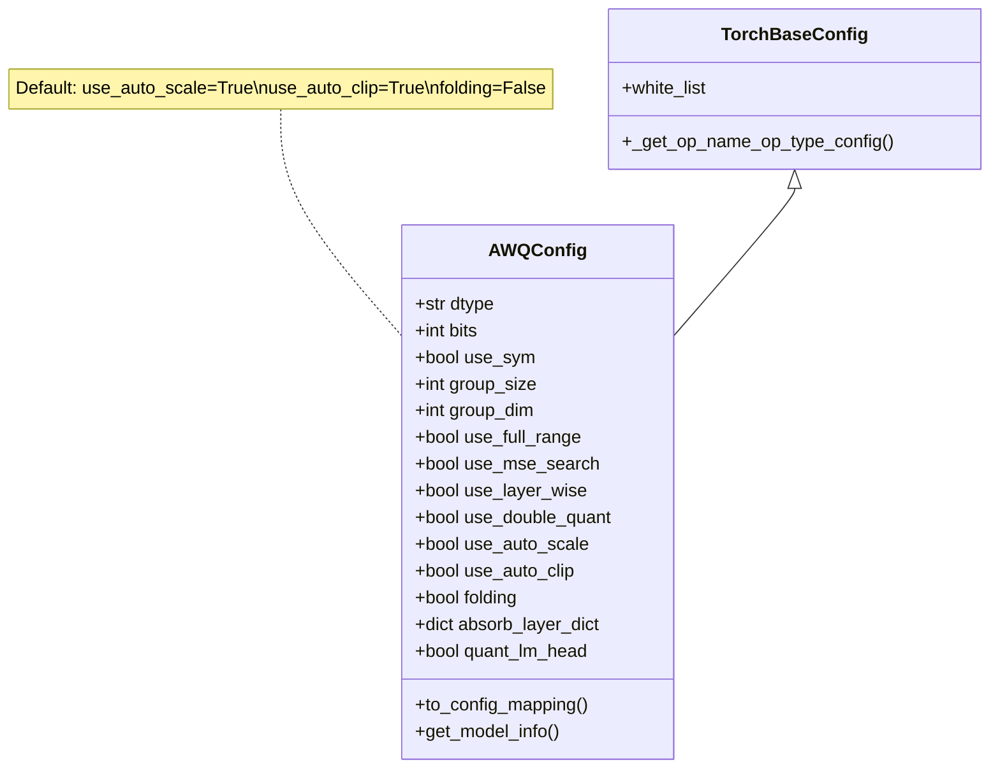
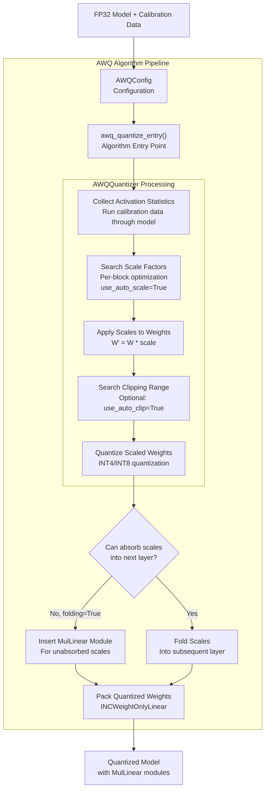
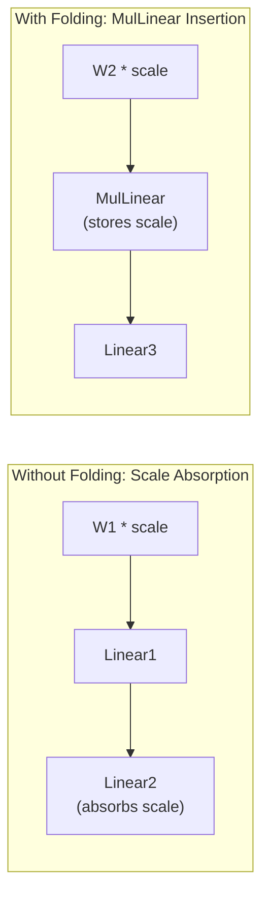
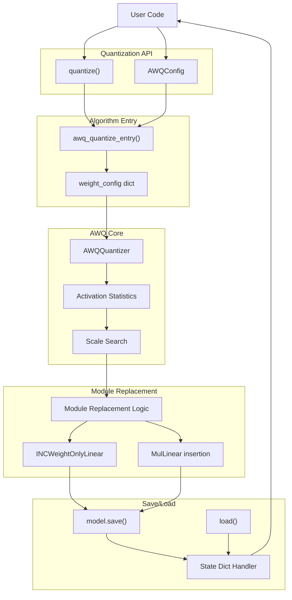

<!-- source: DeepWiki mcp.deepwiki.com · repo intel/neural-compressor · extra page AWQ Algorithm · fetched 2026-10-21 -->

# AWQ Algorithm

<details>
<summary>Relevant source files</summary>

The following files were used as context for generating this wiki page:

- [.azure-pipelines/scripts/ut/env_setup.sh](.azure-pipelines/scripts/ut/env_setup.sh)
- [docs/source/quantization_weight_only.md](docs/source/quantization_weight_only.md)
- [examples/pytorch/multimodal-modeling/quantization/auto_round/mllm.py](examples/pytorch/multimodal-modeling/quantization/auto_round/mllm.py)
- [neural_compressor/adaptor/pytorch.py](neural_compressor/adaptor/pytorch.py)
- [neural_compressor/adaptor/pytorch_cpu.yaml](neural_compressor/adaptor/pytorch_cpu.yaml)
- [neural_compressor/adaptor/pytorch_ipex.yaml](neural_compressor/adaptor/pytorch_ipex.yaml)
- [neural_compressor/adaptor/torch_utils/auto_round.py](neural_compressor/adaptor/torch_utils/auto_round.py)
- [neural_compressor/adaptor/torch_utils/awq.py](neural_compressor/adaptor/torch_utils/awq.py)
- [neural_compressor/adaptor/torch_utils/bf16_convert.py](neural_compressor/adaptor/torch_utils/bf16_convert.py)
- [neural_compressor/adaptor/torch_utils/model_wrapper.py](neural_compressor/adaptor/torch_utils/model_wrapper.py)
- [neural_compressor/adaptor/torch_utils/teq.py](neural_compressor/adaptor/torch_utils/teq.py)
- [neural_compressor/adaptor/torch_utils/util.py](neural_compressor/adaptor/torch_utils/util.py)
- [neural_compressor/adaptor/torch_utils/weight_only.py](neural_compressor/adaptor/torch_utils/weight_only.py)
- [neural_compressor/algorithm/smooth_quant.py](neural_compressor/algorithm/smooth_quant.py)
- [neural_compressor/model/torch_model.py](neural_compressor/model/torch_model.py)
- [neural_compressor/torch/algorithms/layer_wise/utils.py](neural_compressor/torch/algorithms/layer_wise/utils.py)
- [neural_compressor/torch/algorithms/mixed_low_precision/modules.py](neural_compressor/torch/algorithms/mixed_low_precision/modules.py)
- [neural_compressor/torch/algorithms/mixed_low_precision/quantizer.py](neural_compressor/torch/algorithms/mixed_low_precision/quantizer.py)
- [neural_compressor/torch/algorithms/weight_only/__init__.py](neural_compressor/torch/algorithms/weight_only/__init__.py)
- [neural_compressor/torch/algorithms/weight_only/autoround.py](neural_compressor/torch/algorithms/weight_only/autoround.py)
- [neural_compressor/torch/algorithms/weight_only/awq.py](neural_compressor/torch/algorithms/weight_only/awq.py)
- [neural_compressor/torch/algorithms/weight_only/gptq.py](neural_compressor/torch/algorithms/weight_only/gptq.py)
- [neural_compressor/torch/algorithms/weight_only/modules.py](neural_compressor/torch/algorithms/weight_only/modules.py)
- [neural_compressor/torch/algorithms/weight_only/rtn.py](neural_compressor/torch/algorithms/weight_only/rtn.py)
- [neural_compressor/torch/algorithms/weight_only/save_load.py](neural_compressor/torch/algorithms/weight_only/save_load.py)
- [neural_compressor/torch/algorithms/weight_only/teq.py](neural_compressor/torch/algorithms/weight_only/teq.py)
- [neural_compressor/torch/algorithms/weight_only/utility.py](neural_compressor/torch/algorithms/weight_only/utility.py)
- [neural_compressor/torch/quantization/__init__.py](neural_compressor/torch/quantization/__init__.py)
- [neural_compressor/torch/quantization/algorithm_entry.py](neural_compressor/torch/quantization/algorithm_entry.py)
- [neural_compressor/torch/quantization/config.py](neural_compressor/torch/quantization/config.py)
- [neural_compressor/torch/quantization/quantize.py](neural_compressor/torch/quantization/quantize.py)
- [neural_compressor/torch/quantization/save_load_entry.py](neural_compressor/torch/quantization/save_load_entry.py)
- [neural_compressor/torch/utils/constants.py](neural_compressor/torch/utils/constants.py)
- [neural_compressor/torch/utils/utility.py](neural_compressor/torch/utils/utility.py)
- [neural_compressor/transformers/models/modeling_auto.py](neural_compressor/transformers/models/modeling_auto.py)
- [neural_compressor/transformers/quantization/utils.py](neural_compressor/transformers/quantization/utils.py)
- [neural_compressor/transformers/utils/quantization_config.py](neural_compressor/transformers/utils/quantization_config.py)
- [neural_compressor/utils/pytorch.py](neural_compressor/utils/pytorch.py)
- [test/3x/torch/algorithms/weight_only/test_teq_quantizer.py](test/3x/torch/algorithms/weight_only/test_teq_quantizer.py)
- [test/3x/torch/quantization/fp8_quant/test_fp8_jsons/test_pow2_w4a8_quant.json](test/3x/torch/quantization/fp8_quant/test_fp8_jsons/test_pow2_w4a8_quant.json)
- [test/3x/torch/quantization/fp8_quant/test_gptq_mixed_precision.py](test/3x/torch/quantization/fp8_quant/test_gptq_mixed_precision.py)
- [test/3x/torch/quantization/weight_only/test_autoround.py](test/3x/torch/quantization/weight_only/test_autoround.py)
- [test/3x/torch/quantization/weight_only/test_awq.py](test/3x/torch/quantization/weight_only/test_awq.py)
- [test/3x/torch/quantization/weight_only/test_gptq.py](test/3x/torch/quantization/weight_only/test_gptq.py)
- [test/3x/torch/quantization/weight_only/test_rtn.py](test/3x/torch/quantization/weight_only/test_rtn.py)
- [test/3x/torch/quantization/weight_only/test_teq.py](test/3x/torch/quantization/weight_only/test_teq.py)
- [test/3x/torch/quantization/weight_only/test_transformers.py](test/3x/torch/quantization/weight_only/test_transformers.py)
- [test/3x/torch/requirements.txt](test/3x/torch/requirements.txt)
- [test/adaptor/pytorch_adaptor/test_adaptor_pytorch_2x.py](test/adaptor/pytorch_adaptor/test_adaptor_pytorch_2x.py)
- [test/adaptor/pytorch_adaptor/test_weight_only_adaptor_pytorch.py](test/adaptor/pytorch_adaptor/test_weight_only_adaptor_pytorch.py)
- [test/algorithm/test_smooth_quant.py](test/algorithm/test_smooth_quant.py)
- [test/ipex/test_adaptor_ipex.py](test/ipex/test_adaptor_ipex.py)
- [test/quantization/test_weight_only_quantization.py](test/quantization/test_weight_only_quantization.py)
- [test/requirements.txt](test/requirements.txt)
- [test/utils/test_huggingface.py](test/utils/test_huggingface.py)

</details>


This document describes the **AWQ (Activation-aware Weight Quantization)** algorithm implementation in Intel Neural Compressor. AWQ is a weight-only quantization technique specifically designed for large language models (LLMs) that leverages activation statistics to protect salient weights and improve quantization accuracy.

For general information about weight-only quantization, see [Weight-Only Quantization](#6.3). For comparisons with other weight-only algorithms, see [RTN](#6.3.1), [GPTQ](#6.3.2), [TEQ](#6.3.4), and [AutoRound](#6.3.5).

## Overview

AWQ addresses a key challenge in weight-only quantization: not all weights contribute equally to model accuracy. The algorithm identifies and protects "salient" weights—those corresponding to channels with larger activation magnitudes—by applying learned per-channel scaling factors. This activation-aware approach typically achieves better accuracy than simpler methods like RTN while being faster than Hessian-based methods like GPTQ.

### Key Features

- **Activation-aware scaling**: Uses activation statistics to determine optimal per-channel scales
- **Auto-clip search**: Optionally searches for optimal clipping ranges to reduce quantization error
- **Scale absorption**: Can fold scaling factors into subsequent layers when possible
- **MulLinear insertion**: Inserts multiplication layers when scales cannot be absorbed

### Algorithm Comparison

| Feature | AWQ | RTN | GPTQ | TEQ |
|---------|-----|-----|------|-----|
| Activation awareness | ✓ | ✗ | ✗ | ✓ |
| Calibration data required | ✓ | ✗ | ✓ | ✓ |
| Relative speed | Medium | Fast | Slow | Medium |
| Scale factor handling | Per-channel | None | None | Learned |
| Typical accuracy | High | Medium | Highest | High |

Sources: [neural_compressor/torch/quantization/config.py:556-735](), [docs/source/quantization_weight_only.md:1-200]()

## Configuration

AWQ quantization is configured via the `AWQConfig` class, which extends the base configuration with AWQ-specific parameters.

### AWQConfig Class



Sources: [neural_compressor/torch/quantization/config.py:556-735]()

### Key Parameters

| Parameter | Type | Default | Description |
|-----------|------|---------|-------------|
| `dtype` | str | "int" | Data type for quantized weights |
| `bits` | int | 4 | Number of bits for weight quantization |
| `use_sym` | bool | True | Use symmetric quantization |
| `group_size` | int | 32 | Size of weight groups for quantization |
| `use_auto_scale` | bool | True | Enable automatic scale factor search based on activations |
| `use_auto_clip` | bool | True | Enable automatic clipping range search |
| `folding` | bool | False | Allow insertion of MulLinear when scales cannot be absorbed |
| `absorb_layer_dict` | dict | {} | Dictionary specifying which layers can absorb scales |
| `use_layer_wise` | bool | False | Process model layer-by-layer to reduce memory usage |
| `use_double_quant` | bool | False | Apply quantization to scale factors themselves |
| `quant_lm_head` | bool | False | Whether to quantize the language model head |

Sources: [neural_compressor/torch/quantization/config.py:589-663]()

### Example Configuration

```python
from neural_compressor.torch.quantization import AWQConfig, quantize

# Basic AWQ configuration
config = AWQConfig(
    bits=4,
    group_size=128,
    use_auto_scale=True,
    use_auto_clip=True
)

# Advanced configuration with double quantization
config_dq = AWQConfig(
    bits=4,
    group_size=128,
    use_double_quant=True,
    double_quant_bits=8,
    double_quant_group_size=256
)
```

Sources: [neural_compressor/torch/quantization/config.py:728-735]()

## Algorithm Workflow

The AWQ algorithm follows a multi-stage process to quantize model weights while preserving accuracy through activation-aware scaling.



Sources: [neural_compressor/torch/quantization/algorithm_entry.py:399-481](), [neural_compressor/torch/quantization/config.py:556-735]()

### Stage-by-Stage Process

#### 1. Entry Point Dispatch

The `awq_quantize_entry()` function serves as the main entry point for AWQ quantization.

```
awq_quantize_entry() processes:
1. Converts AWQConfig to weight_config dictionary
2. Extracts AWQ-specific parameters (use_auto_scale, use_auto_clip, folding)
3. Initializes AWQQuantizer with config and absorb_layer_dict
4. Executes quantization with calibration data
```

**Key code locations:**
- Entry function: [neural_compressor/torch/quantization/algorithm_entry.py:399-481]()
- Config mapping: [neural_compressor/torch/quantization/algorithm_entry.py:423-455]()

#### 2. Activation Statistics Collection

AWQ collects activation statistics during calibration to identify salient weight channels.

```
For each transformer block:
  - Run example_inputs through the block
  - Record activation magnitudes per channel
  - Identify high-magnitude channels (salient weights)
```

The `example_inputs` parameter is **required** for AWQ quantization:

```python
assert example_inputs is not None, "Please provide example_inputs for AWQ quantization."
```

Sources: [neural_compressor/torch/quantization/algorithm_entry.py:459-460]()

#### 3. Scale Search and Application

When `use_auto_scale=True` (default), AWQ searches for optimal per-channel scaling factors:

```
For each weight matrix W:
  - Compute per-channel activation magnitudes: a = max(|activations|)
  - Search for scale s that minimizes quantization error
  - Apply scale: W' = W * s
  - Track scale for later handling
```

The search process balances protecting salient weights while avoiding excessive scale factors that could harm less important weights.

#### 4. Clipping Range Search

When `use_auto_clip=True` (default), AWQ searches for optimal clipping ranges:

```
For each quantized tensor:
  - Test multiple clipping percentiles
  - Measure quantization error (MSE) for each
  - Select clipping range that minimizes error
```

This is controlled by the `use_mse_search` parameter passed to the quantizer.

Sources: [neural_compressor/torch/quantization/algorithm_entry.py:451-452]()

#### 5. Scale Handling: Absorption vs. Insertion

AWQ must handle the per-channel scales applied to weights. Two strategies are available:

**Scale Absorption (folding=False, default):**
- Scales are mathematically folded into the subsequent layer's weights
- No runtime overhead
- Only works when the next layer is quantization-compatible

**MulLinear Insertion (folding=True):**
- When scales cannot be absorbed, insert a `MulLinear` module
- Performs runtime multiplication: `output = linear(input * scale)`
- Allows AWQ to work with more complex model architectures



Sources: [neural_compressor/torch/quantization/config.py:636-638](), [neural_compressor/torch/quantization/algorithm_entry.py:452-453]()

## Key Components

### AWQQuantizer Class

The `AWQQuantizer` class (located in `neural_compressor.torch.algorithms.weight_only.awq`) implements the core AWQ algorithm logic. It is initialized by the algorithm entry point and orchestrates the quantization process.

**Initialization:**
```
AWQQuantizer(
    quant_config=weight_config,
    absorb_layer_dict=absorb_layer_dict
)
```

**Execution:**
```
model = quantizer.execute(
    model,
    mode=Mode.QUANTIZE,
    bits=-1,  # Use config for each op
    example_inputs=example_inputs,
    run_fn=run_fn,
    run_args=run_args,
    use_auto_scale=use_auto_scale,
    use_mse_search=use_mse_search,
    folding=folding,
    use_full_range=use_full_range
)
```

Sources: [neural_compressor/torch/quantization/algorithm_entry.py:461-475]()

### MulLinear Module

The `MulLinear` module wraps a linear layer with scaling functionality. It is inserted when AWQ scales cannot be absorbed into subsequent layers.

**Module structure:**
```
MulLinear:
  - Wraps torch.nn.Linear module
  - Stores per-channel scaling factors
  - Forward: output = wrapped_linear(input * scale)
```

**Detection during loading:**
When loading an AWQ-quantized model, the presence of `.linear.qweight` in the state dict indicates a `MulLinear` wrapper:

```python
if name + ".linear.qweight" in self.loaded_state_dict_keys:
    new_module = MulLinear(linear_module)
    set_module(self.original_model, name, new_module)
    name += ".linear"
```

Sources: [neural_compressor/torch/algorithms/weight_only/save_load.py:458-461](), [neural_compressor/torch/algorithms/weight_only/modules.py:38-71]()

### INCWeightOnlyLinear

AWQ-quantized weights are ultimately stored in `INCWeightOnlyLinear` modules, which provide:
- Compressed INT4/INT8 weight storage
- Dynamic dequantization during forward pass
- Compatible with both CPU and HPU execution

Sources: [neural_compressor/torch/algorithms/weight_only/modules.py:156-319]()

## Usage Examples

### Basic AWQ Quantization

```python
from neural_compressor.torch.quantization import AWQConfig, quantize
import torch

# Load model
model = AutoModelForCausalLM.from_pretrained("model_name")

# Configure AWQ
config = AWQConfig(
    bits=4,
    group_size=128,
    use_auto_scale=True,
    use_auto_clip=True
)

# Prepare example inputs for calibration
example_inputs = torch.randint(0, 1000, (1, 512))

# Quantize
quantized_model = quantize(
    model,
    quant_config=config,
    example_inputs=example_inputs
)
```

### AWQ with Custom Calibration Function

```python
def calibration_fn(model):
    for batch in calibration_dataloader:
        model(**batch)

config = AWQConfig(bits=4, group_size=128)

quantized_model = quantize(
    model,
    quant_config=config,
    run_fn=calibration_fn,
    example_inputs=example_inputs
)
```

### AWQ with Double Quantization

```python
config = AWQConfig(
    bits=4,
    group_size=128,
    use_double_quant=True,
    double_quant_dtype="int",
    double_quant_bits=8,
    double_quant_group_size=256
)

quantized_model = quantize(model, config, example_inputs=example_inputs)
```

Sources: [neural_compressor/torch/quantization/config.py:556-735](), [neural_compressor/torch/quantization/algorithm_entry.py:399-481]()

## Model Saving and Loading

### Saving AWQ Models

AWQ-quantized models can be saved in two formats:

**1. INC Native Format:**
```python
quantized_model.save("./saved_model", format="default")
# Saves: quantized_weight.pt, qconfig.json
```

**2. HuggingFace Format:**
```python
quantized_model.save("./saved_model", format="huggingface")
# Saves: model.safetensors, quantize_config.json, config.json
```

Sources: [neural_compressor/torch/algorithms/weight_only/save_load.py:55-108]()

### Loading AWQ Models

AWQ models are loaded using the standard loading mechanism, which automatically detects and reconstructs `MulLinear` modules:

```python
from neural_compressor.torch.quantization import load

# Load INC format
model = load("./saved_model", original_model=fp32_model, format="default")

# Load HuggingFace format
model = load("./saved_model", format="huggingface")
```

During loading, the system:
1. Detects `.linear.qweight` keys in state dict
2. Reconstructs `MulLinear` wrappers around quantized linear layers
3. Loads quantized weights into `INCWeightOnlyLinear` modules
4. Restores activation scaling factors

Sources: [neural_compressor/torch/algorithms/weight_only/save_load.py:110-143](), [neural_compressor/torch/algorithms/weight_only/save_load.py:455-505]()

## State Dict Structure

AWQ-quantized models have a distinctive state dict structure when scales cannot be absorbed:

```
Standard quantized layer:
  - layer.qweight
  - layer.scales
  - layer.qzeros (if asymmetric)

AWQ layer with MulLinear:
  - layer.linear.qweight      # Wrapped linear's quantized weights
  - layer.linear.scales        # Quantization scales
  - layer.linear.qzeros        # Zero points
  - layer.scale                # AWQ activation scaling factors
```

The presence of nested `.linear.` in the key indicates AWQ-specific scaling.

Sources: [neural_compressor/torch/algorithms/weight_only/save_load.py:458-461]()

## Configuration Mapping

The `AWQConfig.to_config_mapping()` method converts the high-level configuration into per-operator settings. Special handling includes:

**LM Head Exclusion:**
By default, language model head layers are excluded from quantization unless `quant_lm_head=True`:

```python
if not self.quant_lm_head:
    self.set_local(
        LM_HEAD_NAMES, 
        AWQConfig(dtype="fp32", use_layer_wise=self.use_layer_wise, model_path=self.model_path)
    )
```

**Model Info Extraction:**
The configuration queries the model for all `torch.nn.Linear` and `transformers.Conv1D` layers that will be quantized.

Sources: [neural_compressor/torch/quantization/config.py:679-697](), [neural_compressor/torch/quantization/config.py:699-715]()

## Integration with Other Systems



Sources: [neural_compressor/torch/quantization/quantize.py:115-152](), [neural_compressor/torch/quantization/algorithm_entry.py:399-481](), [neural_compressor/torch/algorithms/weight_only/save_load.py:55-505]()

## Performance Characteristics

### Memory Usage

AWQ requires loading calibration data into memory to collect activation statistics. Memory usage is proportional to:
- Model size (full FP32 model during quantization)
- Calibration batch size
- Number of calibration samples

Use `use_layer_wise=True` to reduce peak memory by processing the model layer-by-layer.

### Quantization Time

AWQ quantization time depends on:
- Number of calibration samples (more = better accuracy but slower)
- Whether `use_auto_scale=True` (scale search adds overhead)
- Whether `use_auto_clip=True` (clip search adds overhead)
- Model architecture (number of linear layers)

Typical quantization times:
- **Small models** (< 1B params): Seconds to minutes
- **Large models** (7B+ params): Minutes to hours

### Runtime Performance

**With scale absorption (folding=False):**
- No runtime overhead beyond standard weight-only quantization
- Scales are folded into weights

**With MulLinear insertion (folding=True):**
- Additional per-channel multiplication overhead
- Typically < 5% runtime overhead
- Enables AWQ on more model architectures

Sources: [neural_compressor/torch/quantization/config.py:626-663]()

## Comparison with Related Algorithms

| Aspect | AWQ | RTN | GPTQ | TEQ |
|--------|-----|-----|------|-----|
| **Calibration Required** | Yes | No | Yes | Yes |
| **Activation Awareness** | Yes (statistics) | No | No | Yes (learned) |
| **Scale Handling** | Per-channel | None | None | Learnable transform |
| **Memory Overhead** | Medium | Low | High | Medium |
| **Time Complexity** | Medium | Fast | Slow | Medium |
| **Typical Accuracy** | High | Medium | Highest | High |
| **Best Use Case** | General LLM quantization | Quick prototyping | Maximum accuracy | Flexible quantization |

**When to use AWQ:**
- Need better accuracy than RTN without GPTQ's computational cost
- Have calibration data available
- Want to protect salient weights automatically
- Model has regular transformer structure

**When to use alternatives:**
- **RTN**: No calibration data, need fast quantization
- **GPTQ**: Maximum accuracy required, willing to spend more time
- **TEQ**: Need learnable transformation, willing to train
- **AutoRound**: Want gradient-based optimization

Sources: [docs/source/quantization_weight_only.md:1-200]()

## Troubleshooting

### Common Issues

**Issue: "Please provide example_inputs for AWQ quantization"**
- **Cause**: AWQ requires example inputs to collect activation statistics
- **Solution**: Pass `example_inputs` parameter to `quantize()`:
  ```python
  quantize(model, config, example_inputs=sample_input)
  ```

**Issue: Model accuracy degradation**
- **Possible causes:**
  - Insufficient calibration data
  - `use_auto_clip=False` (default is True)
  - Wrong `group_size` for model architecture
- **Solutions:**
  - Increase calibration samples
  - Enable `use_auto_clip=True`
  - Try `group_size=128` instead of 32

**Issue: Out of memory during quantization**
- **Solutions:**
  - Set `use_layer_wise=True` in config
  - Reduce calibration batch size
  - Use smaller calibration dataset

**Issue: MulLinear modules causing performance issues**
- **Cause**: `folding=True` inserts runtime multiplication layers
- **Solution**: Set `folding=False` (default) to absorb scales into weights

Sources: [neural_compressor/torch/quantization/config.py:556-735](), [neural_compressor/torch/quantization/algorithm_entry.py:399-481]()

## References

### Related Documentation
- [Weight-Only Quantization Overview](#6.3)
- [RTN Algorithm](#6.3.1)
- [GPTQ Algorithm](#6.3.2)
- [TEQ Algorithm](#6.3.4)
- [AutoRound Algorithm](#6.3.5)
- [Model Save and Load](#8.2)

### Key Source Files
- Configuration: [neural_compressor/torch/quantization/config.py:556-735]()
- Algorithm Entry: [neural_compressor/torch/quantization/algorithm_entry.py:399-481]()
- Module Definitions: [neural_compressor/torch/algorithms/weight_only/modules.py:38-71]()
- Save/Load Logic: [neural_compressor/torch/algorithms/weight_only/save_load.py:55-505]()

### Academic Reference
- Paper: "AWQ: Activation-aware Weight Quantization for LLM Compression and Acceleration"
- URL: https://arxiv.org/abs/2306.00978

---

